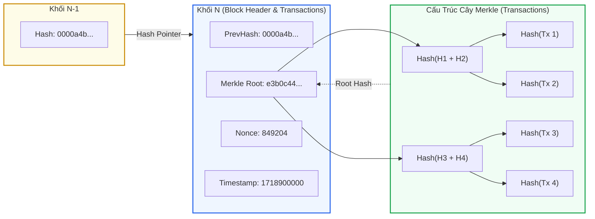
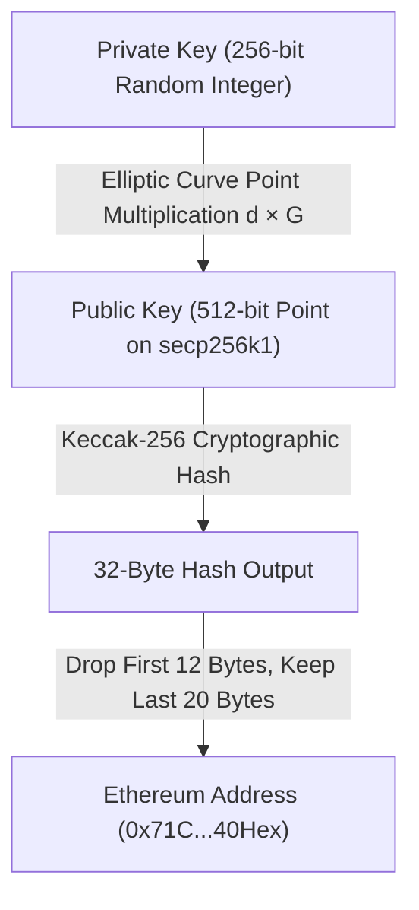
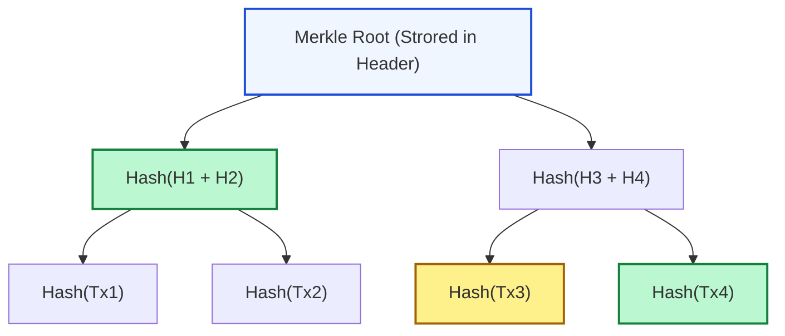
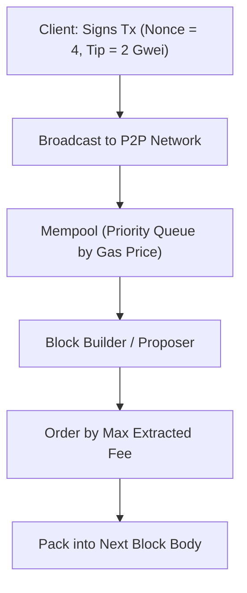

# 6.1. Blockchain Fundamentals, Cryptography & Hash-Linked Block Structures

## Tổng quan về Sổ cái Phân tán, Mật mã học và Cấu trúc Khối
Công nghệ Sổ cái Phân tán (**Distributed Ledger Technology - DLT**) và **Blockchain** biểu diễn bước đột phá căn bản trong Khoa học Máy tính: Giải quyết bài toán đồng thuận trạng thái giữa các bên tham gia không tin cậy lẫn nhau (Untrusted Participants) qua môi trường mạng phi tập trung mà không cần sự hiện diện của một thực thể trung ương (Central Authority) đóng vai trò trung gian xác thực.

Về bản chất toán học và cấu trúc dữ liệu:
1. **Danh sách Liên kết bằng Hàm băm (Hash-Linked Data Structure)**: Các khối dữ liệu (Blocks) được xâu chuỗi tuần tự theo thời gian. Mỗi khối chứa mã băm mật mã học (Cryptographic Hash) của khối liền trước trong tiêu đề của nó:
$$H_i = \text{Hash}(\text{Header}_i) = \text{Hash}(\text{Header}_{i-1} \parallel \text{MerkleRoot}_i \parallel \text{Timestamp} \parallel \text{Nonce})$$
Bất kỳ sự sửa đổi dù chỉ 1 bit ở khối quá khứ sẽ làm thay đổi toàn bộ mã băm $H_i$, phá vỡ liên kết của tất cả các khối phía sau (Tính bất biến - Immutability).
2. **Cây Merkle (Merkle Trees)**: Cấu trúc cây nhị phân lồng nhau cho phép chứng minh một giao dịch nằm trong khối (**Merkle Proof**) với độ phức tạp không gian và thời gian tối ưu $\mathcal{O}(\log N)$.
3. **Mật mã Khóa Công khai (Asymmetric Cryptography)**: Xác thực quyền sở hữu và ủy quyền dịch chuyển tài sản thông qua cặp khóa công khai / bí mật trên đường cong elip (**ECDSA secp256k1** hoặc **Ed25519**).



---

## 2. Chi tiết từng Keyword (Under-the-Hood Deep Dive)

---

### 1. DLT Fundamentals, Cryptographic Hash Functions & Public Key Cryptography

#### 1. Khái niệm bản chất (What & Why)
- **Distributed Ledger Technology (DLT)**: Khung kiến trúc cho phép lưu trữ, sao chép và đồng bộ hóa một sổ cái kế toán phân tán trên nhiều nút mạng vật lý độc lập. Blockchain là một dạng hiện thực hóa đặc biệt của DLT trong đó dữ liệu được tổ chức thành các "khối" liên kết nhau.
- **Cryptographic Hash Functions**: Hàm băm mật mã học một chiều ($y = H(x)$) biến đổi chuỗi dữ liệu có độ dài tùy ý thành chuỗi băm có độ dài cố định (256 bits). Phải thỏa mãn 3 tính chất sống còn:
  1. *Kháng tiền ảnh (Pre-image Resistance)*: Cho trước $y$, bất khả thi về mặt tính toán để tìm ra $x$.
  2. *Kháng tiền ảnh thứ hai (Second Pre-image Resistance)*: Cho trước $x_1$, bất khả thi để tìm ra $x_2 \neq x_1$ sao cho $H(x_1) = H(x_2)$.
  3. *Kháng va chạm (Collision Resistance)*: Bất khả thi để tìm ra bất kỳ cặp $(x_1, x_2)$ nào sao cho $H(x_1) = H(x_2)$. Tiêu biểu: SHA-256 (Bitcoin), Keccak-256 (Ethereum).
- **Public Key Cryptography & Digital Signatures**: Người dùng tạo một cặp khóa: Khóa bí mật (Private Key $d$) dùng để ký giao dịch (Sign); Khóa công khai (Public Key $Q = d \times G$) được dẫn xuất thông qua phép nhân điểm trên đường cong elip dùng để xác thực chữ ký (Verify).

#### 2. Cơ chế hoạt động sâu (Under the hood / Hardcore Internals)
- **Đường cong Elip Secp256k1 & Dẫn xuất Địa chỉ Ethereum (Address Derivation)**:
  Phương trình đường cong Weierstrass trên trường hữu hạn $\mathbb{F}_p$:
  $$y^2 \equiv x^3 + 7 \pmod p$$
  Địa chỉ ví Ethereum không phải là khóa công khai nguyên bản:
  1. Bắt đầu từ Private Key 256-bit ngẫu nhiên.
  2. Tính Public Key 512-bit (tọa độ $X, Y$ không nén): $Q = (x, y)$.
  3. Băm Public Key bằng hàm **Keccak-256**: $\text{Hash} = \text{Keccak-256}(Q)$.
  4. Lấy **20 bytes cuối cùng** của mã băm và thêm tiền tố `0x`: Đó chính là Địa chỉ Ví (Ethereum Address) 40 ký tự hexa!

#### 3. Sơ đồ minh họa


#### 4. Code ví dụ thực chiến (C++ SHA-256 Double-Hash Mining Simulation)
Đoạn mã C++20 minh họa việc tính toán hàm băm kép (Double SHA-256) được sử dụng làm bằng chứng khối:

```cpp
#include <iostream>
#include <string>
#include <vector>
#include <iomanip>
#include <sstream>

// Giả lập hàm băm đơn giản để minh họa nguyên lý nối chuỗi
std::string mock_sha256(const std::string& input) {
    uint32_t hash = 5381;
    for (char c : input) {
        hash = ((hash << 5) + hash) + static_cast<uint8_t>(c);
    }
    std::stringstream ss;
    ss << std::hex << std::setfill('0') << std::setw(8) << hash;
    return ss.str();
}

int main() {
    std::string prev_hash = "000000000019d6689c085ae165831e934ff763ae46a2a6c172b3f1b60a8ce26f";
    std::string merkle_root = "4a5e1e4baab89f3a32518a88c31bc87f618f76673e2cc77ab2127b7afdeda33b";
    uint32_t nonce = 2083236893;

    std::string header = prev_hash + merkle_root + std::to_string(nonce);
    std::string block_hash = mock_sha256(mock_sha256(header)); // Double Hash

    std::cout << "[Blockchain Engine] Computed Block Hash: " << block_hash << "\n";
    return 0;
}
```

#### 5. Ưu / Nhược điểm, Pitfalls & Anti-patterns
- **Yếu điểm Sinh số ngẫu nhiên (Weak RNG / Nonce Reuse)**: Trong thuật toán ký số ECDSA, nếu người ký tái sử dụng cùng một giá trị số ngẫu nhiên bí mật ($k$) cho hai chữ ký khác nhau, kẻ tấn công có thể dễ dàng giải phương trình đại số để suy ra Private Key gốc của người dùng ngay lập tức (Lỗ hổng kinh điển của máy PlayStation 3). Cần áp dụng chuẩn **RFC 6979** (Deterministic ECDSA).

#### 6. Ứng dụng thực tế trong Backend / Systems
- Hệ thống truy xuất nguồn gốc chuỗi cung ứng dược phẩm và hàng hải quốc tế.

---

### 2. Block Structure, Merkle Trees & Merkle Proofs

#### 1. Khái niệm bản chất (What & Why)
- **Block Structure**: Khối dữ liệu chứa hai phần chính: **Block Header** (chứa siêu dữ liệu: PrevBlockHash, MerkleRoot, Timestamp, Nonce, Difficulty/GasLimit) và **Block Body** (danh sách toàn bộ các giao dịch đã được xác thực).
- **Merkle Trees (Cây Băm Nhị Phân)**: Cây trong đó mỗi nút lá (Leaf) là mã băm của một giao dịch cụ thể, và mỗi nút cha (Internal Node) là mã băm của sự kết hợp hai nút con của nó:
  $$\text{Node}_{\text{Parent}} = \text{Hash}(\text{Node}_{\text{Left}} \parallel \text{Node}_{\text{Right}})$$
- **Merkle Proof (Chứng chỉ Băm Nhẹ)**: Khả năng chứng minh giao dịch $T_x$ thuộc về một khối có gốc $R$ mà **chỉ cần cung cấp $\log_2(N)$ mã băm trung gian**, cho phép các ứng dụng di động nhẹ (Light Clients / SPV) xác thực số dư mà không cần tải về toàn bộ blockchain nặng hàng trăm Gigabytes.

#### 2. Cơ chế hoạt động sâu (Under the hood / Hardcore Internals)
- **Xác minh Merkle Proof với Độ phức tạp $\mathcal{O}(\log N)$**:
  Giả sử khối chứa $1,024$ giao dịch. Để chứng minh giao dịch $T_5$ hợp lệ:
  - Thay vì tải về toàn bộ 1,024 giao dịch (tiêu tốn băng thông và CPU),
  - Node đầy đủ (Full Node) chỉ cần gửi cho Light Client đúng **10 mã băm** (Đường dẫn kiểm chứng - Merkle Audit Path).
  - Light Client chỉ cần tính đúng 10 phép băm liên tiếp. Nếu kết quả cuối cùng trùng khớp chính xác với `MerkleRoot` trong Block Header, giao dịch được chứng minh là tồn tại 100% trong blockchain!

#### 3. Sơ đồ minh họa


#### 4. Code ví dụ thực chiến (C++ Merkle Tree Root Calculation & Verification)
```cpp
#include <iostream>
#include <vector>
#include <string>
#include <sstream>
#include <iomanip>

// Giả lập hàm băm đơn giản
std::string hash_pair(const std::string& a, const std::string& b) {
    uint32_t val = 0;
    for (char c : (a + b)) val = (val * 31) + static_cast<uint8_t>(c);
    std::stringstream ss;
    ss << std::hex << std::setfill('0') << std::setw(8) << val;
    return ss.str();
}

std::string compute_merkle_root(std::vector<std::string> leaves) {
    if (leaves.empty()) return "";
    while (leaves.size() > 1) {
        if (leaves.size() % 2 != 0) {
            leaves.push_back(leaves.back()); // Nhân bản lá cuối nếu lẻ
        }
        std::vector<std::string> next_level;
        for (size_t i = 0; i < leaves.size(); i += 2) {
            next_level.push_back(hash_pair(leaves[i], leaves[i + 1]));
        }
        leaves = std::move(next_level);
    }
    return leaves[0];
}

int main() {
    std::vector<std::string> transactions = {"tx_alice_to_bob", "tx_bob_to_carol", "tx_carol_to_dave", "tx_dave_to_eve"};
    std::string root = compute_merkle_root(transactions);
    std::cout << "[Merkle Engine] Computed Merkle Root: " << root << "\n";
    return 0;
}
```

#### 5. Ưu / Nhược điểm, Pitfalls & Anti-patterns
- **Second Preimage Attack on Merkle Trees**: Nếu cây Merkle không phân biệt giữa nút lá và nút trung gian (bằng cách thêm tiền tố `0x00` trước nút lá và `0x01` trước nút trung gian), kẻ tấn công có thể giả mạo một nút trung gian thành một giao dịch hợp lệ.

#### 6. Ứng dụng thực tế trong Backend / Systems
- Light Client SPV Wallets trên điện thoại di động (Electrum) và các cầu nối xuyên chuỗi (Cross-Chain Relayers).

---

### 3. Transactions, Validation & Ordering (Mempool & Nonce)

#### 1. Khái niệm bản chất (What & Why)
- **Transactions (Giao dịch)**: Thông điệp có chữ ký số đại diện cho một sự thay đổi trạng thái (State Transition). Ví dụ: Chuyển tiền, kích hoạt hàm Smart Contract, tạo token mới.
- **Transaction Validation**: Bộ quy tắc kiểm tra nghiêm ngặt mà mọi node trong mạng phải thẩm định trước khi chấp nhận giao dịch vào bộ đệm: Kiểm tra cú pháp, xác thực chữ ký số hợp lệ (`ecrecover`), kiểm tra số dư đủ chi trả (Balance >= Value + Fee), và kiểm tra số thứ tự **Nonce**.
- **Mempool (Memory Pool)**: Hàng đợi lưu trữ tạm thời trong RAM của mỗi node chứa các giao dịch hợp lệ đang chờ được thợ đào/người xác thực đóng gói vào khối tiếp theo.
- **Transaction Ordering**: Thứ tự sắp xếp các giao dịch bên trong khối. Mặc định các thợ đào sẽ ưu tiên các giao dịch trả phí hoa hồng (Priority Fee / Tip) cao nhất.

#### 2. Cơ chế hoạt động sâu (Under the hood / Hardcore Internals)
- **Hai Mô Hình Kế Toán: UTXO vs Account-Based Model**:
  - *UTXO Model (Bitcoin, Cardano)*: Không có khái niệm "số dư tài khoản". Tiền tồn tại dưới dạng các đầu ra giao dịch chưa tiêu (**Unspent Transaction Outputs - UTXO**). Mỗi giao dịch tiêu hủy các UTXO đầu vào và tạo ra các UTXO đầu ra mới. Ưu điểm: Khả năng xử lý giao dịch song song cực cao, không lo race conditions.
  - *Account-Based Model (Ethereum, Solana)*: Giống hệ thống ngân hàng truyền thống: Mỗi địa chỉ sở hữu một số dư (Balance) và một biến đếm số thứ tự giao dịch (**Nonce**).
- **Nonce Replay Attack Prevention**:
  Để ngăn chặn kẻ tấn công chặn gói tin giao dịch hợp lệ và phát lại (Replay) nhiều lần để rút sạch tiền:
  - Nonce phải tăng tuần tự liên tục bắt đầu từ 0 (`0, 1, 2, ...`).
  - Giao dịch có `nonce = 5` sẽ bị treo trong Mempool vĩnh viễn cho đến khi các giao dịch từ `nonce = 0` đến `nonce = 4` được đào thành công.

#### 3. Sơ đồ minh họa


#### 4. Code ví dụ thực chiến (TypeScript Transaction Nonce Validator Logic)
```typescript
interface AccountState {
  balance: bigint;
  expectedNonce: number;
}

interface RawTransaction {
  from: string;
  to: string;
  amount: bigint;
  nonce: number;
  gasFee: bigint;
}

class MempoolValidator {
  private accounts = new Map<string, AccountState>();

  public registerAccount(addr: string, initialBalance: bigint, nonce: number): void {
    this.accounts.set(addr, { balance: initialBalance, expectedNonce: nonce });
  }

  public validateTransaction(tx: RawTransaction): { valid: boolean; reason?: string } {
    const state = this.accounts.get(tx.from);
    if (!state) return { valid: false, reason: "Account does not exist." };

    // 1. Kiểm tra Nonce chống Replay
    if (tx.nonce < state.expectedNonce) {
      return { valid: false, reason: `Nonce too low! (Expected: ${state.expectedNonce}, Got: ${tx.nonce})` };
    }
    if (tx.nonce > state.expectedNonce) {
      return { valid: false, reason: `Nonce gap detected! Transaction must wait in queue.` };
    }

    // 2. Kiểm tra số dư đủ thanh toán cả tiền gửi và phí gas
    const totalRequired = tx.amount + tx.gasFee;
    if (state.balance < totalRequired) {
      return { valid: false, reason: "Insufficient balance for amount + gas fee." };
    }

    return { valid: true };
  }
}

// Test validation
const validator = new MempoolValidator();
validator.registerAccount("0xAlice", 1000000000000000000n /* 1 ETH */, 5);

console.log("Tx with old Nonce 4:", validator.validateTransaction({
  from: "0xAlice", to: "0xBob", amount: 100n, nonce: 4, gasFee: 21000n
}));

console.log("Tx with correct Nonce 5:", validator.validateTransaction({
  from: "0xAlice", to: "0xBob", amount: 100n, nonce: 5, gasFee: 21000n
}));
```

#### 5. Ưu / Nhược điểm, Pitfalls & Anti-patterns
- **Stuck Transactions in Mempool**: Khi phí gas mạng lưới tăng đột biến, một giao dịch với nonce thấp nhưng đặt phí gas quá rẻ sẽ bị kẹt vĩnh viễn trong Mempool, chặn đứng toàn bộ các giao dịch có nonce cao hơn phía sau. Khắc phục: Gửi một giao dịch mới với **cùng số Nonce nhưng tăng phí gas lên ít nhất 10-12%** để thay thế (Replace-By-Fee - RBF / Speed-up).

#### 6. Ứng dụng thực tế trong Backend / Systems
- Hệ thống xử lý nạp/rút tiền tự động cho các sàn giao dịch tài sản số tập trung (Centralized Exchanges - CEX).
