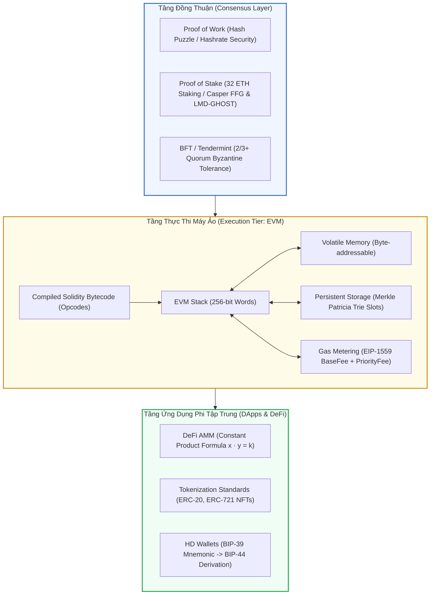
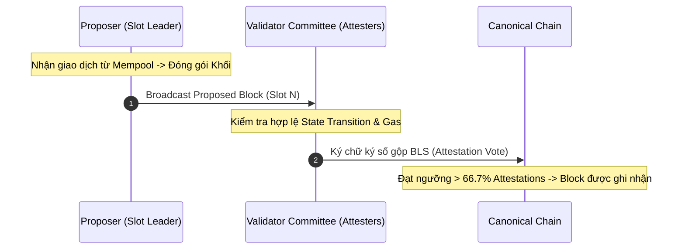
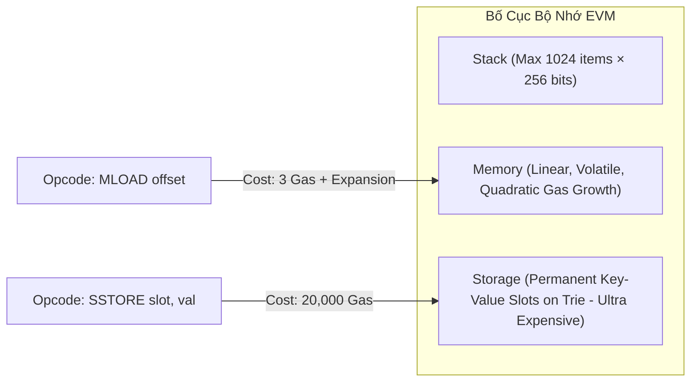
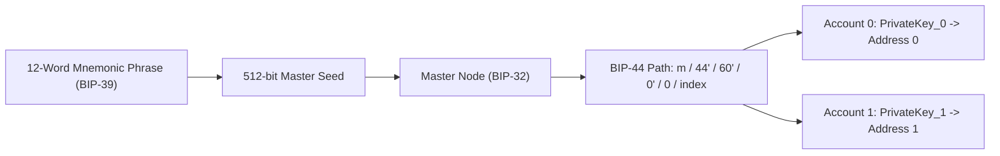

# 6.2. Consensus Mechanisms, Smart Contract VMs (EVM) & DeFi Architecture

## Tổng quan về Thuật toán Đồng thuận và Máy ảo Hợp đồng Thông minh
Trong một hệ thống mạng phi tập trung mở (Permissionless P2P Network), bất kỳ ai cũng có thể gia nhập hoặc rời bỏ mạng, và một tỷ lệ các nút mạng có thể bị lỗi, hành xử độc hại hoặc cố tình gửi thông điệp gian lận. Thử thách cơ bản này được mô hình hóa trong Khoa học Máy tính dưới tên gọi **Bài toán Các vị Tướng Byzantine (Byzantine Generals Problem)**.

Hệ thống blockchain giải quyết bài toán này thông qua hai trụ cột công nghệ:
1. **Thuật toán Đồng thuận Chống Lỗi Byzantine (BFT Consensus Algorithms)**: Các cơ chế kinh tế - toán học như **Proof of Work (PoW)** hoặc **Proof of Stake (PoS)** kết hợp với lý thuyết trò chơi (Game Theory) để khuyến khích các nút hành xử trung thực (nhận phần thưởng khối) và trừng phạt nghiêm khắc các hành vi gian lận (**Slashing**).
2. **Máy ảo Hợp đồng Thông minh (Smart Contract VMs / EVM)**: Một máy trạng thái phân tán tự trị (Decentralized State Machine). Hợp đồng thông minh là các đoạn mã tự thực thi khi các điều kiện định trước được thỏa mãn. Để ngăn chặn các cuộc tấn công DoS bằng vòng lặp vô tận (Halting Problem), hệ thống áp dụng cơ chế định lượng tài nguyên bắt buộc gọi là **Gas Mechanism**.



---

## 2. Chi tiết từng Keyword (Under-the-Hood Deep Dive)

---

### 1. Consensus Algorithms: PoW, PoS & Byzantine Fault Tolerance (BFT)

#### 1. Khái niệm bản chất (What & Why)
- **Byzantine Fault Tolerance (BFT)**: Khả năng của một hệ thống phân tán duy trì hoạt động chính xác và đạt đồng thuận ngay cả khi có tới $f < \frac{n}{3}$ số nút trong mạng bị hỏng hóc hoặc cố tình thông đồng gửi dữ liệu sai lệch (Byzantine Nodes).
- **Proof of Work (PoW - Bằng chứng Công việc)**: Cơ chế yêu cầu các thợ đào (Miners) tiêu tốn năng lượng điện và năng lực phần cứng để giải một bài toán hàm băm mật mã học khó: Tìm một số `Nonce` sao cho $\text{SHA-256}(\text{Header}) < \text{Target}$.
- **Proof of Stake (PoS - Bằng chứng Cổ phần)**: Cơ chế loại bỏ việc tiêu tốn điện năng lãng phí của PoW. Các nút xác thực (**Validators**) phải khóa một lượng tài sản giá trị (ví dụ: $32\text{ ETH}$) vào hợp đồng ký quỹ để giành quyền đề xuất và bỏ phiếu xác thực khối.
- **Slashing (Cắt phạt Cổ phần)**: Hình phạt nghiêm khắc trong PoS: Nếu một validator bị phát hiện ký vào hai khối khác nhau ở cùng một độ cao (Double Signing / Equivocation) hoặc bỏ phiếu bao vây (Surround Vote), mạng lưới sẽ tự động tiêu hủy một phần hoặc toàn bộ số tiền $32\text{ ETH}$ đã stake và đuổi vĩnh viễn nút đó ra khỏi mạng.

#### 2. Cơ chế hoạt động sâu (Under the hood / Hardcore Internals)
- **Casper FFG & LMD-GHOST trong Ethereum PoS**:
  Ethereum kết hợp hai thuật toán:
  - **LMD-GHOST (Latest Message Driven GHOST)**: Giải thuật chọn nhánh (Fork-choice Rule) tức thời ở cấp độ từng khe thời gian (**Slot = 12 giây**), chọn chuỗi có trọng số phiếu bầu validator tích lũy lớn nhất.
  - **Casper FFG (Friendly Finality Gadget)**: Chịu trách nhiệm khóa cứng tính bất biến (Finality) ở cấp độ từng kỷ nguyên (**Epoch = 32 slots = 6.4 phút**). Khi một Epoch nhận được $\ge \frac{2}{3}$ số phiếu xác nhận của toàn bộ mạng lưới, nó trở thành **Finalized**. Một khối đã finalized về mặt toán học không thể bị đảo ngược trừ khi kẻ tấn công chấp nhận đốt cháy hàng tỷ USD giá trị cổ phần stake.

#### 3. Sơ đồ minh họa


#### 4. Code ví dụ thực chiến (C++ Proof-of-Work Hash Difficulty Solver)
Đoạn mã C++20 minh họa việc giải bài toán Proof-of-Work tìm Nonce thỏa mãn độ khó tiền tố 4 số 0:

```cpp
#include <iostream>
#include <string>
#include <sstream>
#include <iomanip>
#include <cstdint>

// Giả lập hàm băm nhanh
std::string fast_hash(const std::string& data) {
    uint32_t h = 2166136261u;
    for (char c : data) {
        h ^= static_cast<uint8_t>(c);
        h *= 16777619u;
    }
    std::stringstream ss;
    ss << std::hex << std::setfill('0') << std::setw(8) << h;
    return ss.str();
}

int main() {
    std::string block_content = "BlockData: Alice sends 10 BTC to Bob";
    uint32_t nonce = 0;
    std::string target_prefix = "00"; // Yêu cầu băm bắt đầu bằng 2 số 0

    std::cout << "[PoW Miner] Mining block with target prefix: " << target_prefix << "...\n";
    
    while (true) {
        std::string payload = block_content + std::to_string(nonce);
        std::string hash = fast_hash(payload);
        
        if (hash.rfind(target_prefix, 0) == 0) { // Khớp tiền tố
            std::cout << "[PoW Solved!] Found Nonce: " << nonce << " -> Hash: " << hash << "\n";
            break;
        }
        nonce++;
    }
    return 0;
}
```

#### 5. Ưu / Nhược điểm, Pitfalls & Anti-patterns
- **Nothing-at-Stake Problem trong PoS đơn giản**: Nếu không có cơ chế Slashing, trong trường hợp mạng bị phân nhánh (Fork), các validator sẽ bỏ phiếu cho cả hai nhánh vì việc bỏ phiếu không tốn chi phí điện, dẫn đến sự bất ổn định đồng thuận.

#### 6. Ứng dụng thực tế trong Backend / Systems
- Vận hành các nút kiểm thực (Validator Nodes) trong các mạng blockchain công khai hoặc mạng nội bộ ngân hàng (Hyperledger Besu).

---

### 2. Smart Contracts, EVM Internals, Solidity & Gas Mechanism (EIP-1559)

#### 1. Khái niệm bản chất (What & Why)
- **Smart Contracts (Hợp đồng Thông minh)**: Chương trình máy tính tất định (Deterministic Code) được triển khai và lưu trữ vĩnh viễn trên blockchain, tự động thực thi các thỏa thuận giao dịch mà không cần tin tưởng vào bất kỳ bên thứ ba nào.
- **Ethereum Virtual Machine (EVM)**: Máy ảo ngăn xếp (Stack-based VM) với kích thước từ nhớ chuẩn hóa **256 bits** (32 bytes), được thiết kế tối ưu cho các phép tính mật mã học băm và đường cong elip.
- **Solidity**: Ngôn ngữ lập trình hướng hợp đồng cấp cao (Contract-oriented Language) phổ biến nhất để viết ứng dụng trên EVM.
- **Gas Mechanism & EIP-1559**: Đơn vị đo lường năng lực tính toán và lưu trữ tiêu thụ bởi mỗi chỉ lệnh máy. Theo chuẩn nâng cấp EIP-1559, chi phí giao dịch gồm 3 thành phần:
  $$\text{Transaction Fee} = \text{Gas Used} \times (\text{Base Fee} + \text{Priority Fee})$$
  Trong đó:
  - **Base Fee**: Mức phí cơ sở được điều chỉnh tự động theo thuật toán dựa trên độ đầy của khối trước. Toàn bộ Base Fee **bị đốt cháy vĩnh viễn (Burned)** khỏi nguồn cung.
  - **Priority Fee (Tip)**: Khoản tiền thưởng trả trực tiếp cho Validator để được ưu tiên xử lý sớm.

#### 2. Cơ chế hoạt động sâu (Under the hood / Hardcore Internals)
- **3 Phân Vùng Bộ Nhớ Trong EVM**:
  1. **Stack**: Ngăn xếp chứa tối đa $1,024$ phần tử, mỗi phần tử $256$ bits. Nếu cố truy xuất sâu hơn phần tử thứ 16 sẽ bị lỗi `Stack too deep`.
  2. **Memory**: Mảng byte tuyến tính tạm thời (Volatile). Chi phí gas mở rộng bộ nhớ (Memory Expansion Cost) tăng theo hàm bậc hai:
     $$\text{Gas}_{\text{Memory}} = 3 \times a + \frac{a^2}{512} \quad (\text{với } a \text{ là số từ nhớ 32-byte})$$
  3. **Storage**: Vùng nhớ bền vững lưu trữ trên cây Merkle Patricia Trie và ghi đè xuống đĩa SSD. Đây là vùng nhớ đắt đỏ nhất trong toàn bộ hệ thống: Ghi một ô nhớ mới (`SSTORE` từ 0 sang khác 0) tiêu tốn tới **$20,000\text{ Gas}$**, trong khi một phép toán `ADD` chỉ tốn **$3\text{ Gas}$**.

#### 3. Sơ đồ minh họa


#### 4. Code ví dụ thực chiến (Solidity ERC-20 Minimal Token Implementation)
Đoạn mã Solidity hiện thực hóa chuẩn token ERC-20 an toàn:

```solidity
// SPDX-License-Identifier: MIT
pragma solidity ^0.8.20;

contract MinimalToken {
    string public name = "Enterprise Utility Token";
    string public symbol = "EUT";
    uint8 public decimals = 18;
    uint256 public totalSupply;

    mapping(address => uint256) public balanceOf;
    mapping(address => mapping(address => uint256)) public allowance;

    event Transfer(address indexed from, address indexed to, uint256 value);
    event Approval(address indexed owner, address indexed spender, uint256 value);

    constructor(uint256 initialSupply) {
        totalSupply = initialSupply * (10 ** uint256(decimals));
        balanceOf[msg.sender] = totalSupply;
        emit Transfer(address(0), msg.sender, totalSupply);
    }

    function transfer(address to, uint256 amount) external returns (bool) {
        require(to != address(0), "Invalid recipient");
        require(balanceOf[msg.sender] >= amount, "Insufficient balance");

        balanceOf[msg.sender] -= amount;
        balanceOf[to] += amount;
        emit Transfer(msg.sender, to, amount);
        return true;
    }

    function approve(address spender, uint256 amount) external returns (bool) {
        allowance[msg.sender][spender] = amount;
        emit Approval(msg.sender, spender, amount);
        return true;
    }
}
```

#### 5. Ưu / Nhược điểm, Pitfalls & Anti-patterns
- **Gas Limit Out-of-Gas Failure**: Nếu một vòng lặp trong Smart Contract lặp qua một mảng động không giới hạn độ dài (Unbounded Array), chi phí gas sẽ vượt quá giới hạn tối đa của một khối (**Block Gas Limit = 30,000,000 gas**), khiến hàm bị kẹt vĩnh viễn và không bao giờ có thể thực thi thành công.

#### 6. Ứng dụng thực tế trong Backend / Systems
- Viết microservice lắng nghe sự kiện Smart Contract qua WebSocket JSON-RPC (`eth_subscribe("logs")`) để tự động kích hoạt nghiệp vụ hoàn tất đơn hàng.

---

### 3. DApps, DeFi (AMM x · y = k) & HD Wallet Architecture

#### 1. Khái niệm bản chất (What & Why)
- **Decentralized Applications (DApps)**: Ứng dụng có tầng giao diện Frontend truyền thống (React/Vue) nhưng giao tiếp trực tiếp với Backend là mạng Blockchain và các Smart Contracts thông qua giao thức Web3 RPC.
- **Decentralized Finance (DeFi)**: Hệ sinh thái các dịch vụ tài chính mở (cho vay, mượn, giao dịch hoán đổi) không phụ thuộc vào các định chế tài chính truyền thống.
- **Automated Market Maker (AMM)**: Mô hình sàn giao dịch phi tập trung (như Uniswap v2) loại bỏ hoàn toàn sổ lệnh mua bán (Order Book), thay thế bằng các bể thanh khoản (**Liquidity Pools**) tự động định giá theo công thức tích số không đổi:
  $$x \cdot y = k$$
- **HD Wallet Architecture (Hierarchical Deterministic Wallets)**: Tiêu chuẩn ví tiền điện tử cho phép tạo ra vô số địa chỉ ví khác nhau từ duy nhất **một chuỗi 12 hoặc 24 từ dễ nhớ (Mnemonic Seed Phrase)** theo các chuẩn **BIP-39**, **BIP-32**, và **BIP-44**.

#### 2. Cơ chế hoạt động sâu (Under the hood / Hardcore Internals)
- **Cơ chế Định giá AMM & Trượt Giá (Slippage)**:
  Giả sử một bể thanh khoản có $x$ đồng ETH và $y$ đồng USDT sao cho $x \cdot y = k$.
  Khi người dùng muốn đổi $\Delta x$ đồng ETH để lấy $\Delta y$ đồng USDT:
  $$(x + \Delta x)(y - \Delta y) = k \implies \Delta y = y - \frac{k}{x + \Delta x} = \frac{y \cdot \Delta x}{x + \Delta x}$$
  Nếu lượng mua $\Delta x$ quá lớn so với dung lượng bể $x$, tỷ lệ hoán đổi sẽ bị suy giảm nghiêm trọng so với giá thị trường bên ngoài. Hiện tượng này gọi là **Trượt giá (Slippage)**.

#### 3. Sơ đồ minh họa


#### 4. Code ví dụ thực chiến (TypeScript Constant Product AMM Swap Calculator)
```typescript
class ConstantProductAMM {
  private reserveX: number; // Ví dụ: ETH Reserve
  private reserveY: number; // Ví dụ: USDT Reserve
  private feePercent: number; // Phí giao dịch (ví dụ: 0.3%)

  constructor(reserveX: number, reserveY: number, feePercent = 0.003) {
    this.reserveX = reserveX;
    this.reserveY = reserveY;
    this.feePercent = feePercent;
  }

  // Tính số lượng token Y nhận được khi nạp vào deltaX token X
  public getAmountOut(deltaX: number): { amountOutY: number; newPrice: number; slippagePercent: number } {
    const inputWithFee = deltaX * (1 - this.feePercent);
    const k = this.reserveX * this.reserveY;
    
    // (X + inputWithFee) * (Y - amountOut) = k
    const newReserveX = this.reserveX + inputWithFee;
    const newReserveY = k / newReserveX;
    const amountOutY = this.reserveY - newReserveY;

    const initialSpotPrice = this.reserveY / this.reserveX;
    const executionPrice = amountOutY / deltaX;
    const slippagePercent = ((initialSpotPrice - executionPrice) / initialSpotPrice) * 100;

    return { amountOutY, newPrice: newReserveY / newReserveX, slippagePercent };
  }
}

// Test AMM Swap
const pool = new ConstantProductAMM(100 /* 100 ETH */, 300000 /* 300,000 USDT -> Giá 3,000 USDT/ETH */);
const swapResult = pool.getAmountOut(5 /* Đổi 5 ETH */);

console.log(`Swapping 5 ETH -> Received: ${swapResult.amountOutY.toFixed(2)} USDT`);
console.log(`Execution Slippage: ${swapResult.slippagePercent.toFixed(2)}%`);
```

#### 5. Ưu / Nhược điểm, Pitfalls & Anti-patterns
- **Impermanent Loss (Tổn thất tạm thời)**: Các nhà cung cấp thanh khoản (Liquidity Providers) cho bể AMM có thể chịu thiệt hại về tổng giá trị tài sản so với việc chỉ đơn thuần nắm giữ (HODL) token nếu giá giữa hai tài sản biến động quá mạnh lệch pha nhau.

#### 6. Ứng dụng thực tế trong Backend / Systems
- Thiết lập Backend Wallet Custody tự động tạo địa chỉ nạp tiền duy nhất cho từng người dùng dựa trên cây phân cấp BIP-44.
