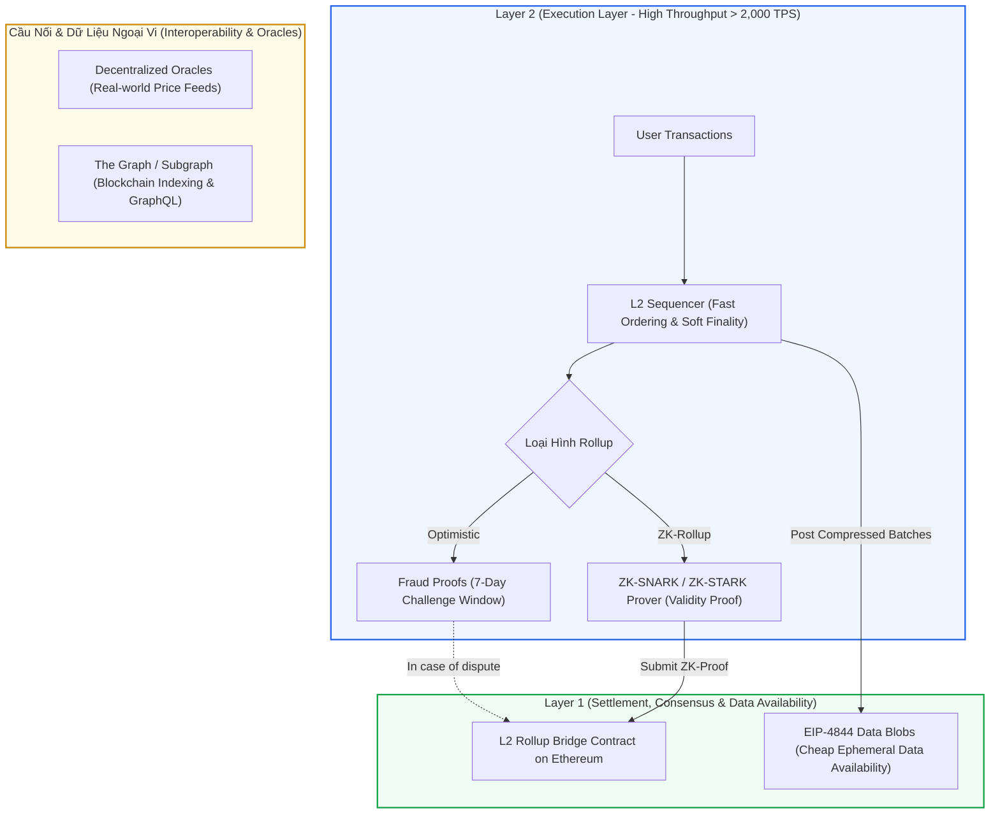
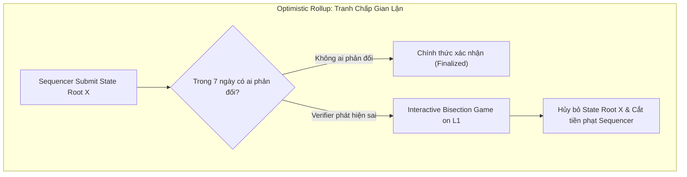
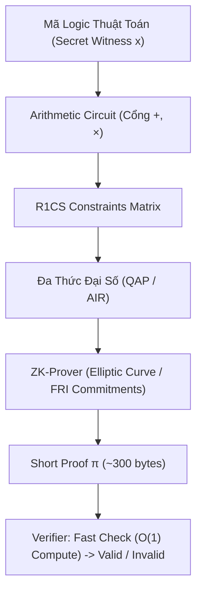

# 6.3. Layer 2 Scaling, Rollups, Zero-Knowledge Proofs & Cross-Chain Infrastructure

## Tổng quan về Mở rộng Layer 2, Bằng chứng Không Tri thức và Khả năng Tương tác
Mạng lưới blockchain cơ sở (**Layer 1** như Bitcoin hay Ethereum) bị giới hạn nghiêm trọng về thông lượng xử lý giao dịch do sự ràng buộc của **Tam giác Bất khả thi (Blockchain Trilemma)**: Một hệ thống phân tán chỉ có thể tối đa hóa được 2 trong 3 yếu tố: **Tính Phi tập trung (Decentralization)**, **Tính An toàn (Security)**, và **Khả năng Mở rộng (Scalability)**. Với kích thước khối và thời gian sinh khối giới hạn để mọi người dùng bình thường đều có thể tự chạy một Full Node, Ethereum Layer 1 chỉ xử lý được khoảng $15 - 30 \text{ Transactions Per Second (TPS)}$, khiến phí giao dịch bị đội lên hàng chục USD vào giờ cao điểm.

Để giải quyết bài toán này mà không làm suy giảm tính an toàn của Layer 1, toàn bộ ngành công nghiệp đã chuyển dịch sang kiến trúc **Layer 2 (L2 Scaling)** mà trọng tâm là công nghệ **Rollups**:
- Di chuyển toàn bộ quá trình tính toán và lưu trữ trạng thái ra ngoài chuỗi (**Off-Chain Execution**).
- Nén hàng ngàn giao dịch thành một lô duy nhất và xuất bản bằng chứng dữ liệu về lại Layer 1 để thừa hưởng 100% tính an toàn và bất biến của Layer 1 (**On-Chain Data Availability**).
- Hai trường phái kiến trúc chính: **Optimistic Rollups** (dựa trên Bằng chứng Gian lận - Fraud Proofs) và **Zero-Knowledge Rollups** (dựa trên Bằng chứng Tính hợp lệ - Validity Proofs).



---

## 2. Chi tiết từng Keyword (Under-the-Hood Deep Dive)

---

### 1. Layer 1 vs Layer 2, Rollups: Optimistic Rollups vs ZK-Rollups

#### 1. Khái niệm bản chất (What & Why)
- **Layer 1 (L1)**: Chuỗi khối gốc rễ đảm nhận việc đồng thuận toàn cục, dàn xếp cuối cùng (Settlement) và đảm bảo tính khả dụng của dữ liệu (Data Availability).
- **Layer 2 (L2)**: Giao thức xây dựng trên đỉnh Layer 1 nhằm tăng tốc độ xử lý giao dịch lên hàng ngàn TPS và giảm phí gas xuống dưới $0.01.
- **Rollups**: Kỹ thuật gom cụm (Roll up) hàng ngàn giao dịch thực thi ở L2, nén lại và gửi về L1 dưới dạng một bản tóm tắt giao dịch kèm trạng thái gốc mới (State Root).
- **Optimistic Rollups (Arbitrum, Optimism)**: Hoạt động theo nguyên tắc "Lạc quan": Mặc định coi mọi lô giao dịch gửi lên là hoàn toàn trung thực. Hệ thống mở ra một cửa sổ thử thách (**Challenge Window kéo dài 7 ngày**). Nếu bất kỳ ai phát hiện gian lận, họ có thể nộp **Bằng chứng Gian lận (Fraud Proof / Fault Proof)** để hủy bỏ khối sai và tịch thu tiền ký quỹ của kẻ gian lận.
- **Zero-Knowledge Rollups (zkSync, Starknet, Scroll)**: Sử dụng các bằng chứng toán học mật mã học (**Validity Proofs**). Thay vì chờ đợi 7 ngày, mỗi lô giao dịch khi gửi lên L1 đều đi kèm một bằng chứng ZK-SNARK hoặc ZK-STARK. Hợp đồng thông minh trên L1 tự động chạy hàm kiểm tra tính đúng đắn của bằng chứng trong vài giây.

#### 2. Cơ chế hoạt động sâu (Under the hood / Hardcore Internals)
- **So Sánh Chuyên Sâu Hai Kiến Trúc Rollup**:

| Tiêu chí | Optimistic Rollups | Zero-Knowledge Rollups |
| :--- | :--- | :--- |
| **Cơ chế Xác thực** | Bằng chứng Gian lận (Fraud Proofs - Interactive bisection game). | Bằng chứng Tính hợp lệ (Validity Proofs - ZK-SNARK/STARK). |
| **Thời gian Rút tiền (Withdrawal Delay)** | Chậm: Buộc phải chờ **7 ngày** để hết thời gian thử thách. | Tức thì: Ngay khi ZK-Proof được xác minh trên L1 (**vài phút đến 1 giờ**). |
| **Chi phí Tính toán Off-chain** | Rất thấp: Sequencer chỉ chạy máy ảo EVM bình thường. | Rất cao: Bộ tạo bằng chứng (ZK Prover) đòi hỏi các cụm máy chủ GPU/ASIC chuyên dụng khổng lồ. |
| **Độ phức tạp Mã nguồn** | Tương thích EVM dễ dàng (EVM Equivalent). | Rất phức tạp: Cần biên dịch opcode sang hệ thống mạch số học (Arithmetic Circuits / Polynomial Constraints). |

- **EIP-4844 (Proto-Danksharding) & Blob Space**:
  Trước đây, Rollups phải lưu dữ liệu giao dịch vào trường `calldata` của Ethereum rất đắt đỏ. Nâng cấp EIP-4844 tạo ra một không gian lưu trữ mới gọi là **Data Blobs**: Dữ liệu blob chỉ tồn tại trong các nút mạng khoảng 18 ngày (đủ để các validator kiểm tra) rồi tự động bị xóa bỏ, giúp giảm tới 90-95% chi phí giao dịch trên các mạng L2.

#### 3. Sơ đồ minh họa


#### 4. Code ví dụ thực chiến (Solidity L1 Rollup State Root Verification Stub)
```solidity
// SPDX-License-Identifier: MIT
pragma solidity ^0.8.20;

contract RollupStateVerifier {
    address public sequencer;
    bytes32 public currentL2StateRoot;

    event StateRootCommitted(bytes32 indexed oldRoot, bytes32 indexed newRoot, uint256 blockNumber);

    constructor(bytes32 genesisRoot, address sequencerAddr) {
        currentL2StateRoot = genesisRoot;
        sequencer = sequencerAddr;
    }

    // Sequencer nộp state root mới kèm batch dữ liệu
    function commitBatch(bytes32 newRoot, bytes calldata proofData) external {
        require(msg.sender == sequencer, "Unauthorized sequencer");
        
        // Giả lập hàm xác thực ZK Validity Proof
        bool isValid = verifyZkProof(currentL2StateRoot, newRoot, proofData);
        require(isValid, "Invalid cryptographic validity proof!");

        bytes32 old = currentL2StateRoot;
        currentL2StateRoot = newRoot;
        emit StateRootCommitted(old, newRoot, block.number);
    }

    function verifyZkProof(bytes32, bytes32, bytes calldata) internal pure returns (bool) {
        // Thực hiện phép ghép cặp đường cong elip elliptic curve pairing (ecPairing)
        return true; 
    }
}
```

#### 5. Ưu / Nhược điểm, Pitfalls & Anti-patterns
- **Rủi ro Sequencer Tập trung (Centralized Sequencer Risk)**: Hầu hết các mạng Layer 2 hiện nay chỉ vận hành duy nhất một Sequencer do công ty phát hành kiểm soát. Nếu Sequencer này bị sập hoặc kiểm duyệt giao dịch, người dùng phải sử dụng cơ chế "Escape Hatch" (Tự gửi giao dịch trực tiếp từ L1) vốn phức tạp và tốn phí cao.

#### 6. Ứng dụng thực tế trong Backend / Systems
- Triển khai sàn giao dịch phái sinh phi tập trung (Perpetual DEX) xử lý hàng chục ngàn lệnh đặt/hủy mỗi giây với chi phí gần bằng 0.

---

### 2. Zero-Knowledge Proofs (ZKP): zk-SNARKs vs zk-STARKs

#### 1. Khái niệm bản chất (What & Why)
- **Zero-Knowledge Proofs (Bằng chứng Không Tri thức)**: Phương pháp mật mã học cho phép một bên (Người chứng minh - Prover) chứng minh cho một bên khác (Người xác minh - Verifier) rằng một nhận định toán học là hoàn toàn chính xác, mà **không làm lộ bất kỳ thông tin nhạy cảm nào khác ngoài tính đúng đắn của nhận định đó**.
- **3 Thuộc tính Toán học Cốt lõi của ZKP**:
  1. *Tính Đúng đắn (Completeness)*: Nếu nhận định là đúng, một Verifier trung thực sẽ luôn bị thuyết phục bởi một Prover trung thực.
  2. *Tính Vững chắc (Soundness)*: Nếu nhận định là sai, một Prover gian lận không thể thuyết phục Verifier tin vào điều đó trừ một xác suất toán học cực nhỏ có thể bỏ qua.
  3. *Tính Không Tri thức (Zero-Knowledge)*: Verifier hoàn toàn không học được bất kỳ thông tin nào khác về dữ liệu bí mật (**Witness**).
- **zk-SNARKs**: Zero-Knowledge Succinct Non-Interactive Argument of Knowledge. Bằng chứng có kích thước siêu nhỏ (vài trăm bytes) và thời gian xác thực tức thì vài mili-giây. Yêu cầu một giai đoạn thiết lập tin cậy (**Trusted Setup**).
- **zk-STARKs**: Zero-Knowledge Scalable Transparent Argument of Knowledge. Không cần Trusted Setup (sử dụng hàm băm thuần túy), kháng máy tính lượng tử (**Quantum-Resistant**), nhưng kích thước bằng chứng lớn hơn (vài chục Kilobytes).

#### 2. Cơ chế hoạt động sâu (Under the hood / Hardcore Internals)
- **Chu trình Số học hóa (Arithmetization Pipeline)**:
  Làm thế nào để chuyển đổi một đoạn mã logic thông thường thành một bằng chứng ZK?
  1. *Computation Code*: Hàm tính toán (ví dụ: $y = x^3 + x + 5$).
  2. *Arithmetic Circuit*: Phân rã thành mạng lưới các cổng cộng và nhân nhị phân cơ bản.
  3. *R1CS (Rank-1 Constraint System)*: Chuyển đổi các cổng thành các phương trình vector dạng $(A \cdot s) \times (B \cdot s) - (C \cdot s) = 0$.
  4. *QAP (Quadratic Arithmetic Program)*: Dùng phép nội suy Lagrange để biến đổi các vector số học thành các đa thức đại số bậc cao.
  5. *Polynomial Commitment Scheme (KZG hoặc FRI)*: Thu gọn toàn bộ đa thức vào duy nhất một điểm đánh giá bí mật, tạo ra bằng chứng ngắn gọn SNARK.

#### 3. Sơ đồ minh họa


#### 4. Code ví dụ thực chiến (TypeScript ZKP Knowledge Demonstration Simulation)
Đoạn mã TypeScript mô phỏng bài toán chứng minh biết bí mật $x$ sao cho $x^2 = 25$ mà không tiết lộ $x = 5$ thông qua phép kiểm tra modulo ngẫu nhiên:

```typescript
class SimpleZKPVerification {
  // Verifier kiểm tra đẳng thức đại số
  public static verifyCommitment(publicSquare: number, proofValue: number, randomNonce: number): boolean {
    // Giả lập phép kiểm tra tính vững chắc của đa thức
    const computed = (proofValue * proofValue) / (randomNonce * randomNonce);
    return Math.round(computed) === publicSquare;
  }
}

// Prover chứng minh sở hữu bí mật x = 5 mà không gửi số 5 trực tiếp
const secretX = 5;
const publicSquare = 25;
const randomNonce = 3;
const blindedProof = secretX * randomNonce; // 15 (Witness bị làm mờ)

const isValid = SimpleZKPVerification.verifyCommitment(publicSquare, blindedProof, randomNonce);
console.log(`[ZKP Verification Engine] Proof Validated: ${isValid} (Secret was never revealed!)`);
```

#### 5. Ưu / Nhược điểm, Pitfalls & Anti-patterns
- **Prover Computational Bottleneck**: Việc tính toán sinh bằng chứng ZK-SNARK cho các khối giao dịch lớn đòi hỏi phần cứng cực mạnh (hàng chục Gigabytes RAM và máy chủ chuyên dụng tính toán nhân đa thức đa chiều MSM/NTT), làm tăng độ trễ trước khi giao dịch được xác nhận chính thức.

#### 6. Ứng dụng thực tế trong Backend / Systems
- Hệ thống định danh số phi tập trung (Decentralized Identity - DID): Chứng minh người dùng trên 18 tuổi mà không cần tiết lộ ngày tháng năm sinh hay số căn cước công dân.

---

### 3. Blockchain Oracles, Interoperability & Indexing Infrastructure

#### 1. Khái niệm bản chất (What & Why)
- **Blockchain Oracles (Bộ Tiên tri)**: Cầu nối dữ liệu giữa thế giới thực ngoại vi (Off-chain) và Smart Contracts trên blockchain (On-chain). Do bản chất tất định (Deterministic Sandbox), Smart Contract không thể tự thực hiện một lệnh gọi HTTP `fetch()` ra bên ngoài để lấy giá vàng, thời tiết hay kết quả bóng đá. Oracles giải quyết vấn đề này.
- **Blockchain Interoperability & Cross-Chain Communication**: Khả năng truyền tải thông điệp và tài sản an toàn giữa hai mạng blockchain độc lập hoàn toàn (ví dụ: Chuyển token từ Ethereum sang Solana hoặc Avalanche).
- **Blockchain Indexing (Chỉ mục Hóa Blockchain)**: Quá trình đọc liên tục các khối dữ liệu nhị phân thô từ các RPC node, giải mã sự kiện (Events/Logs), tổ chức lại và lưu trữ vào các CSDL truyền thống (PostgreSQL, Elasticsearch) để phục vụ các truy vấn GraphQL/REST API tốc độ cao.

#### 2. Cơ chế hoạt động sâu (Under the hood / Hardcore Internals)
- **Cơ chế Mạng Lưới Oracle Phi Tập Trung (Chainlink DON - Decentralized Oracle Network)**:
  Để tránh điểm lỗi đơn lẻ (Single Point of Failure), Chainlink vận hành một cụm gồm hàng chục nút Oracle độc lập:
  - Mỗi nút độc lập cào dữ liệu giá từ nhiều sàn giao dịch khác nhau.
  - Các nút sử dụng thuật toán đồng thuận ngoại chuỗi (**OCR - Off-Chain Reporting**) để thống nhất một giá trị trung vị (Median).
  - Một nút đại diện ký chữ ký số tập thể và gửi giao dịch cập nhật giá duy nhất lên hợp đồng L1, tiết kiệm tối đa phí gas.
- **Kiến trúc Cầu Nối Xuyên Chuỗi (Cross-Chain Bridges)**:
  - *Lock and Mint*: Khóa tài sản gốc trên Chuỗi A -> Một mạng Relayer quan sát sự kiện khóa -> Phát lệnh đúc (Mint) tài sản bọc (Wrapped Asset) tương ứng trên Chuỗi B.
  - *Lỗ hổng thế kỷ*: Các Smart Contract cầu nối thường lưu giữ hàng tỷ USD tài sản khóa, biến chúng thành mục tiêu hàng đầu của các hacker (các vụ hack cầu nối Ronin, Wormhole gây thiệt hại hàng trăm triệu USD do lộ khóa đa chữ ký Multisig).

#### 3. Sơ đồ minh họa


```mermaid
graph LR
    subgraph OffChainWorld["Thế Giới Ngoại Vi & APIs"]
        BinanceAPI["Coinbase / Binance APIs"] --> ChainlinkDON["Chainlink Decentralized Oracle Nodes"]
    end

    subgraph OnChainConsensus["Hợp Đồng Trên Blockchain"]
        ChainlinkDON -->|Submit Median Price Feed| PriceFeedContract["AggregatorV3Interface Contract"]
        PriceFeedContract --> DeFiLending["DeFi Lending Protocol (Liquidate Undercollateralized Loans)"]
    end

    subgraph IndexingPipeline["Đường Ống Chỉ Mục Hóa Dữ Liệu"]
        DeFiLending -->|Emit Events| TheGraphNode["The Graph Indexer / Subgraph"]
        TheGraphNode --> PostgresDB["PostgreSQL Relational DB"]
        PostgresDB --> GraphQL["GraphQL Endpoint for Frontend DApp"]
    end
```

#### 4. Code ví dụ thực chiến (Solidity Chainlink Price Feed Consumer)
```solidity
// SPDX-License-Identifier: MIT
pragma solidity ^0.8.20;

// Giao diện chuẩn mực của Chainlink Oracle
interface AggregatorV3Interface {
    function latestRoundData() external view returns (
        uint80 roundId,
        int256 answer,
        uint256 startedAt,
        uint256 updatedAt,
        uint80 answeredInRound
    );
}

contract PriceConsumer {
    AggregatorV3Interface internal dataFeed;

    // Địa chỉ Feed ETH/USD trên mạng Sepolia Testnet
    constructor(address feedAddress) {
        dataFeed = AggregatorV3Interface(feedAddress);
    }

    function getLatestPrice() public view returns (int256) {
        (
            /* uint80 roundId */,
            int256 price,
            /* uint256 startedAt */,
            uint256 updatedAt,
            /* uint80 answeredInRound */
        ) = dataFeed.latestRoundData();

        // Kiểm tra an toàn: Không chấp nhận dữ liệu giá quá cũ (Stale Price check)
        require(block.timestamp - updatedAt < 3600, "Price data is stale!");
        require(price > 0, "Invalid price report!");
        return price;
    }
}
```

#### 5. Ưu / Nhược điểm, Pitfalls & Anti-patterns
- **Flash Loan Oracle Manipulation Attack**: Sử dụng giá giao dịch tức thời từ một bể AMM đơn lẻ làm nguồn tham chiếu giá cho hợp đồng vay mượn. Kẻ tấn công có thể vay một khoản tiền khổng lồ (Flash Loan), thao túng giá trong bể AMM trong cùng 1 transaction, rút cạn tiền của giao thức rồi trả lại khoản vay. Bắt buộc phải sử dụng **TWAP (Time-Weighted Average Price)** hoặc Chainlink Decentralized Oracles.

#### 6. Ứng dụng thực tế trong Backend / Systems
- Xây dựng hệ thống Indexer bằng Substreams/TheGraph đồng bộ hóa toàn bộ lịch sử biến động số dư NFT của người dùng về cơ sở dữ liệu Elasticsearch phục vụ tìm kiếm.
