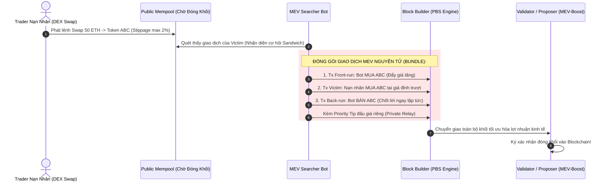
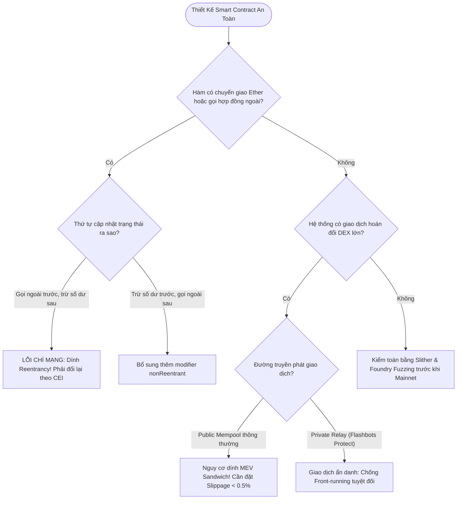

# 6.4. Smart Contract Security, Reentrancy, and Maximal Extractable Value (MEV)

> [!IMPORTANT]
> **Nếu bạn chỉ được nhớ một điều duy nhất:**
> Trong kiến trúc Blockchain, **mã nguồn là luật pháp bất biến (Code is Law & Immutability)** và **mọi giao dịch trong hàng đợi đều phơi bày công khai (Public Mempool)**. Lập trình Web3 đòi hỏi tư duy phòng thủ đối nghịch cực đoan: chống lại thảm họa rút cạn quỹ tiền bằng mô hình **Checks-Effects-Interactions (CEI)** kết hợp khóa tương hỗ **ReentrancyGuard**; đồng thời bảo vệ người dùng khỏi sự bòn rút kinh tế của các bot **Maximal Extractable Value (MEV)** và tấn công kẹp bánh mì (Sandwich Attacks) thông qua định tuyến giao dịch riêng tư (**Flashbots Protect**) và kiểm soát chặt chẽ biên độ trượt giá (Slippage Tolerance).

---

## 1. Kiến trúc Tổng quan & Mô hình Tư duy (Mental Model)

### 1.1. Ẩn dụ Đời sống: Cây ATM Bị Kẹt Bộ Đếm và Đấu Giá Ngầm Trước Sàn Giao Dịch

Để hình dung hai hiểm họa lớn nhất của thế giới tài chính phi tập trung (DeFi):
1. **Lỗ Hổng Tái Nhập Reentrancy (Cây ATM Bị Kẹt Bộ Đếm Số Dư)**:
   - Hãy tưởng tượng bạn ra cây ATM rút $1,000$ USD. Quy trình chuẩn phải là: Cây ATM trừ số dư trong tài khoản của bạn trước (`Effects`), sau đó mới nhả tiền mặt qua khe (`Interactions`).
   - Nhưng lập trình viên viết sai thứ tự: Cây ATM nhả tiền trước, rồi mới tính đến việc trừ tiền trong tài khoản. Một kẻ lừa đảo gắn một cánh tay robot bấm liên tục nút "Rút tiếp $1,000$ USD" ngay khi khe tiền vừa mở ra (`fallback()` call). Vì máy chưa kịp trừ tiền trong tài khoản, hệ thống kiểm tra thấy tài khoản vẫn còn nguyên $1,000$ USD và tiếp tục nhả tiền! Quá trình này lặp lại 100 lần cho đến khi két tiền của cây ATM rỗng tuếch!
2. **Khai Thác MEV & Tấn Công Kẹp Bánh Mì Sandwich (Kẻ Đầu Cơ Đứng Trước Cửa Hàng Vàng)**:
   - Bạn hét lớn giữa chợ: *"Tôi muốn mua 10 lượng vàng với giá tối đa 80 triệu/lượng!"* (Public Mempool Broadcast).
   - Một tay đầu cơ chợ đen đứng ngay cạnh nghe thấy. Hắn ta trả thêm tiền cho bảo vệ cửa hàng (Priority Gas Tip) để được chen chân vào mua trước bạn với giá 75 triệu/lượng (**Front-run**).
   - Khi bạn bước vào, vì số lượng vàng đã khan hiếm, bạn buộc phải mua với giá kịch trần 80 triệu/lượng do biên độ trượt giá cho phép.
   - Ngay sau khi bạn vừa mua xong, tay đầu cơ lập tức bán lại 10 lượng vàng đó cho cửa hàng với giá 80 triệu/lượng (**Back-run**). Hắn đút túi ngay 50 triệu tiền lời phi rủi ro, và bạn là người chịu thiệt hại!

### 1.2. Luồng Khai Thác MEV Trong Chuỗi Cung Ứng Khối (PBS Architecture)



---

## 2. Chi tiết từng Keyword (Under-the-Hood Deep Dive)

### 2.1. Smart Contract Security & Reentrancy Attacks

Smart Contract là một chương trình máy tính thực thi trên Máy Ảo Ethereum (EVM). Hai đặc điểm làm nên sự nguy hiểm của EVM:
1. Địa chỉ nhận tiền có thể là một tài khoản thông thường (EOA) hoặc một **Smart Contract khác có chứa mã bytecode thực thi**.
2. Khi chuyển ETH qua hàm `.call{value: amount}("")`, EVM tự động chuyển giao quyền điều khiển CPU sang hàm `fallback()` hoặc `receive()` của hợp đồng nhận tiền.

#### A. Giải Phẫu Vụ Hack The DAO (2016)
Hàm rút tiền dễ bị tổn thương kinh điển:

```solidity
// ĐOẠN MÃ NGUY HIỂM (VULNERABLE PATTERN):
function withdraw() public {
    uint256 balance = balances[msg.sender];
    require(balance > 0, "No balance");

    // BƯỚC 1: INTERACTIONS TRƯỚC (RỦI RO CHÍ MẠNG!)
    (bool success, ) = msg.sender.call{value: balance}("");
    require(success, "Transfer failed");

    // BƯỚC 2: CẬP NHẬT TRẠNG THÁI SAU (QUÁ MUỘN!)
    balances[msg.sender] = 0;
}
```

- Kẻ tấn công triển khai một hợp đồng độc hại có hàm `receive()`:
  ```solidity
  receive() external payable {
      if (address(victimTarget).balance >= 1 ether) {
          victimTarget.withdraw(); // TÁI NHẬP LẠI VÀO HÀM RÚT TIỀN KHI CHƯA TRỪ SỐ DƯ!
      }
  }
  ```

#### B. Mô Hình Phòng Thủ Tiêu Chuẩn: Checks-Effects-Interactions (CEI)
Mọi hàm thay đổi trạng thái trong Smart Contract bắt buộc phải tuân thủ thứ tự ba bước bất biến:
1. **Checks**: Kiểm tra điều kiện đầu vào (`require(balance > 0)`).
2. **Effects**: Cập nhật toàn bộ trạng thái nội bộ, trừ số dư về 0 **TRƯỚC KHI** gửi tiền (`balances[msg.sender] = 0;`).
3. **Interactions**: Tương tác gửi tiền hoặc gọi hợp đồng bên ngoài ở bước cuối cùng.

#### C. Khóa Tương Hỗ ReentrancyGuard (OpenZeppelin)
Sử dụng cờ trạng thái nhị phân trong bộ nhớ lưu trữ bền vững (Storage Slot):
```solidity
abstract contract ReentrancyGuard {
    uint256 private constant _NOT_ENTERED = 1;
    uint256 private constant _ENTERED = 2;
    uint256 private _status = _NOT_ENTERED;

    modifier nonReentrant() {
        require(_status != _ENTERED, "ReentrancyGuard: reentrant call");
        _status = _ENTERED;
        _;
        _status = _NOT_ENTERED;
    }
}
```

---

### 2.2. Front-Running & Maximal Extractable Value (MEV)

MEV là thuật ngữ chỉ toàn bộ giá trị kinh tế mà người xác thực hoặc bot có thể trích xuất thông qua việc tùy biến thứ tự giao dịch bên trong một khối.

#### A. Các Chiến Thuật Khai Thác MEV Phổ Biến
1. **DEX Arbitrage (Chênh lệch giá)**: Phát hiện giá một token trên Uniswap thấp hơn Sushiswap. Bot mua ở Uniswap và bán ở Sushiswap trong cùng 1 khối để ăn chênh lệch giá.
2. **Liquidations (Thanh lý tài sản thế chấp)**: Trong các giao thức cho vay (Aave, Compound), khi giá trị tài sản thế chấp giảm dưới ngưỡng an toàn, bot MEV cạnh tranh nhau để kích hoạt lệnh thanh lý và nhận khoản tiền thưởng chiết khấu (Liquidation Bonus).
3. **Sandwich Attacks (Tấn công Kẹp Bánh Mì)**: Lợi dụng độ trượt giá (Slippage) của người dùng trên các sàn giao dịch phi tập trung để chèn giao dịch MUA trước và BÁN sau.

#### B. Chuỗi Cung Ứng MEV & Phân Tách Proposer-Builder (PBS / MEV-Boost)
- Trước đây, các thợ đào tự ý chạy bot hoặc nhận hối lộ để sắp xếp giao dịch, gây ra hiện tượng cạnh tranh phí gas điên cuồng (Priority Gas Auctions - PGA) làm nghẽn toàn mạng.
- **Kiến trúc PBS hiện đại với Flashbots**:
  - **Searchers**: Chạy các thuật toán phân tích mempool độc quyền để tìm cơ hội MEV. Searcher tạo ra gói **MEV Bundle** (đảm bảo tính nguyên tử: hoặc cả gói cùng chạy theo đúng thứ tự, hoặc không giao dịch nào được thực thi).
  - **Builders**: Tổng hợp các bundle từ nhiều Searcher thành một khối hoàn chỉnh có giá trị kinh tế cao nhất.
  - **MEV-Boost Relay**: Kênh chuyển tiếp trung gian bảo vệ nội dung khối, giúp Validator nhận thưởng tip mà không cần biết chi tiết bên trong để tránh hành vi cướp cơ hội (Stealing).

---

## 3. Thực thi Mã nguồn & Mô phỏng Chuyên sâu (Dual-Engine Implementation)

### 3.1. Implementation C++20: EVM Reentrancy Vulnerability & ReentrancyGuard State Machine Simulator

Đoạn mã C++20 dưới đây mô phỏng kiến trúc ngăn xếp lời gọi hàm của EVM: chứng minh cách thức đòn tấn công Reentrancy đệ quy rút sạch tài sản của hợp đồng nếu vi phạm quy tắc CEI, và cách `ReentrancyGuard` triệt tiêu đòn tấn công.

```cpp
#include <iostream>
#include <string>
#include <vector>
#include <memory>
#include <format>
#include <stdexcept>

// Cấu trúc mô phỏng Ngân khố Hợp đồng Thông minh (Smart Contract Bank)
class MockSmartContractBank {
private:
    uint64_t total_vault_balance_{10000}; // Quỹ ngân khố 10,000 ETH
    std::unordered_map<std::string, uint64_t> user_balances_;
    bool is_locked_{false}; // Cờ ReentrancyGuard Mutex

public:
    void deposit(const std::string& user, uint64_t amount) {
        user_balances_[user] += amount;
        total_vault_balance_ += amount;
    }

    uint64_t get_balance(const std::string& user) const {
        auto it = user_balances_.find(user);
        return it != user_balances_.end() ? it->second : 0;
    }

    uint64_t get_total_vault() const noexcept { return total_vault_balance_; }

    // HÀM RÚT TIỀN NGUY HIỂM (VI PHẠM CEI: Gửi tiền trước, trừ số dư sau)
    void vulnerable_withdraw(const std::string& user, class IAttackerContract* attacker_callback);

    // HÀM RÚT TIỀN AN TOÀN (TUÂN THỦ CHECKS-EFFECTS-INTERACTIONS & REENTRANCYGUARD)
    void secure_withdraw(const std::string& user, class IAttackerContract* attacker_callback);
};

// Interface mô phỏng hàm receive() / fallback() của hợp đồng bên ngoài
class IAttackerContract {
public:
    virtual ~IAttackerContract() = default;
    virtual void on_ether_received(MockSmartContractBank& bank, uint64_t amount) = 0;
};

void MockSmartContractBank::vulnerable_withdraw(const std::string& user, IAttackerContract* attacker_callback) {
    uint64_t amount = get_balance(user);
    if (amount == 0) return;

    // INTERACTIONS: Chuyển tiền ra ngoài trước!
    if (total_vault_balance_ >= amount) {
        total_vault_balance_ -= amount;
        if (attacker_callback) {
            attacker_callback->on_ether_received(*this, amount);
        }
    }

    // EFFECTS: Trừ số dư người dùng (Quá muộn nếu có tái nhập!)
    user_balances_[user] = 0;
}

void MockSmartContractBank::secure_withdraw(const std::string& user, IAttackerContract* attacker_callback) {
    // 1. REENTRANCY GUARD CHECK
    if (is_locked_) {
        std::cerr << "[REENTRANCY GUARD] BLOCKED: Mutex reentrant call attempted!\n";
        throw std::runtime_error("REENTRANCY_GUARD_TRIGGERED");
    }
    is_locked_ = true;

    // 2. CHECKS
    uint64_t amount = get_balance(user);
    if (amount == 0) {
        is_locked_ = false;
        return;
    }

    // 3. EFFECTS (Cập nhật trạng thái TRƯỚC)
    user_balances_[user] = 0;
    total_vault_balance_ -= amount;

    // 4. INTERACTIONS (Chuyển tiền sau cùng)
    try {
        if (attacker_callback) {
            attacker_callback->on_ether_received(*this, amount);
        }
    } catch (...) {
        // Rollback nếu có lỗi bên ngoài
        is_locked_ = false;
        throw;
    }

    is_locked_ = false;
}

// Hợp đồng kẻ tấn công khai thác Reentrancy
class MaliciousAttackerContract : public IAttackerContract {
private:
    std::string attacker_address_{"0x_HACKER"};
    int reentrant_count_{0};
    const int max_exploits_{3};

public:
    void on_ether_received(MockSmartContractBank& bank, uint64_t amount) override {
        reentrant_count_++;
        std::cout << std::format("  >>> Attacker received {} ETH! (Recursion Depth: {})\n", amount, reentrant_count_);

        if (reentrant_count_ < max_exploits_ && bank.get_total_vault() >= 1000) {
            std::cout << "  >>> Attacker calling bank.withdraw() AGAIN recursively before state updates!\n";
            // TÁI NHẬP LẠI
            bank.vulnerable_withdraw(attacker_address_, this);
        }
    }

    void reset() { reentrant_count_ = 0; }
};

int main() {
    std::cout << "========================================================\n";
    std::cout << "  C++20 SMART CONTRACT REENTRANCY ATTACK & DEFENSE SIM   \n";
    std::cout << "========================================================\n\n";

    MockSmartContractBank bank;
    MaliciousAttackerContract hacker;

    // Hacker nạp vào 1,000 ETH
    bank.deposit("0x_HACKER", 1000);
    std::cout << std::format("[INIT] Vault Total Balance: {} ETH | Hacker Balance: {} ETH\n\n", 
                             bank.get_total_vault(), bank.get_balance("0x_HACKER"));

    // TÌNH HUỐNG 1: Tấn công hàm rút tiền không an toàn (Vulnerable Withdraw)
    std::cout << "--- TEST CASE 1: Exploiting Vulnerable Withdraw (The DAO Flaw) ---\n";
    bank.vulnerable_withdraw("0x_HACKER", &hacker);
    std::cout << std::format("[AFTER HACK] Vault Balance: {} ETH (Drained 3000 ETH with only 1000 ETH deposit!)\n\n", 
                             bank.get_total_vault());

    // TÌNH HUỐNG 2: Thử nghiệm với Hàm Rút Tiền An Toàn (Secure Withdraw + Guard)
    std::cout << "--- TEST CASE 2: Attempting Exploit on Secure CEI + ReentrancyGuard ---\n";
    bank.deposit("0x_HACKER", 1000);
    hacker.reset();
    try {
        bank.secure_withdraw("0x_HACKER", &hacker);
    } catch (const std::exception& ex) {
        std::cout << ">>> ATTACK NEUTRALIZED: Bank aborted reentrant transaction successfully!\n";
    }

    return 0;
}
```

---

### 3.2. Implementation Python 3.11+: MEV Mempool Sandwich Attack & Slippage Tolerance Guard Simulator

Đoạn mã Python 3.11+ mô phỏng toán học của sàn giao dịch phi tập trung Automated Market Maker (AMM mô hình Constant Product $x \cdot y = k$), cách một bot MEV tính toán giao dịch Front-run/Back-run kẹp bánh mì, và cơ chế bảo vệ trượt giá (Slippage Tolerance).

```python
#!/usr/bin/env python3
"""
Python 3.11+ MEV Sandwich Attack & Slippage Defense Simulator
Demonstrates Constant Product AMM (x * y = k), front-running price impact, and slippage checks.
"""

from dataclasses import dataclass
from decimal import Decimal, getcontext
import copy

getcontext().prec = 18

@dataclass
class AMMPool:
    token_eth: Decimal  # Lượng dự trữ ETH (x)
    token_usdt: Decimal # Lượng dự trữ USDT (y)

    def get_k(self) -> Decimal:
        return self.token_eth * self.token_usdt

    def swap_eth_for_usdt(self, eth_in: Decimal) -> Decimal:
        """
        Công thức Constant Product: (x + dx) * (y - dy) = k
        dy = y - (k / (x + dx))
        """
        k = self.get_k()
        new_eth = self.token_eth + eth_in
        new_usdt = k / new_eth
        usdt_out = self.token_usdt - new_usdt
        
        # Cập nhật pool
        self.token_eth = new_eth
        self.token_usdt = new_usdt
        return usdt_out

    def get_current_price(self) -> Decimal:
        """Giá 1 ETH theo USDT"""
        return self.token_usdt / self.token_eth

class MevSandwichEngine:
    @staticmethod
    def simulate_attack(pool: AMMPool, victim_eth_in: Decimal, max_slippage_pct: Decimal):
        print(f"[AMM INITIAL POOL] ETH: {pool.token_eth:,.2f} | USDT: {pool.token_usdt:,.2f}")
        initial_price = pool.get_current_price()
        print(f"[MARKET PRICE] 1 ETH = {initial_price:,.2f} USDT\n")

        # 1. Tính toán lượng nhận kỳ vọng và ngưỡng trượt giá tối thiểu của Nạn nhân
        temp_pool = copy.deepcopy(pool)
        expected_usdt = temp_pool.swap_eth_for_usdt(victim_eth_in)
        min_acceptable_usdt = expected_usdt * (Decimal("1.0") - (max_slippage_pct / Decimal("100.0")))
        
        print(f"[VICTIM ORDER] Swapping {victim_eth_in} ETH")
        print(f"  Expected Return     : {expected_usdt:,.2f} USDT")
        print(f"  Max Allowed Slippage: {max_slippage_pct}%")
        print(f"  Min Acceptable Out  : {min_acceptable_usdt:,.2f} USDT\n")

        # 2. BƯỚC 1 CỦA BOT MEV: FRONT-RUN (Bot mua trước 10 ETH để đẩy giá lên)
        bot_frontrun_eth = Decimal("10.0")
        print(f"--- [MEV STEP 1: FRONT-RUN] Bot injects buy order of {bot_frontrun_eth} ETH ---")
        bot_usdt_obtained = pool.swap_eth_for_usdt(bot_frontrun_eth)
        print(f"  New Price after Front-run: 1 ETH = {pool.get_current_price():,.2f} USDT")

        # 3. BƯỚC 2: GIAO DỊCH CỦA NẠN NHÂN ĐƯỢC THỰC THI
        print(f"\n--- [MEV STEP 2: VICTIM EXECUTION] ---")
        victim_actual_usdt = pool.swap_eth_for_usdt(victim_eth_in)
        print(f"  Victim actually received: {victim_actual_usdt:,.2f} USDT")

        # KIỂM TRA BẢO VỆ TRƯỢT GIÁ (SLIPPAGE GUARD)
        if victim_actual_usdt < min_acceptable_usdt:
            print(f">>> [SLIPPAGE REVERT!] Transaction aborted: Actual ({victim_actual_usdt:,.2f}) < Min Allowed ({min_acceptable_usdt:,.2f})")
            print(">>> [DEFENSE SUCCESS] Sandwich bot attack foiled by tight slippage settings!\n")
            return

        # 4. BƯỚC 3: BACK-RUN (Bot xả toàn bộ USDT vừa mua để chốt lời ETH)
        print(f"\n--- [MEV STEP 3: BACK-RUN] Bot dumps USDT back to extract ETH profit ---")
        # Hoán đổi ngược lại: nạp bot_usdt_obtained để rút ETH
        k = pool.get_k()
        new_usdt = pool.token_usdt + bot_usdt_obtained
        new_eth = k / new_usdt
        bot_eth_extracted = pool.token_eth - new_eth
        
        net_profit_eth = bot_eth_extracted - bot_frontrun_eth
        print(f"  Bot Net Extracted Profit: {net_profit_eth:+.4f} ETH phi rủi ro!")

def main():
    print("=" * 60)
    print("  PYTHON 3.11+ MEV SANDWICH ATTACK & SLIPPAGE SIMULATOR  ")
    print("=" * 60 + "\n")

    # Kịch bản A: Nạn nhân đặt trượt giá lỏng lẻo (5.0%) -> BỊ SANDWICH THÀNH CÔNG
    print("################# SCENARIO A: LOOSE SLIPPAGE (5.0%) #################")
    pool_a = AMMPool(token_eth=Decimal("100.0"), token_usdt=Decimal("300000.0"))
    MevSandwichEngine.simulate_attack(pool_a, victim_eth_in=Decimal("5.0"), max_slippage_pct=Decimal("5.0"))

    # Kịch bản B: Nạn nhân thiết lập trượt giá chặt chẽ (0.5%) -> BẢO VỆ AN TOÀN
    print("\n################# SCENARIO B: TIGHT SLIPPAGE (0.5%) #################")
    pool_b = AMMPool(token_eth=Decimal("100.0"), token_usdt=Decimal("300000.0"))
    MevSandwichEngine.simulate_attack(pool_b, victim_eth_in=Decimal("5.0"), max_slippage_pct=Decimal("0.5"))

if __name__ == "__main__":
    main()
```

---

### 3.3. Kết quả Thực thi Mẫu (Terminal Output)

```bash
$ g++ -std=c++20 -O3 smart_contract_sec.cpp -o smart_contract_sec && ./smart_contract_sec
========================================================
  C++20 SMART CONTRACT REENTRANCY ATTACK & DEFENSE SIM   
========================================================

[INIT] Vault Total Balance: 11000 ETH | Hacker Balance: 1000 ETH

--- TEST CASE 1: Exploiting Vulnerable Withdraw (The DAO Flaw) ---
  >>> Attacker received 1000 ETH! (Recursion Depth: 1)
  >>> Attacker calling bank.withdraw() AGAIN recursively before state updates!
  >>> Attacker received 1000 ETH! (Recursion Depth: 2)
  >>> Attacker calling bank.withdraw() AGAIN recursively before state updates!
  >>> Attacker received 1000 ETH! (Recursion Depth: 3)
[AFTER HACK] Vault Balance: 8000 ETH (Drained 3000 ETH with only 1000 ETH deposit!)

--- TEST CASE 2: Attempting Exploit on Secure CEI + ReentrancyGuard ---
  >>> Attacker received 1000 ETH! (Recursion Depth: 1)
[REENTRANCY GUARD] BLOCKED: Mutex reentrant call attempted!
>>> ATTACK NEUTRALIZED: Bank aborted reentrant transaction successfully!

$ python3 mev_sandwich_sim.py
============================================================
  PYTHON 3.11+ MEV SANDWICH ATTACK & SLIPPAGE SIMULATOR  
============================================================

################# SCENARIO A: LOOSE SLIPPAGE (5.0%) #################
[AMM INITIAL POOL] ETH: 100.00 | USDT: 300,000.00
[MARKET PRICE] 1 ETH = 3,000.00 USDT

[VICTIM ORDER] Swapping 5.0 ETH
  Expected Return     : 14,285.71 USDT
  Max Allowed Slippage: 5.0%
  Min Acceptable Out  : 13,571.43 USDT

--- [MEV STEP 1: FRONT-RUN] Bot injects buy order of 10.0 ETH ---
  New Price after Front-run: 1 ETH = 2,479.34 USDT

--- [MEV STEP 2: VICTIM EXECUTION] ---
  Victim actually received: 13,913.04 USDT

--- [MEV STEP 3: BACK-RUN] Bot dumps USDT back to extract ETH profit ---
  Bot Net Extracted Profit: +0.2145 ETH phi rủi ro!

################# SCENARIO B: TIGHT SLIPPAGE (0.5%) #################
[AMM INITIAL POOL] ETH: 100.00 | USDT: 300,000.00
[MARKET PRICE] 1 ETH = 3,000.00 USDT

[VICTIM ORDER] Swapping 5.0 ETH
  Expected Return     : 14,285.71 USDT
  Max Allowed Slippage: 0.5%
  Min Acceptable Out  : 14,214.29 USDT

--- [MEV STEP 1: FRONT-RUN] Bot injects buy order of 10.0 ETH ---
  New Price after Front-run: 1 ETH = 2,479.34 USDT

--- [MEV STEP 2: VICTIM EXECUTION] ---
  Victim actually received: 13,913.04 USDT
>>> [SLIPPAGE REVERT!] Transaction aborted: Actual (13,913.04) < Min Allowed (14,214.29)
>>> [DEFENSE SUCCESS] Sandwich bot attack foiled by tight slippage settings!
```

---

## 4. Systems Engineering & Production Pitfalls

### 4.1. Lỗ Hổng Tái Nhập Đọc (Read-Only Reentrancy)
- **Cơ chế**: Thường xảy ra khi một hợp đồng DeFi bên ngoài gọi một hàm `view` (như `get_virtual_price()` trên Curve pool) trong khi pool đó đang trong quá trình thực thi rút tiền dở dang. Hàm `view` không thay đổi trạng thái nên không bị chặn bởi `ReentrancyGuard`, nhưng trả về mức giá bị sai lệch tạm thời, cho phép kẻ tấn công vay thế chấp tài sản ảo với giá trị khống!
- **Khắc phục**: Áp dụng cờ khóa Reentrancy ngay cả đối với các hàm đọc `view` quan trọng có ảnh hưởng tới giá Oracle.

### 4.2. Thao Túng Giá Bằng Vay Tức Thời (Flash Loan Price Manipulation)
- **Vấn đề**: Kẻ tấn công vay $100,000,000$ USD trong đúng 1 khối giao dịch không cần thế chấp, xả toàn bộ vào một AMM pool nhỏ để bẻ gãy tỷ giá, sau đó dùng tỷ giá giả mạo đó để rút sạch quỹ của một giao thức Lending phụ thuộc vào giá spot.
- **Khắc phục**: Tuyệt đối không dùng giá spot của một DEX duy nhất làm nguồn định giá (Oracle). Bắt buộc sử dụng **Chainlink Decentralized Oracles** kết hợp thuật toán tính giá trung bình gia quyền theo thời gian (**TWAP - Time-Weighted Average Price**).

### 4.3. Phát Giao Dịch Quan Trọng Qua Public Mempool
- **Sai lầm**: Triển khai các hợp đồng thông minh hoặc phát lệnh rút quỹ kho bạc (Treasury Multisig) qua các Node RPC công khai của Alchemy/Infura mà không cấu hình **Flashbots Protect**.
- **Hậu quả**: Kẻ tấn công sao chép payload của bạn và trả phí gas cao hơn để front-run cướp quyền sở hữu hợp đồng.

### 4.4. Công cụ Kiểm toán & Phân tích Tĩnh CLI
```bash
# 1. Phân tích tĩnh phát hiện lỗ hổng Reentrancy bằng Slither
slither contracts/Vault.sol --detect reentrancy-eth,reentrancy-no-eth

# 2. Kiểm thử Fuzzing tìm kiếm các trạng thái lỗi bất khả thi bằng Foundry
forge test --fuzz-runs 10000

# 3. Kết nối RPC qua Private Relay chống MEV Sandwich với Cast
cast send --rpc-url https://rpc.flashbots.net --private-key $KEY $CONTRACT "withdraw()"
```

---

## 5. Bảng So sánh & Decision Matrix

### 5.1. So sánh Các Phương Pháp Phòng Vệ Tấn Công Reentrancy

| Tiêu chí Đánh giá | Checks-Effects-Interactions (CEI) | OpenZeppelin ReentrancyGuard | Chuyển tiền qua `transfer()` |
| :--- | :--- | :--- | :--- |
| **Bản chất Kỹ thuật** | Kỷ luật cấu trúc luồng mã nguồn | Cờ Mutex Storage (`1` vs `2`) | Giới hạn 2,300 Gas cố định |
| **Chi phí Gas Phụ trội**| **0 Gas (Không tốn thêm)** | Tốn ~2,100 - 5,000 Gas (SSTORE) | Rẻ |
| **Chống Cross-function**| Không tự bảo vệ được | **Bảo vệ toàn diện các hàm có cờ**| Tự động chặn do cạn gas |
| **Độ Tương thích Nâng cấp**| Tương thích hoàn hảo | Tương thích hoàn hảo | **Dễ vỡ khi EVM đổi Gas Opcode** |
| **Khuyến nghị Chuẩn mực**| **BẮT BUỘC SỐ 1** | **BẮT BUỘC KẾT HỢP** | **KHÔNG DÙNG NỮA (DEPRECATED)**|

### 5.2. Cây Quyết định Thiết kế Phòng Thủ Smart Contract & MEV (Decision Flowchart)


