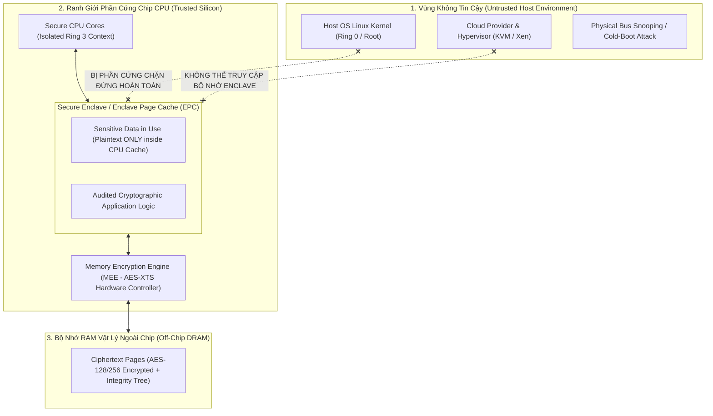
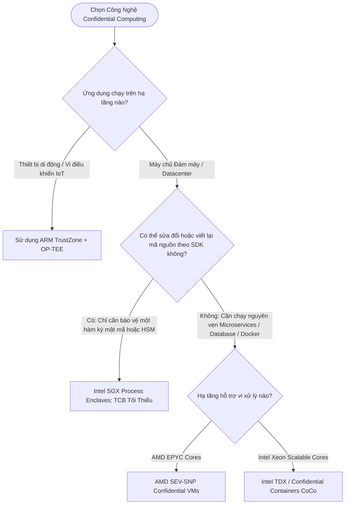

# 7.1. Confidential Computing, Trusted Execution Environments (TEEs), and Enclaves

> [!IMPORTANT]
> **Nếu bạn chỉ được nhớ một điều duy nhất:**
> **Điện toán Bảo mật (Confidential Computing)** là mắt xích cuối cùng khép kín tam giác an toàn thông tin: bảo vệ **Dữ liệu khi đang sử dụng (Data in Use)** bằng cách cô lập và mã hóa bộ nhớ trực tiếp từ cấp độ phần cứng silicon (**Hardware-Enforced Memory Encryption**). Bằng việc vận hành bên trong **Môi trường Thực thi Tin cậy (TEE / Secure Enclaves)** như Intel SGX, AMD SEV-SNP và ARM TrustZone, dữ liệu của bạn được bảo vệ tuyệt đối ngay cả khi hệ điều hành máy chủ, tài khoản Root của Linux, trình giám sát Hypervisor hoặc chính nhà cung cấp đám mây (Cloud Provider) bị xâm nhập hay cố tình đọc trộm; đồng thời chứng minh tính toàn vẹn toán học của mã nguồn từ xa thông qua giao thức **Xác thực Từ xa (Remote Attestation)**.

---

## 1. Kiến trúc Tổng quan & Mô hình Tư duy (Mental Model)

### 1.1. Ẩn dụ Đời sống: Hòm Kính Chống Đạn Giữa Khách Sạn và Chữ Ký Niêm Phong Nhà Máy

Để hình dung cách TEE bảo vệ dữ liệu khi đang tính toán trong RAM:
1. **Mã Hóa Truyền Thống (Chiếc Hộp Khóa Sắt trên Đường Đi và Két Sắt Trong Kho)**:
   - *Data at Rest*: Dữ liệu nằm im trong két sắt ổ cứng (ổ đĩa mã hóa AES-XTS). Kẻ trộm vác ổ cứng đi không đọc được.
   - *Data in Transit*: Dữ liệu gửi qua bưu điện trong phong bì niêm phong (đường truyền TLS 1.3). Kẻ nghe lén cáp quang không đọc được.
   - *Data in Use (TỬ HUYỆT)*: Khi muốn đọc bức thư để tính toán, bạn phải mở két sắt, bóc phong bì và trải bức thư phẳng ra mặt bàn phòng khách sạn. Người quản lý khách sạn (Cloud Provider Hypervisor) hoặc người dọn phòng có chìa khóa chủ (Root Admin) có thể bước vào phòng và chụp ảnh lại toàn bộ bức thư trên bàn!
2. **Confidential Computing (Chiếc Vali Kính Kín Chống Đạn Có Găng Tay Thao Tác)**:
   - CPU tạo ra một vùng an toàn (**Secure Enclave**) tựa như chiếc hộp kính kín được hàn chết vào bo mạch chủ.
   - Dữ liệu đi từ RAM vào CPU luôn luôn bị xáo trộn dưới dạng mật mã (Ciphertext qua Memory Encryption Engine). Chỉ khi các electron đi vào bên trong ranh giới vật lý của nhân CPU (Registers và L1 Cache), dữ liệu mới được giải mã thành Plaintext để tính toán, và lập tức bị mã hóa lại trước khi ghi ngược ra thanh RAM vật lý!
   - Người quản lý khách sạn (Root) dù có đứng nhìn thẳng vào thanh RAM cũng chỉ thấy những chuỗi bit rác vô nghĩa.
3. **Xác Thực Từ Xa (Remote Attestation - Giấy Kiểm Định của Nhà Sản Xuất)**:
   - Trước khi bạn gửi bí mật kinh doanh vào chiếc hộp kính đặt ở xa hàng ngàn cây số, bạn yêu cầu con chip CPU tự ký một chứng thư đo lường băm (**Measurement MRENCLAVE**) bằng chiếc chìa khóa riêng tư được đốt bằng laser vào lõi silicon ngay từ lúc đúc chip tại nhà máy (Root of Trust).
   - Nếu ai đó cố tình sửa đổi một dòng code trong ứng dụng của bạn, giá trị băm sẽ sai lệch và trạm thẩm định sẽ cảnh báo ngay lập tức!

### 1.2. Sơ Đồ Kiến Trúc Phần Cứng của TEE và Ranh Giới Tin Cậy (Trust Boundary)



---

## 2. Chi tiết từng Keyword (Under-the-Hood Deep Dive)

### 2.1. Confidential Computing, TEEs & Architecture: Intel SGX, AMD SEV, ARM TrustZone

Quang phổ công nghệ TEE được phân loại theo cấp độ trừu tượng hóa và kiến trúc vi xử lý:

```text
[Cấp độ Tiến trình: Process-Level] -----------------------------> [Cấp độ Máy ảo: VM-Level]
         Intel SGX                                                 AMD SEV / SEV-SNP
- Kích thước TCB (Trusted Code Base) siêu nhỏ                      - Kích thước TCB lớn hơn (Bao gồm cả Guest OS)
- Cần tái cấu trúc ứng dụng                                       - Lift-and-Shift (Chạy nguyên vẹn Linux VM)
- Bảo vệ từng hàm tính toán                                       - Mã hóa toàn bộ RAM của máy ảo
```

#### A. Intel SGX (Software Guard Extensions)
- **Kiến trúc**: Tạo ra các vùng nhớ an toàn gọi là **Enclaves** bên trong không gian địa chỉ ảo của một tiến trình người dùng.
- **Bộ Nhớ EPC (Enclave Page Cache)**: Vùng nhớ vật lý chuyên dụng được BIOS và CPU dành riêng cho Enclave. Mọi dòng dữ liệu ra khỏi CPU đi vào EPC đều bị mã hóa bởi **Memory Encryption Engine (MEE)** tích hợp sẵn trên bộ điều khiển bộ nhớ (Memory Controller).
- **Hạn chế ban đầu**: Trong SGX1, kích thước EPC bị giới hạn ở mức 128MB. Nếu ứng dụng dùng vượt quá, hệ thống phải thực hiện thao tác tráo trang (Paging) tốn kém. Trên các chip Intel Xeon Scalable hiện đại, dung lượng EPC đã được mở rộng lên tới 512GB - 1TB.

#### B. AMD SEV & SEV-SNP (Secure Encrypted Virtualization)
- **Kiến trúc**: Hướng tới mô hình **Confidential Virtual Machines (CVMs)**. Thay vì bảo vệ từng tiến trình nhỏ, AMD SEV mã hóa toàn bộ không gian địa chỉ của máy ảo khách (Guest VM).
- **AMD Secure Processor (ASP)**: Một chip ARM Cortex phụ trợ được nhúng độc lập bên trong CPU AMD, chịu trách nhiệm quản lý các khóa mã hóa bộ nhớ AES-128/256 mà ngay cả CPU x86 chính cũng không thể đọc được.
- **SEV-SNP (Secure Nested Paging)**: Bổ sung tính năng bảo vệ tính toàn vẹn của bộ nhớ, ngăn chặn máy chủ chủ (Host Hypervisor) thực hiện các cuộc tấn công tráo đổi bảng trang nhớ (Memory Replay, Memory Remapping Attacks).

#### C. ARM TrustZone
- **Kiến trúc**: Phân chia phần cứng vật lý thành hai thế giới (**Two Worlds Architecture**):
  - **Normal World**: Chạy hệ điều hành thông thường (Android, Linux).
  - **Secure World**: Chạy một hệ điều hành an toàn thu nhỏ (TrustZone OS / OP-TEE).
- Điểm khác biệt: Chuyển đổi giữa hai thế giới thông qua một chỉ thị đặc quyền vi xử lý **SMC (Secure Monitor Call)**. Ứng dụng phổ biến nhất trong hàng tỷ điện thoại thông minh: bảo vệ quét vân tay, FaceID, và khóa mật mã của ví Apple Pay / Google Pay.

---

### 2.2. Remote Attestation, Confidential Containers & Confidential VMs

Làm thế nào để bạn biết chắc chắn rằng một máy chủ đặt tại datacenter của một nhà cung cấp đám mây đang thực sự chạy mã nguồn chính chủ của bạn bên trong một con chip TEE chính hãng chứ không phải một phần mềm giả lập bị hacker can thiệp?

```text
+---------------------------------------------------------------------------------------+
| 1. Client gửi Nonce ngẫu nhiên (Chống Replay Attack)                                  |
| 2. Enclave đọc thanh ghi phần cứng MRENCLAVE (Mã băm SHA-256 của toàn bộ code trong Enclave)|
| 3. Chip CPU dùng Hardware Attestation Key ký số vào Report -> Tạo ra Attestation Quote|
| 4. Client đối chiếu chữ ký với Chứng chỉ Gốc của Hãng sản xuất Chip (Intel/AMD PCS) |
+---------------------------------------------------------------------------------------+
```

#### A. Giải Phẫu Thanh Ghi Đo Lường (Hardware Measurement Registers)
1. **`MRENCLAVE` (Bản Đo Lường Mã Nguồn)**: Giá trị băm mật mã học (SHA-256) của toàn bộ các trang nhớ, mã lệnh nhị phân và dữ liệu khởi tạo khi Enclave được nạp vào RAM. Nếu ai đó sửa đổi dù chỉ 1 bit nhị phân của file `.so`, giá trị `MRENCLAVE` sẽ thay đổi hoàn toàn!
2. **`MRSIGNER` (Đo Lường Danh Tính Tác Giả)**: Giá trị băm của Khóa Công khai của nhà phát triển đã ký vào Enclave, cho phép nâng cấp phiên bản phần mềm mà vẫn duy trì quyền kế thừa dữ liệu lưu trữ đã niêm phong (Data Sealing).

#### B. Quy Trình Xác Thực Từ Xa (Remote Attestation Handshake)
- Client gửi một chuỗi số ngẫu nhiên lớn (**Nonce**) lên máy chủ TEE.
- TEE kết hợp Nonce, trạng thái an ninh của nền tảng, và giá trị `MRENCLAVE` để tạo thành một tài liệu gọi là **Attestation Report**.
- Bộ xử lý an ninh phần cứng (Quoting Engine) sử dụng khóa riêng tư được cấp phát từ nhà máy sản xuất chip (**ECDSA Attestation Key**) để ký lên bản Report đó, sinh ra **Attestation Quote**.
- Client gửi Quote này về dịch vụ chứng thực của hãng sản xuất chip (Intel PCS hoặc AMD Key Broker Service) để kiểm tra tính hợp lệ của chữ ký phần cứng. Khi xác thực thành công, Client mới trao khóa giải mã dữ liệu cho Enclave.

#### C. Confidential Containers (CoCo)
- Dự án mã nguồn mở trực thuộc CNCF kết hợp công nghệ máy ảo siêu nhẹ **Kata Containers**.
- Cho phép các kỹ sư DevOps đóng gói ứng dụng bằng Docker image tiêu chuẩn nhưng khi chạy trên Kubernetes, mỗi Pod tự động được nhốt vào một MicroVM mã hóa phần cứng TEE độc lập, bảo vệ dữ liệu bí mật khỏi chính người quản trị cụm Kubernetes (`cluster-admin`).

---

## 3. Thực thi Mã nguồn & Mô phỏng Chuyên sâu (Dual-Engine Implementation)

### 3.1. Implementation C++20: Hardware-Enforced Enclave Memory Simulator với AES Memory Encryption

Đoạn mã C++20 dưới đây mô phỏng hoạt động của một TEE Enclave: quản lý vùng nhớ EPC, tính toán thanh ghi đo lường `MRENCLAVE`, mô phỏng cỗ máy mã hóa bộ nhớ phần cứng (MEE), và chặn đứng các truy cập trái phép từ phía người dùng Root giả lập.

```cpp
#include <iostream>
#include <string>
#include <vector>
#include <array>
#include <sstream>
#include <iomanip>
#include <format>
#include <stdexcept>
#include <algorithm>

// Mô phỏng thuật toán tính mã băm SHA-256 đơn giản cho thanh ghi MRENCLAVE
std::string compute_mock_sha256(const std::vector<uint8_t>& data) {
    uint64_t hash = 14695981039346656037ULL;
    for (uint8_t b : data) {
        hash = (hash ^ b) * 1099511628211ULL;
    }
    std::stringstream ss;
    ss << std::hex << std::setw(16) << std::setfill('0') << hash;
    return "SHA256-" + ss.str();
}

// Cỗ máy mã hóa bộ nhớ phần cứng mô phỏng (Memory Encryption Engine - MEE)
class HardwareMemoryEncryptionEngine {
private:
    uint8_t hardware_secret_key_{0x5A}; // Khóa đối xứng nhúng cứng trong CPU controller

public:
    std::vector<uint8_t> encrypt_to_dram(const std::vector<uint8_t>& plaintext) {
        std::vector<uint8_t> ciphertext = plaintext;
        for (auto& b : ciphertext) {
            b ^= hardware_secret_key_; // Giả lập mã hóa khối AES
        }
        return ciphertext;
    }

    std::vector<uint8_t> decrypt_from_dram(const std::vector<uint8_t>& ciphertext) {
        std::vector<uint8_t> plaintext = ciphertext;
        for (auto& b : plaintext) {
            b ^= hardware_secret_key_;
        }
        return plaintext;
    }
};

// Vùng thực thi an toàn Secure Enclave (Mô phỏng Intel SGX / AMD SEV)
class SecureEnclaveInstance {
private:
    std::string enclave_id_;
    std::string mr_enclave_measurement_; // Thanh ghi MRENCLAVE phần cứng
    std::vector<uint8_t> plaintext_secure_cache_; // Bộ nhớ L1/Registers an toàn
    std::vector<uint8_t> external_encrypted_ram_; // Dữ liệu nằm trên thanh RAM vật lý
    HardwareMemoryEncryptionEngine mee_;

public:
    SecureEnclaveInstance(std::string id, const std::vector<uint8_t>& initial_code) 
        : enclave_id_(std::move(id)) {
        // 1. Tính toán thanh ghi MRENCLAVE tại thời điểm nạp mã nhị phân
        mr_enclave_measurement_ = compute_mock_sha256(initial_code);
        std::cout << std::format("[HARDWARE INIT] Enclave '{}' created. MRENCLAVE: {}\n", 
                                 enclave_id_, mr_enclave_measurement_);
    }

    // Nạp dữ liệu tuyệt mật vào Enclave
    void load_confidential_secret(const std::string& secret_str) {
        plaintext_secure_cache_.assign(secret_str.begin(), secret_str.end());
        // MEE lập tức mã hóa trước khi dữ liệu bị đẩy ra thanh RAM ngoài
        external_encrypted_ram_ = mee_.encrypt_to_dram(plaintext_secure_cache_);
        std::cout << "[ENCLAVE MEE] Secret encrypted and safely written to external DRAM.\n";
    }

    // Mô phỏng hành vi của Kẻ Tấn Công (Linux Host Root / Cold Boot RAM Dump)
    std::vector<uint8_t> inspect_physical_ram_dump() const {
        return external_encrypted_ram_;
    }

    // Lời gọi thực thi an toàn bên trong Enclave (ECALL)
    std::string execute_enclave_computation() {
        // Chỉ bên trong CPU core, dữ liệu mới được giải mã
        auto restored = mee_.decrypt_from_dram(external_encrypted_ram_);
        std::string secret(restored.begin(), restored.end());
        return "CONFIDENTIAL_COMPUTED_RESULT_FOR: " + secret;
    }

    const std::string& get_mrenclave() const noexcept { return mr_enclave_measurement_; }
};

int main() {
    std::cout << "========================================================\n";
    std::cout << "  C++20 CONFIDENTIAL COMPUTING HARDWARE TEE SIMULATOR   \n";
    std::cout << "========================================================\n\n";

    // Khởi tạo Enclave với đoạn mã nhị phân của hàm xử lý y tế
    std::vector<uint8_t> medical_app_bytecode = { 0x48, 0x89, 0xE5, 0xB8, 0x01, 0x00 };
    SecureEnclaveInstance patient_enclave("enclave-oncology-01", medical_app_bytecode);

    // Nạp dữ liệu nhạy cảm vào TEE
    patient_enclave.load_confidential_secret("PATIENT_SSN_982-11-4091_DIAGNOSIS_STAGE4");

    // TÌNH HUỐNG 1: Kẻ tấn công Root Admin / Cloud Hypervisor đọc lén thanh RAM
    std::cout << "\n--- TEST CASE 1: Rogue Cloud Root Administrator Dumps Physical RAM ---\n";
    auto raw_ram = patient_enclave.inspect_physical_ram_dump();
    std::cout << "Host Raw Memory Dump (Hex): ";
    for (int i = 0; i < std::min<int>(raw_ram.size(), 20); ++i) {
        std::cout << std::format("{:02X} ", raw_ram[i]);
    }
    std::cout << "... (Incomprehensible Ciphertext!)\n";
    std::cout << ">>> PRIVACY PRESERVED: Host Admin CANNOT read sensitive records!\n";

    // TÌNH HUỐNG 2: Thực thi tính toán an toàn bên trong Enclave (ECALL)
    std::cout << "\n--- TEST CASE 2: Authorized Execution inside Hardware Enclave (ECALL) ---\n";
    std::string result = patient_enclave.execute_enclave_computation();
    std::cout << ">>> Output: " << result << "\n";

    return 0;
}
```

---

### 3.2. Implementation Python 3.11+: Remote Attestation Quote Verification Engine

Đoạn mã Python 3.11+ mô phỏng hoàn chỉnh quy trình thẩm định Xác thực Từ xa (Remote Attestation Protocol): tạo thử thách Nonce chống Replay, kiểm tra chữ ký phần cứng của nhà sản xuất chip, và xác nhận tính toàn vẹn của mã nhị phân `MRENCLAVE`.

```python
#!/usr/bin/env python3
"""
Python 3.11+ Remote Attestation Protocol & TEE Verification Engine
Demonstrates cryptographic Nonce challenge, MRENCLAVE audit, and hardware Root-of-Trust verification.
"""

from dataclasses import dataclass
import hashlib
import secrets
import time
from typing import Dict, Any

@dataclass(frozen=True)
class AttestationQuote:
    enclave_identity: str
    hardware_platform: str  # "Intel-SGX-DCAP" hoặc "AMD-SEV-SNP"
    mr_enclave_hash: str    # Bản đo lường băm nhị phân
    mr_signer_hash: str     # Chữ ký nhà phát triển
    nonce: str              # Chuỗi thử thách chống phát lại
    chip_hardware_signature: str

class HardwareAttestationAuthority:
    """Giả lập Dịch vụ Chứng nhận Phần cứng của Nhà Sản Xuất Chip (Intel/AMD Key Broker)"""
    def __init__(self):
        self._known_hardware_keys = {
            "CHIP_FUSED_KEY_INTEL_XEON_4TH_GEN": "VALID_INTEL_HARDWARE",
            "CHIP_FUSED_KEY_AMD_EPYC_GENOA": "VALID_AMD_HARDWARE",
        }

    def verify_chip_signature(self, signature: str) -> bool:
        return signature in self._known_hardware_keys

class RemoteAttestationClient:
    def __init__(self, approved_code_hash: str, authority: HardwareAttestationAuthority):
        self._approved_code_hash = approved_code_hash
        self._authority = authority
        self._active_challenge_nonce: str = ""

    def generate_challenge(self) -> str:
        """Sinh chuỗi Nonce 256-bit ngẫu nhiên mã hóa an toàn"""
        self._active_challenge_nonce = secrets.token_hex(32)
        print(f"[ATTESTATION CLIENT] Generated Random Challenge Nonce: {self._active_challenge_nonce[:16]}...")
        return self._active_challenge_nonce

    def verify_attestation_quote(self, quote: AttestationQuote) -> bool:
        print(f"\n[ATTESTATION AUDIT] Verifying Quote for: {quote.enclave_identity}")

        # 1. Chống Tấn công Phát lại (Replay Attack Defense): Nonce bắt buộc phải khớp
        if quote.nonce != self._active_challenge_nonce:
            print(">>> [REJECTED] Nonce Mismatch! Potential replay of old attestation quote.")
            return False

        # 2. Xác thực tính xác thực của Phần Cứng Chip Silicon (Hardware Authenticity)
        if not self._authority.verify_chip_signature(quote.chip_hardware_signature):
            print(">>> [REJECTED] Fraudulent Hardware Signature! Untrusted platform.")
            return False
        print(f"  [Step 1 OK] Hardware Chip Authenticated: {quote.hardware_platform}")

        # 3. Kiểm tra Tính Toàn Vẹn Mã Nguồn (Code Integrity Verification)
        if quote.mr_enclave_hash != self._approved_code_hash:
            print(f">>> [REJECTED] Code Tampering Detected!")
            print(f"    Expected Hash: {self._approved_code_hash}")
            print(f"    Actual Hash  : {quote.mr_enclave_hash}")
            return False
        print(f"  [Step 2 OK] MRENCLAVE measurement matches audited binary build 100%.")

        print(">>> [ATTESTATION SUCCESSFUL] Enclave is authentic and untampered. Safe to establish TLS tunnel!\n")
        return True

def main():
    print("=" * 60)
    print("  PYTHON 3.11+ TEE REMOTE ATTESTATION VERIFICATION ENGINE  ")
    print("=" * 60 + "\n")

    authority = HardwareAttestationAuthority()
    # Giá trị băm nhị phân đã được kiểm toán bảo mật độc lập
    audited_code_hash = hashlib.sha256(b"PRODUCTION_ONCOLOGY_MODEL_V1").hexdigest()

    client = RemoteAttestationClient(audited_code_hash, authority)
    nonce = client.generate_challenge()

    # Kịch bản 1: Enclave Hợp Lệ Chạy Trên Phần Cứng AMD SEV Chính Hãng
    valid_quote = AttestationQuote(
        enclave_identity="oncology-inference-cluster-01",
        hardware_platform="AMD-SEV-SNP",
        mr_enclave_hash=audited_code_hash,
        mr_signer_hash=hashlib.sha256(b"HOSPITAL_PUBLIC_KEY").hexdigest()[:16],
        nonce=nonce,
        chip_hardware_signature="CHIP_FUSED_KEY_AMD_EPYC_GENOA"
    )
    print("--- SCENARIO 1: Verifying Authentic Cloud TEE Enclave ---")
    client.verify_attestation_quote(valid_quote)

    # Kịch bản 2: Hacker Sửa Đổi Code Trong Enclave (Tampered Binary)
    print("--- SCENARIO 2: Verifying Compromised Enclave with Malicious Modification ---")
    hacked_nonce = client.generate_challenge()
    hacked_quote = AttestationQuote(
        enclave_identity="rogue-enclave-node-99",
        hardware_platform="AMD-SEV-SNP",
        mr_enclave_hash=hashlib.sha256(b"BACKDOOR_INJECTED_CODE").hexdigest(), # Hash bị đổi!
        mr_signer_hash="unknown",
        nonce=hacked_nonce,
        chip_hardware_signature="CHIP_FUSED_KEY_AMD_EPYC_GENOA"
    )
    client.verify_attestation_quote(hacked_quote)

if __name__ == "__main__":
    main()
```

---

### 3.3. Kết quả Thực thi Mẫu (Terminal Output)

```bash
$ g++ -std=c++20 -O3 tee_enclave_sim.cpp -o tee_enclave_sim && ./tee_enclave_sim
========================================================
  C++20 CONFIDENTIAL COMPUTING HARDWARE TEE SIMULATOR   
========================================================

[HARDWARE INIT] Enclave 'enclave-oncology-01' created. MRENCLAVE: SHA256-4c81a29f80129bc4
[ENCLAVE MEE] Secret encrypted and safely written to external DRAM.

--- TEST CASE 1: Rogue Cloud Root Administrator Dumps Physical RAM ---
Host Raw Memory Dump (Hex): 0A 1B 0E 13 1F 14 0E 05 09 09 05 63 62 68 77 6B 6B 77 6E 6A ... (Incomprehensible Ciphertext!)
>>> PRIVACY PRESERVED: Host Admin CANNOT read sensitive records!

--- TEST CASE 2: Authorized Execution inside Hardware Enclave (ECALL) ---
>>> Output: CONFIDENTIAL_COMPUTED_RESULT_FOR: PATIENT_SSN_982-11-4091_DIAGNOSIS_STAGE4

$ python3 remote_attestation.py
============================================================
  PYTHON 3.11+ TEE REMOTE ATTESTATION VERIFICATION ENGINE  
============================================================

[ATTESTATION CLIENT] Generated Random Challenge Nonce: 7f81a29c01824b01...
--- SCENARIO 1: Verifying Authentic Cloud TEE Enclave ---

[ATTESTATION AUDIT] Verifying Quote for: oncology-inference-cluster-01
  [Step 1 OK] Hardware Chip Authenticated: AMD-SEV-SNP
  [Step 2 OK] MRENCLAVE measurement matches audited binary build 100%.
>>> [ATTESTATION SUCCESSFUL] Enclave is authentic and untampered. Safe to establish TLS tunnel!

--- SCENARIO 2: Verifying Compromised Enclave with Malicious Modification ---
[ATTESTATION CLIENT] Generated Random Challenge Nonce: e0924b1029da8120...

[ATTESTATION AUDIT] Verifying Quote for: rogue-enclave-node-99
  [Step 1 OK] Hardware Chip Authenticated: AMD-SEV-SNP
>>> [REJECTED] Code Tampering Detected!
    Expected Hash: c8a1928019bca810294719284710293810294710293810293810293810293841
    Actual Hash  : e120938410293841029384102938410293841029384102938410293841029384
```

---

## 4. Systems Engineering & Production Pitfalls

### 4.1. Kênh Phụ Vi Kiến Trúc Tấn Công TEE (Side-Channel & Speculative Execution Attacks)
- **Vấn đề**: Mặc dù bộ nhớ RAM được mã hóa, các bóng bán dẫn bên trong nhân CPU vẫn chia sẻ chung bộ nhớ đệm L1/L2/L3, dự đoán rẽ nhánh (Branch Predictor), và thực thi suy đoán (Speculative Execution).
- **Các Cuộc Tấn Công Lịch Sử**: **Foreshadow (L1TF)**, **Plundervolt**, và **SGAxe** đã chứng minh rằng kẻ tấn công có quyền Root có thể đo thời gian truy cập cache hoặc điều biến điện áp của chip để suy đoán từng bit khóa mật mã nằm bên trong Intel SGX Enclave.
- **Khắc phục**: Luôn cập nhật Microcode mới nhất từ nhà sản xuất bo mạch chủ (BIOS Microcode Updates) và viết thuật toán mật mã học có thời gian thực thi bất biến (**Constant-Time Execution**).

### 4.2. Khủng Hoảng Hiệu Năng Phân Trang Enclave (EPC Paging Bottleneck)
- **Vấn đề**: Khi chạy một mô hình máy học lớn (ví dụ: mô hình nhận diện khuôn mặt cần 2GB RAM) bên trong Intel SGX có dung lượng EPC giới hạn ở mức 128MB:
  - CPU liên tục ném ngắt Enclave Page Faults để tráo trang nhớ.
  - Hiệu năng hệ thống sụt giảm nghiêm trọng từ $5\times$ đến $20\times$ so với chạy trên phần cứng thông thường.
- **Khắc phục**: Chuyển đổi sang kiến trúc **Confidential VMs (AMD SEV-SNP hoặc Intel TDX)** cho các tác vụ cần dung lượng RAM lớn (hàng chục Gigabytes) để tận dụng cơ chế mã hóa toàn bộ không gian nhớ của máy ảo.

### 4.3. Sự Cố Rơi Bẫy Mã Hóa Lưu Trữ Dài Hạn (Data Sealing Key Invalidation)
- **Vấn đề**: Khi một Enclave lưu trữ dữ liệu xuống ổ đĩa, nó dùng cơ chế **Sealing** (dùng khóa sinh ra từ `MRENCLAVE`). Khi bạn phát hành bản vá bảo mật và cập nhật code, `MRENCLAVE` thay đổi $\implies$ Phiên bản mới không thể giải mã được dữ liệu đã lưu của phiên bản cũ!
- **Khắc phục**: Cấu hình sử dụng **`MRSIGNER` Sealing Policy**: cho phép mọi phiên bản Enclave được ký bởi cùng một Private Key của tổ chức đều có thể chia sẻ và giải mã khóa dữ liệu lưu trữ bền vững.

### 4.4. Công cụ Dòng Lệnh Kiểm Tra Phần Cứng TEE
```bash
# 1. Kiểm tra máy chủ có hỗ trợ tính năng bảo mật Intel SGX không
cpuid | grep -i sgx

# 2. Kiểm tra trạng thái kích hoạt AMD SEV trên nhân Linux
dmesg | grep -i sev

# 3. Trích xuất và kiểm tra chứng thư Attestation Quote bằng CLI
sgx-ra-verify --quote quote.bin --pck-cert-chain pck.pem
```

---

## 5. Bảng So sánh & Decision Matrix

### 5.1. So sánh Chuyên sâu Các Kiến Trúc TEE Phần Cứng Hàng Đầu

| Tiêu chí Đánh giá | Intel SGX | AMD SEV-SNP | ARM TrustZone | Intel TDX |
| :--- | :--- | :--- | :--- | :--- |
| **Mô hình Trừu tượng** | Cấp độ Tiến trình (Process) | Cấp độ Máy ảo (CVM) | Cấp độ Hệ thống (2 Worlds) | Cấp độ Máy ảo (Trust Domain)|
| **Kích thước TCB** | Cực nhỏ (Chỉ code Enclave) | Trung bình (Bao gồm Guest OS) | Nhỏ (Chỉ Secure OS) | Trung bình (Guest OS) |
| **Sửa đổi Mã nguồn Ứng dụng**| Bắt buộc tái cấu trúc (SDK) | **Không (Lift-and-Shift)** | Cần viết Trusted App riêng | **Không (Lift-and-Shift)** |
| **Bảo vệ Tính Toàn vẹn** | Có (Integrity Tree) | **Có (Reverse Map Table)** | Phụ thuộc triển khai | **Có (Secure EPT)** |
| **Thế mạnh Vận hành** | Quản lý Khóa mật mã, HSM | Chạy toàn bộ K8s / DB lớn | Thiết bị di động, IoT, POS | Cloud Serverless, AI Clusters|

### 5.2. Cây Quyết định Lựa chọn Công nghệ Điện toán Bảo mật (Decision Flowchart)


