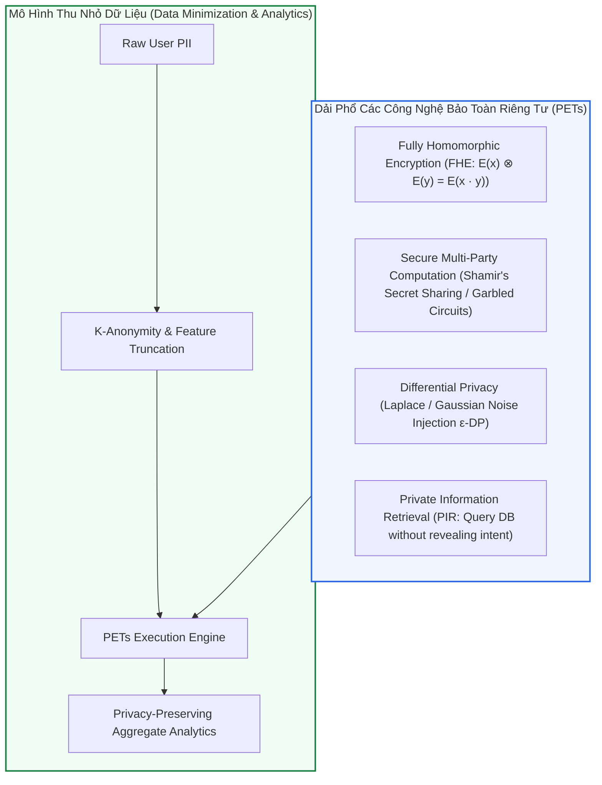
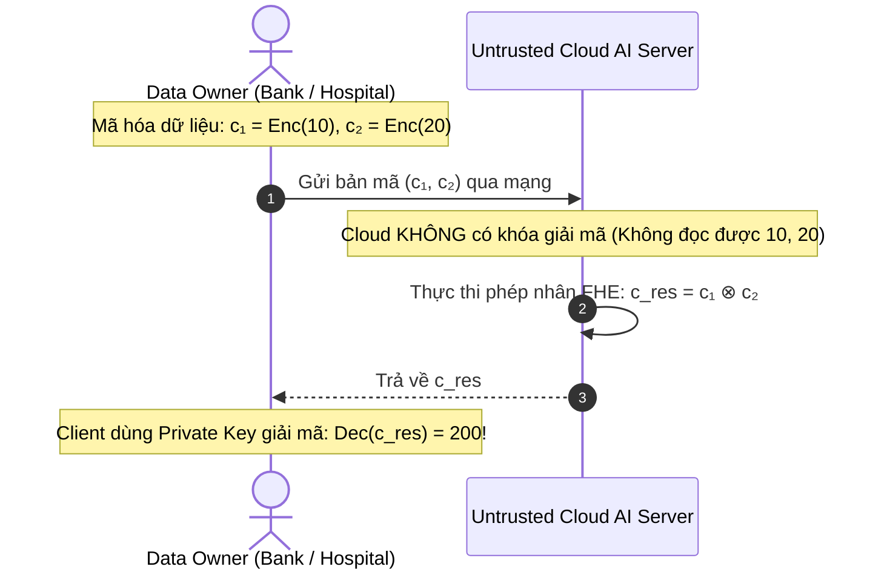
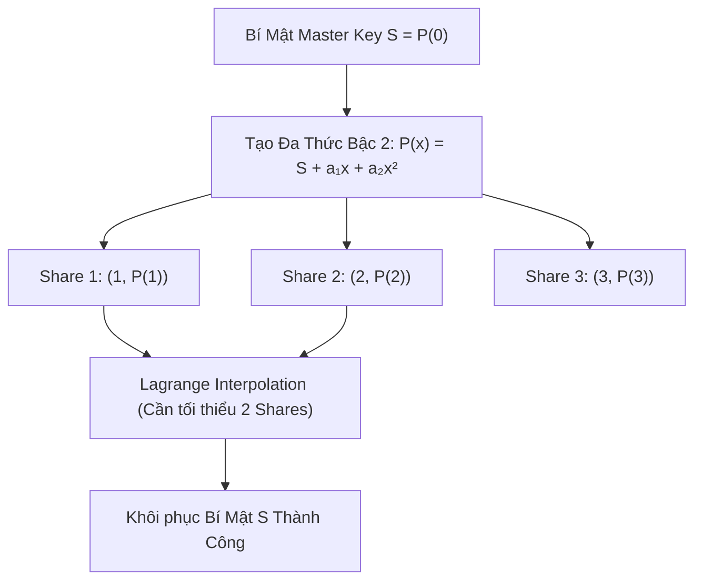
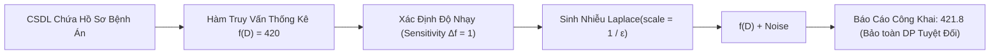

# 7.2. Privacy-Enhancing Technologies (PETs): Homomorphic Encryption, MPC & Differential Privacy

## Tổng quan về Các Công nghệ Tăng cường Quyền Riêng tư (PETs)
Trong kỷ nguyên phân tích dữ liệu lớn (Big Data) và trí tuệ nhân tạo, các tổ chức đối mặt với một xung đột lợi ích gay gắt: Một mặt, họ cần tổng hợp và khai thác dữ liệu người dùng để huấn luyện mô hình và tối ưu hóa dịch vụ; mặt khác, các đạo luật bảo vệ quyền riêng tư nghiêm ngặt trên toàn cầu (như GDPR của Châu Âu, CCPA của Mỹ, hay Nghị định 13 tại Việt Nam) áp đặt các chế tài xử phạt nặng nề đối với hành vi rò rỉ hoặc lạm dụng dữ liệu cá nhân.

Các **Công nghệ Tăng cường Quyền Riêng tư (Privacy-Enhancing Technologies - PETs)** giải quyết nghịch lý này bằng các công cụ toán học và mật mã học tiên tiến, hiện thực hóa nguyên tắc **Điện toán Bảo toàn Quyền riêng tư (Privacy-Preserving Computation)**:
1. **Mã hóa Đồng cấu (Homomorphic Encryption - FHE)**: Cho phép thực hiện các phép toán số học trực tiếp trên bản mã (Ciphertext) mà không bao giờ cần giải mã về dạng bản rõ (Plaintext).
2. **Tính toán Đa bên An toàn (Secure Multi-Party Computation - MPC)**: Cho phép $N$ bên tham gia cùng nhau tính toán một hàm mục tiêu trên các dữ liệu đầu vào bí mật của họ mà không bên nào để lộ dữ liệu cá nhân cho các bên còn lại.
3. **Vi sai Riêng tư (Differential Privacy - DP)**: Tiêu chuẩn vàng toán học chứng minh rằng sự có mặt hay vắng mặt của một cá nhân trong cơ sở dữ liệu không làm thay đổi đáng kể kết quả phân tích thống kê toàn cục.



---

## 2. Chi tiết từng Keyword (Under-the-Hood Deep Dive)

---

### 1. Homomorphic Encryption: Partially (PHE) vs Fully Homomorphic Encryption (FHE)

#### 1. Khái niệm bản chất (What & Why)
- **Homomorphic Encryption**: Hệ thống mật mã học cho phép tính toán trên dữ liệu đã được mã hóa. Kết quả sau khi giải mã sẽ hoàn toàn trùng khớp với kết quả của phép toán đó nếu được thực hiện trên dữ liệu gốc chưa mã hóa.
- **Partially Homomorphic Encryption (PHE)**: Chỉ hỗ trợ duy nhất MỘT loại phép toán (hoặc chỉ phép cộng, hoặc chỉ phép nhân) với số lần không giới hạn. Ví dụ:
  - Hệ mã hóa **Paillier**: Hỗ trợ phép cộng đồng cấu: $\text{Dec}(E(m_1) \cdot E(m_2)) = m_1 + m_2$.
  - Hệ mã hóa **RSA thô**: Hỗ trợ phép nhân đồng cấu: $\text{Dec}(E(m_1) \cdot E(m_2)) = m_1 \times m_2$.
- **Somewhat / Leveled Homomorphic Encryption (SHE/LHE)**: Hỗ trợ cả phép cộng và phép nhân đồng thời, nhưng chỉ thực hiện được một số lượng phép nhân giới hạn (độ sâu mạch số học có hạn) trước khi mức nhiễu (Noise) làm hỏng dữ liệu.
- **Fully Homomorphic Encryption (FHE)**: "Chén thánh" của mật mã học (được Craig Gentry khám phá năm 2009). Cho phép thực hiện **tùy ý số lượng phép toán cộng và nhân bất kỳ** trên bản mã thông qua kỹ thuật làm mới mức nhiễu (**Bootstrapping**). Các sơ đồ tiêu biểu: BGV, BFV, CKKS (tối ưu hóa cho số thực trong ML), TFHE (tính toán cổng logic bitwise).

#### 2. Cơ chế hoạt động sâu (Under the hood / Hardcore Internals)
- **Vấn đề Tích lũy Nhiễu và Thuật toán Bootstrapping**:
  Trong các sơ đồ FHE dựa trên mạng tinh thể (**Lattice-based Cryptography / LWE**), một bản mã bao gồm thông điệp gốc cộng với một lượng nhiễu nhỏ ngẫu nhiên ($c = a \cdot s + 2e + m$).
  - Phép cộng làm mức nhiễu tăng tuyến tính ($e_1 + e_2$).
  - Phép nhân làm mức nhiễu bùng nổ theo hàm mũ ($e_1 \times e_2$).
  - Khi mức nhiễu vượt quá một ngưỡng ranh giới toán học nhất định, bản mã sẽ không thể giải mã được nữa.
  - **Kỹ thuật Bootstrapping của Gentry**: Đưa bản mã đã bị nhiễm nhiễu nặng và một khóa mã hóa homomorphic vào chính một mạch giải mã homomorphic nội bộ. Quá trình này "giải mã homomorphic" bản mã để tạo ra một bản mã mới hoàn toàn sạch nhiễu mà không bao giờ để lộ bản rõ ra ngoài!

#### 3. Sơ đồ minh họa


#### 4. Code ví dụ thực chiến (C++ Paillier Additive Homomorphic Encryption Simulation)
Đoạn mã C++20 mô phỏng nguyên lý tính tổng đồng cấu của hệ mã Paillier:

```cpp
#include <iostream>
#include <cstdint>

// Mô phỏng hệ mã Paillier với số nguyên đơn giản
// Tính chất: Enc(m1) * Enc(m2) mod n^2 = Enc(m1 + m2 mod n)
class MockPaillierPHE {
private:
    uint64_t n_ = 10007; // Số nguyên tố giả lập
public:
    // Giả lập mã hóa: c = (1 + m * n) * r^n mod n^2
    uint64_t encrypt(uint64_t m) const noexcept {
        return (1 + m * n_) % (n_ * n_);
    }

    // Giả lập phép cộng đồng cấu trên đám mây: c_sum = (c1 * c2) mod n^2
    uint64_t homomorphic_add(uint64_t c1, uint64_t c2) const noexcept {
        return (c1 * c2) % (n_ * n_);
    }

    // Giải mã: m = ((c mod n^2 - 1) / n)
    uint64_t decrypt(uint64_t c) const noexcept {
        return ((c - 1) / n_) % n_;
    }
};

int main() {
    MockPaillierPHE crypto;
    uint64_t salary_alice = 5000;
    uint64_t salary_bob   = 7000;

    // 1. Client mã hóa độc lập
    uint64_t c_alice = crypto.encrypt(salary_alice);
    uint64_t c_bob   = crypto.encrypt(salary_bob);

    // 2. Cloud thực hiện tính tổng mà hoàn toàn không biết mức lương của từng người
    uint64_t c_total = crypto.homomorphic_add(c_alice, c_bob);

    // 3. Client giải mã tổng lương
    uint64_t total_decrypted = crypto.decrypt(c_total);
    std::cout << "[PHE Result] Decrypted Total Salary: " << total_decrypted << " (Expected: 12000)\n";
    return 0;
}
```

#### 5. Ưu / Nhược điểm, Pitfalls & Anti-patterns
- **Rào cản Hiệu năng Khổng lồ của FHE**: Phép toán nhân FHE có chi phí tính toán chậm hơn từ **$10,000 \text{ đến } 100,000$ lần** so với phép nhân trên số thực thông thường, và kích thước bản mã bị phình to gấp hàng trăm lần. FHE hiện tại chỉ phù hợp cho các bài toán đặc thù và đang cần sự hỗ trợ của các bộ tăng tốc phần cứng chuyên dụng (FHE ASICs).

#### 6. Ứng dụng thực tế trong Backend / Systems
- Hệ thống chấm điểm tín dụng tài chính ẩn danh (Private Credit Scoring) và phân tích biến thể gen y tế trên nền tảng đám mây công cộng.

---

### 2. Secure Multi-Party Computation (MPC) & Private Information Retrieval (PIR)

#### 1. Khái niệm bản chất (What & Why)
- **Secure Multi-Party Computation (MPC)**: Tập hợp các giao thức mật mã cho phép một nhóm các thực thể tham gia $P_1, P_2, \dots, P_n$ sở hữu các đầu vào bí mật $x_1, x_2, \dots, x_n$ cùng nhau tính toán giá trị của hàm $y = f(x_1, x_2, \dots, x_n)$ sao cho:
  - Tất cả các bên đều nhận được kết quả chính xác $y$.
  - Không có bất kỳ bên nào học được bất kỳ thông tin gì về đầu vào bí mật của các bên khác.
  - Tiêu biểu: Bài toán Các nhà Triệu phú của Yao (Yao's Millionaires' Problem: Hai triệu phú muốn biết ai giàu hơn mà không tiết lộ số tài sản thực tế).
- **Private Information Retrieval (PIR)**: Giao thức cho phép một người dùng truy vấn và tải về một bản ghi cụ thể từ một cơ sở dữ liệu trên máy chủ từ xa mà máy chủ **hoàn toàn không thể biết người dùng đang quan tâm hoặc đọc bản ghi nào**.

#### 2. Cơ chế hoạt động sâu (Under the hood / Hardcore Internals)
- **Cơ chế Chia sẻ Bí mật của Shamir (Shamir's Secret Sharing Scheme - SSS)**:
  Dựa trên định lý hình học cơ bản: Qua $k$ điểm phân biệt trên mặt phẳng, ta xác định được duy nhất một đa thức bậc $k-1$:
  $$P(x) = a_0 + a_1 x + a_2 x^2 + \dots + a_{k-1} x^{k-1}$$
  Để chia sẻ một bí mật $S$ cho $n$ người sao cho cần tối thiểu $k$ người hợp tác mới khôi phục được bí mật (**$(k, n)$ Threshold Scheme**):
  - Đặt bí mật vào hệ số tự do: $a_0 = S$.
  - Chọn ngẫu nhiên các hệ số còn lại $a_1, \dots, a_{k-1}$.
  - Mỗi người nhận một điểm tọa độ $(i, P(i))$.
  - Nếu chỉ có $k-1$ người, họ hoàn toàn không có bất kỳ thông tin nào về $S$ (Information-Theoretic Security). Khi đủ $k$ người, họ dùng công thức **Nội suy Lagrange (Lagrange Interpolation)** để khôi phục $S$:
    $$S = P(0) = \sum_{j=1}^k y_j \prod_{m \neq j} \frac{-x_m}{x_j - x_m}$$

#### 3. Sơ đồ minh họa


#### 4. Code ví dụ thực chiến (C++ Shamir's Secret Sharing (2, 3) Threshold Implementation)
```cpp
#include <iostream>
#include <vector>
#include <random>

struct Share {
    int x;
    int y;
};

class ShamirSecretSharing2of3 {
public:
    // Chia bí mật S thành 3 mảnh, cần 2 mảnh để khôi phục: P(x) = S + a*x
    static std::vector<Share> split_secret(int secret, int a_slope) {
        return {
            {1, secret + a_slope * 1},
            {2, secret + a_slope * 2},
            {3, secret + a_slope * 3}
        };
    }

    // Khôi phục bí mật bằng 2 điểm (x1, y1) và (x2, y2)
    static int recover_secret(const Share& s1, const Share& s2) {
        // Nội suy Lagrange tại x = 0: S = y1 * (-x2)/(x1 - x2) + y2 * (-x1)/(x2 - x1)
        double term1 = static_cast<double>(s1.y) * (-s2.x) / (s1.x - s2.x);
        double term2 = static_cast<double>(s2.y) * (-s1.x) / (s2.x - s1.x);
        return static_cast<int>(std::round(term1 + term2));
    }
};

int main() {
    int master_secret = 8899; // Bí mật cần bảo vệ
    auto shares = ShamirSecretSharing2of3::split_secret(master_secret, 17 /* slope */);

    std::cout << "[SSS] Generated 3 shares: Share 1=(" << shares[0].x << "," << shares[0].y << "), Share 2=(" 
              << shares[1].x << "," << shares[1].y << "), Share 3=(" << shares[2].x << "," << shares[2].y << ")\n";

    // Khôi phục chỉ bằng Share 1 và Share 3 (bỏ qua Share 2)
    int recovered = ShamirSecretSharing2of3::recover_secret(shares[0], shares[2]);
    std::cout << "[SSS] Recovered Secret from Share 1 & 3: " << recovered << " (Match: " << (recovered == master_secret) << ")\n";
    return 0;
}
```

#### 5. Ưu / Nhược điểm, Pitfalls & Anti-patterns
- **Network Roundtrip Explosion trong MPC**: Các giao thức MPC dựa trên mạch xáo trộn (Garbled Circuits) hoặc chuyển giao không màng (Oblivious Transfer) đòi hỏi hàng trăm vòng truyền thông mạng (Network Roundtrips) giữa các bên tham gia cho mỗi phép so sánh bit, làm tăng độ trễ lên đáng kể nếu các bên nằm rải rác ở các châu lục khác nhau.

#### 6. Ứng dụng thực tế trong Backend / Systems
- Triển khai ví tiền điện tử tự lưu ký không khóa riêng (Keyless Non-Custodial MPC Wallets như Fireblocks, Web3Auth).

---

### 3. Differential Privacy (DP) & Data Minimization

#### 1. Khái niệm bản chất (What & Why)
- **Differential Privacy (Vi sai Riêng tư - DP)**: Khung định lượng toán học nghiêm ngặt về quyền riêng tư (do Cynthia Dwork đề xuất năm 2006). Đảm bảo rằng việc thêm vào hoặc bớt đi một bản ghi của một cá nhân trong CSDL không làm thay đổi phân phối xác suất của kết quả truy vấn quá một hệ số $e^\epsilon$:
  $$P(\mathcal{M}(D_1) \in S) \le e^\epsilon \cdot P(\mathcal{M}(D_2) \in S) + \delta$$
  Trong đó:
  - $D_1, D_2$ là hai CSDL láng giềng chỉ khác nhau duy nhất 1 cá nhân.
  - $\epsilon$ (Epsilon): **Ngân sách Quyền riêng tư (Privacy Budget)**. $\epsilon$ càng nhỏ, quyền riêng tư càng được bảo vệ tuyệt đối (nhưng độ chính xác của dữ liệu càng giảm do nhiễu nhiều).
  - $\delta$ (Delta): Xác suất rò rỉ thông tin cực nhỏ có thể chấp nhận được.
- **Data Minimization (Thu nhỏ Dữ liệu)**: Nguyên tắc cốt lõi của GDPR: Hệ thống chỉ được phép thu thập đúng và đủ lượng dữ liệu cần thiết cho mục đích nghiệp vụ cụ thể, thực hiện khử định danh (Pseudonymization), $K$-Anonymity (đảm bảo mỗi bản ghi không thể phân biệt với ít nhất $K-1$ bản ghi khác), và xóa bỏ dữ liệu ngay khi hết thời hạn sử dụng.

#### 2. Cơ chế hoạt động sâu (Under the hood / Hardcore Internals)
- **Cơ chế Nhiễu Laplace (Laplace Mechanism)**:
  Để tính toán một đại lượng thống kê $f(D)$ (ví dụ: đếm số bệnh nhân mắc bệnh hiểm nghèo), hệ thống đo lường độ nhạy toàn cục của hàm (**Global Sensitivity $\Delta f$** - sự thay đổi lớn nhất của kết quả khi thay đổi 1 bản ghi).
  Hệ thống cộng thêm vào kết quả một giá trị nhiễu ngẫu nhiên rút ra từ phân phối Laplace:
  $$\mathcal{M}(D) = f(D) + \text{Laplace}\left(0, \frac{\Delta f}{\epsilon}\right)$$
  Mật độ xác suất của phân phối Laplace:
  $$\text{Lap}(x; b) = \frac{1}{2b} \exp\left(-\frac{|x|}{b}\right) \quad \text{với } b = \frac{\Delta f}{\epsilon}$$

#### 3. Sơ đồ minh họa


#### 4. Code ví dụ thực chiến (TypeScript Laplace Mechanism for Differentially Private Counting)
```typescript
class DifferentialPrivacyEngine {
  // Sinh số ngẫu nhiên theo phân phối Laplace với tham số scale b
  private static sampleLaplace(scale: number): number {
    const u = Math.random() - 0.5; // [-0.5, 0.5]
    return -scale * Math.sign(u) * Math.log(1 - 2 * Math.abs(u));
  }

  // Cơ chế Laplace cho các phép đếm (Count queries có độ nhạy sensitivity = 1)
  public static privateCount(trueCount: number, epsilon: number): number {
    const sensitivity = 1.0;
    const scale = sensitivity / epsilon;
    const noise = this.sampleLaplace(scale);
    const noisyResult = trueCount + noise;
    
    console.log(`[DP Engine] True Count: ${trueCount} | Epsilon: ${epsilon} | Noise Added: ${noise.toFixed(2)} -> Output: ${Math.round(noisyResult)}`);
    return Math.max(0, Math.round(noisyResult));
  }
}

// Test Differential Privacy
const realInfectedCases = 150;
const budgetEpsilon = 0.5; // Ngân sách bảo mật cao

DifferentialPrivacyEngine.privateCount(realInfectedCases, budgetEpsilon);
DifferentialPrivacyEngine.privateCount(realInfectedCases, budgetEpsilon);
```

#### 5. Ưu / Nhược điểm, Pitfalls & Anti-patterns
- **Cạn kiệt Ngân sách Riêng tư (Privacy Budget Exhaustion)**: Mỗi lần người dùng gửi một truy vấn phân tích thống kê tới hệ thống, một lượng ngân sách $\epsilon$ sẽ bị tiêu trừ. Nếu một nhà nghiên cứu liên tục gửi hàng ngàn truy vấn khác nhau trên cùng một tập dữ liệu, ngân sách sẽ cạn kiệt. Nếu tiếp tục cho phép truy vấn, kẻ tấn công có thể dùng phương pháp trung bình hóa thống kê để triệt tiêu nhiễu và tái tạo lại chính xác 100% dữ liệu gốc!

#### 6. Ứng dụng thực tế trong Backend / Systems
- Hệ thống thu thập dữ liệu chẩn đoán telemetry của hệ điều hành Apple iOS và Google Chrome RAPPOR.
