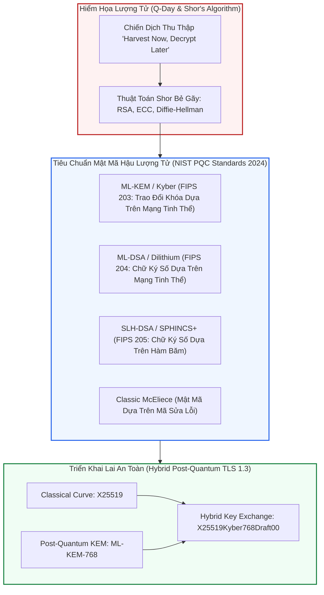
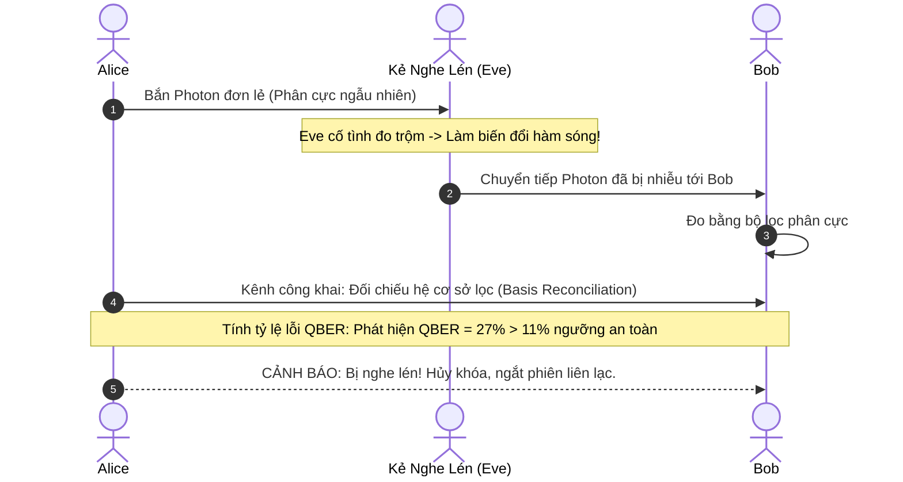
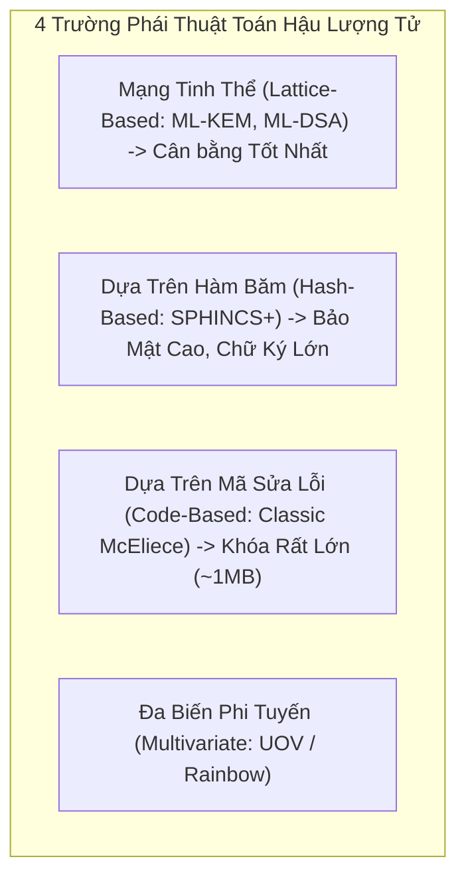
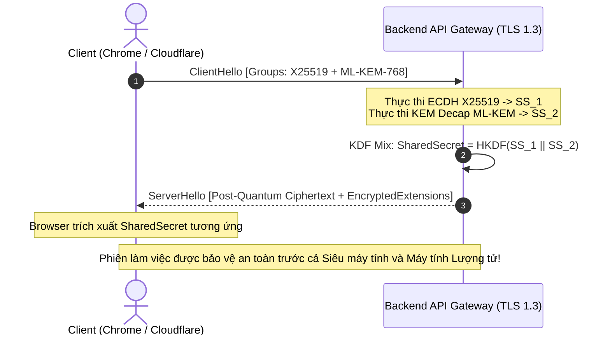

# 8.2. Quantum Cryptography, Post-Quantum Cryptography (PQC) & Migration

## Tổng quan về An ninh Hậu Lượng tử và Mối đe dọa "Thu hoạch Bây giờ, Giải mã Sau"
Sự phát triển nhanh chóng của phần cứng máy tính lượng tử đặt toàn bộ nền tảng an ninh mạng và kinh tế số toàn cầu vào tình trạng báo động khẩn cấp. Toàn bộ các hệ thống bảo mật hiện nay — từ giao thức HTTPS/TLS, cơ sở dữ liệu ngân hàng, chữ ký số thẻ căn cước, cho đến các giao dịch Blockchain — đều dựa trên các thuật toán mật mã hóa khóa công khai bất đối xứng: **RSA** (dựa trên độ khó của việc phân tích thừa số nguyên) và **ECC / ECDSA** (dựa trên bài toán logarit rời rạc trên đường cong elip).

Khi một máy tính lượng tử có khả năng sửa lỗi (Fault-Tolerant Quantum Computer) đạt quy mô vài ngàn Qubit logic ra đời (thường gọi là **Ngày Q - Q-Day**):
- **Thuật toán Shor** sẽ bẻ gãy hoàn toàn RSA-2048, RSA-4096, ECDSA secp256k1 và Ed25519 trong vài phút.
- **Mối đe dọa "Thu hoạch Bây giờ, Giải mã Sau" (HNDL - Harvest Now, Decrypt Later)**: Các cơ quan tình báo và tổ chức tội phạm mạng đang bí mật thu thập, ghi lại và lưu trữ hàng Petabytes lưu lượng mạng viễn thông được mã hóa ngày hôm nay, kiên nhẫn chờ đợi đến Ngày Q để giải mã toàn bộ bí mật quốc gia, hồ sơ bệnh án và giao dịch tài chính quá khứ.

Để đối phó với thảm họa này, thế giới kỹ thuật phần mềm đang ráo riết triển khai hai chiến lược: **Phân phối Khóa Lượng tử (Quantum Key Distribution - QKD)** và **Mật mã Hậu Lượng tử (Post-Quantum Cryptography - PQC)** chạy trên phần cứng cổ điển thông qua kiến trúc **Hybrid TLS 1.3**.



---

## 2. Chi tiết từng Keyword (Under-the-Hood Deep Dive)

---

### 1. Quantum Cryptography vs Quantum Key Distribution (QKD)

#### 1. Khái niệm bản chất (What & Why)
- **Quantum Cryptography (Mật mã Lượng tử)**: Việc ứng dụng các nguyên lý cơ học lượng tử (sự chồng chập, định lý không sao chép, và sự sụp đổ hàm sóng khi đo lường) để xây dựng các kênh truyền tin an toàn tuyệt đối.
- **Quantum Key Distribution (QKD - Phân phối Khóa Lượng tử)**: Giao thức cho phép hai bên (Alice và Bob) thiết lập một chuỗi khóa bí mật ngẫu nhiên dùng chung qua kênh quang học lượng tử, với sự đảm bảo vật lý rằng **bất kỳ nỗ lực nghe lén (Eavesdropping) nào của kẻ thứ ba (Eve) cũng sẽ làm thay đổi trạng thái lượng tử của các hạt photon và bị phát hiện ngay lập tức**.
- **Giao thức BB84 (Bennett & Brassard, 1984)**: Giao thức QKD đầu tiên: Alice mã hóa các bit nhị phân vào các trạng thái phân cực của photon đơn lẻ sử dụng ngẫu nhiên hai hệ cơ sở đo lường (Cơ sở Thẳng đứng/Nằm ngang và Cơ sở Đường chéo $45^\circ$).

#### 2. Cơ chế hoạt động sâu (Under the hood / Hardcore Internals)
- **Cơ chế Phát hiện Nghe lén trong BB84**:
  - Alice gửi một chuỗi photon với phân cực ngẫu nhiên.
  - Bob chọn ngẫu nhiên một trong hai hệ cơ sở để đo từng photon.
  - Sau khi truyền xong, Alice và Bob công khai trên kênh viễn thông thông thường danh sách các hệ cơ sở mà họ đã chọn (nhưng không công khai giá trị bit đo được).
  - Họ loại bỏ tất cả các vị trí mà Bob chọn sai hệ cơ sở (Sifted Key).
  - Họ so sánh công khai một phần nhỏ của chuỗi khóa để đo tỷ lệ lỗi bit (**QBER - Quantum Bit Error Rate**):
    - Nếu không có nghe lén: $\text{QBER} \approx 0\%$.
    - Nếu có Eve chèn vào đo photon: Do định lý không sao chép, phép đo của Eve làm sụp đổ trạng thái photon, tạo ra tỷ lệ lỗi ngẫu nhiên làm $\text{QBER} \ge 25\%$.
    - Alice và Bob phát hiện bị nghe lén và lập tức hủy bỏ toàn bộ phiên tạo khóa!

#### 3. Sơ đồ minh họa


#### 4. Code ví dụ thực chiến (C++ BB84 Quantum Key Distribution Simulation)
```cpp
#include <iostream>
#include <vector>
#include <random>

enum Basis { RECTILINEAR, DIAGONAL }; // 0: +, 1: x

struct Photon {
    int bit_value;
    Basis basis;
};

class BB84Simulator {
public:
    static void run_simulation(size_t num_bits) {
        std::mt19937 gen(1337);
        std::uniform_int_distribution<int> bit_dist(0, 1);
        std::uniform_int_distribution<int> basis_dist(0, 1);

        std::vector<Photon> alice_photons;
        for (size_t i = 0; i < num_bits; ++i) {
            alice_photons.push_back({bit_dist(gen), static_cast<Basis>(basis_dist(gen))});
        }

        // Bob chọn ngẫu nhiên cơ sở để đo
        std::vector<int> bob_measured_bits;
        std::vector<Basis> bob_bases;
        for (size_t i = 0; i < num_bits; ++i) {
            Basis b_basis = static_cast<Basis>(basis_dist(gen));
            bob_bases.push_back(b_basis);

            // Nếu Bob chọn trùng cơ sở với Alice -> Đo chính xác 100%
            if (b_basis == alice_photons[i].basis) {
                bob_measured_bits.push_back(alice_photons[i].bit_value);
            } else {
                bob_measured_bits.push_back(bit_dist(gen)); // Đo sai cơ sở -> Ra giá trị ngẫu nhiên 50/50
            }
        }

        // Đối chiếu cơ sở công khai (Sifting)
        std::vector<int> shared_key;
        for (size_t i = 0; i < num_bits; ++i) {
            if (alice_photons[i].basis == bob_bases[i]) {
                shared_key.push_back(alice_photons[i].bit_value);
            }
        }

        std::cout << "[BB84 Simulation] Sent " << num_bits << " photons -> Distilled Sifted Key of size: " << shared_key.size() << " bits.\n";
    }
};

int main() {
    BB84Simulator::run_simulation(100);
    return 0;
}
```

#### 5. Ưu / Nhược điểm, Pitfalls & Anti-patterns
- **Rào cản Phần cứng và Cự ly Truyền dẫn của QKD**: QKD đòi hỏi đường cáp quang chuyên dụng riêng biệt (Dark Fiber) và các máy dò photon đơn lẻ cực kỳ đắt tiền. Photon bị suy hao trên cáp quang sau khoảng 100-150 km, và không thể sử dụng các bộ lặp quang học cổ điển (vì bộ lặp sẽ làm sụp đổ trạng thái lượng tử).

#### 6. Ứng dụng thực tế trong Backend / Systems
- Tuyến cáp viễn thông bảo mật ngân hàng ngầm kết nối giữa các trung tâm thanh toán liên ngân hàng của các quốc gia.

---

### 2. Post-Quantum Cryptography (PQC) & NIST Standards

#### 1. Khái niệm bản chất (What & Why)
- **Post-Quantum Cryptography (Mật mã Hậu Lượng tử - PQC)**: Các thuật toán mật mã học toán học mới được thiết kế để chạy trên **máy tính cổ điển thông thường hiện có**, nhưng dựa trên các bài toán toán học mà **cả máy tính cổ điển lẫn máy tính lượng tử đều bất khả thi để giải được trong thời gian thực tế**.
- **Bộ Tiêu chuẩn NIST PQC Chính thức (Công bố Tháng 8/2024)**:
  - **FIPS 203 (ML-KEM / CRYSTALS-Kyber)**: Chuẩn đóng gói khóa (Key Encapsulation Mechanism) chính thức cho mã hóa dữ liệu chung.
  - **FIPS 204 (ML-DSA / CRYSTALS-Dilithium)**: Chuẩn chữ ký số chính thức cho xác thực danh tính.
  - **FIPS 205 (SLH-DSA / SPHINCS+)**: Chuẩn chữ ký số không trạng thái dựa trên hàm băm (Stateless Hash-based Signatures) đóng vai trò làm phương án dự phòng tối cao.
  - **FIPS 206 (FN-DSA / FALCON)**: Chữ ký số mạng tinh thể hiệu năng cao cho các thiết bị hạn chế băng thông.

#### 2. Cơ chế hoạt động sâu (Under the hood / Hardcore Internals)
- **Mật mã Dựa trên Mạng Tinh thể (Lattice-Based Cryptography & LWE)**:
  ML-KEM và ML-DSA dựa trên bài toán **Học có Nhiễu (Learning With Errors - LWE / Module-LWE)** và bài toán **Tìm Vector Ngắn nhất (Shortest Vector Problem - SVP)** trên không gian đa chiều ($\mathbb{R}^n$ với $n \approx 512 - 1024$ chiều):
  Cho một ma trận $A$ và vector $b = A \cdot s + e \pmod q$ (với $e$ là vector nhiễu ngẫu nhiên nhỏ).
  Nhiệm vụ: Tìm lại vector bí mật $s$.
  Bài toán này tương đương với việc tìm điểm nút mạng tinh thể gần nhất trong không gian ngàn chiều. Thuật toán Shor lượng tử hoàn toàn vô tác dụng trước cấu trúc hình học mạng tinh thể này!
- **Chữ ký Dựa trên Hàm băm (Hash-Based Signatures - SPHINCS+)**:
  SPHINCS+ chỉ dựa vào tính chất kháng tiền ảnh của các hàm băm an toàn (như SHA-256). Nó xây dựng các cây Merkle lồng nhau nhiều tầng (Hypertree) chứa hàng ngàn chữ ký một lần (**One-Time Signatures - WOTS+**). Mức độ tin cậy bảo mật của nó là tuyệt đối vì không phụ thuộc vào bất kỳ giả thuyết đại số phức tạp nào.

#### 3. Sơ đồ minh họa


#### 4. Code ví dụ thực chiến (C++ Modular Lattice LWE Encryption Toy Demonstration)
Đoạn mã C++20 mô phỏng bài toán Learning With Errors (LWE) bảo vệ một bit nhị phân:

```cpp
#include <iostream>
#include <vector>
#include <random>

class ToyLWE {
private:
    int q_ = 97; // Modulo số nguyên tố nhỏ
public:
    // Mã hóa 1 bit message m (0 hoặc 1)
    std::pair<int, int> encrypt_bit(int m, int secret_s) {
        static std::mt19937 gen(42);
        std::uniform_int_distribution<int> a_dist(0, q_ - 1);
        std::uniform_int_distribution<int> noise_dist(-2, 2); // Nhiễu nhỏ e

        int a = a_dist(gen);
        int e = noise_dist(gen);

        // Biểu diễn m: nếu m=1 thì mã hóa thành q/2 ≈ 48, nếu m=0 mã hóa thành 0
        int encoded_m = (m == 1) ? (q_ / 2) : 0;
        int b = (a * secret_s + e + encoded_m) % q_;
        if (b < 0) b += q_;

        return {a, b}; // Bản mã là cặp (a, b)
    }

    // Giải mã: dec = b - a*s mod q
    int decrypt_bit(std::pair<int, int> ciphertext, int secret_s) {
        int val = (ciphertext.second - (ciphertext.first * secret_s)) % q_;
        if (val < 0) val += q_;

        // Kiểm tra xem val gần 0 hay gần q/2
        int dist_to_0 = std::min(val, q_ - val);
        int dist_to_half = std::abs(val - (q_ / 2));

        return (dist_to_half < dist_to_0) ? 1 : 0;
    }
};

int main() {
    ToyLWE lwe;
    int secret_key = 5;

    auto ct0 = lwe.encrypt_bit(0, secret_key);
    auto ct1 = lwe.encrypt_bit(1, secret_key);

    std::cout << "[LWE Toy] Decrypted bit for 0: " << lwe.decrypt_bit(ct0, secret_key) << "\n";
    std::cout << "[LWE Toy] Decrypted bit for 1: " << lwe.decrypt_bit(ct1, secret_key) << "\n";
    return 0;
}
```

#### 5. Ưu / Nhược điểm, Pitfalls & Anti-patterns
- **Kích thước Khóa và Chữ ký Phình to**: Trong khi khóa công khai RSA-2048 chỉ dài 256 bytes và ECDSA secp256k1 chỉ dài 64 bytes:
  - Khóa công khai của ML-KEM-768 dài **$1,184\text{ bytes}$**.
  - Chữ ký của SPHINCS+-256s dài tới **$29,792\text{ bytes}$**!
  Sự gia tăng kích thước này có thể làm tràn gói tin MTU mạng TCP (gây phân mảnh gói tin IP Fragmentation làm chậm quá trình bắt tay TLS).

#### 6. Ứng dụng thực tế trong Backend / Systems
- Cập nhật chứng chỉ TLS của máy chủ Nginx và cơ sở hạ tầng chứng thực số (Public Key Infrastructure - PKI) sang chuẩn NIST FIPS 203/204.

---

### 3. Hybrid Post-Quantum TLS & Quantum-Safe Migration Roadmap

#### 1. Khái niệm bản chất (What & Why)
- **Hybrid Post-Quantum TLS**: Cơ chế kết hợp đồng thời cả thuật toán trao đổi khóa cổ điển đã được kiểm chứng qua nhiều thập kỷ (**X25519**) và thuật toán hậu lượng tử mới (**ML-KEM-768 / Kyber**) bên trong một lần bắt tay TLS 1.3 duy nhất (**X25519Kyber768Draft00**).
- **Tại sao cần Mô hình Lai (Hybrid Approach)**: Kỹ thuật phòng thủ theo chiều sâu (Defense-in-depth): Nếu các thuật toán PQC mới trong tương lai bị phát hiện có lỗ hổng toán học tiềm ẩn, hệ thống vẫn an toàn nhờ lớp bảo vệ của ECDH cổ điển; ngược lại nếu Ngày Q ập đến, hệ thống vẫn an toàn trước máy tính lượng tử nhờ lớp bảo vệ của Kyber.
- **Crypto-Agility (Tính Cơ động Mật mã)**: Khả năng của kiến trúc phần mềm cho phép thay thế và hoán đổi các thuật toán mật mã học một cách linh hoạt thông qua cấu hình mà không cần phải viết lại hay biên dịch lại toàn bộ ứng dụng.

#### 2. Cơ chế hoạt động sâu (Under the hood / Hardcore Internals)
- **Bắt tay Lai trong TLS 1.3 (Key Encapsulation Hybrid)**:
  Trong thông điệp `ClientHello`:
  1. Client gửi cả hai khóa công khai: $PK_{\text{Classical}}$ và $PK_{\text{PostQuantum}}$ gộp chung vào extension `supported_groups`.
  2. Server tính toán hai bí mật chia sẻ độc lập: $SS_{\text{Classical}}$ qua ECDH và $SS_{\text{PostQuantum}}$ qua ML-KEM Decapsulation.
  3. Server kết hợp hai bí mật này thông qua hàm trích xuất khóa chuẩn **HKDF-Extract**:
     $$\text{MasterSecret} = \text{HKDF-Extract}(\text{Salt}, SS_{\text{Classical}} \parallel SS_{\text{PostQuantum}})$$
  Kẻ tấn công bắt buộc phải bẻ gãy đồng thời cả hai thuật toán mới có thể giải mã được phiên truyền thông!

#### 3. Sơ đồ minh họa


#### 4. Code ví dụ thực chiến (TypeScript Crypto-Agile Provider Factory)
```typescript
interface KeyExchangeAlgorithm {
  name: string;
  generateSharedSecret: () => string;
}

class CryptoAgileTLSProvider {
  public static selectBestKeyExchange(clientSupportedGroups: string[]): KeyExchangeAlgorithm {
    // Ưu tiên cao nhất cho chuẩn Hybrid Post-Quantum
    if (clientSupportedGroups.includes("X25519Kyber768Draft00")) {
      return {
        name: "X25519Kyber768Draft00 (Hybrid Classical + NIST FIPS 203)",
        generateSharedSecret: () => "QUANTUM_SAFE_HYBRID_SECRET_8812"
      };
    }
    // Fallback về đường cong cổ điển nếu client chưa hỗ trợ PQC
    return {
      name: "X25519 (Classical ECDH Only)",
      generateSharedSecret: () => "CLASSICAL_LEGACY_SECRET_5541"
    };
  }
}

// Test Provider
const clientCaps = ["P-256", "X25519", "X25519Kyber768Draft00"];
const selectedExchange = CryptoAgileTLSProvider.selectBestKeyExchange(clientCaps);
console.log(`[TLS 1.3 Handshake] Negotiated Key Exchange Protocol: ${selectedExchange.name}`);
```

#### 5. Ưu / Nhược điểm, Pitfalls & Anti-patterns
- **Hardcoded Cipher Suites**: Cố định cứng các chuỗi mã hóa cũ (như `ECDHE-RSA-AES128-GCM-SHA256`) trong mã nguồn hoặc file cấu hình Docker, khiến ứng dụng không thể tự động đàm phán nâng cấp lên các bộ mã hóa hậu lượng tử an toàn.

#### 6. Ứng dụng thực tế trong Backend / Systems
- Kích hoạt hỗ trợ X25519Kyber768 trên toàn bộ hệ thống API Gateway Cloudflare và Google Cloud để bảo vệ toàn bộ dữ liệu người dùng trước các chiến dịch do thám HNDL.
