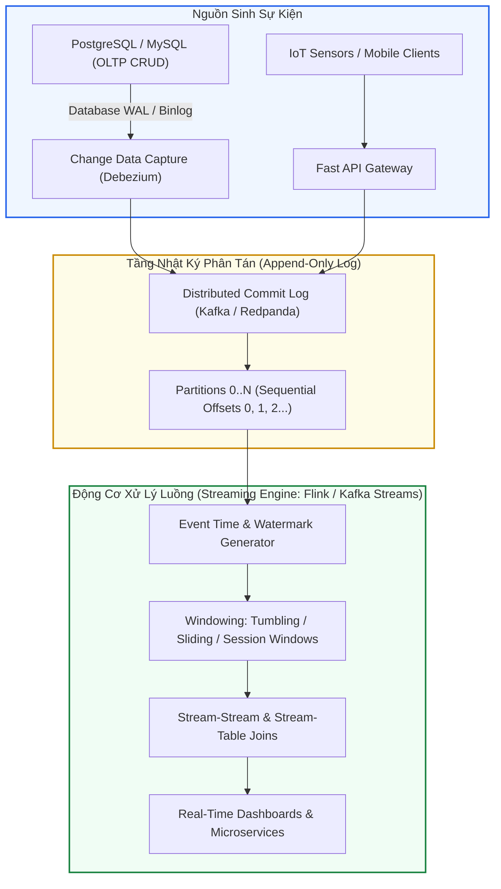
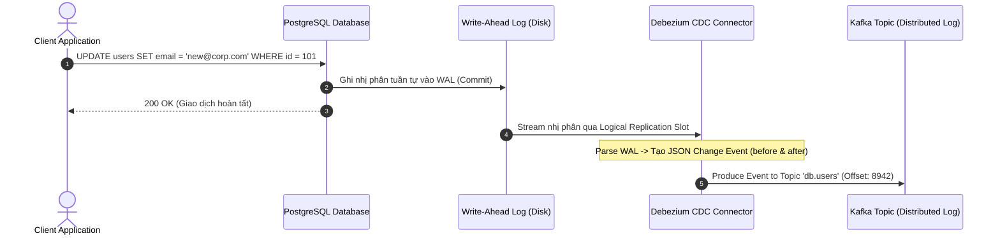
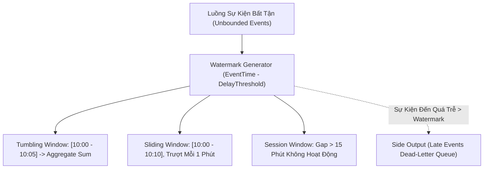
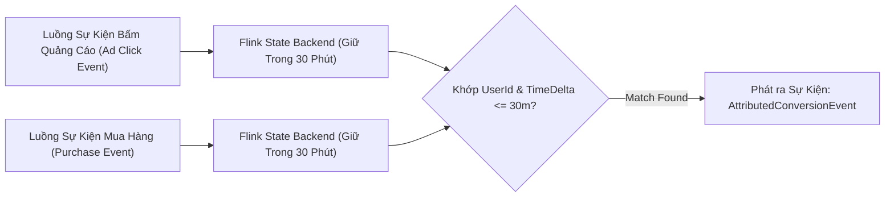

# 9.1. Event Streaming, Distributed Logs, CDC & Stream Window Semantics

## Tổng quan về Hạ tầng Luồng Sự kiện và Xử lý Dữ liệu Thời gian Thực
Trong kiến trúc phần mềm truyền thống, dữ liệu được nhìn nhận dưới dạng tĩnh tại (Data at Rest): Cơ sở dữ liệu quan hệ (RDBMS) lưu trữ trạng thái hiện tại (Current State), và các tác vụ xử lý lô (**Batch Processing**) chạy định kỳ hàng đêm qua ETL pipelines để tổng hợp số liệu. Mô hình này tạo ra độ trễ thông tin lớn (Data Staleness từ vài giờ đến vài ngày), không thể đáp ứng nhu cầu kinh doanh hiện đại đòi hỏi phản ứng tức thì (như phát hiện gian lận thanh toán, khớp lệnh thị trường, giám sát dịch vụ).

**Truyền luồng Sự kiện (Event Streaming)** và **Xử lý Dữ liệu Thời gian Thực (Real-Time Data Processing)** đảo ngược hoàn toàn mô thức này:
1. **Nhật ký Sự kiện Phân tán (Distributed Event Log)**: Coi sự thật tối cao của hệ thống không phải là trạng thái hiện tại, mà là một chuỗi tuần tự bất biến của các sự kiện đã xảy ra theo thời gian (**Append-Only Immutable Commit Log**). Trạng thái hiện tại chỉ là hệ quả tích lũy của việc duyệt qua toàn bộ nhật ký sự kiện này:
$$\text{Current State } S_t = \sum_{i=1}^t \text{Event}_i = S_{t-1} + \Delta e_t$$
2. **Khai thác Thay đổi Dữ liệu (Change Data Capture - CDC)**: Lắng nghe trực tiếp nhật ký giao dịch mức thấp của cơ sở dữ liệu (**Database WAL / Binlog**) để đồng bộ hóa trạng thái sang các hệ thống phân tán khác với độ trễ tính bằng mili-giây.
3. **Ngữ nghĩa Thời gian và Cửa sổ (Windowing & Watermarks)**: Phân định rạch ròi giữa **Thời gian Sự kiện (Event Time)** và **Thời gian Xử lý (Processing Time)**, sử dụng dấu mốc **Watermarks** để xử lý các sự kiện đến trễ hoặc xáo trộn thứ tự (Out-of-Order Events).



---

## 2. Chi tiết từng Keyword (Under-the-Hood Deep Dive)

---

### 1. Distributed Event Logs, Event Sourcing & Change Data Capture (CDC)

#### 1. Khái niệm bản chất (What & Why)
- **Distributed Event Logs**: Cấu trúc dữ liệu nền tảng của Apache Kafka và Redpanda: Một danh sách nhật ký chỉ nối thêm (Append-only) được phân vùng (Partitioned) và nhân bản (Replicated) trên nhiều máy chủ. Các sự kiện được gán số thứ tự đơn điệu tăng dần gọi là **Offset**.
- **Event Sourcing**: Khuôn mẫu kiến trúc phần mềm trong đó mọi thay đổi trạng thái của ứng dụng được lưu trữ dưới dạng một chuỗi sự kiện nghiệp vụ bất biến (`OrderCreated`, `PaymentReceived`, `ItemShipped`), thay vì cập nhật đè (UPDATE) lên một dòng trong bảng SQL. Cho phép tái tạo lại chính xác trạng thái của hệ thống tại bất kỳ thời điểm nào trong quá khứ (Time-travel Audit).
- **Change Data Capture (CDC)**: Kỹ thuật tự động phát hiện và trích xuất mọi thao tác INSERT, UPDATE, DELETE xảy ra trên cơ sở dữ liệu quan hệ nguồn và phát tán chúng dưới dạng các luồng sự kiện thời gian thực.
- **Tại sao CDC vượt trội hơn Polling**: Truy vấn định kỳ (`SELECT * FROM orders WHERE updated_at > ?`) gây quá tải CPU của CSDL, bỏ lỡ các bản ghi bị xóa (hard deletes), và không thể đạt độ trễ thời gian thực. CDC đọc trực tiếp từ **Write-Ahead Log (WAL)** của database với chi phí CPU gần như bằng 0 và độ trễ dưới 5 mili-giây.

#### 2. Cơ chế hoạt động sâu (Under the hood / Hardcore Internals)
- **Cơ chế Đọc WAL của Debezium (PostgreSQL Logical Decoding)**:
  - Khi một giao dịch commit trong PostgreSQL, hệ điều hành ghi các thay đổi vào đĩa thông qua WAL để đảm bảo tính bền vững (ACID Durability).
  - Debezium kết nối vào PostgreSQL thông qua một **Logical Replication Slot** (sử dụng plugin `pgoutput`).
  - PostgreSQL trích xuất các thay đổi nhị phân từ WAL, chuyển đổi thành các thông điệp có cấu trúc (chứa cả trạng thái `before` và `after` của dòng dữ liệu) và đẩy sang Apache Kafka.
- **Tối ưu hóa I/O Tuần tự và Zero-Copy trong Distributed Logs**:
  Distributed Logs đạt thông lượng hàng triệu thông điệp mỗi giây trên một máy chủ nhờ:
  - *Sequential I/O*: Ổ đĩa SSD/HDD có tốc độ ghi tuần tự nhanh hơn gấp hàng trăm lần so với ghi ngẫu nhiên (Random I/O).
  - *Linux OS Page Cache*: Dữ liệu gửi đến được ghi thẳng vào Page Cache của nhân hệ điều hành.
  - *Zero-Copy Transfer (`sendfile` system call)*: Khi truyền dữ liệu từ đĩa ra mạng tới Consumer, dữ liệu được truyền thẳng từ Page Cache sang Network Socket Buffer của card mạng mà không bao giờ bị sao chép vào User Space của tiến trình Java, triệt tiêu hoàn toàn chi phí chuyển đổi ngữ cảnh CPU (Context Switches).

#### 3. Sơ đồ minh họa


#### 4. Code ví dụ thực chiến (C++ Memory-Mapped Sequential Append-Only Log Segment)
Đoạn mã C++20 mô phỏng cấu trúc một Segment lưu trữ của Distributed Log với ghi tuần tự nhị phân và index offset:

```cpp
#include <iostream>
#include <vector>
#include <string>
#include <cstdint>
#include <cstring>

struct RecordHeader {
    uint64_t offset;
    uint32_t payload_size;
    uint32_t crc32;
};

class LocalLogSegment {
private:
    std::vector<uint8_t> disk_buffer_;
    uint64_t next_offset_ = 0;

public:
    uint64_t append(const std::string& message) {
        uint64_t current_offset = next_offset_++;
        RecordHeader header{
            current_offset,
            static_cast<uint32_t>(message.size()),
            0x12345678 // Mock CRC
        };

        // Ghi tuần tự Header + Payload vào cuối mảng (Sequential Write)
        size_t old_size = disk_buffer_.size();
        disk_buffer_.resize(old_size + sizeof(RecordHeader) + message.size());

        std::memcpy(&disk_buffer_[old_size], &header, sizeof(RecordHeader));
        std::memcpy(&disk_buffer_[old_size + sizeof(RecordHeader)], message.data(), message.size());

        return current_offset;
    }

    [[nodiscard]] size_t total_bytes_on_disk() const noexcept { return disk_buffer_.size(); }
};

int main() {
    LocalLogSegment segment;
    uint64_t off0 = segment.append("ORDER_CREATED: id=101, val=$50");
    uint64_t off1 = segment.append("PAYMENT_RECEIVED: id=101, status=PAID");

    std::cout << "[Commit Log] Written Offset 0: " << off0 << "\n";
    std::cout << "[Commit Log] Written Offset 1: " << off1 << "\n";
    std::cout << "[Commit Log] Total Segment Size: " << segment.total_bytes_on_disk() << " bytes on disk.\n";
    return 0;
}
```

#### 5. Ưu / Nhược điểm, Pitfalls & Anti-patterns
- **Dual-Write Hazard (Hiểm họa Ghi kép)**: Ứng dụng cố gắng tự cập nhật CSDL và sau đó tự gửi message lên Kafka trong hai lệnh độc lập. Nếu ứng dụng bị crash giữa hai lệnh, CSDL đã thay đổi nhưng Kafka không nhận được tin nhắn, làm mất tính nhất quán phân tán vĩnh viễn. Bắt buộc phải sử dụng **Transactional Outbox Pattern** hoặc **CDC trực tiếp từ CSDL**.

#### 6. Ứng dụng thực tế trong Backend / Systems
- Đồng bộ hóa dữ liệu thời gian thực từ CSDL chính PostgreSQL sang ElasticSearch để phục vụ tìm kiếm và sang Apache Iceberg Data Lakehouse để phục vụ phân tích.

---

### 2. Time Semantics, Watermarks & Windowing (Tumbling, Sliding, Session Windows)

#### 1. Khái niệm bản chất (What & Why)
- **Ba Miền Thời Gian trong Xử lý Luồng**:
  1. **Event Time (Thời gian Sự kiện)**: Thời điểm sự kiện thực sự xảy ra tại nguồn phát sinh (được nhúng trong trường timestamp của payload). Đây là miền thời gian duy nhất đảm bảo tính đúng đắn của nghiệp vụ.
  2. **Ingestion Time (Thời gian Nạp)**: Thời điểm sự kiện được ghi vào broker (Kafka).
  3. **Processing Time (Thời gian Xử lý)**: Thời điểm đồng hồ hệ thống của máy chủ worker đang thực thi code xử lý sự kiện. Dễ làm sai lệch kết quả do độ trễ mạng hoặc tắc nghẽn queue.
- **Watermarks (Dấu Mốc Thời Gian)**: Cơ chế toán học để đo lường tiến trình của Event Time trong luồng dữ liệu bất định. Một Watermark mang giá trị thời gian $t$ là một khẳng định ngầm rằng: *"Hệ thống tin rằng sẽ không còn bất kỳ sự kiện nào có $\text{Event Time} < t$ xuất hiện trong luồng nữa"*.
- **Windowing (Phân Cửa Sổ Dữ Liệu)**: Kỹ thuật cắt nhỏ luồng dữ liệu vô hạn (Unbounded Stream) thành các tập hợp hữu hạn (Bounded Chunks) dựa trên thời gian để thực hiện các phép toán tổng hợp (Aggregation: Count, Sum, Average).

#### 2. Cơ chế hoạt động sâu (Under the hood / Hardcore Internals)
- **3 Dạng Cửa Sổ Cốt Lõi**:
  1. **Tumbling Windows (Cửa sổ Cố định Không Chồng lấn)**: Cắt luồng thành các khoảng thời gian cố định bằng nhau (ví dụ: mỗi 5 phút). Mỗi sự kiện thuộc về đúng duy nhất 1 cửa sổ.
  2. **Sliding Windows / Hopping Windows (Cửa sổ Trượt Có Chồng lấn)**: Cửa sổ có độ dài cố định $D$ (ví dụ: 10 phút) nhưng trượt về phía trước theo chu kỳ $S < D$ (ví dụ: mỗi 1 phút). Mỗi sự kiện có thể thuộc về nhiều cửa sổ đồng thời.
  3. **Session Windows (Cửa sổ Phiên Hoạt động)**: Nhóm các sự kiện của cùng một người dùng dựa trên khoảng lặng không hoạt động (**Inactivity Gap**). Nếu trong vòng 15 phút người dùng không có hành động mới, phiên cũ sẽ đóng lại; hành động tiếp theo sẽ mở ra một Session Window mới.
- **Xử lý Sự kiện Đến Trễ (Late-Arriving Events & Out-of-Order Handling)**:
  Khi một gói tin mạng bị nghẽn và đến sau khi Watermark đã vượt qua ranh giới của cửa sổ (Window Closure):
  - *Mặc định*: Sự kiện bị bỏ rơi (Dropped).
  - *Allowed Lateness*: Cho phép cửa sổ tiếp tục nhận dữ liệu trễ trong một khoảng thời gian ân hạn và phát lại kết quả hiệu chỉnh (Updated Accumulation).
  - *Side Outputs*: Định tuyến các sự kiện đến quá trễ ra một luồng phụ riêng biệt (Dead Letter Queue) để xử lý đối soát thủ công.

#### 3. Sơ đồ minh họa


#### 4. Code ví dụ thực chiến (TypeScript Watermark Generator & Tumbling Window Aggregator)
Đoạn mã TypeScript mô phỏng giải thuật tính toán cửa sổ Tumbling Window dựa trên Event Time và Watermark trễ 5 giây:

```typescript
interface StreamEvent {
  userId: string;
  amount: number;
  eventTimeMs: number;
}

class TumblingWindowEngine {
  private windowSizeMs: number;
  private maxOutOfOrdernessMs: number;
  private currentWatermarkMs: number = 0;
  private activeWindows = new Map<string, number>(); // WindowKey -> TotalAmount

  constructor(windowSizeSec: number, maxDelaySec: number) {
    this.windowSizeMs = windowSizeSec * 1000;
    this.maxOutOfOrdernessMs = maxDelaySec * 1000;
  }

  public processEvent(event: StreamEvent): void {
    // 1. Cập nhật Watermark đơn điệu tăng dần: Watermark = max(Watermark, EventTime - MaxDelay)
    const potentialWatermark = event.eventTimeMs - this.maxOutOfOrdernessMs;
    if (potentialWatermark > this.currentWatermarkMs) {
      this.currentWatermarkMs = potentialWatermark;
    }

    // 2. Kiểm tra nếu sự kiện đến quá muộn so với Watermark hiện tại
    const windowStart = Math.floor(event.eventTimeMs / this.windowSizeMs) * this.windowSizeMs;
    const windowEnd = windowStart + this.windowSizeMs;

    if (windowEnd <= this.currentWatermarkMs) {
      console.warn(`[LATE EVENT DROPPED] EventTime: ${event.eventTimeMs} is behind Watermark: ${this.currentWatermarkMs}`);
      return;
    }

    // 3. Gom tụ vào cửa sổ tương ứng
    const windowKey = `[${new Date(windowStart).toISOString()} - ${new Date(windowEnd).toISOString()}]`;
    const currentSum = this.activeWindows.get(windowKey) ?? 0;
    this.activeWindows.set(windowKey, currentSum + event.amount);

    console.log(`[Aggregated] Window ${windowKey} -> New Sum: $${this.activeWindows.get(windowKey)}`);
  }
}

// Test Windowing
const engine = new TumblingWindowEngine(60 /* 1-minute window */, 5 /* 5s max delay */);
const baseTime = 1718900000000;

engine.processEvent({ userId: "U1", amount: 100, eventTimeMs: baseTime + 10000 }); // 10:10
engine.processEvent({ userId: "U2", amount: 250, eventTimeMs: baseTime + 25000 }); // 10:25 -> Watermark = 20s
engine.processEvent({ userId: "U3", amount: 50,  eventTimeMs: baseTime + 5000  }); // 10:05 -> Đến trễ nhưng > Watermark -> Chấp nhận
engine.processEvent({ userId: "U4", amount: 500, eventTimeMs: baseTime + 50000 }); // 10:50 -> Watermark nhảy lên 45s
engine.processEvent({ userId: "U5", amount: 30,  eventTimeMs: baseTime + 2000  }); // Đến quá trễ (< 45s) -> BỊ DROP!
```

#### 5. Ưu / Nhược điểm, Pitfalls & Anti-patterns
- **Sử dụng Processing Time cho Báo cáo Tài chính**: Sử dụng thời gian máy chủ xử lý (`System.currentTimeMillis()`) làm mốc phân cửa sổ doanh thu sẽ dẫn tới sai lệch hoàn toàn số liệu nếu hệ thống gặp sự cố mạng hoặc sập hàng đợi, khiến doanh thu của ngày hôm trước bị tính dồn vào ngày hôm sau.

#### 6. Ứng dụng thực tế trong Backend / Systems
- Tính toán tổng lưu lượng truy cập và phát hiện các cuộc tấn công DDoS trong cửa sổ trượt 1 phút (Sliding Window Rate Limiter).

---

### 3. Stream Joins (Stream-Stream & Stream-Table Joins)

#### 1. Khái niệm bản chất (What & Why)
- **Stream Joins**: Phép kết hợp dữ liệu từ hai luồng độc lập trong thời gian thực.
- **Stream-Table Join (Enrichment)**: Kết hợp một luồng sự kiện chuyển động liên tục với một bảng dữ liệu tra cứu tĩnh hoặc thay đổi chậm (ví dụ: Luồng giao dịch quẹt thẻ tín dụng kết hợp với bảng thông tin khách hàng trong CSDL để bổ sung địa chỉ và email).
- **Stream-Stream Join**: Kết hợp hai luồng sự kiện độc lập chuyển động song song (ví dụ: Kết hợp luồng sự kiện người dùng bấm vào quảng cáo - Ad Clicks với luồng sự kiện người dùng mua hàng - Purchases để tính toán tỷ lệ chuyển đổi ROI). Do hai luồng chuyển động liên tục, phép join bắt buộc phải có một **Ranh giới Cửa sổ Thời gian (Window Bound)**: Chỉ kết hợp nếu sự kiện B xảy ra trong vòng $N$ phút sau khi sự kiện A xuất hiện.

#### 2. Cơ chế hoạt động sâu (Under the hood / Hardcore Internals)
- **Cơ chế Duy trì Trạng thái trong Stream-Stream Join (State Retention)**:
  Để thực hiện phép kết hợp:
  - Khi một sự kiện $A$ đến, công cụ xử lý luồng (như Apache Flink) phải lưu trữ sự kiện $A$ vào bộ nhớ trạng thái (**State Backend** - như RocksDB).
  - Sau đó, nó kiểm tra xem đã có sự kiện $B$ nào tương ứng đang chờ trong State hay chưa. Nếu có, phát ra kết quả Join.
  - Ngược lại, nếu chưa có, sự kiện $A$ sẽ tiếp tục nằm trong State cho đến khi hết thời hạn của cửa sổ (Time-To-Live - TTL) rồi tự động bị dọn rác (Eviction).

#### 3. Sơ đồ minh họa


#### 4. Code ví dụ thực chiến (TypeScript Interval Stream-Stream Join Simulator)
```typescript
interface AdClick {
  clickId: string;
  userId: string;
  timestampMs: number;
}

interface Purchase {
  orderId: string;
  userId: string;
  amount: number;
  timestampMs: number;
}

class IntervalStreamJoiner {
  private clicksState = new Map<string, AdClick>(); // Key: userId
  private maxJoinWindowMs: number;

  constructor(windowMinutes: number) {
    this.maxJoinWindowMs = windowMinutes * 60 * 1000;
  }

  public onAdClick(click: AdClick): void {
    this.clicksState.set(click.userId, click);
  }

  public onPurchase(purchase: Purchase): void {
    const matchingClick = this.clicksState.get(purchase.userId);
    if (matchingClick) {
      const delta = purchase.timestampMs - matchingClick.timestampMs;
      if (delta >= 0 && delta <= this.maxJoinWindowMs) {
        console.log(`[ATTRIBUTION JOIN MATCH] Purchase ${purchase.orderId} ($${purchase.amount}) attributed to Ad Click ${matchingClick.clickId}! Time Delta: ${delta / 1000}s`);
        return;
      }
    }
    console.log(`[ORGANIC PURCHASE] No matching ad click within window for purchase: ${purchase.orderId}`);
  }
}

// Test Stream Join
const joiner = new IntervalStreamJoiner(30 /* 30-minute attribution window */);
const now = Date.now();

joiner.onAdClick({ clickId: "CLK_99", userId: "USR_10", timestampMs: now });
joiner.onPurchase({ orderId: "ORD_442", userId: "USR_10", amount: 120.0, timestampMs: now + 500000 }); // Sau ~8 phút -> Khớp
```

#### 5. Ưu / Nhược điểm, Pitfalls & Anti-patterns
- **State Size Explosion (Nổ tung Bộ nhớ Trạng thái)**: Đặt khoảng thời gian Join quá dài (ví dụ: giữ trạng thái trong 30 ngày) trên luồng có hàng triệu sự kiện mỗi giây sẽ làm tràn bộ nhớ RAM và đĩa SSD của cụm máy chủ xử lý luồng. Cần thiết lập cấu hình TTL nghiêm ngặt cho State.

#### 6. Ứng dụng thực tế trong Backend / Systems
- Hệ thống tính toán hoa hồng tiếp thị liên kết (Affiliate Marketing Attribution Engine) thời gian thực.
