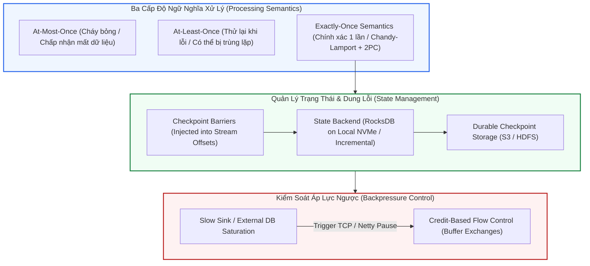
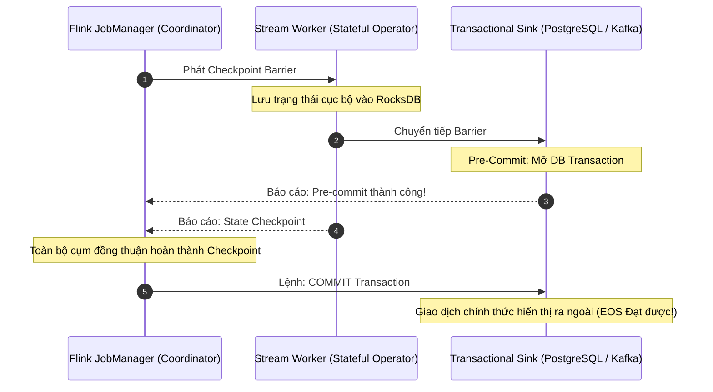
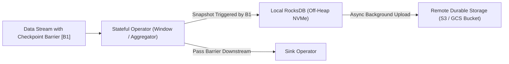
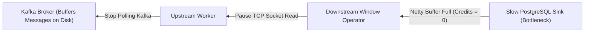

# 9.2. Stream Statefulness, Fault Tolerance, Exactly-Once Semantics & Backpressure

## Tổng quan về Tính Trạng thái, Dung lỗi và Ngữ nghĩa Xử lý Chính xác Một lần
Trong một hệ thống xử lý phân tán quy mô lớn vận hành 24/7, sự cố hỏng hóc máy chủ (Hardware Crash), gián đoạn mạng (Network Partition), và tắc nghẽn tài nguyên không phải là ngoại lệ hy hữu mà là những biến cố chắc chắn sẽ xảy ra. Khi hàng triệu sự kiện đang di chuyển liên tục qua hàng trăm máy chủ worker song song:
1. **Làm thế nào để duy trì tính đúng đắn của các phép tính toán tích lũy có trạng thái (Stateful Stream Processing)?**
2. **Làm thế nào để hệ thống phục hồi lại trạng thái chính xác sau sự cố mà không làm mất mát dữ liệu và không tính toán trùng lặp bất kỳ giao dịch nào?**

Hạ tầng xử lý luồng hiện đại (tiên phong bởi **Apache Flink**) giải quyết bài toán này thông qua việc kết hợp giữa thuật toán chụp ảnh phân tán **Chandy-Lamport Snapshotting**, cơ chế kiểm soát áp lực ngược **Stream Backpressure**, và giao thức giao dịch hai pha **Two-Phase Commit (2PC)** để đạt được tiêu chuẩn cao nhất: **Ngữ nghĩa Xử lý Chính xác Một lần (Exactly-Once Processing Semantics - EOS)** từ đầu đến cuối (End-to-End).



---

## 2. Chi tiết từng Keyword (Under-the-Hood Deep Dive)

---

### 1. Processing Semantics: At-Most-Once, At-Least-Once & Exactly-Once (EOS)

#### 1. Khái niệm bản chất (What & Why)
- **At-Most-Once (Tối đa một lần)**: Dữ liệu được gửi đi theo kiểu "bắn rồi quên" (Fire-and-forget). Nếu máy chủ xử lý bị sập giữa chừng, sự kiện đó sẽ **bị mất vĩnh viễn (Data Loss)**. Ưu điểm: Độ trễ thấp nhất, không tốn chi phí kiểm tra. Thích hợp cho telemetry sensor không quan trọng.
- **At-Least-Once (Ít nhất một lần)**: Đảm bảo không có sự kiện nào bị mất. Nếu một worker không phản hồi xác nhận (ACK) sau một khoảng thời gian, sự kiện sẽ được gửi lại (Retry). Nhược điểm: Khi có lỗi mạng, sự kiện có thể được xử lý nhiều lần, dẫn đến **trùng lặp dữ liệu (Duplicate Processing)** nếu consumer không có cơ chế khử trùng lặp (Idempotence).
- **Exactly-Once Processing Semantics (EOS - Chính xác một lần)**: Đảm bảo rằng dù có bao nhiêu sự cố máy chủ hay gián đoạn mạng xảy ra, trạng thái cuối cùng của hệ thống (trong cơ sở dữ liệu hoặc downstream sinks) phản ánh chính xác như thể mỗi sự kiện chỉ được xử lý **đúng duy nhất một lần**.

#### 2. Cơ chế hoạt động sâu (Under the hood / Hardcore Internals)
- **Cơ chế End-to-End Exactly-Once qua Giao thức Two-Phase Commit (2PC)**:
  Để đạt EOS toàn diện từ Source -> Processing Engine -> Sink:
  1. *Source (Kafka)*: Hỗ trợ tua lại offset (Replayable Source).
  2. *Processing Engine (Flink)*: Quản lý trạng thái bằng thuật toán Checkpointing.
  3. *Sink (Database / Kafka)*: Phải hỗ trợ giao dịch hai pha (**Two-Phase Commit Sink - `TwoPhaseCommitSinkFunction`**):
     - **Pha 1 (Pre-commit)**: Khi Checkpoint Barrier đến Sink, Sink mở một transaction mới trên CSDL đích, ghi toàn bộ kết quả tạm thời vào transaction đó nhưng **chưa commit**.
     - **Pha 2 (Commit)**: Khi Flink Coordinator thông báo rằng toàn bộ tất cả các worker khác trong cụm đã lưu checkpoint thành công, Coordinator phát lệnh `commit()` tới Sink. Lúc này dữ liệu mới chính thức hiển thị cho người dùng ngoài! Nếu bất kỳ worker nào bị sập, lệnh `abort()` được phát ra và transaction bị rollback sạch sẽ.

#### 3. Sơ đồ minh họa


#### 4. Code ví dụ thực chiến (TypeScript Idempotent Event Deduplicator Stub)
Đoạn mã TypeScript xây dựng cơ chế xử lý Idempotent Consumer đảm bảo tính chất Exactly-Once trên nền tảng broker At-Least-Once:

```typescript
interface FinancialTransactionEvent {
  transactionId: string;
  senderAccount: string;
  recipientAccount: string;
  amountUsd: number;
}

class IdempotentTransactionProcessor {
  private processedIds = new Set<string>(); // Khóa khử trùng lặp (Dedup Key Store)
  private balances = new Map<string, number>();

  public processEvent(event: FinancialTransactionEvent): { status: string; currentBalance: number } {
    // 1. Kiểm tra xem Transaction ID đã được xử lý trong quá khứ chưa
    if (this.processedIds.has(event.transactionId)) {
      console.warn(`[DUPLICATE DETECTED] Ignoring already processed transaction: ${event.transactionId}`);
      return { status: "ALREADY_PROCESSED", currentBalance: this.balances.get(event.recipientAccount) ?? 0 };
    }

    // 2. Thực thi nghiệp vụ thay đổi số dư trong cùng một transaction logic
    const current = this.balances.get(event.recipientAccount) ?? 0;
    const updated = current + event.amountUsd;
    this.balances.set(event.recipientAccount, updated);

    // 3. Đánh dấu đã xử lý
    this.processedIds.add(event.transactionId);

    console.log(`[PROCESSED] Tx ${event.transactionId}: Credited $${event.amountUsd} to ${event.recipientAccount}. New Balance: $${updated}`);
    return { status: "SUCCESS", currentBalance: updated };
  }
}

// Test Idempotence
const processor = new IdempotentTransactionProcessor();
const txEvent: FinancialTransactionEvent = { transactionId: "TX_99812", senderAccount: "ACC_A", recipientAccount: "ACC_B", amountUsd: 500 };

processor.processEvent(txEvent); // Lần 1: Thành công
processor.processEvent(txEvent); // Lần 2 (Do mạng gửi lại): Bị chặn khử trùng lặp -> Bảo vệ EOS!
```

#### 5. Ưu / Nhược điểm, Pitfalls & Anti-patterns
- **Non-Deterministic Logic Breaks EOS**: Nếu mã xử lý bên trong Stream Operator sử dụng các hàm phi tất định (như `Math.random()` hoặc gọi API HTTP ngoại vi để lấy tỷ giá thời gian thực), khi worker bị sập và phục hồi lại từ checkpoint, việc chạy lại các sự kiện sẽ sinh ra kết quả khác với lần chạy đầu tiên, phá vỡ tính đúng đắn của Exactly-Once.

#### 6. Ứng dụng thực tế trong Backend / Systems
- Hệ thống thanh toán bù trừ ngân hàng (Payment Clearing & Settlement Core Engine) yêu cầu độ chính xác tài chính 100%.

---

### 2. Stream State Management & Checkpointing (Chandy-Lamport Algorithm)

#### 1. Khái niệm bản chất (What & Why)
- **Stateful vs Stateless Stream Processing**:
  - *Stateless (Không lưu trạng thái)*: Mỗi sự kiện được xử lý độc lập mà không quan tâm đến quá khứ (ví dụ: chuyển đổi chữ hoa chữ thường, lọc các bản ghi có `level == 'ERROR'`).
  - *Stateful (Có lưu trạng thái)*: Việc xử lý sự kiện hiện tại phụ thuộc vào thông tin tích lũy từ các sự kiện trước đó (ví dụ: đếm số lần quẹt thẻ trong 1 giờ, tính trung bình động, bảng trạng thái cửa sổ).
- **Stream Checkpointing**: Quá trình chụp lại định kỳ trạng thái nhất quán toàn cục của toàn bộ ứng dụng xử lý luồng phân tán và lưu vào bộ lưu trữ bền vững (như S3/HDFS).
- **Thuật toán Chandy-Lamport (Asynchronous Barrier Snapshotting - ABS)**: Thuật toán cho phép chụp ảnh toàn bộ trạng thái của một hệ thống luồng phân tán **mà không cần phải dừng hay tạm khóa (Zero Stop-the-World pause)** luồng dữ liệu đang chạy.

#### 2. Cơ chế hoạt động sâu (Under the hood / Hardcore Internals)
- **Cơ chế Barrier Alignment trong Apache Flink**:
  1. JobManager định kỳ chèn một thông điệp đặc biệt gọi là **Checkpoint Barrier** vào các luồng đầu vào tại Source.
  2. Barrier di chuyển xuôi dòng (Downstream) cùng nhịp độ với các sự kiện dữ liệu thông thường.
  3. Khi một Operator nhận dữ liệu từ nhiều phân vùng đầu vào (ví dụ 2 partition):
     - Nó nhận Barrier từ Partition 1 trước, nhưng chưa nhận Barrier từ Partition 2.
     - Operator thực hiện **Căn chỉnh rào chắn (Barrier Alignment)**: Tạm dừng xử lý dữ liệu từ Partition 1 (đệm vào RAM) và tiếp tục xử lý dữ liệu từ Partition 2 cho đến khi nhận được Barrier từ Partition 2.
     - Khi đã nhận đủ Barrier từ tất cả các đầu vào, Operator ngay lập tức chụp trạng thái hiện tại (State) đẩy vào nền lưu trữ bất đồng bộ (Asynchronous Flush to RocksDB), sau đó tiếp tục chuyển tiếp Barrier xuôi dòng tới các toán tử kế tiếp.
- **State Backends: In-Memory Heap vs Embedded RocksDB**:
  - *HashMap State Backend (Heap)*: Lưu trữ đối tượng Java thuần trên Heap. Rất nhanh nhưng bị giới hạn bởi dung lượng RAM và chịu ảnh hưởng tiêu cực của JVM Garbage Collection.
  - *Embedded RocksDB State Backend*: Lưu trữ trạng thái trên đĩa NVMe cục bộ dưới dạng các bảng SSTable ngoài Heap (Off-Heap). Hỗ trợ **Checkpoint gia tăng (Incremental Checkpoints)**: Mỗi checkpoint chỉ cần sao chép các file SSTable mới sinh ra lên S3, cho phép duy trì trạng thái lên tới hàng Terabytes cho mỗi node máy chủ!

#### 3. Sơ đồ minh họa


#### 4. Code ví dụ thực chiến (C++ Asynchronous State Snapshot Manager)
```cpp
#include <iostream>
#include <unordered_map>
#include <string>
#include <future>
#include <chrono>

class StreamStateManager {
private:
    std::unordered_map<std::string, int64_t> active_state_; // Key -> Aggregate Value
public:
    void update_state(const std::string& key, int64_t delta) {
        active_state_[key] += delta;
    }

    // Chụp ảnh trạng thái bất đồng bộ mà không chặn luồng xử lý chính
    std::future<size_t> trigger_asynchronous_snapshot(uint64_t checkpoint_id) {
        // 1. Sao chép nhanh (Fast memory copy) trạng thái tại điểm rào chắn
        auto snapshot_copy = active_state_;

        // 2. Đẩy tác vụ ghi đĩa / upload S3 sang một luồng nền (Background Worker)
        return std::async(std::launch::async, [snapshot_copy = std::move(snapshot_copy), checkpoint_id]() {
            // Giả lập ghi dữ liệu xuống đĩa NVMe / S3
            std::this_thread::sleep_for(std::chrono::milliseconds(50));
            std::cout << "[Background Snapshot] Checkpoint #" << checkpoint_id 
                      << " successfully persisted " << snapshot_copy.size() << " keys to storage.\n";
            return snapshot_copy.size();
        });
    }
};

int main() {
    StreamStateManager manager;
    manager.update_state("USER_101", 150);
    manager.update_state("USER_102", 300);

    // Kích hoạt Checkpoint
    auto fut = manager.trigger_asynchronous_snapshot(1);
    
    // Luồng chính vẫn tiếp tục nhận và xử lý dữ liệu mới ngay lập tức
    manager.update_state("USER_101", 50);

    fut.get(); // Chờ hoàn tất tác vụ nền
    std::cout << "[Main Stream] Continuous execution maintained.\n";
    return 0;
}
```

#### 5. Ưu / Nhược điểm, Pitfalls & Anti-patterns
- **Checkpoint Alignment Buffer Bloat**: Nếu một phân vùng đầu vào bị nghẽn mạng nặng trong khi phân vùng kia chạy quá nhanh, quá trình Barrier Alignment sẽ tích lũy một lượng dữ liệu đệm khổng lồ trong RAM, dẫn tới lỗi Java `OutOfMemoryError`. Giải pháp hiện đại: Sử dụng **Unaligned Checkpoints** (cho phép lưu cả dữ liệu đang nằm trên đường ống truyền thông vào checkpoint).

#### 6. Ứng dụng thực tế trong Backend / Systems
- Quản lý trạng thái theo dõi phiên của hàng triệu người chơi trong các trò chơi trực tuyến nhiều người chơi (MMORPG Leaderboards).

---

### 3. Stream Backpressure, Rebalancing & Schema Evolution

#### 1. Khái niệm bản chất (What & Why)
- **Stream Backpressure (Áp lực Ngược)**: Cơ chế điều tiết lưu lượng tự nhiên trong đường ống xử lý: Khi một toán tử hạ nguồn (Downstream Operator / CSDL Sink) bị chậm chạp hoặc quá tải, nó phát tín hiệu ngược dòng (Upstream) để yêu cầu các toán tử phía trước và Broker làm chậm tốc độ gửi dữ liệu lại, ngăn chặn việc tràn bộ nhớ làm sập hệ thống.
- **Stream Rebalancing & Repartitioning**: Quá trình phân phối lại các khóa hoặc các phân vùng xử lý giữa các máy chủ worker khi có một máy chủ mới gia nhập hoặc một máy chủ bị chết trong cụm.
- **Stream Schema Evolution**: Khả năng của hệ thống luồng tiếp tục vận hành trơn tru khi cấu trúc dữ liệu của các sự kiện bị thay đổi theo thời gian (ví dụ: bổ sung thêm một trường mới, xóa bỏ trường cũ) thông qua các giải pháp như **Confluent Schema Registry** và định dạng nhị phân **Apache Avro / Protocol Buffers**.

#### 2. Cơ chế hoạt động sâu (Under the hood / Hardcore Internals)
- **Cơ chế Credit-Based Flow Control trong Flink Network Stack**:
  Flink thiết lập kênh giao tiếp mạng giữa các worker thông qua Netty:
  - Máy chủ nhận (Downstream Task) cấp phát một số lượng bộ đệm cố định và gửi tín hiệu báo cho Máy chủ gửi (Upstream Task) biết nó đang có bao nhiêu tín chỉ rảnh (**Credits / Free Buffers**).
  - Upstream Task chỉ được phép gửi đúng số lượng gói tin tương ứng với số credit mà Downstream Task đang có.
  - Nếu Downstream bị nghẽn (do bận ghi vào Database chậm), nó ngừng cấp thêm credit. Upstream nhận thấy credit = 0 sẽ lập tức ngừng đọc dữ liệu từ Kafka. Toàn bộ đường ống tự động làm chậm nhịp độ một cách an toàn mà không bị mất một byte dữ liệu nào!
- **Quy tắc Tương thích Lược đồ (Schema Compatibility Rules)**:
  - *Backward Compatibility*: Phiên bản mã mới có thể đọc được dữ liệu được ghi bởi phiên bản mã cũ (Bắt buộc các trường mới thêm vào phải có giá trị mặc định `default`).
  - *Forward Compatibility*: Phiên bản mã cũ có thể đọc được dữ liệu được ghi bởi phiên bản mã mới (Bỏ qua các trường lạ chưa biết).
  - *Full Compatibility*: Thỏa mãn đồng thời cả Backward và Forward.

#### 3. Sơ đồ minh họa


#### 4. Code ví dụ thực chiến (TypeScript Credit-Based Backpressure Simulation)
```typescript
class BackpressureChannel {
  private availableCredits: number = 3; // Cho phép đệm tối đa 3 gói tin
  private downstreamQueue: string[] = [];

  public send(data: string): boolean {
    if (this.availableCredits <= 0) {
      console.warn(`[BACKPRESSURE ACTIVE] Downstream is saturated! Upstream MUST throttle/pause.`);
      return false; // Bị nghẽn, upstream phải dừng lại
    }

    this.availableCredits--;
    this.downstreamQueue.push(data);
    console.log(`[Dispatched] Item: ${data} | Remaining Credits: ${this.availableCredits}`);
    return true;
  }

  // Downstream xử lý xong 1 gói tin -> Hoàn trả credit cho Upstream
  public acknowledgeProcessed(): void {
    const item = this.downstreamQueue.shift();
    this.availableCredits++;
    console.log(`[Downstream Processed] Finished: ${item} -> Credits restored to: ${this.availableCredits}`);
  }
}

// Test Flow Control
const channel = new BackpressureChannel();
channel.send("MSG_1");
channel.send("MSG_2");
channel.send("MSG_3");
const sent4 = channel.send("MSG_4"); // Sẽ bị từ chối do hết Credits!

channel.acknowledgeProcessed(); // Xử lý xong 1 tin -> Giải phóng credit
channel.send("MSG_4"); // Bây giờ gửi thành công!
```

#### 5. Ưu / Nhược điểm, Pitfalls & Anti-patterns
- **Breaking Schema without Compatibility Check**: Thêm một trường mới bắt buộc (Required Field không có Default Value) vào sự kiện Avro trên Kafka mà không kiểm tra tính tương thích qua Schema Registry sẽ làm sập hàng loạt toàn bộ các microservices hạ nguồn đang sử dụng phiên bản thư viện cũ.

#### 6. Ứng dụng thực tế trong Backend / Systems
- Hệ thống định tuyến đơn hàng thương mại điện tử bảo vệ cơ sở dữ liệu kho vận không bị sập trong các chiến dịch Siêu Sale (Flash Sale 11/11).
