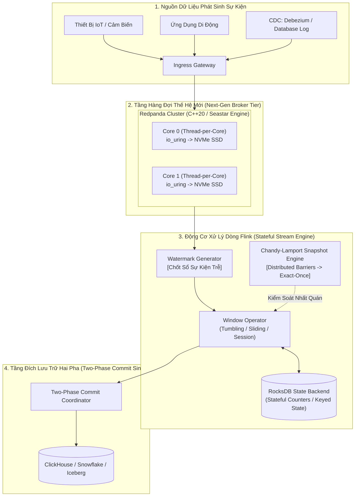

# 9.3. Stream Processing Engines and Modern Brokers

> [!IMPORTANT]
> **Nếu bạn chỉ được nhớ một điều duy nhất:** Trong xử lý dữ liệu thời gian thực quy mô lớn, sự chuyển dịch kiến trúc lớn nhất thập kỷ qua là từ mô hình lô vi mô chậm chạp sang **Xử lý dòng sự kiện thuần túy dựa trên Event Time (Apache Flink)** kết hợp với **Hạ tầng Broker thế hệ mới không JVM (Redpanda C++20 / Seastar)**. Để xử lý chính xác các sự kiện bị đảo lộn trật tự mạng, Flink bắt buộc phải dùng **Watermarks** làm con dấu thời gian chốt sổ và bảo đảm ngữ nghĩa **Exactly-Once Semantics (EOS)** thông qua thuật toán phân tán **Chandy-Lamport Snapshot** kết hợp Two-Phase Commit Sink. Trong khi đó, Redpanda triệt tiêu hoàn toàn độ trễ bất định của Java Garbage Collection bằng kiến trúc **Thread-per-Core (Shared-Nothing)**, ghi trực tiếp xuống NVMe SSD thông qua Linux **`io_uring`** với độ trễ p99 chỉ vài mili-giây.

---

## 1. Kiến trúc Tổng quan & Mô hình Tư duy (Mental Model)

### Ẩn Dụ Đời Sống: Dòng Sông Phù Sa & Nhà Máy Lọc Nước Tự Động
Hãy hình dung hệ thống xử lý dòng sự kiện giống như một hệ sinh thái sông ngòi:
1. **Dòng Chảy Sự Kiện (Unbounded Stream)**: Dữ liệu không nằm im trong kho đĩa (như hồ nước tĩnh của cơ sở dữ liệu), mà liên tục cuồn cuộn chảy qua như một con sông lớn (Unbounded Stream) không bao giờ dừng lại.
2. **Event Time vs Processing Time (Thời điểm thuyền xuất bến vs Thời điểm thuyền cập bến)**: Thuyền chở cam (Event) xuất phát từ vườn lúc $10:00$ sáng (Event Time). Do gặp sóng to gió lớn (nghẽn mạng viễn thông), tới tận $10:15$ thuyền mới cập bến nhà máy (Processing Time). Nếu nhà máy phân loại cam theo giờ cập bến $10:15$, toàn bộ số liệu thống kê sản lượng thu hoạch cam lúc $10:00$ sẽ bị sai lệch hoàn toàn!
3. **Watermark (Cột mốc thủy triều chốt sổ)**: Trưởng trạm quan sát thả một phao tiêu trôi theo dòng sông mang biển số $10:05$. Khi chiếc phao tiêu này trôi qua cổng nhà máy (Watermark), nhà máy tuyên bố: "Toàn bộ thuyền xuất bến trước $10:05$ đều đã cập cảng. Chúng ta tiến hành đóng sổ thống kê mẻ cam của khung giờ $10:00 - 10:05$!" Mọi thuyền đến sau chiếc phao tiêu (Late Data) sẽ bị chuyển sang luồng xử lý ngoại lệ riêng biệt.
4. **Redpanda vs Kafka (Động cơ xe F1 thuần kim loại vs Xe tải động cơ hơi nước)**: Kafka truyền thống phụ thuộc vào máy ảo Java (JVM) nặng nề; khi bộ nhớ đầy, GC kích hoạt tạm dừng thế giới (**Stop-the-World GC Pause**), dòng chảy bị khựng lại bất ngờ. Redpanda được đúc bằng C++20 nguyên khối, mỗi nhân CPU điều khiển một xi-lanh riêng biệt (Thread-per-Core), bơm dữ liệu trực tiếp vào ổ cứng không qua trung gian.



---

## 2. Chi tiết từng Keyword (Under-the-Hood Deep Dive)

### 2.1. Stream vs Batch Processing, Event Time, Processing Time & Watermarks
- **Sự Tiến Hóa Tư Duy Từ Batch Sang Stream**:
  - *Batch Processing (Hadoop / Spark cổ điển)*: Giả định dữ liệu là hữu hạn (Bounded Data). Thu thập dữ liệu theo lô (hàng giờ/hàng ngày), nạp vào đĩa và chạy giải thuật MapReduce. Độ trễ cao từ hàng phút tới hàng giờ.
  - *Stream Processing (Apache Flink / Spark Streaming)*: Coi mọi dữ liệu trong vũ trụ vốn dĩ là **Dòng Dữ Liệu Vô Hạn (Unbounded Data Streams)**. Batch chẳng qua chỉ là một trường hợp đặc biệt của Stream khi ta đặt một ranh giới tĩnh.
- **Ba Khái Niệm Thời Gian Trong Hệ Phân Tán**:
  1. **Event Time (Thời gian sự kiện)**: Dấu thời gian khi sự kiện thực sự được tạo ra trên thiết bị nguồn (ví dụ cảm biến gắn nhãn `10:00:01.250`). Đây là thước đo chân lý duy nhất phản ánh đúng bản chất nghiệp vụ.
  2. **Ingestion Time (Thời gian nạp)**: Thời điểm sự kiện được ghi vào phân vùng của Message Broker (Redpanda/Kafka).
  3. **Processing Time (Thời gian xử lý)**: Thời điểm máy chủ Stream Engine đang thực thi mã toán tử trên CPU. Hoàn toàn phụ thuộc vào độ lệch đồng hồ máy chủ, tải CPU và độ trễ mạng $\implies$ Không thể đảm bảo tính tất định khi chạy lại dữ liệu lịch sử (Replay).
- **Bản Chất Toán Học Của Watermarks**:
  - Watermark là một metadata record đặc biệt mang giá trị timestamp $t_w$ được chèn trực tiếp vào dòng chảy dữ liệu.
  - Mang ý nghĩa cam kết toán học: Mọi sự kiện có $\text{EventTime} \le t_w$ được giả định là **đã cập cảng đầy đủ**. Khi một toán tử nhận được Watermark $t_w$, nó kích hoạt tính toán và đóng vĩnh viễn các cửa sổ thời gian kết thúc trước $t_w$.
  - *Công thức Bounded-Out-Of-Orderness Watermark*:
    $$W(t) = \max_{e \in \text{Observed}} (\text{EventTime}(e)) - \Delta_{\text{delay}}$$
    Trong đó $\Delta_{\text{delay}}$ là ngưỡng độ trễ mạng tối đa được phép chấp nhận (ví dụ $5\text{ giây}$).

### 2.2. Windowing Strategies: Tumbling, Sliding, Session Windows & Late-Arriving Data
Xử lý dữ liệu vô hạn bắt buộc phải chia cắt dòng chảy thành các lát hữu hạn gọi là **Cửa Sổ Thời Gian (Windows)**:
1. **Tumbling Window (Cửa sổ Nhảy / Không gối nhau)**:
   - Các cửa sổ có độ dài cố định và nằm kế tiếp nhau không chồng lấn: `[10:00 - 10:05]`, `[10:05 - 10:10]`. Mỗi sự kiện thuộc về đúng một cửa sổ duy nhất (ví dụ: đếm số lượt click mỗi 5 phút).
2. **Sliding Window / Hopping Window (Cửa sổ Trượt / Chồng lấn nhau)**:
   - Được định nghĩa bởi hai tham số: Kích thước cửa sổ (Size) và Chu kỳ trượt (Slide).
   - Ví dụ: Cửa sổ 10 phút, trượt mỗi 1 phút: `[10:00 - 10:10]`, `[10:01 - 10:11]`. Một sự kiện có thể rơi vào nhiều cửa sổ đồng thời. Dùng để tính toán đường trung bình động (Moving Averages).
3. **Session Window (Cửa sổ Phiên làm việc)**:
   - Không có kích thước cố định, được xác định bởi **Khoảng cách nhàn rỗi (Inactivity Gap)**. Nếu người dùng không thực hiện thao tác nào quá 30 phút, phiên cũ đóng lại và một phiên mới được mở khi có sự kiện tiếp theo.
4. **Xử Lý Dữ Liệu Đến Muộn (Late-Arriving Data Handling)**:
   - Khi một sự kiện đến sau khi Watermark đã đi qua, Flink cung cấp 3 cơ chế ứng phó:
     - *Mặc định*: Vứt bỏ sự kiện (Drop).
     - *Allowed Lateness*: Cho phép cửa sổ giữ trạng thái mở thêm một khoảng thời gian dự phòng $\delta$ để cập nhật lại kết quả khi có dữ liệu muộn.
     - *Side Output*: Chuyển hướng toàn bộ các sự kiện muộn sang một nhánh luồng phụ (Dead-Letter Stream) để xử lý đối soát hoặc ghi nhận cảnh báo.

### 2.3. Exactly-Once Semantics (EOS): Chandy-Lamport Distributed Snapshot & Two-Phase Commit (2PC) Sink
Ngữ nghĩa xử lý là chuẩn mực sống còn của các hệ thống tài chính và quảng cáo:
- **At-Most-Once**: Có thể mất dữ liệu, không bao giờ xử lý trùng.
- **At-Least-Once**: Đảm bảo không mất dữ liệu, nhưng có thể bị xử lý lặp lại nhiều lần khi có crash.
- **Exactly-Once Semantics (EOS)**: Mỗi sự kiện ảnh hưởng tới trạng thái cuối cùng **đúng một lần duy nhất**, ngay cả khi có sự cố sập máy chủ hàng loạt.
- **Thuật Toán Chandy-Lamport Snapshot Trong Flink (Asynchronous Barrier Snapshotting)**:
  - Nguồn dữ liệu (Source) định kỳ chèn một con dấu đặc biệt gọi là **Checkpoint Barrier** vào dòng stream.
  - Khi toán tử nhận được Barrier từ tất cả các kênh đầu vào (Barrier Alignment), nó chụp nhanh trạng thái bộ nhớ nội bộ (State) của mình rồi ghi bất đồng bộ xuống bộ nhớ bền vững (HDFS / S3).
  - Quá trình chụp snapshot diễn ra liên tục mà không cần tạm dừng dòng chảy xử lý của hệ thống!
- **Two-Phase Commit (2PC) Sink Protocol**:
  - Snapshot trong bộ nhớ là chưa đủ; dữ liệu ghi ra cơ sở dữ liệu bên ngoài (PostgreSQL / ClickHouse / Kafka) cũng phải tuân thủ Exactly-Once.
  - *Pha 1 (Pre-commit)*: Khi gặp Barrier, Sink mở một transaction mới trên DB bên ngoài và ghi dữ liệu tạm thời.
  - *Pha 2 (Commit)*: Khi toàn bộ cụm Flink hoàn tất việc ghi Snapshot thành công lên S3, Coordinator phát tín hiệu Commit. Lúc này Sink mới chính thức hoàn tất transaction bên ngoài. Nếu có bất kỳ node nào sập trước pha 2, transaction bên ngoài được Abort/Rollback hoàn toàn.

### 2.4. Next-Gen Storage Engines & Brokers: Redpanda (C++20 Seastar) vs Apache Kafka (JVM PageCache)
- **Điểm Nghẽn Cốt Lõi Của Apache Kafka**:
  - Viết bằng Java/Scala, vận hành trên máy ảo **JVM**.
  - Dựa dẫm vào Page Cache của Linux Kernel để đạt hiệu năng cao. Nhược điểm: Hiện tượng **Tranh Chấp Bộ Nhớ Đệm (Page Cache Pollution)** khi có consumer đọc dữ liệu cũ trong lịch sử (Historical Reads), làm đẩy toàn bộ dữ liệu mới ra khỏi RAM, khiến các real-time consumers bị tụt dốc hiệu năng.
  - Đợt thu gom rác **JVM Garbage Collection (Stop-The-World)** gây ra hiện tượng gai độ trễ (Tail Latency Spikes p99 > 200ms).
- **Kiến Trúc Đột Phá Của Redpanda**:
  - Được xây dựng lại từ đầu bằng **C++20** dựa trên framework hướng bất đồng bộ **Seastar**.
  - **Kiến Trúc Thread-per-Core (Shared-Nothing)**: Redpanda gắn cứng mỗi luồng xử lý vào một CPU Core vật lý duy nhất. Mỗi core sở hữu một vùng RAM riêng biệt, hoàn toàn không có Mutex Lock hay Atomic Contention giữa các core.
  - **Direct I/O & Linux `io_uring`**: Redpanda bỏ qua hoàn toàn Page Cache của OS, trực tiếp điều khiển hàng đợi đọc/ghi của ổ cứng NVMe SSD thông qua giao tiếp bất đồng bộ nhân Linux `io_uring`. Độ trễ p99 đạt mức ổn định tuyệt đối $< 5\text{ ms}$ ở thông lượng hàng triệu tin nhắn mỗi giây!
  - Tương thích 100% với giao thức mạng của Apache Kafka (Kafka-API Compatible) nhưng không cần cài đặt ZooKeeper hay JVM.

### 2.5. Cloud-Native Brokers: Apache Pulsar & NATS JetStream
- **Apache Pulsar (Tách Rời Tính Toán và Lưu Trữ)**:
  - Thay vì gộp chung lưu trữ và phục vụ phân vùng trên cùng 1 node như Kafka/Redpanda, Pulsar tách thành 2 tầng riêng biệt: **Pulsar Brokers (Stateless Serving Tier)** và **Apache BookKeeper (Stateful Storage Tier)**.
  - Lợi ích: Mở rộng cụm (Scale-out) diễn ra trong 1 giây mà không cần di chuyển dữ liệu phân vùng (Rebalance-free Partition Scaling), hỗ trợ hàng triệu Topics phân tán và cơ chế Multi-tenancy cấp doanh nghiệp.
- **NATS JetStream (Siêu Nhẹ & Tốc Độ Cực Hạn)**:
  - Được viết bằng Go, tập trung vào sự tối giản và độ trễ siêu thấp micro-giây. Lý tưởng cho các kiến trúc mạng Edge Computing, IoT và giao tiếp Microservices nội bộ với mức tiêu thụ tài nguyên chỉ vài chục MB RAM.

---

## 3. Thực thi Mã nguồn & Mô phỏng Chuyên sâu (Dual-Engine Implementation)

### Engine 1: C++20 Stream Watermark & Tumbling Window Aggregator
Chương trình C++20 mô phỏng cơ chế trích xuất Event Time, tự động sinh Watermark trễ và kích hoạt tính toán cửa sổ luồng (Tumbling Window):

```cpp
#include <iostream>
#include <vector>
#include <string>
#include <algorithm>
#include <iomanip>

struct StreamEvent {
    std::string device_id;
    int64_t event_time_ms; // Event Time thực tế
    double metric_value;
};

class TumblingWindowEngine {
public:
    explicit TumblingWindowEngine(int64_t window_size_ms, int64_t allowed_lateness_ms)
        : window_size_ms_(window_size_ms), 
          allowed_lateness_ms_(allowed_lateness_ms),
          current_watermark_ms_(-1) {}

    void process_event(const StreamEvent& event) {
        std::cout << "[Event Ingress] Device: " << event.device_id 
                  << " | EventTime: " << event.event_time_ms 
                  << " | Value: " << event.metric_value << "\n";

        // Cập nhật mốc thời gian lớn nhất từng thấy
        max_seen_event_time_ = std::max(max_seen_event_time_, event.event_time_ms);
        // Tính toán Watermark: W = max(EventTime) - Lateness
        current_watermark_ms_ = max_seen_event_time_ - allowed_lateness_ms_;

        // Kiểm tra xem sự kiện có bị trễ sau Watermark không
        if (event.event_time_ms < current_watermark_ms_) {
            std::cerr << "  -> [BỊ VỨT BỎ - LATE DATA]: Sự kiện đến sau Watermark (" 
                      << current_watermark_ms_ << " ms)!\n";
            return;
        }

        // Đưa sự kiện vào cửa sổ tương ứng
        int64_t window_start = (event.event_time_ms / window_size_ms_) * window_size_ms_;
        int64_t window_end = window_start + window_size_ms_;

        windows_[window_start].push_back(event);

        // Kiểm tra kích hoạt chốt sổ các cửa sổ đã nằm sau Watermark
        trigger_windows();
    }

private:
    void trigger_windows() {
        auto it = windows_.begin();
        while (it != windows_.end()) {
            int64_t w_start = it->first;
            int64_t w_end = w_start + window_size_ms_;

            // Nếu Watermark đã vượt qua điểm kết thúc của cửa sổ -> ĐÓNG CỬA SỔ!
            if (current_watermark_ms_ >= w_end) {
                double sum = 0.0;
                for (const auto& ev : it->second) {
                    sum += ev.metric_value;
                }
                double avg = it->second.empty() ? 0.0 : sum / it->second.size();

                std::cout << "\n>>> [CHỐT SỔ CỬA SỔ STREAM: " << w_start << " - " << w_end << " ms] <<<\n"
                          << "    Tổng số mẫu đo : " << it->second.size() << "\n"
                          << "    Giá trị trung bình: " << std::fixed << std::setprecision(2) << avg << "\n"
                          << "    (Watermark hiện tại: " << current_watermark_ms_ << " ms)\n\n";

                it = windows_.erase(it); // Xóa trạng thái sau khi emit
            } else {
                ++it;
            }
        }
    }

    int64_t window_size_ms_;
    int64_t allowed_lateness_ms_;
    int64_t max_seen_event_time_{0};
    int64_t current_watermark_ms_;
    std::unordered_map<int64_t, std::vector<StreamEvent>> windows_;
};

int main() {
    std::cout << "=== C++20 Stream Watermark & Tumbling Window Engine ===\n";
    // Cửa sổ 5000ms (5s), cho phép trễ tối đa 2000ms (2s)
    TumblingWindowEngine engine(5000, 2000);

    // Kịch bản gửi dòng sự kiện có xáo trộn thứ tự thời gian
    std::vector<StreamEvent> stream = {
        {"Sensor-01", 1000, 10.0},
        {"Sensor-02", 2500, 20.0},
        {"Sensor-01", 4000, 30.0},
        // Sự kiện nhảy vọt đẩy Watermark lên: W = 7500 - 2000 = 5500 ms -> Chốt cửa sổ [0 - 5000]!
        {"Sensor-03", 7500, 40.0},
        // Sự kiện đến muộn: EventTime = 3000 ms (< Watermark 5500 ms) -> Bị loại bỏ!
        {"Sensor-01", 3000, 99.0},
        {"Sensor-02", 8000, 50.0}
    };

    for (const auto& ev : stream) {
        engine.process_event(ev);
    }

    return 0;
}
```

#### Terminal Output Mẫu (C++20 Engine):
```text
=== C++20 Stream Watermark & Tumbling Window Engine ===
[Event Ingress] Device: Sensor-01 | EventTime: 1000 | Value: 10
[Event Ingress] Device: Sensor-02 | EventTime: 2500 | Value: 20
[Event Ingress] Device: Sensor-01 | EventTime: 4000 | Value: 30
[Event Ingress] Device: Sensor-03 | EventTime: 7500 | Value: 40

>>> [CHỐT SỔ CỬA SỔ STREAM: 0 - 5000 ms] <<<
    Tổng số mẫu đo : 3
    Giá trị trung bình: 20.00
    (Watermark hiện tại: 5500 ms)

[Event Ingress] Device: Sensor-01 | EventTime: 3000 | Value: 99
  -> [BỊ VỨT BỎ - LATE DATA]: Sự kiện đến sau Watermark (5500 ms)!
[Event Ingress] Device: Sensor-02 | EventTime: 8000 | Value: 50
```

---

### Engine 2: Python 3.11+ Exactly-Once Two-Phase Commit (2PC) Sink Simulator
Mô phỏng giao thức Two-Phase Commit phối hợp giữa Flink Checkpoint Coordinator và Transactional Sink:

```python
from typing import List, Dict

class TransactionalDatabaseSink:
    """Mô phỏng đích lưu trữ hỗ trợ Two-Phase Commit (ACID Sink)."""
    def __init__(self):
        self.committed_storage: List[str] = []
        self.active_transactions: Dict[str, List[str]] = {}

    def begin_transaction(self, tx_id: str):
        self.active_transactions[tx_id] = []
        print(f"  [DB Sink] Mở Transaction mới: {tx_id}")

    def write_data(self, tx_id: str, record: str):
        self.active_transactions[tx_id].append(record)

    def pre_commit(self, tx_id: str):
        # Kiểm tra tính toàn vẹn và đẩy dữ liệu vào bộ đệm Write-Ahead Log
        print(f"  [DB Sink] Pha 1 (Pre-commit): Đóng băng {len(self.active_transactions[tx_id])} records của {tx_id}")

    def commit(self, tx_id: str):
        # Pha 2: Chính thức công bố dữ liệu bền vững
        data = self.active_transactions.pop(tx_id, [])
        self.committed_storage.extend(data)
        print(f"  [DB Sink] Pha 2 (COMMIT): Hoàn tất giao dịch {tx_id}. Đã lưu bền vững!")

    def abort(self, tx_id: str):
        # Hủy bỏ và dọn dẹp bộ đệm tạm thời
        self.active_transactions.pop(tx_id, None)
        print(f"  [DB Sink] HUỶ BỎ GIAO DỊCH (ABORT): Rollback toàn bộ dữ liệu của {tx_id}!")

class FlinkTwoPhaseCommitCoordinator:
    def __init__(self, sink: TransactionalDatabaseSink):
        self.sink = sink
        self.checkpoint_counter = 0

    def run_pipeline(self):
        print("=== Mô phỏng Exactly-Once Semantics với Two-Phase Commit ===")
        
        # -------------------------------------------------------------
        # VÒNG LẶP CHECKPOINT 1: THÀNH CÔNG
        # -------------------------------------------------------------
        self.checkpoint_counter += 1
        tx1 = f"TX-CP-{self.checkpoint_counter}"
        self.sink.begin_transaction(tx1)

        print("[Stream Worker] Xử lý sự kiện Event-A, Event-B...")
        self.sink.write_data(tx1, "PAYMENT_ORDER_1001")
        self.sink.write_data(tx1, "PAYMENT_ORDER_1002")

        print("[Coordinator] Bắt đầu kích hoạt Checkpoint Barrier 1...")
        self.sink.pre_commit(tx1)
        # Giả lập ghi Snapshot thành công lên S3
        print("[Coordinator] Toàn bộ State Snapshot đã ghi an toàn lên S3!")
        self.sink.commit(tx1)

        # -------------------------------------------------------------
        # VÒNG LẶP CHECKPOINT 2: SỰ CỐ NODE SẬP ĐỘT NGỘT
        # -------------------------------------------------------------
        print("\n--- Bắt đầu Checkpoint 2: Giả lập sự cố máy chủ ---")
        self.checkpoint_counter += 1
        tx2 = f"TX-CP-{self.checkpoint_counter}"
        self.sink.begin_transaction(tx2)

        print("[Stream Worker] Xử lý sự kiện Event-C...")
        self.sink.write_data(tx2, "PAYMENT_ORDER_1003")

        self.sink.pre_commit(tx2)
        print("[SỰ CỐ PHÂN TÁN]: Worker node bị mất điện trước khi Snapshot hoàn tất!")
        # Coordinator kích hoạt Rollback toàn diện
        self.sink.abort(tx2)

        print(f"\n[Dữ Liệu Bền Vững Cuối Cùng Trong Database]:")
        for idx, rec in enumerate(self.sink.committed_storage):
            print(f"  Record #{idx+1}: {rec}")
        print("Hoàn toàn không có dữ liệu ma (Ghost records) hay thất thoát dữ liệu!")

if __name__ == "__main__":
    db_sink = TransactionalDatabaseSink()
    coordinator = FlinkTwoPhaseCommitCoordinator(db_sink)
    coordinator.run_pipeline()
```

#### Terminal Output Mẫu (Python 3.11+ Engine):
```text
=== Mô phỏng Exactly-Once Semantics với Two-Phase Commit ===
  [DB Sink] Mở Transaction mới: TX-CP-1
[Stream Worker] Xử lý sự kiện Event-A, Event-B...
[Coordinator] Bắt đầu kích hoạt Checkpoint Barrier 1...
  [DB Sink] Pha 1 (Pre-commit): Đóng băng 2 records của TX-CP-1
[Coordinator] Toàn bộ State Snapshot đã ghi an toàn lên S3!
  [DB Sink] Pha 2 (COMMIT): Hoàn tất giao dịch TX-CP-1. Đã lưu bền vững!

--- Bắt đầu Checkpoint 2: Giả lập sự cố máy chủ ---
  [DB Sink] Mở Transaction mới: TX-CP-2
[Stream Worker] Xử lý sự kiện Event-C...
  [DB Sink] Pha 1 (Pre-commit): Đóng băng 1 records của TX-CP-2
[SỰ CỐ PHÂN TÁN]: Worker node bị mất điện trước khi Snapshot hoàn tất!
  [DB Sink] HUỶ BỎ GIAO DỊCH (ABORT): Rollback toàn bộ dữ liệu của TX-CP-2!

[Dữ Liệu Bền Vững Cuối Cùng Trong Database]:
  Record #1: PAYMENT_ORDER_1001
  Record #2: PAYMENT_ORDER_1002
Hoàn toàn không có dữ liệu ma (Ghost records) hay thất thoát dữ liệu!
```

---

## 4. Systems Engineering & Production Pitfalls

### 4.1. Thảm Họa Rebalance Storm Trong Cụm Kafka / Redpanda Consumers
- **Cơ chế**: Khi một consumer xử lý một batch dữ liệu quá lâu do tính toán nặng hoặc mạng chậm, nó không kịp gửi heartbeat về Group Coordinator trong khoảng thời gian `max.poll.interval.ms`.
- **Hệ quả dây chuyền**: Coordinator nhận định consumer đã chết và kích hoạt **Rebalance**. Toàn bộ các consumers khác trong nhóm bị tạm dừng đọc dữ liệu. Khi consumer cũ thức dậy và cố gắng commit offset, nó bị văng lỗi `CommitFailedException`. Vòng lặp rebalance liên tục diễn ra (Rebalance Storm), làm đóng băng toàn bộ đường ống dẫn dữ liệu.
- **Giải pháp**:
  1. Tách rời luồng kéo dữ liệu (Poller thread) và luồng xử lý tác vụ (Worker thread pool).
  2. Nâng cấp lên thuật toán **Cooperative Sticky Assignor** (`CooperativeStickyAssignor`) để rebalance diễn ra tiệm tiến từng phân vùng mà không làm gián đoạn toàn bộ nhóm consumer.

### 4.2. Hiện Tượng Cháy RAM Ngoài Heap (Off-Heap OOM) Của RocksDB State Backend Trong Flink
- Flink sử dụng RocksDB (thư viện C++) làm State Backend để lưu trữ hàng Terabyte trạng thái ra đĩa và RAM ngoài Heap (Off-Heap Memory).
- Mặc định, RocksDB sử dụng Block Cache và Write Buffer Memory. Nếu lập trình viên cấu hình không kiểm soát dung lượng bộ nhớ ngoài heap, RocksDB sẽ ngốn vượt mức RAM được cấp phát của Kubernetes Pod, khiến Linux OOM Killer lập tức bắn hạ TaskManager.
- **Quy tắc vàng**: Bắt buộc kích hoạt cờ quản lý bộ nhớ tập trung của Flink:
  ```yaml
  state.backend.rocksdb.memory.managed: true
  state.backend.rocksdb.memory.fixed-per-slot: 512mb
  ```

### 4.3. Các Lệnh Chẩn Đoán Production Thực Chiến (CLI Diagnostics)
```bash
# 1. Kiểm tra trạng thái sức khỏe và độ trễ phân vùng bằng Redpanda CLI (rpk)
rpk cluster status
rpk topic describe my_events_topic -p

# 2. Giám sát độ trễ Consumer Lag của cụm Kafka/Redpanda
kafka-consumer-groups.sh --bootstrap-server localhost:9092 --describe --group payment-analytics-group

# 3. Liệt kê và chẩn đoán các tác vụ Apache Flink đang chạy
flink list -r

# 4. Kiểm tra tỷ lệ Backpressure thời gian thực của Flink qua REST API
curl -s http://localhost:8081/jobs/<JOB_ID>/vertices/<VERTEX_ID>/backpressure
```

---

## 5. Bảng So sánh & Decision Matrix

| Tiêu Chí Kỹ Thuật | Apache Kafka | Redpanda | Apache Pulsar | NATS JetStream | Apache Flink |
| :--- | :--- | :--- | :--- | :--- | :--- |
| **Ngôn Ngữ Triển Khai**| Java / Scala (JVM) | **C++20 (Seastar)** | Java (JVM) + BookKeeper | Go (Golang) | Java / Scala |
| **Kiến Trúc Nhân** | Thread Pool + PageCache | **Thread-per-Core + io_uring** | Tách rời Compute/Storage | Đơn khối siêu nhẹ | Distributed Dataflow |
| **Độ Trễ Tail Latency** | Cao ($p99 > 100\text{ ms}$ khi GC) | **Cực thấp ($p99 < 5\text{ ms}$)** | Trung bình (~$15\text{ ms}$) | **Siêu thấp ($p99 < 1\text{ ms}$)** | Thấp ($10 - 50\text{ ms}$) |
| **Ngữ Nghĩa Xử Lý** | At-least-once / Kafka Tx | At-least-once / Kafka Tx | Exactly-Once deduplication | At-least-once | **True Exactly-Once (EOS)** |
| **Xử Lý Trạng Thái (State)**| Phụ thuộc Kafka Streams | Phụ thuộc Wasm Transforms | Pulsar Functions | Key-Value Store đơn giản | **Toàn diện (RocksDB Backend)**|

> [!TIP]
> **Quy Tắc Vàng Ra Quyết Định Thiết Kế (Engineering Decision Rule)**:
> 1. Xây dựng đường ống vận chuyển dữ liệu thời gian thực mới: Ưu tiên lựa chọn **Redpanda** thay vì Apache Kafka cổ điển để loại bỏ hoàn toàn chi phí bảo trì cụm JVM, giảm 3 lần chi phí phần cứng và ổn định độ trễ p99.
> 2. Khi cần tính toán trạng thái phức tạp (Stateful Windowing, Sessionization, Pattern Matching): Bắt buộc tích hợp **Apache Flink** làm lõi tính toán kết hợp lưu trữ trạng thái **RocksDB State Backend**.
> 3. Tuyệt đối thiết lập **Watermarks dựa trên Event Time** ngay từ đầu nguồn để bảo vệ hệ thống khỏi các dữ liệu mạng bị đảo trật tự hoặc trễ giờ.
