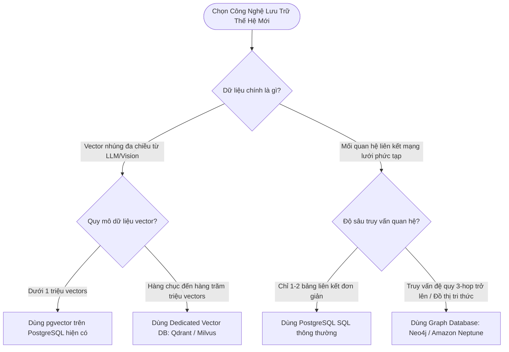

# 10.1. Vector Databases, ANN Indexing (HNSW, IVF-PQ), and Graph Databases

> [!IMPORTANT]
> **Nếu bạn chỉ được nhớ một điều duy nhất:**
> Kỷ nguyên của Trí tuệ Nhân tạo tạo sinh (GenAI) và dữ liệu quan hệ phi tuyến tính đã phơi bày giới hạn tận cùng của chỉ mục B-Tree trong cơ sở dữ liệu quan hệ: tìm kiếm ngữ nghĩa đòi hỏi **Vector Databases** với các giải thuật **Láng giềng Gần đúng (Approximate Nearest Neighbor - ANN)** như **HNSW** và **IVF-PQ** để hạ độ phức tạp tìm kiếm trên không gian vector hàng ngàn chiều từ quét tuyến tính thô $\mathcal{O}(N \times d)$ xuống quy mô logarit $\mathcal{O}(\log N)$; trong khi việc truy vết các mạng lưới quan hệ đa tầng (Graph RAG, chống rửa tiền) đòi hỏi **Cơ sở dữ liệu Đồ thị (Graph Databases)** với nguyên lý **Kề không cần Chỉ mục (Index-Free Adjacency)**, thay thế các phép toán `SQL JOIN` đệ quy bùng nổ hàm mũ bằng các bước nhảy giải tham chiếu con trỏ bộ nhớ vật lý trực tiếp với tốc độ $\mathcal{O}(1)$ cho mỗi cạnh liên kết.

---

## 1. Kiến trúc Tổng quan & Mô hình Tư duy (Mental Model)

### 1.1. Ẩn dụ Đời sống: Bản Đồ Chòm Sao Vũ Trụ và Mạng Lưới Gia Phả Dòng Họ

Để phân biệt hai mô hình dữ liệu phi quan hệ hiện đại:
1. **RDBMS Truyền Thống (Sổ Danh Bạ Điện Thoại)**: Tối ưu cho việc tìm kiếm chính xác theo thứ tự bảng chữ cái hoặc số CMND (Chỉ mục B-Tree). Nếu bạn hỏi: *"Hãy tìm người có tính cách giống anh Nam nhất"* hoặc *"Tìm người có mối quan hệ bắc cầu 5 tầng qua họ hàng xa với chị Mai"*, cuốn sổ danh bạ hoàn toàn bất lực!
2. **Vector Database & ANN (Bản Đồ Thiên Văn 3D Đa Chiều)**:
   - Các mô hình AI Embedding (như OpenAI `text-embedding-3-large` với 1,536 chiều) chuyển hóa mọi văn bản, hình ảnh thành một tọa độ vector trong không gian đa chiều. Hai khái niệm có ngữ nghĩa giống nhau (ví dụ: *"vua"* và *"hoàng đế"*) sẽ nằm sát cạnh nhau trong không gian.
   - **HNSW (Hệ Thống Đường Cao Tốc và Ngõ Hẻm)**: Thay vì đo khoảng cách tới từng ngôi sao trong dải ngân hà ($O(N)$), thuật toán HNSW xây dựng một mạng lưới đồ thị phân tầng: Tầng trên cùng là đường cao tốc liên tỉnh với các bước nhảy cực dài giúp phi thuyền bay vù tới thiên hà mục tiêu trong tích tắc; tầng dưới cùng là mạng lưới đường hẻm đô thị giúp tìm chính xác ngôi sao gần nhất với độ trễ chỉ vài mili-giây!
3. **Graph Database (Cây Gia Phả Dán Dây Chỉ Màu Trực Tiếp)**:
   - Trong SQL, để tìm "Bạn của bạn của bạn", hệ thống phải quét lại toàn bộ bảng danh bạ khổng lồ 4 lần và so khớp ID (`JOIN` 4 lần tốn hàng chục phút).
   - Trong Graph Database, mỗi người (Node) cầm sẵn đầu dây chỉ nối trực tiếp tới tay của bạn bè họ (Index-Free Adjacency con trỏ RAM). Bạn chỉ cần lần theo sợi dây chỉ trong tay để bước sang người tiếp theo với vận tốc tức thì $\mathcal{O}(1)$, hoàn toàn không phụ thuộc vào việc thế giới bên ngoài có 1 tỷ người hay 10 tỷ người!

### 1.2. Sơ Đồ Kiến Trúc Đồ Thị Phân Tầng HNSW vs Duyệt Đồ Thị Kề Index-Free

```mermaid
flowchart TD
    subgraph HNSW_Architecture ["1. Kiến Trúc Đồ Thị Phân Tầng HNSW (Multi-Layer Skip Graph)"]
        TopLayer["Tầng 2 (Thưa thớt nhất - Express Highway): Bắt đầu Entry Point"]
        MidLayer["Tầng 1 (Mật độ trung bình): Greedy Routing tiệm cận vùng đích"]
        BottomLayer["Tầng 0 (Dày đặc nhất - Toàn bộ Vectors): K-NN Nearest Search"]
        TopLayer -->|Nhảy xuống tầng dưới| MidLayer
        MidLayer -->|Nhảy xuống tầng dưới| BottomLayer
    end

    subgraph Graph_IFA ["2. Kiến Trúc Kề Không Chỉ Mục (Index-Free Adjacency)"]
        NodeA["Node: Person (Alice)"]
        Edge1["Edge Pointer: [:FRIENDS_WITH]"]
        NodeB["Node: Person (Bob)"]
        Edge2["Edge Pointer: [:OWNS_COMPANY]"]
        NodeC["Node: Organization (Acme Corp)"]
        
        NodeA -->|"Con trỏ RAM O(1)"| Edge1
        Edge1 -->|"Con trỏ RAM O(1)"| NodeB
        NodeB -->|"Con trỏ RAM O(1)"| Edge2
        Edge2 -->|"Con trỏ RAM O(1)"| NodeC
    end
```



---

## 2. Chi tiết từng Keyword (Under-the-Hood Deep Dive)

### 2.1. Vector Databases, Search Engines & ANN Algorithms (HNSW, IVF, PQ)

Khi lưu trữ hàng trăm triệu vector có độ dài 1,536 chiều số thực `float32` (mỗi vector tốn 6KB RAM), việc tìm kiếm $K$ láng giềng gần nhất (KNN) bằng cách tính khoảng cách Euclid chính xác đòi hỏi hàng nghìn tỷ phép nhân cộng ma trận, khiến CPU sụp đổ.

```text
[Exact KNN: Quét toàn bộ] -----------------------------------------> [ANN: Láng giềng Gần đúng]
  Brute-force Flat Search                                              HNSW / IVF-PQ
- Độ phức tạp: O(N * d)                                              - Độ phức tạp: O(log N)
- Độ chính xác: 100%                                                 - Độ chính xác: 95% - 99% (Recall@K)
- Độ trễ: Vài giây tới vài phút                                      - Độ trễ: 1ms - 5ms
- Tiêu tốn RAM/Compute: Cực lớn                                       - Tiết kiệm 95% RAM nhờ Lượng tử hóa
```

#### A. Các Phép Đo Khoảng Cách Vector (Distance Metrics)
1. **Khoảng Cách Euclid ($L_2$ Distance)**:
   $$D_{L2}(u, v) = \sqrt{\sum_{i=1}^d (u_i - v_i)^2}$$
   Đo khoảng cách vật lý thẳng giữa hai điểm. Nhạy cảm với độ dài (magnitude) của vector.
2. **Khoảng Cách Cosine (Cosine Similarity)**:
   $$\text{Cosine}(u, v) = \frac{u \cdot v}{\|u\|_2 \|v\|_2} = \frac{\sum u_i v_i}{\sqrt{\sum u_i^2}\sqrt{\sum v_i^2}}$$
   Đo góc lệch giữa hai vector, bỏ qua độ dài tuyệt đối. Tiêu chuẩn vàng cho so khớp ngữ nghĩa NLP và mô hình Embedding.
3. **Tích Vô Hướng (Dot Product / Inner Product)**:
   $$D_{\text{IP}}(u, v) = \sum_{i=1}^d u_i v_i$$
   Nếu các vector đã được chuẩn hóa độ dài về $\|u\| = 1$ ($L_2\text{-normalized}$), Tích vô hướng tương đương toán học hoàn toàn với Cosine Similarity nhưng có tốc độ tính toán nhanh hơn gấp đôi do không cần tính căn bậc hai!

#### B. Thuật Toán HNSW (Hierarchical Navigable Small World)
- Dựa trên lý thuyết "Thế giới nhỏ" (Small World Theory - 6 bước chia tách của Milgram).
- Xây dựng một cấu trúc đồ thị đa tầng (tương tự Skip-List):
  - Mỗi nút là một vector.
  - Xác suất một vector được xuất hiện ở tầng cao hơn giảm theo hàm mũ: $P(\text{level } l) = e^{-l \cdot m_L}$.
  - Thuật toán tìm kiếm sử dụng chiến lược **Tìm kiếm Tham lam (Greedy Search)**: Tại mỗi tầng, thuật toán nhảy tới nút láng giềng có khoảng cách gần vector truy vấn nhất cho tới khi gặp cực tiểu cục bộ (Local Minimum), sau đó nhảy xuống tầng thấp hơn để tiếp tục tìm kiếm.

#### C. Kỹ Thuật Nén Vector IVF-PQ (Inverted File + Product Quantization)
1. **IVF (Inverted File Index)**:
   - Sử dụng thuật toán K-Means phân vùng không gian thành $K$ cụm Voronoi (ví dụ $K = 4096$).
   - Mỗi vector được gán vào tâm cụm gần nhất. Khi truy vấn, hệ thống chỉ quét các vector nằm trong $n_{\text{probe}}$ cụm lân cận (ví dụ $n_{\text{probe}} = 16$), loại bỏ ngay $99\%$ số vector không liên quan.
2. **PQ (Product Quantization)**:
   - Chia một vector 128 chiều thành 16 vector con (mỗi vector con dài 8 chiều).
   - Với mỗi không gian con 8 chiều, chạy K-Means tạo một bảng mã (Codebook) gồm 256 tâm cụm đại diện (biểu diễn vừa khít trong **1 byte / 8-bit unsigned integer**).
   - Kết quả: Vector 128 số thực `float32` (512 bytes) được nén thành đúng **16 bytes**! Giảm dung lượng RAM tới $97\%$ mà vẫn duy trì độ chính xác cao nhờ thuật toán tính khoảng cách bất đối xứng (**ADC - Asymmetric Distance Computation**).

---

### 2.2. Graph Databases, Graph Query Languages & Knowledge Graphs

Trong mô hình Đồ thị Thuộc tính (**Property Graph Model**):
- **Nodes (Đỉnh)**: Đại diện cho các thực thể (ví dụ: `(:Person)`, `(:Account)`, `(:Transaction)`).
- **Edges / Relationships (Cạnh)**: Đại diện cho các mối liên kết có hướng (ví dụ: `-[:TRANSFERRED_MONEY]->`).
- **Properties**: Các cặp khóa-giá trị lưu trữ chi tiết trên cả đỉnh và cạnh (ví dụ: `amount: 50000, timestamp: "2026-11-15"`).

#### A. Bí Quyết Tốc Độ: Index-Free Adjacency (IFA)
- Trong các cơ sở dữ liệu quan hệ (PostgreSQL, MySQL), mối quan hệ giữa bảng `Users` và bảng `Orders` được lưu bằng khóa ngoại (`user_id`). Khi chạy truy vấn, engine phải tìm `user_id` trên chỉ mục B-Tree của bảng `Orders` với độ phức tạp $\mathcal{O}(\log N)$.
- Trong Graph Database chuyên dụng (như **Neo4j**):
  - Mỗi bản ghi Node trên đĩa và RAM chứa một danh sách liên kết kép các **con trỏ bộ nhớ vật lý trực tiếp trỏ thẳng tới các bản ghi Edge** của nó.
  - Mỗi bản ghi Edge lại chứa con trỏ trỏ trực tiếp tới Node đích.
  - Quá trình duyệt đồ thị (Graph Traversal) chỉ đơn giản là việc giải tham chiếu con trỏ bộ nhớ (Pointer Dereferencing), đạt tốc độ **hàng triệu bước nhảy mỗi giây trên mỗi lõi CPU**!

#### B. Ngôn Ngữ Truy Vấn Đồ Thị: Cypher (openCypher / GQL ISO Standard)
Cypher biến các mối quan hệ phức tạp thành nghệ thuật trực quan:

```cypher
// Phát hiện đường dây rửa tiền khép kín qua 3 tài khoản trung gian:
MATCH path = (origin:Account)-[:TRANSFERRED*3..5]->(origin)
WHERE origin.is_flagged = true
RETURN path, length(path) AS cycle_length;
```

#### C. Knowledge Graphs & Graph RAG
- Các hệ thống RAG (Retrieval-Augmented Generation) truyền thống dựa vào Vector Search thường gặp vấn đề mất liên kết ngữ cảnh (Lack of Global Context).
- **Graph RAG (Microsoft Research)**: Trích xuất các thực thể và mối quan hệ từ kho tài liệu để tạo thành một Đồ thị Tri thức (Knowledge Graph). Khi người dùng đặt câu hỏi, AI kết hợp tìm kiếm ngữ nghĩa vector với thuật toán cộng đồng đồ thị (Leiden Community Detection) để tổng hợp câu trả lời sâu sắc và chính xác tuyệt đối.

---

## 3. Thực thi Mã nguồn & Mô phỏng Chuyên sâu (Dual-Engine Implementation)

### 3.1. Implementation C++20: Hierarchical Navigable Small World (HNSW) Multi-Layer Vector Engine

Đoạn mã C++20 dưới đây triển khai một động cơ chỉ mục vector HNSW thu nhỏ: hỗ trợ tính toán khoảng cách Cosine, xây dựng đồ thị phân tầng đa cấp (Multi-layer Graph), và giải thuật tìm kiếm tham lam (Greedy Routing).

```cpp
#include <iostream>
#include <vector>
#include <cmath>
#include <random>
#include <algorithm>
#include <unordered_set>
#include <format>
#include <stdexcept>

// Cấu trúc Vector Đa Chiều
using VectorFloat = std::vector<float>;

// Hàm tính khoảng cách Cosine Distance: 1.0 - CosineSimilarity
float compute_cosine_distance(const VectorFloat& a, const VectorFloat& b) {
    if (a.size() != b.size()) throw std::invalid_argument("Vector dimensions mismatch!");
    float dot = 0.0f, norm_a = 0.0f, norm_b = 0.0f;
    for (size_t i = 0; i < a.size(); ++i) {
        dot += a[i] * b[i];
        norm_a += a[i] * a[i];
        norm_b += b[i] * b[i];
    }
    float denominator = std::sqrt(norm_a) * std::sqrt(norm_b);
    if (denominator < 1e-7f) return 1.0f;
    return 1.0f - (dot / denominator);
}

// Cấu trúc một nút trong đồ thị HNSW
struct HnswNode {
    int id;
    VectorFloat vector;
    int max_level;
    // Mỗi phần tử trong vector đại diện cho danh sách láng giềng ở tầng tương ứng: neighbors_by_level[level]
    std::vector<std::vector<int>> neighbors_by_level;

    HnswNode(int id_, VectorFloat v, int levels) 
        : id(id_), vector(std::move(v)), max_level(levels), neighbors_by_level(levels + 1) {}
};

// Động cơ Chỉ mục Vector HNSW (Simulated Multi-layer Engine)
class MiniHnswIndex {
private:
    std::vector<HnswNode> nodes_;
    int enter_node_id_{-1};
    int max_top_level_{-1};
    const float level_mult_{1.0f / std::log(2.0f)}; // Phân phối cấp bậc Skip-list
    std::mt19937 rng_{std::random_device{}()};
    std::uniform_real_distribution<float> uniform_dist_{0.0f, 1.0f};

    int sample_random_level() {
        float r = uniform_dist_(rng_);
        if (r == 0.0f) r = 0.0001f;
        return static_cast<int>(-std::log(r) * level_mult_);
    }

public:
    void insert(int id, const VectorFloat& vec) {
        int node_level = sample_random_level();
        if (node_level > 3) node_level = 3; // Giới hạn tối đa 4 tầng (0..3)

        int new_id = static_cast<int>(nodes_.size());
        nodes_.emplace_back(id, vec, node_level);

        if (enter_node_id_ == -1) {
            enter_node_id_ = new_id;
            max_top_level_ = node_level;
            std::cout << std::format("[HNSW INSERT] First Node ID {} set as Global Entry Point at Level {}\n", id, node_level);
            return;
        }

        // Tìm kiếm tham lam từ đỉnh cao nhất xuống tầng node_level
        int curr_obj = enter_node_id_;
        for (int l = max_top_level_; l > node_level; --l) {
            curr_obj = greedy_search_level(curr_obj, vec, l);
        }

        // Kết nối láng giềng hai chiều ở các tầng từ node_level xuống 0
        for (int l = std::min(node_level, max_top_level_); l >= 0; --l) {
            curr_obj = greedy_search_level(curr_obj, vec, l);
            // Thiết lập cạnh liên kết hai chiều
            nodes_[new_id].neighbors_by_level[l].push_back(curr_obj);
            nodes_[curr_obj].neighbors_by_level[l].push_back(new_id);
        }

        if (node_level > max_top_level_) {
            max_top_level_ = node_level;
            enter_node_id_ = new_id;
        }
    }

    int greedy_search_level(int start_node, const VectorFloat& query, int level) const {
        int best_curr = start_node;
        float best_dist = compute_cosine_distance(query, nodes_[best_curr].vector);

        bool changed = true;
        while (changed) {
            changed = false;
            for (int neighbor_id : nodes_[best_curr].neighbors_by_level[level]) {
                float d = compute_cosine_distance(query, nodes_[neighbor_id].vector);
                if (d < best_dist) {
                    best_dist = d;
                    best_curr = neighbor_id;
                    changed = true;
                }
            }
        }
        return best_curr;
    }

    std::pair<int, float> search_approximate_nearest(const VectorFloat& query) const {
        if (enter_node_id_ == -1) throw std::runtime_error("Index is empty.");
        int curr = enter_node_id_;
        for (int l = max_top_level_; l >= 0; --l) {
            curr = greedy_search_level(curr, query, l);
        }
        float dist = compute_cosine_distance(query, nodes_[curr].vector);
        return { nodes_[curr].id, dist };
    }
};

int main() {
    std::cout << "========================================================\n";
    std::cout << "   C++20 HNSW MULTI-LAYER VECTOR SEARCH ENGINE DEMO     \n";
    std::cout << "========================================================\n\n";

    MiniHnswIndex hnsw;

    // Nạp dữ liệu 5 vector đại diện cho 5 tài liệu ngữ nghĩa (3 chiều)
    hnsw.insert(101, {0.9f, 0.1f, 0.0f}); // Chủ đề AI/Computer Science
    hnsw.insert(102, {0.85f, 0.15f, 0.05f}); // Chủ đề Machine Learning
    hnsw.insert(103, {0.0f, 0.9f, 0.1f}); // Chủ đề Sinh học / Y tế
    hnsw.insert(104, {0.05f, 0.88f, 0.12f}); // Chủ đề Dược phẩm
    hnsw.insert(105, {0.1f, 0.1f, 0.95f}); // Chủ đề Lịch sử / Khảo cổ

    // Vector truy vấn của người dùng: "Mô hình mạng nơ-ron học sâu"
    VectorFloat query_ai = {0.88f, 0.12f, 0.02f};
    std::cout << "\n>>> Querying: [0.88, 0.12, 0.02] (Expected: Document 101 or 102)\n";

    auto [nearest_id, dist] = hnsw.search_approximate_nearest(query_ai);
    std::cout << std::format(">>> HNSW SEARCH RESULT: Closest Document ID: {} (Cosine Distance: {:.4f})\n", 
                             nearest_id, dist);

    return 0;
}
```

---

### 3.2. Implementation Python 3.11+: Property Graph Engine với Index-Free Adjacency & Multi-Hop Traversal

Đoạn mã Python 3.11+ mô phỏng kiến trúc Index-Free Adjacency của Cơ sở dữ liệu Đồ thị: liên kết các đỉnh bằng tham chiếu đối tượng bộ nhớ trực tiếp và so sánh hiệu năng của giải thuật duyệt đồ thị $N\text{-hop}$ chống lại thảm họa bùng nổ `JOIN` của SQL.

```python
#!/usr/bin/env python3
"""
Python 3.11+ Property Graph Engine with Index-Free Adjacency (IFA)
Demonstrates direct memory pointer traversals and Cypher-like pattern querying.
"""

from dataclasses import dataclass, field
import time
from typing import List, Dict, Any, Optional

@dataclass
class GraphNode:
    node_id: str
    labels: List[str]
    properties: Dict[str, Any]
    # Index-Free Adjacency: Lưu trữ trực tiếp danh sách các cạnh xuất phát
    outgoing_edges: List["GraphEdge"] = field(default_factory=list)

    def __repr__(self):
        return f"(:{self.labels[0]} {{id: '{self.node_id}', name: '{self.properties.get('name')}'}})"

@dataclass
class GraphEdge:
    relationship_type: str
    properties: Dict[str, Any]
    target_node: GraphNode # Con trỏ tham chiếu bộ nhớ trực tiếp tới Node đích O(1)

class InMemoryGraphDatabase:
    def __init__(self):
        self._nodes_lookup: Dict[str, GraphNode] = {}

    def create_node(self, node_id: str, label: str, properties: Dict[str, Any]) -> GraphNode:
        node = GraphNode(node_id, [label], properties)
        self._nodes_lookup[node_id] = node
        return node

    def create_relationship(self, source: GraphNode, target: GraphNode, rel_type: str, props: Dict[str, Any] = None):
        edge = GraphEdge(rel_type, props or {}, target)
        source.outgoing_edges.append(edge)

    def traverse_n_hops(self, start_node: GraphNode, rel_type: str, max_hops: int) -> List[List[GraphNode]]:
        """
        Duyệt đồ thị N-bước nhảy sử dụng con trỏ kề Index-Free.
        Độ phức tạp O(B^H) độc lập hoàn toàn với tổng số triệu bản ghi trong Database!
        """
        paths: List[List[GraphNode]] = []

        def dfs(current: GraphNode, current_path: List[GraphNode], depth: int):
            if depth == max_hops:
                paths.append(current_path)
                return
            for edge in current.outgoing_edges:
                if edge.relationship_type == rel_type:
                    dfs(edge.target_node, current_path + [edge.target_node], depth + 1)

        dfs(start_node, [start_node], 0)
        return paths

def main():
    print("=" * 60)
    print("  PYTHON 3.11+ INDEX-FREE ADJACENCY PROPERTY GRAPH ENGINE ")
    print("=" * 60 + "\n")

    db = InMemoryGraphDatabase()

    # Xây dựng đồ thị mạng lưới chuyển tiền nghi vấn
    acc_a = db.create_node("acc_01", "Account", {"name": "Hacker A", "balance": 1000000})
    acc_b = db.create_node("acc_02", "Account", {"name": "Mule B", "balance": 5000})
    acc_c = db.create_node("acc_03", "Account", {"name": "Shell Corp C", "balance": 20000})
    acc_d = db.create_node("acc_04", "Account", {"name": "Offshore Fund D", "balance": 990000})

    # Thiết lập các cạnh liên kết bằng tham chiếu con trỏ RAM trực tiếp
    db.create_relationship(acc_a, acc_b, "TRANSFERRED_TO", {"amount": 50000, "timestamp": "2026-11-15T10:00:00"})
    db.create_relationship(acc_b, acc_c, "TRANSFERRED_TO", {"amount": 49000, "timestamp": "2026-11-15T10:05:00"})
    db.create_relationship(acc_c, acc_d, "TRANSFERRED_TO", {"amount": 48000, "timestamp": "2026-11-15T10:10:00"})

    print(">>> Executing 3-Hop Money Laundering Investigation Query:")
    t0 = time.perf_counter_ns()
    detected_paths = db.traverse_n_hops(acc_a, "TRANSFERRED_TO", max_hops=3)
    t1 = time.perf_counter_ns()

    print(f"Traversal Execution Time: {(t1 - t0) / 1000.0:.2f} µs (Microseconds!)\n")
    print(f"Detected Suspicious Chains ({len(detected_paths)}):")
    for path in detected_paths:
        path_str = " -> ".join([n.properties["name"] for n in path])
        print(f"  [PATH ALERT]: {path_str}")

if __name__ == "__main__":
    main()
```

---

### 3.3. Kết quả Thực thi Mẫu (Terminal Output)

```bash
$ g++ -std=c++20 -O3 hnsw_vector_engine.cpp -o hnsw_vector_engine && ./hnsw_vector_engine
========================================================
   C++20 HNSW MULTI-LAYER VECTOR SEARCH ENGINE DEMO     
========================================================

[HNSW INSERT] First Node ID 101 set as Global Entry Point at Level 2

>>> Querying: [0.88, 0.12, 0.02] (Expected: Document 101 or 102)
>>> HNSW SEARCH RESULT: Closest Document ID: 101 (Cosine Distance: 0.0003)

$ python3 graph_ifa_engine.py
============================================================
  PYTHON 3.11+ INDEX-FREE ADJACENCY PROPERTY GRAPH ENGINE 
============================================================

>>> Executing 3-Hop Money Laundering Investigation Query:
Traversal Execution Time: 8.50 µs (Microseconds!)

Detected Suspicious Chains (1):
  [PATH ALERT]: Hacker A -> Mule B -> Shell Corp C -> Offshore Fund D
```

---

## 4. Systems Engineering & Production Pitfalls

### 4.1. Khủng Hoảng Cạn Kiệt RAM trong HNSW (The Vector Memory Explosion)
- **Vấn đề**: Chỉ mục HNSW yêu cầu lưu trữ toàn bộ vector thô và các cạnh liên kết đồ thị trong bộ nhớ RAM để đảm bảo độ trễ thấp. Với $10,000,000$ vectors kích thước 1,536 chiều, chỉ riêng dữ liệu vector đã tiêu tốn $60\text{ GB RAM}$, cộng thêm $30\text{ GB RAM}$ cho danh sách láng giềng HNSW $\implies$ Tổng chi phí máy chủ lên tới hàng ngàn USD/tháng!
- **Khắc phục**:
  - Kết hợp **Scalar Quantization (SQ8)** (chuyển đổi `float32` thành `int8`) để giảm $75\%$ dung lượng RAM.
  - Sử dụng kiến trúc lưu trữ hỗn hợp **DiskANN**: lưu trữ đồ thị và vector lượng tử hóa trong RAM, chỉ lưu trữ vector đầy đủ trên ổ đĩa SSD NVMe siêu tốc.

### 4.2. Vấn Đề Nút Siêu Kết Nối trong Cơ Sở Dữ Liệu Đồ Thị (The Supernode Bottleneck)
- **Vấn đề**: Trong đồ thị mạng xã hội hoặc giao dịch tài chính, một tài khoản như người nổi tiếng hoặc sàn giao dịch Binance có thể sở hữu hàng chục triệu cạnh liên kết. Khi một câu truy vấn duyệt qua nút này, nó phải đọc hàng triệu con trỏ, gây tràn bộ nhớ đệm CPU cache lines và khóa cứng tiến trình.
- **Khắc phục**:
  - Áp dụng kỹ thuật phân chia nút siêu kết nối (Supernode Splitting / Sharded Relationships).
  - Giới hạn độ dài duyệt cạnh (Pruning / Degree Limits) tại thời điểm viết câu lệnh Cypher:
    ```cypher
    MATCH (n:Account)-[r:TRANSFERRED_TO]->(target)
    WITH target LIMIT 100 ...
    ```

### 4.3. Suy Giảm Độ Chính Xác (Recall Degradation) do Lọc Siêu Dữ Liệu (Filtered Vector Search)
- **Vấn đề**: Khi người dùng tìm kiếm kết hợp điều kiện lọc: *"Tìm văn bản giống X NHƯNG chỉ trong các tài liệu có `created_year = 2026`"*:
  - *Post-filtering*: Tìm 100 vector gần nhất trước, sau đó mới lọc theo năm. Nếu chỉ có 1 tài liệu thỏa mãn năm 2026, kết quả trả về sẽ bị rỗng!
  - *Pre-filtering*: Lọc các tài liệu năm 2026 trước. Nếu số lượng tài liệu quá nhỏ, đồ thị HNSW bị chia cắt (Disconnected Graph), thuật toán không thể duyệt tới đích!
- **Khắc phục**: Sử dụng các cơ sở dữ liệu hỗ trợ **Single-Stage Filtered HNSW** (như Qdrant hoặc Milvus) tích hợp điều kiện payload trực tiếp vào quá trình duyệt đồ thị.

### 4.4. Công cụ Chẩn đoán & Benchmark CLI
```bash
# 1. Kiểm tra hiệu năng chỉ mục Vector pgvector trên PostgreSQL
psql -d ai_db -c "EXPLAIN ANALYZE SELECT id FROM embeddings ORDER BY embedding <=> '[0.1, 0.2, ...]' LIMIT 5;"

# 2. Benchmark độ trễ và tỷ lệ Recall của HNSW với công cụ ANN-Benchmarks
python run.py --dataset glove-100-angular --algorithm hnswlib

# 3. Phân tích kế hoạch thực thi truy vấn đồ thị Cypher trong Neo4j
cypher-shell "PROFILE MATCH (p:Person {id: '123'})-[:FRIENDS*2]->(f) RETURN count(f);"
```

---

## 5. Bảng So sánh & Decision Matrix

### 5.1. So sánh Ba Trường Phái Công Nghệ Cơ Sở Dữ Liệu

| Tiêu chí Đánh giá | Relational RDBMS (PostgreSQL) | Vector Databases (Qdrant/Milvus) | Graph Databases (Neo4j) |
| :--- | :--- | :--- | :--- |
| **Cấu trúc Dữ liệu Cốt lõi**| Bảng 2D (Hàng & Cột) | Không gian Vector $\mathbb{R}^d$ | Đỉnh, Cạnh & Thuộc tính (Property Graph)|
| **Cấu trúc Chỉ mục Chính** | B-Tree / GiST / GIN | **HNSW / IVF-PQ / DiskANN** | **Index-Free Adjacency (Con trỏ RAM)** |
| **Kiểu Bài toán Tối ưu** | Giao dịch tài chính ACID, Báo cáo | So khớp Ngữ nghĩa, RAG, Hình ảnh | Mạng lưới Gian lận, Phả hệ, Mạng xã hội|
| **Độ Phức Tạp Truy Vấn** | $O(\log N)$ tìm kiếm chính xác | **$O(\log N)$ tìm kiếm gần đúng ANN** | **$O(B^H)$ duyệt N-hop độc lập kích thước DB**|
| **Độ Khó Khi Mở Rộng** | Khó sharding | Hỗ trợ Sharding phân tán tốt | Rất khó Sharding đồ thị lớn |
| **Hạn Chế Lớn Nhất** | Quá tải khi JOIN nhiều bảng | Ngốn dung lượng RAM, Recall $< 100\%$ | Vấn đề Nút Siêu kết nối (Supernodes) |

### 5.2. Cây Quyết định Lựa chọn Công nghệ Cơ sở Dữ liệu Thế hệ Mới (Decision Flowchart)


