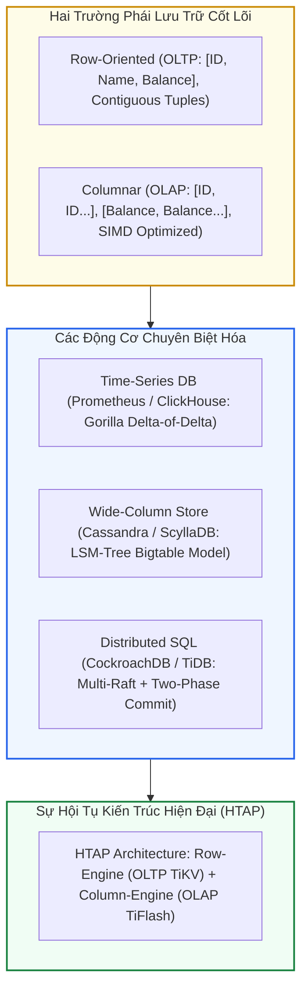
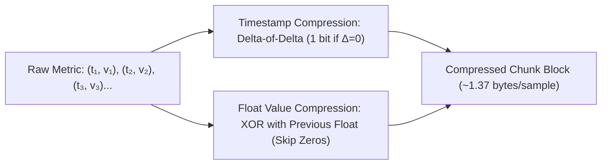
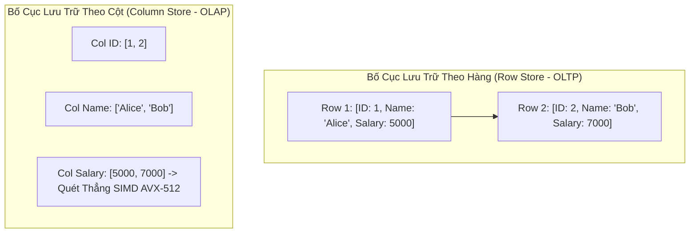
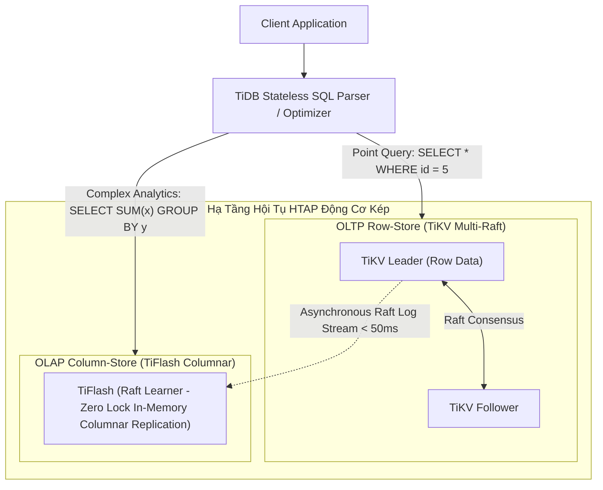

# 10.2. Time-Series, Columnar, NewSQL (Distributed SQL) & HTAP Systems

## Tổng quan về Sự Hội tụ của Các Hệ Quản trị Cơ sở Dữ liệu Thế hệ Mới
Trong nhiều thập kỷ, thế giới cơ sở dữ liệu bị chia đôi thành hai vương quốc hoàn toàn tách biệt:
1. **OLTP (Online Transaction Processing)**: Tối ưu hóa cho các giao dịch nghiệp vụ hàng ngày (ngân hàng, thương mại điện tử). Sử dụng cấu trúc lưu trữ theo hàng (**Row-Oriented**), yêu cầu tính toàn vẹn giao dịch tuyệt đối (**ACID**), độ trễ phản hồi thấp cho các truy vấn đơn dòng (Point Reads/Writes), nhưng cực kỳ chậm chạp khi cần tổng hợp hàng triệu dòng dữ liệu.
2. **OLAP (Online Analytical Processing)**: Tối ưu hóa cho việc phân tích kinh doanh (Data Warehouses / BI Dashboards). Sử dụng cấu trúc lưu trữ theo cột (**Columnar Databases**), tối ưu hóa việc quét hàng tỷ dòng và thực hiện các phép toán tổng hợp đa chiều (`SUM`, `AVG`), nhưng không thể hỗ trợ các giao dịch ghi đơn lẻ có tính nhất quán cao.

Sự bùng nổ của dữ liệu viễn thông, IoT và yêu cầu ra quyết định kinh doanh tức thì đã phá vỡ ranh giới này. Cuộc cách mạng kiến trúc cơ sở dữ liệu hiện đại chứng kiến sự ra đời của:
- **Cơ sở dữ liệu Chuỗi thời gian (Time-Series Databases - TSDB)**: Tận dụng các thuật toán nén chuyên biệt (Gorilla XOR Compression) để lưu trữ hàng tỷ bản ghi đo lường với dung lượng đĩa tối thiểu.
- **NewSQL / Distributed SQL**: Mang lại khả năng mở rộng ngang (Horizontal Scalability) không giới hạn của NoSQL trong khi vẫn duy trì chuẩn mực giao dịch **ACID** và cú pháp **SQL chuẩn** của cơ sở dữ liệu quan hệ.
- **Hệ thống HTAP (Hybrid Transactional/Analytical Processing)**: Xóa bỏ hoàn toàn quy trình trích xuất ETL chậm chạp bằng cách hội tụ cả OLTP và OLAP trên cùng một nền tảng cơ sở dữ liệu duy nhất (**TiDB**, **SingleStore**).



---

## 2. Chi tiết từng Keyword (Under-the-Hood Deep Dive)

---

### 1. Time-Series Databases (TSDB) & Gorilla Compression

#### 1. Khái niệm bản chất (What & Why)
- **Time-Series Databases (TSDB)**: Cơ sở dữ liệu chuyên dụng để lưu trữ và truy vấn dữ liệu được đánh chỉ mục theo chuỗi thời gian liên tục (ví dụ: số liệu CPU máy chủ, giá chứng khoán từng giây, thông số cảm biến áp suất). Tiêu biểu: Prometheus TSDB, InfluxDB, TimescaleDB, ClickHouse.
- **Đặc trưng của dữ liệu Time-Series**: Dữ liệu chỉ ghi thêm (Append-only / 99% Writes), hiếm khi cập nhật lại quá khứ, luôn gắn liền với một dấu thời gian (Timestamp), và dữ liệu cũ thường được tổng hợp hạ mẫu (**Downsampling / Rollups**) để tiết kiệm dung lượng đĩa trước khi xóa vĩnh viễn.

#### 2. Cơ chế hoạt động sâu (Under the hood / Hardcore Internals)
- **Thuật toán Nén Gorilla của Facebook (Gorilla Compression Engine)**:
  Gorilla là chuẩn mực nén dữ liệu chuỗi thời gian hiệu năng cao nhất, nén riêng biệt hai trường:
  1. *Nén Timestamp bằng Kỹ thuật Delta-of-Delta*:
     Khoảng cách thời gian giữa các lần ghi thường rất đều đặn (ví dụ mỗi 60 giây).
     Thay vì lưu timestamp 64-bit ($t_i$), hệ thống tính độ chênh lệch: $D_i = t_i - t_{i-1}$.
     Sau đó tính độ chênh lệch của độ chênh lệch (**Delta-of-Delta**): $\Delta_i = D_i - D_{i-1}$.
     Nếu dữ liệu đến đúng chu kỳ, $\Delta_i = 0$ và chỉ tiêu tốn đúng **1 bit** (`0`) để lưu trữ! Giảm 96% dung lượng timestamp.
  2. *Nén Giá trị Số thực bằng XOR Floating-Point*:
     Các giá trị đo lường liên tiếp thường có cùng bậc độ lớn và chỉ thay đổi các bit cuối. Thuật toán lấy XOR giữa hai số thực liên tiếp: $\text{xor} = v_i \oplus v_{i-1}$.
     Nếu hai giá trị giống hệt nhau, XOR = 0 và chỉ tốn 1 bit. Nếu khác nhau, nó chỉ lưu các bit có nghĩa (Significant Bits) nằm giữa các số 0 đầu và số 0 cuối (Leading/Trailing Zeros).
     Dung lượng trung bình nén được: **Chỉ mất 1.37 bytes cho mỗi điểm đo lường 16-byte!**

#### 3. Sơ đồ minh họa


#### 4. Code ví dụ thực chiến (C++ Gorilla Delta-of-Delta Timestamp Compressor)
```cpp
#include <iostream>
#include <vector>
#include <cstdint>

class GorillaTimestampCompressor {
private:
    uint64_t prev_time_ = 0;
    int64_t prev_delta_ = 0;
    std::vector<int64_t> compressed_stream_;

public:
    void add_timestamp(uint64_t timestamp) {
        if (prev_time_ == 0) {
            prev_time_ = timestamp;
            compressed_stream_.push_back(static_cast<int64_t>(timestamp)); // Điểm mốc đầu
            return;
        }

        int64_t current_delta = static_cast<int64_t>(timestamp - prev_time_);
        int64_t delta_of_delta = current_delta - prev_delta_;

        prev_time_ = timestamp;
        prev_delta_ = current_delta;

        // Lưu delta-of-delta (Nếu chu kỳ đều đặn, delta_of_delta = 0)
        compressed_stream_.push_back(delta_of_delta);
    }

    void dump_stream() const {
        std::cout << "[Gorilla Stream] Base Time: " << compressed_stream_[0] << "\n";
        std::cout << "Delta-of-Deltas: ";
        for (size_t i = 1; i < compressed_stream_.size(); ++i) {
            std::cout << compressed_stream_[i] << " ";
        }
        std::cout << "\n";
    }
};

int main() {
    GorillaTimestampCompressor comp;
    // Chuỗi thời gian đều đặn mỗi 60 giây: 1000, 1060, 1120, 1180, sau đó bị trễ 2 giây: 1242
    comp.add_timestamp(1000);
    comp.add_timestamp(1060);
    comp.add_timestamp(1120);
    comp.add_timestamp(1180);
    comp.add_timestamp(1242);

    comp.dump_stream();
    std::cout << "Kỳ vọng: Các chu kỳ đều đặn có Delta-of-Delta = 0 (Chỉ tốn 1 bit lưu trữ!)\n";
    return 0;
}
```

#### 5. Ưu / Nhược điểm, Pitfalls & Anti-patterns
- **High Cardinality Explosion**: Khi người dùng gắn quá nhiều nhãn định danh động (như UUID, IP khách hàng, mã Session) vào các tags/labels của chuỗi thời gian, số lượng chuỗi thời gian độc lập bùng nổ lên hàng triệu, làm kiệt quệ bộ nhớ RAM của bộ lập chỉ mục chuỗi (Inverted Index) trong Prometheus hoặc InfluxDB.

#### 6. Ứng dụng thực tế trong Backend / Systems
- Hệ thống giám sát hạ tầng máy chủ Kubernetes quy mô hàng chục ngàn node bằng Prometheus và Thanos.

---

### 2. Columnar Databases vs Row-Oriented & Wide-Column Stores

#### 1. Khái niệm bản chất (What & Why)
- **Row-Oriented Databases (OLTP)**: Lưu trữ dữ liệu liên tục trên đĩa theo từng hàng: `[Row 1: ColA, ColB, ColC] [Row 2: ColA, ColB, ColC]`. Rất nhanh khi đọc hoặc ghi toàn bộ thông tin của một dòng cụ thể (Point Query: `SELECT * FROM users WHERE id = 101`). Nhưng khi thực hiện tính tổng `SELECT SUM(salary) FROM users`, hệ thống buộc phải nạp toàn bộ các cột khác (tên, tuổi, địa chỉ) từ đĩa vào RAM, gây lãng phí 90% băng thông I/O.
- **Columnar Databases (OLAP - ClickHouse, Snowflake, DuckDB)**: Lưu trữ dữ liệu liên tục trên đĩa theo từng cột: `[ColA: R1, R2, R3...] [ColB: R1, R2, R3...] [Salary: R1, R2, R3...]`. Khi tính tổng lương, hệ thống **chỉ đọc duy nhất mảng dữ liệu của cột `Salary`**, bỏ qua hoàn toàn các cột khác.
- **Wide-Column Databases (Cassandra, ScyllaDB, Google Bigtable)**: Cơ sở dữ liệu phân tán NoSQL lưu trữ dữ liệu dưới dạng bảng 2 chiều thưa thớt (Sparse Multi-Dimensional Map) được sắp xếp theo Khóa phân vùng (**Partition Key**) và Khóa gom cụm (**Clustering Key**). Sử dụng cấu trúc **LSM-Tree** cho tốc độ ghi dữ liệu phân tán cực cao.

#### 2. Cơ chế hoạt động sâu (Under the hood / Hardcore Internals)
- **Tối ưu hóa Thực thi Vector SIMD trong Columnar Engines**:
  Do các giá trị của cùng một cột có cùng kiểu dữ liệu (ví dụ toàn bộ là số nguyên 32-bit `int32`) và nằm liên tục kề nhau trong bộ nhớ RAM, CPU có thể nạp một mảng 16 số nguyên vào một thanh ghi **SIMD AVX-512** duy nhất và thực hiện phép cộng tích lũy trong đúng 1 chu kỳ xung nhịp CPU (**Vectorized Execution**), đạt tốc độ xử lý hàng tỷ dòng mỗi giây trên 1 lõi CPU!
- **Thuật toán Nén Dữ liệu Cột (RLE & Dictionary Encoding)**:
  - *Run-Length Encoding (RLE)*: Nén các chuỗi giá trị lặp lại liên tiếp. Ví dụ cột Quốc gia: `['VN', 'VN', 'VN', 'US']` được nén thành `(VN, 3), (US, 1)`.
  - *Dictionary Encoding*: Thay thế các chuỗi ký tự dài bằng các mã số nguyên nhỏ (1 byte).

#### 3. Sơ đồ minh họa


#### 4. Code ví dụ thực chiến (C++ Columnar SIMD-like Sum Aggregation Simulation)
```cpp
#include <iostream>
#include <vector>
#include <numeric>

// Mô phỏng cấu trúc dữ liệu hướng cột tối ưu hóa bộ nhớ đệm L1 Cache
struct ColumnarTable {
    std::vector<int32_t> user_ids;
    std::vector<int32_t> amounts; // Chỉ cần quét liên tục mảng này
};

int64_t compute_columnar_sum(const std::vector<int32_t>& column) {
    int64_t total = 0;
    // Trình biên dịch tự động vector hóa (Auto-vectorization) vòng lặp này thành lệnh SIMD
    #pragma GCC ivdep
    for (size_t i = 0; i < column.size(); ++i) {
        total += column[i];
    }
    return total;
}

int main() {
    ColumnarTable table;
    table.user_ids = {101, 102, 103, 104};
    table.amounts = {250, 400, 150, 300};

    int64_t total = compute_columnar_sum(table.amounts);
    std::cout << "[Columnar Execution] Total Amount Computed: $" << total << " (Skipped scanning User IDs completely!)\n";
    return 0;
}
```

#### 5. Ưu / Nhược điểm, Pitfalls & Anti-patterns
- **Thảm họa Ghi đơn dòng trên CSDL Cột**: Cố gắng sử dụng ClickHouse làm CSDL cho các thao tác `UPDATE` hoặc `DELETE` từng dòng một liên tục. CSDL cột được thiết kế để chèn theo lô lớn (Bulk Insert $\ge 10,000$ rows). Việc chèn lẻ từng dòng sẽ tạo ra hàng vạn file phần nhỏ trên đĩa, làm sập động cơ gộp bảng (**Too many parts error**).

#### 6. Ứng dụng thực tế trong Backend / Systems
- Hệ thống phân tích log sự kiện và bảng điều khiển theo dõi doanh thu thời gian thực phục vụ hàng triệu người dùng trên ClickHouse.

---

### 3. NewSQL, Distributed SQL & HTAP (OLTP/OLAP Convergence)

#### 1. Khái niệm bản chất (What & Why)
- **NewSQL / Distributed SQL**: Thế hệ cơ sở dữ liệu quan hệ phân tán hiện đại (như CockroachDB, TiDB, YugabyteDB, Google Cloud Spanner) kết hợp ưu điểm tốt nhất của cả hai thế giới:
  - Khả năng mở rộng ngang (Scale-out) tự động phân mảnh (Auto-sharding) và tính sẵn sàng cao (High Availability) của NoSQL.
  - Ngữ nghĩa giao dịch đầy đủ **ACID cấp độ Serializable** và cú pháp SQL chuẩn của RDBMS truyền thống.
- **HTAP (Hybrid Transactional/Analytical Processing)**: Kiến trúc hội tụ cho phép một hệ thống cơ sở dữ liệu duy nhất vừa phục vụ các giao dịch OLTP có độ trễ cực thấp (< 10ms), vừa đồng thời chạy các câu truy vấn phân tích OLAP phức tạp trên cùng một nguồn dữ liệu thời gian thực **mà không làm ảnh hưởng hay suy giảm hiệu năng của nhau**.

#### 2. Cơ chế hoạt động sâu (Under the hood / Hardcore Internals)
- **Kiến trúc Multi-Raft và Phân vùng Range trong Distributed SQL**:
  Thay vì đồng thuận Raft trên toàn bộ cơ sở dữ liệu (tạo ra điểm nghẽn đơn lẻ):
  - Dữ liệu được chia thành các dải khóa liên tục (**Ranges / Regions**, mỗi range có kích thước từ 64MB đến 512MB).
  - Mỗi Range độc lập tạo thành một nhóm đồng thuận **Raft Group** riêng biệt gồm 3 đến 5 bản sao phân tán trên các node máy chủ khác nhau (**Multi-Raft Architecture**).
  - Nhờ đó, hàng ngàn giao dịch tác động vào các Range khác nhau có thể ghi song song 100% mà không cần chờ đợi nhau!
- **Cơ chế Động cơ Kép trong HTAP (TiDB: TiKV + TiFlash)**:
  - Tầng OLTP sử dụng **TiKV**: Lưu trữ theo hàng (Row-store) dựa trên RocksDB, sử dụng Raft để đảm bảo giao dịch ACID.
  - Tầng OLAP sử dụng **TiFlash**: Một nút đặc biệt tham gia vào chính Raft Group của TiKV với tư cách là một bản sao học việc (Raft Learner). TiFlash tự động chuyển đổi dữ liệu từ dạng hàng sang dạng cột (Column-store) trong bộ nhớ theo thời gian thực (độ trễ đồng bộ < 100ms).
  - Trình tối ưu hóa truy vấn (Cost-Based Optimizer) tự động quyết định: Truy vấn điểm sẽ định tuyến vào TiKV; truy vấn phân tích tổng hợp sẽ định tuyến vào TiFlash!

#### 3. Sơ đồ minh họa


#### 4. Code ví dụ thực chiến (TypeScript HTAP Query Routing Optimizer Simulator)
```typescript
enum QueryType {
  POINT_LOOKUP,
  ANALYTICAL_AGGREGATION
}

class HTAPQueryRouter {
  public static routeQuery(sql: string): { targetEngine: 'TIKV_ROW_STORE' | 'TIFLASH_COLUMN_STORE'; estimatedCost: number } {
    const isAggregation = /(sum|avg|count|group\s+by|join)/i.test(sql);
    const hasSingleIdLookup = /where\s+id\s*=\s*\d+/i.test(sql);

    if (hasSingleIdLookup && !isAggregation) {
      console.log(`[HTAP Optimizer] Routing Point Query to OLTP Row Engine (TiKV) for < 2ms latency.`);
      return { targetEngine: 'TIKV_ROW_STORE', estimatedCost: 1.0 };
    }

    console.log(`[HTAP Optimizer] Routing Analytical Query to OLAP Column Engine (TiFlash) for SIMD vector scan.`);
    return { targetEngine: 'TIFLASH_COLUMN_STORE', estimatedCost: 45.0 };
  }
}

// Test Router
HTAPQueryRouter.routeQuery("SELECT * FROM customers WHERE id = 8841");
HTAPQueryRouter.routeQuery("SELECT country, SUM(order_total) FROM orders GROUP BY country");
```

#### 5. Ưu / Nhược điểm, Pitfalls & Anti-patterns
- **Cross-Region Latency Penalty**: Trong các hệ thống Distributed SQL triển khai đa châu lục (Multi-Region Active-Active), các giao dịch phân tán yêu cầu đồng thuận Raft xuyên đại dương có thể làm tăng độ trễ ghi từ 2ms lên 200-300ms do giới hạn tốc độ ánh sáng truyền qua cáp quang.

#### 6. Ứng dụng thực tế trong Backend / Systems
- Hệ thống lõi ngân hàng số thế hệ mới vừa ghi nhận hàng vạn giao dịch chuyển tiền mỗi giây, vừa đồng thời phát hiện gian lận và hiển thị báo cáo tài chính trực tiếp trên cùng một CSDL duy nhất.
