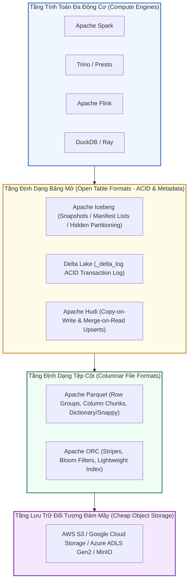
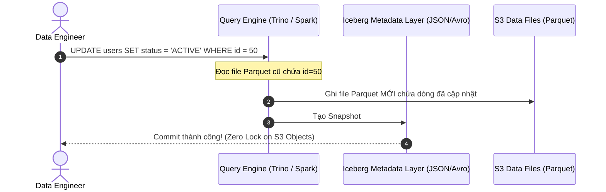
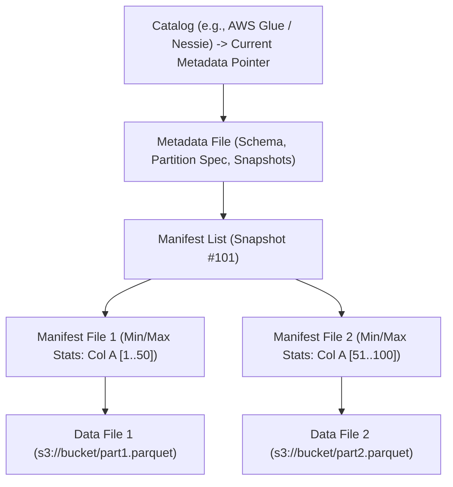
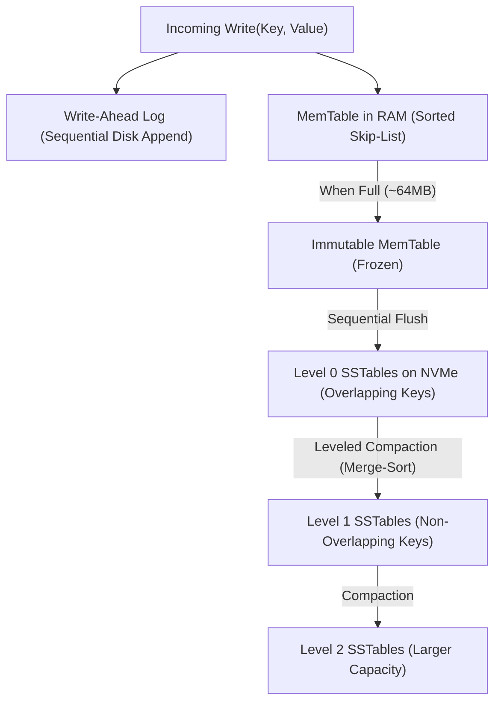

# 10.3. Lakehouse Architecture, Open Table Formats (Iceberg, Delta) & LSM-Trees

## Tổng quan về Kiến trúc Lakehouse và Các Định dạng Bảng Hiện đại
Trong lịch sử tiến hóa của kỹ thuật dữ liệu (Data Engineering), các doanh nghiệp thường phải duy trì song song hai hệ thống hạ tầng cồng kềnh và đắt đỏ:
1. **Data Warehouse (Kho Dữ liệu - e.g., Snowflake, Teradata)**: Cung cấp khả năng truy vấn SQL cực nhanh, giao dịch ACID tin cậy và kiểm soát lược đồ chặt chẽ. Tuy nhiên, nó bị khóa cứng vào nhà cung cấp (Vendor Lock-in), chi phí lưu trữ cực kỳ đắt đỏ do gắn chặt tính toán với lưu trữ, và không thể lưu trữ dữ liệu phi cấu trúc (ảnh, video, audio).
2. **Data Lake (Hồ Dữ liệu - e.g., Hadoop HDFS, AWS S3 Raw)**: Cho phép lưu trữ không giới hạn mọi loại dữ liệu thô với chi phí cực rẻ trên Object Storage. Tuy nhiên, nó nhanh chóng biến thành một **"Đầm lầy Dữ liệu (Data Swamp)"**: Hoàn toàn không có hỗ trợ giao dịch ACID, không thể sửa đổi (UPDATE/DELETE) từng dòng dữ liệu để tuân thủ quyền riêng tư (GDPR Right to be Forgotten), và hiệu năng truy vấn rất chậm chạp.

**Kiến trúc Lakehouse (Data Lakehouse)** đã ra đời để thống nhất hai thế giới này: Mang toàn bộ các tính năng cao cấp của Data Warehouse (**Giao dịch ACID**, **Kiểm soát Lược đồ - Schema Enforcement**, **Du hành Thời gian - Time Travel**) xuống vận hành trực tiếp trên nền tảng lưu trữ đối tượng giá rẻ (**AWS S3 / Google Cloud Storage**) thông qua các **Định dạng Bảng Mở (Open Table Formats)** như **Apache Iceberg**, **Delta Lake**, và **Apache Hudi**.



---

## 2. Chi tiết từng Keyword (Under-the-Hood Deep Dive)

---

### 1. Lakehouse Architecture, Data Lake vs Data Warehouse & Object Storage

#### 1. Khái niệm bản chất (What & Why)
- **Data Warehouse**: Hệ thống lưu trữ dữ liệu có cấu trúc truyền thống phục vụ báo cáo quản trị.
- **Data Lake**: Bể chứa lưu trữ toàn bộ dữ liệu thô (Raw Data) của doanh nghiệp ở định dạng nguyên bản.
- **Lakehouse Architecture**: Kiến trúc lưu trữ kết hợp: Sử dụng Object Storage giá rẻ làm nền móng vật lý, nhưng bổ sung một tầng siêu dữ liệu (Metadata Layer) trung gian để mang lại tính năng ACID và tối ưu hóa truy vấn tương đương Data Warehouse.
- **Object Storage-Based Databases**: Cơ sở dữ liệu vận hành trên nền tảng lưu trữ đối tượng (AWS S3, MinIO). Tận dụng tính bất biến của Object Storage: Các file dữ liệu một khi đã ghi là **bất biến (Immutable)**. Mọi thao tác cập nhật đều tạo ra các file mới và cập nhật con trỏ siêu dữ liệu (**Snapshot-based Metadata Management**).

#### 2. Cơ chế hoạt động sâu (Under the hood / Hardcore Internals)
- **Time Travel & Snapshot Isolation trên Object Storage**:
  Làm thế nào để hệ thống hỗ trợ tính năng "Du hành thời gian" (ví dụ: `SELECT * FROM sales FOR SYSTEM_TIME AS OF '2024-01-01'`)?
  - Mỗi lần có một giao dịch ghi thành công, hệ thống tạo ra một **Snapshot ID** mới.
  - Snapshot mới chứa danh sách các file dữ liệu hợp lệ tại thời điểm đó. Các file cũ không bị xóa bỏ.
  - Khi người dùng truy vấn một thời điểm trong quá khứ, công cụ truy vấn chỉ cần đọc file Metadata tương ứng với Snapshot của thời điểm đó để xác định danh sách file Parquet cần đọc, bỏ qua hoàn toàn các file sinh ra sau đó!

#### 3. Sơ đồ minh họa


#### 4. Code ví dụ thực chiến (TypeScript Snapshot Metadata Pointer Resolution Simulation)
```typescript
interface TableSnapshot {
  snapshotId: number;
  timestampMs: number;
  activeDataFiles: string[];
}

class LakehouseTableMetadata {
  private snapshots: TableSnapshot[] = [];

  public commitNewSnapshot(files: string[]): void {
    const newId = this.snapshots.length + 1;
    this.snapshots.push({
      snapshotId: newId,
      timestampMs: Date.now(),
      activeDataFiles: files
    });
    console.log(`[Lakehouse Metadata] Committed Snapshot #${newId} with ${files.length} active Parquet files.`);
  }

  // Khả năng du hành thời gian (Time Travel Query)
  public getFilesAtTimestamp(targetTimestampMs: number): string[] {
    const validSnapshots = this.snapshots.filter(s => s.timestampMs <= targetTimestampMs);
    if (validSnapshots.length === 0) throw new Error("No snapshot found before this timestamp!");
    const targetSnapshot = validSnapshots[validSnapshots.length - 1];
    console.log(`[Time Travel] Resolved to Snapshot #${targetSnapshot.snapshotId} generated at ${new Date(targetSnapshot.timestampMs).toISOString()}`);
    return targetSnapshot.activeDataFiles;
  }
}

// Test Time Travel
const table = new LakehouseTableMetadata();
const t0 = Date.now();
table.commitNewSnapshot(["data_part_001.parquet", "data_part_002.parquet"]);

setTimeout(() => {
  table.commitNewSnapshot(["data_part_001.parquet", "data_part_003_v2.parquet"]); // Cập nhật thay thế part 2
}, 50);

setTimeout(() => {
  // Đọc dữ liệu tại thời điểm t0 trong quá khứ
  const pastFiles = table.getFilesAtTimestamp(t0 + 10);
  console.log("Files to read for past query:", pastFiles);
}, 100);
```

#### 5. Ưu / Nhược điểm, Pitfalls & Anti-patterns
- **Small Files Problem on S3 (Vấn đề Quá nhiều File Nhỏ)**: Các luồng streaming liên tục ghi các file Parquet kích thước vài Kilobytes lên S3 mỗi giây. Sau vài tuần, số lượng file lên tới hàng triệu, làm nghẽn API liệt kê danh sách của S3 (`s3:ListObjects`) và làm chậm hàng trăm lần tốc độ truy vấn. Bắt buộc phải có tiến trình nền định kỳ gộp file (**Compaction Job** gộp các file nhỏ thành các file lớn kích thước 128MB - 512MB).

#### 6. Ứng dụng thực tế trong Backend / Systems
- Xây dựng kho dữ liệu phân tích tập trung toàn doanh nghiệp thay thế các cụm Hadoop cồng kềnh.

---

### 2. Open Table Formats (Apache Iceberg, Delta Lake, Apache Hudi) & Columnar Formats (Parquet, ORC)

#### 1. Khái niệm bản chất (What & Why)
- **Open Table Formats**: Lớp trừu tượng hóa định nghĩa cấu trúc của một bảng dữ liệu (Bao gồm lược đồ cột, phân vùng, và lịch sử giao dịch) nằm trên tập hợp các file dữ liệu nhị phân phân tán.
- **Apache Iceberg (Netflix / Apple)**: Định dạng bảng mở tiên tiến nhất hiện nay, thiết kế tối ưu cho quy mô cấp độ Petabyte. Đặc trưng bởi **Cây Siêu Dữ Liệu Phân Cấp (Hierarchical Metadata Tree)** và tính năng **Phân vùng Ẩn (Hidden Partitioning)**.
- **Delta Lake (Databricks)**: Định dạng bảng mã nguồn mở dựa trên nhật ký giao dịch tuần tự **`_delta_log`** (các file JSON chứa commit log kết hợp với file Parquet checkpoint). Tích hợp sâu sắc với hệ sinh thái Apache Spark.
- **Apache Hudi (Uber)**: Tối ưu hóa đặc biệt cho các đường ống nạp dữ liệu luồng (Streaming Ingestion) có tần suất cập nhật/xóa cực cao thông qua hai chế độ: **Copy-on-Write (CoW)** và **Merge-on-Read (MoR)**.
- **Apache Parquet & Apache ORC**: Các định dạng file lưu trữ theo cột nhị phân tự chứa (Self-describing Columnar Formats). Tổ chức dữ liệu thành các **Row Groups / Stripes** (chứa từ 100,000 đến 1,000,000 dòng), bên trong chia thành các **Column Chunks** được nén chặt bằng Snappy hoặc Zstandard.

#### 2. Cơ chế hoạt động sâu (Under the hood / Hardcore Internals)
- **Kiến trúc Cây Siêu Dữ Liệu của Apache Iceberg**:
  Khác với Hive (phân vùng dựa trên đường dẫn thư mục `year=2024/month=05`), Iceberg sử dụng cấu trúc 3 tầng:
  1. **Iceberg Catalog**: Con trỏ nguyên tử (Atomic Pointer) trỏ tới file **Metadata File** hiện tại (`v1.metadata.json`).
  2. **Manifest List**: File liệt kê danh sách các **Manifest Files** kèm theo thông tin phạm vi phân vùng (Partition Bounds).
  3. **Manifest File**: Liệt kê chi tiết từng file Parquet cụ thể kèm theo các số liệu thống kê ở cấp độ file (**Column Metrics: Min/Max values, Null counts**).
  - *Cắt tỉa Tối đa (Data Skipping / File Pruning)*: Khi chạy câu truy vấn `WHERE age > 65`, công cụ truy vấn chỉ cần đọc Manifest File: Nếu `max_value(age) < 65`, toàn bộ file Parquet đó sẽ bị bỏ qua ngay lập tức mà không cần nạp bất kỳ byte nào từ S3!

#### 3. Sơ đồ minh họa


#### 4. Code ví dụ thực chiến (C++ Parquet Row-Group Header Inspecting Logic Stub)
```cpp
#include <iostream>
#include <vector>
#include <string>
#include <cstdint>

struct ColumnChunkMetadata {
    std::string column_name;
    int64_t min_value;
    int64_t max_value;
    uint64_t file_offset;
};

// Mô phỏng cơ chế Data Skipping dựa trên siêu dữ liệu Row Group của Parquet/Iceberg
class ParquetDataSkipper {
private:
    std::vector<ColumnChunkMetadata> chunks_;
public:
    void add_chunk_metadata(std::string col, int64_t min_v, int64_t max_v, uint64_t offset) {
        chunks_.push_back({std::move(col), min_v, max_v, offset});
    }

    bool should_read_chunk(size_t chunk_idx, int64_t query_target_value) {
        const auto& chunk = chunks_[chunk_idx];
        // Nếu giá trị tìm kiếm nằm ngoài phạm vi [min, max] -> Bỏ qua không cần nạp từ S3!
        if (query_target_value < chunk.min_value || query_target_value > chunk.max_value) {
            std::cout << "[DATA SKIPPING] Skipping Chunk " << chunk_idx 
                      << " (" << chunk.column_name << " range: [" << chunk.min_value << ".." << chunk.max_value << "])\n";
            return false;
        }
        std::cout << "[DATA HIT] Must read Parquet Chunk " << chunk_idx << " at byte offset " << chunk.file_offset << "\n";
        return true;
    }
};

int main() {
    ParquetDataSkipper skipper;
    skipper.add_chunk_metadata("user_id", 1, 1000, 1048576);
    skipper.add_chunk_metadata("user_id", 1001, 2000, 2097152);

    int64_t target_user = 1500;
    std::cout << "Querying for user_id = " << target_user << ":\n";
    skipper.should_read_chunk(0, target_user); // Sẽ skip chunk 0
    skipper.should_read_chunk(1, target_user); // Sẽ hit chunk 1
    return 0;
}
```

#### 5. Ưu / Nhược điểm, Pitfalls & Anti-patterns
- **Đụng độ Giao dịch Ghi Đồng thời (Concurrent Write Conflict)**: Khi hai tiến trình ghi đồng thời cùng cố gắng commit một Snapshot mới lên một bảng Iceberg, hệ thống sử dụng cơ chế **Kiểm soát Đồng thời Lạc quan (Optimistic Concurrency Control - OCC)**. Giao dịch nào đến sau bị xung đột phân vùng sẽ buộc phải Retry lại từ đầu.

#### 6. Ứng dụng thực tế trong Backend / Systems
- Tối ưu hóa đường ống phân tích dữ liệu người dùng đa nền tảng kết hợp giữa Apache Spark và Trino truy vấn trực tiếp trên hồ dữ liệu Iceberg.

---

### 3. Log-Structured Storage & LSM-Trees (Log-Structured Merge-Trees)

#### 1. Khái niệm bản chất (What & Why)
- **Log-Structured Storage & LSM-Trees**: Cấu trúc dữ liệu và động cơ lưu trữ được tối ưu hóa chuyên biệt cho các hệ thống có tần suất ghi dữ liệu cực lớn (**Write-Heavy Workloads**). Là trái tim của các cơ sở dữ liệu hiện đại: RocksDB, LevelDB, Cassandra, ScyllaDB, CockroachDB (Pebble).
- **Vấn đề B-Tree truyền thống gặp phải**: Trong B-Tree (PostgreSQL, MySQL InnoDB), mỗi thao tác ghi mới hoặc cập nhật đều phải tìm đến vị trí trang lá trên đĩa và ghi đè tại chỗ (In-Place Update). Điều này tạo ra vô số các thao tác **Ghi Ngẫu Nhiên (Random I/O)**, làm nghẽn băng thông và nhanh chóng làm hao mòn phần cứng ổ SSD.

#### 2. Cơ chế hoạt động sâu (Under the hood / Hardcore Internals)
- **4 Thành phần Cốt lõi của LSM-Tree**:
  1. **WAL (Write-Ahead Log)**: Nhật ký ghi tuần tự trên đĩa. Mọi thao tác ghi trước hết được nối đuôi vào WAL để đảm bảo không mất dữ liệu khi mất điện.
  2. **MemTable**: Cấu trúc dữ liệu trong bộ nhớ RAM (thường là một **Skip-List** hoặc Red-Black Tree) duy trì dữ liệu đã được sắp xếp theo khóa.
  3. **Immutable MemTable**: Khi MemTable đạt giới hạn kích thước (ví dụ: 64MB), nó chuyển sang chế độ chỉ đọc và một MemTable mới được tạo ra.
  4. **SSTables (Sorted String Tables)**: Các file bất biến lưu trữ trên đĩa được tổ chức theo các tầng phân cấp ($L_0, L_1, L_2 \dots$). Dữ liệu bên trong SSTable được sắp xếp theo khóa và có kèm theo **Bloom Filter** để kiểm tra nhanh sự tồn tại của khóa mà không cần đọc đĩa.
- **Quá trình Thu gọn Định kỳ (Compaction Process)**:
  Các file SSTable ở tầng trên định kỳ được gộp và phân loại lại (**Merge-Sort**) xuống tầng dưới để loại bỏ các bản ghi đã bị ghi đè hoặc các bản ghi bị xóa mang dấu bia mộ (**Tombstones**).

#### 3. Sơ đồ minh họa


#### 4. Code ví dụ thực chiến (C++ Skip-List Style MemTable Flush Simulator)
```cpp
#include <iostream>
#include <map>
#include <string>

class MicroLSMTree {
private:
    std::map<std::string, std::string> memtable_; // Giả lập MemTable sắp xếp trong RAM
    size_t flush_threshold_ = 3;

public:
    void put(std::string key, std::string val) {
        memtable_[std::move(key)] = std::move(val);
        std::cout << "[LSM MemTable] Inserted key. Current size: " << memtable_.size() << "\n";

        if (memtable_.size() >= flush_threshold_) {
            flush_to_sstable();
        }
    }

    void flush_to_sstable() {
        std::cout << ">>> [FLUSH TRIGGERED] Flushing MemTable to immutable SSTable on disk:\n";
        for (const auto& [k, v] : memtable_) {
            std::cout << "    SSTable Row: " << k << " => " << v << "\n";
        }
        memtable_.clear(); // Giải phóng RAM cho chu kỳ mới
    }
};

int main() {
    MicroLSMTree lsm;
    lsm.put("user_101", "Alice");
    lsm.put("user_102", "Bob");
    lsm.put("user_103", "Charlie"); // Sẽ kích hoạt Flush tuần tự
    lsm.put("user_104", "Dave");
    return 0;
}
```

#### 5. Ưu / Nhược điểm, Pitfalls & Anti-patterns
- **Write Amplification vs Space Amplification**: Việc liên tục chạy quá trình Compaction gộp các file SSTable làm tăng **Hệ số Khuếch đại Ghi (Write Amplification)**: Một byte dữ liệu ghi từ người dùng có thể bị đọc và ghi lại từ 10 đến 30 lần trên đĩa SSD trong suốt vòng đời của nó, làm nóng ổ đĩa và chiếm dụng tài nguyên I/O.

#### 6. Ứng dụng thực tế trong Backend / Systems
- Động cơ lưu trữ RocksDB bên trong các cụm Kafka Streams, CockroachDB và Flink State Backends.
