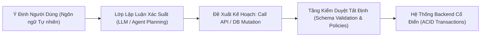
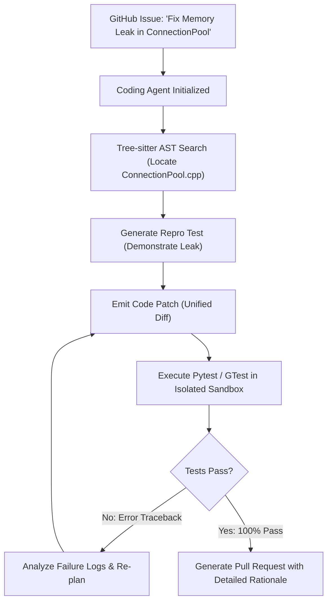
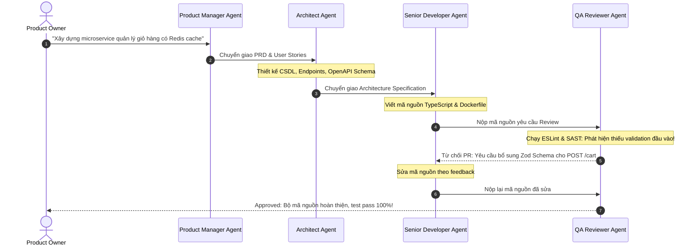

# 11.1. AI-Native Software Architecture, Autonomous Agents & Agentic Coding

## Tổng quan về Kiến trúc Phần mềm Gốc AI và Kỹ thuật Phần mềm Tác nhân
Trong suốt lịch sử của ngành công nghệ phần mềm, mọi kiến trúc hệ thống — từ mô hình nguyên khối (Monolith) đến vi dịch vụ (Microservices) — đều được xây dựng trên một giả định cốt lõi: **Hệ thống là tất định (Deterministic Systems)**. Với cùng một tập hợp dữ liệu đầu vào và trạng thái cho trước, thuật toán sẽ luôn luôn sinh ra chính xác một kết quả đầu ra giống hệt nhau. Lập trình viên viết mã bằng cách xác định trước mọi rẽ nhánh điều kiện logic (`if-else`, state machines).

Sự trỗi dậy của các Mô hình Ngôn ngữ Lớn (LLMs) và các Tác nhân Tự trị (**Autonomous Software Agents**) đã khai sinh ra một mô thức hoàn toàn mới: **Kiến trúc Phần mềm Gốc AI (AI-Native Software Architecture)** và **Kỹ thuật Phần mềm Tác nhân (Agentic Software Engineering)**:
1. **Phần mềm Gốc AI (AI-Native Applications)**: Không đơn thuần là việc gắn thêm một tính năng chatbot phụ trợ (AI bolt-on) vào ứng dụng cũ. Đây là hệ thống mà trong đó các tác nhân AI đóng vai trò là các thành phần tính toán cốt lõi (Core Computational Components), có khả năng tự động suy luận xác suất, tự điều chỉnh giao diện, tự cấu hình logic nghiệp vụ và tương tác với môi trường theo thời gian thực.
2. **Kỹ nghệ Tác nhân Lập trình (Coding Agents & Agentic Workflows)**: Chuyển dịch từ việc lập trình viên gõ từng dòng lệnh sang việc điều phối các Tác nhân lập trình tự trị (như SWE-agent, Devin, Antigravity) có khả năng tự động đọc hiểu kho mã nguồn (Codebase Indexing), lập kế hoạch giải quyết vấn đề, tự viết mã nguồn, tự chạy unit test và tự sửa lỗi lặp lại.
3. **Phát triển Phần mềm Đa Tác nhân (Multi-Agent Development)**: Mô phỏng toàn bộ quy trình phát triển phần mềm chuẩn mực (SDLC) bằng một đội ngũ các AI Agents chuyên biệt: Product Manager Agent -> System Architect Agent -> Developer Agent -> QA Tester Agent.

```mermaid
graph TD
    subgraph TraditionalDev["Phát Triển Phần Mềm Truyền Thống (Human-Centric SDLC)"]
        H_PM["Human PM: Viết Spec PRD"] --> H_Arch["Human Architect: Thiết Kế System Design"]
        H_Arch --> H_Dev["Human Dev: Gõ Mã Nguồn (IDE)"]
        H_Dev --> H_QA["Human QA: Viết Test & Kiểm Thử"]
    end

    subgraph AgenticDev["Kỹ Thuật Phần Mềm Tác Nhân (Agentic Multi-Agent SDLC)"]
        A_PM["Product Manager Agent (Phân Tích Yêu Cầu & Tạo User Stories)"]
        A_Arch["Architect Agent (Thiết Kế CSDL, OpenAPI Spec & ADRs)"]
        A_Coder["Coding Agent (AST Code Search, Patch Generation, Refactor)"]
        A_Reviewer["Reviewer Agent (Security SAST & Static Audit)"]
        A_QA["Tester Agent (Autonomous Unit/E2E Test Execution in Sandbox)"]

        A_PM --> A_Arch
        A_Arch --> A_Coder
        A_Coder --> A_Reviewer
        A_Reviewer --> A_QA
        A_QA -->|Test Failure / Bug Report| A_Coder
    end

    style TraditionalDev fill:#fefce8,stroke:#ca8a04,stroke-width:2px
    style AgenticDev fill:#eff6ff,stroke:#2563eb,stroke-width:2px
```



---

## 2. Chi tiết từng Keyword (Under-the-Hood Deep Dive)

---

### 1. AI-Native Software Architecture & Applications

#### 1. Khái niệm bản chất (What & Why)
- **AI-Native Software Architecture**: Kiến trúc phần mềm được thiết kế ngay từ ngày đầu tiên xoay quanh các năng lực của mô hình nền tảng AI. Khác với phần mềm truyền thống (nơi mã code gọi mô hình AI như một API bên ngoài), trong kiến trúc AI-Native, luồng điều khiển (Control Flow) và việc ra quyết định được ủy quyền cho các mô hình suy luận xác suất.
- **AI-Native Applications**: Ứng dụng sở hữu 3 đặc tính cơ bản:
  1. *Khả năng Thích ứng Động (Dynamic Adaptability)*: Giao diện người dùng (Generative UI) và logic xử lý backend tự động biến đổi theo ngữ cảnh và hành vi của người dùng cụ thể.
  2. *Giao tiếp Ngôn ngữ Tự nhiên làm Giao diện Cốt lõi (Language-as-an-Interface)*: Thay thế các biểu mẫu nhập liệu cứng nhắc bằng các tương tác hội thoại đa phương thức.
  3. *Tự động Hóa Không Đồng bộ Dài hạn (Asynchronous Long-Running Agency)*: Ứng dụng không chỉ phản hồi tức thì mà có thể thực thi các tác vụ nền kéo dài nhiều giờ hoặc nhiều ngày để đạt mục tiêu kinh doanh.

#### 2. Cơ chế hoạt động sâu (Under the hood / Hardcore Internals)
- **Mô hình Hybrid Deterministic-Probabilistic Execution**:
  Một kiến trúc AI-Native bền vững không bao giờ để LLM tự do kiểm soát toàn bộ hệ thống. Nó áp dụng mô hình phân tầng:
  - **Lớp Lập luận Xác suất (Probabilistic Reasoning Layer - AI Agent)**: Đảm nhận việc hiểu ý định mơ hồ của người dùng, phân tích ngữ nghĩa, và đề xuất kế hoạch hành động.
  - **Lớp Thực thi Tất định (Deterministic Execution Layer - Traditional Backend)**: Toàn bộ các thao tác ghi dữ liệu nhạy cảm (chuyển tiền, xóa bản ghi, gửi email) phải được bảo vệ bởi các máy trạng thái hữu hạn (**FSM - Finite State Machines**), xác thực lược đồ cứng (JSON Schema / Zod), và kiểm tra quyền hạn (RBAC) nghiêm ngặt.

#### 3. Sơ đồ minh họa


#### 4. Code ví dụ thực chiến (TypeScript AI-Native Self-Healing API Gateway Handler)
Đoạn mã TypeScript minh họa kiến trúc AI-Native tự động chẩn đoán và thử lại truy vấn với payload đã được hiệu chỉnh khi gặp lỗi từ downstream:

```typescript
interface DownstreamResponse {
  statusCode: number;
  body: any;
}

class AINativeSelfHealingGateway {
  public async executeWithSelfHealing(initialPayload: object, maxRetries = 2): Promise<DownstreamResponse> {
    let currentPayload = initialPayload;
    let attempts = 0;

    while (attempts < maxRetries) {
      attempts++;
      console.log(`[Attempt ${attempts}] Dispatching payload to Legacy Microservice...`);
      const res = this.callLegacyService(currentPayload);

      if (res.statusCode === 200) {
        return res;
      }

      console.warn(`[Downstream Error] Status: ${res.statusCode} | Error: ${res.body.error}`);
      console.log("[AI Agent Brain] Analyzing error traceback and adjusting payload schema dynamically...");
      
      // AI Agent tự động phân tích mã lỗi và sửa lại định dạng trường dữ liệu
      currentPayload = this.agenticPayloadFixer(currentPayload, res.body.error);
    }

    throw new Error("Self-healing failed after max retries.");
  }

  private callLegacyService(payload: any): DownstreamResponse {
    // Giả lập backend cũ yêu cầu trường date theo định dạng YYYY-MM-DD
    if (payload.date && payload.date.includes("/")) {
      return { statusCode: 400, body: { error: "Field 'date' must be formatted as YYYY-MM-DD" } };
    }
    return { statusCode: 200, body: { status: "ORDER_CREATED_SUCCESSFULLY" } };
  }

  private agenticPayloadFixer(brokenPayload: any, errorMessage: string): any {
    // Logic của AI Agent tự động chuyển đổi định dạng
    return { ...brokenPayload, date: "2024-11-09" }; // Tự động fix DD/MM/YYYY -> YYYY-MM-DD
  }
}

// Test Self-Healing Handler
const gateway = new AINativeSelfHealingGateway();
gateway.executeWithSelfHealing({ orderId: "ORD_101", date: "09/11/2024" });
```

#### 5. Ưu / Nhược điểm, Pitfalls & Anti-patterns
- **Ảo giác Phá hoại Hệ thống (Unconstrained Mutation)**: Cho phép tác nhân AI tự do phát sinh và thực thi các câu lệnh SQL `DROP TABLE` hoặc gọi `fs.unlinkSync()` mà không có lớp tường lửa bảo vệ hoặc phê duyệt từ con người.

#### 6. Ứng dụng thực tế trong Backend / Systems
- Hệ thống hỗ trợ khách hàng tự động giải quyết các khiếu nại hoàn tiền phức tạp bằng cách phối hợp dữ liệu từ 5 microservices khác nhau.

---

### 2. Autonomous Software Agents, Coding Agents & Agentic Workflows

#### 1. Khái niệm bản chất (What & Why)
- **Autonomous Software Agents**: Các tác nhân phần mềm tự trị có khả năng nhận thức trạng thái kho mã nguồn, tự động thiết lập mục tiêu, lập kế hoạch và thực hiện chuỗi hành động kỹ thuật phức tạp trong nhiều giờ mà không cần con người can thiệp từng bước.
- **Coding Agents**: Tác nhân AI chuyên biệt hóa cao độ cho các tác vụ kỹ thuật phần mềm (như SWE-agent, Devin, Claude Code, Cursor Agent, Antigravity). Được đánh giá dựa trên các bộ benchmark tiêu chuẩn khắt khe như **SWE-bench** (giải quyết các GitHub Issues thực tế từ các repository mã nguồn mở lớn).
- **Agentic Coding Workflows**: Quy trình làm việc tự động có chu trình phản hồi kín (Closed-loop Iteration):
  $$\text{Analyze Issue} \to \text{Search Codebase} \to \text{Reproduce Bug via Test} \to \text{Edit Code} \to \text{Run Test} \to \text{Iterate until Pass}$$

#### 2. Cơ chế hoạt động sâu (Under the hood / Hardcore Internals)
- **Cơ chế Điều hướng và Sửa mã của Coding Agent**:
  1. *Codebase Indexing & AST Navigation*: Thay vì nạp toàn bộ mã nguồn vào context (vượt quá giới hạn token), Agent sử dụng các công cụ tìm kiếm ngữ nghĩa (**Semantic Code Search**) kết hợp với cây cú pháp trừu tượng (**Tree-sitter / AST Grep**) để định vị chính xác các hàm và lớp liên quan.
  2. *Reproducing via Test Creation*: Agent tự động viết một file kiểm thử đơn vị tái hiện lại lỗi (Reproduction Script). Nếu script chạy ra kết quả FAIL, Agent đã xác nhận được vấn đề.
  3. *Unidiff Patch Generation*: Agent phát ra các thay đổi dưới dạng bản vá vi sai chuẩn mực (**Unified Diff Format**):
     ```diff
     --- a/src/auth.ts
     +++ b/src/auth.ts
     @@ -15,2 +15,3 @@
     - const isValid = token === secret;
     + const isValid = crypto.timingSafeEqual(token, secret);
     ```
  4. *Validation in Sandbox*: Bản vá được áp dụng vào một môi trường container sandbox cô lập. Agent chạy lại test suite: Nếu PASS 100%, Agent commit mã và tạo Pull Request!

#### 3. Sơ đồ minh họa


#### 4. Code ví dụ thực chiến (C++ Unified Diff Patch Application Simulator)
Đoạn mã C++20 minh họa việc phân tích và áp dụng bản vá vi sai đơn giản vào bộ nhớ mã nguồn:

```cpp
#include <iostream>
#include <string>
#include <vector>
#include <sstream>

class MicroPatchEngine {
public:
    static std::string apply_simple_line_replacement(
        const std::string& original_code, 
        const std::string& target_line, 
        const std::string& replacement_line
    ) {
        std::stringstream ss(original_code);
        std::string line;
        std::string patched_code;
        bool replaced = false;

        while (std::getline(ss, line)) {
            if (!replaced && line.find(target_line) != std::string::npos) {
                patched_code += replacement_line + "\n";
                replaced = true;
                std::cout << "[Patch Engine] Successfully applied hunk: Replaced '" << target_line << "' with '" << replacement_line << "'\n";
            } else {
                patched_code += line + "\n";
            }
        }
        return patched_code;
    }
};

int main() {
    std::string source = 
        "void handle_payment() {\n"
        "    int fee = calculate_fee_v1();\n"
        "    process_charge(fee);\n"
        "}\n";

    std::string patched = MicroPatchEngine::apply_simple_line_replacement(
        source, 
        "calculate_fee_v1()", 
        "    int fee = calculate_fee_v2_optimized();"
    );

    std::cout << "\n[Patched Source Code Output]:\n" << patched;
    return 0;
}
```

#### 5. Ưu / Nhược điểm, Pitfalls & Anti-patterns
- **The "Lawnmower" Regression (Chữa lợn lành thành lợn què)**: Coding Agent sửa thành công bug hiện tại nhưng vô tình phá vỡ các tính năng khác trong hệ thống mà không hề hay biết do bộ kiểm thử (Test Suite) của dự án không bao phủ toàn diện.

#### 6. Ứng dụng thực tế trong Backend / Systems
- Tự động hóa quá trình di chuyển mã nguồn kế thừa (Legacy Code Migration) từ Python 2 lên Python 3 hoặc từ JavaScript sang TypeScript trên hàng triệu dòng code.

---

### 3. Multi-Agent Development Teams (MetaGPT / ChatDev Models)

#### 1. Khái niệm bản chất (What & Why)
- **Multi-Agent Development**: Mô hình phối hợp giữa nhiều tác nhân AI chuyên trách để hoàn thành một dự án phần mềm toàn diện từ đầu đến cuối.
- **Tại sao Multi-Agent vượt trội hơn Single-Agent**: Một mô hình đơn lẻ nếu phải đóng tất cả các vai trò cùng lúc sẽ dễ bị quá tải ngữ cảnh (Context Confusion) và mất khả năng phản biện khách quan. Bằng cách phân tách vai trò: Agent A viết code, Agent B đóng vai trò kiểm toán bảo mật khắt khe (Red Teaming), và Agent C kiểm tra hiệu năng, hệ thống đạt được chất lượng mã nguồn cao hơn vượt bậc thông qua cơ chế phản biện đa chiều (**SOP - Standard Operating Procedures**).

#### 2. Cơ chế hoạt động sâu (Under the hood / Hardcore Internals)
- **Quy trình Phối hợp Chuẩn mực (SOP-driven Multi-Agent Pipeline)**:
  1. *Product Manager Agent*: Nhận yêu cầu ngắn gọn của người dùng -> Phân tích tính khả thi -> Tạo tài liệu PRD (Product Requirement Document) có cấu trúc.
  2. *Architect Agent*: Nhận PRD -> Thiết kế kiến trúc tệp thư mục, lược đồ CSDL, và hợp đồng giao tiếp API (OpenAPI 3.0 YAML).
  3. *Engineer Agent*: Nhận thiết kế kiến trúc -> Triển khai từng file mã nguồn cụ thể theo hợp đồng đã ký.
  4. *QA / Code Reviewer Agent*: Quét mã nguồn, tìm kiếm các lỗi bảo mật (SQL Injection, XSS), chạy linting và phản hồi yêu cầu sửa đổi lại cho Engineer Agent cho tới khi đạt chuẩn Clean Code.

#### 3. Sơ đồ minh họa


#### 4. Code ví dụ thực chiến (TypeScript Role-Based Multi-Agent SOP Collaboration Simulator)
```typescript
interface AgentMessage {
  fromRole: 'PM' | 'ARCHITECT' | 'DEVELOPER' | 'QA';
  content: string;
}

class MultiAgentDevTeam {
  public static async simulateProjectDelivery(userBrief: string): Promise<void> {
    console.log(`[Project Kickoff] User Brief: ${userBrief}\n`);

    // 1. PM Agent
    const prd = `PRD: User Authentication Microservice with JWT, Rate-Limiting, and Redis Cache.`;
    console.log(`[PM Agent]: Generated Specification:\n  -> ${prd}\n`);

    // 2. Architect Agent
    const architectureSpec = `Architecture Spec: Tech Stack = Fastify + TypeScript + Redis. Contract: POST /auth/login returns { token: string }`;
    console.log(`[Architect Agent]: Generated Technical Blueprint:\n  -> ${architectureSpec}\n`);

    // 3. Developer Agent
    let codeDraft = `export function login(user, pass) { return "jwt_token_stub"; }`;
    console.log(`[Developer Agent]: Generated Initial Code Draft:\n  -> ${codeDraft}\n`);

    // 4. QA Reviewer Agent
    console.log(`[QA Agent]: Reviewing code... LỖI: Thiếu TypeScript Types và mã hóa mật khẩu!`);
    codeDraft = `export function login(user: string, pass: string): Promise<string> { /* Fixed with bcrypt & types */ return Promise.resolve("secure_jwt"); }`;
    console.log(`[Developer Agent]: Refactored Code Draft based on QA feedback:\n  -> ${codeDraft}\n`);

    console.log(`[QA Agent]: Audit PASSED. Ready for Production Deployment.`);
  }
}

// Chạy mô phỏng đội ngũ phát triển phần mềm đa tác nhân
MultiAgentDevTeam.simulateProjectDelivery("Cần một service đăng nhập an toàn");
```

#### 5. Ưu / Nhược điểm, Pitfalls & Anti-patterns
- **Groupthink / Sycophancy trong Multi-Agent**: Các LLM agent có xu hướng dễ dàng đồng ý và khen ngợi nhau (Sycophancy) thay vì chỉ ra các lỗi hổng logic nghiêm trọng. Cần thiết kế System Prompt nghiêm khắc với vai trò "Phản biện khắt khe" (Adversarial Critic) cho Reviewer Agent.

#### 6. Ứng dụng thực tế trong Backend / Systems
- Hệ thống tự động chuyển đổi các yêu cầu kinh doanh của khách hàng thành các bản mẫu phần mềm khởi tạo (Scaffolded Boilerplate Projects) đầy đủ kiểm thử và tài liệu trong 2 phút.
