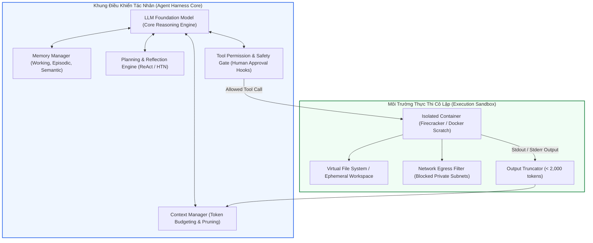
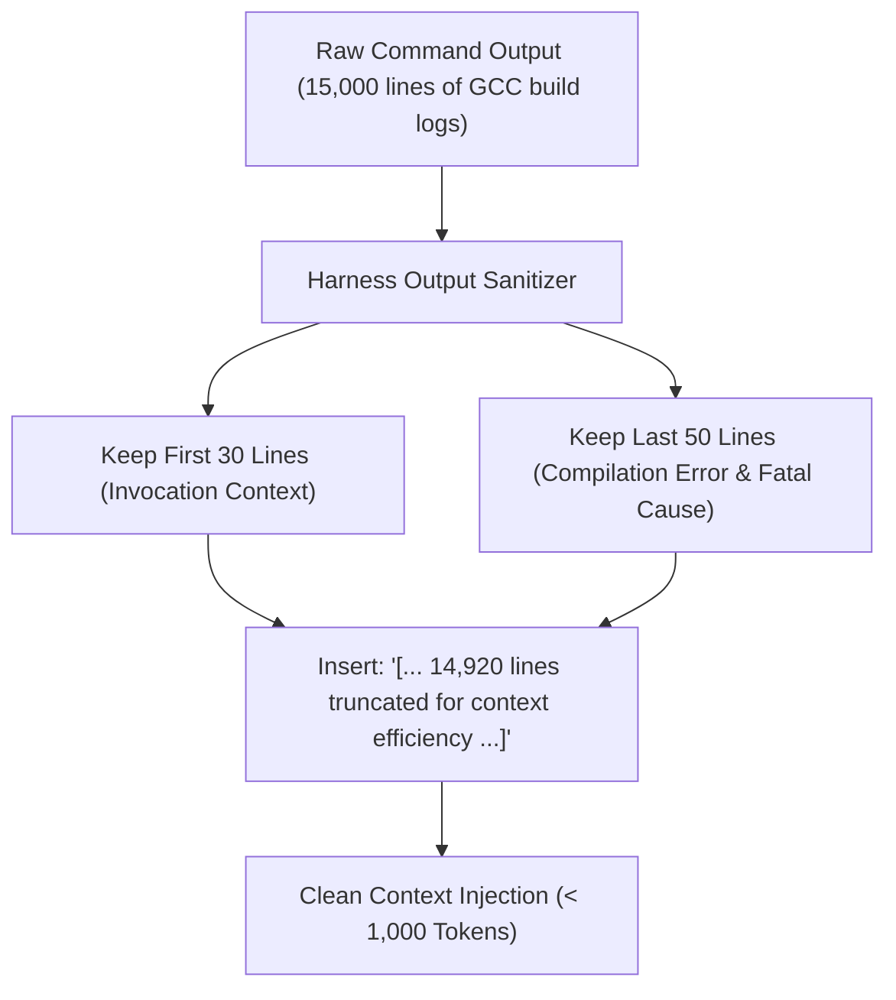
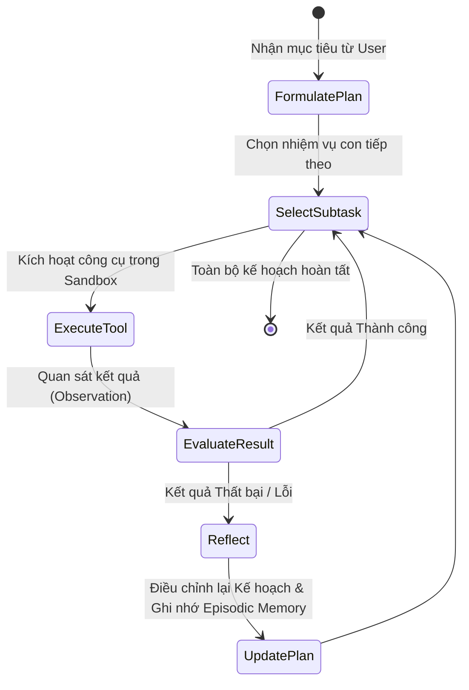
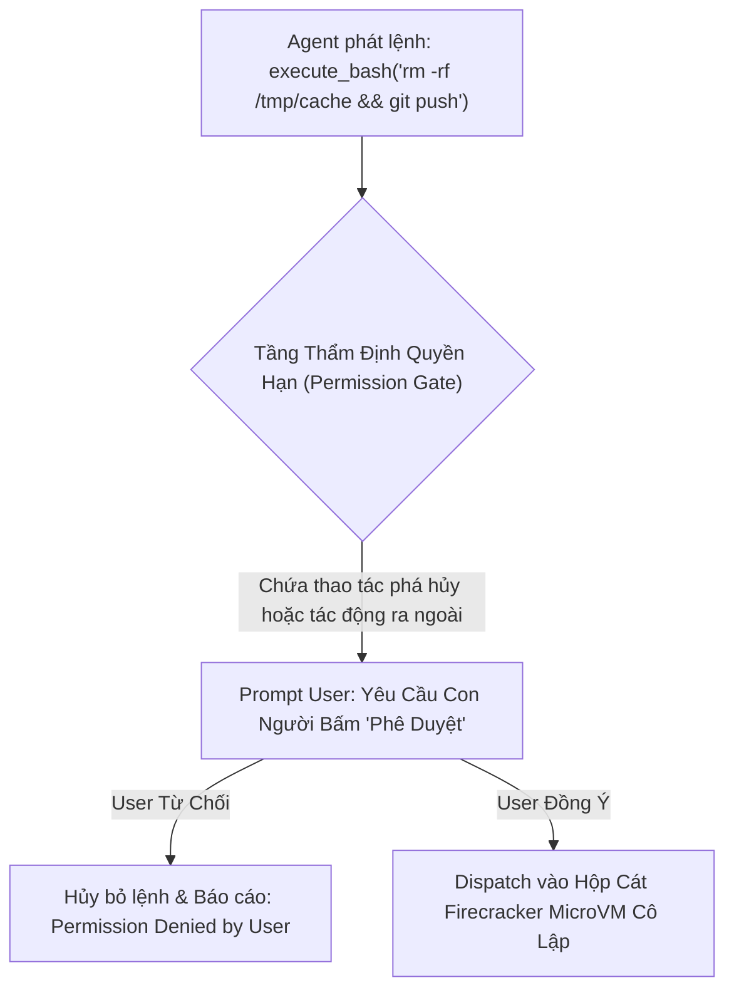

# 11.2. Agent Harness Engineering, Context, Memory & Sandboxed Tool Permissions

## Tổng quan về Kỹ nghệ Khung Điều khiển Tác nhân, Ngữ cảnh và Hộp cát Bảo mật
Một mô hình ngôn ngữ lớn (LLM) tự thân nó chỉ là một hàm tính toán phân phối xác suất dự đoán token tiếp theo: $P(w_{t+1} \mid w_1, \dots, w_t)$. Để biến một mô hình ngôn ngữ tĩnh tại thành một **Tác nhân Phần mềm Tự trị (Autonomous Software Agent)** có khả năng làm việc liên tục trong nhiều giờ mà không bị lạc hướng hay phá hoại hệ thống, các kỹ sư phải xây dựng một **Khung Điều khiển Tác nhân (Agent Harness Engineering)** hoàn chỉnh bao bọc xung quanh mô hình.

Khung điều khiển này chịu trách nhiệm 4 chức năng kỹ thuật sống còn:
1. **Quản lý Ngữ cảnh và Bộ đệm Token (Context Management & Budgeting)**: Kiểm soát nghiêm ngặt cửa sổ ngữ cảnh (Context Window), tự động cắt tỉa các log kết quả công cụ quá dài, và nén ký ức để ngăn ngừa hiện tượng tràn bộ nhớ ngữ cảnh.
2. **Quản lý Ký ức Đa tầng (Multi-tier Agent Memory)**: Phân chia rõ ràng giữa Bộ nhớ làm việc tạm thời (**Working Memory**), Bộ nhớ tình tiết dài hạn (**Episodic Memory**), và Bộ nhớ tri thức ngữ nghĩa (**Semantic Memory**).
3. **Phân quyền Công cụ và Kiểm soát Truy cập (Tool Permissions & RBAC)**: Thiết lập ma trận quyền hạn nghiêm ngặt phân định giữa các công cụ an toàn chỉ đọc (Read-only Tools: `read_file`, `grep`) và các công cụ có khả năng làm thay đổi trạng thái (Mutating / Risky Tools: `run_command`, `write_file`, `git push`).
4. **Môi trường Thực thi Hộp cát Cách ly (Agent Sandboxing & MicroVMs)**: Mọi lệnh shell hoặc mã nguồn do Agent sinh ra bắt buộc phải được thực thi bên trong một môi trường cô lập tuyệt đối (**Docker Container / Firecracker MicroVM / WASM Sandbox**) không có quyền truy cập vào máy chủ Host.



---

## 2. Chi tiết từng Keyword (Under-the-Hood Deep Dive)

---

### 1. Agent Harness Engineering & Context Management

#### 1. Khái niệm bản chất (What & Why)
- **Agent Harness Engineering**: Bộ khung phần mềm hạ tầng (Scaffolding Runtime) bao quanh LLM, đóng vai trò như "Hệ điều hành của Agent": Quản lý vòng đời tiến trình, điều phối các lời gọi công cụ, tiêm chỉ dẫn hệ thống (System Prompt), bắt và xử lý ngoại lệ khi LLM sinh mã lỗi, và duy trì tính liên tục của phiên làm việc.
- **Agent Context Management**: Chiến lược phân bổ và kiểm soát dung lượng token đưa vào cửa sổ ngữ cảnh. Do chi phí và độ trễ tăng vọt theo kích thước context, Harness phải liên tục dọn dẹp các thông tin dư thừa.
- **Tool Output Truncation**: Khi Agent thực thi một lệnh shell như `cat huge_log.txt` hoặc chạy lệnh biên dịch phát sinh hàng vạn dòng log, nếu nạp toàn bộ vào context sẽ làm "thổi bay" (Blow up) cửa sổ ngữ cảnh. Harness phải tự động cắt tỉa thông minh: Giữ lại 50 dòng đầu và 50 dòng cuối cùng chứa thông điệp lỗi (Stack trace).

#### 2. Cơ chế hoạt động sâu (Under the hood / Hardcore Internals)
- **Chiến lược Quản lý Ngữ cảnh Động (Dynamic Token Budgeting Allocation)**:
  Giả sử Context Window tối đa là $128\text{K}$ tokens:
  - $\text{System Prompt \& Tool Definitions}$: Cố định **$4\text{K}$ tokens** (Luôn nằm ở prefix để tận dụng KV-Cache).
  - $\text{Agent Working Memory \& Active Plan}$: Cố định **$8\text{K}$ tokens**.
  - $\text{Recent Interaction History (Turns)}$: Cố định **$32\text{K}$ tokens** (Sliding Window FIFO).
  - $\text{Scratchpad / Ephemeral Tool Execution Output}$: Tối đa **$16\text{K}$ tokens**.
  - $\text{Reserved for Completion Generation}$: Dành riêng **$8\text{K}$ tokens**.
  Khi tổng số token lịch sử chạm ngưỡng $80\%$ ngân sách, Harness kích hoạt tác vụ nén ngữ cảnh (**Context Summarization**): Tóm tắt 20 bước hội thoại cũ nhất thành 1 đoạn văn tóm tắt cô đọng 200 tokens và giải phóng phần còn lại.

#### 3. Sơ đồ minh họa


#### 4. Code ví dụ thực chiến (TypeScript Intelligent Output Truncator & Token Limiter)
```typescript
class ContextSanitizer {
  private static readonly MAX_LINES_HEAD = 20;
  private static readonly MAX_LINES_TAIL = 30;

  public static sanitizeToolOutput(rawOutput: string, maxCharacters = 4000): string {
    if (rawOutput.length <= maxCharacters) {
      return rawOutput;
    }

    const lines = rawOutput.split('\n');
    if (lines.length <= (this.MAX_LINES_HEAD + this.MAX_LINES_TAIL)) {
      return rawOutput.substring(0, maxCharacters) + "\n... [Truncated by Character Limit]";
    }

    const headLines = lines.slice(0, this.MAX_LINES_HEAD);
    const tailLines = lines.slice(lines.length - this.MAX_LINES_TAIL);
    const omittedCount = lines.length - (this.MAX_LINES_HEAD + this.MAX_LINES_TAIL);

    return [
      ...headLines,
      `\n>>> [... ${omittedCount} lines omitted by Agent Harness for Token Conservation ...] <<<\n`,
      ...tailLines
    ].join('\n');
  }
}

// Test Sanitizer
const hugeLogs = Array.from({ length: 1000 }, (_, i) => `Log line ${i + 1}: Compiling dependency...`).join('\n') 
  + "\nFATAL ERROR: undefined reference to 'vtable for MemoryPool'\nBuild failed.";

const sanitized = ContextSanitizer.sanitizeToolOutput(hugeLogs);
console.log(sanitized);
```

#### 5. Ưu / Nhược điểm, Pitfalls & Anti-patterns
- **Aggressive Over-pruning**: Cắt tỉa ngữ cảnh quá thô bạo làm mất các chi tiết quan trọng mà Agent cần (ví dụ cắt mất dòng cảnh báo `warning: implicit conversion` dẫn đến lỗi memory leak). Cần có cơ chế cho phép Agent chủ động yêu cầu xem lại các dòng bị cắt nếu cần.

#### 6. Ứng dụng thực tế trong Backend / Systems
- Hệ thống khung điều khiển của các trợ lý lập trình tự trị hàng đầu (như Claude Code, Antigravity) quản lý hàng trăm phiên làm việc kéo dài nhiều ngày.

---

### 2. Agent State Management, Memory (Episodic, Semantic) & Planning

#### 1. Khái niệm bản chất (What & Why)
- **Agent State Management**: Quản lý trạng thái thực thi bền vững của Agent thông qua mô hình đồ thị máy trạng thái có thể tuần tự hóa (Serializable State Machine). Đảm bảo nếu tiến trình Agent bị khởi động lại, nó có thể phục hồi chính xác trạng thái suy luận và bước đi tiếp theo.
- **Agent Memory Architecture**:
  - *Working Memory*: Bộ nhớ ngắn hạn trong phiên làm việc hiện tại (danh sách biến, mục tiêu con đang làm dở).
  - *Episodic Memory (Ký ức Tình tiết)*: Lưu lại lịch sử các hành động và kết quả trong quá khứ: *"Hôm qua khi sửa lỗi này, mình đã thử đổi sang cổng 8080 nhưng thất bại vì cổng đó bị chiếm dụng"*. Giúp Agent không lặp lại các sai lầm cũ.
  - *Semantic Memory (Ký ức Tri thức)*: Kho tri thức phi ngữ cảnh về kiến trúc hệ thống, quy chuẩn coding style của công ty, hoặc tài liệu API.
- **Agent Planning**: Cơ chế lập kế hoạch phân rã mục tiêu (Hierarchical Task Networks - HTN). Cho phép Agent vạch ra lộ trình các bước thực hiện và tự đánh giá lại (Self-Reflection) sau mỗi bước.

#### 2. Cơ chế hoạt động sâu (Under the hood / Hardcore Internals)
- **Vòng lặp ReAct kết hợp Reflection (Reasoning + Acting + Self-Correction)**:
  Tại mỗi chu kỳ của vòng lặp:
  $$\text{State } S_t \to \text{Thought } T_t \to \text{Action } A_t \to \text{Observation } O_t \to \text{Reflection } R_t \to S_{t+1}$$
  Nếu $\text{Observation}$ báo cáo lỗi: Thay vì ngay lập tức thử một hành động bừa bãi khác, Agent kích hoạt khối **Reflection**:
  - *"Tại sao hành động vừa rồi thất bại?"*
  - *"Giả thuyết ban đầu có đúng không?"*
  - *"Cần điều chỉnh lại kế hoạch tổng thể như thế nào trước khi chạy lệnh tiếp theo?"*

#### 3. Sơ đồ minh họa


#### 4. Code ví dụ thực chiến (TypeScript Hierarchical Task Planning & Reflection State Engine)
```typescript
interface TaskNode {
  id: string;
  title: string;
  status: 'PENDING' | 'RUNNING' | 'COMPLETED' | 'BLOCKED';
  reflectionNotes?: string;
}

class AgentPlanningEngine {
  private plan: TaskNode[] = [];
  private episodicMemory: string[] = [];

  public initializePlan(tasks: string[]): void {
    this.plan = tasks.map((t, idx) => ({
      id: `step_${idx + 1}`,
      title: t,
      status: 'PENDING'
    }));
  }

  public handleTaskFailure(taskId: string, errorReason: string, lessonsLearned: string): void {
    const task = this.plan.find(t => t.id === taskId);
    if (task) {
      task.status = 'BLOCKED';
      task.reflectionNotes = `Failed due to: ${errorReason}. Reflection: ${lessonsLearned}`;
      // Ghi vào Episodic Memory dài hạn để không bao giờ tái phạm
      this.episodicMemory.push(`[Episodic Memory Lesson] On '${task.title}': ${lessonsLearned}`);
      console.warn(`[Agent Reflection] Task ${taskId} blocked. Lesson Recorded: ${lessonsLearned}`);
    }
  }

  public getEpisodicMemoryContext(): string {
    return this.episodicMemory.join('\n');
  }
}

// Test Planning & Reflection
const planner = new AgentPlanningEngine();
planner.initializePlan([
  "Install libpq-dev on container",
  "Compile C++ Postgres driver"
]);

planner.handleTaskFailure(
  "step_1", 
  "apt-get failed: Permission denied", 
  "Must execute apt commands using sudo or root user inside Docker container."
);

console.log("\nPersisted Agent Memory for Next Run:\n" + planner.getEpisodicMemoryContext());
```

#### 5. Ưu / Nhược điểm, Pitfalls & Anti-patterns
- **Plan Rigidity (Kế hoạch Cứng nhắc)**: Agent bám chặt vào một bản kế hoạch ban đầu dù môi trường thực tế đã thay đổi hoàn toàn, liên tục cố gắng thực hiện một bước đã trở nên vô nghĩa. Cần kích hoạt cơ chế Dynamic Re-planning khi có biến cố lớn.

#### 6. Ứng dụng thực tế trong Backend / Systems
- Quản trị viên tự trị vận hành cơ sở dữ liệu (Autonomous Database Administrator Agent) tự động lập kế hoạch dọn dẹp phân vùng và đánh chỉ mục định kỳ.

---

### 3. Agent Tool Permissions & Sandboxing (Execution Environments)

#### 1. Khái niệm bản chất (What & Why)
- **Agent Tool Permissions**: Hệ thống kiểm soát truy cập dựa trên vai trò (RBAC) và chính sách quyền hạn nghiêm ngặt áp đặt lên các công cụ mà Agent được phép gọi.
- **Phân loại Công cụ theo Rủi ro**:
  - *Tier 1: Safe / Read-Only (Không có rủi ro)*: `read_file`, `list_directory`, `web_search`. Được tự động thực thi không cần hỏi.
  - *Tier 2: Mutating / Local Impact (Rủi ro trung bình)*: `edit_file`, `create_branch`, `run_tests`. Thực thi tự động trong sandbox nhưng được lưu log kiểm toán.
  - *Tier 3: Destructive / External World (Rủi ro cao)*: `drop_database`, `git_push_main`, `aws_terminate_instance`, `send_email`. Bắt buộc phải tạm dừng và yêu cầu sự xác nhận phê duyệt trực tiếp từ con người (**Human-in-the-Loop Approval Gate**).
- **Agent Sandboxing & Execution Environments**: Hạ tầng cô lập an toàn nơi Agent thực thi các mã lệnh nguy hiểm: Chạy trong các máy ảo MicroVMs siêu nhỏ (như **AWS Firecracker**, **gVisor**, hoặc **Docker Rootless Sandbox**) với mạng bị giới hạn chặt chẽ.

#### 2. Cơ chế hoạt động sâu (Under the hood / Hardcore Internals)
- **Các Rào Chắn Bảo Mật Phần Cứng và Nhân Hệ Điều Hành cho Sandbox**:
  1. *Linux Namespaces & cgroups*: Cô lập Process ID, User ID, và giới hạn cứng CPU (tối đa 2 cores) và RAM (tối đa 2GB) để ngăn chặn mã độc của Agent làm treo máy chủ host.
  2. *seccomp-bpf Filters*: Khóa chặt các lời gọi hệ thống (Syscalls): Chặn hoàn toàn các lệnh nguy hiểm như `reboot`, `mount`, `ptrace`, `kexec_load`.
  3. *Network Egress Firewall (eBPF / iptables)*: Chặn hoàn toàn việc truy cập vào các dải IP nội bộ mạng công ty (`10.0.0.0/8`, `192.168.0.0/16`, AWS Metadata endpoint `169.254.169.254`), ngăn chặn tuyệt đối nguy cơ Agent bị tấn công Prompt Injection và âm mưu đánh cắp IAM credentials của máy chủ!

#### 3. Sơ đồ minh họa


#### 4. Code ví dụ thực chiến (TypeScript Secure Tool Execution Gate with Confirmation Hooks)
```typescript
type RiskLevel = 'SAFE' | 'MUTATING' | 'CRITICAL';

interface ToolMetadata {
  name: string;
  risk: RiskLevel;
  execute: (args: any) => Promise<any>;
}

class ToolExecutionGateway {
  private registry = new Map<string, ToolMetadata>();

  public registerTool(tool: ToolMetadata): void {
    this.registry.set(tool.name, tool);
  }

  public async invokeTool(toolName: string, args: any, userApproved = false): Promise<any> {
    const tool = this.registry.get(toolName);
    if (!tool) throw new Error(`Tool not found: ${toolName}`);

    console.log(`[Tool Gateway] Evaluating call: ${toolName} (Risk Tier: ${tool.risk})`);

    // Kiểm tra chính sách an toàn
    if (tool.risk === 'CRITICAL' && !userApproved) {
      console.warn(`[SECURITY INTERCEPTION] Action '${toolName}' requires EXPLICIT HUMAN APPROVAL! Execution blocked.`);
      return {
        status: "APPROVAL_REQUIRED",
        message: `Action ${toolName} has high impact. Please confirm execution.`
      };
    }

    // Chạy trong môi trường an toàn
    return await tool.execute(args);
  }
}

// Test Gateway
const gateway = new ToolExecutionGateway();
gateway.registerTool({
  name: "deploy_to_production",
  risk: "CRITICAL",
  execute: async () => ({ deployed: true })
});

// Thử gọi khi chưa có phê duyệt
gateway.invokeTool("deploy_to_production", { version: "v2.0" }, false /* No human approval */);
```

#### 5. Ưu / Nhược điểm, Pitfalls & Anti-patterns
- **Chạy Agent Shell trực tiếp trên Máy Chủ Phát Triển (Bare-Metal Execution)**: Cho phép Agent tự do chạy lệnh `bash` trực tiếp trên máy Mac/Linux của lập trình viên mà không qua Docker sandbox. Một câu lệnh sinh nhầm của AI như `rm -rf $DIR/*` (khi `$DIR` là biến rỗng) có thể xóa sạch toàn bộ thư mục cá nhân `~` của lập trình viên!

#### 6. Ứng dụng thực tế trong Backend / Systems
- Hệ thống nền tảng điện toán đám mây cho phép AI Agents tự động chạy mã code do người dùng tải lên trong môi trường sandbox an toàn tuyệt đối.
