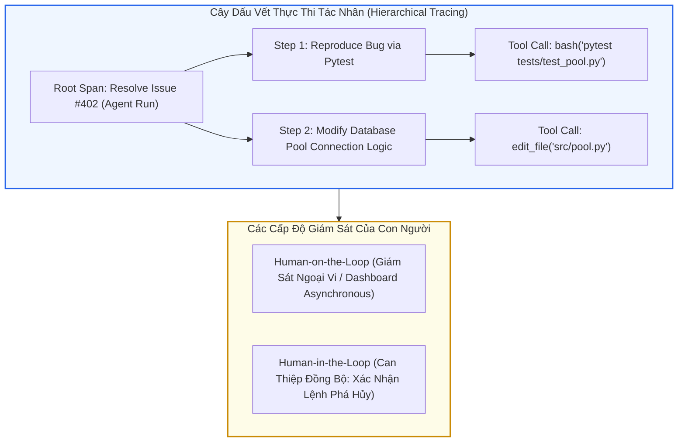
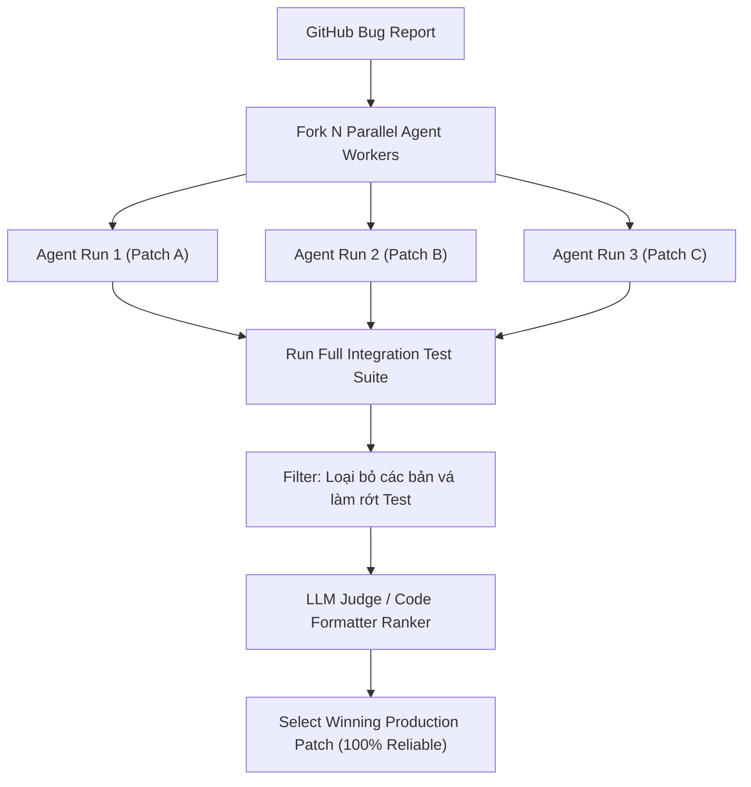
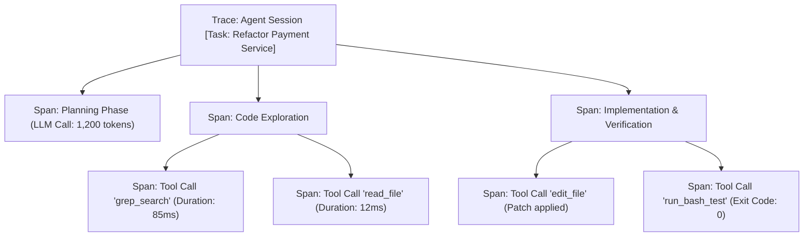
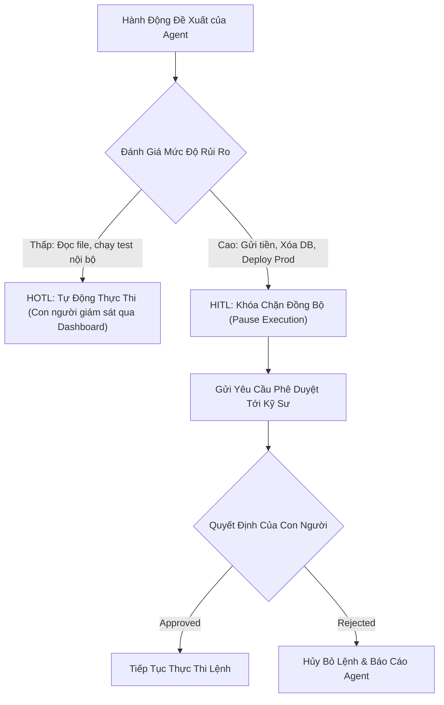

# 11.3. Agent Reliability, Observability, Tracing & Human-in-the-Loop Governance

## Tổng quan về Độ Tin cậy, Khả năng Quan sát và Cơ chế Giám sát Tác nhân
Khi các tác nhân phần mềm tự trị (Autonomous Software Agents) chuyển dịch từ các phòng thí nghiệm nghiên cứu sang vận hành thực tế trong các hệ thống doanh nghiệp, thử thách lớn nhất mà các kỹ sư phần mềm phải đối mặt không phải là năng lực tính toán mà là **Độ tin cậy (Agent Reliability)** và **Tính Minh bạch (Agent Observability)**.

Khác với các microservices truyền thống có luồng thực thi xác định, một tác nhân AI có thể:
- Bị kẹt vào vòng lặp vô tận (Infinite Loop of Death) khi liên tục thử lại một công cụ thất bại mà không thay đổi chiến lược.
- Gặp hiện tượng trôi dạt mục tiêu (Goal Drift) sau 30-40 bước suy luận liên tiếp.
- Tạo ra các hiệu ứng phụ không mong muốn trong cơ sở dữ liệu nếu không có sự giám sát của con người.

Để kiểm soát những rủi ro này, kiến trúc hệ thống bắt buộc phải tích hợp 3 trụ cột kỹ thuật:
1. **Khung Đo lường và Thẩm định Tác nhân (Agent Evaluation & Benchmarking)**: Đánh giá định lượng trên các tập benchmark thực tế (**SWE-bench**, **GAIA**) để đo lường tỷ lệ giải quyết vấn đề thành công (**Pass@1**).
2. **Dấu vết và Khả năng Quan sát Phân cấp (Hierarchical Agent Tracing & Observability)**: Theo dõi vết toàn bộ cây suy luận từ mục tiêu gốc, từng bước lập kế hoạch, từng lời gọi công cụ, cho tới số lượng token tiêu thụ theo thời gian thực.
3. **Mô hình Giám sát Con người (Human-in-the-Loop vs Human-on-the-Loop)**: Thiết lập các ranh giới can thiệp linh hoạt cho phép con người giữ quyền quyết định tối cao đối với các tác vụ rủi ro cao.



---

## 2. Chi tiết từng Keyword (Under-the-Hood Deep Dive)

---

### 1. Agent Evaluation, Benchmarking & Reliability Engineering

#### 1. Khái niệm bản chất (What & Why)
- **Agent Evaluation**: Quy trình đo lường định lượng và có hệ thống năng lực giải quyết vấn đề tự động của AI Agent trên các kịch bản kiểm thử tiêu chuẩn hóa.
- **SWE-bench (Software Engineering Benchmark)**: Bộ tiêu chuẩn vàng trong ngành công nghiệp: Gồm hàng ngàn GitHub Issues thực tế được thu thập từ 12 repository mã nguồn mở Python lớn (Django, SymPy, Flask, v.v.). Agent chỉ được cung cấp mô tả issue và mã nguồn, và phải tự động sinh ra bản vá Git (Git Patch) vượt qua toàn bộ các Unit Tests ẩn của dự án.
- **Các Chỉ số Đo lường Hiệu năng (Agent Metrics)**:
  - **Pass@1**: Tỷ lệ phần trăm các bài toán được giải quyết thành công ngay trong lần chạy thử đầu tiên (không cần thử lại).
  - **Pass@k**: Tỷ lệ phần trăm giải quyết thành công nếu cho phép Agent thử $k$ lần độc lập.
  - **Cost-per-Resolved-Task**: Chi phí tài chính trung bình (tiền API tokens và hạ tầng compute) để giải quyết thành công một issue.
  - **Step Efficiency**: Số lượng bước gọi công cụ trung bình để hoàn thành một nhiệm vụ (càng ít bước càng tốt).
- **Agent Reliability**: Kỹ thuật giảm thiểu sự bất định (Stochastic Variance) của mô hình: Đảm bảo cùng một vấn đề được giao, Agent luôn đưa ra kết quả ổn định và có thể tái lặp.

#### 2. Cơ chế hoạt động sâu (Under the hood / Hardcore Internals)
- **Kỹ thuật Tournament Selection & Best-of-N Sampling**:
  Để nâng cao độ tin cậy của Agent trên các bài toán phức tạp:
  - Hệ thống khởi chạy $N$ phiên làm việc độc lập của Agent song song (với các giá trị seed ngẫu nhiên hoặc nhiệt độ khác nhau).
  - Mỗi phiên làm việc sinh ra một bản vá mã nguồn độc lập.
  - Một bộ kiểm thử tự động (Automated Verification Test Suite) được chạy trên cả $N$ bản vá.
  - Một mô hình đánh giá (**Verifier / Ranker LLM**) chấm điểm tính thanh lịch và độ an toàn của các bản vá vượt qua test để chọn ra bản vá tối ưu duy nhất gửi cho người dùng.

#### 3. Sơ đồ minh họa


#### 4. Code ví dụ thực chiến (TypeScript Tournament Evaluation Selector)
```typescript
interface AgentRunResult {
  runId: string;
  patchDiff: string;
  testsPassed: boolean;
  totalTokensUsed: number;
  durationMs: number;
}

class AgentReliabilityTournament {
  public static selectBestCandidate(runs: AgentRunResult[]): AgentRunResult | null {
    // 1. Lọc điều kiện tiên quyết: Bắt buộc phải pass toàn bộ unit tests
    const validCandidates = runs.filter(r => r.testsPassed);
    if (validCandidates.length === 0) {
      console.error("[Tournament Failure] None of the parallel agent runs passed tests.");
      return null;
    }

    // 2. Tối ưu hóa chi phí và tốc độ: Chọn bản vá tiêu tốn ít token và thời gian nhất
    validCandidates.sort((a, b) => a.totalTokensUsed - b.totalTokensUsed);
    const winner = validCandidates[0];

    console.log(`[Tournament Winner] Selected Run ${winner.runId} (Tokens: ${winner.totalTokensUsed}, Duration: ${winner.durationMs}ms)`);
    return winner;
  }
}

// Test Tournament
const mockRuns: AgentRunResult[] = [
  { runId: "Run_A", patchDiff: "diffA", testsPassed: false, totalTokensUsed: 12000, durationMs: 45000 },
  { runId: "Run_B", patchDiff: "diffB", testsPassed: true,  totalTokensUsed: 18000, durationMs: 60000 },
  { runId: "Run_C", patchDiff: "diffC", testsPassed: true,  totalTokensUsed: 9500,  durationMs: 32000 } // Thắng cuộc!
];

AgentReliabilityTournament.selectBestCandidate(mockRuns);
```

#### 5. Ưu / Nhược điểm, Pitfalls & Anti-patterns
- **Benchmark Overfitting (Học vẹt Benchmark)**: Agent được tinh chỉnh (fine-tuned) quá mức để ghi nhớ các test case cụ thể của bộ dữ liệu SWE-bench, nhưng khi đưa vào kho mã nguồn thực tế của doanh nghiệp với các quy chuẩn riêng, nó hoàn toàn mất khả năng giải quyết vấn đề.

#### 6. Ứng dụng thực tế trong Backend / Systems
- Hệ thống tự động thẩm định chất lượng các Coding Agents trước khi tích hợp vào công cụ phát triển phần mềm nội bộ công ty.

---

### 2. Agent Observability & Hierarchical Distributed Tracing

#### 1. Khái niệm bản chất (What & Why)
- **Agent Observability**: Khả năng giám sát, bóc tách và phân tích sâu toàn bộ quá trình "suy nghĩ" (Inner Monologue), ra quyết định và hành động của tác nhân AI trong thời gian thực.
- **Hierarchical Tracing (Dấu vết Phân cấp)**: Khác với tracing phân tán thông thường (chỉ theo dõi các lời gọi HTTP RPC phẳng giữa các microservices), Agent Tracing là một cấu trúc cây phân cấp nhiều tầng:
  - *Root Trace*: Phiên làm việc của Agent (Mục tiêu tổng quát).
  - *Phase Spans*: Các giai đoạn lớn (Lập kế hoạch, Tìm kiếm, Sửa mã, Kiểm thử).
  - *Action Spans*: Từng hành động gọi công cụ cụ thể (`read_file`, `bash`).
  - *Generation Spans*: Từng lượt gọi LLM nền tảng kèm theo chi tiết prompt, completion, số token và các siêu tham số (temperature, top_p).

#### 2. Cơ chế hoạt động sâu (Under the hood / Hardcore Internals)
- **Chuẩn Mở OpenInference & OpenTelemetry GenAI Semantic Conventions**:
  Để chuẩn hóa dữ liệu telemetry qua các nền tảng giám sát (như Arize Phoenix, Langfuse, Datadog):
  Mỗi span được gắn các thuộc tính tiêu chuẩn:
  - `openinference.span.kind`: `AGENT`, `CHAIN`, `TOOL`, hoặc `LLM`.
  - `llm.input_messages`: Mảng JSON chứa toàn bộ lịch sử ngữ cảnh truyền vào.
  - `llm.output_messages`: Phản hồi cấu trúc của mô hình.
  - `tool.name` & `tool.parameters`: Tên và tham số của công cụ được gọi.
  - `agent.iteration_count`: Số bước lặp trong vòng lặp ReAct hiện tại.

#### 3. Sơ đồ minh họa


#### 4. Code ví dụ thực chiến (TypeScript Hierarchical Agent Tracer Stub)
```typescript
interface SpanRecord {
  spanId: string;
  parentId?: string;
  name: string;
  kind: 'AGENT' | 'PLANNER' | 'TOOL' | 'LLM';
  durationMs: number;
  metadata: Record<string, any>;
}

class AgentTracer {
  private spans: SpanRecord[] = [];

  public startSpan(name: string, kind: 'AGENT' | 'PLANNER' | 'TOOL' | 'LLM', parentId?: string): string {
    const spanId = `span_${Date.now()}_${Math.random().toString(36).substring(2, 7)}`;
    this.spans.push({
      spanId,
      parentId,
      name,
      kind,
      durationMs: 0,
      metadata: {}
    });
    console.log(`[OTel Trace] Started ${kind} Span: "${name}" (ID: ${spanId}, Parent: ${parentId ?? 'ROOT'})`);
    return spanId;
  }

  public endSpan(spanId: string, durationMs: number, metadata: Record<string, any>): void {
    const span = this.spans.find(s => s.spanId === spanId);
    if (span) {
      span.durationMs = durationMs;
      span.metadata = metadata;
      console.log(`[OTel Trace] Finished Span: "${span.name}" in ${durationMs}ms. Tokens: ${metadata.tokens ?? 0}`);
    }
  }
}

// Test Hierarchical Tracing
const tracer = new AgentTracer();
const rootId = tracer.startSpan("BugFixSession_Django_Issue_12", "AGENT");
const toolId = tracer.startSpan("exec_pytest_sandbox", "TOOL", rootId);

tracer.endSpan(toolId, 2500, { exitCode: 0, testsPassed: 4 });
tracer.endSpan(rootId, 8500, { totalTokens: 14200, costUsd: 0.042 });
```

#### 5. Ưu / Nhược điểm, Pitfalls & Anti-patterns
- **Telemetry Flooding (Ngập lụt Dữ liệu Giám sát)**: Ghi lại toàn bộ văn bản prompt và completion của hàng ngàn bước gọi công cụ chi tiết có thể tiêu tốn hàng Terabytes dữ liệu lưu trữ mỗi ngày. Cần thiết lập chính sách lấy mẫu (Sampling Rate: ví dụ lưu 100% các phiên bị lỗi và chỉ lưu 5% các phiên thành công thông thường).

#### 6. Ứng dụng thực tế trong Backend / Systems
- Bảng điều khiển giám sát chi phí và độ trễ của các AI Agents vận hành trong nền tảng SaaS doanh nghiệp.

---

### 3. Human-in-the-Loop (HITL) vs Human-on-the-Loop (HOTL)

#### 1. Khái niệm bản chất (What & Why)
- **Human-in-the-Loop (HITL - Con người Trong Vòng lặp)**: Mô hình can thiệp đồng bộ (Synchronous Intervention). Tác nhân AI **bắt buộc phải dừng lại và chờ đợi sự phê duyệt rõ ràng từ con người** trước khi được phép thực thi một hành động có rủi ro cao (như xóa dữ liệu, gửi email cho khách hàng, triển khai mã nguồn lên môi trường Production).
- **Human-on-the-Loop (HOTL - Con người Trên Vòng lặp)**: Mô hình giám sát ngoại vi bất đồng bộ (Asynchronous Supervisory Oversight). Tác nhân AI được phép tự động hoàn toàn thực hiện toàn bộ quy trình từ đầu đến cuối mà không cần hỏi từng bước. Con người đóng vai trò là một người giám sát (Supervisor): Theo dõi bảng điều khiển telemetry từ xa, có quyền nhận cảnh báo bất thường và có thể bấm nút khẩn cấp để can thiệp hoặc hủy bỏ tiến trình (**Emergency Abort Button / Kill-Switch**) bất cứ lúc nào nếu phát hiện hành vi bất thường.

#### 2. Cơ chế hoạt động sâu (Under the hood / Hardcore Internals)
- **So Sánh Ma Trận Ra Quyết Định: HITL vs HOTL**:

| Tiêu chí | Human-in-the-Loop (HITL) | Human-on-the-Loop (HOTL) |
| :--- | :--- | :--- |
| **Mô hình Tương tác** | Đồng bộ (Synchronous Blocking - Chờ đợi phê duyệt). | Bất đồng bộ (Asynchronous Oversight - Tự động chạy). |
| **Tốc độ Thực thi** | Chậm (Bị giới hạn bởi thời gian phản hồi của con người). | Cực nhanh (Hoàn thành trong vài giây/phút ở tốc độ máy). |
| **Mức độ Rủi ro** | Thích hợp cho các hành động không thể đảo ngược (Irreversible). | Thích hợp cho các hành động có thể đảo ngược hoặc rủi ro thấp. |
| **Cơ chế An toàn** | Phê duyệt trước (Pre-execution Authorization Gate). | Giám sát sau + Nút ngắt khẩn cấp (Emergency Kill-Switch). |

#### 3. Sơ đồ minh họa


#### 4. Code ví dụ thực chiến (TypeScript HITL Approval Interceptor Logic)
```typescript
interface ActionRequest {
  tool: string;
  targetEnvironment: 'STAGING' | 'PRODUCTION';
  impactDescription: string;
}

class GovernanceController {
  // Bộ lọc chặn rủi ro quyết định luồng HITL vs HOTL
  public static async interceptAction(req: ActionRequest, humanApproverCallback: () => Promise<boolean>): Promise<boolean> {
    // Nếu tác động vào môi trường Production -> Bắt buộc Human-in-the-Loop
    if (req.targetEnvironment === 'PRODUCTION') {
      console.warn(`[HITL GATE] Action on PRODUCTION requires human confirmation!`);
      console.warn(`[Impact Description]: ${req.impactDescription}`);
      
      const approved = await humanApproverCallback();
      if (!approved) {
        console.error(`[ACTION REJECTED] Human engineer denied permission for ${req.tool}`);
        return false;
      }
      console.log(`[ACTION APPROVED] Human engineer signed off. Proceeding...`);
      return true;
    }

    // Môi trường Staging/Dev: Áp dụng Human-on-the-Loop (Tự động thực thi, ghi audit log)
    console.log(`[HOTL Mode] Executing autonomously on ${req.targetEnvironment}. Telemetry emitted to audit stream.`);
    return true;
  }
}

// Test Governance
(async () => {
  // Thao tác an toàn trên Staging -> Tự động chạy
  await GovernanceController.interceptAction(
    { tool: "db_migrate", targetEnvironment: "STAGING", impactDescription: "Apply schema migration on dev DB" },
    async () => true
  );

  // Thao tác nguy hiểm trên Production -> Dừng chờ phê duyệt
  await GovernanceController.interceptAction(
    { tool: "db_migrate", targetEnvironment: "PRODUCTION", impactDescription: "Drop old column 'legacy_auth_id' on Prod DB" },
    async () => {
      // Giả lập kỹ sư bấm nút 'Reject' trên giao diện quản trị
      return false;
    }
  );
})();
```

#### 5. Ưu / Nhược điểm, Pitfalls & Anti-patterns
- **Alert Fatigue trong HITL (Hội chứng Mệt mỏi vì Cảnh báo)**: Cấu hình HITL quá mức khiến Agent hỏi ý kiến con người trên từng câu lệnh nhỏ nhặt (như đọc một file cấu hình). Lập trình viên sẽ bị mệt mỏi và hình thành thói quen bấm "Approve All" một cách vô thức, làm vô hiệu hóa hoàn toàn tầng phòng thủ bảo mật.

#### 6. Ứng dụng thực tế trong Backend / Systems
- Hệ thống CI/CD tự động của doanh nghiệp cho phép AI Agent tự do deploy lên môi trường Staging (HOTL), nhưng bắt buộc có chữ ký số của Release Manager trước khi deploy lên Production (HITL).
