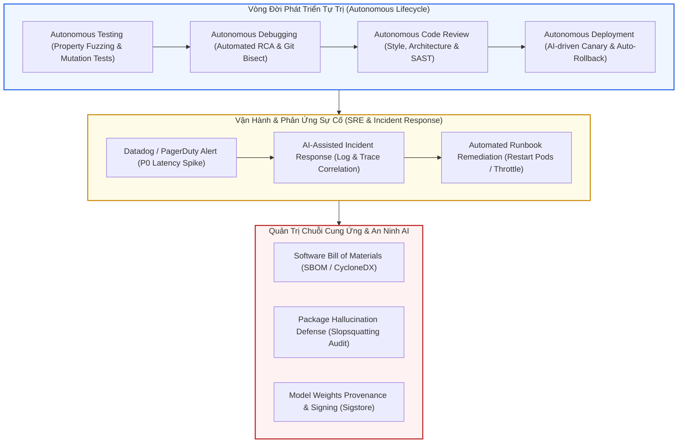
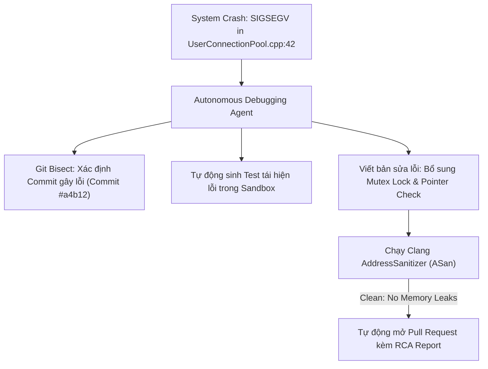
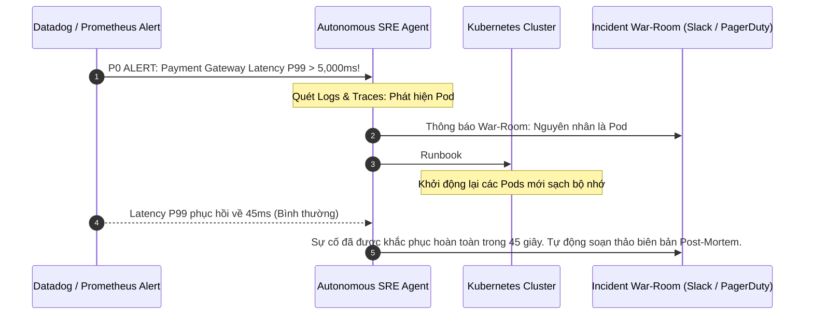
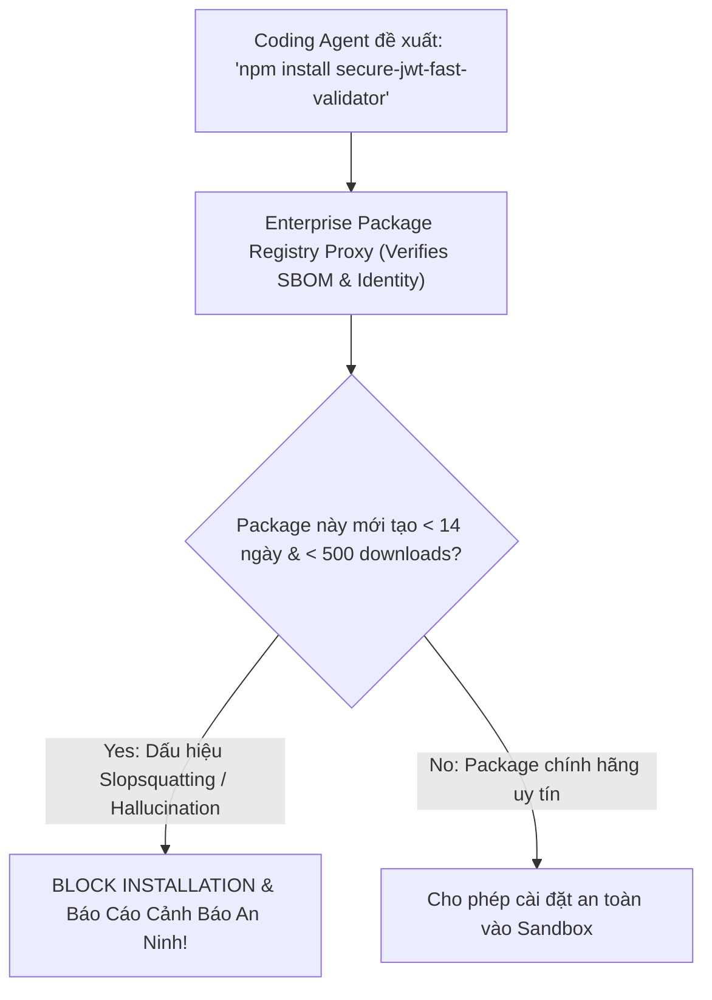

# 11.4. Autonomous Lifecycle, AI-Assisted SRE & AI Supply Chain Governance

## Tổng quan về Vòng đời Phần mềm Tự trị và Quản trị Chuỗi Cung ứng AI
Sự trưởng thành của các tác nhân phần mềm thông minh không chỉ dừng lại ở giai đoạn viết mã nguồn (Coding) mà đang cách mạng hóa toàn bộ **Vòng đời Phát triển Phần mềm (Software Development Life Cycle - SDLC)** và **Vận hành Hệ thống (DevOps / SRE)**. Một hệ thống phần mềm tự trị hiện đại có khả năng tự kiểm thử, tự gỡ lỗi, tự đánh giá mã nguồn, tự triển khai, và thậm chí tự phản ứng khẩn cấp để khắc phục các sự cố gián đoạn dịch vụ nghiêm trọng (P0 Outages) mà không cần con người thức dậy vào ban đêm.

Tuy nhiên, sự tự trị này mở ra một bề mặt tấn công hoàn toàn mới đối với an ninh phần mềm: **An ninh Chuỗi Cung ứng AI (AI Supply Chain Security)** và **Quản trị AI (AI Governance)**. Kẻ tấn công có thể:
- Đầu độc các mô hình nền tảng bằng dữ liệu huấn luyện độc hại (Data Poisoning).
- Lợi dụng xu hướng ảo giác của AI để tạo ra các gói phần mềm độc hại giả mạo (**AI Package Hallucination / Slopsquatting Attack**).
- Thay đổi ngầm các trọng số mô hình hoặc các chỉ dẫn Prompt injection để chiếm quyền điều khiển hạ tầng triển khai.

Do đó, việc thiết lập một khung quản trị chuỗi cung ứng phần mềm với **Bản kê Khai Phần mềm (SBOM - Software Bill of Materials)**, kiểm minh hình thức (**Formal Verification**), và các chính sách kiểm toán tự động là yêu cầu bắt buộc đối với các kỹ sư Backend và SRE hiện đại.



---

## 2. Chi tiết từng Keyword (Under-the-Hood Deep Dive)

---

### 1. Autonomous Testing, Debugging, Code Review & Deployment

#### 1. Khái niệm bản chất (What & Why)
- **Autonomous Testing**: Khả năng của hệ thống tự động sinh ra các ca kiểm thử phức tạp mà con người thường bỏ sót:
  - *Property-Based Testing*: Tự động sinh ra hàng ngàn trường hợp biên (Edge cases, số nguyên âm, chuỗi Unicode kỳ dị, mảng rỗng) để kiểm chứng các bất biến toán học của hệ thống.
  - *Mutation Testing*: Tự động cố tình làm hỏng mã nguồn (thay `>` thành `<`) để kiểm tra xem bộ test suite hiện tại có đủ nhạy bén để phát hiện lỗi hay không.
- **Autonomous Debugging**: Tác nhân tự động nhận diện thông báo lỗi (Error Stack Trace), tự động chạy lệnh **`git bisect`** để cô lập commit đầu tiên gây ra lỗi, tái hiện lỗi trong sandbox, và tự động đề xuất bản sửa lỗi chính xác.
- **Autonomous Code Review**: Bot kiểm duyệt mã nguồn tự động phân tích các Pull Request: Kiểm tra tính tuân thủ quy chuẩn kiến trúc của công ty (Architectural Decisions), phát hiện các lỗ hổng bảo mật tiềm ẩn, và đo lường tác động hiệu năng trước khi cho phép merge.
- **Autonomous Deployment**: Triển khai thông minh: Hệ thống tự động đẩy phiên bản mới ra một tỷ lệ nhỏ người dùng (**Canary Deployment 5%**), AI liên tục theo dõi các chỉ số đo lường (Error rate, P99 Latency). Nếu phát hiện bất thường dù là nhỏ nhất, AI sẽ **tự động kích hoạt Rollback ngay lập tức** trong vòng vài giây mà không cần con người bấm nút.

#### 2. Cơ chế hoạt động sâu (Under the hood / Hardcore Internals)
- **Chu trình Tự động Phân tích Gốc rễ Lỗi (Autonomous Root Cause Analysis - RCA)**:
  Khi phát sinh ngoại lệ `NullPointerException` hoặc `SIGSEGV`:
  1. *Frame Inspection*: Tác nhân bóc tách Call Stack để xác định dòng code chính xác gây ra crash.
  2. *Git Blame & History Correlation*: Quét lịch sử commit gần nhất để xem ai đã thay đổi hàm đó và lý do nghiệp vụ là gì.
  3. *State Reconstruction*: Tác nhân giả lập trạng thái bộ nhớ dẫn tới giá trị `null` bằng cách tạo một unit test tối thiểu.
  4. *Patch Verification*: Viết lại hàm với cơ chế kiểm tra an toàn (Null Safety) và chạy lại toàn bộ test suite để xác nhận không gây tác dụng phụ.

#### 3. Sơ đồ minh họa


#### 4. Code ví dụ thực chiến (TypeScript Autonomous Code Review Safety Guard)
Đoạn mã TypeScript xây dựng bộ quy tắc kiểm duyệt tự động phát hiện các câu lệnh SQL không an toàn trong các Pull Request:

```typescript
interface CodeChangeHunk {
  filename: string;
  addedLines: string[];
}

class AutonomousPRReviewer {
  public static reviewPullRequest(hunks: CodeChangeHunk[]): { approved: boolean; reviewComments: string[] } {
    const comments: string[] = [];
    let approved = true;

    for (const hunk of hunks) {
      for (const line of hunk.addedLines) {
        // Kiểm tra lỗi bảo mật SQL Injection kinh điển do cộng chuỗi
        if (/query\s*\(\s*["'].*SELECT.*FROM.*["']\s*\+/i.test(line)) {
          approved = false;
          comments.push(`[CRITICAL SECURITY ALERT] File ${hunk.filename}: Detected Raw SQL string concatenation on line: "${line.trim()}". Bắt buộc sử dụng Parameterized Queries hoặc ORM!`);
        }

        // Kiểm tra việc sử dụng các hàm cấm
        if (line.includes("eval(") || line.includes("child_process.exec(")) {
          approved = false;
          comments.push(`[BLOCKED] File ${hunk.filename}: Usage of arbitrary execution primitives ('eval' / 'exec') is strictly prohibited.`);
        }
      }
    }

    return { approved, reviewComments: comments };
  }
}

// Test Code Review Bot
const diffHunks: CodeChangeHunk[] = [{
  filename: "src/services/userService.ts",
  addedLines: [
    "export async function getUser(name: string) {",
    "  const sql = 'SELECT * FROM users WHERE username = ' + name;", // Lỗ hổng SQLi
    "  return await db.query(sql);",
    "}"
  ]
}];

const reviewResult = AutonomousPRReviewer.reviewPullRequest(diffHunks);
console.log("PR Review Result:", reviewResult);
```

#### 5. Ưu / Nhược điểm, Pitfalls & Anti-patterns
- **Automated Rollback Thrashing**: Hệ thống tự động Rollback kích hoạt quá nhạy bén do các biến động chỉ số ngẫu nhiên không đáng kể, làm gián đoạn các kế hoạch phát hành tính năng mới hợp lệ. Cần áp dụng thuật toán thống kê kiểm định giả thuyết (**Mann-Whitney U Test** hoặc **CUSUM**) trên chuỗi thời gian metrics trước khi ra quyết định rollback.

#### 6. Ứng dụng thực tế trong Backend / Systems
- Hệ thống CI/CD của các công ty công nghệ lớn (như Meta, Netflix) tự động kiểm thử đột biến (Mutation Testing) và canary deployment phục vụ hàng tỷ người dùng.

---

### 2. AI-Assisted Incident Response & SRE Observability

#### 1. Khái niệm bản chất (What & Why)
- **AI-Assisted Incident Response**: Việc sử dụng các tác nhân AI đóng vai trò như một kỹ sư SRE trực ban (On-Call SRE Copilot/Agent) trong các sự cố hạ tầng khẩn cấp: Tự động tổng hợp và tương quan hàng vạn log, metrics, và traces phát sinh cùng lúc khi có báo động, định vị nguyên nhân gốc rễ và đề xuất phương án xử lý nhanh nhất.
- **Automated Runbook Execution**: Tác nhân AI có quyền thực thi các kịch bản khắc phục sự cố tiêu chuẩn đã được định nghĩa trước (Automated Runbooks: Ví dụ: Khởi động lại Pod bị tràn bộ nhớ, mở rộng kích thước Connection Pool của CSDL, kích hoạt chế độ bảo trì tạm thời).

#### 2. Cơ chế hoạt động sâu (Under the hood / Hardcore Internals)
- **Cơ chế Tương quan Đa Tín hiệu (Cross-Telemetry Correlation Engine)**:
  Khi một báo động P0 xuất hiện (ví dụ: Tỷ lệ lỗi 500 tăng vọt từ $0.01\%$ lên $15\%$):
  1. AI quét toàn bộ các sự kiện thay đổi gần nhất: Có phiên bản phần mềm mới nào vừa deploy trong 15 phút qua không? Có cấu hình cờ tính năng (Feature Flag) nào vừa được bật không?
  2. AI phân tích phân phối độ trễ (Trace Percentile Heatmaps): Xác định xem điểm nghẽn nằm ở tầng API Gateway, mạng nội bộ, hay do câu lệnh truy vấn CSDL bị khóa dòng (Row-level Locking).
  3. AI trích xuất các dòng log dị thường nhất (**Log Anomaly Clustering**) bằng thuật toán TF-IDF / Embeddings, loại bỏ các log rác thông thường để làm nổi bật dòng lỗi căn nguyên duy nhất: `FATAL: Redis connection pool exhausted`.

#### 3. Sơ đồ minh họa


#### 4. Code ví dụ thực chiến (TypeScript Automated Incident Triage Simulator)
```typescript
interface IncidentAlert {
  service: string;
  metricName: string;
  currentValue: number;
  threshold: number;
  recentDeployments: string[];
}

class IncidentResponseTriage {
  public static triageIncident(alert: IncidentAlert): { rootCauseHypothesis: string; recommendedAction: string } {
    console.log(`[P0 INCIDENT INGESTED] Service: ${alert.service} | Metric: ${alert.metricName} breached! Value: ${alert.currentValue} (Max: ${alert.threshold})`);

    // 1. Kiểm tra mối liên hệ với các đợt phát hành gần nhất
    if (alert.recentDeployments.length > 0) {
      const suspectCommit = alert.recentDeployments[alert.recentDeployments.length - 1];
      return {
        rootCauseHypothesis: `Degradation strongly correlated with recent deployment: ${suspectCommit}`,
        recommendedAction: `Execute Immediate Canary Rollback to previous stable tag.`
      };
    }

    // 2. Nếu không có deploy mới -> Kiểm tra sự gia tăng lưu lượng đột biến
    return {
      rootCauseHypothesis: "Sudden traffic surge causing resource saturation without recent code changes.",
      recommendedAction: "Trigger Horizontal Pod Autoscaler (HPA) to scale replica count +50%."
    };
  }
}

// Test Triage
const alertData: IncidentAlert = {
  service: "checkout-api",
  metricName: "http_server_errors_5xx",
  currentValue: 18.5,
  threshold: 1.0,
  recentDeployments: ["deploy_commit_99f1a_v2.4.1"]
};

console.log("AI Incident Triage:", IncidentResponseTriage.triageIncident(alertData));
```

#### 5. Ưu / Nhược điểm, Pitfalls & Anti-patterns
- **Vòng lặp Phản ứng Khủng hoảng (Runbook Cascading Storm)**: AI Agent tự động khởi động lại hàng loạt tất cả các máy chủ cùng một lúc khi hệ thống đang chịu tải cao, làm toàn bộ hệ thống sập hoàn toàn vì không còn máy chủ nào sống sót để hứng lưu lượng.

#### 6. Ứng dụng thực tế trong Backend / Systems
- Hệ thống hỗ trợ vận hành trung tâm dữ liệu tự động phản ứng và cô lập các máy chủ bị suy thoái phần cứng.

---

### 3. AI Governance, Supply Chain Security & Package Hallucination Defense

#### 1. Khái niệm bản chất (What & Why)
- **AI Governance**: Bộ quy chuẩn, chính sách và công cụ kỹ thuật nhằm kiểm soát việc phát triển và ứng dụng AI tuân thủ các chuẩn mực đạo đức, pháp lý, an toàn dữ liệu và kiểm toán được.
- **AI Supply Chain Security**: Bảo vệ toàn bộ chuỗi cung ứng phần mềm AI: Từ mã nguồn, các thư viện phụ thuộc của bên thứ ba, tập dữ liệu huấn luyện (Training Datasets), trọng số mô hình (Model Weights), cho tới môi trường triển khai.
- **Bản kê Khai Phần mềm (SBOM - Software Bill of Materials)**: Danh mục toàn diện các thành phần mã nguồn mở và thư viện phụ thuộc được sử dụng trong ứng dụng (theo chuẩn CycloneDX hoặc SPDX), có gắn chữ ký số chứng thực tính toàn vẹn (thông qua **Sigstore / Cosign**).
- **Hiện tượng Ảo giác Gói phần mềm (AI Package Hallucination / Slopsquatting Attack)**: Lỗ hổng an ninh mạng mới xuất hiện: Khi các lập trình viên sử dụng Coding Agents để viết code, AI có xu hướng "bịa ra" tên của một thư viện phụ thuộc không hề tồn tại trên kho npm hoặc PyPI (ví dụ: `import "auth-token-validator-v2"`). Kẻ tấn công quét các gợi ý phổ biến của LLM, bí mật đăng ký trước gói mã độc mang đúng tên gọi bịa đặt đó lên npm/PyPI. Khi người dùng chạy lệnh `npm install`, mã độc được tự động tải về và chiếm quyền điều khiển máy tính!

#### 2. Cơ chế hoạt động sâu (Under the hood / Hardcore Internals)
- **Cơ chế Phòng thủ Chống Slopsquatting trong CI/CD**:
  Để ngăn chặn hoàn toàn việc cài đặt các gói thư viện ảo giác độc hại:
  1. *Package Registry Pre-Flight Audit*: Mọi câu lệnh cài đặt package (`npm install`, `pip install`) do AI Agent đề xuất bắt buộc phải đi qua một proxy kiểm duyệt nội bộ.
  2. *Age & Reputation Threshold*: Proxy kiểm tra metadata của package trên kho công khai: Nếu package vừa được tạo dưới 30 ngày, hoặc có số lượng tải về cực ít ($< 1,000 \text{ downloads}$), hoặc tác giả không có danh tính uy tín, lệnh cài đặt sẽ bị **chặn đứng lập tức**!
  3. *Cryptographic Model Provenance (Sigstore)*: Các file trọng số mô hình (`.safetensors`) bắt buộc phải được ký số bởi tổ chức phát hành và xác minh hàm băm trước khi nạp vào bộ nhớ GPU.

#### 3. Sơ đồ minh họa


#### 4. Code ví dụ thực chiến (TypeScript Package Hallucination Pre-Installation Guard)
```typescript
interface PackageMetadata {
  name: string;
  createdDaysAgo: number;
  weeklyDownloads: number;
  verifiedAuthor: boolean;
}

class PackageSupplyChainGuard {
  // Bộ lọc bảo vệ ngăn chặn việc cài đặt gói thư viện bịa đặt độc hại
  public static evaluatePackageSafety(pkg: PackageMetadata): { safe: boolean; reason?: string } {
    console.log(`[Supply Chain Audit] Inspecting package: ${pkg.name}...`);

    // 1. Kiểm tra tuổi thọ gói thư viện (Chống Slopsquatting vừa tạo)
    if (pkg.createdDaysAgo < 30) {
      return { safe: false, reason: `Package is too new (${pkg.createdDaysAgo} days old). Potential AI hallucination target!` };
    }

    // 2. Kiểm tra mức độ uy tín cộng đồng
    if (pkg.weeklyDownloads < 1000 && !pkg.verifiedAuthor) {
      return { safe: false, reason: `Low download count (${pkg.weeklyDownloads}/week) and unverified publisher.` };
    }

    return { safe: true };
  }
}

// Test Package Guard
const hallucinatedPackage: PackageMetadata = {
  name: "ai-auto-crypto-formatter",
  createdDaysAgo: 3, // Vừa tạo 3 ngày trước trên npm bởi hacker
  weeklyDownloads: 12,
  verifiedAuthor: false
};

const decision = PackageSupplyChainGuard.evaluatePackageSafety(hallucinatedPackage);
console.log("Installation Decision:", decision);
```

#### 5. Ưu / Nhược điểm, Pitfalls & Anti-patterns
- **Blind Trust in AI-Generated PRs (Tin tưởng mù quáng vào PR của AI)**: Bật chế độ tự động merge (Auto-merge) các Pull Request do Coding Agents tạo ra mà không có tầng kiểm thử bảo mật và quét phụ thuộc. Kẻ tấn công có thể lợi dụng điều này để cấy mã cửa sau (Backdoor) vào sản phẩm thương mại.

#### 6. Ứng dụng thực tế trong Backend / Systems
- Hệ thống quản lý chính sách bảo mật phần mềm tuân thủ sắc lệnh an ninh mạng liên bang (Executive Order 14028) yêu cầu xuất trình SBOM cho toàn bộ các sản phẩm phần mềm doanh nghiệp.
