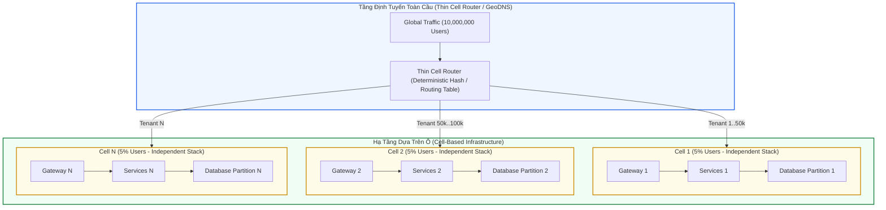
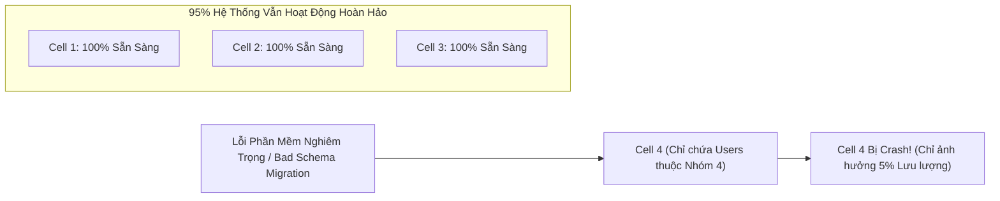
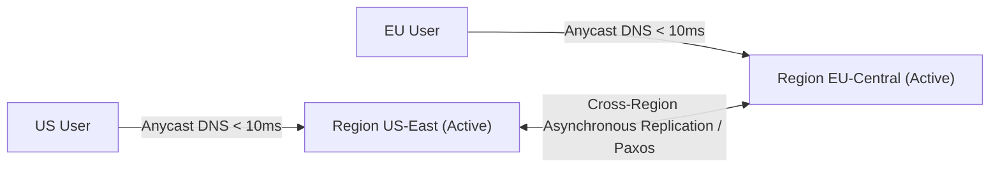
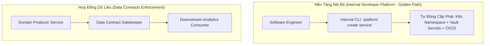

# 12.2. Cell-Based Architecture, Multi-Region Active-Active & Platform Engineering

## Tổng quan về Kiến trúc Dựa trên Ô (Cell-Based) và Hệ thống Phân tán Toàn cầu
Khi quy mô của các hệ thống backend tăng trưởng từ hàng triệu lên hàng trăm triệu người dùng hoạt động đồng thời (như hạ tầng của AWS, Slack, DoorDash, Uber), mô hình kiến trúc phân tán truyền thống bộc lộ một điểm yếu chí mạng: **Bán kính Thiệt hại Toàn cục (Global Blast Radius)**. Trong một cụm vi dịch vụ dùng chung cơ sở dữ liệu hoặc hàng đợi thông điệp trung tâm:
- Một bản phát hành phần mềm bị lỗi (Bad Deployment),
- Một câu truy vấn CSDL độc hại làm cạn kiệt connection pool,
- Hoặc một lỗi phân vùng mạng nội bộ,
đều có thể kích hoạt hiệu ứng sụp đổ dây chuyền (Cascading Failure), kéo sập toàn bộ hệ thống trên toàn thế giới, gây ra các sự cố gián đoạn dịch vụ diện rộng (Global Outages).

Để khống chế tuyệt đối rủi ro này và đạt được tính sẵn sàng cao ở cấp độ $99.999\%$ (Five Nines), các tập đoàn công nghệ hàng đầu áp dụng hai mô thức kiến trúc nền tảng:
1. **Kiến trúc Dựa trên Ô (Cell-Based Architecture - CBA)**: Chia nhỏ toàn bộ hệ sinh thái backend thành hàng chục "Ô" (**Cells**) độc lập hoàn toàn, tự chứa đầy đủ các tầng dịch vụ từ API Gateway, Microservices, đến Cơ sở Dữ liệu riêng biệt.
2. **Hệ thống Đa vùng Hoạt động Song song (Multi-Region Active-Active Systems)**: Vận hành đồng thời nhiều trung tâm dữ liệu độc lập ở các châu lục khác nhau, cho phép người dùng đọc và ghi dữ liệu tại vùng địa lý gần nhất mà vẫn duy trì tính toàn vẹn trạng thái.



---

## 2. Chi tiết từng Keyword (Under-the-Hood Deep Dive)

---

### 1. Cell-Based Architecture & Cell-Based Infrastructure

#### 1. Khái niệm bản chất (What & Why)
- **Cell-Based Architecture (CBA)**: Khuôn mẫu kiến trúc xây dựng hệ thống từ các đơn vị triển khai khép kín, hoàn chỉnh và độc lập gọi là **Cell (Ô)**. Mỗi Cell sở hữu bản sao riêng của toàn bộ các microservices và phân vùng cơ sở dữ liệu của nó, không chia sẻ bất kỳ tài nguyên trạng thái nào với các Cell khác (**Shared-Nothing between Cells**).
- **Thu hẹp Bán kính Thiệt hại (Blast Radius Containment)**: Lợi ích cốt lõi nhất của CBA: Nếu Cell số 3 bị sập hoàn toàn do lỗi tràn bộ nhớ hoặc hỏng hóc CSDL, **chỉ có đúng 5% người dùng thuộc Cell 3 bị ảnh hưởng**, trong khi **95% người dùng còn lại ở 19 Cells khác vẫn hoạt động hoàn toàn bình thường 100%**!
- **Cell Router (Bộ Định tuyến Ô)**: Thành phần duy nhất dùng chung: Một tầng proxy siêu mỏng, cực kỳ đơn giản và có độ tin cậy tối cao, chịu trách nhiệm băm định danh người dùng (`tenantId` hoặc `userId`) để chuyển hướng request vào đúng Cell được chỉ định.

#### 2. Cơ chế hoạt động sâu (Under the hood / Hardcore Internals)
- **Chiến lược Phân bổ Ô (Cell Partitioning Strategies)**:
  1. *Theo Dải Người dùng (Key Range Partitioning)*: `Cell 1: Users A-F`, `Cell 2: Users G-M`, v.v.
  2. *Theo Doanh nghiệp Độc lập (Dedicated Enterprise Cell)*: Khách hàng VIP doanh nghiệp lớn được cấp phát riêng duy nhất một Cell độc lập để đảm bảo tuyệt đối tính cô lập hiệu năng và bảo mật (Noisy Neighbor Immunity).
  3. *Nguyên lý Scale-by-Cell*: Thay vì mở rộng một cụm Kubernetes khổng lồ (vốn dễ gặp lỗi nghẽn etcd khi vượt quá 5,000 nodes), hệ thống mở rộng dung lượng bằng cách **nhân bản thêm các Cell mới có kích thước cố định chuẩn hóa** (ví dụ: mỗi Cell phục vụ tối đa 50,000 active users).

#### 3. Sơ đồ minh họa


#### 4. Code ví dụ thực chiến (C++ Deterministic Cell Hash Router)
Đoạn mã C++20 minh họa việc định tuyến gói tin vào Cell đích sử dụng thuật toán băm nhất quán MurmurHash:

```cpp
#include <iostream>
#include <string>
#include <vector>
#include <cstdint>

class CellRouter {
private:
    size_t total_cells_;

    // Thuật toán băm đơn giản để minh họa phân phối đồng đều
    uint32_t hash_key(const std::string& key) const noexcept {
        uint32_t h = 2166136261u;
        for (char c : key) {
            h ^= static_cast<uint8_t>(c);
            h *= 16777619u;
        }
        return h;
    }

public:
    explicit CellRouter(size_t total_cells) : total_cells_(total_cells) {}

    [[nodiscard]] size_t route_to_cell(const std::string& tenant_id) const noexcept {
        uint32_t hash = hash_key(tenant_id);
        return (hash % total_cells_) + 1; // Cell Index: 1 .. N
    }
};

int main() {
    CellRouter router(10); // Cụm gồm 10 Cells độc lập (mỗi Cell chứa 10% tải)

    std::vector<std::string> tenants = {"ORG_ALPHA", "ORG_BETA", "ORG_GAMMA", "ORG_DELTA"};
    for (const auto& tenant : tenants) {
        size_t cell_id = router.route_to_cell(tenant);
        std::cout << "[Thin Router] Tenant: " << tenant << " -> Routed to Isolated Cell #" << cell_id << "\n";
    }
    return 0;
}
```

#### 5. Ưu / Nhược điểm, Pitfalls & Anti-patterns
- **Cross-Cell Data Access**: Các truy vấn đòi hỏi tổng hợp dữ liệu xuyên qua nhiều Cell khác nhau (ví dụ: Báo cáo tài chính toàn cầu của tất cả người dùng) rất phức tạp và chậm chạp. Phải sử dụng cơ chế CDC đẩy dữ liệu từ các Cell về một Data Lakehouse trung tâm để phân tích bất đồng bộ.

#### 6. Ứng dụng thực tế trong Backend / Systems
- Kiến trúc vùng ô độc lập của hệ thống nhắn tin Slack và hạ tầng thanh toán DoorDash bảo đảm không bao giờ bị sập toàn bộ dịch vụ cùng lúc.

---

### 2. Multi-Region Active-Active Systems & Globally Distributed Applications

#### 1. Khái niệm bản chất (What & Why)
- **Multi-Region Active-Active Systems**: Kiến trúc triển khai đồng thời ứng dụng trên ít nhất hai hoặc nhiều vùng địa lý độc lập (Regions - ví dụ: US-East, EU-Central, AP-Southeast), trong đó **tất cả các vùng đều đồng thời tiếp nhận cả lưu lượng đọc và ghi của người dùng**.
- **Khác biệt với Active-Passive (Disaster Recovery)**: Trong Active-Passive, vùng phụ chỉ đứng chờ và dữ liệu chỉ được chuyển sang khi vùng chính bị sập hoàn toàn (mất từ vài phút đến vài giờ để chuyển mạch). Trong Active-Active, cả hai vùng đều xử lý tải thực tế từng giây, đạt chỉ số **RTO = 0 (Recovery Time Objective)** và **RPO $\approx$ 0 (Recovery Point Objective)**.

#### 2. Cơ chế hoạt động sâu (Under the hood / Hardcore Internals)
- **Giải quyết Xung đột Ghi Đa vùng (Multi-Master Write Conflicts)**:
  Khi Người dùng A cập nhật tài khoản tại vùng US và Người dùng B cập nhật cùng tài khoản đó tại vùng EU trong cùng một giây:
  1. *Last-Write-Wins (LWW)*: Dựa trên dấu thời gian đồng hồ vật lý (NTP/Wall Clock). Dễ bị sai lệch dữ liệu do hiện tượng trôi dạt đồng hồ (Clock Skew).
  2. *Conflict-free Replicated Data Types (CRDTs)*: Cấu trúc dữ liệu tự động hòa giải toán học không xung đột.
  3. *Global Linearizable Consensus (Google Spanner / CockroachDB)*: Sử dụng thuật toán Paxos/Raft kết hợp với đồng hồ nguyên tử TrueTime để sắp xếp thứ tự giao dịch toàn cầu.

#### 3. Sơ đồ minh họa


#### 4. Code ví dụ thực chiến (TypeScript Geo-DNS Region Router Stub)
```typescript
interface RegionEndpoint {
  regionCode: string;
  latitude: number;
  longitude: number;
}

class GlobalTrafficDirector {
  private regions: RegionEndpoint[] = [
    { regionCode: "us-east-1", latitude: 38.0, longitude: -78.0 },
    { regionCode: "eu-central-1", latitude: 50.1, longitude: 8.6 },
    { regionCode: "ap-southeast-1", latitude: 1.3, longitude: 103.8 }
  ];

  public findClosestActiveRegion(clientLat: number, clientLon: number): string {
    let closestRegion = this.regions[0].regionCode;
    let minDistance = Infinity;

    for (const reg of this.regions) {
      // Công thức tính khoảng cách khoảng cách Euclid đơn giản hóa
      const d = Math.hypot(clientLat - reg.latitude, clientLon - reg.longitude);
      if (d < minDistance) {
        minDistance = d;
        closestRegion = reg.regionCode;
      }
    }

    console.log(`[GeoDNS] Client at (${clientLat}, ${clientLon}) routed to closest Active-Active Region: ${closestRegion}`);
    return closestRegion;
  }
}

// Test GeoDNS
const director = new GlobalTrafficDirector();
director.findClosestActiveRegion(21.02, 105.83); // Khách hàng tại Hà Nội -> Sẽ được định tuyến tới ap-southeast-1 (Singapore)
```

#### 5. Ưu / Nhược điểm, Pitfalls & Anti-patterns
- **Split-Brain Hazard (Hiểm họa Phân rẽ Não)**: Khi đường truyền cáp quang biển giữa hai châu lục bị đứt hoàn toàn, cả hai vùng có thể tự coi mình là nút sống sót duy nhất và tiếp tục chấp nhận các giao dịch ghi mâu thuẫn nhau. Bắt buộc phải có một vùng thứ 3 đóng vai trò làm Trọng tài đồng thuận (**Witness / Arbiter Region**).

#### 6. Ứng dụng thực tế trong Backend / Systems
- Hạ tầng xác thực danh tính toàn cầu của Netflix và Google Cloud Identity.

---

### 3. Database-Centric, Data-Oriented & Platform-Oriented Architectures

#### 1. Khái niệm bản chất (What & Why)
- **Database-Centric Architecture**: Mô hình đặt cơ sở dữ liệu làm trung tâm điều phối của toàn bộ hệ thống: Sử dụng Row-Level Security (RLS), Stored Procedures, Triggers, và các tính năng Realtime CDC của CSDL để giải quyết logic nghiệp vụ trực tiếp ngay tại nơi dữ liệu sinh sống (tiêu biểu: Supabase, Firebase).
- **Data-Oriented Architecture (DOA) / Data Mesh**: Mô hình coi dữ liệu là sản phẩm hạng nhất (Data as a Product). Phân chia quyền sở hữu dữ liệu cho từng nhóm nghiệp vụ phi tập trung (Domain-driven), thiết lập các hợp đồng dữ liệu nghiêm ngặt (**Data Contracts**) giữa các dịch vụ.
- **Platform-Oriented Architecture (Platform Engineering)**: Xu hướng chuyển dịch từ việc các nhóm phát triển tự cấu hình hạ tầng đám mây phân tán sang việc xây dựng một **Nền tảng Phát triển Nội bộ (Internal Developer Platform - IDP)**: Đội ngũ Platform Engineering cung cấp các "Con đường Hoàng kim" (**Golden Paths**) tự phục vụ (Self-service APIs/CLI) giúp lập trình viên tạo môi trường, kết nối CSDL và deploy mã nguồn an toàn mà không cần am hiểu sâu về Kubernetes hay Terraform.

#### 2. Cơ chế hoạt động sâu (Under the hood / Hardcore Internals)
- **Data Contracts trong Data-Oriented Architecture**:
  Hợp đồng dữ liệu định nghĩa rõ ràng:
  - Lược đồ Schema (Avro/Protobuf).
  - Cam kết chất lượng dữ liệu (**SLA / SLO**: Tỷ lệ null cho phép $< 0.01\%$, độ trễ đồng bộ $< 5\text{s}$).
  - Quyền sở hữu và trách nhiệm bảo mật PII.
  Nếu một dịch vụ cố tình phát tán sự kiện vi phạm hợp đồng dữ liệu, đường ống CI/CD sẽ tự động chặn việc triển khai phiên bản mới đó.

#### 3. Sơ đồ minh họa


#### 4. Code ví dụ thực chiến (TypeScript Data Contract Schema Enforcer)
```typescript
interface DataContract {
  datasetName: string;
  version: string;
  requiredFields: string[];
}

class DataContractEnforcer {
  public static validateEvent(eventPayload: Record<string, any>, contract: DataContract): boolean {
    for (const field of contract.requiredFields) {
      if (!(field in eventPayload) || eventPayload[field] === null || eventPayload[field] === undefined) {
        console.error(`[DATA CONTRACT VIOLATION] Event violates contract '${contract.datasetName}@${contract.version}'. Missing required field: '${field}'`);
        return false;
      }
    }
    return true;
  }
}

// Test Contract
const orderContract: DataContract = {
  datasetName: "orders_stream",
  version: "1.0.0",
  requiredFields: ["orderId", "totalAmountUsd", "userId"]
};

const validEvent = { orderId: "ORD_1", totalAmountUsd: 99.0, userId: "U10" };
const invalidEvent = { orderId: "ORD_2", totalAmountUsd: 50.0 }; // Thiếu userId

console.log("Valid Event Check:", DataContractEnforcer.validateEvent(validEvent, orderContract));
console.log("Invalid Event Check:", DataContractEnforcer.validateEvent(invalidEvent, orderContract));
```

#### 5. Ưu / Nhược điểm, Pitfalls & Anti-patterns
- **Shadow IT do Platform quá phức tạp**: Nếu đội ngũ Platform Engineering xây dựng một nền tảng quá cứng nhắc, quan liêu và khó sử dụng, các kỹ sư phát triển sẽ tìm cách "vượt rào" bằng cách tự tạo tài nguyên đám mây không kiểm soát (Shadow IT), phá vỡ toàn bộ cấu trúc bảo mật của doanh nghiệp.

#### 6. Ứng dụng thực tế trong Backend / Systems
- Hệ thống Internal Developer Platform (dựa trên Spotify Backstage) chuẩn hóa quy trình phát triển cho hàng ngàn kỹ sư trong các tập đoàn công nghệ lớn.
