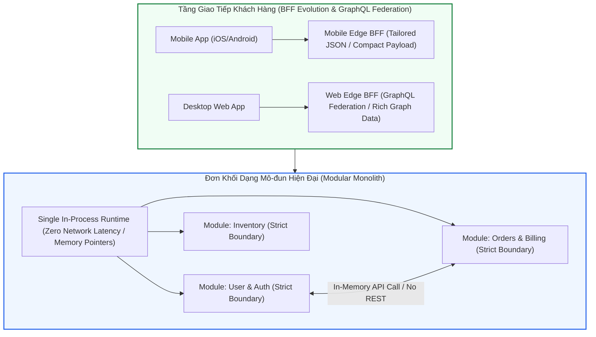
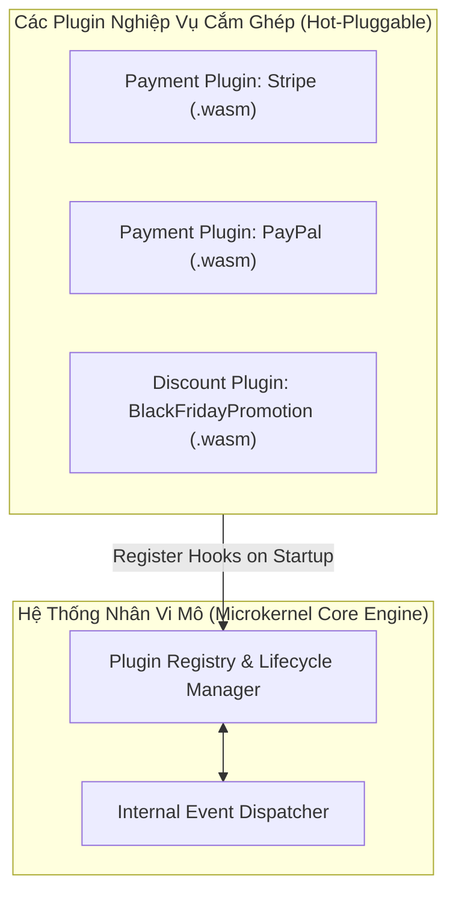
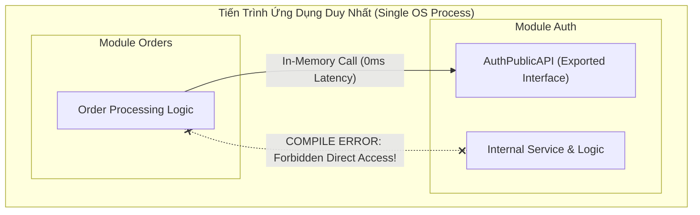
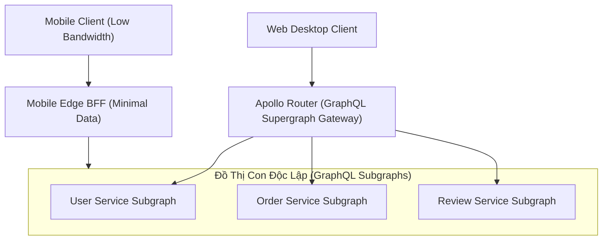

# 12.3. Composable, Plugin-Based (Microkernel), Modular Monolith & BFF Evolution

## Tổng quan về Kiến trúc Hợp phần, Đơn khối Dạng mô-đun và Sự Tiến hóa của BFF
Trong suốt một thập kỷ qua, ngành công nghiệp phần mềm đã chứng kiến sự bùng nổ mạnh mẽ của kiến trúc **Vi dịch vụ (Microservices)**. Tuy nhiên, khi các doanh nghiệp triển khai hàng trăm vi dịch vụ nhỏ lẻ, họ nhanh chóng nhận ra cái giá đắt đỏ của sự phức tạp vận hành:
- Chi phí hạ tầng mạng tăng vọt do độ trễ truyền thông liên dịch vụ (Network Latency),
- Khó khăn tột cùng trong việc gỡ lỗi phân tán (Distributed Tracing / Cascading Timeouts),
- Và sự phá vỡ tính toàn vẹn giao dịch (Mất giao dịch ACID, buộc phải chuyển sang mô hình Saga phức tạp).

Thực tế này đã thúc đẩy sự xuất hiện của làn sóng kiến trúc hiện đại:
1. **Kiến trúc Hợp phần và Plugin (Composable & Microkernel Architecture)**: Xây dựng một nhân hệ thống tối giản (**Microkernel Core**) kết hợp với các mô-đun chức năng đóng gói (**Packaged Business Capabilities - PBCs**) có thể cắm ghép linh hoạt.
2. **Sự Tiến hóa của Đơn khối Dạng mô-đun (Modular Monolith Evolution)**: Lấy lại những ưu điểm tốt nhất của Monolith (Không có độ trễ mạng, giao dịch ACID trong bộ nhớ, dễ tái cấu trúc mã nguồn) kết hợp với tính phân chia ranh giới miền độc lập (**Domain Boundaries**) nghiêm ngặt của Microservices.
3. **Tiến hóa của Mô hình BFF (Backend for Frontend Evolution)**: Từ các máy chủ Node.js trung gian cồng kềnh chuyển dịch thành các **Edge BFFs** siêu tốc chạy bằng GraphQL Federation, tRPC hoặc WebAssembly ngay tại rìa mạng CDN.



---

## 2. Chi tiết từng Keyword (Under-the-Hood Deep Dive)

---

### 1. Composable Architecture, Plugin-Based & Microkernel Architecture

#### 1. Khái niệm bản chất (What & Why)
- **Composable Architecture**: Triết lý kiến trúc xây dựng hệ thống từ các khối năng lực nghiệp vụ độc lập được đóng gói sẵn (**Packaged Business Capabilities - PBCs**). Hệ thống được lắp ghép linh hoạt thông qua các API mở, cho phép doanh nghiệp dễ dàng thay thế nhà cung cấp cổng thanh toán, động cơ tìm kiếm hoặc hệ thống CMS mà không làm ảnh hưởng tới toàn bộ ứng dụng (Tiêu chuẩn **MACH: Microservices, API-first, Cloud-native, Headless**).
- **Microkernel Architecture (Kiến trúc Nhân vi mô / Plugin-based Architecture)**: Mô hình kiến trúc phân tách thành hai thành phần chính:
  1. *Core System (Nhân cốt lõi)*: Chứa logic tối thiểu để hệ thống vận hành (vòng đời ứng dụng, cơ chế đăng ký và nạp plugin).
  2. *Plugins (Các mô-đun mở rộng)*: Chứa các tính năng nghiệp vụ cụ thể, được nạp động tại thời điểm chạy (Runtime Loading) mà không cần biên dịch lại mã nguồn nhân cốt lõi.

#### 2. Cơ chế hoạt động sâu (Under the hood / Hardcore Internals)
- **Cơ chế Giao tiếp Plugin An toàn (HashiCorp `go-plugin` & WASM Plugins)**:
  Có hai phương pháp kiến trúc để nạp plugin:
  - *Phương pháp In-Process C-FFI / Dynamic Shared Libraries (`.so` / `.dll`)*: Nạp trực tiếp vào bộ nhớ RAM của tiến trình chính. Tốc độ cực nhanh ($O(1)$) nhưng nguy hiểm: Một lỗi phân đoạn (`SIGSEGV`) bên trong plugin sẽ làm sập ngay lập tức toàn bộ máy chủ chính!
  - *Phương pháp Out-of-Process qua gRPC (HashiCorp Model)*: Chạy plugin như một tiến trình độc lập, giao tiếp với Core System qua UNIX Domain Sockets. Đảm bảo tính cô lập lỗi nhưng có chi phí IPC.
  - *Phương pháp WebAssembly (Modern Standard)*: Nạp plugin dưới dạng WASM sandbox bên trong tiến trình chính. Đạt được cả hai mục tiêu: **Tốc độ gọi hàm trong bộ nhớ (In-Memory Speed)** VÀ **Cô lập an toàn tuyệt đối (Memory Sandboxing)**!

#### 3. Sơ đồ minh họa


#### 4. Code ví dụ thực chiến (C++ Microkernel Plugin Registry Engine)
Đoạn mã C++20 xây dựng hệ thống lõi Microkernel hỗ trợ đăng ký và gọi plugin linh hoạt:

```cpp
#include <iostream>
#include <memory>
#include <string>
#include <unordered_map>

// Giao diện trừu tượng chuẩn mực của Plugin
class IExportPlugin {
public:
    virtual ~IExportPlugin() = default;
    virtual std::string format_data(const std::string& raw_data) = 0;
    virtual std::string get_plugin_name() const = 0;
};

// Microkernel Core Engine
class MicrokernelCore {
private:
    std::unordered_map<std::string, std::unique_ptr<IExportPlugin>> registry_;
public:
    void register_plugin(std::unique_ptr<IExportPlugin> plugin) {
        std::cout << "[Microkernel Core] Registered plugin: " << plugin->get_plugin_name() << "\n";
        registry_[plugin->get_plugin_name()] = std::move(plugin);
    }

    std::string process_export(const std::string& plugin_name, const std::string& data) {
        auto it = registry_.find(plugin_name);
        if (it == registry_.end()) throw std::runtime_error("Plugin not found!");
        return it->second->format_data(data);
    }
};

// Plugin cụ thể: JSON Exporter
class JsonExportPlugin : public IExportPlugin {
public:
    std::string format_data(const std::string& raw_data) override {
        return "{\"payload\": \"" + raw_data + "\", \"format\": \"JSON\"}";
    }
    std::string get_plugin_name() const override { return "JSON_EXPORTER"; }
};

int main() {
    MicrokernelCore core;
    core.register_plugin(std::make_unique<JsonExportPlugin>());

    std::string output = core.process_export("JSON_EXPORTER", "Order #8812 Completed");
    std::cout << "[Plugin Execution Result]: " << output << "\n";
    return 0;
}
```

#### 5. Ưu / Nhược điểm, Pitfalls & Anti-patterns
- **Plugin Dependency Hell**: Các plugin phụ thuộc vào các phiên bản thư viện dùng chung khác nhau dẫn tới xung đột nhị phân (DLL Hell). Cần áp dụng đóng gói container hoặc WASM để đóng kín toàn bộ phụ thuộc của từng plugin.

#### 6. Ứng dụng thực tế trong Backend / Systems
- Hệ thống thương mại điện tử Shopify và hệ sinh thái Gateway Kong API cho phép đối tác cài đặt các plugin tùy biến chức năng.

---

### 2. Modular Monolith Evolution & Distributed Modular Architecture

#### 1. Khái niệm bản chất (What & Why)
- **Modular Monolith (Đơn khối Dạng mô-đun)**: Lối kiến trúc phần mềm trong đó toàn bộ mã nguồn của doanh nghiệp được triển khai thành **duy nhất một file nhị phân / tiến trình ứng dụng**, nhưng bên trong mã nguồn được phân chia thành các **Mô-đun miền độc lập (Strict Domain Modules)** hoàn toàn cô lập nhau về ranh giới nghiệp vụ và cấu trúc dữ liệu.
- **Tại sao Modular Monolith trở thành Xu hướng Thống trị Mới**: Các tổ chức công nghệ hàng đầu (như Shopify, Basecamp/DHH, Prime Video) đã công khai việc chuyển đổi ngược từ Microservices quay về Modular Monolith:
  - Loại bỏ hoàn toàn độ trễ mạng mạng TCP/gRPC giữa các dịch vụ.
  - Sử dụng giao dịch **ACID trong cơ sở dữ liệu** thay vì các cơ chế 2-phase commit phức tạp.
  - Đơn giản hóa tột cùng quy trình CI/CD và chi phí máy chủ trên đám mây.
- **Distributed Modular Architecture**: Giai đoạn tiến hóa chuyển tiếp: Mã nguồn được thiết kế theo chuẩn Modular Monolith; khi một mô-đun cụ thể thực sự có nhu cầu mở rộng tài nguyên đột biến (ví dụ: mô-đun Xử lý Video), nó có thể được tách ra thành một dịch vụ phân tán độc lập một cách dễ dàng mà không cần phải tái cấu trúc toàn bộ dự án.

#### 2. Cơ chế hoạt động sâu (Under the hood / Hardcore Internals)
- **Kiểm soát Ranh giới Mô-đun ở Thời điểm Biên dịch (Compile-Time Enforcement)**:
  Làm thế nào để đảm bảo lập trình viên không "ăn gian" bằng cách gọi trực tiếp bảng dữ liệu của mô-đun khác?
  - Hệ thống sử dụng các công cụ phân tích phụ thuộc tĩnh như **ArchUnit** (Java), **Packwerk** (Shopify Ruby), hoặc các luật hiển thị của công cụ build **Bazel**:
  - Module `Billing` chỉ được phép gọi các hàm được khai báo công khai trong file giao diện `BillingPublicAPI`.
  - Nghiêm cấm tuyệt đối việc Module `Order` truy vấn trực tiếp vào bảng SQL `billing_invoices` của Module `Billing`. Nếu vi phạm, trình biên dịch sẽ báo lỗi đỏ (**Build Failed**) ngay lập tức!

#### 3. Sơ đồ minh họa


#### 4. Code ví dụ thực chiến (TypeScript Strict Module Boundary Interface Enforcement)
```typescript
// MÔ-ĐUN THANH TOÁN (PAYMENT MODULE)
// Chỉ xuất khẩu duy nhất Public Interface này cho các module khác
export interface IPaymentModuleAPI {
  chargeCustomer(userId: string, amountUsd: number): Promise<{ success: boolean; txId: string }>;
}

// Lớp triển khai nội bộ bí mật (Không xuất khẩu ra ngoài)
class InternalPaymentService implements IPaymentModuleAPI {
  public async chargeCustomer(userId: string, amountUsd: number) {
    console.log(`[Payment Engine] In-memory charge $${amountUsd} for ${userId}. (Zero Network RPC Latency)`);
    return { success: true, txId: "TX_INTERNAL_992" };
  }
}

// MÔ-ĐUN ĐƠN HÀNG (ORDER MODULE)
class OrderService {
  private paymentApi: IPaymentModuleAPI;

  constructor(paymentApi: IPaymentModuleAPI) {
    this.paymentApi = paymentApi; // Dependency Injection thông qua Interface
  }

  public async createOrder(userId: string, total: number): Promise<void> {
    console.log("[Order Module] Creating order...");
    const chargeResult = await this.paymentApi.chargeCustomer(userId, total);
    console.log(`[Order Module] Order confirmed with Transaction ID: ${chargeResult.txId}`);
  }
}

// Test Modular Monolith Execution
const paymentModule: IPaymentModuleAPI = new InternalPaymentService();
const orderService = new OrderService(paymentModule);
orderService.createOrder("USER_101", 149.99);
```

#### 5. Ưu / Nhược điểm, Pitfalls & Anti-patterns
- **Big Ball of Mud Regression**: Nếu thiếu kỷ luật và không có công cụ tự động kiểm tra phụ thuộc (như ArchUnit) trong CI, một Modular Monolith sẽ nhanh chóng bị thoái hóa thành một mớ mã nguồn rối rắm (Spaghetti Code) với các liên kết phụ thuộc chéo vòng quanh.

#### 6. Ứng dụng thực tế trong Backend / Systems
- Hệ thống thương mại điện tử cốt lõi của Shopify phục vụ hàng triệu merchant trên toàn cầu vận hành trên một Modular Monolith Ruby/Rails được chuẩn hóa bằng Packwerk.

---

### 3. API Composition & Backend for Frontend (BFF) Evolution

#### 1. Khái niệm bản chất (What & Why)
- **API Composition**: Kỹ thuật tổng hợp dữ liệu trong kiến trúc phân tán: Thay vì client phải tự gọi 10 API microservices độc lập qua mạng di động chậm chạp, một dịch vụ tổng hợp trung gian (**Composer / Aggregator**) tiếp nhận 1 request từ client, gọi song song các microservices nội bộ qua mạng LAN tốc độ cao, và ghép kết quả thành một payload duy nhất trả về cho client.
- **Backend for Frontend (BFF Pattern - Sam Newman)**: Mô hình kiến trúc tạo ra các tầng backend riêng biệt được tinh chỉnh đặc thù cho từng loại giao diện người dùng:
  - *Mobile BFF*: Trả về dữ liệu JSON tối giản, cắt bỏ các trường thừa thãi để tiết kiệm pin và băng thông di động 4G.
  - *Desktop Web BFF*: Trả về dữ liệu toàn diện phong phú cho màn hình lớn.
  - *IoT / Third-Party BFF*: Tối ưu hóa cho các giao thức nhị phân siêu nhẹ.
- **Sự Tiến hóa Hiện đại của BFF**: Chuyển dịch từ việc viết các server Node.js BFF thủ công sang các công nghệ khai báo tự động: **GraphQL Federation (Apollo Federation Subgraphs)**, **tRPC** (Type-safe end-to-end), và **Edge BFFs** chạy tại biên mạng CDN.

#### 2. Cơ chế hoạt động sâu (Under the hood / Hardcore Internals)
- **Kiến trúc GraphQL Federation (Subgraphs & Gateway Supergraph)**:
  Thay vì một server GraphQL nguyên khối đơn lẻ:
  - Mỗi vi dịch vụ (Users, Products, Reviews) vận hành một GraphQL **Subgraph** độc lập của riêng mình.
  - Một Gateway trung tâm (**Apollo Router** viết bằng Rust) tự động gộp các Subgraph này thành một lược đồ thống nhất duy nhất (**Supergraph Schema**).
  - Khi client gửi một câu truy vấn GraphQL phức tạp, Apollo Router phân tích cú pháp thành một kế hoạch thực thi tối ưu (**Query Execution Plan**), thực hiện fan-out gọi song song các subgraph và ghép kết quả lại với độ trễ tính bằng micro-giây.

#### 3. Sơ đồ minh họa


#### 4. Code ví dụ thực chiến (TypeScript GraphQL-style API Composer)
```typescript
interface UserProfile {
  id: string;
  name: string;
}

interface OrderSummary {
  orderId: string;
  total: number;
}

class MobileBFFComposer {
  public async getDashboardData(userId: string): Promise<{ user: UserProfile; recentOrders: OrderSummary[] }> {
    console.log(`[Mobile BFF] Composing lightweight payload for user: ${userId}`);

    // Kích hoạt gọi song song tới các microservices nội bộ (Parallel Fan-out)
    const [userRes, ordersRes] = await Promise.all([
      this.fetchUserMicroservice(userId),
      this.fetchOrdersMicroservice(userId)
    ]);

    // Lọc bỏ 80% trường dữ liệu thừa, chỉ giữ lại những gì màn hình Mobile cần
    return {
      user: { id: userRes.id, name: userRes.fullName },
      recentOrders: ordersRes.slice(0, 3).map(o => ({ orderId: o.id, total: o.amount }))
    };
  }

  private async fetchUserMicroservice(id: string): Promise<any> {
    return { id, fullName: "Alexander Doe", internalAuditId: "99812", address: "123 Main St" };
  }

  private async fetchOrdersMicroservice(id: string): Promise<any[]> {
    return [{ id: "ORD_1", amount: 45.0, internalRoutingKey: "US_EAST" }];
  }
}

// Test BFF Composer
(async () => {
  const bff = new MobileBFFComposer();
  const mobilePayload = await bff.getDashboardData("USR_4412");
  console.log("Tailored Mobile Payload:", mobilePayload);
})();
```

#### 5. Ưu / Nhược điểm, Pitfalls & Anti-patterns
- **BFF Code Duplication**: Các đội ngũ phát triển Mobile BFF và Web BFF bắt đầu nhân bản mã nguồn logic nghiệp vụ trùng lặp giữa các tầng BFF khác nhau. Cần duy trì nguyên tắc: **BFF chỉ là tầng chuyển đổi định dạng và kết hợp giao tiếp (Presentation & Aggregation Layer), tuyệt đối không chứa logic nghiệp vụ cốt lõi (Domain Business Logic)**.

#### 6. Ứng dụng thực tế trong Backend / Systems
- Hệ thống cổng giao diện của Netflix phục vụ trải nghiệm xem phim cá nhân hóa tối ưu trên hàng ngàn chủng loại thiết bị khác nhau (Smart TVs, Android, iOS, Web).
