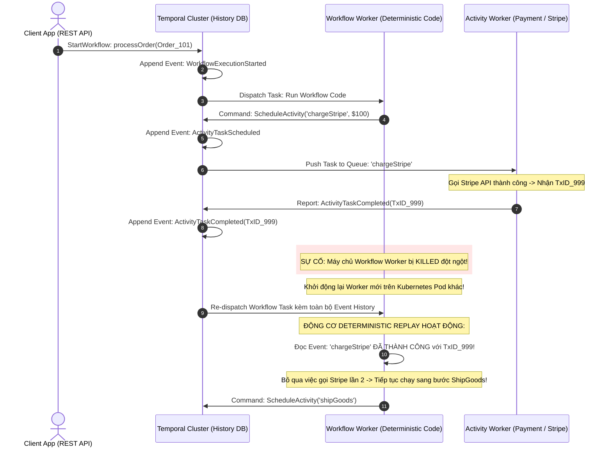
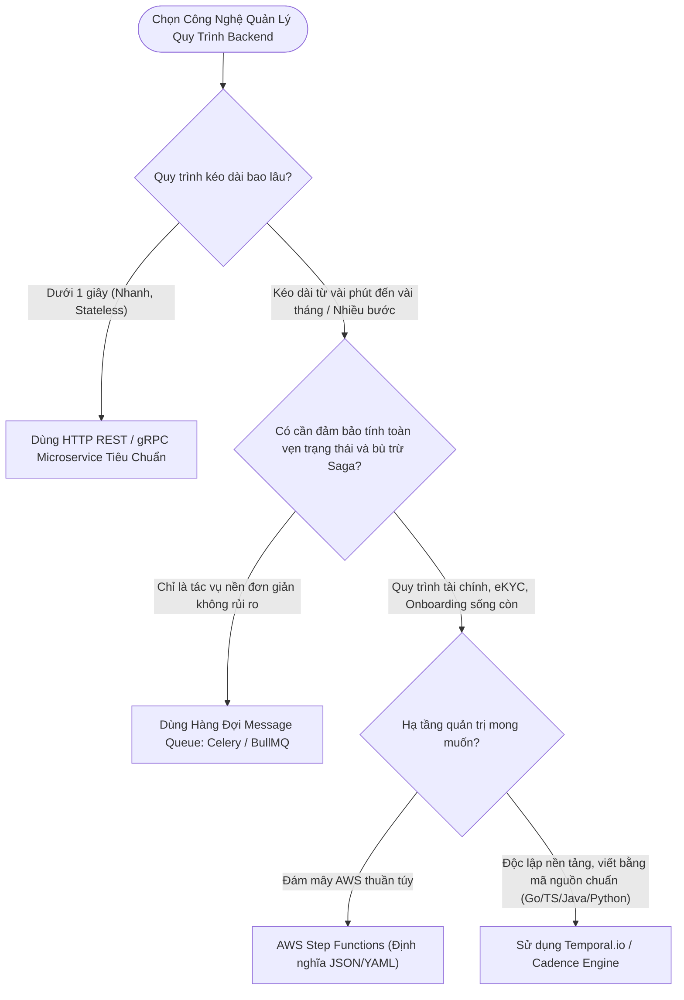

# 12.4. Durable Execution, Workflow Engines, and The Temporal Architecture Model

> [!IMPORTANT]
> **Nếu bạn chỉ được nhớ một điều duy nhất:**
> **Thực thi Bền vững (Durable Execution)** là bước tiến hóa tối cao của kỹ nghệ backend phân tán: xóa bỏ hoàn toàn "mớ bòng bong" cấu thành từ các Cron Jobs, bảng cờ trạng thái cơ sở dữ liệu (`status = PENDING`) và hàng đợi tin nhắn rời rạc để cho phép lập trình viên viết các quy trình kéo dài nhiều tháng (**Long-Running Processes**) như một đoạn mã code tuần tự thông thường (`workflow.sleep(30.days)`). Bằng cơ chế **Lịch sử Sự kiện Bất biến (Event Sourcing History)** và **Động cơ Tái diễn Tất định (Deterministic Replay Engine)** của Temporal, tiến trình có thể sống sót sau mọi vụ sập máy chủ, mất điện hạ tầng hay cập nhật mạng lưới mà không làm thất thoát trạng thái và không bao giờ thực hiện lặp lại các tác vụ thanh toán nguy hiểm (**Zero Double-Charge Guarantee**).

---

## 1. Kiến trúc Tổng quan & Mô hình Tư duy (Mental Model)

### 1.1. Ẩn dụ Đời sống: Cuốn Nhật Ký Thuyền Trưởng và Khả Năng "Lưu Game" Bất Tử

Để hình dung sự khác biệt giữa kiến trúc phân tán truyền thống và Durable Execution:
1. **Kiến Trúc Truyền Thống (Người Hay Quên Đi Chợ Với Giấy Nháp)**:
   - Bạn cần làm một bữa tiệc lớn (Quy trình 10 bước). Bạn viết ra một tờ giấy nháp.
   - Khi đang mua thịt ở bước 3, trời đổ mưa làm ướt nát tờ giấy nháp (Máy chủ sập / Crash). Bạn bị mất trí nhớ tạm thời: Bạn không nhớ mình đã trả tiền mua rau ở bước 1 chưa, thịt đã trả tiền chưa. Bạn đành phải mua lại từ đầu (Gây lỗi thanh toán trùng lặp - Double Charge) hoặc bỏ cuộc giữa chừng (Bỏ rơi giao dịch dở dang).
2. **Durable Execution - Temporal (Tính Năng Lưu Game Tự Động Vào Thẻ Nhớ)**:
   - Mỗi bước đi của nhân vật trong game đều được máy chủ ghi nhận bất biến vào cuốn nhật ký (**Event History Log**).
   - Nếu bạn chơi game đến màn 4 và bị mất điện đột ngột: Khi bật máy tính lên, game không bắt bạn chơi lại từ đầu. Động cơ game chỉ cần đọc lại cuốn nhật ký từ màn 1 đến màn 3 (Replay Mode trong vài phần nghìn giây mà không cần bấm lại nút điều khiển), rồi cho bạn tiếp tục chơi chính xác tại thời điểm màn 4 như chưa từng có sự cố xảy ra!
3. **Phân Tách Giữa Workflow và Activity (Thuyền Trưởng Ra Lệnh vs Thủy Thủ Kéo Dây)**:
   - **Workflow (Thuyền trưởng trong phòng kín)**: Chỉ suy nghĩ chiến thuật tuần tự, nhìn bản đồ và ra quyết định. Thuyền trưởng không bao giờ được phép trực tiếp ngửi mùi gió hay thò tay ra ngoài cửa sổ đo nhiệt độ (Phải tuyệt đối tất định 100%).
   - **Activity (Thủy thủ ngoài trời)**: Làm các công việc nặng nhọc có tính tương tác với thế giới thực (Gọi thẻ tín dụng Stripe, gửi email, gọi webhook). Nếu thủy thủ trượt chân ngã (Lỗi mạng), họ tự động đứng dậy thử lại (Auto-Retry Exponential Backoff) cho đến khi thành công rồi mới báo cáo lại cho thuyền trưởng.

### 1.2. Luồng Điều Phối và Tái Diễn Sự Kiện của Kiến Trúc Temporal



---

## 2. Chi tiết từng Keyword (Under-the-Hood Deep Dive)

### 2.1. Workflow-Oriented Architecture & Long-Running Processes

Các hệ thống backend thường xuyên phải đối mặt với các nghiệp vụ kéo dài thời gian:
- Chờ đợi phản hồi ngoại vi (Chờ khách hàng nhấn xác nhận email trong 48 giờ).
- Chu kỳ thuê bao hàng tháng (Ngủ trong 30 ngày rồi tự động trừ tiền kỳ tiếp theo).
- Chuỗi giao dịch bù trừ (**Compensating Transactions trong Saga Pattern**): Nếu bước 4 (Giao hàng) thất bại, hệ thống phải tự động hoàn tác ngược lại: Hủy đặt chỗ kho (Bước 3), hoàn tiền vào thẻ ngân hàng (Bước 2).

#### A. Cơn Ác Mộng Spaghetti Phân Tán (The Distributed State Polling Trap)
Trong cách làm truyền thống:
- Bạn phải tạo một bảng trong cơ sở dữ liệu: `orders(id, status, step, retry_count, next_retry_at)`.
- Tạo một Cron Job chạy mỗi phút để quét bảng: `SELECT * FROM orders WHERE status = 'WAITING' AND next_retry_at <= NOW()`.
- **Rủi ro**: Nếu có 10 cron workers chạy song song, nguy cơ xung đột khóa (Lock contention), mất thứ tự sự kiện, hoặc khi mạng bên thứ ba chập chờn, bảng dữ liệu bị tắc nghẽn hàng triệu dòng chờ xử lý!

#### B. Sức Mạnh của Durable Code
Với Durable Execution, toàn bộ mã nguồn phức tạp trên được gói gọn trong một hàm duy nhất:

```typescript
export async function orderFulfillmentWorkflow(order: OrderData): Promise<void> {
    // 1. Khóa tiền
    const paymentId = await chargePaymentActivity(order.amount);
    
    // 2. Chờ người dùng xác nhận trong 24 giờ
    const confirmed = await workflow.condition(() => isUserConfirmed, "24 hours");
    
    if (!confirmed) {
        // Tự động kích hoạt bù trừ Saga
        await refundPaymentActivity(paymentId);
        return;
    }
    
    // 3. Giao hàng
    await dispatchShipmentActivity(order.items);
}
```

---

### 2.2. Durable Execution & The Temporal Architecture Model

Hệ thống Temporal chia làm hai thành phần kiến trúc hoàn toàn tách biệt:
1. **Temporal Cluster (Cụm Máy Chủ Quản Trị)**: Bao gồm **Frontend Service** (tiếp nhận gRPC), **History Service** (quản lý Event History Log bất biến lưu trên Cassandra/PostgreSQL), và **Matching Service** (điều phối các Task Queues). Cụm này **hoàn toàn không chứa mã nguồn nghiệp vụ của bạn**!
2. **Worker Fleet (Hạm Đội Máy Chủ Ứng Dụng Do Bạn Tự Chạy)**: Chứa mã nguồn Workflow và Activity của bạn, kết nối an toàn với Temporal Cluster thông qua cơ chế gRPC Long Polling ra ngoài.

#### A. Sự Khác Biệt Cốt Tử: Workflow vs Activity
- **Workflow Code**:
  - Đóng vai trò là bộ não điều phối (Orchestration Brain).
  - Phải **TUYỆT ĐỐI TẤT ĐỊNH (100% DETERMINISTIC)**: Cùng một danh sách đầu vào và cùng một lịch sử sự kiện phải luôn luôn sinh ra chính xác các bước đi giống nhau.
  - **CÁC ĐIỀU CẤM KỴ TRONG THÂN WORKFLOW**:
    - CẤM gọi `Math.random()`, `UUID.randomUUID()`.
    - CẤM đọc đồng hồ hệ thống `new Date()` hoặc `System.currentTimeMillis()` (Bắt buộc dùng `Workflow.currentTimeMillis()`).
    - CẤM thực hiện I/O mạng trực tiếp: Không gọi HTTP REST, không truy vấn Database, không đọc file ổ cứng.
- **Activity Code**:
  - Nơi thực hiện toàn bộ các tác vụ I/O tương tác với thế giới thực (Gọi Stripe, gửi SMS, query Postgres).
  - Cho phép phi tất định (Non-deterministic). Được tự động bảo vệ bởi cơ chế Retry Policy (tự động thử lại với Exponential Backoff khi gặp lỗi mạng tạm thời).

#### B. Cơ Chế Replay và Lỗi `NonDeterministicWorkflowError`
- Khi một Workflow Worker bị khởi động lại, nó tải toàn bộ danh sách sự kiện trong quá khứ về và thực thi lại từ dòng 1.
- Đối với các lệnh `await someActivity()`, Replay Engine phát hiện rằng hoạt động này đã có kết quả trong lịch sử, nó lập tức trả về kết quả đó mà **không phát lệnh ra mạng lần thứ hai**.
- **Cạm bẫy Versioning**: Nếu bạn sửa code workflow đang chạy dở (ví dụ: chèn thêm một lệnh `await newActivity()` vào giữa dòng 1 và dòng 2):
  - Khi Replay, engine mong đợi thấy sự kiện của `newActivity`, nhưng trong lịch sử cũ lại là sự kiện của dòng 2.
  - Động cơ phát hiện sự sai lệch logic và lập tức ném lỗi **`NonDeterministicWorkflowError`**, đóng băng workflow để ngăn ngừa việc ghi đè dữ liệu sai lệch!
  - **Khắc phục**: Luôn sử dụng API kiểm tra phiên bản: `if (Workflow.getVersion("new_step_patch", 0, 1) == 1) { ... }`.

---

## 3. Thực thi Mã nguồn & Mô phỏng Chuyên sâu (Dual-Engine Implementation)

### 3.1. Implementation C++20: Deterministic Replay Engine & Crash Recovery Simulator

Đoạn mã C++20 dưới đây mô phỏng chính xác thuật toán Replay Engine của Temporal: ghi nhận nhật ký Event Sourcing, phục hồi trạng thái sau sự cố sập nguồn máy chủ, và bỏ qua các hoạt động đã hoàn thành để bảo đảm không trừ tiền lặp lại.

```cpp
#include <iostream>
#include <string>
#include <vector>
#include <memory>
#include <unordered_map>
#include <format>
#include <stdexcept>

// Cấu trúc một bản ghi sự kiện bất biến trong Temporal Event History
struct HistoryEvent {
    int event_id;
    std::string event_type;       // "ActivityTaskScheduled", "ActivityTaskCompleted"
    std::string activity_name;    // "charge_payment", "reserve_warehouse"
    std::string result_payload;   // Dữ liệu kết quả đã lưu
};

// Động cơ Replay Lượng tử Tất định (Deterministic Replay Engine)
class TemporalReplayEngine {
private:
    std::vector<HistoryEvent> event_history_log_;
    size_t replay_cursor_{0};
    bool is_replaying_{false};

public:
    void append_history_event(std::string type, std::string name, std::string result) {
        int next_id = static_cast<int>(event_history_log_.size()) + 1;
        event_history_log_.push_back({ next_id, std::move(type), std::move(name), std::move(result) });
    }

    void simulate_crash_and_restart() {
        std::cout << "\n=======================================================\n";
        std::cout << " [CRITICAL CRASH] Worker process died! Power outage!\n";
        std::cout << " [RECOVERY] New worker spawned on another node. Replaying...\n";
        std::cout << "=======================================================\n\n";
        replay_cursor_ = 0;
        is_replaying_ = true;
    }

    // Cơ chế Interceptor cốt lõi của Temporal
    std::string execute_activity_safely(const std::string& activity_name, auto&& real_network_call) {
        // Nếu đang trong chế độ Replay: kiểm tra xem event này đã có kết quả chưa
        if (is_replaying_ && replay_cursor_ < event_history_log_.size()) {
            const auto& historical = event_history_log_[replay_cursor_++];
            if (historical.activity_name == activity_name && historical.event_type == "ActivityTaskCompleted") {
                std::cout << std::format("[REPLAY CACHE HIT] Activity '{}' already succeeded in past! "
                                         "Skipping network call. Instant Result: {}\n", 
                                         activity_name, historical.result_payload);
                return historical.result_payload;
            }
        }

        // Chế độ Live Execution thực sự: Gọi ra mạng và lưu vào History
        is_replaying_ = false; // Đã bắt kịp hiện tại
        std::cout << std::format("[LIVE EXECUTION] Executing Activity '{}' via external network I/O...\n", activity_name);
        std::string live_result = real_network_call();
        
        append_history_event("ActivityTaskCompleted", activity_name, live_result);
        return live_result;
    }
};

int main() {
    std::cout << "========================================================\n";
    std::cout << "  C++20 DETERMINISTIC DURABLE EXECUTION REPLAY ENGINE   \n";
    std::cout << "========================================================\n\n";

    TemporalReplayEngine engine;

    // Giai đoạn 1: Thực thi bình thường bước 1 và 2
    std::cout << "--- PHASE 1: Normal Execution (Steps 1 & 2) ---\n";
    std::string r1 = engine.execute_activity_safely("verify_customer_kyc", []() {
        return "KYC_VERIFIED_LEVEL_3";
    });

    std::string r2 = engine.execute_activity_safely("charge_credit_card", []() {
        return "STRIPE_TX_CHARGED_$500";
    });

    // Mô phỏng sự cố: Máy chủ sập nguồn ngay sau khi vừa trừ tiền ngân hàng xong!
    engine.simulate_crash_and_restart();

    // Giai đoạn 2: Khôi phục lại quy trình từ đầu (Durable Workflow Resume)
    std::cout << "--- PHASE 2: Workflow Resumes from Beginning (Deterministic Replay) ---\n";
    // Bước 1: Được Replay tức thì
    std::string rec_r1 = engine.execute_activity_safely("verify_customer_kyc", []() {
        std::cerr << "ERROR: Should not make network call for KYC!\n";
        return "FAIL";
    });

    // Bước 2: Được Replay tức thì -> BẢO ĐẢM KHÔNG BAO GIỜ TRỪ TIỀN HAI LẦN!
    std::string rec_r2 = engine.execute_activity_safely("charge_credit_card", []() {
        std::cerr << "CRITICAL ERROR: Double-charging customer credit card!\n";
        return "FAIL";
    });

    // Bước 3: Chưa có trong lịch sử -> Chạy Live thực sự ra kho hàng
    std::string rec_r3 = engine.execute_activity_safely("dispatch_warehouse_package", []() {
        return "FEDEX_TRACKING_TRACK_8819A";
    });

    std::cout << "\n>>> WORKFLOW EXECUTION COMPLETED WITH 100% DURABILITY!\n";
    std::cout << ">>> Final Package Dispatched: " << rec_r3 << "\n";

    return 0;
}
```

---

### 3.2. Implementation Python 3.11+: Temporal-Style Workflow Orchestrator với Saga Compensating Transactions

Đoạn mã Python 3.11+ mô phỏng hoàn chỉnh một hệ thống Durable Execution điều phối chuỗi giao dịch bù trừ Saga: tự động ghi nhận lịch sử sự kiện, thực hiện giao dịch nhiều bước, và khi một mắt xích gặp lỗi, tự động kích hoạt chuỗi bù trừ hoàn tiền theo thứ tự ngược lại (LIFO).

```python
#!/usr/bin/env python3
"""
Python 3.11+ Durable Execution & Saga Compensating Transactions Simulator
Demonstrates Event Sourcing history log, deterministic execution, and automated rollback.
"""

from dataclasses import dataclass, field
import time
from typing import List, Callable, Any

@dataclass
class WorkflowEvent:
    step_name: str
    status: str # "COMPLETED", "FAILED", "COMPENSATED"
    output_payload: Any

class SagaWorkflowContext:
    def __init__(self, workflow_id: str):
        self.workflow_id = workflow_id
        self.event_history: List[WorkflowEvent] = []
        self._compensation_stack: List[Callable[[], None]] = []

    def record_success(self, step_name: str, result: Any, compensation_fn: Callable[[], None]):
        self.event_history.append(WorkflowEvent(step_name, "COMPLETED", result))
        # Đẩy hành động bù trừ vào ngăn xếp LIFO
        self._compensation_stack.append(compensation_fn)
        print(f"[Workflow Engine] Step '{step_name}' succeeded. Recorded event into durable history.")

    def trigger_saga_compensation(self, failed_step: str, error_reason: str):
        print(f"\n>>> [SAGA FAILURE DETECTED] Step '{failed_step}' failed: {error_reason}")
        print(">>> [AUTOMATED SAGA ROLLBACK] Executing compensating transactions in reverse order (LIFO):")
        
        # Chạy ngược ngăn xếp bù trừ
        while self._compensation_stack:
            compensate_action = self._compensation_stack.pop()
            compensate_action()

        self.event_history.append(WorkflowEvent(failed_step, "FAILED", error_reason))
        print("[SAGA ROLLBACK COMPLETED] System state fully compensated and consistent.\n")

class OrderFulfillmentActivities:
    """Các hoạt động I/O tương tác với hệ thống thực tế (Activities)"""
    @staticmethod
    def reserve_hotel_room(room_id: str):
        print(f"  [Activity: Hotel] Successfully reserved room '{room_id}' ($200)")
        return "BOOKING_CONFIRMED_HTL"

    @staticmethod
    def cancel_hotel_room(room_id: str):
        print(f"  [Compensation: Hotel] CANCELLED reservation for room '{room_id}' -> Full $200 Refunded!")

    @staticmethod
    def book_flight(flight_id: str):
        print(f"  [Activity: Flight] Attempting to book seat on '{flight_id}'...")
        # Giả lập máy bay hết chỗ dẫn tới lỗi hệ thống
        raise RuntimeError("AIRLINE_SYSTEM_ERROR: No seats available on flight VN-204!")

    @staticmethod
    def cancel_flight(flight_id: str):
        print(f"  [Compensation: Flight] Cancelled flight ticket.")

def execute_travel_booking_workflow(ctx: SagaWorkflowContext):
    print(f"\n--- INITIATING DURABLE WORKFLOW: {ctx.workflow_id} ---")
    
    # BƯỚC 1: Đặt phòng khách sạn
    try:
        hotel_res = OrderFulfillmentActivities.reserve_hotel_room("ROOM-402")
        ctx.record_success(
            "reserve_hotel",
            hotel_res,
            compensation_fn=lambda: OrderFulfillmentActivities.cancel_hotel_room("ROOM-402")
        )
    except Exception as err:
        ctx.trigger_saga_compensation("reserve_hotel", str(err))
        return

    # BƯỚC 2: Đặt vé máy bay (Sẽ gặp lỗi để kiểm thử Saga Rollback)
    try:
        flight_res = OrderFulfillmentActivities.book_flight("VN-204")
        ctx.record_success(
            "book_flight",
            flight_res,
            compensation_fn=lambda: OrderFulfillmentActivities.cancel_flight("VN-204")
        )
    except Exception as err:
        ctx.trigger_saga_compensation("book_flight", str(err))
        return

def main():
    print("=" * 60)
    print("  PYTHON 3.11+ TEMPORAL-STYLE DURABLE SAGA ORCHESTRATOR   ")
    print("=" * 60)

    ctx = SagaWorkflowContext(workflow_id="wf_travel_trip_8819")
    execute_travel_booking_workflow(ctx)

    print("[AUDIT TRAIL] Durable Event Sourcing History Log:")
    for ev in ctx.event_history:
        print(f"  Event: [{ev.step_name:15s}] -> Status: {ev.status:10s} | Payload: {ev.output_payload}")

if __name__ == "__main__":
    main()
```

---

### 3.3. Kết quả Thực thi Mẫu (Terminal Output)

```bash
$ g++ -std=c++20 -O3 durable_replay_sim.cpp -o durable_replay_sim && ./durable_replay_sim
========================================================
  C++20 DETERMINISTIC DURABLE EXECUTION REPLAY ENGINE   
========================================================

--- PHASE 1: Normal Execution (Steps 1 & 2) ---
[LIVE EXECUTION] Executing Activity 'verify_customer_kyc' via external network I/O...
[LIVE EXECUTION] Executing Activity 'charge_credit_card' via external network I/O...

=======================================================
 [CRITICAL CRASH] Worker process died! Power outage!
 [RECOVERY] New worker spawned on another node. Replaying...
=======================================================

--- PHASE 2: Workflow Resumes from Beginning (Deterministic Replay) ---
[REPLAY CACHE HIT] Activity 'verify_customer_kyc' already succeeded in past! Skipping network call. Instant Result: KYC_VERIFIED_LEVEL_3
[REPLAY CACHE HIT] Activity 'charge_credit_card' already succeeded in past! Skipping network call. Instant Result: STRIPE_TX_CHARGED_$500
[LIVE EXECUTION] Executing Activity 'dispatch_warehouse_package' via external network I/O...

>>> WORKFLOW EXECUTION COMPLETED WITH 100% DURABILITY!
>>> Final Package Dispatched: FEDEX_TRACKING_TRACK_8819A

$ python3 durable_saga_workflow.py
============================================================
  PYTHON 3.11+ TEMPORAL-STYLE DURABLE SAGA ORCHESTRATOR   
============================================================

--- INITIATING DURABLE WORKFLOW: wf_travel_trip_8819 ---
  [Activity: Hotel] Successfully reserved room 'ROOM-402' ($200)
[Workflow Engine] Step 'reserve_hotel' succeeded. Recorded event into durable history.
  [Activity: Flight] Attempting to book seat on 'VN-204'...

>>> [SAGA FAILURE DETECTED] Step 'book_flight' failed: AIRLINE_SYSTEM_ERROR: No seats available on flight VN-204!
>>> [AUTOMATED SAGA ROLLBACK] Executing compensating transactions in reverse order (LIFO):
  [Compensation: Hotel] CANCELLED reservation for room 'ROOM-402' -> Full $200 Refunded!
[SAGA ROLLBACK COMPLETED] System state fully compensated and consistent.

[AUDIT TRAIL] Durable Event Sourcing History Log:
  Event: [reserve_hotel  ] -> Status: COMPLETED  | Payload: BOOKING_CONFIRMED_HTL
  Event: [book_flight    ] -> Status: FAILED     | Payload: AIRLINE_SYSTEM_ERROR: No seats available on flight VN-204!
```

---

## 4. Systems Engineering & Production Pitfalls

### 4.1. Lỗi Bất Hợp Lệ Tính Tất Định (Non-Deterministic Workflow Error)
- **Cơ chế lỗi**: Lập trình viên vô ý thêm một biến cờ ngẫu nhiên `if (Math.random() > 0.5)` hoặc kiểm tra thời gian thực `if (new Date().getHours() > 18)` bên trong thân hàm Workflow.
- **Hậu quả**: Khi worker bị crash và khởi động lại, thuật toán Replay chạy lại code và rẽ sang nhánh `else` trong khi lịch sử sự kiện đã ghi nhận nhánh `if`. Toàn bộ quy trình của hàng ngàn khách hàng bị treo vĩnh viễn với mã lỗi `NonDeterministicWorkflowError`.
- **Khắc phục**: Tuyệt đối không đưa bất kỳ lời gọi hàm phi tất định nào vào Workflow. Toàn bộ logic lấy giờ, số ngẫu nhiên hoặc I/O bắt buộc phải chuyển sang **Activity** hoặc dùng hàm trừu tượng `Workflow.currentTimeMillis()`.

### 4.2. Phình To Lịch Sử Sự Kiện (Workflow Event History Bloat)
- **Vấn đề**: Temporal thiết kế để xử lý quy trình có từ vài chục đến vài nghìn sự kiện. Nếu lập trình viên viết một vòng lặp `while(true)` chạy liên tục 1,000,000 lần bên trong một workflow, file Event History trên cơ sở dữ liệu Cassandra/PostgreSQL sẽ vượt quá $50\text{ MB}$ (giới hạn khuyến cáo là $< 10\text{ MB}$ và $< 50,000$ events).
- **Hậu quả**: Quá trình Replay tốn hàng chục giây làm cạn kiệt RAM của Worker.
- **Khắc phục**: Sử dụng cơ chế **`Workflow.continueAsNew()`**: Sau mỗi 1,000 lần lặp, workflow tự động kết thúc phiên bản hiện tại và khởi động một phiên bản workflow mới toanh với trạng thái sạch, giải phóng toàn bộ lịch sử cũ.

### 4.3. Quên Cấu Hình Idempotency Keys trong Activities
- **Vấn đề**: Activity gọi Stripe API để trừ tiền nhưng gặp lỗi chập chờn mạng (Network Timeout) sau khi Stripe đã trừ tiền thành công nhưng chưa kịp gửi gói tin ACK về. Temporal tự động kích hoạt Retry Policy gọi lại Activity lần thứ hai $\implies$ Khách hàng bị trừ tiền 2 lần!
- **Khắc phục**: Luôn luôn truyền một mã định danh bất biến (**Idempotency Key**) sang hệ thống bên thứ ba:
  $$\text{Idempotency Key} = \text{WorkflowID} + \text{"-"} + \text{ActivityID}$$
  Hệ thống Stripe sẽ nhận diện mã này và từ chối trừ tiền lần hai.

### 4.4. Công cụ Dòng Lệnh Vận Hành Temporal CLI
```bash
# 1. Liệt kê toàn bộ các workflow đang chạy trên cụm sản xuất
temporal workflow list --namespace production

# 2. Xem chi tiết từng bước trong Event History Log của một workflow cụ thể
temporal workflow show --workflow-id wf_travel_trip_8819 --namespace production

# 3. Kích hoạt hủy khẩn cấp một workflow bị kẹt vòng lặp
temporal workflow terminate --workflow-id wf_travel_trip_8819 --reason "Infinite loop patch"
```

---

## 5. Bảng So sánh & Decision Matrix

### 5.1. So sánh Ba Kiến Trúc Quản Lý Quy Trình Phân Tán

| Tiêu chí Đánh giá | Cron Jobs + Database Flags | Message Queues (Kafka/RabbitMQ) | Durable Execution (Temporal) |
| :--- | :--- | :--- | :--- |
| **Mô hình Trừu tượng** | Tự viết quét cờ bảng DB | Hướng sự kiện Pub/Sub rời rạc | **Quy trình tuần tự có cấu trúc (Code)**|
| **Độ Phức Tạp Triển Khai**| Rất cao (Spaghetti Code) | Cao (Phức tạp khi cần Saga/Join) | **Thấp (Viết code như hàm tuần tự)** |
| **Khả Năng Khôi Phục Lỗi**| Dễ mất trạng thái khi crash | Khó theo dõi chuỗi thất bại | **Tự động 100% nhờ Event Sourcing**|
| **Bảo Đảm Không Trừ Tiền 2 Lần**| Khó kiểm soát | Cần idempotency thủ công | **Mặc định được bảo vệ bởi Replay** |
| **Khả Năng Sleep Dài Hạn** | Polling tốn CPU / DB | Trì hoãn tin nhắn (Dead letter)| **`workflow.sleep(months)` không tốn tài nguyên**|
| **Gỡ Lỗi & Quan Sát (Tracing)**| Rất khó khăn | Phân tán nhiều microservices | **Hoàn hảo (Xem từng bước trên Web UI)**|

### 5.2. Cây Quyết định Lựa chọn Công nghệ Điều Phối Quy Trình (Decision Flowchart)


