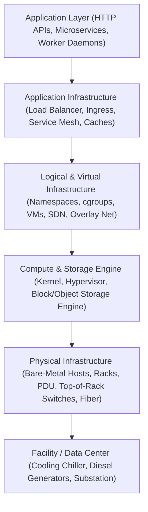
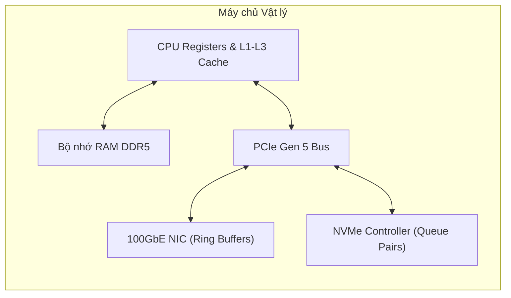
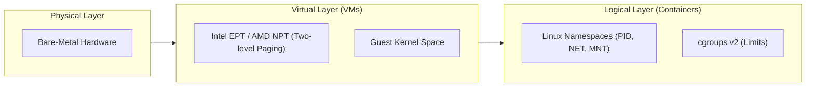
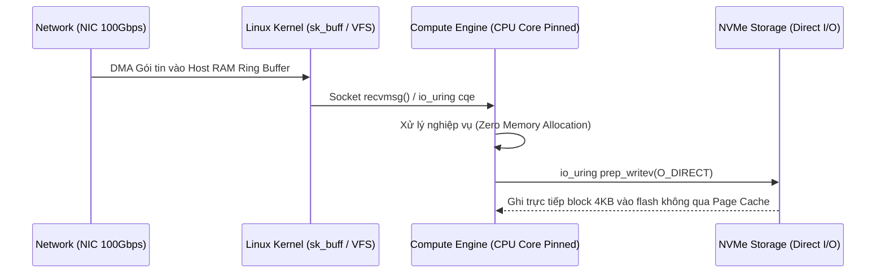
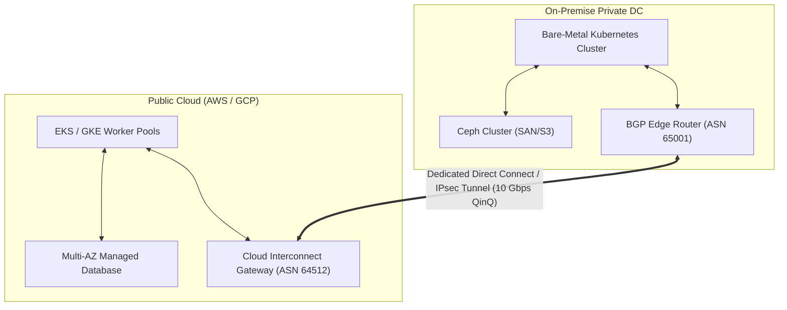
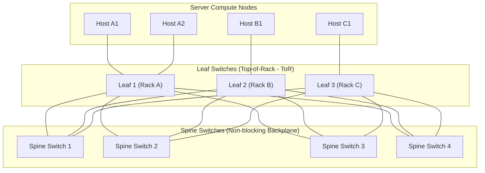

# 1.1. Infrastructure Typology and Core Concepts (Phân loại & Khái niệm Cốt lõi Hạ tầng)

## Tổng quan về Hạ tầng Kỹ thuật (Infrastructure Engineering Fundamentals)

Hạ tầng kỹ thuật (Infrastructure Engineering) là nền tảng điện toán nền dưới mọi phần mềm, đóng vai trò cung cấp, quản lý và tối ưu hóa toàn bộ tài nguyên tính toán (Compute), lưu trữ (Storage), mạng (Networking) và các lớp dịch vụ nền tảng (Platform Services).

Khác với Software Engineering thuần túy (vốn tập trung vào nghiệp vụ logic ứng dụng), Infrastructure Engineering giải quyết bài toán:
$$\min_{\text{Topology}} \left( \text{Cost} + \text{Latency} + \text{Operational Friction} \right) \quad \text{subject to} \quad \text{Availability} \ge 99.999\%, \quad \text{Throughput} \ge T_{\max}$$

Mô hình hệ thống hạ tầng phân lớp:



---

## 2. Chi tiết từng Keyword (Under-the-Hood Deep Dive)

---

### 1. Infrastructure Engineering Fundamentals & IT Infrastructure

#### 1. Khái niệm bản chất (What & Why)
- **Infrastructure Engineering Fundamentals**: Nhánh kỹ thuật phần mềm và hệ thống chuyên trách việc thiết kế, xây dựng, bảo trì và tự động hóa toàn bộ phần cứng, hệ điều hành, mạng và các nền tảng chạy phần mềm. Mục tiêu tối thượng là đảm bảo tính sẵn sàng (Availability), độ tin cậy (Reliability), hiệu năng cao (Performance) và khả năng mở rộng (Scalability) với chi phí tối ưu.
- **IT Infrastructure (Hạ tầng CNTT)**: Tổng thể các tài nguyên vật lý, mạng, phần cứng, phần mềm cơ sở, trung tâm dữ liệu và con người/quy trình cần thiết để vận hành và quản lý môi trường CNTT doanh nghiệp.

#### 2. Cơ chế hoạt động sâu (Under the hood)
Tại tầng vật lý và hệ điều hành, một yêu cầu hạ tầng không phải là một "hộp đen". Mỗi phép tính (Compute) tiêu tốn chu kỳ xung nhịp CPU (CPU cycles), mỗi byte ghi vào đĩa kích hoạt I/O Controller, DMA transfer và Flush cache, và mỗi gói tin mạng đều đi qua NIC driver, Ring Buffers, Linux Socket Buffer (`sk_buff`), và chuyển mạch phần cứng thông qua giao thức L2/L3.



#### 3. Code ví dụ thực chiến (C++ POSIX/Syscall - Truy vấn Năng lực Phần cứng & Hạ tầng Kernel)
Đoạn mã C++ minh họa cách một tiến trình Infrastructure Agent thu thập thông tin tài nguyên cấp thấp trực tiếp từ Linux Kernel thông qua `sysinfo`, `statvfs` và `getrlimit`:

```cpp
#include <iostream>
#include <sys/sysinfo.h>
#include <sys/statvfs.h>
#include <sys/resource.h>
#include <unistd.h>
#include <iomanip>

struct SystemCapacity {
    unsigned long total_ram_mb;
    unsigned long free_ram_mb;
    unsigned short cpu_cores;
    unsigned long total_storage_gb;
    unsigned long free_storage_gb;
    rlim_t max_open_files;
};

class InfrastructureInspector {
public:
    static SystemCapacity inspect_local_node(const char* mount_point = "/") {
        SystemCapacity cap{};
        
        // 1. Thu thập thông số Memory và CPU cores
        struct sysinfo s_info{};
        if (sysinfo(&s_info) == 0) {
            cap.total_ram_mb = (s_info.totalram * s_info.mem_unit) / (1024 * 1024);
            cap.free_ram_mb = (s_info.freeram * s_info.mem_unit) / (1024 * 1024);
        }
        cap.cpu_cores = sysconf(_SC_NPROCESSORS_ONLN);

        // 2. Thu thập dung lượng Disk Filesystem
        struct statvfs vfs{};
        if (statvfs(mount_point, &vfs) == 0) {
            unsigned long long total_bytes = vfs.f_blocks * vfs.f_frsize;
            unsigned long long free_bytes = vfs.f_bavail * vfs.f_frsize;
            cap.total_storage_gb = total_bytes / (1024 * 1024 * 1024);
            cap.free_storage_gb = free_bytes / (1024 * 1024 * 1024);
        }

        // 3. Thu thập giới hạn File Descriptors của Kernel cho hạ tầng
        struct rlimit limit{};
        if (getrlimit(RLIMIT_NOFILE, &limit) == 0) {
            cap.max_open_files = limit.rlim_cur;
        }

        return cap;
    }
};

int main() {
    auto node = InfrastructureInspector::inspect_local_node();
    std::cout << "=== Infrastructure Node Hardware Metrics ===" << std::endl;
    std::cout << "Online Cores      : " << node.cpu_cores << std::endl;
    std::cout << "RAM Total / Free  : " << node.total_ram_mb << " MB / " << node.free_ram_mb << " MB" << std::endl;
    std::cout << "Disk Total / Free : " << node.total_storage_gb << " GB / " << node.free_storage_gb << " GB" << std::endl;
    std::cout << "Max Open FDs      : " << node.max_open_files << std::endl;
    return 0;
}
```

#### 4. Pitfalls & Anti-patterns
- **Xem hạ tầng như hộp đen vô hạn**: Không nắm vững giới hạn phần cứng (PCIe bandwidth, NVMe IOPS limits, Socket buffers) dẫn đến việc scale-out mù quáng mà không giải quyết được nghẽn cổ chai (Bottleneck).
- **Hạ tầng không tài liệu hóa & thủ công**: Snowflake servers — máy chủ được cấu hình bằng tay, không thể tái lập khi có sự cố phần cứng.

---

### 2. Computing, Physical, Virtual & Logical Infrastructure

#### 1. Khái niệm bản chất (What & Why)
- **Computing Infrastructure**: Hệ thống tổng thể xử lý tính toán gồm CPU/GPU/ASIC, memory bus và tập lệnh.
- **Physical Infrastructure**: Thiết bị vật lý hữu hình (Bare-metal servers, racks, switches cáp quang, UPS, PDU).
- **Virtual Infrastructure**: Tài nguyên trừu tượng hóa thông qua Hypervisor Type-1/Type-2 (KVM, ESXi) biến một server vật lý thành nhiều Virtual Machines (VMs).
- **Logical Infrastructure**: Các phân vùng logic bên trên hệ điều hành và mạng (Linux Namespaces, cgroups, VLAN, VPC, Kubernetes Namespaces).

#### 2. Cơ chế hoạt động sâu (Under the hood)
Sự chuyển đổi từ Physical $\to$ Virtual $\to$ Logical là quá trình tăng dần mức độ trừu tượng và giảm thiểu phụ thuộc phần cứng:
1. **Physical Mode**: Kernel trực tiếp sở hữu Page Tables (CR3 register trên x86_64), truy cập physical address trực tiếp.
2. **Virtual Mode**: Hypervisor kích hoạt Intel VT-x (`VMXON`, `VMENTRY`, `VMEXIT`), tạo ra 2 cấp độ phân dịch địa chỉ: GVA (Guest Virtual Address) $\to$ GPA (Guest Physical Address) $\to$ HPA (Host Physical Address) thông qua Extended Page Tables (EPT) do MMU phần cứng thực thi.
3. **Logical Mode (Containers/Namespaces)**: Chia sẻ chung một Linux Kernel duy nhất. Sự cô lập được đảm bảo bởi `struct nsproxy` trong `task_struct`, chia tách PID, Mount, Network, IPC, UTS và User IDs.



#### 3. Code ví dụ thực chiến (C++ Linux Namespaces & cgroups Isolation Stub)
Đoạn mã C++ minh họa cách tạo một Logical Infrastructure container phân tách namespace và giới hạn bộ nhớ:

```cpp
#define _GNU_SOURCE
#include <sched.h>
#include <unistd.h>
#include <sys/wait.h>
#include <sys/mount.h>
#include <iostream>
#include <fstream>
#include <string>

static int container_entry(void* arg) {
    // 1. Thiết lập hostname riêng cho logical container (UTS Namespace)
    sethostname("isolated-worker-node", 20);

    // 2. Chuyển đổi mount namespace thành private để tránh rò rỉ mount point
    mount(nullptr, "/", nullptr, MS_PRIVATE | MS_REC, nullptr);

    std::cout << "[Logical Container] Đang thực thi bên trong PID, UTS, Mount Namespace riêng biệt." << std::endl;
    std::cout << "[Logical Container] PID hiện tại trong namespace: " << getpid() << std::endl;

    // Giả lập worker task
    sleep(1);
    return 0;
}

int main() {
    const size_t STACK_SIZE = 1024 * 1024;
    auto* stack = new char[STACK_SIZE];
    char* stack_top = stack + STACK_SIZE;

    // Cờ tạo logical boundary: clone tiến trình con với namespace mới
    int clone_flags = CLONE_NEWPID | CLONE_NEWUTS | CLONE_NEWNS | CLONE_NEWIPC | SIGCHLD;

    std::cout << "[Host Infrastructure] Khởi tạo logical infrastructure container..." << std::endl;
    pid_t child_pid = clone(container_entry, stack_top, clone_flags, nullptr);

    if (child_pid == -1) {
        perror("clone failed");
        delete[] stack;
        return 1;
    }

    waitpid(child_pid, nullptr, 0);
    delete[] stack;
    std::cout << "[Host Infrastructure] Logical container đã hoàn tất vòng đời." << std::endl;
    return 0;
}
```

---

### 3. Application, Network, Storage & Compute Infrastructure

#### 1. Khái niệm bản chất (What & Why)
- **Application Infrastructure**: Lớp phần mềm nền tảng trực tiếp hỗ trợ ứng dụng hoạt động: Reverse Proxy (NGINX/HAProxy), API Gateway, Middleware, Distributed Message Brokers (Kafka, RabbitMQ).
- **Network Infrastructure**: Mạng vật lý và mạng ảo (Switches, Routers, BGP transit, Dark Fiber, SD-WAN, Overlay VXLAN).
- **Storage Infrastructure**: Hệ thống lưu trữ dữ liệu khối (Block - EBS, SAN), lưu trữ tệp (File - NFS, CephFS), và lưu trữ đối tượng (Object - S3, MinIO).
- **Compute Infrastructure**: Năng lực điện toán tập trung hoặc phân tán (x86, ARM Neoverse, Apple Silicon, GPU Tensor cores).

#### 2. Cơ chế hoạt động sâu (Under the hood)
- **Data Path Alignment**: Trong kiến trúc hạ tầng hiệu năng cao, Network Interface Card (NIC) nhận gói tin qua DMA trực tiếp vào Host RAM (Zero-Copy via DPDK hoặc AF_XDP), bypass kernel TCP stack, chuyển tới Compute Core đã được pinned (NUMA-aware core binding), và ghi log ra Storage thông qua `io_uring` direct I/O (`O_DIRECT`).



#### 3. Code ví dụ thực chiến (C++ O_DIRECT Block Storage I/O)
Minh họa ghi dữ liệu trực tiếp vào hạ tầng Storage bypass Linux Page Cache bằng Direct I/O và căn chỉnh địa chỉ bộ nhớ (Memory Alignment):

```cpp
#include <fcntl.h>
#include <unistd.h>
#include <cstdlib>
#include <cstring>
#include <iostream>

class DirectStorageWriter {
public:
    static bool write_raw_block(const char* filepath, size_t block_size) {
        // O_DIRECT yêu cầu buffer và offset phải được căn chỉnh theo sector/block size (thường là 4096 bytes)
        int fd = open(filepath, O_WRONLY | O_CREAT | O_TRUNC | O_DIRECT, 0644);
        if (fd < 0) {
            perror("open(O_DIRECT) failed");
            return false;
        }

        void* aligned_buffer = nullptr;
        if (posix_memalign(&aligned_buffer, block_size, block_size) != 0) {
            close(fd);
            return false;
        }

        // Điền payload
        std::memset(aligned_buffer, 0xAB, block_size);

        ssize_t written = write(fd, aligned_buffer, block_size);
        bool success = (written == static_cast<ssize_t>(block_size));

        free(aligned_buffer);
        close(fd);
        return success;
    }
};

int main() {
    const size_t ALIGNED_BLOCK = 4096;
    if (DirectStorageWriter::write_raw_block("infra_block_test.dat", ALIGNED_BLOCK)) {
        std::cout << "[Storage Infrastructure] Ghi thành công khối 4096 bytes Direct I/O Bypass Page Cache!" << std::endl;
        unlink("infra_block_test.dat");
    }
    return 0;
}
```

---

### 4. Data Center, Cloud, Hybrid & Distributed Infrastructure

#### 1. Khái niệm bản chất (What & Why)
- **Data Center Infrastructure**: Trung tâm dữ liệu vật lý gồm không gian rack (U), sàn nâng, hệ thống làm mát chính xác (CRAC), PDU và nguồn điện dự phòng UPS.
- **Cloud Infrastructure**: Hạ tầng do các Hyper-scalers (AWS, GCP, Azure) làm chủ, người dùng tiêu thụ qua mô hình phần mềm định nghĩa (Software-Defined Everything).
- **Hybrid Infrastructure**: Sự kết hợp giữa hạ tầng On-premise (Bare-metal nội bộ) và Public Cloud, kết nối qua kênh thuê riêng (AWS Direct Connect, Google Cloud Interconnect) và VPN IPsec.
- **Distributed Infrastructure**: Hạ tầng phân tán địa lý (Multi-region, Edge nodes, PoP - Points of Presence) giúp giảm độ trễ truy cập người dùng cuối (CDN, Anycast DNS).

#### 2. Cơ chế hoạt động sâu (Under the hood)
Trong Hybrid và Distributed Infrastructure, bài toán lớn nhất là **Network Latency & Topology Routing**:
$$\text{Latency}_{\text{cross-DC}} = \frac{2 \times \text{Distance}}{c_{\text{fiber}}} + \sum \text{Hop Latency} + \text{Queueing Latency}$$
Vận tốc truyền tín hiệu trong sợi quang khoảng $200,000 \text{ km/s}$ ($\approx 5 \text{ \mu s/km}$). Một liên kết hybrid giữa Tokyo và Frankfurt có RTT tối thiểu $\approx 100\text{ ms}$, đặt ra thách thức cho các hệ thống đồng thuận (Consensus engines như Raft/Paxos) khi phân bổ node xuyên trung tâm dữ liệu.



---

### 5. Infrastructure Architecture, Topology, Components & Dependencies

#### 1. Khái niệm bản chất (What & Why)
- **Infrastructure Architecture**: Bản thiết kế tổng thể định hình cách các tài nguyên compute, network, storage kết nối, đáp ứng các tiêu chuẩn bảo mật, chịu lỗi và mở rộng.
- **Infrastructure Topology**: Cấu trúc hình học mô tả quan hệ kết nối vật lý hoặc logic giữa các nút mạng (Spine-Leaf topology, Star, Mesh).
- **Infrastructure Components**: Các khối cấu thành cơ sở hạ tầng (L4 Load Balancer, DNS Server, Gateway, Virtual Router).
- **Infrastructure Dependencies**: Đồ thị có hướng (DAG - Directed Acyclic Graph) biểu diễn quan hệ phụ thuộc giữa các thành phần. Nếu DNS sập, toàn bộ dịch vụ phụ thuộc sập theo (Cascading Failure).

#### 2. Cơ chế hoạt động sâu (Under the hood)
Trong Data Center hiện đại, kiến trúc 3 lớp truyền thống (Core-Aggregation-Access) đã được thay thế hoàn toàn bằng **Clos Network (Spine-Leaf Topology)**:
- Mỗi Leaf Switch nối với mọi Spine Switch.
- Không sử dụng Spanning Tree Protocol (STP) gây khóa cổng, mà sử dụng **ECMP (Equal-Cost Multi-Path)** ở Layer 3 để cân bằng tải trên toàn bộ đường truyền quang.
- Đảm bảo độ trễ giữa bất kỳ server nào trong trung tâm dữ liệu đều cố định ở mức **bước nhảy 3 chặng (Leaf $\to$ Spine $\to$ Leaf)**.



#### 3. Code ví dụ thực chiến (TypeScript - Infrastructure Dependency Graph & Topo Sort Resolver)
Đoạn mã TypeScript biểu diễn Dependency Graph của hạ tầng, phát hiện chu trình lặp vô hạn (Cycle Detection) và tính toán thứ tự khởi động (Topological Sort):

```typescript
interface InfraComponent {
  id: string;
  name: string;
  dependencies: string[];
}

class InfrastructureDependencyResolver {
  private components: Map<string, InfraComponent> = new Map();

  register(component: InfraComponent): void {
    this.components.set(component.id, component);
  }

  resolveBootOrder(): string[] {
    const visited: Map<string, number> = new Map(); // 0: unvisited, 1: visiting, 2: visited
    const order: string[] = [];

    const dfs = (nodeId: string) => {
      const state = visited.get(nodeId) || 0;
      if (state === 1) {
        throw new Error(`[CRITICAL] Phát hiện chu trình phụ thuộc vòng kín (Cyclic Dependency) tại node: ${nodeId}`);
      }
      if (state === 2) return;

      visited.set(nodeId, 1);
      const comp = this.components.get(nodeId);
      if (!comp) {
        throw new Error(`Thiếu thành phần hạ tầng phụ thuộc: ${nodeId}`);
      }

      for (const dep of comp.dependencies) {
        dfs(dep);
      }

      visited.set(nodeId, 2);
      order.push(nodeId);
    };

    for (const key of this.components.keys()) {
      if ((visited.get(key) || 0) === 0) {
        dfs(key);
      }
    }

    return order;
  }
}

// Minh họa khởi tạo chuỗi hạ tầng
const resolver = new InfrastructureDependencyResolver();
resolver.register({ id: "pdu_power", name: "PDU & UPS Power", dependencies: [] });
resolver.register({ id: "core_network", name: "Spine/Leaf Switches", dependencies: ["pdu_power"] });
resolver.register({ id: "storage_san", name: "NVMe Storage Pool", dependencies: ["core_network"] });
resolver.register({ id: "dns_ntp", name: "Core DNS/NTP Services", dependencies: ["core_network"] });
resolver.register({ id: "k8s_control_plane", name: "Kubernetes Control Plane", dependencies: ["storage_san", "dns_ntp"] });
resolver.register({ id: "ingress_controller", name: "BGP Edge Ingress", dependencies: ["k8s_control_plane"] });

const bootOrder = resolver.resolveBootOrder();
console.log("=== Thứ tự khởi động hạ tầng an toàn (Topological Order) ===");
bootOrder.forEach((step, idx) => console.log(`${idx + 1}. Khởi động: ${step}`));
```

#### 4. Pitfalls & Anti-patterns
- **Circular Infrastructure Dependency**: Dịch vụ DNS cần đọc cấu hình từ một cơ sở dữ liệu phân tán, nhưng cơ sở dữ liệu phân tán lại phân giải địa chỉ replica qua chính DNS đó. Khi toàn hệ thống khởi động lại sau cúp điện (Cold Boot), toàn bộ cụm rơi vào thế bế tắc (Deadlock).
- **Phụ thuộc ngầm định (Hidden Infrastructure Dependencies)**: Dùng NTP công cộng ngoài Internet mà không có local Stratum-1 NTP server trong Data Center, dẫn đến lệch xung nhịp clock drift khi đứt cáp biển.

---

### Ứng dụng thực tế trong Backend & Systems
1. **Thiết kế Zero-Loss Disaster Recovery**: Phân bổ tài nguyên cân xứng giữa DC1 và DC2, sử dụng đồng bộ dữ liệu mức block/storage network để giảm RPO (Recovery Point Objective) về 0.
2. **Deterministic Latency Services**: Các sàn giao dịch điện tử (HFT) cấu hình máy chủ Bare-metal đặt cùng Rack với Switch của sàn (Colocation), vô hiệu hóa C-States và P-States của CPU để tránh độ trễ xung nhịp.
3. **Data Sovereignty Compliance**: Phân vùng Logical và Physical Infrastructure độc lập để đáp ứng các tiêu chuẩn bảo vệ dữ liệu (GDPR, PCI-DSS).
