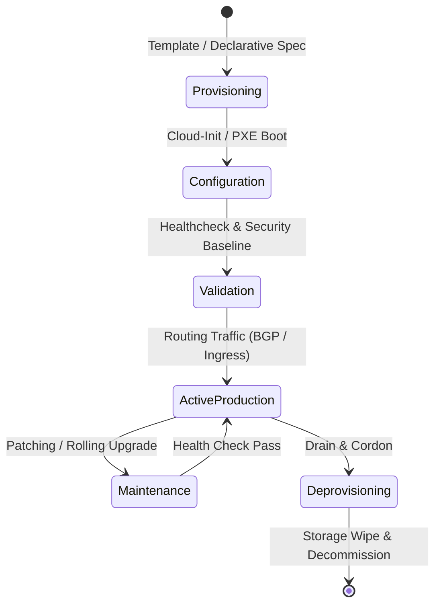
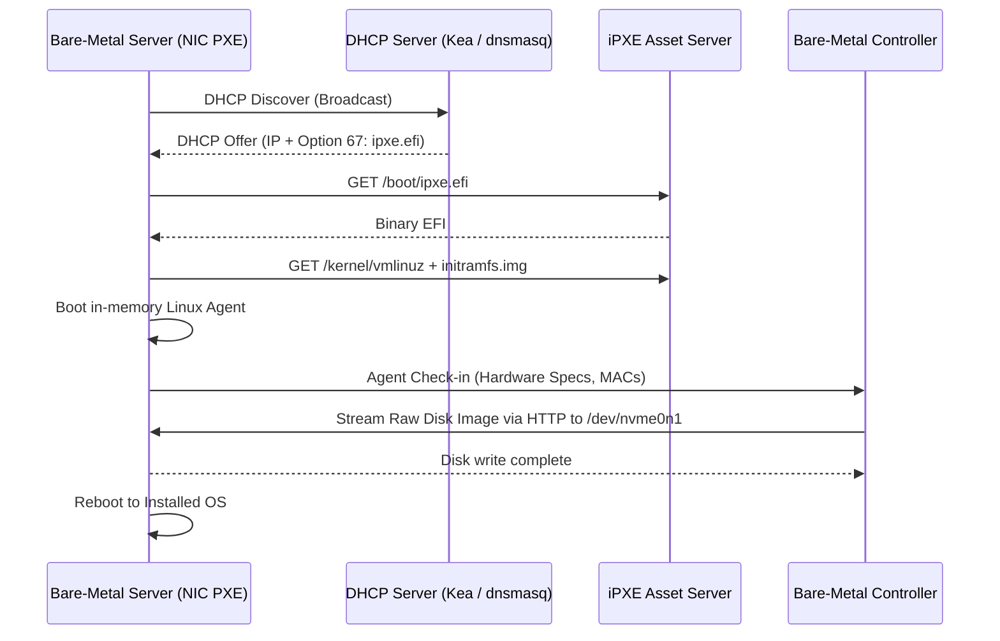
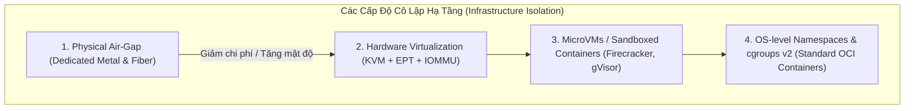

# 1.2. Lifecycle, Governance, and Engineering Principles (Vòng đời, Quản trị & Nguyên lý Kỹ nghệ Hạ tầng)

## Tổng quan về Nguyên lý Vận hành & Quản trị Hạ tầng

Quản trị vòng đời và nguyên lý kỹ nghệ hạ tầng là tập hợp các nguyên tắc định lượng, khung quy trình và kiến trúc hệ thống nhằm chuyển đổi hạ tầng từ một tập hợp phần cứng rời rạc, cấu hình thủ công thành một hệ thống tự động hóa, có thể dự đoán được (Deterministic), kiểm soát được (Observable) và tự phục hồi (Self-healing).

Mô hình định lượng độ sẵn sàng (Availability) và độ tin cậy (Reliability):
$$\text{Availability} (A) = \frac{\text{MTBF}}{\text{MTBF} + \text{MTTR}} = \frac{\text{Uptime}}{\text{Uptime} + \text{Downtime}}$$
Trong đó:
- $\text{MTBF}$ (Mean Time Between Failures): Thời gian trung bình giữa hai lần xảy ra sự cố phần cứng/phần mềm.
- $\text{MTTR}$ (Mean Time To Repair/Recover): Thời gian trung bình để phát hiện, cô lập và phục hồi hệ thống về trạng thái hoạt động bình thường.



---

## 2. Chi tiết từng Keyword (Under-the-Hood Deep Dive)

---

### 1. Infrastructure Provisioning & Lifecycle Management

#### 1. Khái niệm bản chất (What & Why)
- **Infrastructure Provisioning**: Quá trình chuẩn bị, phân bổ và kích hoạt tài nguyên máy tính (Bare-metal servers, VMs, mạng VLAN, kho đĩa lưu trữ) từ trạng thái thô (Unallocated) sang trạng thái sẵn sàng chạy ứng dụng.
- **Infrastructure Lifecycle Management**: Quản lý toàn bộ 5 giai đoạn vòng đời của hạ tầng:
  1. *Procure & Rack*: Đặt hàng phần cứng, lắp rack, đấu nối cáp mạng và điện.
  2. *Provision & Bootstrap*: Cài đặt OS nền (PXE boot), cấu hình network bonding, firmware.
  3. *Operate & Monitor*: Vận hành, cập nhật bảo mật, giám sát telemetry, auto-remediation.
  4. *Decommission*: Rút lưu lượng (drain), làm sạch dữ liệu đĩa (NIST 800-88 sanitization).
  5. *Retire*: Tháo dỡ phần cứng và tái chế.

#### 2. Cơ chế hoạt động sâu (Under the hood)
Tại tầng Bare-metal, Provisioning diễn ra thông qua chuỗi giao thức mạng cấp thấp:
1. Máy chủ khởi động qua NIC PXE ROM, gửi gói tin **DHCP Discover** (với Option 66/67 chỉ định Next-Server IP và Bootfile Name).
2. Tải Kernel Linux tối giản (`vmlinuz`) và `initramfs` qua **TFTP** hoặc **iPXE (HTTP/HTTPS)**.
3. Kernel trong RAM khởi chạy một in-memory agent (như Ironic Python Agent hoặc custom C++ daemon), nhận lệnh phân vùng đĩa qua `parted`, ghi image OS trực tiếp vào block device NVMe `/dev/nvme0n1`, cấu hình EFI boot loader và reboot.



---

### 2. Capacity Planning, Resource Allocation & Management

#### 1. Khái niệm bản chất (What & Why)
- **Infrastructure Capacity Planning**: Dự báo nhu cầu tính toán, lưu trữ, băng thông mạng trong tương lai dựa trên chuỗi thời gian (Time-series Forecasting) và mục tiêu kinh doanh, nhằm cấp phát phần cứng kịp thời trước khi chạm ngưỡng bão hòa.
- **Resource Allocation**: Phân bổ hạn ngạch tài nguyên (Quotas) cho từng nhóm dự án hoặc ứng dụng dựa trên cam kết SLA.
- **Resource Management**: Giám sát liên tục và điều hòa tỷ lệ sử dụng thực tế (Utilization Rate) so với tài nguyên đã cấp phát (Allocated vs Used), chống lãng phí và tranh chấp.

#### 2. Cơ chế hoạt động sâu (Under the hood)
Mô hình hóa lý thuyết hàng đợi **Erlang C** và **Little's Law** trong Capacity Planning:
$$L = \lambda W$$
- $L$: Số lượng yêu cầu đang nằm trong hệ thống hạ tầng (In-flight requests).
- $\lambda$: Tốc độ yêu cầu đến trung bình (Arrival rate - RPS).
- $W$: Thời gian một yêu cầu lưu trú trong hệ thống (Response time / Latency).

Khi Utilization của CPU/NIC vượt quá $70\% - 80\%$, thời gian chờ trong hàng đợi tăng theo hàm phi tuyến:
$$W_q \approx \left( \frac{\rho}{1 - \rho} \right) \cdot \frac{C_a^2 + C_s^2}{2} \cdot S$$
Với $\rho$ là hệ số sử dụng tài nguyên ($0 \le \rho < 1$). Khi $\rho \to 1$, độ trễ hàng đợi $W_q \to \infty$. Do đó, Capacity Planning luôn phải dự trữ **Capacity Headroom** tối thiểu $25\% - 30\%$.

#### 3. Code ví dụ thực chiến (C++ Erlang Queueing Latency Predictor)
Đoạn mã C++ tính toán dự báo độ trễ tăng vọt khi tải tài nguyên tiến sát ngưỡng bão hòa:

```cpp
#include <iostream>
#include <cmath>
#include <iomanip>

class CapacityModeling {
public:
    // Mô phỏng độ trễ hàng đợi theo công thức Kingman's Approximation cho hệ thống M/G/1
    static double estimate_queue_delay_ms(double arrival_rate, double service_rate, double ca_sq, double cs_sq) {
        if (service_rate <= arrival_rate) {
            return -1.0; // Hệ thống mất kiểm soát, hàng đợi bùng nổ vô hạn (Saturation)
        }

        double rho = arrival_rate / service_rate; // Hệ số tải Utilization (0 -> 1)
        double mean_service_time_ms = (1.0 / service_rate) * 1000.0;
        
        // Công thức Kingman: Wq = [rho / (1 - rho)] * [(Ca^2 + Cs^2) / 2] * S
        double wait_time_ms = (rho / (1.0 - rho)) * ((ca_sq + cs_sq) / 2.0) * mean_service_time_ms;
        return wait_time_ms;
    }
};

int main() {
    double service_capacity_rps = 10000.0; // 10,000 RPS khả năng xử lý của cụm
    double ca_sq = 1.0; // Phân phối Poisson
    double cs_sq = 1.0;

    std::cout << "=== Infrastructure Queueing Latency vs Resource Utilization ===" << std::endl;
    std::cout << std::setw(15) << "Arrival (RPS)" 
              << std::setw(15) << "Utilization (%)" 
              << std::setw(20) << "Queue Delay (ms)" << std::endl;

    for (double arrival = 5000; arrival <= 9800; arrival += 1000) {
        double util = (arrival / service_capacity_rps) * 100.0;
        double delay = CapacityModeling::estimate_queue_delay_ms(arrival, service_capacity_rps, ca_sq, cs_sq);
        std::cout << std::setw(15) << arrival 
                  << std::setw(15) << std::fixed << std::setprecision(1) << util 
                  << std::setw(20) << std::setprecision(3) << delay << std::endl;
    }
    return 0;
}
```

---

### 3. Standardization, Automation, Abstraction & Isolation

#### 1. Khái niệm bản chất (What & Why)
- **Infrastructure Standardization**: Chuẩn hóa cấu hình phần cứng (BOM - Bill of Materials), phiên bản Kernel Linux, cấu hình sysctl, tiêu chuẩn phân vùng mạng.
- **Infrastructure Automation**: Tự động hóa toàn bộ thao tác cấu hình, mở rộng, vá lỗi qua code (IaC - Infrastructure as Code).
- **Infrastructure Abstraction**: Che giấu sự phức tạp của phần cứng bên dưới thông qua các giao diện lập trình cấp cao (APIs, Kubernetes CRDs, Storage CSI, Network CNI).
- **Infrastructure Isolation**: Phân lập ranh giới lỗi và bảo mật giữa các ứng dụng chạy trên cùng một hạ tầng (Fault Domain & Security Boundary).

#### 2. Cơ chế hoạt động sâu (Under the hood)
Cô lập hạ tầng (Isolation) được thực thi ở 4 tầng từ thấp đến cao:
1. **Physical Air-gap**: Máy chủ riêng biệt, switch vật lý riêng, cáp quang riêng (cực kỳ an toàn, chi phí cao).
2. **Hardware Virtualization (Hypervisor)**: Intel VT-x EPT cô lập không gian bộ nhớ vật lý, IOMMU cô lập trực tiếp truy cập bus thiết bị ngoại vi (DMA isolation).
3. **OS Kernel Sandbox**: MicroVMs (AWS Firecracker / Google gVisor) sử dụng KVM với bộ giả lập tối giản để cách ly container untrusted với host kernel.
4. **Linux OS Isolation**: Namespaces + cgroups v2 + Seccomp BPF filters (hiệu năng cao nhất, nhưng chia sẻ chung kernel code).



---

### 4. Scalability, Reliability, Availability & Resilience

#### 1. Khái niệm bản chất (What & Why)
- **Scalability (Khả năng mở rộng)**: Khả năng hệ thống tăng thông lượng khi bổ sung tài nguyên mà không làm suy giảm hiệu năng trên mỗi đơn vị tài nguyên. Gồm Scale-Up (Thêm CPU/RAM vào máy chủ) và Scale-Out (Thêm nhiều node vào cụm phân tán).
- **Reliability (Độ tin cậy)**: Xác suất hệ thống thực hiện đúng chức năng không sai sót trong một khoảng thời gian xác định dưới điều kiện tải nhất định ($R(t) = e^{-\lambda t}$).
- **Availability (Độ sẵn sàng)**: Tỷ lệ phần trăm thời gian hệ thống hoạt động bình thường và sẵn sàng xử lý yêu cầu (e.g., 99.999% hay "5 số 9", tương đương không quá 5.26 phút gián đoạn mỗi năm).
- **Resilience (Khả năng phục hồi)**: Năng lực của hệ thống tự duy trì hoặc khôi phục hoạt động chấp nhận được khi một phần hạ tầng bị hư hỏng (Graceful Degradation, Circuit Breaking, Failover).

#### 2. Bảng đối chiếu Số lượng "Chín" (Availability Table)
| Mức độ Sẵn sàng | Downtime / Năm | Downtime / Tháng | Hạ tầng yêu cầu |
| :--- | :--- | :--- | :--- |
| **99.0%** (2 số 9) | 3.65 ngày | 7.20 giờ | Single Server, Manual Backup |
| **99.9%** (3 số 9) | 8.76 giờ | 43.8 phút | Multi-VM, Basic Load Balancer |
| **99.99%** (4 số 9) | 52.6 phút | 4.38 phút | Multi-AZ, Auto Failover, Quorum Replication |
| **99.999%** (5 số 9) | 5.26 phút | 26.3 giây | Multi-Region Active-Active, BGP Anycast, Zero-loss storage |

---

### 5. Observability, Security, Governance, Documentation & FinOps

#### 1. Khái niệm bản chất (What & Why)
- **Infrastructure Observability**: Khả năng suy luận trạng thái nội tại của toàn bộ cụm hạ tầng thông qua các tín hiệu ngoại vi: Metrics (Counters, Gauges, Histograms), Logs (Systemd journal, Kernel dmesg), Traces (OpenTelemetry span) và Network Flows.
- **Infrastructure Security**: Bảo vệ toàn diện bề mặt hạ tầng (Hardening Kernel, TLS Encryption-in-Transit, Disk Encryption-at-Rest, Zero Trust Network Architecture).
- **Infrastructure Governance**: Chính sách quy định ai được phép cấp phát tài nguyên, tiêu chuẩn bảo mật bắt buộc, kiểm toán truy cập (Audit Logs), tuân thủ ISO/IEC 27001, SOC 2.
- **Infrastructure Documentation**: Kiến trúc dạng code (Architecture-as-Code), Runbooks, Disaster Recovery Playbooks luôn được đồng bộ cùng mã nguồn.
- **Infrastructure Cost Optimization & Technical Debt**: 
  - *Cost Optimization*: Quyền sử dụng tài nguyên đúng kích cỡ (Rightsizing), tắt node nhàn rỗi, tận dụng Reserved Instances hoặc Spot Instances.
  - *Technical Debt*: Các giải pháp vá tạm bợ (Workarounds), kernel quá hạn (EOL), cấu hình phân mảnh không đồng nhất làm tăng nguy cơ sụp đổ hệ thống.

#### 2. Code ví dụ thực chiến (TypeScript Policy-as-Code Engine)
Đoạn mã TypeScript mô phỏng công cụ kiểm tra chính sách hạ tầng (Governance & Cost Guardrail) trước khi cấp phát tài nguyên:

```typescript
interface ResourceRequest {
  resourceId: string;
  type: "VM" | "BLOCK_STORAGE" | "LB";
  cpuCores: number;
  memoryGb: number;
  tags: Record<string, string>;
  costPerHourUsd: number;
}

interface GovernancePolicyResult {
  approved: boolean;
  violations: string[];
}

class InfrastructureGovernanceEngine {
  private maxAllowedMonthlyBudget: number = 5000; // USD

  evaluate(request: ResourceRequest, currentMonthlyCost: number): GovernancePolicyResult {
    const violations: string[] = [];

    // 1. Kiểm tra bắt buộc phải có thẻ quản trị (Mandatory Tags: Owner, Environment, CostCenter)
    const requiredTags = ["Owner", "Environment", "CostCenter"];
    for (const tag of requiredTags) {
      if (!request.tags[tag] || request.tags[tag].trim() === "") {
        violations.push(`Thiếu thẻ quản trị bắt buộc: '${tag}'`);
      }
    }

    // 2. Kiểm tra giới hạn kích cỡ tài nguyên (Rightsizing Policy)
    if (request.type === "VM" && request.cpuCores > 64) {
      violations.push(`Vượt quá giới hạn CPU cho phép (Yêu cầu: ${request.cpuCores}, Tối đa: 64 cores)`);
    }

    // 3. Dự toán ngân sách và ngăn chặn nợ kỹ thuật/vượt ngân sách (FinOps Guardrail)
    const projectedResourceMonthlyCost = request.costPerHourUsd * 24 * 30;
    if (currentMonthlyCost + projectedResourceMonthlyCost > this.maxAllowedMonthlyBudget) {
      violations.push(
        `Vượt ngân sách hàng tháng cho phép ($${currentMonthlyCost + projectedResourceMonthlyCost} > $${this.maxAllowedMonthlyBudget})`
      );
    }

    return {
      approved: violations.length === 0,
      violations
    };
  }
}

// Chạy thử nghiệm đánh giá Policy
const governance = new InfrastructureGovernanceEngine();
const newVm: ResourceRequest = {
  resourceId: "worker-ai-node-09",
  type: "VM",
  cpuCores: 128, // Vi phạm
  memoryGb: 512,
  tags: { Owner: "AI-Platform-Team" }, // Thiếu Environment, CostCenter
  costPerHourUsd: 4.5
};

const result = governance.evaluate(newVm, 2500);
console.log(`Kết quả thẩm định yêu cầu cấp phát [${newVm.resourceId}]:`);
console.log(`Trạng thái: ${result.approved ? "CHẤP THUẬN" : "TỪ CHỐI"}`);
result.violations.forEach((v, i) => console.log(`  [!] Vi phạm ${i + 1}: ${v}`));
```

---

### Ứng dụng thực tế trong Backend & Systems
1. **Zero-Downtime Infrastructure Migration**: Sử dụng mô hình hạ tầng Blue/Green, triển khai song song cụm phần cứng mới, chuyển đổi lưu lượng dần qua DNS Anycast và BGP withdraw.
2. **Automated Quorum Guarding**: Tự động phát hiện khi cụm phân tán (etcd, ZooKeeper) suy giảm số lượng node biểu quyết (Loss of Quorum) để cô lập partition mạng trước khi dữ liệu bị ghi đè không nhất quán (Split-brain).
3. **FinOps Dynamic Scheduling**: Tự động di chuyển các tác vụ batch processing (AI training, ETL) lên các Bare-metal server có giá điện thấp nhất theo khung giờ và làm mát tự nhiên (Free cooling).
