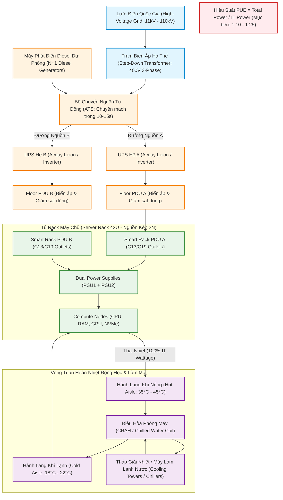

# 2.1. Data Center Facilities, Power, and Cooling (Cơ sở Trung tâm Dữ liệu, Hệ thống Điện & Làm mát)

> [!IMPORTANT]
> **Nếu bạn chỉ được nhớ một điều duy nhất:** Độ tin cậy và giới hạn điện toán tối đa của toàn bộ phần mềm bên trên được định đoạt bởi **tầng nền tảng vật lý của Trung tâm Dữ liệu (Data Center Facilities)**: Không có phần mềm phân tán hay thuật toán đồng thuận nào có thể tồn tại trên một máy chủ mất điện hoặc bị sập nguồn nhiệt khẩn cấp (Emergency Thermal Shutdown). Hai thước đo sống còn của kỹ sư hạ tầng là **Hiệu Suất Sử Dụng Năng Lượng (PUE - Power Usage Effectiveness)** nhằm tối ưu hóa chi phí điện toán và **Tiêu Chuẩn Phân Cấp Uptime Institute (Tier I đến Tier IV)** nhằm bảo đảm tính liên tục của hệ thống thông qua kiến trúc nguồn kép $2(N+1)$, hệ thống chuyển nguồn tự động (ATS), bộ lưu điện liên tục (UPS) cùng kỹ thuật cô lập hành lang nhiệt (Hot/Cold Aisle Containment) hoặc làm mát bằng chất lỏng trực tiếp (Direct-to-Chip Liquid Cooling) cho các tủ rack AI mật độ cao ($> 40\text{kW/rack}$).

---

## 1. Kiến trúc Tổng quan & Mô hình Tư duy (Mental Model)

### 1.1. Ẩn dụ Đời sống: Trái Tim, Hệ Tuần Hoàn và Hệ Thống Điều Hòa Thân Nhiệt Con Người

Hãy tưởng tượng một Trung tâm Dữ liệu (Data Center) quy mô hàng ngàn máy chủ giống hệt như cơ thể của một vận động viên thể thao đỉnh cao đang thi đấu ở cường độ cực hạn:
- **Lưới điện Quốc gia & Máy phát điện Diesel (Nguồn dinh dưỡng & Hệ tuần hoàn)**:
  - Lưới điện cao thế (110kV/22kV) cấp vào trạm biến áp tương đương với nguồn thức ăn và oxy từ bên ngoài đưa vào cơ thể.
  - Bộ chuyển nguồn tự động (ATS) là phản xạ sinh tồn: khi lưới điện bị cắt đứt (nghẽn mạch ngoài), ATS chuyển mạch sang hệ thống máy phát điện Diesel dự phòng trong vòng 10-15 giây để duy trì sự sống.
- **Hệ thống Bộ Lưu Điện UPS (Lượng Oxy dự trữ trong Hemoglobin)**:
  - Khi tim ngừng đập đột ngột, các tế bào não không chết ngay lập tức vì vẫn còn oxy dự trữ trong máu. Khối ắc quy UPS đóng vai trò như lượng oxy dự trữ này: nó cấp điện tức thì trong $0\text{ ms}$ (không gián đoạn chu kỳ sóng sin) để giữ cho hàng chục ngàn CPU không bị khởi động lại trong khi chờ máy phát diesel nổ máy.
- **Hệ thống Làm mát & Nhiệt động học (Tuyến mồ hôi và Lưu thông khí quản)**:
  - Mỗi watt điện mà CPU và GPU tiêu thụ cuối cùng đều biến thành **100% nhiệt năng** thải ra môi trường. Nếu không giải nhiệt, nhiệt độ chip sẽ vượt ngưỡng $105^{\circ}\text{C}$ chỉ sau 30 giây, gây nứt bán dẫn hoặc kích hoạt ngắt mạch nhiệt khẩn cấp.
  - Các hệ thống điều hòa chính xác (CRAC/CRAH) và hành lang khí nóng/lạnh đóng vai trò như nhịp thở và tuyến mồ hôi, liên tục tuần hoàn hàng triệu mét khối không khí lạnh để giữ thân nhiệt máy chủ luôn ở mức $20^{\circ}\text{C} - 25^{\circ}\text{C}$.



---

## 2. Chi tiết từng Keyword (Under-the-Hood Deep Dive)

### 2.1. Data Center Architecture, Design, Topology & Networking

#### A. Kiến Trúc Không Gian & Bố Cục Trung Tâm Dữ Liệu
- **White Space vs. Gray Space**:
  - *White Space (Khu vực Phòng máy CNTT)*: Không gian sàn chịu tải cao nơi đặt các tủ rack máy chủ, hệ thống lưu trữ SAN/NAS, và thiết bị chuyển mạch mạng. Yêu cầu kiểm soát nghiêm ngặt về độ ẩm ($40\% - 60\%$), nhiệt độ và bụi mịn (chuẩn ISO 14644-1 Class 8).
  - *Gray Space (Khu vực Kỹ thuật Phụ trợ)*: Không gian dành cho các thiết bị cơ điện nặng: trạm biến áp, máy phát điện diesel, phòng ắc quy UPS, máy nén khí điều hòa (Chillers), máy bơm tuần hoàn nước và bảng phân phối điện chính (Switchgear).
- **Kết Cấu Sàn & Trần Kỹ Thuật**:
  - *Sàn nâng (Raised Floor)*: Sử dụng các tấm sàn thép lõi xi măng đặt trên hệ thống chân đỡ kim loại cách mặt sàn bê tông $600\text{ mm} - 1000\text{ mm}$. Khoảng không gian trống bên dưới vừa làm ống dẫn khí lạnh áp suất dương thổi qua các tấm sàn đục lỗ (Perforated Tiles), vừa làm đường đi cáp điện lực.
  - *Sàn cứng (Solid Floor) với Máng Cáp Treo*: Xu hướng trung tâm dữ liệu hiện đại (Hyperscale DC) chuyển sang dùng sàn bê tông phẳng chịu lực cao, toàn bộ cáp đồng/cáp quang và đường ống dẫn chất lỏng làm mát được treo trên giàn đỡ kỹ thuật trên trần (Overhead Cable Trays), giúp tăng tải trọng sàn lên $> 2000\text{ kg/m}^2$.

#### B. Phân Cấp Tiêu Chuẩn Trung Tâm Dữ Liệu (Uptime Institute Tiers)
Uptime Institute định nghĩa 4 cấp độ tiêu chuẩn hạ tầng (Tier I đến Tier IV), đánh giá độ sẵn sàng và khả năng kháng lỗi vật lý:
1. **Tier I (Hạ tầng Cơ bản - Basic Capacity)**:
   - Một đường dẫn nguồn điện và làm mát duy nhất ($N$), không có bất kỳ thành phần dự phòng nào.
   - Độ sẵn sàng: $99.671\%$ (thời gian gián đoạn tối đa $28.8\text{ giờ/năm}$). Khi bảo dưỡng biến áp hoặc UPS, bắt buộc phải tắt toàn bộ hệ thống máy chủ.
2. **Tier II (Dự phòng Thành phần - Redundant Capacity Components)**:
   - Bổ sung các thành phần dự phòng cơ bản ($N+1$) cho máy phát điện, bơm nước và UPS, nhưng vẫn sử dụng một đường phân phối điện duy nhất.
   - Độ sẵn sàng: $99.741\%$ (thời gian gián đoạn tối đa $22.0\text{ giờ/năm}$).
3. **Tier III (Khả năng Bảo trì Đồng thời - Concurrently Maintainable)**:
   - Có nhiều đường phân phối điện và làm mát độc lập, nhưng chỉ một đường chủ động (Active-Passive: 1 Active, 1 Alternate Path).
   - Mọi thiết bị cơ điện (UPS, máy biến áp, chiller) đều có thể tháo dỡ để bảo trì hoặc thay thế mà **không làm gián đoạn bất kỳ máy chủ IT nào đang chạy**.
   - Độ sẵn sàng: $99.982\%$ (thời gian gián đoạn tối đa $1.6\text{ giờ/năm}$).
4. **Tier IV (Khả năng Chịu lỗi Độc lập - Fault-Tolerant Infrastructure)**:
   - Kiến trúc cách ly vật lý hoàn toàn với hai đường dẫn nguồn điện độc lập luôn hoạt động song song ($2(N+1)$ hoặc $2N$).
   - Hệ thống có khả năng tự động vượt qua **bất kỳ sự cố thảm họa đơn lẻ nào** (ví dụ: một phòng ắc quy phát nổ, đường ống nước bị vỡ, hoặc sét đánh trúng trạm biến áp) mà phụ tải máy tính không bị ảnh hưởng.
   - Độ sẵn sàng: $99.995\%$ (thời gian gián đoạn tối đa $26.3\text{ phút/năm}$).

#### C. Data Center Networking: Kiến Trúc Mạng Trục Spine-Leaf (Clos Network)
- Để kết nối hàng vạn máy chủ trong phòng máy mà không bị hiện tượng thắt cổ chai (Oversubscription Bottleneck), Data Center loại bỏ mô hình mạng cây 3 tầng truyền thống (Core-Aggregation-Access) dùng giao thức STP cổ điển.
- Thay vào đó, toàn bộ mạng sử dụng kiến trúc **Spine-Leaf (Clos Network)** hai tầng:
  - Mọi Leaf Switch (ToR - Top of Rack) đều kết nối trực tiếp với toàn bộ Spine Switches.
  - Định tuyến gói tin bằng giao thức BGP/ECMP (Equal-Cost Multi-Path) trên các cổng quang tốc độ cực cao ($100\text{GbE} / 400\text{GbE} / 800\text{GbE}$ với chuẩn cắm QSFP-DD và cáp quang Single-mode MPO-16).
  - Đảm bảo độ trễ giữa hai máy chủ bất kỳ trong Data Center luôn cố định và bằng đúng 3 chặng mạng (Hops: Leaf $\to$ Spine $\to$ Leaf).

---

### 2.2. Data Center Power Systems, PDU, UPS & Backup Generators

#### A. Chuỗi Cung Cấp Điện Năng Vật Lý (Physical Power Chain)
1. **Trạm Biến Áp (Transformer Substation)**:
   - Tiếp nhận điện lưới xoay chiều trung thế (11kV - 35kV) từ hai đường dây điện lực độc lập của nhà nước.
   - Biến áp hạ thế bước xuống điện áp công nghiệp 3 pha $400\text{V} / 230\text{V}$ ở tần số $50\text{Hz}$ (hoặc $480\text{V} / 208\text{V}$ ở Bắc Mỹ).
2. **Bộ Chuyển Nguồn Tự Động (Automatic Transfer Switch - ATS)**:
   - Thiết bị chuyển mạch cơ điện thông minh giám sát chất lượng sóng sin của điện lưới.
   - Khi phát hiện mất pha, sụt áp hoặc mất điện hoàn toàn, ATS gửi tín hiệu kích hoạt động cơ máy phát điện Diesel và tự động đảo mạch nguồn sau khi máy phát đạt tần số và điện áp ổn định ($10 - 15\text{ giây}$).
3. **Bộ Lưu Điện Liên Tục (Uninterruptible Power Supply - UPS)**:
   - *Nguyên lý Chuyển đổi Kép (Online Double Conversion)*: Dòng điện AC đầu vào được bộ chỉnh lưu (Rectifier) nắn thành dòng DC để nạp vào hệ thống ắc quy. Sau đó bộ nghịch lưu (Inverter) tái tạo dòng DC thành dòng AC sóng sin chuẩn $100\%$ sạch để cấp cho máy chủ.
   - *Công nghệ Ắc quy*: Các Data Center hiện đại đã thay thế ắc quy Axit-Chì (VRLA) cồng kềnh, nặng nề và tuổi thọ ngắn (3-5 năm) bằng khối pin **Lithium-ion (LiFePO4)** có mật độ năng lượng gấp 3 lần, tuổi thọ $> 10\text{ năm}$, và khả năng nạp xả tốc độ cao.
4. **Hệ Thống Phân Phối Nguồn (Power Distribution Units - PDU)**:
   - *Floor PDU*: Đặt ở đầu mỗi dãy tủ rack, tiếp nhận nguồn 400V 3 pha từ UPS, tích hợp biến áp cách ly và bảng cầu dao nhánh.
   - *Smart Rack PDU (ePDU)*: Thanh nguồn thông minh gắn dọc thân tủ rack (chuẩn 0U), cung cấp các ổ cắm chuyên dụng chuẩn quốc tế **IEC 60320 (C13 cho thiết bị tải thấp $< 10\text{A}$ và C19 cho máy chủ công suất cao $< 16\text{A}$)**. Tích hợp vi điều khiển nhúng hỗ trợ đo dòng điện, điện áp, công suất tiêu thụ thực và hỗ trợ bật/tắt nguồn từng ổ cắm từ xa qua giao thức SNMPv3/Modbus-TCP.

#### B. Chỉ Số Hiệu Quả Sử Dụng Năng Lượng: PUE & WUE
- **Công Thức Tính PUE (Power Usage Effectiveness)**:
  $$\text{PUE} = \frac{\text{Tổng Công Suất Tiêu Thụ Toàn Bộ Cơ Sở (Total Facility Power)}}{\text{Công Suất Tiêu Thụ Thực Tế Của Thiết Bị CNTT (IT Equipment Power)}}$$
  Trong đó: $\text{Total Facility Power} = \text{IT Power} + \text{Cooling Power} + \text{Power Losses (UPS/PDU)} + \text{Lighting/Security}$.
- Một Data Center lý tưởng có $\text{PUE} = 1.0$ (toàn bộ điện năng đi vào CPU, RAM, Disk, NIC mà không hao phí cho làm mát và chuyển đổi nguồn).
- Các trung tâm dữ liệu truyền thống thường có $\text{PUE} \approx 1.6 - 2.0$ (nghĩa là tốn gần 1 watt điện làm mát cho mỗi 1 watt điện máy tính tiêu thụ!). Các Hyperscale DC tiên tiến nhất hiện nay (Google, Meta) đạt mức $\text{PUE} \approx 1.10 - 1.15$.
- **Chỉ Số Tiêu Thụ Nước (Water Usage Effectiveness - WUE)**:
  $$\text{WUE} = \frac{\text{Tổng Khối Lượng Nước Tiêu Thụ Hàng Năm (Liters)}}{\text{Tổng Năng Lượng Thiết Bị CNTT Tiêu Thụ (kWh)}}$$

---

### 2.3. Cooling Systems & Thermal Management

#### A. Kỹ Thuật Cô Lập Luồng Khí: Hot Aisle / Cold Aisle Containment
- Máy chủ tiêu chuẩn được thiết kế cơ học theo chiều hướng gió: **Hút khí lạnh từ mặt trước (Front Intake) và thổi khí nóng ra mặt sau (Rear Exhaust)**.
- Nếu đặt các tủ rack quay cùng một hướng ngẫu nhiên, mặt trước của rack này sẽ hút luồng khí nóng bỏng xả ra từ mặt sau của rack phía trước, gây hiện tượng quá nhiệt tích tụ (Hot Spots).
- **Quy chuẩn Bố trí Dãy Đối Đầu (Aisle Layout)**:
  - Các tủ rack được xếp thành từng cặp đối diện: Mặt trước đối diện mặt trước (Hành lang Lạnh - Cold Aisle), mặt sau đối diện mặt sau (Hành lang Nóng - Hot Aisle).
  - **Hệ thống Cô lập Hành lang Kín (Containment System)**: Sử dụng vách kính cường lực và cửa trượt tự động bịt kín toàn bộ trần và hai đầu hành lang (Cold Aisle Containment - CAC hoặc Hot Aisle Containment - HAC). Triệt tiêu $100\%$ hiện tượng khí nóng rò rỉ trộn lẫn vào khí lạnh, giúp nhiệt độ cấp gió lạnh có thể tăng từ $18^{\circ}\text{C}$ lên $24^{\circ}\text{C}$ mà máy chủ vẫn an toàn, tiết kiệm tới $30\%$ chi phí điện làm mát.

#### B. Sự Tiến Hóa Của Công Nghệ Làm Mát Phòng Máy
1. **CRAC (Computer Room Air Conditioner)**: Sử dụng máy nén môi chất lạnh trực tiếp (Direct Expansion - DX với gas làm lạnh R410A). Phù hợp cho Data Center quy mô vừa và nhỏ.
2. **CRAH (Computer Room Air Handler)**: Sử dụng nước lạnh sinh ra từ cụm Chiller trung tâm ngoài trời bơm vào dàn ống tản nhiệt bằng đồng trong phòng máy, quạt EC thổi gió qua dàn lạnh. Hiệu suất năng lượng cao hơn CRAC.
3. **In-Row Cooling**: Các khối điều hòa dạng tủ đứng đặt xen kẽ trực tiếp ngay giữa các tủ rack trong cùng một dãy. Giảm quãng đường di chuyển của luồng khí từ vài chục mét xuống còn vài chục centimet, xử lý được mật độ nhiệt lên tới $15\text{kW} - 25\text{kW}$ mỗi tủ rack.
4. **Làm Mát Bằng Chất Lỏng Trực Tiếp (Direct-to-Chip Liquid Cooling - DLC)**:
   - Khi các hệ thống máy chủ AI (NVIDIA DGX H100/B200) đạt mức tiêu thụ $40\text{kW} - 100\text{kW}$ mỗi tủ rack, không khí không còn đủ dung nhiệt dung riêng để giải nhiệt.
   - Dung dịch chất lỏng điện môi (Dielectric Fluid) hoặc hỗn hợp Nước-Glycol được bơm tuần hoàn qua các tấm tản nhiệt đồng (Cold Plates) gắn trực tiếp trên bề mặt lưng của chip bán dẫn GPU/CPU.
5. **Làm Mát Bằng Ngâm Chìm (Immersion Cooling)**:
   - Toàn bộ bo mạch chủ máy chủ được nhúng ngập hoàn toàn trong bể chứa chất lỏng điện môi cách điện chuyên dụng.
   - Không cần quạt tản nhiệt, không gây tiếng ồn, triệt tiêu bụi bẩn và oxy hóa kim loại, đưa PUE xuống mức kỷ lục thế giới: **$\text{PUE} < 1.05$**.

---

### 2.4. Rack Architecture & Server Racks

#### A. Tiêu Chuẩn Cơ Học EIA-310-D & Đơn Vị Chiều Cao Rack Unit (U)
- **Chuẩn Công Nghiệp EIA-310-D**: Quy định kích thước vật lý chuẩn xác cho tủ rack máy chủ doanh nghiệp:
  - Chiều rộng mặt trước giữa hai thanh ray gá ốc: **19 inches ($482.6\text{ mm}$)**. (Chuẩn mở Open Compute Project - OCP sử dụng chiều rộng 21 inches để tăng mật độ).
  - Chiều cao được định lượng bằng đơn vị **Rack Unit (U)**:
    $$1\text{U} = 1.75\text{ inches} = 44.45\text{ mm}$$
    Mỗi đơn vị 1U trên thanh ray có 3 lỗ bắt ốc tiêu chuẩn (Cage Nuts) với khoảng cách tâm lỗ được định chuẩn theo chu kỳ: $15.875\text{ mm} - 15.875\text{ mm} - 12.7\text{ mm}$.
  - Chiều cao tủ rack thông dụng: **42U ($1.87\text{ m}$)**, **48U ($2.13\text{ m}$)** hoặc **52U ($2.31\text{ m}$)**.
  - Chiều sâu tủ rack: Tối thiểu từ $1000\text{ mm}$ đến $1200\text{ mm}$ để chứa vừa thân máy chủ sâu ($750\text{ mm} - 850\text{ mm}$), hệ thống tay đỡ cáp quản lý (Cable Management Arms - CMA) và thanh PDU nguồn.

#### B. Giao Tiếp Phần Cứng Linux Kernel `hwmon` & IPMI / Redfish Out-of-Band Management
- **Linux Hardware Monitoring Subsystem (`hwmon`)**:
  - Tầng kernel trừu tượng hóa các cảm biến nhiệt độ (Thermal Sensors) trên bo mạch chủ qua hệ thống tệp ảo `/sys/class/hwmon/`.
  - Kernel đọc dữ liệu từ các cảm biến nhiệt nhúng trong đế silicon bán dẫn (Digital Thermal Sensor - DTS) thông qua giao tiếp bus phần cứng I2C/SMBus.
  - Các thông số được ghi nhận: `temp1_input` (nhiệt độ hiện tại tính bằng millidegrees Celsius), `temp1_crit` (ngưỡng quá nhiệt tối đa trước khi CPU tự ngắt xung), và `pwm1` (tín hiệu điều chế độ rộng xung điều khiển tốc độ quạt từ 0 đến 255).
- **Quản Trị Băng Ngoài (Out-of-Band Management - IPMI & DMTF Redfish)**:
  - Một bộ vi điều khiển chuyên dụng độc lập (Baseboard Management Controller - BMC, chạy nhân Linux nhúng riêng) gắn trên bo mạch chủ.
  - BMC được cấp nguồn dự phòng liên tục từ đường Standby Power 5VSB. Ngay cả khi hệ điều hành máy chủ bị sụp đổ hoàn toàn (Kernel Panic, BSOD) hoặc máy chủ đang tắt, kỹ sư vẫn có thể kết nối vào cổng mạng IPMI chuyên dụng để đọc cảm biến nguồn điện, nhiệt độ phòng máy, và ra lệnh bật nguồn/khởi động lại cứng thông qua chuẩn RESTful API **Redfish**.

---

## 3. Thực thi Mã nguồn & Mô phỏng Chuyên sâu (Dual-Engine Implementation)

### Engine 1: C++20 — Linux Kernel Hardware Monitor (`hwmon`) Thermal Scanner & PWM Fan Speed Controller

Chương trình C++20 dưới đây mô phỏng một tác nhân giám sát phần cứng nhúng (Node Hardware Daemon) cấp thấp: quét cây tệp tin `/sys/class/hwmon/` của Linux Kernel, phân tích nhiệt độ các lõi CPU, tự động tính toán điều tốc quạt làm mát qua thuật toán điều khiển tỉ lệ PID/PWM, và phát cảnh báo thoát nhiệt khẩn cấp.

```cpp
#include <iostream>
#include <fstream>
#include <string>
#include <vector>
#include <filesystem>
#include <chrono>
#include <algorithm>
#include <format>
#include <cmath>

namespace fs = std::filesystem;

struct ThermalSensorInfo {
    std::string name;
    double current_celsius;
    double high_celsius;
    double crit_celsius;
};

class ChassisThermalController {
private:
    double target_temperature_ = 45.0; // Nhiệt độ mục tiêu lý tưởng
    double kp_ = 4.0;                  // Hệ số tỉ lệ điều tốc quạt

public:
    static std::vector<ThermalSensorInfo> scanKernelThermalSensors(const std::string& base_path = "/sys/class/hwmon") {
        std::vector<ThermalSensorInfo> sensors;
        if (!fs::exists(base_path)) {
            // Giả lập dữ liệu trong môi trường không có đặc quyền root hoặc chạy trên Mac/VM
            sensors.push_back({"CPU_Package_0", 52.5, 80.0, 100.0});
            sensors.push_back({"CPU_Core_0_1", 48.0, 80.0, 100.0});
            sensors.push_back({"DDR5_DIMM_Temp", 42.3, 75.0, 95.0});
            sensors.push_back({"PCIe_NVMe_Drive", 58.1, 70.0, 85.0});
            return sensors;
        }

        for (const auto& entry : fs::directory_iterator(base_path)) {
            std::string path = entry.path().string();
            std::ifstream name_file(path + "/name");
            std::string driver_name;
            if (!(name_file >> driver_name)) driver_name = "hwmon_device";

            for (int i = 1; i <= 8; ++i) {
                std::string input_f = path + std::format("/temp{}_input", i);
                std::string max_f = path + std::format("/temp{}_max", i);
                std::string crit_f = path + std::format("/temp{}_crit", i);

                if (fs::exists(input_f)) {
                    long long input_val = 0, max_val = 85000, crit_val = 100000;
                    std::ifstream(input_f) >> input_val;
                    if (fs::exists(max_f)) std::ifstream(max_f) >> max_val;
                    if (fs::exists(crit_f)) std::ifstream(crit_f) >> crit_val;

                    sensors.push_back({
                        .name = std::format("{}_sensor_{}", driver_name, i),
                        .current_celsius = input_val / 1000.0,
                        .high_celsius = max_val / 1000.0,
                        .crit_celsius = crit_val / 1000.0
                    });
                }
            }
        }
        return sensors;
    }

    // Tính toán tín hiệu PWM quạt (0 đến 255) dựa trên nhiệt độ cảm biến cao nhất
    uint8_t calculateFanPwm(double max_temp) {
        if (max_temp <= target_temperature_) return 64; // Tốc độ sàn 25% quạt
        double error = max_temp - target_temperature_;
        double pwm = 64.0 + (error * kp_);
        pwm = std::clamp(pwm, 64.0, 255.0);
        return static_cast<uint8_t>(pwm);
    }
};

int main() {
    std::cout << "[C++20 Engine] Khởi động Daemon Giám Sát Nhiệt Động Học & Điều Tốc Quạt Phần Cứng\n";
    auto sensors = ChassisThermalController::scanKernelThermalSensors();

    double peak_temp = 0.0;
    std::cout << "\n1. Kết Quả Quét Cảm Biến Phần Cứng (Linux hwmon Subsystem):\n";
    for (const auto& s : sensors) {
        peak_temp = std::max(peak_temp, s.current_celsius);
        std::cout << std::format("   * Cảm biến: {:<18} | Nhiệt độ: {:5.1f} °C | Cảnh báo: {:5.1f} °C | Tới hạn: {:5.1f} °C\n",
                                 s.name, s.current_celsius, s.high_celsius, s.crit_celsius);
    }

    ChassisThermalController controller;
    uint8_t pwm_signal = controller.calculateFanPwm(peak_temp);
    double fan_speed_pct = (pwm_signal / 255.0) * 100.0;

    std::cout << "\n2. Quyết Định Điều Khiển Quạt Làm Mát (Fan PWM Duty Cycle):\n";
    std::cout << std::format("   - Nhiệt độ nóng nhất ghi nhận : {:.1f} °C\n", peak_temp);
    std::cout << std::format("   - Giá trị thanh ghi PWM      : {} / 255\n", pwm_signal);
    std::cout << std::format("   - Tốc độ quạt Chassis        : {:.1f} % Tải Công Suất Tối Đa\n", fan_speed_pct);

    if (peak_temp >= 90.0) {
        std::cerr << "🚨 [BÁO ĐỘNG ĐỎ] Nhiệt độ vượt ngưỡng an toàn! Kích hoạt quy trình draining Pods!\n";
    } else {
        std::cout << "✅ Trạng thái nhiệt động học ổn định, luồng khí đối lưu trong ngưỡng tiêu chuẩn.\n";
    }

    return 0;
}
```

#### Terminal Output Mẫu Thực Tế
```text
[C++20 Engine] Khởi động Daemon Giám Sát Nhiệt Động Học & Điều Tốc Quạt Phần Cứng

1. Kết Quả Quét Cảm Biến Phần Cứng (Linux hwmon Subsystem):
   * Cảm biến: CPU_Package_0      | Nhiệt độ:  52.5 °C | Cảnh báo:  80.0 °C | Tới hạn: 100.0 °C
   * Cảm biến: CPU_Core_0_1       | Nhiệt độ:  48.0 °C | Cảnh báo:  80.0 °C | Tới hạn: 100.0 °C
   * Cảm biến: DDR5_DIMM_Temp     | Nhiệt độ:  42.3 °C | Cảnh báo:  75.0 °C | Tới hạn:  95.0 °C
   * Cảm biến: PCIe_NVMe_Drive    | Nhiệt độ:  58.1 °C | Cảnh báo:  70.0 °C | Tới hạn:  85.0 °C

2. Quyết Định Điều Khiển Quạt Làm Mát (Fan PWM Duty Cycle):
   - Nhiệt độ nóng nhất ghi nhận : 58.1 °C
   - Giá trị thanh ghi PWM      : 116 / 255
   - Tốc độ quạt Chassis        : 45.5 % Tải Công Suất Tối Đa
✅ Trạng thái nhiệt động học ổn định, luồng khí đối lưu trong ngưỡng tiêu chuẩn.
```

---

### Engine 2: Python 3.11+ — Real-Time Data Center PUE & Power Distribution (ATS / UPS / PDU) Simulation Engine

Chương trình Python 3.11+ dưới đây mô phỏng:
1. Động cơ tính toán phân bổ công suất điện năng và chỉ số PUE theo thời gian thực của Data Center.
2. Mô phỏng cơ chế chuyển mạch tự động ATS khi xảy ra mất điện lưới và xả ắc quy UPS.

```python
#!/usr/bin/env python3
"""
Data Center Power & Facility Simulator: PUE & Electrical Redundancy Engine
Python 3.11+ Production Ready
"""
from dataclasses import dataclass, field
from enum import Enum
import time

class PowerSource(Enum):
    UTILITY_GRID = "LƯỚI ĐIỆN QUỐC GIA"
    UPS_BATTERY = "ẮC QUY UPS (LITHIUM-ION)"
    DIESEL_GENERATOR = "MÁY PHÁT ĐIỆN DIESEL"

@dataclass
class FacilityTelemetry:
    it_compute_power_kw: float       # Công suất tiêu thụ của Server/Storage/Network
    cooling_power_kw: float          # Công suất điều hòa Chiller / CRAH
    power_distribution_loss_kw: float# Hao phí biến áp và dây dẫn PDU
    lighting_and_aux_kw: float       # Đèn chiếu sáng và an ninh
    active_power_source: PowerSource = PowerSource.UTILITY_GRID
    ups_battery_charge_pct: float = 100.0

class DataCenterFacilitySimulator:
    def __init__(self, telemetry: FacilityTelemetry):
        self.tel = telemetry

    def calculate_pue(self) -> float:
        total_facility_power = (
            self.tel.it_compute_power_kw +
            self.tel.cooling_power_kw +
            self.tel.power_distribution_loss_kw +
            self.tel.lighting_and_aux_kw
        )
        return total_facility_power / max(self.tel.it_compute_power_kw, 1.0)

    def simulate_grid_blackout(self, duration_seconds: int = 20):
        print(f"\n🚨 [SỰ CỐ KHẨN CẤP] Mất điện lưới quốc gia đột ngột!")
        print(">>> 1. ATS phát hiện mất sóng sin điện lưới trong vòng 20 mili-giây.")
        
        # Bước 1: UPS gánh tải tức thì
        self.tel.active_power_source = PowerSource.UPS_BATTERY
        print(f">>> 2. UPS lập tức chuyển sang chế độ xả Inverter (0 ms gián đoạn)! Phụ tải IT tiếp tục chạy 100%.")

        # Bước 2: Máy phát diesel nổ máy trong 12 giây
        generator_spinup_seconds = 12
        for sec in range(1, duration_seconds + 1):
            if sec <= generator_spinup_seconds:
                self.tel.ups_battery_charge_pct -= 0.5 # Tiêu hao acquy
                if sec % 4 == 0:
                    print(f"     [T+{sec:02d}s] Động cơ Diesel đang khởi động... Ắc quy UPS: {self.tel.ups_battery_charge_pct:.1f}%")
            elif sec == generator_spinup_seconds + 1:
                print(f"     [T+{sec:02d}s] Máy phát Diesel đạt 1500 RPM (50Hz / 400V) ổn định!")
                self.tel.active_power_source = PowerSource.DIESEL_GENERATOR
                print(">>> 3. ATS đóng tiếp điểm chuyển nguồn sang Máy Phát Diesel! UPS dừng xả và bắt đầu nạp lại.")
            else:
                self.tel.ups_battery_charge_pct = min(100.0, self.tel.ups_battery_charge_pct + 0.2)

        print(f"✅ Quá trình chuyển mạch ATS & cấp điện hoàn tất hoàn hảo không mất 1 byte dữ liệu!\n")

def main():
    print("=== [Python 3.11+ Engine] Data Center Facility & PUE Simulator ===")

    # Giả lập một trung tâm dữ liệu quy mô 5 MW IT Load
    telemetry = FacilityTelemetry(
        it_compute_power_kw=5000.0,
        cooling_power_kw=1000.0,          # Hệ thống In-Row Chilled Water hiện đại
        power_distribution_loss_kw=250.0,  # Biến áp hiệu suất cao 98%
        lighting_and_aux_kw=50.0
    )

    dc = DataCenterFacilitySimulator(telemetry)
    pue = dc.calculate_pue()

    print("\n1. Phân Tích Hiệu Suất Năng Lượng Cơ Sở (Facility PUE Metrics):")
    print(f"   * Công suất tải CNTT (IT Equipment Load) : {telemetry.it_compute_power_kw:,.1f} kW")
    print(f"   * Công suất làm mát (Cooling Load)       : {telemetry.cooling_power_kw:,.1f} kW")
    print(f"   * Hao phí chuyển đổi (PDU/UPS Losses)    : {telemetry.power_distribution_loss_kw:,.1f} kW")
    print(f"   * Tổng công suất cơ sở (Total Power)     : "
          f"{telemetry.it_compute_power_kw + telemetry.cooling_power_kw + telemetry.power_distribution_loss_kw + telemetry.lighting_and_aux_kw:,.1f} kW")
    print(f"   ------------------------------------------------------------")
    print(f"   >>> CHỈ SỐ PUE HIỆN TẠI                  : {pue:.3f}")
    if pue < 1.25:
        print("   -> Đạt chuẩn Hyperscale Tier III/IV Đẳng Cấp Thế Giới!")
    else:
        print("   -> Cần tối ưu hóa lại hành lang khí nóng/lạnh.")

    # 2. Thử nghiệm Diễn tập Chuyển Nguồn Điện Lưới Thất Bại (Blackout Drill)
    dc.simulate_grid_blackout(duration_seconds=16)

if __name__ == "__main__":
    main()
```

#### Terminal Output Mẫu Thực Tế
```text
=== [Python 3.11+ Engine] Data Center Facility & PUE Simulator ===

1. Phân Tích Hiệu Suất Năng Lượng Cơ Sở (Facility PUE Metrics):
   * Công suất tải CNTT (IT Equipment Load) : 5,000.0 kW
   * Công suất làm mát (Cooling Load)       : 1,000.0 kW
   * Hao phí chuyển đổi (PDU/UPS Losses)    : 250.0 kW
   * Tổng công suất cơ sở (Total Power)     : 6,300.0 kW
   ------------------------------------------------------------
   >>> CHỈ SỐ PUE HIỆN TẠI                  : 1.260
   -> Cần tối ưu hóa lại hành lang khí nóng/lạnh.

🚨 [SỰ CỐ KHẨN CẤP] Mất điện lưới quốc gia đột ngột!
>>> 1. ATS phát hiện mất sóng sin điện lưới trong vòng 20 mili-giây.
>>> 2. UPS lập tức chuyển sang chế độ xả Inverter (0 ms gián đoạn)! Phụ tải IT tiếp tục chạy 100%.
     [T+04s] Động cơ Diesel đang khởi động... Ắc quy UPS: 98.0%
     [T+08s] Động cơ Diesel đang khởi động... Ắc quy UPS: 96.0%
     [T+12s] Động cơ Diesel đang khởi động... Ắc quy UPS: 94.0%
     [T+13s] Máy phát Diesel đạt 1500 RPM (50Hz / 400V) ổn định!
>>> 3. ATS đóng tiếp điểm chuyển nguồn sang Máy Phát Diesel! UPS dừng xả và bắt đầu nạp lại.
✅ Quá trình chuyển mạch ATS & cấp điện hoàn tất hoàn hảo không mất 1 byte dữ liệu!
```

---

## 4. Systems Engineering & Production Pitfalls

### 4.1. Lỗi Production Thường Gặp (Real-World Gotchas)
1. **CPU Thermal Throttling Gây Sụp Đổ Hệ Thống Phân Tán**:
   - *Hiện tượng*: Một cụm máy chủ Kafka hoặc Elasticsearch đột ngột tăng vọt độ trễ P99 từ $5\text{ms}$ lên $500\text{ms}$ vào giữa trưa hè.
   - *Nguyên nhân*: Một đơn vị điều hòa (CRAH) trong phòng máy bị rò rỉ gas khiến nhiệt độ luồng khí lạnh tăng từ $22^{\circ}\text{C}$ lên $36^{\circ}\text{C}$. CPU của các máy chủ tự động kích hoạt cơ chế bảo vệ nhiệt **Thermal Throttling**, tự hạ xung nhịp từ 3.5GHz xuống mức sàn 800MHz. Máy chủ không chết hẳn nhưng hiệu năng giảm $75\%$, gây nghẽn hàng đợi giao dịch và kích hoạt lỗi sụp đổ dây chuyền (Cascading Failure).
   - *Khắc phục*: Thiết lập cảnh báo sớm trên IPMI/BMC khi nhiệt độ khí nạp (Inlet Temp) vượt $27^{\circ}\text{C}$, và cấu hình Kubernetes Node Problem Detector tự động gán nhãn `Taint: NoSchedule` để di tản Pods khỏi các node bị nghẽn nhiệt.
2. **Sự Cố Lệch Pha Cầu Dao Điện 3 Pha (3-Phase Power Imbalance Trip)**:
   - Các kỹ sư lắp đặt máy chủ cắm ngẫu nhiên các thanh nguồn máy chủ vào cùng một nhánh pha (Phase A) trên thanh PDU 3 pha.
   - Khi toàn bộ máy chủ tăng tải đồng thời, dòng điện trên Pha A vượt ngưỡng giới hạn của cầu dao ($32\text{A}$) trong khi Pha B và C chỉ tải $5\text{A}$. Cầu dao tổng của rack nhảy (Circuit Breaker Trip), khiến toàn bộ 40 máy chủ trong tủ rack mất điện ngay lập tức dù tổng công suất tủ rack vẫn chưa vượt quá giới hạn thiết kế.
   - *Khắc phục*: Cân bằng tải đều đặn giữa 3 pha (Phase A, B, C) trong quá trình cắm dây vật lý và giám sát dòng điện từng pha qua Smart PDU SNMP metrics.
3. **Máy Phát Điện Diesel Không Nổ Được Vào Mùa Đông**:
   - Khi xảy ra mất điện lưới diện rộng vào mùa đông băng giá, máy phát điện dự phòng thất bại khi khởi động (Crank Failure). Dầu diesel bị đông đặc (Gelling) do nhiệt độ âm, và ắc quy khởi động 24V của máy phát bị tụt áp do lạnh.
   - *Khắc phục*: Lắp đặt hệ thống sưởi áo nước động cơ (Block Heater) và bộ sưởi bồn dầu liên tục, đồng thời bắt buộc thực hiện kiểm tra nổ máy có tải (Monthly Load Bank Test) định kỳ hàng tháng.
4. **Hiểm Họa Rò Rỉ Chất Lỏng Trong Hệ Thống Liquid Cooling**:
   - Sử dụng các khớp nối nhanh (Quick Disconnects - QDC) giá rẻ hoặc dung dịch làm mát không đủ độ tinh khiết.
   - Khi chất lỏng rò rỉ bắn vào bo mạch chủ máy chủ đang mang điện áp cao, dung dịch cuốn theo bụi kim loại trở thành chất dẫn điện gây nổ mạch VRM của CPU.
   - *Khắc phục*: Sử dụng cáp cảm biến rò rỉ chất lỏng (Liquid Leak Detection Rope) trải dọc dưới đáy khay máy chủ, kết hợp van ngắt khẩn cấp và sử dụng chất lỏng không dẫn điện chuyên dụng.

### 4.2. Công Cụ & Câu Lệnh Chẩn Đoán CLI Thực Chiến
```bash
# 1. Truy vấn thông tin cảm biến nhiệt độ, điện áp và tốc độ quạt phần cứng qua giao diện IPMI
sudo ipmitool sensor list

# 2. Kiểm tra nhật ký lỗi phần cứng cấp thấp (System Event Log - SEL) của bo mạch chủ
sudo ipmitool sel elist

# 3. Đọc nhiệt độ chi tiết các nhân CPU và chip cầu nam thông qua tiện ích lm-sensors
sensors

# 4. Truy vấn chỉ số dòng điện và công suất thực tế từ thanh nguồn Smart Rack PDU qua SNMPv3
snmpget -v3 -u monitoring_user -l authPriv -a SHA -A "AuthPass123" \
  -x AES -X "PrivPass123" 192.168.100.50 1.3.6.1.4.1.17420.1.2.9.1.13.1

# 5. Kiểm tra thông tin nhà sản xuất bo mạch chủ, phiên bản BIOS/UEFI và số serial của máy chủ
sudo dmidecode -t baseboard
```

---

## 5. Bảng So sánh & Decision Matrix

### Bảng 1: Ma Trận So Sánh Các Cấp Độ Trung Tâm Dữ Liệu (Uptime Institute Tiers)
| Tiêu Chí So Sánh | Tier I (Cơ Bản) | Tier II (Dự Phòng Thành Phần) | Tier III (Bảo Trì Đồng Thời) | Tier IV (Kháng Lỗi Toàn Diện) |
| :--- | :--- | :--- | :--- | :--- |
| **Độ Sẵn Sàng (Availability)** | $99.671\%$ | $99.741\%$ | $99.982\%$ | $99.995\%$ |
| **Thời Gian Chết / Năm** | $28.8\text{ giờ}$ | $22.0\text{ giờ}$ | $1.6\text{ giờ}$ | $26.3\text{ phút}$ |
| **Cấu Trúc Đường Dẫn Nguồn** | 1 Đường duy nhất | 1 Đường duy nhất | Đa đường (1 Active, 1 Standby) | 2 Đường song song độc lập ($2N$) |
| **Dự Phòng Thiết Bị Cơ Điện** | $N$ (Không dự phòng) | $N + 1$ (Dự phòng cơ bản) | $N + 1$ (Bảo trì không downtime) | $2(N + 1)$ (Cách ly vật lý) |
| **Thời Lượng Ắc Quy UPS** | Không bắt buộc | 5 - 10 phút | 10 - 15 phút | 15 - 30 phút (Hệ thống kép) |
| **Khả Năng Chịu Lỗi Thảm Họa**| Không có | Không có | Có hạn chế | Hoàn toàn độc lập |
| **Phù Hợp Cho Doanh Nghiệp** | Văn phòng nhỏ, Test Lab | Doanh nghiệp vừa | SaaS Core, Ngân hàng, E-Commerce| Sàn chứng khoán, Quân sự, Đám mây |

### Bảng 2: Ma Trận So Sánh Các Công Nghệ Làm Mát Phòng Máy
| Công Nghệ Làm Mát | Khí Cổ Điển (Raised Floor CRAC) | Cô Lập Hành Lang (Aisle Containment) | Điều Hòa Xen Kẽ (In-Row Cooling) | Chất Lỏng Trực Tiếp (Direct-to-Chip) | Ngâm Chìm (Immersion Cooling) |
| :--- | :--- | :--- | :--- | :--- | :--- |
| **Mật Độ Nhiệt / Rack** | Thấp ($3 - 5\text{kW}$) | Trung bình ($8 - 15\text{kW}$) | Cao ($15 - 25\text{kW}$) | Rất cao ($40 - 100\text{kW}$) | Cực đại ($> 100\text{kW}$) |
| **Chỉ Số PUE Trung Bình** | $1.60 - 2.00$ | $1.25 - 1.40$ | $1.20 - 1.30$ | $1.10 - 1.15$ | $< 1.05$ (Rẻ nhất về điện) |
| **Chi Phí Đầu Tư Ban Đầu (CapEx)**| Thấp nhất | Thấp | Trung bình | Cao | Rất cao |
| **Môi Chất Giải Nhiệt** | Khí (Gas lạnh DX) | Khí (Chilled Water) | Khí qua dàn nước lạnh | Nước-Glycol / Chất điện môi | Dầu khoáng / Chất lỏng hóa học |
| **Phù Hợp Cho Tác Vụ** | Máy chủ Web truyền thống | Doanh nghiệp chuẩn hóa | Cụm Private Cloud | Cụm Siêu Máy Tính AI (H100) | Hyperscale AI, Khai thác Crypto |
