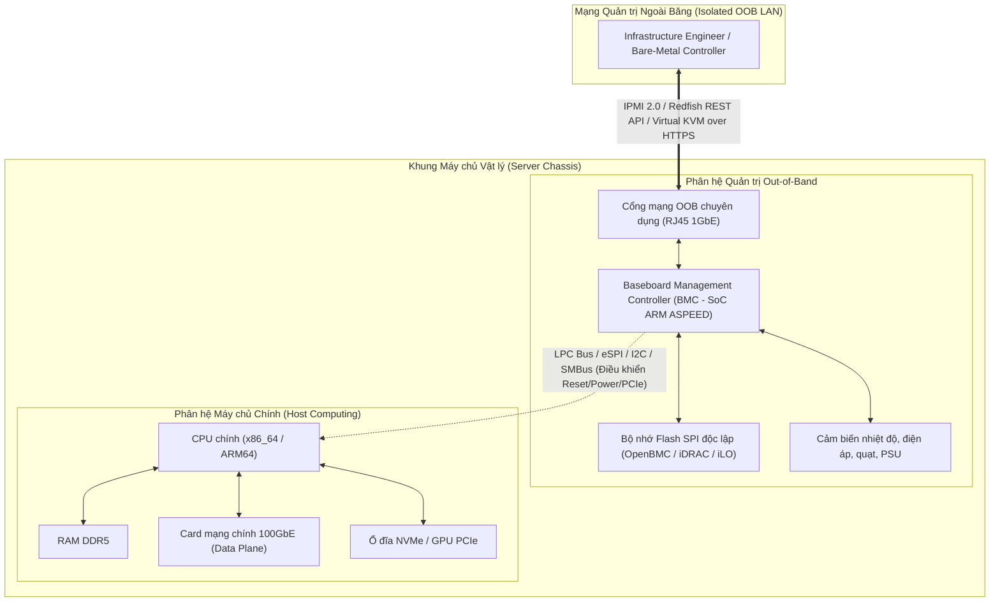
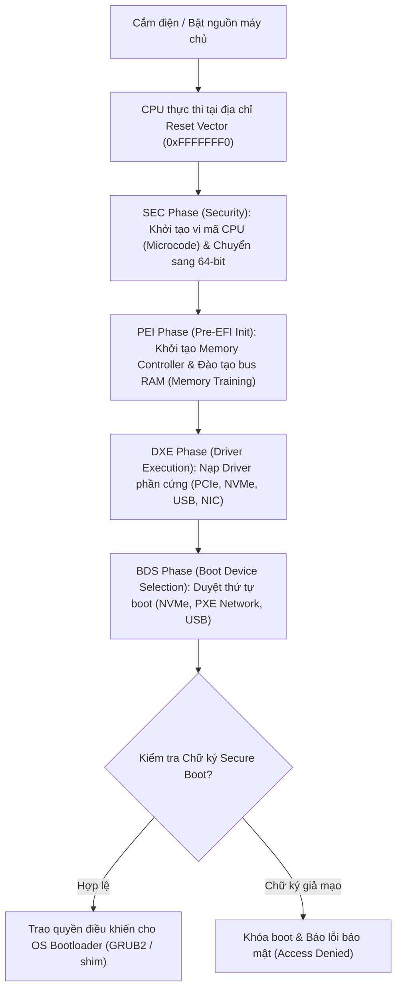
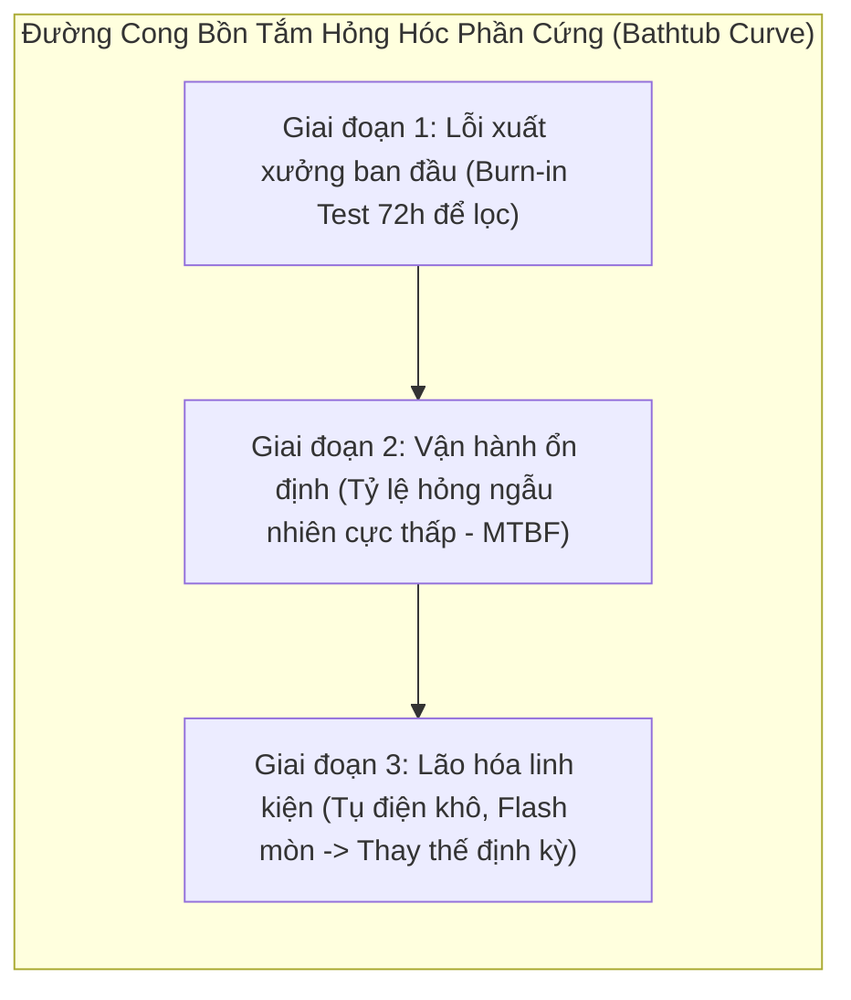

# 2.3. Hardware Reliability and Out-of-Band Management (Độ tin cậy Phần cứng & Quản trị Máy chủ Ngoài Băng thông)

## Tổng quan về Vận hành & Quản trị Phần cứng Từ xa

Trong các trung tâm dữ liệu quy mô hàng chục nghìn máy chủ, kỹ sư hạ tầng không thể có mặt trực tiếp tại tủ rack để cắm màn hình và bàn phím (KVM Switch thủ công) mỗi khi máy chủ gặp sự cố hoặc cần cài đặt lại hệ điều hành.

Hệ thống quản trị phần cứng từ xa **Out-of-Band Management (OOBM)** cung cấp một kênh điều khiển hoàn toàn độc lập với hệ điều hành và CPU chính của máy chủ. Ngay cả khi CPU chính bị treo cứng (Kernel Panic), hệ điều hành chưa cài đặt, hoặc máy chủ đang tắt nguồn (Power Off), kênh OOBM vẫn hoạt động bình thường nhờ một vi điều khiển chuyên dụng chạy hệ điều hành thời gian thực độc lập được cấp nguồn bởi đường điện phụ (Standby Power Rail 5VSB).



---

## 2. Chi tiết từng Keyword (Under-the-Hood Deep Dive)

---

### 1. BMC, IPMI, Redfish & Out-of-Band Management

#### 1. Khái niệm bản chất (What & Why)
- **BMC (Baseboard Management Controller)**: Một vi xử lý nhúng độc lập (SoC, thường là chip ARM ASPEED AST2500/AST2600) được tích hợp sẵn trên bo mạch chủ máy chủ. Chạy hệ điều hành nhúng riêng (Linux-based như OpenBMC, Dell iDRAC, HPE iLO, Supermicro IPMI).
- **Out-of-Band (OOB) Management**: Kênh quản trị sử dụng cổng mạng vật lý riêng, cáp mạng riêng và switch riêng, cách ly hoàn toàn khỏi mạng truyền dữ liệu của ứng dụng (In-band Network), ngăn chặn rủi ro nghẽn mạng hoặc tấn công DDoS từ bên ngoài làm mất quyền điều khiển máy chủ.
- **IPMI (Intelligent Platform Management Interface)**: Chuẩn giao thức kế thừa (IPMI 1.5/2.0) hoạt động qua UDP port 623 để đọc cảm biến, bật/tắt nguồn và xem log phần cứng (SEL - System Event Log). Nhược điểm: Thuật ngữ cũ, bảo mật yếu (mã hóa RAKP dễ bị tấn công brute-force).
- **Redfish (DMTF Standard)**: Chuẩn giao thức quản trị hạ tầng phần cứng hiện đại thay thế hoàn toàn IPMI. Sử dụng kiến trúc **RESTful API** với định dạng **JSON qua HTTPS**, hỗ trợ schema OpenAPI tiêu chuẩn cho mọi thao tác: Bật/tắt nguồn, cập nhật Firmware, cấu hình BIOS/UEFI, thiết lập RAID, và gắn ổ đĩa ảo (Virtual Media ISO).
- **Remote Server Management & Hardware Inventory**:
  - *Virtual Console / Serial-over-LAN (SoL)*: Truy cập giao diện dòng lệnh console và đồ họa từ xa từ lúc máy chủ vừa bật nguồn.
  - *Hardware Inventory*: Tự động quét và lập danh mục toàn bộ số serial của bo mạch, chip CPU, thanh RAM, ổ cứng NVMe và card mạng.

#### 2. Cơ chế hoạt động sâu (Under the hood)
Khi kỹ sư gửi một HTTP POST request qua Redfish để khởi động lại máy chủ:
$$\text{Client (REST)} \xrightarrow{\text{POST /redfish/v1/Systems/1/Actions/ComputerSystem.Reset}} \text{Web Server của BMC (Nginx/CivetWeb)}$$
1. Daemon Redfish trên BMC phân tích cú pháp JSON payload `{"ResetType": "ForceRestart"}`.
2. BMC kích hoạt chân tín hiệu **GPIO (General-Purpose Input/Output)** được nối vật lý tới đường dây `SYS_RESET#` hoặc `POWER_BUTTON#` của bo mạch chủ.
3. Chip quản lý nguồn trên bo mạch chủ (CPLD / Southbridge / PCH) ngắt nguồn điện cấp cho CPU chính và kích hoạt chu kỳ chuỗi nguồn (Power Sequence) mới.

#### 3. Code ví dụ thực chiến (TypeScript - Redfish REST Client Tự động Điều khiển Máy chủ Bare-Metal)
Đoạn mã TypeScript minh họa cách một Infrastructure Automation Controller tương tác với máy chủ thông qua Redfish API:

```typescript
import https from "https";

interface PowerStateResponse {
  PowerState: "On" | "Off" | "PoweringOn" | "PoweringOff";
  Model: string;
  SerialNumber: string;
  ProcessorSummary: {
    Count: number;
    Model: string;
  };
  MemorySummary: {
    TotalSystemMemoryGiB: number;
  };
}

class RedfishServerManager {
  private bmcEndpoint: string;
  private authHeader: string;

  constructor(bmcIp: string, user: string, pass: string) {
    this.bmcEndpoint = `https://${bmcIp}`;
    this.authHeader = "Basic " + Buffer.from(`${user}:${pass}`).toString("base64");
  }

  // Gửi HTTP Request tới BMC qua giao thức an toàn HTTPS (Bypass self-signed cert trong OOB LAN)
  private async request<T>(path: string, method: string = "GET", body?: any): Promise<T> {
    return new Promise((resolve, reject) => {
      const url = new URL(path, this.bmcEndpoint);
      const req = https.request(
        url,
        {
          method,
          headers: {
            Authorization: this.authHeader,
            "Content-Type": "application/json",
            Accept: "application/json"
          },
          rejectUnauthorized: false // Chỉ sử dụng trong mạng OOB nội bộ có phân vùng
        },
        (res) => {
          let data = "";
          res.on("data", (chunk) => (data += chunk));
          res.on("end", () => {
            if (res.statusCode && res.statusCode >= 200 && res.statusCode < 300) {
              resolve(data ? JSON.parse(data) : ({} as T));
            } else {
              reject(new Error(`Redfish API Lỗi HTTP ${res.statusCode}: ${data}`));
            }
          });
        }
      );
      req.on("error", reject);
      if (body) req.write(JSON.stringify(body));
      req.end();
    });
  }

  async getSystemInventory(): Promise<PowerStateResponse> {
    return this.request<PowerStateResponse>("/redfish/v1/Systems/1");
  }

  async setPowerState(action: "On" | "ForceOff" | "GracefulRestart" | "ForceRestart"): Promise<void> {
    console.log(`[Redfish OOB] Đang gửi lệnh nguồn: ${action}...`);
    await this.request<void>("/redfish/v1/Systems/1/Actions/ComputerSystem.Reset", "POST", {
      ResetType: action
    });
    console.log(`[Redfish OOB] Lệnh ${action} đã được BMC tiếp nhận thành công.`);
  }
}

// Minh họa sử dụng
async function main() {
  const server = new RedfishServerManager("192.168.100.45", "admin", "SecureSuperSecret123!");
  try {
    const info = await server.getSystemInventory();
    console.log(`=== Thông tin Máy chủ Vật lý qua Redfish API ===`);
    console.log(`Model        : ${info.Model}`);
    console.log(`Serial Number: ${info.SerialNumber}`);
    console.log(`CPU Cores    : ${info.ProcessorSummary.Count} x ${info.ProcessorSummary.Model}`);
    console.log(`Total RAM    : ${info.MemorySummary.TotalSystemMemoryGiB} GiB`);
    console.log(`Power State  : ${info.PowerState}`);
  } catch (err: any) {
    console.error(`Không thể kết nối BMC: ${err.message}`);
  }
}
main();
```

---

### 2. Firmware Management, BIOS & UEFI

#### 1. Khái niệm bản chất (What & Why)
- **Firmware Management**: Quy trình kiểm soát phiên bản, kiểm tra mã băm bảo mật và nâng cấp mã nhúng phần cứng (BIOS/UEFI, BMC firmware, CPLD, RAID Controller, NVMe SSD controller firmware).
- **BIOS (Basic Input/Output System)**: Hệ thống vào/ra cơ sở kế thừa từ thời kỳ máy tính IBM PC (thập niên 1980). Chạy ở chế độ 16-bit Real Mode của CPU, sử dụng bảng phân vùng MBR (Master Boot Record) bị giới hạn đĩa tối đa $2\text{ TB}$.
- **UEFI (Unified Extensible Firmware Interface)**: Chuẩn firmware hiện đại thay thế hoàn toàn BIOS truyền thống. Chạy ở chế độ 32-bit hoặc 64-bit CPU, hỗ trợ bảng phân vùng **GPT (GUID Partition Table)** cho phép quản lý đĩa lên tới hàng triệu Terabytes ($9.4\text{ ZB}$). Hỗ trợ tính năng **Secure Boot** nhằm xác minh chữ ký số của Bootloader (GRUB, Windows Boot Manager) trước khi trao quyền thực thi.



---

### 3. Hardware Failure Detection, Redundancy, Monitoring & Capacity Planning

#### 1. Khái niệm bản chất (What & Why)
- **Hardware Failure Detection**: Cơ chế phát hiện sớm dấu hiệu hư hỏng phần cứng thông qua các cảm biến dòng điện, điện áp, tốc độ quạt (RPM), đếm lỗi bộ nhớ ECC (Correctable Memory Errors) và thông số **S.M.A.R.T.** của ổ đĩa.
- **Hardware Redundancy**: Thiết kế dự phòng vật lý trong một máy chủ:
  - Nguồn dự phòng kép (Dual Hot-plug PSUs $1 + 1$): Hai nguồn cắm vào hai thanh PDU thuộc hai nhánh điện lưới khác nhau. Nếu một nguồn nổ hoặc một nhánh điện sập, nguồn còn lại gánh trọn vẹn $100\%$ tải mà không gây gián đoạn.
  - Quạt dự phòng đa mô-đun ($N + 1$ Fans): Nếu 1 quạt bị kẹt trục, các quạt còn lại tự động tăng tốc lên $100\%$ công suất để bù đắp áp suất khí.
  - Cổng mạng kép (Dual-port NICs): Sử dụng cơ chế LACP Bonding (802.3ad) nối tới 2 switch ToR khác nhau (MLAG).
- **Hardware Lifecycle Management & Monitoring**: Theo dõi tuổi thọ khấu hao phần cứng (thường là chu kỳ 3 - 5 năm trong trung tâm dữ liệu). Dự đoán tỷ lệ hỏng hóc theo biểu đồ đường cong bồn tắm (**Bathtub Curve**: Tỷ lệ hỏng cao lúc đầu do lỗi xuất xưởng - Infant Mortality, ổn định ở giữa chu kỳ, và tăng vọt ở cuối chu kỳ do lão hóa linh kiện).



#### 2. Code ví dụ thực chiến (C++ Đọc S.M.A.R.T. NVMe Log Page qua IOCTL)
Đoạn mã C++ gửi lệnh trực tiếp tới NVMe Controller trong Linux Kernel để kiểm tra độ hao mòn của chip nhớ flash (Percentage Used / Wear Level):

```cpp
#include <iostream>
#include <fcntl.h>
#include <unistd.h>
#include <sys/ioctl.h>
#include <linux/nvme_ioctl.h>
#include <cstring>
#include <cstdint>

#pragma pack(push, 1)
struct nvme_smart_log {
    uint8_t  critical_warning;
    uint16_t temperature; // Kelvin
    uint8_t  avail_spare;
    uint8_t  spare_thresh;
    uint8_t  percent_used; // % mòn bộ nhớ flash
    uint8_t  reserved1[26];
    uint64_t data_units_read[2];
    uint64_t data_units_written[2];
    uint64_t host_reads[2];
    uint64_t host_writes[2];
    uint64_t ctrl_busy_time[2];
    uint64_t power_cycles[2];
    uint64_t power_on_hours[2];
    uint64_t unsafe_shutdowns[2];
    uint64_t media_errors[2];
    uint64_t num_err_log_entries[2];
    uint8_t  reserved2[320];
};
#pragma pack(pop)

class NvmeHealthInspector {
public:
    static void check_drive_health(const char* device_path) {
        int fd = open(device_path, O_RDONLY);
        if (fd < 0) {
            std::cerr << "Không thể mở thiết bị " << device_path << " (Yêu cầu quyền root)" << std::endl;
            return;
        }

        nvme_smart_log smart_data{};
        struct nvme_admin_cmd cmd{};
        std::memset(&cmd, 0, sizeof(cmd));

        cmd.opcode = 0x02; // Get Log Page opcode
        cmd.nsid = 0xFFFFFFFF; // Global log page
        cmd.addr = reinterpret_cast<uint64_t>(&smart_data);
        cmd.data_len = sizeof(smart_data);
        cmd.cdw10 = 0x02 | (((sizeof(smart_data) / 4) - 1) << 16); // Log Page ID 0x02: SMART / Health Information

        if (ioctl(fd, NVME_IOCTL_ADMIN_CMD, &cmd) == 0) {
            double temp_c = smart_data.temperature - 273.15;
            std::cout << "=== Báo cáo Tình trạng Ổ đĩa NVMe [" << device_path << "] ===" << std::endl;
            std::cout << "Nhiệt độ hiện tại   : " << temp_c << " °C" << std::endl;
            std::cout << "Dung lượng dự phòng : " << static_cast<int>(smart_data.avail_spare) << " %" << std::endl;
            std::cout << "Mức độ hao mòn Flash: " << static_cast<int>(smart_data.percent_used) << " % đã sử dụng" << std::endl;
            
            if (smart_data.percent_used > 80) {
                std::cerr << "[CẢNH BÁO BẢO TRÌ] Ổ đĩa đã hao mòn trên 80%, cần lập lịch thay thế vật lý!" << std::endl;
            }
        } else {
            std::cerr << "ioctl NVME_IOCTL_ADMIN_CMD thất bại trên " << device_path << std::endl;
        }

        close(fd);
    }
};

int main() {
    NvmeHealthInspector::check_drive_health("/dev/nvme0");
    return 0;
}
```

---

### Ứng dụng thực tế trong Backend & Systems
1. **Automated Node Self-Fencing (STONITH - Shoot The Other Node In The Head)**: Trong các cụm High Availability (như Pacemaker/Corosync hoặc etcd storage), khi một node bị nghi ngờ phân rã mạng (Network Partition), hệ thống tự động gọi BMC Redfish API để tắt nguồn máy chủ nghi ngờ ngay lập tức nhằm ngăn chặn hai node cùng ghi dữ liệu vào một khối lưu trữ dùng chung dẫn đến hư hỏng filesystem.
2. **Predictive Hardware Maintenance**: Bằng cách thu thập metrics `percent_used` từ NVMe qua Redfish và số lỗi bộ nhớ sửa được (Correctable ECC errors) từ BMC SEL log đưa vào hệ thống giám sát Prometheus/Grafana, đội ngũ SRE có thể tự động rút node (cordon & drain) và mở vé bảo hành thay linh kiện trước khi ổ cứng hoặc thanh RAM bị lỗi vật lý hoàn toàn.
