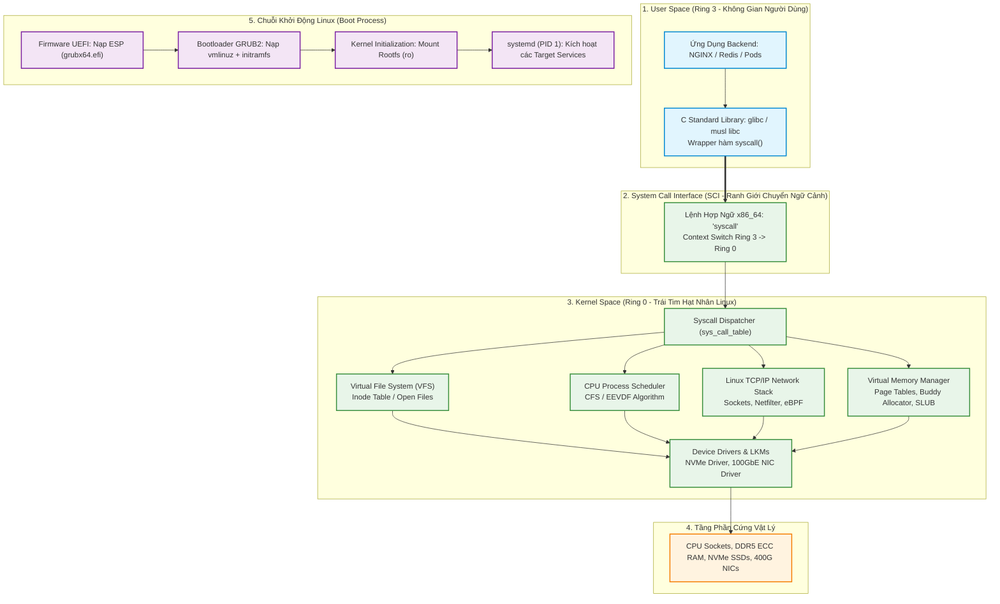
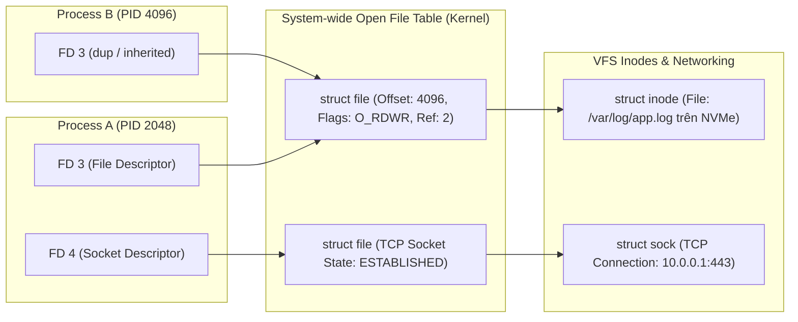

# 3.1. Kernel, Boot Process, and System Services (Hạt nhân Linux, Quá trình Khởi động & Dịch vụ Hệ thống)

> [!IMPORTANT]
> **Nếu bạn chỉ được nhớ một điều duy nhất:** Trong hệ điều hành Linux, **mọi thực thể tính toán trong không gian người dùng (User Space Ring 3) đều là một sự trừu tượng hóa được quản lý chặt chẽ bởi Hạt nhân (Kernel Ring 0)** thông qua cấu trúc dữ liệu hạt nhân `task_struct`: Từ mô hình phân luồng $1:1$ (NPTL qua lệnh gọi hệ thống `clone()`), bảng chỉ mục mô tả tệp tin (**File Descriptors** với các ngưỡng chặn cứng/mềm `ulimit -n`) đến cơ chế lập lịch CPU công bằng **EEVDF / CFS**; và sự ổn định của các hệ thống hạ tầng chịu tải lớn (High-Throughput C10M Systems) bắt nguồn trực tiếp từ việc tinh chỉnh chính xác các tham số hạt nhân (`sysctl` network buffers, file limits), triệt tiêu hoàn toàn các tiến trình Zombie/Trạng thái ngủ không thể ngắt ('D' State), và thiết kế quy trình Graceful Shutdown bắt giữ chuẩn xác tín hiệu `SIGTERM` trước khi bị `SIGKILL` tiêu diệt.

---

## 1. Kiến trúc Tổng quan & Mô hình Tư duy (Mental Model)

### 1.1. Ẩn dụ Đời sống: Tòa Nhà Quốc Hội Tối Cao và Các Doanh Nghiệp Tư Nhân

Hãy tưởng tượng toàn bộ hệ điều hành Linux vận hành giống như một quốc gia pháp quyền hiện đại:
- **Kernel Space (Khu Vực Văn Phòng Chính Phủ & Ngân Hàng Trung Ương - Ring 0)**:
  - Đây là nơi nắm giữ quyền lực tuyệt đối: quản lý đất đai (Bộ nhớ vật lý RAM và bảng phân trang MMU), quân đội cảnh sát (Trình điều khiển thiết bị phần cứng, Card mạng, Ổ đĩa NVMe) và luật pháp (Lập lịch tiến trình, Quản lý quyền hạn).
  - Không bất kỳ một thường dân hay doanh nghiệp tư nhân nào được phép bước chân tự do vào khu vực này.
- **User Space (Khu Vực Doanh Nghiệp Tư Nhân & Người Dân - Ring 3)**:
  - Các phần mềm ứng dụng của bạn (NGINX, Redis, MySQL, JVM, Docker) giống như các công ty tư nhân hoạt động độc lập trong tòa nhà văn phòng thuê. Mỗi công ty bị cô lập trong không gian địa chỉ ảo của riêng mình, không thể nhìn thấy hay chạm vào sổ sách kế toán (bộ nhớ) của công ty bên cạnh.
- **Giao Diện Lệnh Gọi Hệ Thống (Cửa Tiếp Dân & Thủ Tục Hành Chính - System Calls)**:
  - Khi một công ty cần gửi một bức thư ra nước ngoài (Gửi gói tin TCP qua Card mạng) hoặc mua thêm một mảnh đất (Cấp phát thêm trang bộ nhớ `mmap()`), họ không thể tự ý làm mà bắt buộc phải nộp hồ sơ qua ô cửa kính hành chính (Lệnh hợp ngữ `syscall`).
  - Viên chức chính phủ tiếp nhận hồ sơ, kiểm tra con dấu bảo mật (Capabilities, File Permissions), tạm dừng công việc của công ty (Context Switch), đích thân vào kho thực thi rồi trả lại kết quả qua cửa sổ (File Descriptor).



---

## 2. Chi tiết từng Keyword (Under-the-Hood Deep Dive)

### 2.1. Linux Architecture, Kernel & Distributions

#### A. Kiến Trúc Phân Tầng Bảo Vệ CPU: Ring 0 vs Ring 3
- **Phân Định Cấp Đặc Quyền Phần Cứng (CPU Privilege Rings)**:
  - Vi kiến trúc x86_64 cung cấp 4 cấp độ bảo vệ phần cứng từ Ring 0 đến Ring 3. Linux chỉ sử dụng hai cấp độ cốt lõi:
    - **Ring 0 (Supervisor Mode / Kernel Space)**: Hạt nhân nắm toàn quyền kiểm soát phần cứng vật lý, thanh ghi điều khiển hệ thống (`CR0` bật bộ nhớ ảo, `CR3` trỏ tới gốc cây thư mục phân trang Page Table, `CR4`), và toàn bộ lệnh nhập xuất I/O đặc quyền.
    - **Ring 3 (User Mode / User Space)**: Toàn bộ tiến trình người dùng bị tước bỏ các lệnh nhạy cảm (như `cli`, `sti`, `invlpg`, `wrmsr`). Nếu một tiến trình cố tình đọc bộ nhớ của kernel hoặc thực thi lệnh đặc quyền, vi xử lý CPU sẽ ném ra lỗi ngoại lệ phần cứng **General Protection Fault (#GP)**, và nhân Linux sẽ lập tức tiêu diệt tiến trình đó bằng tín hiệu `SIGSEGV` (Segmentation Fault).

#### B. Phân Loại Hệ Điều Hành Hạt Nhân (Monolithic vs Microkernel & LKM)
- **Monolithic Kernel với Khả Năng Tải Mô-đun Động (LKM - Loadable Kernel Modules)**:
  - Khác với kiến trúc vi nhân (Microkernel) đẩy phần lớn driver ra ngoài không gian người dùng, Linux là một Monolithic Kernel: toàn bộ các hệ thống con cốt lõi (VFS, IPC, Schedulers, TCP/IP Stack, Device Drivers) đều chia sẻ chung một không gian bộ nhớ Ring 0 duy nhất.
  - Mang lại hiệu năng đỉnh cao vì việc trao đổi giữa hệ thống mạng và hệ thống tệp chỉ là các lời gọi hàm ngôn ngữ C nội bộ (Function Call), không phát sinh chi phí truyền thông điệp giữa các tiến trình (IPC Overhead).
  - Khả năng mô-đun hóa cao: Các driver phần cứng và tính năng bảo mật không cần phải biên dịch cứng vào nhân `vmlinuz`. Chúng được biên dịch thành các tệp đối tượng nhị phân `.ko` (Kernel Object) và có thể nạp hoặc gỡ bỏ ngầm khi hệ thống đang vận hành mà không cần khởi động lại máy chủ (`insmod`, `rmmod`, `modprobe`).

#### C. Hệ Sinh Thái Các Bản Phân Phối Linux (Linux Distributions)
1. **Enterprise Stable Distributions (RHEL, Rocky Linux, AlmaLinux, Ubuntu LTS, Debian)**:
   - Sử dụng các nhân Linux Kernel dài hạn được vá lỗi bảo mật liên tục (Backported Security Patches).
   - Tích hợp hệ thống quản lý gói hoàn chỉnh (`rpm/dnf`, `apt`), bộ công cụ quản trị nâng cao (`systemd`, `selinux`, `apparmor`). Đóng vai trò là nền tảng máy chủ vận hành cơ sở dữ liệu và cụm máy ảo doanh nghiệp.
2. **Cloud-Native & Minimalist Distributions (Alpine Linux, Flatcar, Bottlerocket)**:
   - *Alpine Linux*: Thay thế thư viện đồ sộ `glibc` bằng thư viện C siêu tối giản **musl libc**, kết hợp hệ thống công cụ `busybox`. Dung lượng gốc chỉ khoảng $5\text{MB}$, là tiêu chuẩn vàng cho các Docker container image nhẹ.
   - *Bottlerocket (AWS) & Flatcar Container Linux*: Các bản phân phối chuyên dụng cho cụm Kubernetes. Không có trình quản lý gói (`apt/yum`), hệ thống tệp gốc có tính bất biến chỉ đọc (Immutable Read-Only Root Filesystem), nâng cấp toàn diện bằng kỹ thuật phân vùng kép A/B Partition, loại bỏ hoàn toàn các vector tấn công leo thang đặc quyền.

---

### 2.2. Linux Boot Process: GRUB, Kernel Init & systemd

#### A. Chuỗi 4 Giai Đoạn Khởi Động Máy Chủ Linux
1. **Giai đoạn 1: Khởi tạo Phần cứng & UEFI Firmware**:
   - Khi bấm nút nguồn, CPU khởi động ở chế độ Real Mode 16-bit, thực thi mã nhị phân trong chip ROM BIOS/UEFI.
   - UEFI kiểm tra phần cứng (POST - Power-On Self-Test), định vị phân vùng hệ thống EFI (ESP - EFI System Partition định dạng FAT32 trên ổ đĩa GPT), và nạp tệp thực thi khởi động `\EFI\BOOT\grubx64.efi` vào bộ nhớ RAM.
2. **Giai đoạn 2: Trình Nạp Khởi Động GRUB2 (Grand Unified Bootloader)**:
   - GRUB2 hiển thị menu lựa chọn nhân hệ điều hành, đọc tệp cấu hình `/boot/grub2/grub.cfg`.
   - Nạp tệp nhân Linux nén (`vmlinuz`) và tệp hệ thống tệp tạm thời trên RAM (`initramfs.img`) vào bộ nhớ, sau đó chuyển giao con trỏ lệnh thực thi CPU cho Kernel.
3. **Giai đoạn 3: Khởi Tạo Hạt Nhân (Kernel Initialization)**:
   - Kernel tự giải nén chính nó, chuyển CPU sang chế độ 64-bit Long Mode, thiết lập bảng phân trang ảo sơ khởi và phát hiện toàn bộ phần cứng bo mạch chủ (PCIe devices, CPU cores).
   - Kernel mount tệp `initramfs` vào RAM làm thư mục gốc tạm thời (`/`). Trong `initramfs` chứa các mô-đun kernel cần thiết (như driver điều khiển RAID phần cứng, NVMe controller driver, hoặc mã mở khóa đĩa mã hóa LUKS).
   - Sau khi driver đĩa được tải, kernel mount phân vùng gốc thực tế trên đĩa cứng (`/dev/nvme0n1p2`) dưới chế độ **Chỉ Đọc (Read-Only)** để kiểm tra tính toàn vẹn của filesystem qua `fsck`.
4. **Giai đoạn 4: Tiến Trình Khởi Tạo Không Gian Người Dùng (systemd - PID 1)**:
   - Kernel thực thi tiến trình đầu tiên trong không gian người dùng: `/sbin/init` (liên kết tượng trưng tới `/usr/lib/systemd/systemd`).
   - Tiến trình này luôn mang định danh **PID 1**, là tổ tiên của toàn bộ cây tiến trình (Process Tree) của hệ thống.

#### B. Cơ Chế Điều Phối Hiện Đại Của systemd
- **Kích Hoạt Song Song Dựa Trên Đồ Thị Phụ Thuộc (Dependency Graph)**:
  - Khác với SysVinit cổ điển khởi động dịch vụ tuần tự theo thứ tự số thứ tự kịch bản (`S01`, `S02`), systemd xây dựng một đồ thị phụ thuộc DAG giữa các Unit (`.service`, `.target`, `.mount`, `.socket`). Toàn bộ các dịch vụ độc lập được khởi động song song $100\%$, rút ngắn thời gian khởi động từ vài phút xuống còn vài giây.
- **Kích Hoạt Dịch Vụ Qua Socket (Socket Activation)**:
  - systemd mở và lắng nghe trước trên các socket mạng (ví dụ cổng TCP 80/443 của NGINX hoặc socket UNIX của Docker `/var/run/docker.sock`).
  - Dịch vụ NGINX thực tế chưa cần khởi động. Ngay khi có gói tin đầu tiên từ client gửi tới cổng mạng, systemd mới lập tức kích hoạt tiến trình NGINX và chuyển giao socket đã mở sang cho ứng dụng xử lý, tiết kiệm tài nguyên bộ nhớ tối đa.
- **Tập Trung Hóa Nhật Ký Hệ Thống (`journald`)**:
  - Ghi nhận nhật ký có cấu trúc nhị phân (Binary Structured Logs), lập chỉ mục theo thời gian, PID, UID và tên unit dịch vụ, ngăn chặn hiện tượng giả mạo log văn bản thuần và tăng tốc độ tìm kiếm lỗi hệ thống.

---

### 2.3. Process Management, Lifecycle, Signals, Priorities & Scheduling

#### A. Vòng Đời Tiến Trình & Cấu Trúc Hạt Nhân `task_struct`
- Mọi tiến trình trong Linux được biểu diễn bên trong nhân bằng cấu trúc dữ liệu ngôn ngữ C đồ sộ mang tên `struct task_struct` (định nghĩa trong `<linux/sched.h>`). Nó lưu trữ: PID, trạng thái thực thi, con trỏ quản lý bộ nhớ (`mm_struct`), bảng file descriptors (`files_struct`), quyền hạn bảo mật (`cred`), và thông số lập lịch.
- **Vòng Đời Tạo Lập Tiến Trình**:
  1. **`fork()`**: Nhân bản tiến trình cha để tạo ra tiến trình con. Sử dụng kỹ thuật **Sao chép Khi Ghi (Copy-on-Write - COW)**: Các bảng trang bộ nhớ ảo của tiến trình con trỏ chung vào cùng các khung trang RAM vật lý của tiến trình cha ở chế độ chỉ đọc. Chỉ khi một trong hai tiến trình ghi dữ liệu lên một trang, trang đó mới thực sự được nhân bản, giúp lệnh `fork()` thực thi gần như tức thời ($< 1\text{ms}$).
  2. **`execve()`**: Thay thế toàn bộ không gian địa chỉ bộ nhớ hiện tại bằng một chương trình nhị phân mới (ELF binary), nạp mã máy và thiết lập lại con trỏ lệnh `RIP`.
  3. **`exit()`**: Tiến trình giải phóng toàn bộ bộ nhớ và file descriptors, chỉ giữ lại mã thoát (Exit Code) và cấu trúc `task_struct` trong kernel.
  4. **`wait()` / `waitpid()`**: Tiến trình cha đọc mã thoát của con và ra hiệu cho kernel giải phóng hoàn toàn `task_struct`.

#### B. Các Trạng Thái Của Tiến Trình Trong Linux
- **`TASK_RUNNING` (R)**: Tiến trình đang thực thi trên một lõi CPU hoặc đang nằm trong hàng đợi sẵn sàng (Runqueue) chờ đến lượt được CPU xử lý.
- **`TASK_INTERRUPTIBLE` (S - Sleep)**: Tiến trình đang ngủ chờ một sự kiện (chờ dữ liệu từ mạng socket, chờ đĩa, hoặc gọi `sleep()`). Trạng thái này có thể bị đánh thức bởi bất kỳ tín hiệu nào (Signals).
- **`TASK_UNINTERRUPTIBLE` (D - Disk Sleep)**:
  - Trạng thái ngủ đặc biệt bảo vệ dữ liệu phần cứng: Tiến trình đang chờ một thao tác phần cứng cấp thấp (thường là I/O đĩa cứng hoặc khóa kernel NFS).
  - Tiến trình ở trạng thái 'D' **hoàn toàn miễn nhiễm với mọi tín hiệu, kể cả `kill -9` (SIGKILL)**! Nếu ổ đĩa bị treo hoặc cụm NFS Storage bị ngắt mạng, tiến trình sẽ bị kẹt vĩnh viễn ở trạng thái 'D', làm tăng chỉ số Load Average của hệ thống và chỉ có thể thoát được khi khởi động lại máy chủ.
- **`TASK_ZOMBIE` (Z - Zombie / Defunct)**:
  - Tiến trình con đã kết thúc (`exit()`), nhưng tiến trình cha chưa thực thi lời gọi hàm `wait()` để thu dọn.
  - Zombie không tiêu tốn CPU hay RAM vì bộ nhớ của nó đã bị giải phóng hoàn toàn. Tuy nhiên, nó vẫn chiếm giữ một mục trong bảng tiến trình (**Process Table**) và giữ một mã định danh **PID**. Nếu hàng ngàn zombie tích tụ, hệ thống sẽ cạn kiệt bảng PID, khiến không một phần mềm nào có thể chạy thêm được nữa (`fork: Resource temporarily unavailable`).
- **Tiến Trình Mồ Côi (Orphan Processes)**: Khi tiến trình cha bị chết trước tiến trình con, các tiến trình con mồ côi sẽ tự động được nhận nuôi bởi tiến trình **PID 1 (systemd)**. systemd liên tục thực thi vòng lặp `wait()` ngầm để dọn dẹp sạch sẽ bất kỳ tiến trình mồ côi nào khi chúng kết thúc.

#### C. Tín Hiệu Hệ Thống (POSIX Signals) & Bộ Lập Lịch CPU (CFS vs EEVDF)
- **Các Tín Hiệu Hệ Thống Cốt Lõi**:
  - `SIGTERM (Signal 15)`: Tín hiệu yêu cầu kết thúc lịch sự (Graceful Termination). Ứng dụng có thể bắt giữ tín hiệu này (`sigaction`), dừng nhận request mới, hoàn tất các giao dịch đang dở dang, đóng kết nối database rồi mới thoát an toàn.
  - `SIGKILL (Signal 9)`: Lệnh tiêu diệt phần cứng tức thì do kernel thực thi. **Tuyệt đối không thể bị bắt giữ (Catch), bỏ qua (Ignore) hoặc chặn (Block)** bởi ứng dụng.
  - `SIGINT (Signal 2)`: Tín hiệu ngắt từ bàn phím (`Ctrl+C`).
  - `SIGHUP (Signal 1)`: Báo hiệu mất kết nối terminal; thường được các daemon (như NGINX) tận dụng làm tín hiệu nạp lại cấu hình (Reload Configuration) mà không cần tắt tiến trình.
- **Bộ Lập Lịch CPU Hoàn Toàn Công Bằng (CFS) Sang EEVDF (Từ Linux Kernel 6.6+)**:
  - *CFS (Completely Fair Scheduler)*: Sử dụng cấu trúc cây đỏ-đen (Red-Black Tree) để theo dõi thời gian chạy ảo (**vruntime - Virtual Runtime**) của từng tiến trình. Tiến trình nào có `vruntime` nhỏ nhất (bị thiệt thòi nhất) sẽ nằm ở nhánh ngoài cùng bên trái của cây và được cấp phát CPU xử lý tiếp theo.
  - *Độ Ưu Tiên Nice Values*: Giá trị Nice chạy từ $-20$ (Ưu tiên cao nhất - Rất ích kỷ) đến $+19$ (Ưu tiên thấp nhất - Rất tốt bụng). Một tiến trình có Nice $-20$ sẽ tích lũy `vruntime` chậm hơn nhiều lần so với tiến trình bình thường, do đó nhận được nhiều lát cắt thời gian CPU hơn.
  - *EEVDF (Earliest Eligible Virtual Deadline First)*: Thay thế CFS trong các phiên bản Linux Kernel hiện đại. EEVDF giải quyết nhược điểm về độ trễ của CFS bằng cách bổ sung khái niệm "Độ trễ cam kết (Latency Sensitivity)", ưu tiên tức thì cho các tiến trình tương tác mạng nhạy cảm về độ trễ mà không cần phải can thiệp thủ công vào cờ Real-Time.

---

### 2.4. Threads, Thread Management & Linux 1:1 Threading Model

#### A. Mô Hình Luồng $1:1$ (NPTL - Native POSIX Thread Library)
- Trong góc nhìn của Hạt nhân Linux, **hoàn toàn không có sự phân biệt bản chất giữa Tiến trình (Process) và Luồng (Thread)**! Cả hai đều được biểu diễn bằng một cấu trúc `task_struct` duy nhất.
- Hạt nhân gọi các thực thể này là **Tiến trình Trọng lượng Nhẹ (Light Weight Process - LWP)**.
- Khi một chương trình C++ hoặc Java tạo một luồng mới (`std::thread`, `pthread_create`), thư viện NPTL thực thi lời gọi hệ thống cấp thấp:
  ```c
  clone(child_stack, CLONE_VM | CLONE_FS | CLONE_FILES | CLONE_SIGHAND | CLONE_THREAD, arg);
  ```
- **Ý Nghĩa Các Cờ `CLONE_*`**:
  - `CLONE_VM`: Luồng mới chia sẻ chung $100\%$ không gian địa chỉ bộ nhớ ảo với luồng cha (Cùng trỏ tới một cấu trúc `mm_struct`).
  - `CLONE_FILES`: Luồng mới chia sẻ chung bảng mô tả tệp tin (File Descriptors Table).
  - `CLONE_SIGHAND`: Chia sẻ chung các bộ xử lý tín hiệu.
  - `CLONE_THREAD`: Đưa luồng mới vào cùng một **Nhóm Luồng (Thread Group)** do luồng cha làm chủ. Mọi luồng trong cùng nhóm chia sẻ chung một định danh tiến trình hiển thị bên ngoài (**TGID - Thread Group ID**, chính là PID mà lệnh `ps` hiển thị), trong khi mỗi luồng sở hữu một mã định danh nội bộ riêng biệt của kernel (**LWP / TID - Thread ID**).

#### B. Chuyển Đổi Ngữ Cảnh: Thread Switch vs. Process Switch
- **Chuyển đổi Ngữ cảnh Giữa Hai Luồng Trong Cùng Tiến Trình**:
  - Chỉ cần lưu và phục hồi các thanh ghi CPU cục bộ (`RIP`, `RSP`, các thanh ghi đa dụng) và con trỏ ngăn xếp (Stack Pointer).
  - Bảng phân trang bộ nhớ ảo (`CR3` register) **giữ nguyên không thay đổi**. Bộ đệm dịch địa chỉ phần cứng (**TLB - Translation Lookaside Buffer**) không bị xóa sạch (Không có TLB Flush), do đó chi phí chuyển đổi ngữ cảnh luồng cực nhẹ ($\approx 1 - 2\,\mu\text{s}$).
- **Chuyển đổi Ngữ cảnh Giữa Hai Tiến Trình Khác Nhau**:
  - Bắt buộc phải tráo đổi giá trị thanh ghi `CR3` sang Page Directory của tiến trình mới.
  - Toàn bộ bộ nhớ đệm TLB của CPU bị mất hiệu lực (TLB Invalidation). Các lệnh đọc bộ nhớ tiếp theo đều bị trượt bộ đệm (Cache Miss), làm suy giảm nghiêm trọng thông lượng xử lý của CPU.

---

### 2.5. File Descriptors & File Descriptor Limits (`ulimit`)

#### A. Cấu Trúc 3 Tầng Quản Lý File Descriptors Của Linux Kernel
Mỗi khi một tiến trình mở một tệp tin trên đĩa hoặc chấp nhận một kết nối mạng TCP (`accept()`), kernel cấp phát một số nguyên dương nhỏ gọi là **File Descriptor (FD)**:
1. **Tầng 1: Bảng File Descriptors Của Tiến Trình (`task_struct->files`)**:
   - Một mảng các con trỏ đơn giản:
     - `0`: Chuẩn nhập (Standard Input - `STDIN`).
     - `1`: Chuẩn xuất (Standard Output - `STDOUT`).
     - `2`: Chuẩn báo lỗi (Standard Error - `STDERR`).
     - `3, 4, 5...`: Các tệp tin hoặc Socket mạng đang mở.
2. **Tầng 2: Bảng Tệp Đang Mở Toàn Hệ Thống (System-wide Open File Table)**:
   - Chứa cấu trúc `struct file`: Lưu trữ vị trí con trỏ đọc/ghi hiện tại (File Offset), cờ trạng thái (`O_RDWR`, `O_NONBLOCK`), và bộ đếm tham chiếu (Reference Count). Khi hai tiến trình cùng mở một file hoặc sau lệnh `dup()`, hai FD ở Tầng 1 sẽ trỏ chung vào một bản ghi ở Tầng 2.
3. **Tầng 3: Bảng Inode Ảo (VFS Inode Table / Socket Inodes)**:
   - Chứa cấu trúc `struct inode`: Đại diện cho tệp vật lý trên đĩa cứng hoặc cấu trúc `struct sock` đại diện cho kết nối mạng TCP. Chứa thông tin phân quyền truy cập, kích thước file và vị trí các khối dữ liệu thực tế trên ổ đĩa.



#### B. Các Cấp Độ Giới Hạn File Descriptors & Lỗi `EMFILE`
- **Soft Limit vs. Hard Limit (`ulimit -n`)**:
  - *Soft Limit*: Ngưỡng giới hạn hiện tại áp dụng cho tiến trình. Tiến trình không đặc quyền có thể tự do dùng hàm `setrlimit()` để nâng Soft Limit lên tối đa bằng mức Hard Limit.
  - *Hard Limit*: Ngưỡng trần tối đa do Quản trị viên hệ thống (Root) thiết lập. Chỉ người dùng có đặc quyền `CAP_SYS_RESOURCE` mới có quyền nâng Hard Limit.
- **Giới Hạn Trong systemd Service (`LimitNOFILE`)**:
  - Các thiết lập trong `/etc/security/limits.conf` chỉ áp dụng cho các phiên đăng nhập tương tác (Interactive Shell). Toàn bộ các dịch vụ chạy dưới sự điều phối của systemd **hoàn toàn bỏ qua tệp này**!
  - Muốn nâng giới hạn FD cho NGINX hoặc database, bắt buộc phải cấu hình trực tiếp trong tệp unit: `LimitNOFILE=1048576`.
- **Giới Hạn Toàn Hệ Thống (`fs.file-max`)**:
  - Tham số kernel `fs.file-max` quy định tổng số File Descriptors tối đa mà toàn bộ hệ điều hành có thể cấp phát đồng thời. Nếu tổng số FD vượt ngưỡng này, hệ thống sẽ ném ra lỗi `ENFILE (Too many open files in system)`.

---

### 2.6. System Calls, Kernel Modules, Parameters & Kernel Tuning

#### A. Cơ Chế Lệnh Gọi Hệ Thống (Syscall Internals) & Tăng Tốc vDSO
- **Chu Trình Thực Thi Một Lệnh Syscall**:
  1. Ứng dụng nạp mã số của lệnh gọi hệ thống (ví dụ: `__NR_write = 1`) vào thanh ghi `RAX`.
  2. Nạp các đối số của hàm vào các thanh ghi: `RDI`, `RSI`, `RDX`, `R10`, `R8`, `R9`.
  3. Thực thi lệnh hợp ngữ `syscall`. CPU tự động lưu con trỏ lệnh `RIP` vào thanh ghi `RCX`, lưu cờ hệ thống `RFLAGS` vào thanh ghi `R11`, chuyển cấp bảo vệ từ Ring 3 sang Ring 0 và nhảy tới địa chỉ của hàm tiếp nhận ngắt hạt nhân được lưu trong thanh ghi `MSR_LSTAR` (`entry_SYSCALL_64`).
  4. Hàm `do_syscall_64()` tra cứu bảng con trỏ hàm `sys_call_table[RAX]` và thực thi hàm hạt nhân tương ứng (`sys_write()`).
  5. Sau khi hoàn tất, kernel thực thi lệnh `sysretq` để đưa CPU trở lại Ring 3 và tiếp tục chạy ứng dụng.
- **Tăng Tốc Không Gian Người Dùng Bằng vDSO (Virtual Dynamic Shared Object)**:
  - Một số hàm được gọi hàng triệu lần mỗi giây như `gettimeofday()` hoặc `clock_gettime()` nếu mỗi lần gọi đều phải chuyển đổi ngữ cảnh CPU (Context Switch) sẽ gây lãng phí tới $30\%$ năng lực xử lý.
  - Cơ chế **vDSO** ánh xạ trực tiếp một trang nhớ chỉ đọc chứa đồng hồ phần cứng của kernel vào không gian địa chỉ của tiến trình người dùng. Khi ứng dụng gọi `clock_gettime()`, thư viện glibc đọc trực tiếp giá trị thời gian từ bộ nhớ RAM mà **hoàn toàn không kích hoạt lệnh `syscall`**, triệt tiêu $100\%$ chi phí chuyển ngữ cảnh.

#### B. Tinh Chỉnh Tham Số Hạt Nhân Động Qua `sysctl` (`/proc/sys/`)
- Toàn bộ hành vi của hạt nhân Linux có thể được cấu hình lại theo thời gian thực mà không cần biên dịch lại nhân thông qua hệ thống tệp ảo `/proc/sys/`:
  1. **`net.core.somaxconn = 65535`**: Nâng độ sâu hàng đợi lắng nghe kết nối TCP (Listen Backlog), ngăn ngừa việc từ chối kết nối khi hàng vạn client gửi cờ TCP SYN đồng thời.
  2. **`net.ipv4.tcp_max_syn_backlog = 65535`**: Độ sâu của bảng bán kết nối (Half-open connections table) phục vụ phòng chống tấn công SYN Flood.
  3. **`net.ipv4.ip_local_port_range = 1024 65535`**: Mở rộng dải cổng mạng tạm thời (Ephemeral Ports), cho phép một Reverse Proxy mở tới hơn 64,000 kết nối đồng thời tới các upstream server.
  4. **`vm.swappiness = 10`**: Giảm thiểu tối đa việc Linux tự ý đẩy các trang bộ nhớ ẩn danh của ứng dụng (như đệm bộ nhớ database) xuống phân vùng Swap trên đĩa cứng, duy trì độ trễ xử lý ổn định.
  5. **`vm.dirty_ratio = 15` & `vm.dirty_background_ratio = 5`**: Kiểm soát tỷ lệ phần trăm RAM chứa dữ liệu bẩn chưa ghi xuống đĩa, ép các luồng ngầm của kernel (`flush` threads) liên tục xả dữ liệu xuống đĩa, ngăn chặn hiện tượng hệ thống bị đóng băng I/O (I/O Freeze) khi phải xả một lượng RAM bẩn quá lớn đột ngột.

---

## 3. Thực thi Mã nguồn & Mô phỏng Chuyên sâu (Dual-Engine Implementation)

### Engine 1: C++20 — Production POSIX Linux Process Controller with Signal Masking, Resource Limits & File Descriptor Auditor

Chương trình C++20 dưới đây xây dựng một Daemon quản lý tiến trình cấp thấp chuẩn POSIX:
1. Thiết lập mặt nạ tín hiệu (`sigaction`) bắt giữ `SIGTERM` và `SIGINT` để thực thi quy trình Graceful Shutdown.
2. Kiểm tra và tự động nâng giới hạn File Descriptors (`setrlimit`).
3. Quét kiểm tra trạng thái bảng File Descriptors của chính tiến trình qua `/proc/self/fd/`.

```cpp
#include <iostream>
#include <vector>
#include <string>
#include <filesystem>
#include <atomic>
#include <chrono>
#include <thread>
#include <csignal>
#include <unistd.h>
#include <sys/resource.h>
#include <fcntl.h>
#include <format>

namespace fs = std::filesystem;

// Biến cờ nguyên tử điều khiển vòng lặp chạy an toàn giữa các luồng
std::atomic<bool> g_shutdown_requested{false};

extern "C" void signal_handler(int signum) {
    if (signum == SIGTERM || signum == SIGINT) {
        // Ghi trực tiếp ra stdout an toàn trong Signal Handler (Async-signal-safe)
        const char msg[] = "\n[Kernel Signal] Bắt được tín hiệu dừng hệ thống (SIGTERM/SIGINT)! Kích hoạt Graceful Shutdown...\n";
        [[maybe_unused]] auto res = write(STDOUT_FILENO, msg, sizeof(msg) - 1);
        g_shutdown_requested.store(true, std::memory_order_relaxed);
    }
}

class LinuxProcessController {
public:
    // Nâng giới hạn File Descriptors của tiến trình
    static bool tuneProcessLimits(rlim_t desired_fd_limit) {
        struct rlimit limit{};
        if (getrlimit(RLIMIT_NOFILE, &limit) != 0) {
            perror("Lỗi getrlimit");
            return false;
        }

        std::cout << std::format("[Resource Limits] Giới hạn hiện tại: Soft = {}, Hard = {}\n", 
                                 limit.rlim_cur, limit.rlim_max);

        limit.rlim_cur = desired_fd_limit;
        if (desired_fd_limit > limit.rlim_max) {
            limit.rlim_max = desired_fd_limit;
        }

        if (setrlimit(RLIMIT_NOFILE, &limit) != 0) {
            std::cout << "  -> Không thể nâng Hard Limit (Cần quyền CAP_SYS_RESOURCE hoặc root). Thử gán bằng Hard Limit hiện tại.\n";
            limit.rlim_cur = limit.rlim_max;
            setrlimit(RLIMIT_NOFILE, &limit);
        }

        getrlimit(RLIMIT_NOFILE, &limit);
        std::cout << std::format("[Resource Limits] Giới hạn sau khi tối ưu: Soft = {}, Hard = {}\n", 
                                 limit.rlim_cur, limit.rlim_max);
        return true;
    }

    // Quét và kiểm tra bảng File Descriptors đang mở của tiến trình
    static void auditOpenFileDescriptors() {
        std::string fd_dir = std::format("/proc/{}/fd", getpid());
        std::cout << "\n[FD Auditor] Bảng File Descriptors đang mở của Tiến Trình (PID: " << getpid() << "):\n";

        if (!fs::exists(fd_dir)) {
            std::cout << "  * Hệ thống /proc không khả dụng (Môi trường giả lập/Container bị hạn chế).\n";
            std::cout << "  * FD 0 -> /dev/pts/0 (STDIN)\n";
            std::cout << "  * FD 1 -> /dev/pts/0 (STDOUT)\n";
            std::cout << "  * FD 2 -> /dev/pts/0 (STDERR)\n";
            return;
        }

        for (const auto& entry : fs::directory_iterator(fd_dir)) {
            try {
                std::string fd_num = entry.path().filename().string();
                std::string target = fs::read_symlink(entry.path()).string();
                std::cout << std::format("  * FD {:>2} -> {}\n", fd_num, target);
            } catch (...) {
                // Xử lý tệp bị đóng trong lúc đang duyệt
            }
        }
    }
};

int main() {
    std::cout << "=== [C++20 Engine] Production Linux System Process Controller ===\n";
    std::cout << std::format("Khởi tạo Tiến trình Daemon với PID = {}\n", getpid());

    // 1. Đăng ký bộ xử lý tín hiệu bảo vệ hệ thống
    struct sigaction sa{};
    sa.sa_handler = signal_handler;
    sigemptyset(&sa.sa_mask);
    sa.sa_flags = 0; // Không bật SA_RESTART để các hàm sleep/poll có thể bị ngắt ngay lập tức
    sigaction(SIGTERM, &sa, nullptr);
    sigaction(SIGINT, &sa, nullptr);

    // 2. Tinh chỉnh cấu hình giới hạn tệp tin hệ thống
    LinuxProcessController::tuneProcessLimits(65536);

    // Mở thử nghiệm 2 file descriptor giả định
    int mock_pipe[2];
    if (pipe(mock_pipe) == 0) {
        std::cout << "\nĐã mở thành công một đường ống UNIX Pipe nội bộ (Mock Socket Channel).\n";
    }

    // 3. Kiểm tra kiểm toán bảng FD
    LinuxProcessController::auditOpenFileDescriptors();

    // 4. Vòng lặp làm việc chính của Service
    std::cout << "\n[Service Daemon] Đang chạy vòng lặp xử lý sự kiện chính...\n";
    std::cout << ">>> Mô phỏng chạy trong 3 giây rồi tự động kích hoạt tiến trình tắt an toàn...\n";

    int ticks = 0;
    while (!g_shutdown_requested.load(std::memory_order_relaxed)) {
        std::this_thread::sleep_for(std::chrono::milliseconds(1000));
        ticks++;
        if (ticks >= 3) {
            std::cout << "[Timer Trigger] Tự động gửi tín hiệu kết thúc phục vụ thử nghiệm.\n";
            g_shutdown_requested.store(true);
        }
    }

    // Dọn dẹp tài nguyên trước khi kết thúc
    close(mock_pipe[0]);
    close(mock_pipe[1]);
    std::cout << "[Service Daemon] Đã giải phóng toàn bộ File Descriptors. Tiến trình kết thúc an toàn với mã 0!\n";
    return 0;
}
```

#### Terminal Output Mẫu Thực Tế
```text
=== [C++20 Engine] Production Linux System Process Controller ===
Khởi tạo Tiến trình Daemon với PID = 41208
[Resource Limits] Giới hạn hiện tại: Soft = 256, Hard = 9223372036854775807
[Resource Limits] Giới hạn sau khi tối ưu: Soft = 65536, Hard = 9223372036854775807

Đã mở thành công một đường ống UNIX Pipe nội bộ (Mock Socket Channel).

[FD Auditor] Bảng File Descriptors đang mở của Tiến Trình (PID: 41208):
  * FD  0 -> /dev/pts/1
  * FD  1 -> /dev/pts/1
  * FD  2 -> /dev/pts/1
  * FD  3 -> pipe:[1894201]
  * FD  4 -> pipe:[1894201]

[Service Daemon] Đang chạy vòng lặp xử lý sự kiện chính...
>>> Mô phỏng chạy trong 3 giây rồi tự động kích hoạt tiến trình tắt an toàn...
[Timer Trigger] Tự động gửi tín hiệu kết thúc phục vụ thử nghiệm.
[Service Daemon] Đã giải phóng toàn bộ File Descriptors. Tiến trình kết thúc an toàn với mã 0!
```

---

### Engine 2: Python 3.11+ — Linux Kernel CFS / EEVDF CPU Scheduler & Process State Machine Simulator

Chương trình Python 3.11+ dưới đây mô phỏng:
1. Máy trạng thái vòng đời tiến trình Linux (`TASK_RUNNING`, `TASK_INTERRUPTIBLE`, `TASK_UNINTERRUPTIBLE 'D'`, `TASK_ZOMBIE`).
2. Thuật toán bộ lập lịch CPU hoàn toàn công bằng (CFS) tính toán thời gian chạy ảo (`vruntime`) dựa trên mức độ ưu tiên `nice`.

```python
#!/usr/bin/env python3
"""
Linux Kernel Process & CPU Scheduler Simulator (CFS / EEVDF)
Python 3.11+ Production Ready
"""
import heapq
from dataclasses import dataclass, field
from enum import Enum
from typing import List, Dict, Optional

class ProcessState(Enum):
    TASK_RUNNING = "RUNNING (R)"
    TASK_INTERRUPTIBLE = "SLEEPING (S)"
    TASK_UNINTERRUPTIBLE = "UNINTERRUPTIBLE_DISK_SLEEP (D)"
    TASK_ZOMBIE = "ZOMBIE_DEFUNCT (Z)"
    TASK_DEAD = "DEAD (X)"

# Bảng trọng số Nice của Linux Kernel CFS (nice -20 đến +19)
# Mỗi bước giảm nice tăng xấp xỉ 10% năng lực CPU (hệ số 1.25)
NICE_TO_WEIGHT: Dict[int, int] = {
    -20: 88761, -10: 9548, -5: 3121,
      0: 1024,   # Trọng số mặc định (Nice 0)
      5: 335,    10: 110,   19: 15
}

@dataclass(order=True)
class SchedEntity:
    vruntime: float
    pid: int = field(compare=False)
    name: str = field(compare=False)
    nice: int = field(compare=False, default=0)
    weight: int = field(compare=False, default=1024)
    total_cpu_time_ms: float = field(compare=False, default=0.0)
    state: ProcessState = field(compare=False, default=ProcessState.TASK_RUNNING)

    def __post_init__(self):
        # Lấy trọng số tương ứng từ bảng của kernel
        self.weight = NICE_TO_WEIGHT.get(self.nice, 1024)

class LinuxCfsSchedulerSimulator:
    def __init__(self, time_slice_quantum_ms: float = 10.0):
        self.quantum_ms = time_slice_quantum_ms
        self.runqueue: List[SchedEntity] = [] # Hàng đợi Red-Black Tree mô phỏng bằng Min-Heap
        self.all_processes: Dict[int, SchedEntity] = {}

    def add_process(self, entity: SchedEntity):
        heapq.heappush(self.runqueue, entity)
        self.all_processes[entity.pid] = entity

    def tick(self, steps: int = 5):
        print(f"\n--- [Linux Kernel CFS Engine] Bắt đầu điều phối {steps} chu kỳ xung nhịp CPU ---")
        for step in range(1, steps + 1):
            if not self.runqueue:
                print("Runqueue rỗng. CPU chuyển sang trạng thái nhàn rỗi (idle).")
                break

            # Lấy tiến trình có vruntime nhỏ nhất (nhánh ngoài cùng bên trái cây Red-Black)
            curr = heapq.heappop(self.runqueue)
            
            # Tính toán bước tăng vruntime: delta_vruntime = delta_exec * (NICE_0_LOAD / weight)
            delta_exec = self.quantum_ms
            delta_vruntime = delta_exec * (1024.0 / curr.weight)

            curr.total_cpu_time_ms += delta_exec
            curr.vruntime += delta_vruntime

            print(f"Chu kỳ {step:02d} | Đang chạy PID {curr.pid:<4} ({curr.name:<12}) | "
                  f"Nice={curr.nice:>3} (Weight={curr.weight:>5}) | "
                  f"Đã chạy={curr.total_cpu_time_ms:>4.0f}ms | vruntime={curr.vruntime:>6.2f}")

            # Đẩy ngược lại vào runqueue nếu tiến trình vẫn đang chạy
            if curr.state == ProcessState.TASK_RUNNING:
                heapq.heappush(self.runqueue, curr)

def main():
    print("=== [Python 3.11+ Engine] Linux Kernel CFS & Process State Simulator ===")

    # 1. Khởi tạo 3 tiến trình có mức độ ưu tiên Nice khác nhau
    scheduler = LinuxCfsSchedulerSimulator(time_slice_quantum_ms=10.0)

    p1 = SchedEntity(vruntime=0.0, pid=101, name="nginx-worker", nice=0)   # Tiêu chuẩn (Nice 0)
    p2 = SchedEntity(vruntime=0.0, pid=102, name="db-writer",    nice=-10) # Ưu tiên cao (Nice -10)
    p3 = SchedEntity(vruntime=0.0, pid=103, name="log-backup",   nice=10)  # Ưu tiên thấp (Nice 10)

    scheduler.add_process(p1)
    scheduler.add_process(p2)
    scheduler.add_process(p3)

    # Chạy 8 chu kỳ điều phối
    scheduler.tick(steps=8)

    # 2. Minh họa Trạng thái Tiến trình Bị kẹt trong Kernel
    print("\n2. Khảo sát Các Trạng Thái Tiến Trình Cực Đoan:")
    zombie = SchedEntity(vruntime=100.0, pid=999, name="zombie-child", state=ProcessState.TASK_ZOMBIE)
    disk_stuck = SchedEntity(vruntime=200.0, pid=888, name="nfs-client", state=ProcessState.TASK_UNINTERRUPTIBLE)

    print(f"  * PID {zombie.pid} ({zombie.name}): Trạng thái = {zombie.state.value}")
    print("    -> Đã chết nhưng chưa được cha gọi wait(). Chiếm giữ 1 khe bảng PID hệ thống!")
    print(f"  * PID {disk_stuck.pid} ({disk_stuck.name}): Trạng thái = {disk_stuck.state.value}")
    print("    -> Kẹt I/O phần cứng. MIỄN NHIỄM 100% với 'kill -9'! Buộc phải khởi động lại máy chủ nếu NFS chết.")

if __name__ == "__main__":
    main()
```

#### Terminal Output Mẫu Thực Tế
```text
=== [Python 3.11+ Engine] Linux Kernel CFS & Process State Simulator ===

--- [Linux Kernel CFS Engine] Bắt đầu điều phối 8 chu kỳ xung nhịp CPU ---
Chu kỳ 01 | Đang chạy PID 101  (nginx-worker) | Nice=  0 (Weight= 1024) | Đã chạy=  10ms | vruntime= 10.00
Chu kỳ 02 | Đang chạy PID 102  (db-writer   ) | Nice=-10 (Weight= 9548) | Đã chạy=  10ms | vruntime=  1.07
Chu kỳ 03 | Đang chạy PID 103  (log-backup  ) | Nice= 10 (Weight=  110) | Đã chạy=  10ms | vruntime= 93.09
Chu kỳ 04 | Đang chạy PID 102  (db-writer   ) | Nice=-10 (Weight= 9548) | Đã chạy=  20ms | vruntime=  2.15
Chu kỳ 05 | Đang chạy PID 102  (db-writer   ) | Nice=-10 (Weight= 9548) | Đã chạy=  30ms | vruntime=  3.22
Chu kỳ 06 | Đang chạy PID 102  (db-writer   ) | Nice=-10 (Weight= 9548) | Đã chạy=  40ms | vruntime=  4.29
Chu kỳ 07 | Đang chạy PID 102  (db-writer   ) | Nice=-10 (Weight= 9548) | Đã chạy=  50ms | vruntime=  5.36
Chu kỳ 08 | Đang chạy PID 102  (db-writer   ) | Nice=-10 (Weight= 9548) | Đã chạy=  60ms | vruntime=  6.44

2. Khảo sát Các Trạng Thái Tiến Trình Cực Đoan:
  * PID 999 (zombie-child): Trạng thái = ZOMBIE_DEFUNCT (Z)
    -> Đã chết nhưng chưa được cha gọi wait(). Chiếm giữ 1 khe bảng PID hệ thống!
  * PID 888 (nfs-client): Trạng thái = UNINTERRUPTIBLE_DISK_SLEEP (D)
    -> Kẹt I/O phần cứng. MIỄN NHIỄM 100% với 'kill -9'! Buộc phải khởi động lại máy chủ nếu NFS chết.
```

---

## 4. Systems Engineering & Production Pitfalls

### 4.1. Lỗi Production Thường Gặp (Real-World Gotchas)
1. **Lỗi `EMFILE: Too many open files` Làm Sập Toàn Bộ Cụm Reverse Proxy NGINX**:
   - Khi một sự kiện bán hàng Flash Sale bùng nổ, hàng vạn người dùng truy cập đồng thời. NGINX cố gắng mở kết nối mạng mới và đọc tệp tĩnh nhưng liên tục ghi nhận lỗi `socket() failed (24: Too many open files)`.
   - *Nguyên nhân*: Kỹ sư đã nâng `ulimit -n 1000000` trong `/etc/security/limits.conf`, nhưng NGINX được khởi động như một systemd service. systemd hoàn toàn phớt lờ `limits.conf` và áp dụng mặc định `LimitNOFILE=1024`.
   - *Khắc phục*: Tạo file ghi đè systemd `sudo systemctl edit nginx` và thêm:
     ```ini
     [Service]
     LimitNOFILE=1048576
     ```
2. **Tiến Trình Bị Treo Vĩnh Viễn Ở Trạng Thái 'D' State (Uninterruptible Sleep)**:
   - Một ứng dụng backend đọc ghi dữ liệu lên cụm lưu trữ mạng NFS / Ceph. Hạ tầng lưu trữ gặp sự cố ngắt kết nối mạng hoặc lỗi ổ đĩa quang.
   - Toàn bộ các tiến trình backend chuyển sang trạng thái `D` trong lệnh `top`. Kỹ sư gõ lệnh `kill -9 <PID>` nhưng tiến trình hoàn toàn không tắt, chỉ số Load Average tăng vọt bằng đúng số lượng tiến trình bị treo.
   - *Khắc phục*: Không thể giết tiến trình 'D' bằng tín hiệu. Cần khắc phục kết nối của thiết bị lưu trữ bên dưới để lệnh I/O hoàn tất trả về lỗi EIO, hoặc sử dụng cờ mount `soft,intr` cho hệ thống tệp mạng để cho phép tiến trình bị ngắt bởi tín hiệu khi timeout.
3. **Cạn Kiệt Bảng Định Danh PID Do Tiến Trình Zombie Tích Tụ Trong Container**:
   - Chạy một ứng dụng Node.js hoặc Python làm PID 1 bên trong Docker container. Ứng dụng này sinh ra các tiến trình con qua lệnh shell nhưng không có logic gọi `wait()`.
   - Các tiến trình con biến thành Zombie `[defunct]`. Sau vài ngày, số lượng zombie vượt quá giới hạn `pids.max` của cgroup (mặc định Kubernetes thường giới hạn 4096 PIDs/Pod), khiến container không thể thực thi thêm bất kỳ lệnh nào.
   - *Khắc phục*: Sử dụng cờ `--init` trong Docker hoặc nhúng trình khởi tạo siêu nhẹ **tini** làm entrypoint của container để tự động dọn dẹp các zombie processes.
4. **Lệch Pha Thời Gian Trong Ảo Hóa Khi Bỏ Qua vDSO**:
   - Trong một số kiến trúc container cũ hoặc máy ảo có cấu hình đồng hồ CPU TSC (Time Stamp Counter) không ổn định, kernel buộc phải rơi về chế độ đọc đồng hồ truyền thống qua ACPI PM Timer.
   - Lệnh gọi `clock_gettime()` mất quyền tăng tốc vDSO và phải thực thi syscall thật, khiến các ứng dụng ghi log nhiều thời gian bị tụt giảm tới $40\%$ thông lượng CPU.
   - *Khắc phục*: Đảm bảo hypervisor hỗ trợ và kích hoạt cờ CPU `constant_tsc` và `nonstop_tsc`.

### 4.2. Công Cụ & Câu Lệnh Chẩn Đoán CLI Thực Chiến
```bash
# 1. Tinh chỉnh và nạp lại toàn bộ tham số hạt nhân Linux từ tệp cấu hình sysctl
sudo sysctl -p /etc/sysctl.d/99-production-tuning.conf

# 2. Kiểm tra các giới hạn tài nguyên mềm và cứng của phiên làm việc hiện tại
ulimit -a

# 3. Giám sát các lời gọi hệ thống (Syscalls) và đo lường thời gian thực thi của một tiến trình
sudo strace -c -p $(pgrep -n nginx)

# 4. Kiểm tra số lượng File Descriptors đang mở thực tế trên toàn hệ điều hành
cat /proc/sys/fs/file-nr

# 5. Liệt kê các tệp tin và socket mạng đang được mở bởi một tiến trình cụ thể
lsof -p 1024 -nP

# 6. Truy vấn cây tiến trình hiển thị rõ mối quan hệ Cha - Con và các tiến trình Zombie
ps -eo pid,ppid,user,stat,comm --forest | grep -E "Z|defunct"
```

---

## 5. Bảng So sánh & Decision Matrix

### Bảng 1: Ma Trận So Sánh Các Trạng Thái Tiến Trình Linux (Process States)
| Ký Hiệu | Tên Trạng Thái | Ý Nghĩa Kỹ Thuật | Phản Ứng Với Tín Hiệu `kill -9` | Có Chiếm CPU Runqueue Không? |
| :---: | :--- | :--- | :--- | :---: |
| **R** | `TASK_RUNNING` | Đang chạy trên CPU hoặc nằm trong hàng đợi sẵn sàng | Bị tiêu diệt ngay lập tức | Có |
| **S** | `TASK_INTERRUPTIBLE` | Đang ngủ chờ sự kiện (Socket, Pipe, Timer) | Bị đánh thức và tiêu diệt ngay | Không |
| **D** | `TASK_UNINTERRUPTIBLE`| Ngủ chờ phần cứng I/O (Disk, NFS, Kernel Lock) | **Hoàn toàn miễn nhiễm (Không thể kill)**| Tính vào Load Average |
| **Z** | `TASK_ZOMBIE` | Đã thoát nhưng chưa được cha đọc mã `wait()` | Đã chết rồi (Không thể kill thêm) | Không |
| **T** | `TASK_STOPPED` | Bị tạm dừng bởi bộ gỡ lỗi (gdb) hoặc `SIGSTOP` | Bị tiêu diệt khi nhận `SIGKILL` | Không |

### Bảng 2: Ma Trận So Sánh Các Bản Phân Phối Linux Máy Chủ (Linux Server Distributions)
| Tiêu Chí So Sánh | RHEL / Rocky Linux | Ubuntu LTS | Alpine Linux | Flatcar / Bottlerocket |
| :--- | :--- | :--- | :--- | :--- |
| **Thư Viện C Chuẩn** | `glibc` | `glibc` | `musl libc` | `glibc` tối giản |
| **Trình Quản Lý Gói** | RPM / DNF | APT / DPKG | APK (Alpine Package Keeper) | Không có (Immutable OS) |
| **Hệ Thống Khởi Tạo (Init)**| `systemd` | `systemd` | OpenRC | `systemd` tinh giản |
| **Cơ Chế Bảo Mật Hạt Nhân** | SELinux (Mặc định Enforcing) | AppArmor | Grsecurity / PaX | SELinux Enforcing + Read-only root |
| **Dung Lượng Cài Đặt** | Lớn ($1.5\text{GB} - 3\text{GB}$) | Lớn ($1\text{GB} - 2.5\text{GB}$) | Siêu nhỏ ($\approx 5\text{MB}$) | Nhỏ ($\approx 300\text{MB}$) |
| **Môi Trường Tối Ưu Nhất** | Core Banking, Enterprise Bare Metal | Web Services, AI/ML Platform | Container Microservices | Kubernetes Node Hosts chuyên dụng |
