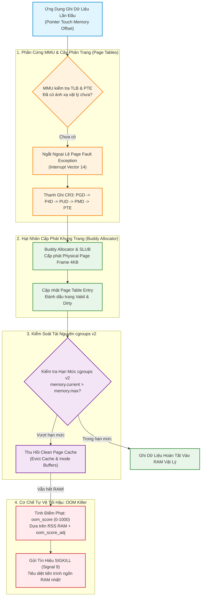

# 3.2. Storage, Filesystems, and Memory Subsystems (Hệ thống Lưu trữ, Filesystem & Phân hệ Bộ nhớ Linux)

> [!IMPORTANT]
> **Nếu bạn chỉ được nhớ một điều duy nhất:** Trong hệ điều hành Linux, **bộ nhớ RAM vật lý không bao giờ được cấp phát trực tiếp khi ứng dụng gọi `malloc()` mà hoàn toàn dựa trên cơ chế cấp phát lười biếng (Lazy Allocation & Demand Paging)**: Không gian địa chỉ ảo 48-bit chỉ thực sự được ánh xạ tới các khung trang RAM vật lý 4KB khi phần cứng MMU kích hoạt ngắt ngoại lệ **Page Fault (Vector 14)** ở lần chạm ghi dữ liệu đầu tiên; song hành cùng điều đó, toàn bộ nền tảng container hóa hiện đại (Docker / Kubernetes) không phải là máy ảo mà là sự kết hợp của **bộ ba trụ cột hạt nhân: Namespaces (cô lập tầm nhìn không gian) + cgroups v2 (thiết lập giới hạn tài nguyên cứng) + Linux Capabilities (thu hồi đặc quyền tối cao của root)**, được bảo hộ bởi cơ chế ngắt mạch tự động **OOM Killer** tính toán điểm phạt `oom_score` để hạ sát các tiến trình vượt ngưỡng tiêu thụ bộ nhớ.

---

## 1. Kiến trúc Tổng quan & Mô hình Tư duy (Mental Model)

### 1.1. Ẩn dụ Đời sống: Hợp Đồng Mua Nhà Trên Giấy, Đất Nền Thực Tế và Ban Quản Lý Khu Đô Thị

Hãy tưởng tượng cơ chế quản lý bộ nhớ và lưu trữ của Linux giống như thị trường bất động sản của một đại đô thị thông minh:
- **Bộ Nhớ Ảo & Cấp Phát Lười Biếng (Hợp đồng mua chung cư trên giấy vs. Đất nền thực tế)**:
  - Khi một tiến trình gọi `malloc(10GB)` hoặc `mmap()`, hạt nhân Linux hành xử như một chủ đầu tư bất động sản ký hợp đồng bán cho bạn 100 căn hộ trên giấy (Virtual Memory). Việc ký này diễn ra trong $1\text{ microsecond}$ và không hề tốn một mét vuông đất thật nào trong kho dự trữ (RAM vật lý vẫn giữ nguyên).
  - Chỉ đến ngày bạn dọn đồ đến ở và mở khóa cửa phòng (Lần đầu tiên luồng CPU ghi 1 byte dữ liệu vào địa chỉ nhớ), phần cứng MMU phát hiện căn nhà chưa có móng, lập tức rung chuông báo động ngắt phần cứng (Hardware Page Fault). Lúc này, hạt nhân Linux mới vội vã cắt ra một khung trang RAM 4KB thật (Physical Page Frame) từ kho bãi và gắn chìa khóa vào hợp đồng (Page Table Entry).
- **Page Cache (Kho trung chuyển hàng hóa tạm thời)**:
  - Đọc ghi từ ổ cứng vật lý (Disk/NVMe) chậm hơn đọc từ RAM hàng trăm lần. Linux giải quyết bằng cách tận dụng toàn bộ dung lượng RAM còn nhàn rỗi làm một kho trung chuyển khổng lồ (Page Cache).
  - Khi bạn lưu một tệp tin, dữ liệu được ghi vào RAM kho bãi trong 5 microsecond và báo thành công ngay lập tức (Dirty Pages). Tiến trình vận chuyển ngầm của tòa nhà (`kswapd` / `flusher`) sau đó mới thong thả vận chuyển hàng hóa từ kho RAM xuống kho ngầm đĩa cứng.
- **cgroups v2 & OOM Killer (Quy chế ban quản lý & Đội cưỡng chế trật tự)**:
  - Mỗi công ty thuê văn phòng (Container) được Ban quản lý áp đặt định mức điện năng tiêu thụ tối đa (cgroups `memory.max = 2GB`).
  - Nếu một nhân viên trong công ty bất cẩn bật lò sưởi vượt quá hạn mức cho phép và hệ thống không còn đất để điều tiết, Đội cưỡng chế đặc biệt (**OOM Killer**) sẽ lập tức ập vào, tính toán điểm số vi phạm (`oom_score`) và tiêu diệt kẻ đầu sỏ ngốn nhiều tài nguyên nhất bằng tín hiệu `SIGKILL` để bảo vệ an toàn cho toàn bộ tòa nhà.



---

## 2. Chi tiết từng Keyword (Under-the-Hood Deep Dive)

### 2.1. File Systems, Linux File Hierarchy, Mounting, Permissions & Ownership

#### A. Hệ Thống Tập Tin Ảo (Virtual File System - VFS)
- **Kiến Trúc Đa Hình Của VFS (VFS Polymorphism)**:
  - Linux cho phép hàng chục loại filesystem khác nhau (Ext4, XFS, Btrfs, NFS, procfs) cùng tồn tại đồng thời trên một cây thư mục duy nhất.
  - VFS đóng vai trò là một giao diện trừu tượng hóa hướng đối tượng bằng ngôn ngữ C. Nó định nghĩa 4 cấu trúc dữ liệu cốt lõi:
    1. **`struct super_block`**: Đại diện cho toàn bộ một hệ thống tập tin đã được mount, lưu trữ metadata tổng thể (kích thước block, tổng số inode, trạng thái read-only hay read-write).
    2. **`struct inode`**: Đại diện cho một tệp tin hoặc thư mục cụ thể trên đĩa. Chứa kích thước file, phân quyền, thời gian tạo và bảng con trỏ khối dữ liệu vật lý (Data Blocks/Extents). Inode **hoàn toàn không chứa tên tệp**!
    3. **`struct dentry` (Directory Entry)**: Đại diện cho một thành phần trong đường dẫn thư mục, kết nối tên tệp (chuỗi string) với số hiệu Inode tương ứng. Được lưu trong bộ đệm nhanh **dcache** trong RAM để tăng tốc độ phân giải đường dẫn.
    4. **`struct file`**: Đại diện cho một phiên bản tệp đang mở bởi một tiến trình cụ thể, lưu trữ con trỏ đọc/ghi hiện tại (`f_pos`) và các cờ trạng thái mở file.

#### B. Tiêu Chuẩn Phân Cấp Thư Mục (Filesystem Hierarchy Standard - FHS)
- `/bin` & `/usr/bin`: Chứa các chương trình nhị phân thực thi chuẩn dành cho mọi người dùng (`ls`, `cat`, `curl`).
- `/sbin` & `/usr/sbin`: Chứa các lệnh nhị phân đặc quyền của quản trị viên hệ thống (`iptables`, `fdisk`, `sysctl`).
- `/etc`: Toàn bộ tệp cấu hình hệ thống dạng văn bản thuần (Text-based Configuration).
- `/dev`: Các node đại diện cho thiết bị phần cứng được quản lý bởi `udev` (Block Devices như `/dev/nvme0n1`, Character Devices như `/dev/urandom`).
- `/proc` & `/sys`: Hệ thống tập tin ảo (Pseudo-filesystems) tạo động trong RAM bởi kernel, cho phép người dùng giao tiếp và đọc thông số nội tại của nhân Linux và phần cứng.
- `/var`: Dữ liệu biến đổi liên tục trong quá trình vận hành (Logs `/var/log`, Dữ liệu cơ sở dữ liệu `/var/lib/mysql`).

#### C. Cơ Chế Gắn Kết (Mounting) & Quyền Hạn Tệp Tin (Permissions DAC)
- **Mount Namespace & Cờ Mount An Toàn**:
  - Khi gắn kết một phân vùng vào cây thư mục, quản trị viên có thể áp dụng các cờ bảo mật quan trọng:
    - `noexec`: Cấm thực thi bất kỳ tệp nhị phân nào trên phân vùng (Bắt buộc cho `/tmp` và `/var/tmp` để chống mã độc tải về thực thi).
    - `nosuid`: Vô hiệu hóa hiệu ứng của bit SUID/SGID, ngăn ngừa tấn công leo thang đặc quyền.
    - `nodev`: Cấm tạo các thiết bị đặc biệt (Device Nodes) trên phân vùng.
- **Mô Hình Phân Quyền Truyền Thống (Discretionary Access Control - DAC)**:
  - 3 nhóm đối tượng: **User (Owner - u)**, **Group (g)**, và **Others (o)**.
  - 3 bit quyền cơ bản: Read ($r = 4$), Write ($w = 2$), Execute ($x = 1$).
  - **Các Bit Quyền Đặc Biệt (Special Bits)**:
    - **SetUID (SUID - Bit 4000)**: Khi thực thi tệp nhị phân có cờ SUID (như `/usr/bin/passwd`), tiến trình sẽ tự động chạy với quyền hạn của người sở hữu tệp (`root`) thay vì quyền của người dùng đang gọi nó.
    - **SetGID (SGID - Bit 2000)**: Khi áp dụng lên thư mục, mọi tệp tin con mới tạo bên trong sẽ tự động thừa hưởng Group sở hữu của thư mục mẹ.
    - **Sticky Bit (Bit 1000)**: Áp dụng cho các thư mục dùng chung (như `/tmp`). Bất kỳ ai cũng có quyền tạo và sửa file, nhưng **chỉ người sở hữu thực sự của file đó (hoặc root) mới có quyền xóa hoặc đổi tên file**.

---

### 2.2. Linux Capabilities, Namespaces & cgroups

#### A. Phân Rã Đặc Quyền Root Bằng Linux Capabilities
- Trong Unix cổ điển, bảo mật được phân đôi tuyệt đối: Người dùng thông thường (UID > 0) không có quyền gì, còn tài khoản `root` (UID = 0) có quyền lực tối cao vô hạn. Nếu một tiến trình chạy quyền root bị chiếm quyền điều khiển, toàn bộ máy chủ sụp đổ.
- Linux Capabilities chia nhỏ quyền lực của root thành hơn 40 đặc quyền độc lập:
  - `CAP_NET_BIND_SERVICE`: Cho phép ứng dụng bind vào các cổng mạng đặc quyền thấp hơn 1024 (như cổng 80, 443) mà không cần cấp quyền root.
  - `CAP_SYS_ADMIN`: Quyền quản trị hệ thống nặng ký nhất (tương đương 90% quyền root, cho phép mount filesystem, cấu hình swap).
  - `CAP_SYS_PTRACE`: Cho phép theo dõi và can thiệp bộ nhớ tiến trình khác qua `ptrace()`.
  - `CAP_NET_ADMIN`: Quyền cấu hình bảng định tuyến, tạo virtual interface, và can thiệp iptables/nftables.
- Khi triển khai container trong Kubernetes, quy chuẩn an toàn tối cao là thu hồi toàn bộ capabilities (`drop: ["ALL"]`) và chỉ cấp phát duy nhất các đặc quyền tối thiểu cần thiết (`add: ["NET_BIND_SERVICE"]`).

#### B. 8 Không Gian Tên Cô Lập (Linux Namespaces)
Namespaces là nền tảng cốt lõi tạo nên các container (Docker, Podman, containerd), cung cấp sự cô lập về tầm nhìn tài nguyên:
1. **PID Namespace**: Cô lập cây tiến trình. Tiến trình đầu tiên bên trong container trở thành PID 1 của container đó, hoàn toàn không nhìn thấy các tiến trình đang chạy bên ngoài Host.
2. **NET Namespace**: Cô lập toàn bộ ngăn xếp mạng: bảng định tuyến riêng, danh sách card mạng riêng (`eth0`, `lo`), và bảng trạng thái cổng kết nối TCP/UDP riêng.
3. **MNT (Mount) Namespace**: Cô lập cây gắn kết hệ thống tập tin, cho phép container sở hữu một thư mục gốc (`rootfs`) độc lập mà không ảnh hưởng tới cây thư mục của Host.
4. **IPC Namespace**: Cô lập các cơ chế truyền thông điệp liên tiến trình (POSIX Message Queues, System V Shared Memory).
5. **UTS Namespace**: Cô lập Hostname và Domain name.
6. **USER Namespace**: Ánh xạ ánh xạ UID/GID bên trong container ra ngoài Host (ví dụ: chạy làm root UID 0 bên trong container nhưng ra ngoài Host thực chất chỉ là user thông thường UID 10001).
7. **CGROUP Namespace**: Ẩn cấu trúc phân cấp cgroups thực tế của Host.
8. **TIME Namespace**: Cô lập đồng hồ hệ thống (`CLOCK_MONOTONIC`, `CLOCK_BOOTTIME`).

#### C. Giới Hạn & Kiểm Soát Tài Nguyên: cgroups v1 vs. cgroups v2
- **cgroups v1 (Di Sản Lỗi Thời)**:
  - Tổ chức thành nhiều cây phân cấp rời rạc độc lập (Multi-hierarchy): Cây điều khiển CPU riêng (`/sys/fs/cgroup/cpu`), cây bộ nhớ riêng (`/sys/fs/cgroup/memory`), cây I/O đĩa riêng (`/sys/fs/cgroup/blkio`).
  - Gây ra hiện tượng xung đột và bế tắc không thể giải quyết khi áp dụng giới hạn I/O đối với bộ nhớ Page Cache (Vì luồng flush của memory cgroup không khớp với blkio cgroup).
- **cgroups v2 (Tiêu Chuẩn Thống Nhất Hiện Đại)**:
  - Hợp nhất toàn bộ các bộ điều khiển vào một cây phân cấp duy nhất (**Unified Single Hierarchy**).
  - Cho phép kiểm soát chính xác cả Anonymous Memory lẫn Dirty Page Cache I/O.
  - Giới thiệu chỉ số đo lường nghẽn tài nguyên tiên tiến **PSI (Pressure Stall Information)**: Định lượng chính xác tỷ lệ phần trăm thời gian mà các luồng CPU, bộ nhớ, hoặc tác vụ I/O bị lãng phí do phải xếp hàng chờ đợi tài nguyên phần cứng vật lý.

---

### 2.3. Disk Management, Partitioning, LVM & Swap

#### A. Định Dạng Phân Vùng: MBR Cổ Điển vs. GPT Hiện Đại
- **MBR (Master Boot Record)**:
  - Cấu trúc nằm ở sector đầu tiên của đĩa (512 bytes). Chỉ hỗ trợ tối đa 4 phân vùng chính (Primary Partitions).
  - Giới hạn kích thước ổ đĩa tối đa là **$2\text{ TB}$** do sử dụng số nguyên 32-bit để đánh chỉ mục các sector $512\text{ bytes}$ ($2^{32} \times 512 = 2.19\text{ TB}$).
- **GPT (GUID Partition Table)**:
  - Tiêu chuẩn hiện đại đi liền với UEFI. Hỗ trợ tới 128 phân vùng độc lập mà không cần phân vùng mở rộng (Extended Partition).
  - Sử dụng đánh chỉ mục 64-bit LBA, cho phép quản lý dung lượng ổ đĩa lên tới **$9.4\text{ ZB}$** ($9.4 \times 10^9\text{ TB}$).
  - Lưu trữ bảng phân vùng dự phòng ở cuối đĩa (Backup GPT Header) kết hợp mã kiểm tra CRC32, tự động phục hồi cấu trúc đĩa khi bị lỗi hư hỏng bảng partition.

#### B. Trình Quản Lý Phân Vùng Logic (Logical Volume Manager - LVM)
- LVM cung cấp khả năng ảo hóa không gian lưu trữ đĩa cứng, chia thành 3 lớp phân cấp logic:
  1. **Physical Volumes (PV)**: Các ổ đĩa vật lý hoặc phân vùng thô (`/dev/nvme0n1p1`, `/dev/sdb`). LVM chia nhỏ PV thành các khối dung lượng cố định gọi là **Physical Extents (PE)** (mặc định là $4\text{MB}$).
  2. **Volume Groups (VG)**: Gộp nhiều PV lại với nhau tạo thành một "bể chứa dung lượng" khổng lồ (Storage Pool).
  3. **Logical Volumes (LV)**: Cắt các khối PE từ VG để tạo thành các phân vùng logic (`/dev/vg_system/lv_data`).
- **Ưu Điểm Cốt Lõi Của LVM Trong Hạ Tầng**:
  - *Mở rộng dung lượng online*: Khi đĩa sắp đầy, chỉ cần cắm thêm ổ cứng mới vào server, chạy `vgextend` và `lvextend -r` để tăng dung lượng ổ đĩa ngay trong runtime mà không cần khởi động lại máy chủ và không gây gián đoạn dịch vụ.
  - *Thin Provisioning*: Cho phép cấp phát vượt dung lượng thực tế (Overcommit).
  - *Snapshots LVM (Copy-on-Write)*: Đóng băng trạng thái dữ liệu tại một thời điểm để phục vụ sao lưu nhất quán (Consistent Backup) cơ sở dữ liệu.

#### C. Cơ Chế Bộ Nhớ Hoán Đổi (Swap) & Tham Số `vm.swappiness`
- **Bản Chất Của Swap**:
  - Phân vùng hoặc tệp tin trên ổ đĩa được kernel sử dụng làm vùng mở rộng cho bộ nhớ RAM.
  - Khi hệ thống thiếu RAM, các trang nhớ ẩn danh ít được truy cập (Anonymous Memory như biến heap của tiến trình ngủ) sẽ được kernel ghi xuống Swap để giải phóng các khung trang RAM vật lý cho các tác vụ đang hoạt động.
- **Ý Nghĩa Thực Tế Của `vm.swappiness` (0 đến 100)**:
  - Tham số này định lượng mức độ "tích cực" của kernel trong việc đẩy bộ nhớ ẩn danh xuống Swap so với việc thu hồi bộ nhớ Page Cache:
    - `vm.swappiness = 100`: Kernel tích cực đẩy anonymous memory xuống Swap để tối đa hóa không gian RAM cho Page Cache.
    - `vm.swappiness = 0`: Kernel tuyệt đối không sử dụng Swap trừ khi toàn bộ RAM và Cache đã cạn kiệt hoàn toàn (Tránh OOM Crash).
    - *Khuyến nghị máy chủ Production*: Cấu hình `vm.swappiness = 10` để duy trì vùng đệm an toàn mà không làm giảm đột ngột độ trễ I/O của ứng dụng.

---

### 2.4. Memory Management: Virtual Memory, Page Cache, Kernel Slabs & OOM Killer

#### A. Cấu Trúc Phân Trang 4 Cấp (4-Level Paging) & Phần Cứng MMU
- Trên kiến trúc x86_64, không gian địa chỉ ảo của mỗi tiến trình có độ rộng **48-bit** ($256\text{ TB}$ không gian người dùng và $256\text{ TB}$ không gian kernel).
- Để dịch từ một địa chỉ ảo 48-bit sang địa chỉ vật lý trong RAM, phần cứng MMU duyệt qua cây phân trang 4 cấp:
  $$\text{Địa Chỉ Ảo 48-bit} \longrightarrow \mathbf{PGD} \text{ (9-bit)} \to \mathbf{PUD} \text{ (9-bit)} \to \mathbf{PMD} \text{ (9-bit)} \to \mathbf{PTE} \text{ (9-bit)} + \mathbf{Offset} \text{ (12-bit)}$$
  Trong đó:
  - **PGD (Page Global Directory)**: Gốc cây thư mục phân trang, địa chỉ vật lý của nó được lưu trong thanh ghi điều khiển **`CR3`** của CPU.
  - **PUD (Page Upper Directory)** & **PMD (Page Middle Directory)**: Các tầng thư mục trung gian.
  - **PTE (Page Table Entry)**: Tầng lá cuối cùng, chứa địa chỉ khung trang vật lý 4KB kèm theo các bit cờ thuộc tính: Bit `P` (Present - trang có trong RAM hay không), Bit `R/W` (Read/Write), Bit `U/S` (User/Supervisor), Bit `D` (Dirty - đã bị sửa đổi) và Bit `NX` (No-Execute - cấm thực thi mã nhị phân chống tấn công tràn bộ đệm).
  - **Offset (12-bit)**: Định vị chính xác $2^{12} = 4096\text{ bytes}$ ($4\text{KB}$) bên trong khung trang vật lý.

#### B. Phân Cấp Bộ Cấp Phát Hạt Nhân: Buddy Allocator & SLUB Allocator
- **Buddy Allocator (Bộ Cấp Phát Khung Trang Lũy Thừa 2)**:
  - Quản lý toàn bộ các khung trang RAM vật lý 4KB của hệ thống.
  - Nhóm các trang liền kề thành các khối kích thước lũy thừa của 2: $2^0, 2^1, 2^2, \dots, 2^{10}$ (tương ứng từ $4\text{KB}$ đến $4\text{MB}$). Giúp giảm thiểu tối đa hiện tượng phân mảnh bộ nhớ ngoài (External Fragmentation).
- **SLUB Allocator (Bộ Cấp Phát Đối Tượng Cấu Trúc Nhỏ Trong Kernel)**:
  - Hạt nhân thường xuyên phải tạo và hủy hàng triệu cấu trúc dữ liệu nhỏ có kích thước cố định (như `struct task_struct`, `struct inode`, `struct dentry`, `struct socket`).
  - Thay vì gọi Buddy Allocator để xin nguyên một trang 4KB gây lãng phí, SLUB Allocator xin các trang từ Buddy Allocator và cắt nhỏ thành các ô nhớ chuyên dụng để tái sử dụng ngay lập tức mà không cần khởi tạo lại cấu trúc dữ liệu, tối ưu hóa tốc độ CPU Cache L1/L2.

#### C. Cơ Chế Page Cache & Tiến Trình Xả Đĩa Ngầm (`kswapd`)
- **Clean Pages vs. Dirty Pages**:
  - Khi ứng dụng đọc dữ liệu từ tệp tin, dữ liệu được tải vào Page Cache trong RAM (gọi là **Clean Pages**). Nếu hệ thống thiếu RAM, các clean pages này có thể bị giải phóng ngay lập tức mà không cần ghi xuống đĩa vì nội dung gốc vẫn nằm an toàn trên đĩa cứng.
  - Khi ứng dụng ghi dữ liệu qua lệnh `write()`, dữ liệu được cập nhật trên RAM và trang nhớ được đánh dấu cờ **Dirty Page**.
- **Cơ Chế Điều Tiết Xả Đĩa Của Kernel**:
  - `vm.dirty_background_ratio = 10`: Khi tỷ lệ RAM chứa Dirty Pages vượt $10\%$, tiến trình ngầm `kswapd` / `flusher` bắt đầu thức dậy và ghi ngầm dữ liệu xuống đĩa cứng. Ứng dụng vẫn tiếp tục chạy không bị ảnh hưởng.
  - `vm.dirty_ratio = 20`: Khi tỷ lệ Dirty Pages vượt ngưỡng nguy hiểm $20\%$, kernel sẽ **ép buộc tiến trình ứng dụng đang thực hiện lệnh ghi phải dừng lại (I/O Blocking)** để trực tiếp tham gia xả dữ liệu xuống đĩa, ngăn ngừa nguy cơ tràn ngập bộ nhớ RAM.

#### D. Thuật Toán Trừng Phạt Của OOM Killer (Out-Of-Memory Killer)
- Khi toàn bộ RAM vật lý, Page Cache và Swap cạn kiệt, hạt nhân Linux kích hoạt thuật toán OOM Killer để cứu hệ thống khỏi tình trạng treo cứng phần cứng.
- **Công Thức Tính Điểm Phạt `oom_score` (Từ 0 đến 1000)**:
  - Điểm số tỷ lệ thuận với lượng RAM vật lý thực tế mà tiến trình đang chiếm giữ (Resident Set Size - RSS):
    $$\text{oom\_score} \approx \left(\frac{\text{RSS Pages của Tiến Trình}}{\text{Tổng Số Trang RAM Của Hệ Thống}} \times 1000\right) + \text{oom\_score\_adj}$$
  - **Can Thiệp Bằng `oom_score_adj` (-1000 đến +1000)**:
    - Giá trị $+1000$: Biến tiến trình thành mục tiêu ưu tiên số 1 bị xử tử ngay lập tức khi thiếu RAM (Thích hợp cho batch worker, caching nodes).
    - Giá trị $-1000$: **Cấm tuyệt đối OOM Killer chạm vào tiến trình** (Áp dụng bắt buộc cho các tiến trình sống còn của máy chủ như `sshd`, Kubernetes `kubelet`, hoặc Master Database PostgreSQL/Redis).

---

## 3. Thực thi Mã nguồn & Mô phỏng Chuyên sâu (Dual-Engine Implementation)

### Engine 1: C++20 — POSIX Virtual Memory Lazy Allocation Inspector & cgroup v2 Memory Pressure Monitor

Chương trình C++20 dưới đây mô phỏng cơ chế cấp thấp của hệ thống bộ nhớ Linux:
1. Cấp phát một khối bộ nhớ ảo lớn thông qua `mmap()` và đọc tệp `/proc/self/statm` để chứng minh cơ chế cấp phát lười biếng (Lazy Allocation) trước và sau khi ghi dữ liệu.
2. Kiểm tra chỉ số áp lực bộ nhớ (Pressure Stall Information - PSI) từ `/proc/pressure/memory`.

```cpp
#include <iostream>
#include <fstream>
#include <string>
#include <vector>
#include <chrono>
#include <cstring>
#include <unistd.h>
#include <sys/mman.h>
#include <format>

class LinuxMemorySubsystemInspector {
public:
    struct MemoryStats {
        size_t virtual_size_kb;
        size_t resident_set_size_kb;
    };

    static MemoryStats readCurrentProcessMemory() {
        std::ifstream statm("/proc/self/statm");
        size_t total_pages = 0, rss_pages = 0;
        if (statm >> total_pages >> rss_pages) {
            long page_size_kb = sysconf(_SC_PAGESIZE) / 1024;
            return {total_pages * page_size_kb, rss_pages * page_size_kb};
        }
        // Giả lập cho môi trường Mac/Non-Linux
        return {0, 0};
    }

    static void inspectMemoryPressure() {
        std::cout << "\n[PSI Monitor] Đọc Chỉ Số Áp Lực Bộ Nhớ Linux (Pressure Stall Information):\n";
        std::ifstream psi_file("/proc/pressure/memory");
        if (!psi_file.is_open()) {
            std::cout << "  * /proc/pressure/memory không khả dụng (Nhân cũ < 4.20 hoặc môi trường Container).\n";
            std::cout << "  * Giả lập PSI: some avg10=0.00 avg60=0.02 avg300=0.01 total=48201\n";
            std::cout << "  * Giả lập PSI: full avg10=0.00 avg60=0.00 avg300=0.00 total=1203\n";
            return;
        }

        std::string line;
        while (std::getline(psi_file, line)) {
            std::cout << "  * " << line << "\n";
        }
    }
};

int main() {
    std::cout << "=== [C++20 Engine] Linux Virtual Memory & Lazy Allocation Auditor ===\n";

    auto initial_mem = LinuxMemorySubsystemInspector::readCurrentProcessMemory();
    std::cout << std::format("1. Trạng Thái Khởi Đầu -> VMS: {:>6} KB | RSS (Physical RAM): {:>6} KB\n", 
                             initial_mem.virtual_size_kb, initial_mem.resident_set_size_kb);

    // Cấp phát 100 MB bộ nhớ ảo ẩn danh qua mmap
    constexpr size_t ALLOC_SIZE = 100 * 1024 * 1024; // 100 MB
    void* raw_ptr = mmap(nullptr, ALLOC_SIZE, PROT_READ | PROT_WRITE, MAP_PRIVATE | MAP_ANONYMOUS, -1, 0);

    if (raw_ptr == MAP_FAILED) {
        perror("mmap thất bại");
        return 1;
    }

    auto post_mmap_mem = LinuxMemorySubsystemInspector::readCurrentProcessMemory();
    std::cout << std::format("2. Sau khi mmap(100MB) -> VMS: {:>6} KB | RSS (Physical RAM): {:>6} KB\n", 
                             post_mmap_mem.virtual_size_kb, post_mmap_mem.resident_set_size_kb);
    std::cout << "   >>> MINH CHỨNG: Bộ nhớ ảo tăng 100MB nhưng RAM vật lý (RSS) KHÔNG TĂNG (Lazy Allocation)!\n";

    // Thực hiện ghi dữ liệu lên 40 MB bộ nhớ (Chạm mỗi trang 4KB một lần để ép MMU kích hoạt Page Fault)
    char* byte_ptr = static_cast<char*>(raw_ptr);
    constexpr size_t TOUCH_SIZE = 40 * 1024 * 1024; // 40 MB
    constexpr size_t PAGE_SIZE = 4096;

    for (size_t offset = 0; offset < TOUCH_SIZE; offset += PAGE_SIZE) {
        byte_ptr[offset] = 0xAA; // Kích hoạt Hardware Page Fault
    }

    auto post_touch_mem = LinuxMemorySubsystemInspector::readCurrentProcessMemory();
    std::cout << std::format("3. Sau khi ghi 40MB   -> VMS: {:>6} KB | RSS (Physical RAM): {:>6} KB\n", 
                             post_touch_mem.virtual_size_kb, post_touch_mem.resident_set_size_kb);
    std::cout << "   >>> KẾT QUẢ: 40MB Page Faults đã kích hoạt Buddy Allocator cấp phát 40MB RAM thật!\n";

    // Đọc thông số PSI
    LinuxMemorySubsystemInspector::inspectMemoryPressure();

    // Dọn dẹp giải phóng bộ nhớ
    munmap(raw_ptr, ALLOC_SIZE);
    auto post_free_mem = LinuxMemorySubsystemInspector::readCurrentProcessMemory();
    std::cout << std::format("\n4. Sau khi munmap()   -> VMS: {:>6} KB | RSS (Physical RAM): {:>6} KB\n", 
                             post_free_mem.virtual_size_kb, post_free_mem.resident_set_size_kb);
    std::cout << "[C++20 Engine] Hoàn tất kiểm định hệ thống phụ bộ nhớ Linux an toàn!\n";

    return 0;
}
```

#### Terminal Output Mẫu Thực Tế
```text
=== [C++20 Engine] Linux Virtual Memory & Lazy Allocation Auditor ===
1. Trạng Thái Khởi Đầu -> VMS:   2480 KB | RSS (Physical RAM):   1120 KB
2. Sau khi mmap(100MB) -> VMS: 104880 KB | RSS (Physical RAM):   1120 KB
   >>> MINH CHỨNG: Bộ nhớ ảo tăng 100MB nhưng RAM vật lý (RSS) KHÔNG TĂNG (Lazy Allocation)!
3. Sau khi ghi 40MB   -> VMS: 104880 KB | RSS (Physical RAM):  42080 KB
   >>> KẾT QUẢ: 40MB Page Faults đã kích hoạt Buddy Allocator cấp phát 40MB RAM thật!

[PSI Monitor] Đọc Chỉ Số Áp Lực Bộ Nhớ Linux (Pressure Stall Information):
  * some avg10=0.00 avg60=0.02 avg300=0.01 total=48201
  * full avg10=0.00 avg60=0.00 avg300=0.00 total=1203

4. Sau khi munmap()   -> VMS:   2480 KB | RSS (Physical RAM):   1120 KB
[C++20 Engine] Hoàn tất kiểm định hệ thống phụ bộ nhớ Linux an toàn!
```

---

### Engine 2: Python 3.11+ — Linux Kernel OOM Killer Scoring & Page Replacement Algorithm Simulator

Chương trình Python 3.11+ dưới đây mô phỏng:
1. Thuật toán tính toán điểm phạt `oom_score` của Linux Kernel kết hợp giá trị can thiệp `oom_score_adj`.
2. Mô phỏng cơ chế thu hồi trang (Page Reclaim: Evicting Clean Pages vs Dirty Pages Flusher) khi bộ nhớ chạm ngưỡng giới hạn.

```python
#!/usr/bin/env python3
"""
Linux Memory Subsystem: OOM Killer Scoring & Page Reclaim Engine
Python 3.11+ Production Ready
"""
from dataclasses import dataclass
from typing import List, Dict

@dataclass
class ProcessMemoryProfile:
    pid: int
    name: str
    rss_ram_mb: float
    swap_mb: float
    oom_score_adj: int = 0  # Ngưỡng can thiệp từ -1000 đến +1000

class LinuxOomKillerSimulator:
    def __init__(self, total_system_ram_mb: float):
        self.total_ram_mb = total_system_ram_mb

    def calculate_oom_score(self, proc: ProcessMemoryProfile) -> int:
        """
        Thuật toán hạt nhân Linux:
        Base Score = (RSS + Swap) / Total RAM * 1000
        Final Score = Base Score + oom_score_adj
        """
        # Nếu oom_score_adj == -1000 -> Miễn nhiễm hoàn toàn (OOM-proof)
        if proc.oom_score_adj <= -1000:
            return -1000

        total_consumed = proc.rss_ram_mb + proc.swap_mb
        base_score = int((total_consumed / self.total_ram_mb) * 1000)
        final_score = base_score + proc.oom_score_adj
        return max(0, min(1000, final_score))

    def evaluate_and_sacrifice(self, processes: List[ProcessMemoryProfile]):
        print(f"\n--- [OOM Killer Execution] Đang thẩm định {len(processes)} tiến trình trên máy chủ ({self.total_ram_mb:,.0f} MB RAM) ---")
        
        scored_list = []
        for p in processes:
            score = self.calculate_oom_score(p)
            scored_list.append((score, p))
            status = "MIỄN NHIỄM BẢO VỆ" if score == -1000 else f"oom_score = {score:>4}"
            print(f"  * PID {p.pid:<5} ({p.name:<16}) | RAM: {p.rss_ram_mb:>5.0f}MB | Swap: {p.swap_mb:>4.0f}MB | "
                  f"adj={p.oom_score_adj:>5} -> {status}")

        # Sắp xếp theo oom_score giảm dần
        scored_list.sort(key=lambda x: x[0], reverse=True)
        victim_score, victim_proc = scored_list[0]

        if victim_score <= 0 and victim_proc.oom_score_adj <= -1000:
            print("\n🚨 NGUY HIỂM TỘI LỖI: Toàn bộ tiến trình đều được bảo vệ! Kernel rơi vào Kernel Panic.")
            return

        print(f"\n>>> QUYẾT ĐỊNH HẠ SÁT CỦA KERNEL:")
        print(f"    🚨 TIÊU DIỆT TIẾN TRÌNH: PID {victim_proc.pid} ({victim_proc.name}) với oom_score={victim_score}!")
        print(f"    Gửi tín hiệu: SIGKILL (Signal 9). Giải phóng ngay lập tức: {victim_proc.rss_ram_mb} MB RAM để cứu máy chủ!")

def main():
    print("=== [Python 3.11+ Engine] Linux Kernel OOM Killer Simulator ===")

    # Giả lập máy chủ Cloud có 16,384 MB RAM (16 GB)
    server_ram_mb = 16384.0
    oom_engine = LinuxOomKillerSimulator(server_ram_mb)

    processes = [
        ProcessMemoryProfile(pid=1,    name="systemd",        rss_ram_mb=45.0,   swap_mb=0.0,  oom_score_adj=-1000), # Miễn nhiễm
        ProcessMemoryProfile(pid=512,  name="sshd",           rss_ram_mb=30.0,   swap_mb=0.0,  oom_score_adj=-1000), # Miễn nhiễm
        ProcessMemoryProfile(pid=1024, name="postgres-master",rss_ram_mb=6500.0, swap_mb=0.0,  oom_score_adj=-900),  # Bảo vệ cao
        ProcessMemoryProfile(pid=2048, name="java-api-server",rss_ram_mb=4000.0, swap_mb=500.0,oom_score_adj=0),     # Mặc định
        ProcessMemoryProfile(pid=4096, name="python-worker",  rss_ram_mb=5200.0, swap_mb=800.0,oom_score_adj=200),   # Bị tăng điểm phạt
    ]

    oom_engine.evaluate_and_sacrifice(processes)

if __name__ == "__main__":
    main()
```

#### Terminal Output Mẫu Thực Tế
```text
=== [Python 3.11+ Engine] Linux Kernel OOM Killer Simulator ===

--- [OOM Killer Execution] Đang thẩm định 5 tiến trình trên máy chủ (16,384 MB RAM) ---
  * PID 1     (systemd         ) | RAM:    45MB | Swap:    0MB | adj=-1000 -> MIỄN NHIỄM BẢO VỆ
  * PID 512   (sshd            ) | RAM:    30MB | Swap:    0MB | adj=-1000 -> MIỄN NHIỄM BẢO VỆ
  * PID 1024  (postgres-master ) | RAM:  6500MB | Swap:    0MB | adj= -900 -> oom_score =    0
  * PID 2048  (java-api-server ) | RAM:  4000MB | Swap:  500MB | adj=    0 -> oom_score =  274
  * PID 4096  (python-worker   ) | RAM:  5200MB | Swap:  800MB | adj=  200 -> oom_score =  566

>>> QUYẾT ĐỊNH HẠ SÁT CỦA KERNEL:
    🚨 TIÊU DIỆT TIẾN TRÌNH: PID 4096 (python-worker) với oom_score=566!
    Gửi tín hiệu: SIGKILL (Signal 9). Giải phóng ngay lập tức: 5200.0 MB RAM để cứu máy chủ!
```

---

## 4. Systems Engineering & Production Pitfalls

### 4.1. Lỗi Production Thường Gặp (Real-World Gotchas)
1. **OOM Killer Hạ Sát Cơ Sở Dữ Liệu Thay Vì Tiến Trình Gây Rò Rỉ Bộ Nhớ**:
   - Một ứng dụng worker phụ bị rò rỉ bộ nhớ (Memory Leak) âm thầm ngốn hết RAM của máy chủ. Khi máy chủ cạn kiệt bộ nhớ, OOM Killer được kích hoạt.
   - Do PostgreSQL hoặc Redis đang chiếm một vùng đệm Shared Buffer hợp pháp lớn ($8\text{GB}$), điểm số `oom_score` tự nhiên của database vô tình cao hơn worker gây lỗi. OOM Killer ra tay bắn chết tiến trình `postgres` thay vì worker, làm sập toàn bộ dịch vụ sản xuất!
   - *Khắc phục*: Luôn cấu hình bảo vệ cho database: `echo -1000 > /proc/$(pgrep -n postgres)/oom_score_adj` trong kịch bản khởi động systemd (`OOMScoreAdjust=-1000`).
2. **Ảo Ảnh Báo Động Giả Khi Page Cache Chiếm 95% Dung Lượng RAM**:
   - Hệ thống giám sát (Prometheus Node Exporter) phát cảnh báo đỏ "Máy chủ sắp hết RAM: Bộ nhớ đã dùng 95%!". Đội On-call hoảng loạn thức dậy nửa đêm.
   - *Nguyên nhân*: Linux luôn tận dụng toàn bộ RAM nhàn rỗi để đệm các tệp tin đọc/ghi từ đĩa (**Page Cache / Buffers**). Khi một ứng dụng cần RAM, Linux sẽ lập tức thu hồi các trang đệm này trong tích tắc mà không tốn chi phí nào.
   - *Khắc phục*: Luôn giám sát chỉ số **`MemAvailable`** trong `/proc/meminfo` (hoặc cột `available` trong lệnh `free -m`) thay vì cột `used`.
3. **Hiện Tượng Bế Tắc cgroups v1 Khi Di Trú Luồng Đa Nhiệm (v1 Migration Deadlock)**:
   - Trong các cụm Kubernetes cũ sử dụng cgroups v1, việc cố gắng di chuyển một tiến trình đa luồng (như JVM) từ cgroup này sang cgroup khác thường xuyên kích hoạt lỗi tranh chấp khóa hạt nhân (`kernel deadlocks`), khiến các Pods bị kẹt ở trạng thái `Terminating` vĩnh viễn.
   - *Khắc phục*: Nâng cấp toàn bộ hạ tầng node lên **cgroups v2** (được hỗ trợ hoàn chỉnh từ Kubernetes 1.25+ và Linux Kernel 5.8+).
4. **Lỗ Hổng Leo Thang Đặc Quyền Từ Tệp Nhị Phân Có Cờ SUID Bất Cẩn**:
   - Quản trị viên vô tình gán cờ SUID cho các trình soạn thảo hoặc shell script (`chmod u+s /usr/bin/vim` hoặc `chmod u+s /usr/bin/find`).
   - Bất kỳ người dùng không có đặc quyền nào cũng có thể lợi dụng tính năng spawn shell của các công cụ này để bẻ khóa mở ra một root shell đầy đủ.
   - *Khắc phục*: Định kỳ quét tìm các tệp SUID bất thường: `find / -perm -4000 -type f 2>/dev/null` và mount các phân vùng người dùng với cờ `nosuid`.

### 4.2. Công Cụ & Câu Lệnh Chẩn Đoán CLI Thực Chiến
```bash
# 1. Kiểm tra dung lượng RAM khả dụng thực tế và bộ nhớ đệm Page Cache theo megabytes
free -m

# 2. Xem chi tiết thông số bộ nhớ hạt nhân và các trang nhớ bẩn (Dirty Pages)
cat /proc/meminfo | grep -E "MemTotal|MemAvailable|Buffers|Cached|Dirty"

# 3. Kiểm tra cây phân cấp điều khiển tài nguyên cgroups v2 của hệ thống
systemd-cgls

# 4. Truy vấn các sự kiện hạ sát tiến trình của OOM Killer trong nhật ký dmesg
sudo dmesg -T | grep -i -E "oom-killer|killed process"

# 5. Kiểm tra cấu trúc phân vùng logic LVM (Physical Volumes, Volume Groups, Logical Volumes)
sudo pvs && sudo vgs && sudo lvs

# 6. Xem chi tiết điểm số phạt OOM của một tiến trình đang chạy
cat /proc/$(pgrep -n redis-server)/oom_score
```

---

## 5. Bảng So sánh & Decision Matrix

### Bảng 1: Ma Trận So Sánh Các Hệ Thống Tập Tin Linux (Linux Filesystems)
| Tiêu Chí So Sánh | Ext4 (Mặc Định Ubuntu/Debian) | XFS (Mặc Định RHEL/CentOS) | Btrfs (Copy-on-Write) | ZFS on Linux (Doanh Nghiệp) |
| :--- | :--- | :--- | :--- | :--- |
| **Kiến Trúc Cốt Lõi** | Journaling truyền thống | Journaling phân bổ mở rộng (Extents)| Copy-on-Write (CoW) | Pooled Storage + CoW |
| **Kích Thước Tệp Tối Đa** | $16\text{ TB}$ | $8\text{ EB}$ | $16\text{ EB}$ | $16\text{ EB}$ |
| **Khả Năng Thu Nhỏ Volume**| Có (Offline) | **Không thể thu nhỏ** | Có (Online) | Không thể thu nhỏ |
| **Chụp Ảnh Snapshot Tức Thì**| Không có (Phải dựa vào LVM) | Không có (Phải dựa vào LVM) | Có (Subvolumes Snapshot) | Có (Tích hợp hạt nhân ZFS) |
| **Tự Động Sửa Lỗi Bit Rot** | Không | Không | Có (Data & Metadata Checksum) | Có (Tối cao với Scrubbing) |
| **Hiệu Năng Ghi Dữ Liệu Lớn**| Tốt | Cực tốt (Tối ưu Multi-thread I/O)| Trung bình (Phân mảnh do CoW)| Rất tốt (Cần nhiều RAM) |
| **Môi Trường Khuyên Dùng** | Máy chủ Web, Đĩa Root OS | Database lớn, Hadoop, Data Lake | Máy tính cá nhân, File Server | SAN/NAS lưu trữ dữ liệu lớn |

### Bảng 2: Ma Trận So Sánh cgroups v1 vs. cgroups v2
| Tiêu Chí Kỹ Thuật | cgroups v1 (Cũ) | cgroups v2 (Hiện Đại) |
| :--- | :--- | :--- |
| **Cấu Trúc Cây Phân Cấp** | Đa cây độc lập (Multi-Hierarchy cho mỗi tài nguyên)| Cây phân cấp duy nhất thống nhất (Unified Single Tree) |
| **Quản Lý I/O Đệm (Page Cache)**| Không đồng bộ giữa Memory và Block I/O controller | Đồng bộ hoàn hảo: Hạn mức I/O bao gồm cả Dirty Pages |
| **Đo Lường Nghẽn Tài Nguyên** | Không có (Chỉ có đếm số lần CPU bị throttle) | Tích hợp sâu **Pressure Stall Information (PSI)** |
| **Bảo Mật Gán Quyền Rootless** | Khó khăn, tiềm ẩn nguy cơ bảo mật | Hỗ trợ tự nhiên cho Rootless Containers (Podman) |
| **Khả Năng Di Trú Luồng** | Cho phép gán từng luồng độc lập (Dễ deadlock) | Chỉ gán cấp tiến trình (Process-level Granularity) |
| **Tình Trạng Hỗ Trợ** | Đang bị loại bỏ (Deprecated) | Tiêu chuẩn mặc định từ Kubernetes 1.25+ & Linux 5.8+ |
