# 3.3. Administration, Shell Automation, and Diagnostics (Quản trị, Tự động hóa Shell & Chẩn đoán Hiệu năng Linux)

> [!IMPORTANT]
> **Nếu bạn chỉ được nhớ một điều duy nhất:** Năng lực vận hành và chẩn đoán sự cố hạ tầng Linux ở cấp độ chuyên gia (Expert System Troubleshooting) không dựa trên sự phỏng đoán cảm tính mà tuân thủ nghiêm ngặt **Phương pháp Luận USE (Utilization, Saturation, and Errors)** của Brendan Gregg: Mọi tài nguyên phần cứng (CPU, Memory, Disk I/O, Network) đều phải được định lượng đa chiều về mức độ sử dụng (%util), độ sâu hàng đợi bão hòa (queue depth/backlog) và tỷ lệ lỗi phần cứng; đồng thời quy chuẩn quản trị hiện đại đòi hỏi loại bỏ hoàn toàn các Cron job truyền thống thiếu kiểm soát để chuyển dịch sang **systemd Timers** (tích hợp cô lập tài nguyên qua cgroups v2 và quản lý nhật ký có cấu trúc qua `journald`), kết hợp vũ khí chẩn đoán phi xâm lấn tối thượng (**Linux perf và eBPF / bpftrace**) để "nhìn xuyên thấu" không gian hạt nhân với chi phí tiêu hao hiệu năng gần như bằng không.

---

## 1. Kiến trúc Tổng quan & Mô hình Tư duy (Mental Model)

### 1.1. Ẩn dụ Đời sống: Phòng Cấp Cứu Bệnh Viện Đa Khoa & Máy Chụp Cộng Hưởng Từ MRI

Hãy tưởng tượng một kỹ sư hạ tầng điều tra sự cố máy chủ Linux chậm giống như một bác sĩ trưởng khoa cấp cứu tiếp nhận một bệnh nhân đang rơi vào tình trạng nguy kịch:
- **Phương Pháp Luận USE (Các chỉ số sinh tồn cơ bản: Mạch, Huyết áp, Nhịp thở)**:
  - Khi bệnh nhân bất tỉnh, bác sĩ không mổ phanh ngay lập tức. Bước đầu tiên là đo lường 3 chỉ số sinh tồn:
    1. *Utilization (Mạch đập)*: Tim có đang đập $100\%$ công suất không? (CPU `%usr`, `%sys` trên lệnh `top`).
    2. *Saturation (Huyết áp & Tắc nghẽn)*: Máu có đang bị ứ nghẽn trong tĩnh mạch không? (Hàng đợi CPU Runqueue trên `vmstat`, hay độ sâu hàng đợi I/O đĩa `aqu-sz` trên `iostat`).
    3. *Errors (Nhiễm trùng nội tạng)*: Có phát sinh tế bào lạ hoặc xuất huyết không? (Lỗi phần cứng trên `dmesg`, gói tin mạng bị Drop trên `ethtool`).
- **Cronjob vs. systemd Timers (Báo thức đồng hồ dây cót vs. Trợ lý thông minh phòng khám)**:
  - Báo thức đồng hồ cơ (Cron) chỉ biết reo chuông đúng giờ hẹn. Nếu ca phẫu thuật trước chưa xong mà chuông reo tiếp, bác sĩ mổ ca sau đè lên ca trước, phòng mổ vỡ trận (Cron Job Overlapping / Thundering Herd).
  - Trợ lý thông minh (systemd Timers) kiểm tra xem phòng mổ đã dọn sạch chưa mới cho ca mới vào, giới hạn số lượng thiết bị tiêu thụ trong phòng (cgroups), và ghi lại toàn bộ biên bản điện tử có chữ ký số (`journald`).
- **strace vs. perf & eBPF (Khám nghiệm xâm lấn vs. Máy chụp MRI hạt nhân)**:
  - Công cụ `strace` giống như việc chọc kim sinh thiết vào tim bệnh nhân tại mọi nhịp đập: Nó chặn đứng tiến trình sau mỗi lệnh gọi hệ thống (`PTRACE_SYSCALL`), khiến ứng dụng chậm đi từ $10\times$ đến $50\times$, có thể làm sập luôn hệ thống Production.
  - Bộ công cụ `perf` và `eBPF` giống như máy chụp cộng hưởng từ MRI không chạm: Nó đọc các thanh ghi CPU và bộ đệm vòng của hạt nhân ở tốc độ ánh sáng mà không làm bệnh nhân đau đớn, hiển thị chính xác dòng mã nguồn nào đang làm nghẽn hệ thống.

```mermaid
flowchart TD
    classDef use fill:#e1f5fe,stroke:#0288d1,stroke-width:2px;
    classDef tools fill:#fff3e0,stroke:#f57c00,stroke-width:2px;
    classDef timer fill:#e8f5e9,stroke:#388e3c,stroke-width:2px;
    classDef ebpf fill:#f3e5f5,stroke:#7b1fa2,stroke-width:2px;

    subgraph USE_Framework ["1. Phương Pháp Luận USE (Brendan Gregg)"]
        direction TB
        CPU_Check["CPU: %usr, %sys | Saturation: runqueue 'r' | Errors: Thermal Throttling"]:::use
        MEM_Check["Memory: Available RAM | Saturation: Swap 'si/so' | Errors: OOM Invocations"]:::use
        DISK_Check["Disk I/O: %util, r_await, w_await | Saturation: aqu-sz | Errors: I/O Timeouts"]:::use
        NET_Check["Network: Throughput Bps | Saturation: Socket Backlog | Errors: CRC / Drops"]:::use
    end

    subgraph SystemAutomation ["2. Tự Động Hóa Vận Hành Hiện Đại"]
        TimerUnit["backup.timer (OnCalendar=*-*-* 02:00:00)"]:::timer
        ServiceUnit["backup.service (ExecStart=/opt/scripts/backup.sh)"]:::timer
        CgroupSlice["cgroups v2 Slice: MemoryMax=2G, CPUWeight=50"]:::timer
        Journald["systemd-journald: Structured Binary Log (/var/log/journal)"]:::timer

        TimerUnit --> ServiceUnit
        ServiceUnit --> CgroupSlice
        ServiceUnit --> Journald
    end

    subgraph DiagnosticTools ["3. Thang Đo Công Cụ Chẩn Đoán Linux"]
        L1_Basic["Tầng 1: Quan sát tổng thể (top, vmstat 1, free -m, iostat -xz 1)"]:::tools
        L2_Logs["Tầng 2: Nhật ký sự kiện (dmesg -T, journalctl -u service -f)"]:::tools
        L3_Network["Tầng 3: Mạng & Socket (ss -tlpn, ip -s link, sar -n DEV 1)"]:::tools
        L4_Advanced["Tầng 4: Trích xuất Hạt nhân Không Xâm Lấn (Linux perf, eBPF / bpftrace)"]:::ebpf

        L1_Basic --> L2_Logs --> L3_Network --> L4_Advanced
    end
```



---

## 2. Chi tiết từng Keyword (Under-the-Hood Deep Dive)

### 2.1. Environment Variables, Shell Scripting, Bash, Zsh, Cron & systemd Timers

#### A. Biến Môi Trường (Environment Variables) Dưới Góc Nhìn Bộ Nhớ Linux ABI
- Trong Linux ABI (Application Binary Interface), khi một tiến trình được khởi tạo thông qua `execve()`, nhân Linux bố trí không gian ngăn xếp (Stack) của tiến trình theo cấu trúc chuẩn:
  $$\text{Stack Top} \longrightarrow \mathbf{argc} \to \mathbf{argv[]} \to \mathbf{environ[]} \to \mathbf{ELF\ Auxiliary\ Vectors}$$
- Mảng con trỏ `char** environ` chứa danh sách các chuỗi ký tự kết thúc bằng null (`KEY=VALUE\0`).
- Tiến trình con tự động thừa hưởng toàn bộ biến môi trường của tiến trình cha (trừ khi gọi `execve` với mảng env rỗng).
- **Các Biến Môi Trường Hệ Thống Sống Còn**:
  - `PATH`: Danh sách các thư mục chứa chương trình nhị phân phân cách bởi dấu hai chấm `:`. Kernel duyệt lần lượt từ trái qua phải để tìm lệnh thực thi.
  - `LD_LIBRARY_PATH`: Ghi đè đường dẫn tìm kiếm các thư viện liên kết động (`.so`). Lạm dụng biến này trong production là một anti-pattern nghiêm trọng có thể gây xung đột phiên bản thư viện C.
  - `LC_ALL` & `LANG`: Thiết lập bảng mã ký tự ngôn ngữ (Bắt buộc thiết lập `C.UTF-8` trên máy chủ để tránh lỗi xử lý chuỗi Unicode trong shell script).

#### B. Shell Scripting Doanh Nghiệp: Bash vs. Zsh
- **Bash (Bourne Again Shell)**: Tiêu chuẩn mặc định trên $99\%$ máy chủ Linux doanh nghiệp. Khi viết shell script tự động hóa, bắt buộc phải đặt chế độ phòng vệ nghiêm ngặt ở đầu tệp tin:
  ```bash
  set -euo pipefail
  IFS=$'\n\t'
  ```
  - `-e`: Dừng kịch bản ngay lập tức nếu có bất kỳ câu lệnh nào trả về mã lỗi khác 0.
  - `-u`: Báo lỗi và dừng chương trình nếu cố tình sử dụng một biến chưa được khởi tạo (ngăn ngừa thảm họa `rm -rf /var/$UNSET_VAR/`).
  - `-o pipefail`: Nếu một câu lệnh trong chuỗi đường ống pipe (`cmd1 | cmd2 | cmd3`) bị thất bại, toàn bộ đường ống sẽ trả về mã lỗi của câu lệnh thất bại đó thay vì chỉ lấy mã của `cmd3`.
- **Zsh (Z Shell)**: Được ưa chuộng trên máy trạm của lập trình viên nhờ hệ thống plugin phong phú (Oh-My-Zsh), khả năng tự sửa lỗi chính tả và autocomplete thông minh. Tuy nhiên, không nên dùng Zsh để viết kịch bản tự động hóa trên server vì tính tương thích POSIX kém chặt chẽ hơn Bash.

#### C. Lập Lịch Tác Vụ: Sự Vượt Trội Của systemd Timers So Với Cron
- **Điểm Yếu Chết Người Của Cron (`crond`)**:
  - Không có cơ chế quản lý vòng đời tiến trình: Nếu một cronjob chạy backup bị treo do nghẽn mạng, ngày hôm sau Cron tiếp tục khởi chạy job thứ hai, thứ ba. Hàng chục job chạy song song ngốn cạn RAM và I/O đĩa (**Cron Stampede**).
  - Mất dấu nhật ký: Toàn bộ đầu ra `stdout` và `stderr` mặc định gửi qua email nội bộ (`sendmail`), nếu hệ thống không cài mail server, nhật ký lỗi biến mất hoàn toàn.
  - Không kiểm soát được tài nguyên: Cronjob có thể chiếm $100\%$ CPU khiến các dịch vụ người dùng bị gián đoạn.
- **systemd Timers (Tiêu Chuẩn Vận Hành Đám Mây Hiện Đại)**:
  - Tách rời giữa **Lịch trình (`.timer`)** và **Nội dung thực thi (`.service`)**.
  - **Tích Hợp Tự Nhiên Với cgroups v2**: Khối lượng công việc của timer bị giới hạn cứng về CPU và RAM trong cấu hình unit (`MemoryMax=1G`, `CPUWeight=20`).
  - **Chống Giật Tải Bằng `RandomizedDelaySec`**: Trong cụm hàng ngàn máy chủ, nếu toàn bộ timer kích hoạt cùng lúc 00:00 UTC, cụm lưu trữ NFS/S3 sẽ sập vì quá tải. Tham số `RandomizedDelaySec=1800` tự động phân tán ngẫu nhiên thời gian kích hoạt trong khoảng 30 phút, dàn phẳng đỉnh tải.
  - **Lập Lịch Theo Đồng Hồ Đơn Điệu (`OnBootSec`, `OnUnitActiveSec`)**: Cho phép kích hoạt tác vụ tính từ lúc máy chủ khởi động thành công, độc lập với việc đồng hồ thời gian thực RTC bị nhảy giờ (Clock Jump).

---

### 2.2. Package Management & Log Management (`journald`, `logrotate`)

#### A. Hệ Thống Quản Lý Gói Nhị Phân (APT vs. DNF/RPM)
- **Chu Trình Xác Thực Toàn Vẹn Mã Nguồn Gói Phần Mềm**:
  1. Khi thực thi `apt update` hoặc `dnf makecache`, trình quản lý gói tải tệp kê khai metadata (`Packages.gz` / `repomd.xml`) chứa danh sách toàn bộ các gói phần mềm kèm mã băm mật mã SHA-256.
  2. Tệp metadata này được ký số bằng khóa riêng tư GPG của nhà phân phối. Trình quản lý gói xác thực chữ ký số bằng các khóa công khai lưu trữ trong `/etc/apt/trusted.gpg.d/` hoặc `/etc/pki/rpm-gpg/`.
  3. Khi cài đặt gói (`.deb` hoặc `.rpm`), hệ thống tự động giải nén, kiểm tra cây phụ thuộc (Dependency Graph Resolution), thực thi các kịch bản trước/sau cài đặt (`preinst`, `postinst`), và ghi nhận lịch sử vào cơ sở dữ liệu hệ thống (`/var/lib/dpkg/status`).

#### B. Quản Trị Nhật Ký Hiện Đại: `systemd-journald` & `logrotate`
- **`systemd-journald` (Bộ Thu Thập Nhật Ký Nhị Phân)**:
  - Tiếp nhận toàn bộ luồng log từ: Nhân Linux (`/dev/kmsg`), Socket hệ thống (`/dev/log`), và hai luồng `stdout`/`stderr` của mọi systemd service.
  - Ghi vào các tệp nhị phân có cấu trúc trong `/var/log/journal/<machine-id>/`.
  - Không bao giờ bị lỗi format, tự động bổ sung metadata giàu ngữ cảnh: `_PID`, `_UID`, `_SYSTEMD_UNIT`, `_COMM`, `_HOSTNAME`.
  - Cho phép truy vấn siêu tốc: `journalctl -u nginx.service --since "1 hour ago" -p err`.
- **Cơ Chế Xoay Vòng Nhật Ký Tệp Tin (`logrotate`)**:
  - Dành cho các ứng dụng tự ghi log ra tệp truyền thống (`/var/log/app/*.log`).
  - **Hai Cơ Chế Xoay Vòng Cốt Lõi**:
    1. *`create` (Đổi tên và Tạo mới)*: Tệp log đang chạy được đổi tên thành `app.log.1`. Sau đó `logrotate` tạo một tệp `app.log` mới toanh và gửi tín hiệu `SIGHUP` hoặc `USR1` để thông báo cho ứng dụng đóng file descriptor cũ và mở file descriptor mới. Đây là cơ chế chuẩn mực, an toàn $100\%$.
    2. *`copytruncate` (Sao chép và Cắt cụt)*: Dành cho các ứng dụng không hỗ trợ bắt tín hiệu reload. `logrotate` sao chép nội dung sang `app.log.1`, sau đó dùng hàm kernel cắt cụt kích thước file `app.log` về 0 (`truncate()`).
       - *Pitfall chết người*: Trong khoảng thời gian vài mili-giây giữa lúc copy xong và truncate, nếu ứng dụng ghi dữ liệu mới vào, các dòng log đó **sẽ bị xóa sạch vĩnh viễn**!

---

### 2.3. Subsystem Monitoring: CPU, Memory, Disk I/O & Network

#### A. Chẩn Đoán Phân Hệ CPU
- **Phân Tích Các Thành Phần CPU Trong `top` / `mpstat`**:
  - `%usr`: Thời gian CPU thực thi mã trong không gian người dùng (Ring 3). Nếu cao, ứng dụng đang bận tính toán logic hoặc thuật toán bị lặp vô hạn.
  - `%sys`: Thời gian CPU thực thi mã trong không gian hạt nhân (Ring 0 - System Calls, Driver, Interrupts). Nếu `%sys > 30%`, hệ thống đang gặp nghẽn nghiêm trọng do gọi quá nhiều syscalls hoặc chuyển đổi ngữ cảnh liên tục.
  - `%iowait`: Thời gian CPU nhàn rỗi nhưng đang phải chờ đợi hoàn tất các yêu cầu đọc/ghi từ ổ đĩa hoặc mạng lưu trữ.
  - `%si` (Soft Interrupts): Thời gian xử lý ngắt mềm, thường tăng vọt khi card mạng tiếp nhận hàng triệu gói tin nhỏ mỗi giây (Network Packet Processing).
- **Chỉ Số Trung Bình Tải (Load Average 1m, 5m, 15m)**:
  - Khác với Unix truyền thống chỉ đếm các tiến trình ở trạng thái `TASK_RUNNING`, **Linux Load Average đếm tổng số tiến trình đang ở trạng thái `TASK_RUNNING` (R) CỘNG VỚI các tiến trình ở trạng thái `TASK_UNINTERRUPTIBLE` (D)**!
  - Nghĩa là: Load Average có thể tăng vọt lên 50 trên một máy chủ 4-core ngay cả khi CPU đang nhàn rỗi $90\%$, nếu có 50 tiến trình đang bị treo chờ đọc dữ liệu từ một ổ cứng bị lỗi!

#### B. Chẩn Đoán Phân Hệ Bộ Nhớ (Memory Subsystem)
- **Kiểm Tra Tràn Swap Qua `vmstat 1`**:
  - Cột `si` (Swap-In): Tốc độ đọc các trang nhớ từ đĩa Swap nạp lại vào RAM (KB/s).
  - Cột `so` (Swap-Out): Tốc độ đẩy các trang nhớ từ RAM ghi xuống đĩa Swap (KB/s).
  - *Quy tắc vàng*: Nếu `so > 0` liên tục, hệ thống đang bị cạn kiệt RAM trầm trọng và rơi vào tình trạng **Swap Thrashing**, khiến toàn bộ ứng dụng bị tê liệt do tốc độ đĩa chậm hơn RAM hàng ngàn lần.

#### C. Chẩn Đoán Phân Hệ I/O Ổ Đĩa (Disk Subsystem) Qua `iostat -xz 1`
- **Các Chỉ Số Sống Còn Của Ổ Đĩa**:
  - `%util`: Phần trăm thời gian trong 1 giây mà thiết bị lưu trữ bận rộn xử lý I/O. Với đĩa quay HDD truyền thống, `%util > 80%` đồng nghĩa với việc đĩa đã chạm trần bão hòa. Với mảng NVMe đa hàng đợi, `%util` có thể đạt $100\%$ nhưng vẫn tiếp tục nhận thêm I/O song song được.
  - `aqu-sz` (Average Queue Size): Độ sâu hàng đợi yêu cầu I/O trung bình gửi xuống thiết bị. Nếu `aqu-sz > 2` đối với đĩa đơn, đĩa đang bị nghẽn cổ chai.
  - `r_await` & `w_await`: Thời gian phản hồi trung bình (Độ trễ Latency tính bằng mili-giây) của thao tác đọc và ghi. Đối với ổ NVMe chuẩn, `r_await` bắt buộc phải $< 1.0\text{ ms}$. Nếu tăng lên $> 20\text{ ms}$, hạ tầng lưu trữ đang gặp sự cố quá tải.

#### D. Chẩn Đoán Phân Hệ Mạng (Network Subsystem)
- Giám sát thông lượng thông qua `sar -n DEV 1`: Kiểm tra số lượng gói tin trên giây (`rxpck/s`, `txpck/s`) và khối lượng byte (`rxkB/s`, `txkB/s`).
- Bảng trạng thái Socket qua lệnh `ss -s`: Đếm số lượng kết nối TCP ở trạng thái `TIME-WAIT`, `ESTABLISHED`, `CLOSE-WAIT`. Nếu số lượng `TIME-WAIT` vượt quá 50,000, cần bật tính năng tái sử dụng cổng TCP `net.ipv4.tcp_tw_reuse = 1`.

---

### 2.4. Linux Troubleshooting, Kernel Diagnostics & Performance Analysis

#### A. Quy Trình 4 Bước Chẩn Đoán Sự Cố Hạ Tầng Khoa Học
1. **Bước 1: Khảo sát Triệu chứng & Tầm ảnh hưởng (Triage)**:
   - Hệ thống bị chậm toàn bộ hay chỉ một endpoint API cụ thể? Có sự thay đổi cấu hình hay bản deploy nào vừa diễn ra không?
2. **Bước 2: Quét Sơ Bộ Các Chỉ Số Sinh Tồn (The 60-Second Linux Triage)**:
   - Thực thi chuỗi câu lệnh kinh điển:
     ```bash
     uptime; dmesg -T | tail -n 20; vmstat 1 5; mpstat -P ALL 1 2; free -m; iostat -xz 1 3; sar -n DEV 1 2
     ```
3. **Bước 3: Cô Lập Phân Hệ Gây Nghẽn (Isolate Bottleneck)**:
   - Dựa vào kết quả USE Method: Nếu CPU bận $\to$ dùng `perf`; nếu đĩa bận $\to$ dùng `iotop`/`blktrace`; nếu mạng nghẽn $\to$ dùng `tcpdump`/`ss`.
4. **Bước 4: Định Danh Tiến Trình & Khắc Phục Gốc Rễ (Root Cause & Fix)**:
   - Tìm tiến trình thủ phạm, điều chỉnh lại tài nguyên hoặc rollback phiên bản lỗi.

#### B. Các Công Cụ Phân Tích Hiệu Năng Nâng Cao: `perf` & `eBPF / bpftrace`
- **Linux `perf` Subsystem (Bộ Profiler Phần Cứng & Hạt Nhân)**:
  - Khai thác các bộ đếm phần cứng hiệu năng cao (Hardware Performance Counters - PMU) tích hợp sẵn trong vi xử lý CPU (như đếm số chu kỳ xung nhịp CPU Cycles, số lệnh Instruction Retired, số lần trượt bộ đệm Cache Misses, số lần dự đoán sai nhánh Branch Mispredictions).
  - Lệnh `perf top`: Hiển thị hàm C/C++ nào trong toàn bộ hệ thống (kể cả trong nhân kernel và driver) đang tiêu thụ nhiều chu kỳ CPU nhất theo thời gian thực.
  - Lệnh `perf record -F 99 -g -p <PID> -- sleep 30`: Lấy mẫu Call Stack 99 lần/giây, sau đó xuất ra biểu đồ ngọn lửa **FlameGraph** trực quan hóa chính xác điểm nghẽn mã nguồn.
- **eBPF (Extended Berkeley Packet Filter) & `bpftrace`**:
  - Công nghệ cách mạng của Linux hiện đại: Cho phép lập trình viên nhúng và chạy các đoạn mã an toàn được kiểm chứng (eBPF Bytecode Verifier) trực tiếp bên trong Hạt nhân Linux tại thời điểm runtime mà không cần sửa mã nguồn kernel hay nạp thêm module ngoài.
  - Công cụ `bpftrace` cung cấp ngôn ngữ kịch bản cấp cao (tương tự DTrace) để theo dõi các điểm gắn kprobe (Kernel Dynamic Tracing), uprobe (User-space Dynamic Tracing), và tracepoints:
    ```bash
    # Đo lường độ trễ thực thi các lệnh đọc/ghi I/O khối đĩa theo biểu đồ phân bổ tần suất
    sudo bpftrace -e 'kprobe:vfs_read { @start[tid] = nsecs; } kretprobe:vfs_read /@start[tid]/ { @latency_us = hist((nsecs - @start[tid]) / 1000); delete(@start[tid]); }'
    ```

---

## 3. Thực thi Mã nguồn & Mô phỏng Chuyên sâu (Dual-Engine Implementation)

### Engine 1: C++20 — Linux Kernel Diagnostic Metrics Harvester Engine

Chương trình C++20 dưới đây xây dựng một Daemon thu thập chỉ số hiệu năng hạ tầng chuyên nghiệp: đọc trực tiếp các tệp tin ảo của Hạt nhân Linux (`/proc/loadavg`, `/proc/meminfo`, `/proc/diskstats`), phân tích định lượng chỉ số bão hòa tài nguyên và phát hiện sớm các nguy cơ sụp đổ hệ thống.

```cpp
#include <iostream>
#include <fstream>
#include <sstream>
#include <string>
#include <vector>
#include <chrono>
#include <iomanip>
#include <format>
#include <cmath>

struct KernelTelemetrySnapshot {
    double load_1m = 0.0;
    double load_5m = 0.0;
    double load_15m = 0.0;
    uint64_t mem_total_kb = 0;
    uint64_t mem_available_kb = 0;
    uint64_t swap_total_kb = 0;
    uint64_t swap_free_kb = 0;
    uint64_t disk_read_sectors = 0;
    uint64_t disk_write_sectors = 0;
};

class LinuxTelemetryHarvester {
public:
    static KernelTelemetrySnapshot harvestMetrics() {
        KernelTelemetrySnapshot snap{};

        // 1. Phân giải /proc/loadavg
        std::ifstream load_f("/proc/loadavg");
        if (load_f.is_open()) {
            load_f >> snap.load_1m >> snap.load_5m >> snap.load_15m;
        } else {
            // Dữ liệu giả lập chuẩn xác khi chạy trong môi trường sandbox/container
            snap.load_1m = 2.45; snap.load_5m = 1.80; snap.load_15m = 1.15;
        }

        // 2. Phân giải /proc/meminfo
        std::ifstream mem_f("/proc/meminfo");
        if (mem_f.is_open()) {
            std::string line;
            while (std::getline(mem_f, line)) {
                std::istringstream iss(line);
                std::string key;
                uint64_t val;
                if (iss >> key >> val) {
                    if (key == "MemTotal:") snap.mem_total_kb = val;
                    else if (key == "MemAvailable:") snap.mem_available_kb = val;
                    else if (key == "SwapTotal:") snap.swap_total_kb = val;
                    else if (key == "SwapFree:") snap.swap_free_kb = val;
                }
            }
        } else {
            snap.mem_total_kb = 16384 * 1024;
            snap.mem_available_kb = 3200 * 1024;
            snap.swap_total_kb = 4096 * 1024;
            snap.swap_free_kb = 3800 * 1024;
        }

        // 3. Phân giải /proc/diskstats (Tìm thiết bị đĩa chính nvme0n1 hoặc sda)
        std::ifstream disk_f("/proc/diskstats");
        if (disk_f.is_open()) {
            std::string line;
            while (std::getline(disk_f, line)) {
                std::istringstream iss(line);
                int major, minor;
                std::string dev_name;
                uint64_t r_ios, r_merges, r_sectors, r_ticks;
                uint64_t w_ios, w_merges, w_sectors, w_ticks;
                if (iss >> major >> minor >> dev_name >> r_ios >> r_merges >> r_sectors >> r_ticks
                        >> w_ios >> w_merges >> w_sectors >> w_ticks) {
                    if (dev_name == "nvme0n1" || dev_name == "sda") {
                        snap.disk_read_sectors = r_sectors;
                        snap.disk_write_sectors = w_sectors;
                        break;
                    }
                }
            }
        } else {
            snap.disk_read_sectors = 1849201;
            snap.disk_write_sectors = 5201948;
        }

        return snap;
    }

    static void evaluateSystemHealth(const KernelTelemetrySnapshot& s) {
        std::cout << "[C++20 Engine] Báo Cáo Sức Khỏe Hạ Tầng Linux (USE Methodology):\n";
        std::cout << std::format("  * Load Average (1m, 5m, 15m)   : {:.2f}, {:.2f}, {:.2f}\n", 
                                 s.load_1m, s.load_5m, s.load_15m);

        double mem_used_pct = (1.0 - (static_cast<double>(s.mem_available_kb) / s.mem_total_kb)) * 100.0;
        uint64_t swap_used_kb = s.swap_total_kb - s.swap_free_kb;

        std::cout << std::format("  * Tổng Bộ Nhớ RAM Vật Lý       : {:>6} MB\n", s.mem_total_kb / 1024);
        std::cout << std::format("  * Bộ Nhớ RAM Khả Dụng Thực Tế  : {:>6} MB\n", s.mem_available_kb / 1024);
        std::cout << std::format("  * Tỷ Lệ Sử Dụng RAM Thực Tế    : {:.2f} %\n", mem_used_pct);
        std::cout << std::format("  * Bộ Nhớ Swap Đang Chiếm Dụng  : {:>6} MB\n", swap_used_kb / 1024);
        std::cout << std::format("  * Tổng Dung Lượng Ghi Ổ Đĩa    : {:>6} MB\n", (s.disk_write_sectors * 512) / (1024 * 1024));

        std::cout << "\n[Nhận Định Chẩn Đoán Tự Động]:\n";
        if (s.load_1m > 8.0) {
            std::cout << "  ⚠️ CẢNH BÁO SATURATION: CPU Runqueue đang bị quá tải!\n";
        }
        if (mem_used_pct > 90.0) {
            std::cout << "  ⚠️ CẢNH BÁO BỘ NHỚ: RAM khả dụng dưới 10%, nguy cơ kích hoạt OOM Killer!\n";
        }
        if (swap_used_kb > 512 * 1024) {
            std::cout << "  ⚠️ CẢNH BÁO SWAP THRASHING: Swap bị sử dụng nhiều, độ trễ I/O sẽ tăng vọt!\n";
        }
        if (s.load_1m <= 8.0 && mem_used_pct <= 90.0 && swap_used_kb <= 512 * 1024) {
            std::cout << "  ✅ Hệ thống vận hành hoàn hảo, mọi chỉ số sinh tồn đều trong ngưỡng an toàn.\n";
        }
    }
};

int main() {
    auto telemetry = LinuxTelemetryHarvester::harvestMetrics();
    LinuxTelemetryHarvester::evaluateSystemHealth(telemetry);
    return 0;
}
```

#### Terminal Output Mẫu Thực Tế
```text
[C++20 Engine] Báo Cáo Sức Khỏe Hạ Tầng Linux (USE Methodology):
  * Load Average (1m, 5m, 15m)   : 2.45, 1.80, 1.15
  * Tổng Bộ Nhớ RAM Vật Lý       :  16384 MB
  * Bộ Nhớ RAM Khả Dụng Thực Tế  :   3200 MB
  * Tỷ Lệ Sử Dụng RAM Thực Tế    : 80.47 %
  * Bộ Nhớ Swap Đang Chiếm Dụng  :    296 MB
  * Tổng Dung Lượng Ghi Ổ Đĩa    :   2540 MB

[Nhận Định Chẩn Đoán Tự Động]:
  ✅ Hệ thống vận hành hoàn hảo, mọi chỉ số sinh tồn đều trong ngưỡng an toàn.
```

---

### Engine 2: Python 3.11+ — Automated USE Method Subsystem Health Auditor & eBPF Trace Simulator

Chương trình Python 3.11+ dưới đây mô phỏng:
1. Động cơ tự động phân tích ma trận 4 phân hệ theo chuẩn USE Method (CPU, Memory, Disk, Network).
2. Mô phỏng phân tích kết quả đo lường độ trễ I/O đĩa từ công cụ eBPF `biolatency` bằng biểu đồ phân phối Logarithmic.

```python
#!/usr/bin/env python3
"""
Linux Production Diagnostics & USE Method Health Auditor
Python 3.11+ Production Ready
"""
from dataclasses import dataclass
from typing import Dict, List, Tuple

@dataclass
class ResourceMetric:
    name: str
    utilization_pct: float
    saturation_queue_depth: float
    error_count: int

class UseMethodAuditor:
    @staticmethod
    def audit_system(metrics: List[ResourceMetric]) -> List[Tuple[str, str, str]]:
        findings = []
        for m in metrics:
            status = "HEALTHY"
            diagnosis = []

            # 1. Kiểm tra Mức độ Sử dụng (Utilization)
            if m.utilization_pct >= 90.0:
                status = "CRITICAL"
                diagnosis.append(f"Utilization ({m.utilization_pct:.1f}%) quá ngưỡng trần 90%")
            elif m.utilization_pct >= 75.0:
                status = "WARNING"
                diagnosis.append(f"Utilization ({m.utilization_pct:.1f}%) ở mức cảnh báo cao")

            # 2. Kiểm tra Mức độ Bão hòa (Saturation)
            if m.saturation_queue_depth > 5.0:
                status = "CRITICAL"
                diagnosis.append(f"Saturation nghẽn nặng: Hàng đợi chờ = {m.saturation_queue_depth:.1f}")
            elif m.saturation_queue_depth > 1.0:
                if status != "CRITICAL": status = "WARNING"
                diagnosis.append(f"Bắt đầu xuất hiện hàng đợi xếp hàng = {m.saturation_queue_depth:.1f}")

            # 3. Kiểm tra Lỗi (Errors)
            if m.error_count > 0:
                status = "CRITICAL"
                diagnosis.append(f"Ghi nhận {m.error_count} lỗi phần cứng/hạt nhân!")

            diag_str = "; ".join(diagnosis) if diagnosis else "Hoạt động bình thường"
            findings.append((m.name, status, diag_str))
        return findings

class MockEbpfBioLatencyAnalyzer:
    """Mô phỏng bộ phân tích độ trễ I/O của eBPF (biolatency)"""
    @staticmethod
    def display_histogram(latency_distribution: Dict[str, int]):
        print("\n--- [eBPF biolatency Trace] Biểu Đồ Phân Phối Độ Trễ I/O Đĩa Cứng (Microseconds) ---")
        max_val = max(latency_distribution.values())
        for bucket, count in latency_distribution.items():
            bar_len = int((count / max_val) * 40)
            bar = "█" * bar_len
            print(f"{bucket:>16} : {count:>6} | {bar}")

def main():
    print("=== [Python 3.11+ Engine] Linux USE Method Health Auditor ===")

    # 1. Thu thập dữ liệu mô phỏng từ 4 phân hệ chính
    cluster_metrics = [
        ResourceMetric(name="CPU Subsystem",      utilization_pct=65.0, saturation_queue_depth=0.8, error_count=0),
        ResourceMetric(name="Memory Subsystem",   utilization_pct=92.5, saturation_queue_depth=3.2, error_count=0), # Nguy cơ OOM
        ResourceMetric(name="Disk I/O Subsystem", utilization_pct=98.0, saturation_queue_depth=12.4, error_count=2),# Nghẽn nặng & có lỗi đĩa
        ResourceMetric(name="Network Subsystem",  utilization_pct=40.0, saturation_queue_depth=0.0, error_count=0),
    ]

    results = UseMethodAuditor.audit_system(cluster_metrics)
    print("\n1. Bảng Đánh Giá Chi Tiết Theo Phương Pháp Luận USE:")
    for res_name, status, diag in results:
        icon = "✅" if status == "HEALTHY" else ("⚠️" if status == "WARNING" else "🚨")
        print(f"  {icon} [{status:<8}] {res_name:<20}: {diag}")

    # 2. Khảo sát độ trễ I/O qua eBPF biolatency Histogram
    ebpf_data = {
        "0 -> 63 us": 12450,
        "64 -> 127 us": 28410,
        "128 -> 255 us": 18200,
        "256 -> 511 us": 4120,
        "512 -> 1023 us": 1250,
        "1024 -> 2047 us": 450,
        "2048 -> 4095 us": 85,
        ">= 4096 us": 12   # Đuôi độ trễ dài (Tail Latency Outliers)
    }
    MockEbpfBioLatencyAnalyzer.display_histogram(ebpf_data)
    print("\n>>> KẾT LUẬN eBPF: 98% I/O hoàn tất dưới 512 microseconds. Tồn tại 12 yêu cầu I/O bị nghẽn > 4ms.")

if __name__ == "__main__":
    main()
```

#### Terminal Output Mẫu Thực Tế
```text
=== [Python 3.11+ Engine] Linux USE Method Health Auditor ===

1. Bảng Đánh Giá Chi Tiết Theo Phương Pháp Luận USE:
  ✅ [HEALTHY ] CPU Subsystem       : Hoạt động bình thường
  🚨 [CRITICAL] Memory Subsystem    : Utilization (92.5%) quá ngưỡng trần 90%; Bắt đầu xuất hiện hàng đợi xếp hàng = 3.2
  🚨 [CRITICAL] Disk I/O Subsystem  : Utilization (98.0%) quá ngưỡng trần 90%; Saturation nghẽn nặng: Hàng đợi chờ = 12.4; Ghi nhận 2 lỗi phần cứng/hạt nhân!
  ✅ [HEALTHY ] Network Subsystem   : Hoạt động bình thường

--- [eBPF biolatency Trace] Biểu Đồ Phân Phối Độ Trễ I/O Đĩa Cứng (Microseconds) ---
     0 -> 63 us :  12450 | █████████████████
   64 -> 127 us :  28410 | ████████████████████████████████████████
  128 -> 255 us :  18200 | █████████████████████████
  256 -> 511 us :   4120 | █████
 512 -> 1023 us :   1250 | █
1024 -> 2047 us :    450 | 
2048 -> 4095 us :     85 | 
     >= 4096 us :     12 | 

>>> KẾT LUẬN eBPF: 98% I/O hoàn tất dưới 512 microseconds. Tồn tại 12 yêu cầu I/O bị nghẽn > 4ms.
```

---

## 4. Systems Engineering & Production Pitfalls

### 4.1. Lỗi Production Thường Gặp (Real-World Gotchas)
1. **Thảm Họa Mất Log Do Cấu Hình `copytruncate` Trên Ứng Dụng Tải Cao**:
   - Khi cấu hình `logrotate` cho một ứng dụng xử lý hàng ngàn giao dịch/giây với tùy chọn `copytruncate`.
   - Trong quá trình `logrotate` thực hiện sao chép file log hàng gigabyte sang tệp mới, ứng dụng vẫn tiếp tục đẩy log vào tệp cũ. Khi `logrotate` gọi hàm cắt cụt kích thước file về 0, toàn bộ các bản ghi nhật ký phát sinh trong suốt thời gian sao chép **bị xóa sạch vĩnh viễn** mà không thể phục hồi, khiến việc điều tra sự cố bảo mật bị gián đoạn.
   - *Khắc phục*: Cấu hình ứng dụng hỗ trợ mở lại log khi nhận tín hiệu `USR1` và sử dụng cơ chế xoay vòng `create` chuẩn mực.
2. **"Tắc Nghẽn Đàn Bò" (Thundering Herd) Khi Đặt Lịch Cron Vào Đúng 00:00 UTC**:
   - Trong một cụm hạ tầng gồm 500 máy chủ, toàn bộ các kỹ sư đều thiết lập cronjob chạy backup hoặc báo cáo vào đúng `0 0 * * *`.
   - Đúng nửa đêm, 500 máy chủ đồng loạt thức dậy, hàng ngàn tiến trình cào dữ liệu và đẩy lên cụm lưu trữ S3/NFS cùng một giây. Mạng nội bộ nghẽn cứng, CPU database chạm đỉnh $100\%$, hàng loạt service quan trọng bị rớt kết nối.
   - *Khắc phục*: Chuyển đổi toàn bộ sang **systemd Timers** và sử dụng tham số `RandomizedDelaySec=1800` để dàn phẳng đỉnh tải.
3. **Hiện Tượng Ứng Dụng Bị Đóng Băng Khi Dùng `strace` Trong Production**:
   - Khi một tiến trình Java hoặc Go trong production chạy chậm, một kỹ sư gõ lệnh `strace -p <PID>` để xem tiến trình đang làm gì.
   - Ngay lập tức, toàn bộ ứng dụng bị treo cứng, hàng ngàn request người dùng bị timeout. Lệnh gọi kernel `ptrace()` chặn đứng mọi luồng thực thi của tiến trình tại mỗi bước chuyển giao syscall. Với các ứng dụng đa luồng có throughput cao, `strace` có thể làm suy giảm hiệu năng tới $90\%$.
   - *Khắc phục*: Tuyệt đối không dùng `strace` trên hệ thống Production có tải cao. Thay thế hoàn toàn bằng **eBPF tools (`trace.bt`, `execsnoop`, `opensnoop`)** với chi phí overhead dưới $1\%$.
4. **Bẫy CPU Throttling Ảo Giác Trong Kubernetes**:
   - Một container Kubernetes được cấp hạn mức `resources.limits.cpu: 500m`. Ứng dụng chạy rất chậm nhưng khi vào trong container gõ `top`, CPU chỉ hiển thị mới dùng $40\%$.
   - *Nguyên nhân*: Kubernetes sử dụng cơ chế CFS Quota với chu kỳ `period` mặc định là $100\text{ms}$. Ứng dụng chỉ được phép dùng tối đa $50\text{ms}$ CPU trong mỗi chu kỳ $100\text{ms}$. Nếu ứng dụng là đa luồng và sử dụng hết $50\text{ms}$ quota trong $10\text{ms}$ đầu tiên, kernel sẽ **đóng băng (Throttle) toàn bộ các luồng của ứng dụng trong $90\text{ms}$ còn lại của chu kỳ**!
   - *Khắc phục*: Kiểm tra thông số `nr_throttled` trong `/sys/fs/cgroup/cpu.stat` và cân nhắc gỡ bỏ CPU Limit (chỉ giữ CPU Request) cho các dịch vụ nhạy cảm với độ trễ P99.

### 4.2. Công Cụ & Câu Lệnh Chẩn Đoán CLI Thực Chiến
```bash
# 1. Báo cáo tổng thể sức khỏe hệ thống theo chu kỳ 1 giây (CPU, Runqueue, Memory, Swap, Block I/O)
vmstat 1 10

# 2. Giám sát chi tiết độ bão hòa và độ trễ I/O của toàn bộ các ổ đĩa
iostat -xz 1 5

# 3. Kiểm tra lưu lượng thông lượng gói tin mạng trên từng interface
sar -n DEV 1 3

# 4. Truy vấn các dòng nhật ký lỗi mức độ ERROR hoặc CRITICAL trong systemd journal
journalctl -p err..emerg -n 50 --no-pager

# 5. Lấy mẫu profiling chu kỳ CPU của toàn hệ thống trong 20 giây và hiển thị hàm C/C++ ngốn CPU nhất
sudo perf top -F 99

# 6. Đo lường phân bổ độ trễ của các lệnh mở tệp tin (open/openat) bằng eBPF bpftrace
sudo bpftrace -e 'tracepoint:syscalls:sys_enter_openat { @start[tid] = nsecs; } tracepoint:syscalls:sys_exit_openat /@start[tid]/ { @lat_us = hist((nsecs - @start[tid])/1000); delete(@start[tid]); }'
```

---

## 5. Bảng So sánh & Decision Matrix

### Bảng 1: Ma Trận So Sánh Các Công Cụ Lập Lịch Tác Vụ (Scheduling Engines)
| Tiêu Chí So Sánh | Cron (crond) | systemd Timers | Kubernetes CronJob |
| :--- | :--- | :--- | :--- |
| **Cấu Trúc Cấu Hình** | Dòng văn bản thô crontab (`* * * * *`) | Cặp tệp khai báo `.timer` & `.service` | YAML Manifest tài nguyên K8s |
| **Kiểm Soát Giới Hạn Tài Nguyên**| Không có (Dễ làm nghẽn host) | Có tự nhiên (cgroups v2: RAM/CPU) | Có tự nhiên (Pod resource limits) |
| **Chống Nghẽn Trùng Lặp (Overrun)**| Không có (Tự viết lockfile) | Tự động ngăn trùng lặp (Service active)| Có (ConcurrencyPolicy: Forbid) |
| **Chống Giật Tải (Jitter/Delay)** | Không hỗ trợ | Rất tốt (`RandomizedDelaySec`) | Hỗ trợ qua kịch bản wrapper |
| **Tích Hợp Nhật Ký Hệ Thống** | Kém (Gửi mail /dev/null) | Tối cao (Lập chỉ mục nhị phân journald)| Xuất sắc (Kubernetes Container Logs)|
| **Môi Trường Áp Dụng Tối Ưu** | Máy chủ đơn lẻ cũ, Task đơn giản | Máy chủ Linux độc lập, Node Host | Ứng dụng Cloud-Native Container |

### Bảng 2: Ma Trận So Sánh Các Công Cụ Điều Tra Hiệu Năng (Diagnostic & Profiling Tools)
| Công Cụ Chẩn Đoán | `strace` | Linux `perf` | `eBPF / bpftrace` |
| :--- | :--- | :--- | :--- |
| **Cơ Chế Hoạt Động** | Cơ chế bẫy `ptrace` (Xâm lấn) | Bộ đếm phần cứng PMU & Lấy mẫu Sampling | Máy ảo eBPF nhúng trong Linux Kernel |
| **Chi Phí Suy Giảm Hiệu Năng**| Cực cao ($10\times - 50\times$ Overhead) | Rất thấp ($1\% - 2\%$ Overhead) | Cực thấp ($< 1\%$ Overhead) |
| **Độ Sâu Quan Sát** | Chỉ quan sát được System Calls | Toàn bộ mã nguồn User + Kernel + CPU | Toàn diện: Mạng, Filesystem, Memory, App |
| **Khả Năng Chạy Trên Production**| **Tuyệt đối cấm khi tải cao** | An toàn khi lấy mẫu tần số hợp lý ($F \le 99$) | **Tiêu chuẩn vàng cho Production** |
| **Độ Phức Tạp Khi Sử Dụng** | Rất đơn giản (`strace -p PID`) | Trung bình (Cần symbol debug, FlameGraph) | Cần học cú pháp kịch bản bpftrace/C |
