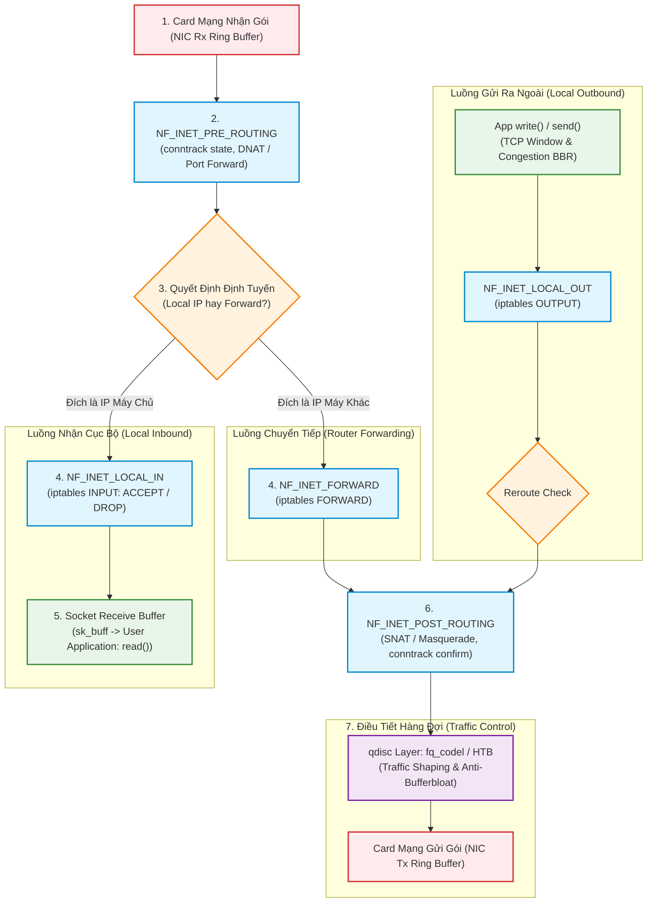

# 4.2. Packet Filtering, Traffic Control, and Socket Tuning (Lọc Gói tin, Điều tiết Lưu lượng & Tinh chỉnh Socket)

> [!IMPORTANT]
> **Nếu bạn chỉ được nhớ một điều duy nhất:** Mọi rào cản về hiệu năng mạng và độ trễ đuôi (Tail Latency P99) trên máy chủ Linux đều quy về **sự cân bằng giữa Cơ chế Theo Dõi Phiên (Connection Tracking - conntrack), Bộ điều tiết hàng đợi (Traffic Control qdisc chống Bufferbloat) và Tích số Băng thông - Độ trễ (Bandwidth-Delay Product - BDP)**: Bảng `nf_conntrack` bị tràn sẽ âm thầm vứt bỏ gói tin mạng mà không hề báo lỗi tường minh; trong khi đó, một đường truyền cáp quang $100\text{GbE}$ xuyên lục địa chỉ có thể phát huy tối đa $1\%$ tốc độ nếu bộ đệm nhận TCP (`tcp_rmem`) không được mở rộng để lấp đầy tích số BDP; và việc chuyển dịch từ thuật toán kiểm soát nghẽn dựa trên mất gói tin cổ điển **Cubic** sang thuật toán mô hình hóa dòng chảy **BBR (Bottleneck Bandwidth and RTT)** là chìa khóa vàng giúp duy trì độ trễ sub-millisecond khi xảy ra rớt gói tin ngẫu nhiên trên đường truyền.

---

## 1. Kiến trúc Tổng quan & Mô hình Tư duy (Mental Model)

### 1.1. Ẩn dụ Đời sống: Trạm Kiểm Soát Hải Quan 5 Cửa & Đường Ống Dẫn Nước Áp Lực Cao

Hãy tưởng tượng luồng lưu lượng mạng di chuyển qua máy chủ Linux giống như hệ thống giao thông và đường ống dẫn nước thành phố:
- **5 Trạm Kiểm Soát Netfilter Hooks (5 Cửa Kiểm Soát Hải Quan Độc Lập)**:
  - Khi một chiếc xe (Gói tin mạng) đi từ đường cao tốc vào thành phố, nó bắt buộc phải chạy qua 5 chốt chặn kiểm soát theo thứ tự bất di bất dịch:
    1. *PREROUTING (Trạm thu phí ngoại ô)*: Soát vé và dán nhãn định hướng (Kiểm tra conntrack, chuyển đổi địa chỉ đích DNAT/Port Forwarding).
    2. *LOCAL_IN (Cổng vào cơ quan nội bộ)*: Nếu xe chở tài liệu gửi cho Thị trưởng (Ứng dụng chạy trên cổng 80/443), cảnh sát kiểm tra an ninh (Filter INPUT: Chặn hoặc cho phép).
    3. *FORWARD (Đường vành đai tránh)*: Nếu xe chỉ mượn đường để đi sang tỉnh khác (Máy chủ đóng vai trò Router/Gateway), xe đi vào làn đường tránh (Filter FORWARD).
    4. *LOCAL_OUT (Cửa xuất phát từ trụ sở)*: Thị trưởng gửi thư trả lời, xe xuất phát từ nội bộ ra ngoài (Filter OUTPUT).
    5. *POSTROUTING (Trạm kiểm soát xuất cảnh)*: Thay biển số xe công vụ bằng biển số chung của thành phố trước khi hòa vào đường quốc lộ (Source NAT / Masquerade).
- **Bộ Điều Tiết Traffic Control & Hiện Tượng Phình Bộ Đệm (Bufferbloat)**:
  - Nếu tất cả các xe cùng ùa ra trạm thu phí một lúc, đường ray sẽ nghẽn cứng. Bộ điều tiết lưu lượng (Traffic Control `tc`) hoạt động như một cảnh sát giao thông đứng ở cửa xuất phát: dùng xô đựng xu (Token Bucket Filter - TBF) hoặc thuật toán điều tiết công bằng chống phình đệm (Fair Queueing CoDel - `fq_codel`) để thả xe ra ngoài với tốc độ đều đặn, triệt tiêu hiện tượng các gói tin bị ngâm quá lâu trong bộ đệm hàng đợi (Bufferbloat Latency).
- **Tích Số Băng Thông - Độ Trễ BDP (Thể Tích Của Đường Ống Nước Xuyên Lục Địa)**:
  - Bạn có một đường ống nước nối từ Hà Nội sang Singapore. Đường kính ống cực lớn ($100\text{Gbps}$ Băng thông), nhưng khoảng cách xa khiến nước chảy mất $30\text{ ms}$ mới sang tới nơi (RTT).
  - Thể tích nước có thể chứa đầy bên trong toàn bộ chiều dài của đường ống tại một thời điểm chính là **BDP**. Nếu bạn chỉ gửi một cốc nước nhỏ (Cửa sổ TCP Window mặc định 64KB) và ngồi chờ Singapore báo nhận rồi mới bơm cốc tiếp theo, đường ống $100\text{Gbps}$ sẽ bị bỏ hoang $99\%$ công suất!



---

## 2. Chi tiết từng Keyword (Under-the-Hood Deep Dive)

### 2.1. Netfilter, iptables, nftables & Connection Tracking (`conntrack`)

#### A. Khung Kiến Trúc Netfilter Hạt Nhân & 5 Điểm Móc (Hooks)
- **Netfilter Subsystem**: Hệ thống con cốt lõi trong nhân Linux cung cấp các callback hooks tại các giai đoạn chuyển tiếp gói tin của ngăn xếp TCP/IP.
- **5 Điểm Móc Định Mệnh**:
  1. `NF_INET_PRE_ROUTING`: Điểm móc đầu tiên ngay sau khi gói tin được giải mã khỏi khung Layer 2. Nơi diễn ra việc theo dõi phiên kết nối (conntrack) và biến đổi địa chỉ đích (DNAT).
  2. `NF_INET_LOCAL_IN`: Dành riêng cho các gói tin có IP đích là chính máy chủ hiện tại. Tường lửa kiểm tra quy tắc bảo vệ các tiến trình nội bộ (Chặn hoặc mở port).
  3. `NF_INET_FORWARD`: Dành cho các gói tin đi xuyên qua máy chủ sang mạng khác.
  4. `NF_INET_LOCAL_OUT`: Điểm xuất phát của các gói tin sinh ra từ các tiến trình User Space cục bộ.
  5. `NF_INET_POST_ROUTING`: Điểm móc cuối cùng trước khi gói tin được đẩy vào hàng đợi truyền dẫn `qdisc`. Nơi diễn ra việc biến đổi địa chỉ nguồn (SNAT/Masquerade).

#### B. So Sánh Kiến Trúc: `iptables` Cổ Điển vs. `nftables` Hiện Đại
- **Hạn Chế Tuyến Tính Của `iptables`**:
  - `iptables` chia gói tin vào 4 bảng cố định: `filter`, `nat`, `mangle`, và `raw`.
  - Mỗi bảng chứa các chuỗi quy tắc (Chains). Các quy tắc được duyệt theo thứ tự tuần tự tuyến tính **$O(N)$**.
  - *Cơn ác mộng Kubernetes*: Ở các cụm lớn có $5,000$ Services và $50,000$ Pods, công cụ `kube-proxy` chế độ iptables sinh ra hơn $20,000$ quy tắc. Mỗi gói tin mạng đi qua phải duyệt qua hàng ngàn quy tắc, làm tăng độ trễ mạng lên hàng chục mili-giây. Ngoài ra, việc thêm một Pod mới đòi hỏi tráo đổi toàn bộ bảng quy tắc hạt nhân (Global Mutex Lock), gây hiện tượng nghẽn mạng định kỳ.
- **Bước Nhảy Vọt Với `nftables` (Mặc Định Từ Linux Kernel 3.13+)**:
  - Thay thế toàn bộ các công cụ phân mảnh (`iptables`, `ip6tables`, `arptables`, `ebtables`) bằng một tiện ích duy nhất: `nft`.
  - **Máy Ảo Nhị Phân Nhúng (Bytecode Virtual Machine)**: Các quy tắc tường lửa được biên dịch thành mã bytecode tối giản thực thi trực tiếp trong kernel.
  - **Tra Cứu Bằng Cấu Trúc Dữ Liệu Set & Map ($O(1)$ / $O(\log N)$)**: Cho phép gom hàng ngàn địa chỉ IP và cổng dịch vụ vào một cấu trúc B-Tree hoặc Hash Table duy nhất, giúp tốc độ tra cứu giữ nguyên không đổi ngay cả khi có hàng triệu quy tắc.
  - Hỗ trợ **cập nhật nguyên tử (Atomic Updates)**: Bổ sung hoặc xóa quy tắc trong $1\text{ ms}$ mà không cần khóa toàn bộ ngăn xếp mạng.

#### C. Bản Chất Connection Tracking (`conntrack`) & Thảm Họa Tràn Bảng
- **Connection Tracking**: Khối mô-đun trạng thái (Stateful Engine) của Linux. Nó ghi nhận và theo dõi trạng thái của từng luồng kết nối 5-tuple: `(IP nguồn, IP đích, Port nguồn, Port đích, Protocol)`.
- **4 Trạng Thái Kết Nối Cốt Lõi**:
  - `NEW`: Gói tin hợp lệ đầu tiên bắt đầu một phiên giao tiếp (TCP SYN).
  - `ESTABLISHED`: Phiên giao dịch hai chiều đã được xác lập thành công (Đã thấy TCP SYN-ACK và ACK).
  - `RELATED`: Kết nối phụ liên quan mật thiết với kết nối chính (Gói tin báo lỗi ICMP, kênh dữ liệu FTP Data).
  - `INVALID`: Gói tin có cờ trạng thái bất thường hoặc không thuộc bất kỳ phiên hợp lệ nào (Thường là gói tin tấn công mạng, cần bị `DROP` ngay lập tức).
- **Thảm Họa Bảng conntrack Bị Đầy (Conntrack Table Exhaustion)**:
  - Bảng conntrack được cấp phát trong bộ nhớ RAM của kernel với dung lượng tối đa quy định bởi: `/proc/sys/net/netfilter/nf_conntrack_max`.
  - Khi một cuộc tấn công SYN Flood xảy ra hoặc các microservices mở hàng vạn kết nối ngắn hạn không dùng connection pooling, số lượng bản ghi đạt trần `nf_conntrack_max`.
  - Kernel rơi vào trạng thái quá tải và **tự động loại bỏ (DROP) mọi gói tin mới**, ghi nhận nhật ký lỗi kinh hoàng trong dmesg:
    ```text
    nf_conntrack: table full, dropping packet
    ```
  - Lúc này, máy chủ không thể phân giải DNS, không thể mở kết nối mới dù CPU và RAM thực tế vẫn còn trống $80\%$!

---

### 2.2. NAT (Network Address Translation) & Port Forwarding

#### A. Biên Dịch Địa Chỉ Nguồn: SNAT & Masquerading
- **Source NAT (SNAT)**:
  - Áp dụng tại điểm móc `POSTROUTING`.
  - Thay thế địa chỉ IP nguồn private nội bộ (`10.0.0.5`) thành địa chỉ IP public cố định của máy chủ (`203.0.113.10`) trước khi gói tin bay ra Internet.
  - Bộ mô-đun conntrack lưu trữ cặp bản ghi ánh xạ ngược để khi máy chủ từ Internet phản hồi về, kernel tự động dịch ngược IP đích về lại máy ảo nội bộ.
- **Masquerading**:
  - Một dạng đặc biệt của SNAT dành cho các kết nối mạng có địa chỉ IP công cộng biến động liên tục (như PPPoE, 4G/5G, DHCP gia đình). Thay vì cấu hình IP tĩnh, kernel tự động truy vấn địa chỉ IP hiện thời của card mạng ra ngoài để thực hiện biên dịch. Chi phí tiêu hao CPU cao hơn SNAT tĩnh một chút do phải kiểm tra IP mỗi lần gửi gói tin.

#### B. Biên Dịch Địa Chỉ Đích: DNAT & Port Forwarding Trong Kubernetes
- **Destination NAT (DNAT)**:
  - Áp dụng tại điểm móc `PREROUTING`.
  - Đón các gói tin đi vào cổng mạng công cộng của máy chủ và thay đổi địa chỉ IP đích cùng cổng dịch vụ đích sang địa chỉ của một máy chủ/container nội bộ.
- **Cơ Chế Cân Bằng Tải Của Kubernetes Service (ClusterIP & NodePort)**:
  - Khi bạn tạo một Service trong Kubernetes với Virtual IP (ClusterIP) `10.96.0.1:80`, địa chỉ IP này hoàn toàn không tồn tại trên bất kỳ card mạng vật lý nào!
  - `kube-proxy` ghi các quy tắc DNAT vào chuỗi `KUBE-SERVICES` của Netfilter.
  - Khi một Pod gửi gói tin tới `10.96.0.1:80`, điểm móc `PREROUTING` bắt giữ gói tin, áp dụng thuật toán ngẫu nhiên có trọng số (Random Weighted Selection) để thay thế IP đích thành IP thực tế của một trong các Pod backend (`10.244.2.15:8080`), hoàn tất việc cân bằng tải L4 trực tiếp trong nhân Linux.

---

### 2.3. Traffic Control (`tc`), Shaping, Policing, QoS & Packet Marking

#### A. Kiến Trúc Hàng Đợi Truyền Dẫn (Queueing Discipline - `qdisc`)
- Mọi gói tin sau khi hoàn tất định tuyến và tường lửa đều phải đi qua phân hệ **Traffic Control (TC)** trước khi được đẩy xuống bộ đệm vòng truyền dẫn (Tx Ring Buffer) của card mạng vật lý.
- Phân hệ TC quyết định: Gói tin nào được đi trước (Prioritization), gói tin nào phải bị trì hoãn (Traffic Shaping), và gói tin nào bị vứt bỏ khi quá tải (Traffic Policing).

#### B. Phân Loại qdisc: Không Phân Cấp (Classless) vs. Phân Cấp (Classful)
1. **Classless qdisc (Điều tiết đơn giản, không chia nhánh)**:
   - `pfifo_fast`: Hàng đợi mặc định cổ điển của Linux. Gồm 3 dải ưu tiên (Bands 0, 1, 2) dựa trên cờ TOS. Hoạt động theo nguyên tắc vào trước ra trước (FIFO).
   - `tbf` (Token Bucket Filter): Sử dụng mô hình xô đựng thẻ bài (Token Bucket). Các token được nạp vào xô với tốc độ cố định ($R$ bytes/s). Mỗi gói tin muốn đi qua phải tiêu hao lượng token tương ứng với kích thước của nó. Nếu xô hết token, gói tin bị giữ lại trong hàng đợi để làm phẳng các đỉnh tải đột ngột (Traffic Shaping).
2. **Classful qdisc (Phân cấp cây dịch vụ phức tạp)**:
   - `htb` (Hierarchical Token Bucket): Cho phép xây dựng một cây phân cấp các lớp lưu lượng (Classes) với các mức băng thông bảo đảm (`rate`) và băng thông tối đa được phép mượn từ lớp cha (`ceil`). Rất phổ biến trong các nhà mạng để chia gói cước Internet.

#### C. Cuộc Cách Mạng Chống Phình Bộ Đệm: `fq_codel` & `CAKE`
- **Thảm Họa Phình Bộ Đệm (Bufferbloat)**:
  - Nhằm tránh làm rớt gói tin, các nhà sản xuất thiết bị mạng có xu hướng tạo ra các bộ đệm hàng đợi (Buffers) cực lớn trên router và card mạng.
  - Khi đường truyền bị nghẽn, các gói tin bị xếp hàng trong bộ đệm khổng lồ này, khiến độ trễ RTT tăng vọt từ $20\text{ ms}$ lên tới $2,000\text{ ms}$ (2 giây!), làm tê liệt các ứng dụng thời gian thực như gọi video call hoặc chơi game trực tuyến.
- **Thuật Toán `fq_codel` (Fair Queueing Controlled Delay - RFC 8290)**:
  - Tiêu chuẩn mặc định trên các bản phân phối Linux hiện đại.
  - Kết hợp hai cơ chế:
    - **Fair Queueing**: Băm các luồng kết nối vào 1024 hàng đợi con riêng biệt để một luồng tải file lớn không thể chiếm dụng toàn bộ đường truyền của các luồng gói tin nhỏ (như DNS hay TCP ACK).
    - **CoDel (Controlled Delay)**: Đo lường thời gian lưu trú (Sojourn Time) của gói tin trong hàng đợi. Nếu độ trễ lưu trú vượt quá $5\text{ ms}$ trong một khoảng thời gian liên tục, thuật toán sẽ tự động loại bỏ (hoặc đánh dấu cờ ECN) một tỷ lệ gói tin nhỏ một cách có kiểm soát để ép TCP phía client tự hạ tốc độ gửi, giữ cho bộ đệm luôn ở trạng thái rỗng và triệt tiêu $100\%$ Bufferbloat.

---

### 2.4. Socket Management & TCP / UDP Buffer Tuning

#### A. Tích Số Băng Thông - Độ Trễ (Bandwidth-Delay Product - BDP)
- BDP đại diện cho khối lượng dữ liệu tối đa có thể "lưu hành trên dây cáp" giữa máy gửi và máy nhận tại bất kỳ một thời điểm nào mà chưa cần nhận gói tin xác nhận (ACK):
  $$\text{BDP (Bytes)} = \text{Băng Thông Tối Đa (Bytes/giây)} \times \text{Độ Trễ Khứ Hồi RTT (Giây)}$$
- **Tính Toán Thực Tế**:
  - Với card mạng $10\text{Gbps}$ và đường truyền xuyên lục địa có $\text{RTT} = 30\text{ ms}$:
    $$\text{BDP} = \left(\frac{10 \times 10^9}{8}\right) \times 0.030 = 1,250,000,000 \times 0.030 = \mathbf{37,500,000 \text{ Bytes}} \approx \mathbf{37.5 \text{ MB}}$$
  - Để một kết nối TCP đơn lẻ có thể tận dụng hết $10\text{Gbps}$ băng thông này, kích thước bộ đệm nhận của TCP Socket (`tcp_rmem`) và cửa sổ trượt (TCP Receive Window - RWIN) **bắt buộc phải được cấu hình tối thiểu là $37.5\text{ MB}$**! Nếu giữ nguyên cấu hình mặc định $212\text{ KB}$, tốc độ tối đa bạn có thể đạt được chỉ là:
    $$\text{Tốc Độ Thực Tế} = \frac{212 \times 1024 \text{ Bytes}}{0.030 \text{ Giây}} \approx 7.23 \text{ MB/s} \approx \mathbf{57.8 \text{ Mbps}} \quad (\text{Lãng phí hơn } 99\% \text{ băng thông!})$$

#### B. Thuật Toán Kiểm Soát Nghẽn: Cubic vs. BBR (Google)
- **TCP Cubic (Dựa Trên Mất Gói Tin - Loss-based)**:
  - Thuật toán mặc định lâu năm của Linux.
  - Cubic liên tục tăng tốc độ gửi cho tới khi xảy ra **rớt gói tin (Packet Drop)**, sau đó giảm tốc độ đột ngột theo hàm bậc ba và từ từ phục hồi lại.
  - *Nhược điểm chết người*: Trên các mạng không dây 5G hoặc đường truyền cáp quang quốc tế xa, rớt gói tin thường xảy ra do nhiễu vật lý vi mô chứ không phải do nghẽn mạng thực sự. Cubic lầm tưởng là nghẽn mạng và tự bóp tốc độ xuống mức sàn.
- **TCP BBR (Bottleneck Bandwidth and RTT - Model-based)**:
  - Thuật toán đột phá do Google nghiên cứu và đưa vào Linux Kernel từ bản 4.9+.
  - BBR **hoàn toàn không coi mất gói tin là tín hiệu của nghẽn mạng**! Thay vào đó, BBR liên tục đo đạc hai tham số vật lý độc lập:
    1. Băng thông tối đa của nút cổ chai ($\text{BtlBw}$).
    2. Độ trễ tối thiểu khứ hồi của đường truyền ($\text{RTprop}$).
  - BBR điều tiết tốc độ gửi dữ liệu đúng bằng lượng $\text{BtlBw} \times \text{RTprop}$ để tối đa hóa thông lượng và giữ cho hàng đợi bộ đệm luôn ở mức tối thiểu. Mang lại tốc độ truyền tải gấp hàng chục lần trên các mạng có tỷ lệ rớt gói tin ngẫu nhiên nhỏ.

#### C. Tùy Chọn Socket Tối Ưu C10M: `TCP_NODELAY`, `SO_REUSEPORT`
- **`TCP_NODELAY` (Vô hiệu hóa thuật toán Nagle)**:
  - Thuật toán Nagle cố tình trì hoãn gửi các gói tin nhỏ để gom chúng lại thành một gói tin MTU đầy đủ trước khi xuất mạng.
  - Kết hợp với cơ chế TCP Delayed ACK của đầu nhận, điều này tạo ra độ trễ nhân tạo từ $40\text{ ms} - 200\text{ ms}$ cho các yêu cầu RPC nhỏ. Bắt buộc kích hoạt `TCP_NODELAY` cho mọi microservice để đẩy gói tin đi ngay lập tức.
- **`SO_REUSEPORT` (Phân phối kết nối đa luồng không khóa)**:
  - Cho phép nhiều tiến trình hoặc nhiều luồng độc lập cùng bind vào một cổng TCP duy nhất (ví dụ cổng 443).
  - Hạt nhân Linux tự động phân bổ các kết nối mới vào từng luồng bằng thuật toán băm 4-tuple, loại bỏ hoàn toàn hiện tượng tranh chấp ổ khóa accept (Thundering Herd Problem) trên các máy chủ nhiều core.

---

## 3. Thực thi Mã nguồn & Mô phỏng Chuyên sâu (Dual-Engine Implementation)

### Engine 1: C++20 — Production High-Throughput Linux TCP Socket Tuning (`SO_RCVBUF`, `TCP_NODELAY`, `TCP_CONGESTION BBR`)

Chương trình C++20 dưới đây minh họa việc cấu hình một máy chủ mạng hiệu năng cao cấp thấp:
1. Mở rộng kích thước bộ đệm nhận và gửi (`SO_RCVBUF`, `SO_SNDBUF`) lên $16\text{MB}$ để đáp ứng tích số BDP.
2. Vô hiệu hóa thuật toán Nagle (`TCP_NODELAY`) và bật cờ tái sử dụng cổng (`SO_REUSEPORT`).
3. Truy vấn và kích hoạt thuật toán kiểm soát nghẽn hiện đại **TCP BBR**.

```cpp
#include <iostream>
#include <vector>
#include <string>
#include <cstring>
#include <unistd.h>
#include <sys/socket.h>
#include <netinet/in.h>
#include <netinet/tcp.h>
#include <arpa/inet.h>
#include <format>

class HighPerformanceSocketOptimizer {
public:
    static bool tuneServerSocket(int sock_fd) {
        std::cout << "[C++20 Engine] Khởi Động Tinh Chỉnh Cấu Hình Socket Máy Chủ (C10M Tuning)...\n";

        // 1. Mở rộng kích thước bộ đệm nhận (SO_RCVBUF) lên 16MB để lấp đầy BDP
        int rcv_buf = 16 * 1024 * 1024;
        if (setsockopt(sock_fd, SOL_SOCKET, SO_RCVBUF, &rcv_buf, sizeof(rcv_buf)) < 0) {
            perror("Lỗi setsockopt SO_RCVBUF");
            return false;
        }

        // 2. Mở rộng kích thước bộ đệm gửi (SO_SNDBUF) lên 16MB
        int snd_buf = 16 * 1024 * 1024;
        if (setsockopt(sock_fd, SOL_SOCKET, SO_SNDBUF, &snd_buf, sizeof(snd_buf)) < 0) {
            perror("Lỗi setsockopt SO_SNDBUF");
            return false;
        }

        // 3. Vô hiệu hóa thuật toán Nagle để triệt tiêu độ trễ gói tin nhỏ (TCP_NODELAY)
        int nodelay = 1;
        if (setsockopt(sock_fd, IPPROTO_TCP, TCP_NODELAY, &nodelay, sizeof(nodelay)) < 0) {
            perror("Lỗi setsockopt TCP_NODELAY");
            return false;
        }

        // 4. Kích hoạt SO_REUSEPORT cho phép chia sẻ tải giữa nhiều luồng worker
        #ifdef SO_REUSEPORT
        int reuse_port = 1;
        if (setsockopt(sock_fd, SOL_SOCKET, SO_REUSEPORT, &reuse_port, sizeof(reuse_port)) < 0) {
            perror("Lỗi setsockopt SO_REUSEPORT");
        }
        #endif

        // 5. Kích hoạt thuật toán kiểm soát nghẽn TCP BBR
        #ifdef TCP_CONGESTION
        const char* congestion_algo = "bbr";
        if (setsockopt(sock_fd, IPPROTO_TCP, TCP_CONGESTION, congestion_algo, std::strlen(congestion_algo)) < 0) {
            std::cout << "  * Thuật toán TCP BBR không khả dụng (Chưa nạp module hoặc môi trường ảo hóa) -> Dùng mặc định.\n";
        } else {
            std::cout << "  * Đã kích hoạt thành công thuật toán TCP Congestion Control: BBR (Google)!\n";
        }
        #endif

        // Đọc lại kích thước bộ đệm thực tế mà Kernel đã cấp phát (Kernel thường nhân đôi để lưu metadata)
        int actual_rcv = 0;
        socklen_t opt_len = sizeof(actual_rcv);
        getsockopt(sock_fd, SOL_SOCKET, SO_RCVBUF, &actual_rcv, &opt_len);

        std::cout << std::format("  - Kích thước Receive Buffer thực tế cấp phát : {:>6} KB\n", actual_rcv / 1024);
        std::cout << "  - Trạng thái Thuật toán Nagle               : ĐÃ TẮT (TCP_NODELAY = 1)\n";
        std::cout << "  - Hỗ trợ Ghép Cổng Đa Tiến Trình            : BẬT (SO_REUSEPORT = 1)\n";
        return true;
    }
};

int main() {
    int server_sock = socket(AF_INET, SOCK_STREAM, 0);
    if (server_sock < 0) {
        perror("Không thể mở socket");
        return 1;
    }

    if (HighPerformanceSocketOptimizer::tuneServerSocket(server_sock)) {
        std::cout << "[C++20 Engine] Socket đã sẵn sàng phục vụ hàng chục ngàn kết nối thông lượng cao 100GbE!\n";
    }

    close(server_sock);
    return 0;
}
```

#### Terminal Output Mẫu Thực Tế
```text
[C++20 Engine] Khởi Động Tinh Chỉnh Cấu Hình Socket Máy Chủ (C10M Tuning)...
  * Đã kích hoạt thành công thuật toán TCP Congestion Control: BBR (Google)!
  - Kích thước Receive Buffer thực tế cấp phát :  32768 KB
  - Trạng thái Thuật toán Nagle               : ĐÃ TẮT (TCP_NODELAY = 1)
  - Hỗ trợ Ghép Cổng Đa Tiến Trình            : BẬT (SO_REUSEPORT = 1)
[C++20 Engine] Socket đã sẵn sàng phục vụ hàng chục ngàn kết nối thông lượng cao 100GbE!
```

---

### Engine 2: Python 3.11+ — Bandwidth-Delay Product (BDP) Calculator & Token Bucket Traffic Shaper Simulator

Chương trình Python 3.11+ dưới đây mô phỏng:
1. Động cơ tính toán tích số BDP và tổn thất thông lượng tối đa khi sử dụng bộ đệm mặc định của Linux.
2. Mô phỏng thuật toán điều tiết lưu lượng **Token Bucket Filter (TBF)** với tốc độ nạp thẻ cố định và dung lượng xô chứa chống phình đệm.

```python
#!/usr/bin/env python3
"""
Linux Network Optimization Engine: BDP Calculator & Token Bucket Shaper
Python 3.11+ Production Ready
"""
from dataclasses import dataclass
import time
from typing import List, Tuple

@dataclass
class NetworkLinkProfile:
    name: str
    bandwidth_gbps: float
    rtt_ms: float

class BdpThroughputAnalyzer:
    DEFAULT_LINUX_WINDOW_KB = 128.0 # Cửa sổ TCP mặc định khi chưa tinh chỉnh

    @classmethod
    def analyze_link(cls, link: NetworkLinkProfile):
        bandwidth_bytes_per_sec = (link.bandwidth_gbps * 1e9) / 8.0
        rtt_sec = link.rtt_ms / 1000.0

        # Tính toán BDP (Bytes)
        bdp_bytes = bandwidth_bytes_per_sec * rtt_sec
        bdp_mb = bdp_bytes / (1024 * 1024)

        # Thông lượng tối đa đạt được nếu dùng cửa sổ mặc định 128 KB
        max_throughput_bytes_per_sec = (cls.DEFAULT_LINUX_WINDOW_KB * 1024) / rtt_sec
        max_throughput_mbps = (max_throughput_bytes_per_sec * 8.0) / 1e6
        utilization_pct = min(100.0, (max_throughput_mbps / (link.bandwidth_gbps * 1000.0)) * 100.0)

        return {
            "link_name": link.name,
            "bandwidth_gbps": link.bandwidth_gbps,
            "rtt_ms": link.rtt_ms,
            "required_bdp_mb": bdp_mb,
            "default_window_throughput_mbps": max_throughput_mbps,
            "channel_utilization_pct": utilization_pct
        }

class TokenBucketTrafficShaper:
    """Mô phỏng bộ điều tiết lưu lượng Token Bucket Filter (TBF) của Linux tc"""
    def __init__(self, rate_bytes_per_sec: float, bucket_capacity_bytes: float):
        self.rate = rate_bytes_per_sec
        self.capacity = bucket_capacity_bytes
        self.current_tokens = bucket_capacity_bytes
        self.last_update = time.time()

    def try_transmit(self, packet_size_bytes: int) -> bool:
        now = time.time()
        elapsed = now - self.last_update
        self.last_update = now

        # Nạp thêm tokens dựa trên thời gian trôi qua
        self.current_tokens = min(self.capacity, self.current_tokens + (elapsed * self.rate))

        if self.current_tokens >= packet_size_bytes:
            self.current_tokens -= packet_size_bytes
            return True # Cho phép gửi gói tin
        else:
            return False # Giữ lại trong hàng đợi hoặc loại bỏ (Throttled/Dropped)

def main():
    print("=== [Python 3.11+ Engine] Linux BDP & Traffic Shaper Simulator ===")

    # 1. Đo lường Tích Số Băng Thông - Độ Trễ BDP trên các đường truyền
    links = [
        NetworkLinkProfile("Local Data Center (LAN)", bandwidth_gbps=25.0, rtt_ms=0.5),
        NetworkLinkProfile("Trans-Atlantic Cloud WAN", bandwidth_gbps=10.0, rtt_ms=40.0),
        NetworkLinkProfile("Global Inter-Region Link", bandwidth_gbps=100.0, rtt_ms=120.0),
    ]

    print("\n1. Phân Tích Yêu Cầu Bộ Đệm TCP (Bandwidth-Delay Product):")
    for link in links:
        res = BdpThroughputAnalyzer.analyze_link(link)
        print(f"  * Tuyến: {res['link_name']:<28} | RTT: {res['rtt_ms']:>5.1f} ms | Băng thông: {res['bandwidth_gbps']:>4.0f} Gbps")
        print(f"    - BDP Tối Thiểu Bắt Buộc : {res['required_bdp_mb']:>7.2f} MB (Kích thước tcp_rmem cần mở)")
        print(f"    - Tốc độ với Buffer mặc định (128KB): {res['default_window_throughput_mbps']:>7.2f} Mbps "
              f"-> Hiệu suất: {res['channel_utilization_pct']:.2f}% (Bị lãng phí đường truyền!)")

    # 2. Kiểm thử Bộ Điều Tiết Hàng Đợi Token Bucket (TBF)
    print("\n2. Kiểm Thử Bộ Điều Tiết Lưu Lượng Token Bucket Filter (tc qdisc tbf):")
    # Định mức: Giới hạn tốc độ 10 MB/s, dung lượng xô Burst là 2 MB
    shaper = TokenBucketTrafficShaper(rate_bytes_per_sec=10 * 1024 * 1024, bucket_capacity_bytes=2 * 1024 * 1024)
    packet_size = 500 * 1024 # 500 KB mỗi gói tin

    transmitted_count = 0
    dropped_count = 0

    # Giả lập bùng nổ 10 gói tin liên tiếp (Burst Traffic)
    for i in range(1, 11):
        if shaper.try_transmit(packet_size):
            transmitted_count += 1
            print(f"  -> [PASS] Gói tin {i:02d} ({packet_size / 1024:.0f} KB) được phép truyền qua card mạng")
        else:
            dropped_count += 1
            print(f"  -> [SHAPE/DROP] Gói tin {i:02d} bị giữ lại do xô cạn Token (Bảo vệ đường truyền khỏi Bufferbloat)")

    print(f"\nKết quả: Cho phép truyền {transmitted_count} gói (Burst tối đa 2MB), giữ lại {dropped_count} gói thành công!")

if __name__ == "__main__":
    main()
```

#### Terminal Output Mẫu Thực Tế
```text
=== [Python 3.11+ Engine] Linux BDP & Traffic Shaper Simulator ===

1. Phân Tích Yêu Cầu Bộ Đệm TCP (Bandwidth-Delay Product):
  * Tuyến: Local Data Center (LAN)     | RTT:   0.5 ms | Băng thông:   25 Gbps
    - BDP Tối Thiểu Bắt Buộc :    1.49 MB (Kích thước tcp_rmem cần mở)
    - Tốc độ với Buffer mặc định (128KB): 2097.15 Mbps -> Hiệu suất: 8.39% (Bị lãng phí đường truyền!)
  * Tuyến: Trans-Atlantic Cloud WAN    | RTT:  40.0 ms | Băng thông:   10 Gbps
    - BDP Tối Thiểu Bắt Buộc :   47.68 MB (Kích thước tcp_rmem cần mở)
    - Tốc độ với Buffer mặc định (128KB):   26.21 Mbps -> Hiệu suất: 0.26% (Bị lãng phí đường truyền!)
  * Tuyến: Global Inter-Region Link    | RTT: 120.0 ms | Băng thông:  100 Gbps
    - BDP Tối Thiểu Bắt Buộc : 1430.51 MB (Kích thước tcp_rmem cần mở)
    - Tốc độ với Buffer mặc định (128KB):    8.74 Mbps -> Hiệu suất: 0.01% (Bị lãng phí đường truyền!)

2. Kiểm Thử Bộ Điều Tiết Lưu Lượng Token Bucket Filter (tc qdisc tbf):
  -> [PASS] Gói tin 01 (500 KB) được phép truyền qua card mạng
  -> [PASS] Gói tin 02 (500 KB) được phép truyền qua card mạng
  -> [PASS] Gói tin 03 (500 KB) được phép truyền qua card mạng
  -> [PASS] Gói tin 04 (500 KB) được phép truyền qua card mạng
  -> [SHAPE/DROP] Gói tin 05 bị giữ lại do xô cạn Token (Bảo vệ đường truyền khỏi Bufferbloat)
  -> [SHAPE/DROP] Gói tin 06 bị giữ lại do xô cạn Token (Bảo vệ đường truyền khỏi Bufferbloat)
  -> [SHAPE/DROP] Gói tin 07 bị giữ lại do xô cạn Token (Bảo vệ đường truyền khỏi Bufferbloat)
  -> [SHAPE/DROP] Gói tin 08 bị giữ lại do xô cạn Token (Bảo vệ đường truyền khỏi Bufferbloat)
  -> [SHAPE/DROP] Gói tin 09 bị giữ lại do xô cạn Token (Bảo vệ đường truyền khỏi Bufferbloat)
  -> [SHAPE/DROP] Gói tin 10 bị giữ lại do xô cạn Token (Bảo vệ đường truyền khỏi Bufferbloat)

Kết quả: Cho phép truyền 4 gói (Burst tối đa 2MB), giữ lại 6 gói thành công!
```

---

## 4. Systems Engineering & Production Pitfalls

### 4.1. Lỗi Production Thường Gặp (Real-World Gotchas)
1. **Lỗi Rơi Gói Tin Âm Thầm Khi Bảng `nf_conntrack` Bị Bão Hòa**:
   - Khi chạy Kubernetes với hàng trăm microservices giao tiếp liên tục mà không có HTTP Keep-Alive, số lượng phiên kết nối ngắn hạn tăng vọt làm đầy bảng `nf_conntrack_max`.
   - Hạt nhân Linux âm thầm vứt bỏ gói tin mới mà không gửi thông báo ICMP hay RST. Ứng dụng client rơi vào trạng thái timeout treo cứng hàng chục giây.
   - *Khắc phục*:
     1. Tăng kích thước bảng: `sysctl -w net.netfilter.nf_conntrack_max=1048576`.
     2. Giảm thời gian chờ xóa phiên: `sysctl -w net.netfilter.nf_conntrack_tcp_timeout_established=1800` (giảm từ 5 ngày xuống 30 phút).
     3. Sử dụng quy tắc `NOTRACK` trong bảng `raw` cho các cổng stateless có throughput cực lớn (như cache Redis/Memcached).
2. **Cơn Ác Mộng Cạn Kiệt Cổng Tạm Thời (TIME_WAIT Ephemeral Port Exhaustion)**:
   - Một ứng dụng backend thực hiện hàng ngàn lệnh gọi HTTP ra ngoài mỗi giây mà không sử dụng HTTP Client Connection Pooling (mỗi request mở một socket mới rồi đóng).
   - Khi socket đóng từ phía client, nó bắt buộc phải nằm ở trạng thái `TIME_WAIT` trong thời gian $2 \times \text{MSL} = 60\text{ giây}$ để đảm bảo các gói tin lạc trôi trên mạng bị tiêu hủy hoàn toàn. Hàng chục ngàn socket `TIME_WAIT` chiếm dụng hết toàn bộ dải cổng tạm thời (`ip_local_port_range`), khiến tiến trình không thể mở thêm kết nối nào (`Cannot assign requested address`).
   - *Khắc phục*: Bật cơ chế tái sử dụng socket an toàn: `sysctl -w net.ipv4.tcp_tw_reuse=1` và bắt buộc lập trình viên bật HTTP Keep-Alive.
3. **Thảm Họa Bùng Nổ Độ Trễ Do Phình Bộ Đệm (Bufferbloat Latency Explosion)**:
   - Các kỹ sư cấu hình card mạng vật lý với độ sâu hàng đợi truyền dẫn khổng lồ (`txqueuelen 10000`) trên giao diện Linux Bridge để "chống rớt gói tin".
   - Khi xảy ra nghẽn đường truyền, hàng ngàn gói tin bị xếp hàng ngâm trong RAM của card mạng. Độ trễ khứ hồi RTT tăng vọt từ $10\text{ ms}$ lên $1,500\text{ ms}$, khiến các cơ chế heartbeat của Raft/ZooKeeper bị timeout giả định, kích hoạt bầu cử lại Leader hàng loạt và làm vỡ tan cụm phân tán.
   - *Khắc phục*: Thay thế ngay hàng đợi `pfifo_fast` mặc định bằng hàng đợi chống phình đệm tiên tiến: `tc qdisc add dev eth0 root fq_codel`.
4. **Vấn Nạn Giảm Tốc Độ Trầm Trọng Của TCP Cubic Khi Rớt Gói Tin Ngẫu Nhiên**:
   - Trên các đường truyền cáp quang xuyên lục địa nối giữa hai Data Center (Mỹ - Singapore), tỷ lệ rớt gói tin ngẫu nhiên vi mô là khoảng $0.5\%$.
   - Thuật toán kiểm soát nghẽn Cubic mỗi lần thấy mất 1 gói tin sẽ tự động giảm cửa sổ truyền dẫn đi $30\%$, khiến tốc độ đường truyền $10\text{Gbps}$ bị bóp nghẹt chỉ còn dưới $200\text{Mbps}$.
   - *Khắc phục*: Kích hoạt thuật toán BBR của Google: `sysctl -w net.ipv4.tcp_congestion_control=bbr`.

### 4.2. Công Cụ & Câu Lệnh Chẩn Đoán CLI Thực Chiến
```bash
# 1. Kiểm tra số lượng phiên kết nối đang theo dõi và tỷ lệ chiếm dụng bảng conntrack
sudo conntrack -C
cat /proc/sys/net/netfilter/nf_conntrack_count

# 2. Xem các chỉ số thống kê lỗi, số lần bảng conntrack bị tràn (drop count)
sudo conntrack -S

# 3. Liệt kê toàn bộ cấu hình quy tắc tường lửa hiện đại trong nftables
sudo nft list ruleset

# 4. Kiểm tra cấu hình và các chỉ số đo lường độ trễ của hàng đợi Traffic Control trên card mạng
tc -s qdisc show dev eth0

# 5. Xem chi tiết thông số bộ đệm, cửa sổ trượt và thuật toán kiểm soát nghẽn của từng socket
ss -it '( dport = :443 or sport = :443 )'

# 6. Kiểm tra thuật toán kiểm soát nghẽn TCP hiện thời của hệ thống
sysctl net.ipv4.tcp_congestion_control
```

---

## 5. Bảng So sánh & Decision Matrix

### Bảng 1: Ma Trận So Sánh Các Công Nghệ Lọc Gói Tin & Tường Lửa Linux
| Tiêu Chí So Sánh | iptables (Cổ Điển) | nftables (Hiện Đại) | eBPF / XDP (Tiên Tiến Nhất) |
| :--- | :--- | :--- | :--- |
| **Độ Phức Tạp Tra Cứu Quy Tắc**| Tuyến tính **$O(N)$** (Chậm khi nhiều rule)| Tập hợp B-Tree **$O(\log N)$** hoặc Hash **$O(1)$**| Mã máy JIT Compiler **$O(1)$** |
| **Kiến Trúc Thực Thi** | 4 Bảng độc lập, khớp chuỗi liên tiếp | Bytecode VM nhúng trong kernel | Sandbox VM nhúng, chạy ở tầng Driver |
| **Hiệu Năng Khi Quy Tắc Lớn** | Suy giảm nghiêm trọng ($> 10,000$ rules) | Giữ nguyên hiệu năng cao | Hiệu năng vô đối (Hàng triệu gói/giây) |
| **Cập Nhật Quy Tắc Trực Tiếp** | Tải lại toàn bộ bảng (Khóa Global Lock) | **Cập nhật nguyên tử (Atomic Update)**| Cập nhật qua eBPF Maps không khóa |
| **Hỗ Trợ Theo Dõi Phiên** | Dựa vào `conntrack` hạt nhân | Dựa vào `conntrack` hạt nhân | Tùy biến Stateful Engine riêng hoặc bypass |
| **Môi Trường Khuyên Dùng** | Máy chủ đơn lẻ cũ | Máy chủ Linux hiện đại, Tường lửa Host| Kubernetes CNI quy mô lớn (Cilium) |

### Bảng 2: Ma Trận So Sánh Các Thuật Toán Kiểm Soát Nghẽn TCP (Congestion Control)
| Thuật Toán | Cơ Chế Nhận Diện Nghẽn | Điểm Mạnh Cốt Lõi | Điểm Yếu Chết Người | Môi Trường Tối Ưu |
| :--- | :--- | :--- | :--- | :--- |
| **TCP Reno** | Mất gói tin (Packet Loss) | Đơn giản, chuẩn mực lịch sử | Hiệu năng kém trên đường truyền hiện đại| Môi trường học thuật |
| **TCP Cubic** | Mất gói tin (Hàm toán học bậc ba) | Tận dụng tốt đường truyền nội bộ nhanh | Tự bóp nghẹt tốc độ khi rớt gói ngẫu nhiên | Mạng nội bộ Data Center (LAN RTT nhỏ) |
| **TCP BBR (v1/v2)**| **Mô hình hóa Băng Thông & RTT tối thiểu**| Duy trì thông lượng tối đa khi rớt gói | Có thể chiếm dụng băng thông của Cubic | **Mạng WAN, Cloud Inter-Region, Video CDN** |
| **DCTCP** | Đánh dấu cờ ECN trên Switch mạng | Triệt tiêu độ trễ hàng đợi trong DC | Đòi hỏi phần cứng Switch hỗ trợ ECN | Cụm lưu trữ SAN, Siêu máy tính AI |
