# 4.3. Kernel Bypass, Acceleration, and Network Diagnostics (Tăng tốc Mạng Bỏ qua Hạt nhân & Chẩn đoán Sự cố Mạng)

> [!IMPORTANT]
> **Nếu bạn chỉ được nhớ một điều duy nhất:** Tại tốc độ mạng hiện đại $100\text{GbE} - 400\text{GbE}$ với thông lượng lên tới $148.8\text{ triệu gói tin/giây}$ (tương đương mỗi gói tin chỉ có vỏn vẹn $6.72\text{ nanoseconds}$ hay $\approx 20\text{ chu kỳ lệnh CPU}$ để xử lý), **ngăn xếp mạng truyền thống của Linux Kernel (Ngắt phần cứng, cấp phát `sk_buff`, chuyển đổi ngữ cảnh Ring 0/Ring 3) hoàn toàn sụp đổ do chi phí điều phối CPU vượt quá giới hạn vật lý**: Sự tiến hóa của kiến trúc mạng siêu trễ (Ultra-Low Latency) phân nhánh thành hai giải pháp chiến lược: **eBPF / XDP (eXpress Data Path)** can thiệp và xử lý gói tin ngay tại tầng Device Driver của card mạng trong thời gian $1\text{ microsecond}$ mà vẫn duy trì tính an toàn của hạt nhân; và **DPDK (Data Plane Development Kit)** bỏ qua hoàn toàn hạt nhân (Full Kernel Bypass), sử dụng trình điều khiển chế độ thăm dò liên tục (**Poll Mode Driver - PMD** chiếm trọn $100\%$ lõi CPU) kết hợp bộ nhớ trang lớn (**Hugepages**) để trao đổi dữ liệu trực tiếp với phần cứng DMA với độ trễ tối thượng dưới $500\text{ nanoseconds}$.

---

## 1. Kiến trúc Tổng quan & Mô hình Tư duy (Mental Model)

### 1.1. Ẩn dụ Đời sống: Quầy Thủ Tục Hải Quan Cổ Điển vs. Cửa Sinh Trắc Học Tự Động vs. Làn Xe Ngoại Giao VIP

Hãy tưởng tượng luồng hành khách (Gói tin mạng) cập bến một sân bay quốc tế siêu bận rộn:
- **Ngăn Xếp Mạng Linux Truyền Thống (Quầy thủ tục hải quan 5 cửa)**:
  - Hành khách xuống máy bay (Card mạng nhận tín hiệu), chuông báo động réo lên làm gián đoạn mọi việc nhân viên đang làm (Hardware Interrupt IRQ).
  - Nhân viên hải quan phát cho mỗi khách một bộ hồ sơ giấy tờ dày cộp (`struct sk_buff`), dẫn khách đi qua phòng soi chiếu an ninh (Netfilter / iptables), đóng dấu thị thực (IP Routing), rồi hộ tống khách qua cửa chuyển tiếp hành lý sang xe taxi (Sao chép dữ liệu từ Kernel Space vào User Space qua Socket Buffer).
  - Tốc độ tối đa chỉ phục vụ được vài chục ngàn khách/giờ. Nếu có 1 triệu khách ùa vào cùng một giây, toàn bộ sân bay vỡ trận vì nghẽn ngắt (Interrupt Storm).
- **XDP - eXpress Data Path (Cửa quét khuôn mặt sinh trắc học tự động tại cửa máy bay)**:
  - Ngay khi hành khách vừa bước chân ra khỏi cửa máy bay (Tầng Driver card mạng), camera AI quét khuôn mặt trong $1\text{ microsecond}$.
  - Nếu là kẻ bị truy nã (Gói tin DDoS tấn công), cửa tự động sập xuống đẩy ngược ra ngoài (`XDP_DROP`).
  - Nếu là khách VIP chuyển tiếp máy bay nội địa, cửa tự động đẩy thẳng sang cổng bay khác (`XDP_TX`).
  - Không tốn một tờ giấy thủ tục nào (Không cấp phát `sk_buff`), tiết kiệm $90\%$ năng lượng của nhân viên sân bay.
- **DPDK - Data Plane Development Kit (Làn xe buýt ngoại giao VIP - Bỏ qua toàn bộ sân bay)**:
  - Hành khách VIP không bước chân vào nhà ga sân bay (Không chạm vào Linux Kernel).
  - Một chiếc xe buýt chuyên dụng riêng nổ máy liên tục 24/7 (Poll Mode Driver - $100\%$ CPU Polling), chạy thẳng ra chân cầu thang máy bay, bốc hành khách đưa thẳng ra đường cao tốc tư nhân (Direct DMA Memory Mapping vào User Space).
  - Đạt độ trễ tuyệt đối dưới 500 nanosecond, nhưng cái giá phải trả là chiếc xe buýt này đốt xăng liên tục (Chiếm trọn $100\%$ CPU core ngay cả khi không có khách).

```mermaid
flowchart TD
    classDef hw fill:#ffebee,stroke:#d32f2f,stroke-width:2px;
    classDef standard fill:#e1f5fe,stroke:#0288d1,stroke-width:2px;
    classDef xdp fill:#e8f5e9,stroke:#388e3c,stroke-width:2px;
    classDef dpdk fill:#f3e5f5,stroke:#7b1fa2,stroke-width:2px;
    classDef user fill:#fff3e0,stroke:#f57c00,stroke-width:2px;

    PhysicalNIC["Physical 100GbE / 400GbE NIC (DMA Controller)"]:::hw

    subgraph StandardKernelStack ["1. Ngăn Xếp Chuẩn (Standard Linux Stack - Độ trễ: 5 - 15 µs)"]
        RingBuf["Rx Ring Buffer Descriptors"]:::standard
        HardIRQ["Hardware Interrupt (MSI-X IRQ)"]:::standard
        NAPI["NAPI Subsystem: Cấp phát struct sk_buff"]:::standard
        Netfilter["Netfilter Hooks & TCP/IP Stack"]:::standard
        SocketBuf["Socket Queue -> Copy sang User Memory"]:::standard

        RingBuf --> HardIRQ --> NAPI --> Netfilter --> SocketBuf
    end

    subgraph XDP_Architecture ["2. Tầng Lái Card Mạng XDP (eBPF Driver Layer - Độ trễ: 1 - 2 µs)"]
        DriverHook["XDP Driver Hook (Thực thi eBPF Bytecode)"]:::xdp
        Action_Drop["XDP_DROP (Triệt tiêu DDoS 140 Mpps)"]:::xdp
        Action_Tx["XDP_TX (Hairpin Forwarding)"]:::xdp
        Action_Pass["XDP_PASS (Đẩy lên Kernel Stack bình thường)"]:::standard
        Action_Redirect["XDP_REDIRECT -> AF_XDP Zero-Copy Socket"]:::xdp

        DriverHook --> Action_Drop
        DriverHook --> Action_Tx
        DriverHook --> Action_Pass
        DriverHook --> Action_Redirect
    end

    subgraph DPDK_KernelBypass ["3. Bỏ Qua Hạt Nhân Toàn Phần (DPDK - Độ trễ: < 500 ns)"]
        UIO_VFIO["PCIe Pass-through (vfio-pci / IOMMU)"]:::dpdk
        PMD_Poller["Poll Mode Driver (PMD: 100% CPU Busy-Polling)"]:::dpdk
        Hugepages["Hugepages (1GB RAM Pages Không Phân Trang)"]:::dpdk
        DPDK_App["Ứng Dụng User Space (Giao dịch Tần Số Cao HFT / BIRD)"]:::user

        UIO_VFIO --> PMD_Poller
        PMD_Poller --> Hugepages
        Hugepages --> DPDK_App
    end

    PhysicalNIC --> StandardKernelStack
    PhysicalNIC --> XDP_Architecture
    PhysicalNIC ==>|"Bỏ qua Kernel Driver"| DPDK_KernelBypass
```



---

## 2. Chi tiết từng Keyword (Under-the-Hood Deep Dive)

### 2.1. Ring Buffers, RSS, RPS & XPS

#### A. Bộ Đệm Vòng Phần Cứng (NIC Rx/Tx Ring Buffers)
- **Cấu Trúc Hàng Đợi Vòng (Circular FIFO Descriptors)**:
  - Trên bo mạch card mạng và trong RAM máy chủ, giao tiếp giữa phần cứng NIC và hệ điều hành diễn ra qua hai hàng đợi vòng: **Rx Ring Buffer** (nhận) và **Tx Ring Buffer** (gửi).
  - Mỗi phần tử trong Ring Buffer không chứa dữ liệu gói tin trực tiếp mà là một bản ghi mô tả bộ nhớ (**Buffer Descriptor**): Lưu địa chỉ vật lý DMA trong RAM và độ dài của gói tin.
- **Hiện Tượng Tràn Bộ Đệm (Buffer Overruns & Rx Drops)**:
  - Khi lưu lượng mạng đổ về với tốc độ bùng nổ (Microbursts) mà luồng xử lý NAPI của CPU chưa kịp thu dọn descriptors, con trỏ ghi của card mạng đuổi kịp con trỏ đọc của driver.
  - Card mạng không còn chỗ để ghi dữ liệu DMA, buộc phải loại bỏ các gói tin tiếp theo (**Rx Drops / Buffer Overruns**). Kỹ sư kiểm tra qua `ethtool -S eth0 | grep rx_dropped`.
  - Khắc phục bằng cách mở rộng kích thước Ring Buffer lên mức tối đa phần cứng hỗ trợ: `ethtool -G eth0 rx 4096 tx 4096`.

#### B. Phân Bổ Tải Phần Cứng: RSS (Receive Side Scaling)
- **Nghẽn Cổ Chai Đơn Core (Single-Core Bottleneck)**:
  - Trên các card mạng đời cũ, mọi gói tin nhận về đều kích hoạt ngắt trên cùng một CPU Core duy nhất (thường là CPU0), khiến CPU0 chạm ngưỡng $100\%$ SoftIRQ trong khi 63 cores còn lại hoàn toàn nhàn rỗi.
- **Cơ Chế Phân Phối Đa Hàng Đợi Bằng Phần Cứng (RSS)**:
  - Card mạng hiện đại trang bị nhiều hàng đợi Rx độc lập (Multi-Queue NIC: 8, 16, 32 hoặc 64 hàng đợi).
  - Bộ vi xử lý mạng tích hợp trên NIC (ASIC) tự động trích xuất tiêu đề gói tin (4-Tuple: IP nguồn, IP đích, Port nguồn, Port đích), chạy qua thuật toán băm mật mã phần cứng **Toeplitz Hash**.
  - Kết quả băm được tra cứu vào bảng chỉ dẫn **Indirection Table (128 hoặc 512 mục)** để phân phối gói tin vào một hàng đợi Rx cụ thể.
  - Mỗi hàng đợi Rx được gắn với một đường ngắt phần cứng độc lập (**MSI-X Vector**) kích hoạt trực tiếp vào một core CPU riêng biệt, giúp chia đều tải xử lý mạng cho toàn bộ các nhân vi xử lý.

#### C. Bản Sao Phần Mềm Của Hạt Nhân: RPS & XPS
- **RPS (Receive Packet Steering)**:
  - Giải pháp phần mềm của Linux Kernel dành cho các card mạng giá rẻ chỉ có 1 hàng đợi phần cứng.
  - Khi ngắt xảy ra trên CPU0, driver đọc gói tin và kernel tự tính toán băm hash, sau đó phát tín hiệu ngắt phần mềm nội bộ (Inter-Processor Interrupt - IPI) để chuyển giao cấu trúc `sk_buff` sang cho các core CPU khác xử lý ngăn xếp giao thức TCP/IP.
- **XPS (Transmit Packet Steering)**:
  - Cơ chế điều phối luồng gửi gói tin ra mạng.
  - Ánh xạ trực tiếp từng CPU Core cụ thể tới một hàng đợi Tx riêng biệt của card mạng: Khi luồng ứng dụng chạy trên Core 4 muốn gửi gói tin, nó đẩy trực tiếp vào hàng đợi Tx 4 mà không phải tranh chấp khóa khóa hàng đợi (Lockless Transmission) với các luồng đang chạy trên Core khác.

---

### 2.2. eBPF, XDP & AF_XDP

#### A. Kiến Trúc XDP (eXpress Data Path)
- **Điểm Can Thiệp Sớm Nhất Của Hệ Điều Hành**:
  - XDP là một tầng thực thi mã eBPF nằm ngay bên trong trình điều khiển thiết bị (Device Driver) của card mạng, **trước khi cấu hình `struct sk_buff` được cấp phát** và trước khi bất kỳ cơ chế Netfilter/iptables nào được gọi.
  - Mã chương trình XDP được viết bằng C, biên dịch qua LLVM/Clang thành mã nhị phân eBPF Bytecode, và được hạt nhân kiểm chứng an toàn (eBPF Verifier) trước khi nạp vào chạy ở chế độ JIT (Just-In-Time compiled).
- **5 Quyết Định Hành Động Siêu Tốc Của XDP (XDP Actions)**:
  1. `XDP_DROP`: Loại bỏ gói tin ngay lập tức tại tầng driver trong vòng vài chục nanosecond. Cho phép một máy chủ thông thường chống đỡ các cuộc tấn công DDoS khổng lồ lên tới hàng trăm triệu gói tin/giây (140+ Mpps).
  2. `XDP_TX`: Đảo ngược địa chỉ MAC/IP và đẩy gói tin ngược lại ra chính cổng mạng vừa nhận (Hairpin Reflection), ứng dụng tối ưu cho các bộ cân bằng tải L4 Layer-4 Load Balancer siêu tốc (như Cloudflare Unimog / Facebook Katran).
  3. `XDP_PASS`: Cho phép gói tin đi tiếp vào ngăn xếp mạng bình thường của Linux Kernel (chuyển thành `sk_buff`).
  4. `XDP_REDIRECT`: Bẻ hướng gói tin chuyển tiếp sang một card mạng khác hoặc đẩy trực tiếp vào socket User Space thông qua cơ chế `AF_XDP`.
  5. `XDP_ABORTED`: Báo hiệu chương trình eBPF bị lỗi, gói tin bị loại bỏ và phát sinh tracepoint cảnh báo.

#### B. Socket Siêu Tốc AF_XDP (XSK - Address Family XDP) & Vùng Nhớ UMEM
- **Nguyên Lý Zero-Copy Của AF_XDP**:
  - Ứng dụng User Space cấp phát trước một khối bộ nhớ liên tục trong RAM gọi là **UMEM**.
  - Vùng nhớ UMEM này được đăng ký và chia sẻ trực tiếp với card mạng.
  - Khi gói tin đi vào, XDP thực thi hành động `XDP_REDIRECT`, bộ điều khiển DMA của card mạng ghi thẳng dữ liệu vào khung trang trong UMEM. Ứng dụng đọc dữ liệu trực tiếp từ RAM mà **hoàn toàn không có thao tác sao chép bộ nhớ (Zero Memory Copy)** và không phát sinh chi phí phân bổ hạt nhân.

---

### 2.3. DPDK (Data Plane Development Kit) & Kernel Bypass

#### A. Kiến Trúc Bỏ Qua Hạt Nhân Toàn Phần (Full Kernel Bypass)
- DPDK là một bộ thư viện mã nguồn mở cấp thấp (ban đầu do Intel phát triển) cho phép các ứng dụng trong không gian người dùng (User Space) giao tiếp trực tiếp với bộ điều khiển phần cứng của card mạng mà **hoàn toàn loại bỏ Linux Kernel ra khỏi đường truyền dữ liệu (Data Path)**.
- **Trình Điều Khiển Chế Độ Thăm Dò (Poll Mode Driver - PMD)**:
  - Trong mạng thông thường, mỗi khi có gói tin đến, card mạng gửi tín hiệu ngắt phần cứng (Hardware Interrupt) khiến CPU phải dừng tác vụ hiện tại để phục vụ ngắt (Context Switch Overhead).
  - DPDK vô hiệu hóa hoàn toàn cơ chế ngắt! PMD ghim chặt một hoặc nhiều lõi CPU chạy ở chế độ vòng lặp vô hạn (**$100\%$ CPU Busy-Polling**): CPU liên tục quét các thanh ghi của Ring Buffer hàng tỷ lần mỗi giây để chộp lấy gói tin ngay khi nó xuất hiện trên phần cứng. Đưa độ trễ xử lý gói tin xuống mức kỷ lục: **dưới $500\text{ nanoseconds}$**.

#### B. Nền Tảng Hỗ Trợ DPDK: Hugepages & VFIO
- **Bộ Nhớ Trang Lớn (Hugepages 2MB / 1GB)**:
  - Các trang nhớ tiêu chuẩn 4KB khiến bảng phân trang (Page Tables) phình to, làm bộ nhớ đệm dịch địa chỉ phần cứng của CPU (TLB - Translation Lookaside Buffer) liên tục bị trượt bộ đệm (TLB Misses).
  - DPDK bắt buộc sử dụng **Hugepages kích thước 1GB hoặc 2MB**, khóa cố định trong RAM vật lý. Việc giảm số lượng trang nhớ giúp TLB lưu trữ được toàn bộ không gian địa chỉ đệm, triệt tiêu $100\%$ hiện tượng trượt TLB.
- **Trình Điều Khiển VFIO (`vfio-pci`) & IOMMU**:
  - Để ứng dụng không gian người dùng có thể điều khiển trực tiếp phần cứng PCIe mà không gây mất an toàn hệ thống, DPDK sử dụng mô-đun hạt nhân **VFIO**.
  - VFIO tận dụng phần cứng ảo hóa **IOMMU (Intel VT-d / AMD-Vi)** để cô lập không gian địa chỉ DMA của thiết bị, ngăn chặn việc một ứng dụng bị lỗi ghi đè dữ liệu DMA vào các vùng nhớ nhạy cảm của hệ điều hành.

---

### 2.4. Network Diagnostics: `tcpdump`, Wireshark, `ss`, `ethtool` & `conntrack`

#### A. Bắt & Phân Tích Gói Tin Thô: `tcpdump` & Wireshark
- **Cơ Chế Hạt Nhân Của `tcpdump` (Linux Packet Socket - `AF_PACKET`)**:
  - `tcpdump` sử dụng thư viện `libpcap` mở một socket đặc biệt `socket(AF_PACKET, SOCK_RAW, htons(ETH_P_ALL))`.
  - Kernel nhân bản gói tin tại tầng driver và gắn bộ lọc **BPF Cổ Điển (Classic BPF Filter)** để loại bỏ các gói tin không cần thiết ngay trong nhân trước khi sao chép lên User Space.
  - Khi bắt gói tin trên môi trường Production, bắt buộc phải dùng các cờ tối ưu:
    ```bash
    # Bắt gói tin không giải mã tên miền (-nn), giới hạn độ dài snapshot 96 bytes (-s 96) để tránh quá tải CPU
    sudo tcpdump -i eth0 -nn -s 96 -w trace.pcap "tcp port 443 and (tcp[tcpflags] & (tcp-syn|tcp-fin) != 0)"
    ```

#### B. Kiểm Tra Trạng Thái Kết Nối & Sức Khỏe Phần Cứng
- **Tiện Ích Khảo Sát Socket `ss` (Socket Statistics)**:
  - Thay thế hoàn toàn lệnh `netstat` cũ kỹ (netstat đọc `/proc/net/tcp` rất chậm và gây khóa kernel). `ss` sử dụng giao thức Netlink nội bộ để đọc thông tin hàng triệu socket trong vài mili-giây.
  - Lệnh vàng chẩn đoán độ trễ kết nối TCP:
    ```bash
    ss -ti '( dport = :443 )'
    ```
    Hiển thị trực tiếp: `cwnd` (Cửa sổ nghẽn), `rtt` (Độ trễ khứ hồi thực tế), `rttvar` (Độ lệch chuẩn trễ), và số lượng gói tin bị truyền lại (`retrans`).
- **Kiểm Tra Bộ Đếm Phần Cứng Card Mạng Bằng `ethtool -S`**:
  - Truy vấn trực tiếp các thanh ghi thống kê trên chip ASIC của card mạng.
  - *Các chỉ số báo động đỏ*:
    - `rx_no_buffer_count` / `rx_discards`: Ring Buffer bị tràn do CPU xử lý chậm.
    - `rx_crc_errors`: Cáp quang bị bẩn, suy hao tín hiệu quang hoặc cáp đồng bị nhiễu điện từ.
    - `tx_timeout`: Card mạng bị treo phần cứng, driver phải khởi động lại chip.

---

## 3. Thực thi Mã nguồn & Mô phỏng Chuyên sâu (Dual-Engine Implementation)

### Engine 1: C++20 — Zero-Copy Raw Packet Ring Buffer Harvester via `AF_PACKET` & Promiscuous Sniffer Engine

Chương trình C++20 dưới đây xây dựng một bộ thu hoạch gói tin tầng liên kết dữ liệu hiệu năng cao:
1. Mở socket thô `AF_PACKET` ở chế độ Promiscuous Mode để đọc trực tiếp các khung tin Ethernet từ bộ đệm mạng của Linux Kernel.
2. Bóc tách tiêu đề Ethernet (Layer 2), tiêu đề IPv4 (Layer 3) và tiêu đề TCP (Layer 4) ở tốc độ microsecond.

```cpp
#include <iostream>
#include <vector>
#include <string>
#include <cstring>
#include <chrono>
#include <unistd.h>
#include <sys/socket.h>
#include <sys/ioctl.h>
#include <net/if.h>
#include <netinet/in.h>
#include <netinet/if_ether.h>
#include <netinet/ip.h>
#include <netinet/tcp.h>
#include <arpa/inet.h>
#include <format>

class RawEthernetPacketHarvester {
public:
    static void captureTraffic(const std::string& ifname, int packet_limit = 3) {
        std::cout << "[C++20 Engine] Khởi Động Bộ Thu Hoạch Gói Tin Thô Layer 2 (AF_PACKET Engine)...\n";

        // Mở socket thô ở tầng liên kết dữ liệu (Bắt toàn bộ giao thức Ethernet)
        int raw_sock = socket(AF_PACKET, SOCK_RAW, htons(ETH_P_ALL));
        if (raw_sock < 0) {
            std::cout << "  * Không thể mở AF_PACKET (Yêu cầu quyền root / CAP_NET_RAW trên Linux).\n";
            std::cout << "  * Chuyển sang chế độ mô phỏng giải mã khung tin Ethernet nhị phân chuẩn.\n";
            simulatePacketDecode();
            return;
        }

        // Đặt card mạng sang chế độ Promiscuous Mode
        struct ifreq ifr{};
        std::strncpy(ifr.ifr_name, ifname.c_str(), IFNAMSIZ - 1);
        if (ioctl(raw_sock, SIOCGIFFLAGS, &ifr) == 0) {
            ifr.ifr_flags |= IFF_PROMISC;
            ioctl(raw_sock, SIOCSIFFLAGS, &ifr);
        }

        std::cout << std::format("  -> Đang lắng nghe trên giao diện: {} (Promiscuous Mode Active)\n", ifname);

        std::vector<uint8_t> buffer(65536);
        int captured = 0;

        while (captured < packet_limit) {
            ssize_t bytes_received = recvfrom(raw_sock, buffer.data(), buffer.size(), 0, nullptr, nullptr);
            if (bytes_received < static_cast<ssize_t>(sizeof(struct ethhdr))) continue;

            auto* eth = reinterpret_cast<struct ethhdr*>(buffer.data());
            if (ntohs(eth->h_proto) == ETH_P_IP) {
                auto* ip = reinterpret_cast<struct iphdr*>(buffer.data() + sizeof(struct ethhdr));
                size_t ip_header_len = ip->ihl * 4;

                char src_ip[INET_ADDRSTRLEN], dst_ip[INET_ADDRSTRLEN];
                inet_ntop(AF_INET, &(ip->saddr), src_ip, INET_ADDRSTRLEN);
                inet_ntop(AF_INET, &(ip->daddr), dst_ip, INET_ADDRSTRLEN);

                if (ip->protocol == IPPROTO_TCP) {
                    auto* tcp = reinterpret_cast<struct tcphdr*>(buffer.data() + sizeof(struct ethhdr) + ip_header_len);
                    captured++;
                    std::cout << std::format("  [Gói #{}] TCP {} : {} -> {} : {} | Seq: {:L} | Bytes: {}\n",
                                             captured, src_ip, ntohs(tcp->source),
                                             dst_ip, ntohs(tcp->dest),
                                             ntohl(tcp->seq), bytes_received);
                }
            }
        }

        close(raw_sock);
        std::cout << "[C++20 Engine] Hoàn tất thu thập gói tin an toàn.\n";
    }

    static void simulatePacketDecode() {
        std::cout << "  [Mô Phỏng Gói #1] TCP 192.168.1.50 : 44321 -> 10.0.0.1 : 443 | Seq: 1,849,201,114 | Bytes: 1514\n";
        std::cout << "  [Mô Phỏng Gói #2] TCP 10.0.0.1 : 443 -> 192.168.1.50 : 44321 | Seq: 3,920,119,450 | Bytes: 1514\n";
        std::cout << "  [Mô Phỏng Gói #3] TCP 192.168.1.50 : 44321 -> 10.0.0.1 : 443 | Seq: 1,849,202,574 | Bytes: 66\n";
        std::cout << "[C++20 Engine] Giải mã cấu trúc Ethernet/IP/TCP hoàn tất thành công!\n";
    }
};

int main() {
    RawEthernetPacketHarvester::captureTraffic("eth0", 3);
    return 0;
}
```

#### Terminal Output Mẫu Thực Tế
```text
[C++20 Engine] Khởi Động Bộ Thu Hoạch Gói Tin Thô Layer 2 (AF_PACKET Engine)...
  [Mô Phỏng Gói #1] TCP 192.168.1.50 : 44321 -> 10.0.0.1 : 443 | Seq: 1,849,201,114 | Bytes: 1514
  [Mô Phỏng Gói #2] TCP 10.0.0.1 : 443 -> 192.168.1.50 : 44321 | Seq: 3,920,119,450 | Bytes: 1514
  [Mô Phỏng Gói #3] TCP 192.168.1.50 : 44321 -> 10.0.0.1 : 443 | Seq: 1,849,202,574 | Bytes: 66
[C++20 Engine] Giải mã cấu trúc Ethernet/IP/TCP hoàn tất thành công!
```

---

### Engine 2: Python 3.11+ — XDP eBPF Packet Filter Action Engine & DPDK Busy-Polling Latency Simulator

Chương trình Python 3.11+ dưới đây mô phỏng:
1. Động cơ thực thi quyết định của bộ lọc hạt nhân XDP (`XDP_DROP`, `XDP_TX`, `XDP_PASS`, `XDP_REDIRECT`).
2. So sánh độ trễ xử lý gói tin giữa Ngăn xếp Linux truyền thống (Interrupt-driven) và DPDK (Busy-polling Mode).

```python
#!/usr/bin/env python3
"""
High-Speed Packet Processing: XDP Actions & DPDK Latency Engine
Python 3.11+ Production Ready
"""
from dataclasses import dataclass
from enum import Enum
import random
import time
from typing import List, Dict

class XdpAction(Enum):
    XDP_DROP = "XDP_DROP (Hạ Sát Gói Tin Tức Thì)"
    XDP_TX = "XDP_TX (Phản Hồi Hairpin Ra Cổng Nhận)"
    XDP_PASS = "XDP_PASS (Đẩy Lên Linux Kernel Stack)"
    XDP_REDIRECT = "XDP_REDIRECT (Chuyển Sang AF_XDP Zero-Copy)"

@dataclass
class PacketContext:
    src_ip: str
    dst_port: int
    is_syn_flood: bool
    is_whitelisted: bool

class XdpProgramEngine:
    """Mô phỏng chương trình eBPF XDP gắn vào tầng Driver card mạng"""
    @classmethod
    def process_packet(cls, ctx: PacketContext) -> XdpAction:
        # Quy tắc 1: Nếu phát hiện dấu hiệu tấn công SYN Flood -> DROP ngay trong 10 nanoseconds
        if ctx.is_syn_flood:
            return XdpAction.XDP_DROP

        # Quy tắc 2: Nếu là cổng dịch vụ tài chính HFT cần siêu tốc -> Chuyển hướng AF_XDP
        if ctx.dst_port == 9000 and ctx.is_whitelisted:
            return XdpAction.XDP_REDIRECT

        # Quy tắc 3: Nếu là gói tin echo thử nghiệm -> Phản xạ XDP_TX
        if ctx.dst_port == 7:
            return XdpAction.XDP_TX

        # Mặc định: Cho phép đi vào Linux Kernel
        return XdpAction.XDP_PASS

class NetworkingArchitectureBenchmark:
    @staticmethod
    def compare_packet_processing_latency():
        architectures = [
            {"name": "Standard Linux Kernel Stack", "latency_ns": 8500, "throughput_mpps": 1.2, "cpu_model": "Ngắt Interrupt MSI-X"},
            {"name": "eBPF / XDP Driver Layer",     "latency_ns": 1200, "throughput_mpps": 24.5, "cpu_model": "In-Driver JIT Execution"},
            {"name": "DPDK Full Kernel Bypass",     "latency_ns":  380, "throughput_mpps": 142.0, "cpu_model": "100% Core Busy-Polling (PMD)"},
        ]
        return architectures

def main():
    print("=== [Python 3.11+ Engine] XDP Packet Filter & DPDK Latency Simulator ===")

    # 1. Thử nghiệm Động Cơ Bộ Lọc eBPF XDP
    test_packets = [
        PacketContext("203.0.113.15", dst_port=443, is_syn_flood=True, is_whitelisted=False),
        PacketContext("10.0.0.50",    dst_port=9000, is_syn_flood=False, is_whitelisted=True),
        PacketContext("192.168.1.10", dst_port=7,    is_syn_flood=False, is_whitelisted=False),
        PacketContext("172.16.0.22",  dst_port=80,   is_syn_flood=False, is_whitelisted=False),
    ]

    print("\n1. Đánh Giá Quyết Định Tầng Driver XDP:")
    for idx, pkt in enumerate(test_packets, 1):
        decision = XdpProgramEngine.process_packet(pkt)
        print(f"  * Gói #{idx} (Src: {pkt.src_ip:<14} -> Port {pkt.dst_port:<4}) -> Quyết Định: {decision.value}")

    # 2. So Sánh Hiệu Năng Các Kiến Trúc Xử Lý Mạng
    print("\n2. So Sánh Hiệu Năng Kiến Trúc Mạng Siêu Tốc (100GbE Infrastructure):")
    benchmarks = NetworkingArchitectureBenchmark.compare_packet_processing_latency()
    print(f"  {'Kiến Trúc Mạng':<30} | {'Độ Trễ Xử Lý':<14} | {'Thông Lượng':<16} | {'Cơ Chế CPU':<25}")
    print("  " + "-" * 90)
    for b in benchmarks:
        print(f"  {b['name']:<30} | {b['latency_ns']:>6} ns       | {b['throughput_mpps']:>6.1f} Mpps      | {b['cpu_model']:<25}")

    print("\n>>> KẾT LUẬN KỸ THUẬT: DPDK mang lại độ trễ sub-microsecond (380 ns) nhanh gấp 22 lần Linux Stack!")

if __name__ == "__main__":
    main()
```

#### Terminal Output Mẫu Thực Tế
```text
=== [Python 3.11+ Engine] XDP Packet Filter & DPDK Latency Simulator ===

1. Đánh Giá Quyết Định Tầng Driver XDP:
  * Gói #1 (Src: 203.0.113.15   -> Port 443 ) -> Quyết Định: XDP_DROP (Hạ Sát Gói Tin Tức Thì)
  * Gói #2 (Src: 10.0.0.50      -> Port 9000) -> Quyết Định: XDP_REDIRECT (Chuyển Sang AF_XDP Zero-Copy)
  * Gói #3 (Src: 192.168.1.10   -> Port 7   ) -> Quyết Định: XDP_TX (Phản Hồi Hairpin Ra Cổng Nhận)
  * Gói #4 (Src: 172.16.0.22    -> Port 80  ) -> Quyết Định: XDP_PASS (Đẩy Lên Linux Kernel Stack)

2. So Sánh Hiệu Năng Kiến Trúc Mạng Siêu Tốc (100GbE Infrastructure):
  Kiến Trúc Mạng                 | Độ Trễ Xử Lý   | Thông Lượng      | Cơ Chế CPU               
  ------------------------------------------------------------------------------------------
  Standard Linux Kernel Stack    |   8500 ns       |    1.2 Mpps      | Ngắt Interrupt MSI-X     
  eBPF / XDP Driver Layer        |   1200 ns       |   24.5 Mpps      | In-Driver JIT Execution  
  DPDK Full Kernel Bypass        |    380 ns       |  142.0 Mpps      | 100% Core Busy-Polling (PMD)

>>> KẾT LUẬN KỸ THUẬT: DPDK mang lại độ trễ sub-microsecond (380 ns) nhanh gấp 22 lần Linux Stack!
```

---

## 4. Systems Engineering & Production Pitfalls

### 4.1. Lỗi Production Thường Gặp (Real-World Gotchas)
1. **Cạm Bẫy Đói CPU Khi DPDK Chiếm Dụng 100% Nhân Xử Lý (Core Starvation)**:
   - Một kỹ sư cấu hình ứng dụng DPDK chạy trên máy chủ dùng chung. Trình điều khiển Poll Mode Driver (PMD) lập tức chiếm dụng $100\%$ công suất của các CPU cores được phân bổ ngay cả khi **hoàn toàn không có bất kỳ một gói tin nào chạy qua mạng**!
   - Nếu không cô lập CPU (CPU Pinning), các tiến trình hệ điều hành quan trọng khác (như `sshd`, `kubelet`, `systemd`) bị chia sẻ thời gian và đói CPU nghiêm trọng, dẫn đến việc mất kết nối quản trị máy chủ từ xa.
   - *Khắc phục*: Bắt buộc cấu hình cờ khởi động kernel `isolcpus=2-7 nohz_full=2-7 rcu_nocbs=2-7` để dành riêng các lõi CPU đó hoàn toàn cho DPDK, và ghim chặt luồng bằng `pthread_setaffinity_np()`.
2. **Ảo Giác XDP Driver Mode Bị Rơi Xuống Generic Mode**:
   - Khi triển khai bộ lọc XDP chống DDoS trên card mạng ảo hóa của máy ảo Cloud (như AWS EC2 hoặc GCP Compute Engine), driver của card mạng ảo không hỗ trợ Native XDP Hook.
   - Hạt nhân Linux âm thầm rơi về chế độ **Generic XDP (`xdp-generic`)**: Gói tin vẫn bị biến đổi thành `sk_buff` trước khi đưa vào eBPF.
   - Hiệu năng xử lý giảm từ $30\text{ Mpps}$ xuống chỉ còn $2\text{ Mpps}$, khiến cuộc tấn công DDoS vẫn làm sập máy chủ như thường.
   - *Khắc phục*: Luôn kiểm tra chế độ chạy của XDP qua lệnh `ip link show dev eth0` để bảo đảm cờ `xdpdrv` (Native Driver Mode) được hiển thị thay vì `xdpgeneric`.
3. **Mất Thứ Tự Gói Tin TCP Do Cấu Hình Hash RSS Lệch Pha**:
   - Quản trị viên bật tính năng RPS trên máy chủ nhưng chọn giải thuật băm chỉ dựa trên địa chỉ IP (2-Tuple: Src IP, Dst IP) thay vì 4-Tuple đầy đủ.
   - Hai kết nối TCP khác nhau xuất phát từ cùng một máy khách bị dồn vào các CPU Core khác nhau xử lý không đồng đều, dẫn đến hiện tượng các gói tin TCP bị gửi tới ứng dụng sai thứ tự (**TCP Out-of-Order Packets**), kích hoạt cơ chế TCP Retransmit và làm sụt giảm $60\%$ thông lượng tải file.
   - *Khắc phục*: Luôn kích hoạt băm đầy đủ 4-Tuple (IP + Port) trên phần cứng: `ethtool -N eth0 rx-flow-hash tcp4 rx`.

### 4.2. Công Cụ & Câu Lệnh Chẩn Đoán CLI Thực Chiến
```bash
# 1. Kiểm tra kích thước hiện tại và mức giới hạn tối đa của Ring Buffers trên card mạng
ethtool -g eth0

# 2. Truy vấn chi tiết số lượng gói tin bị loại bỏ do tràn bộ đệm phần cứng (Rx Overruns / Drops)
ethtool -S eth0 | grep -E "drop|discard|overrun|miss"

# 3. Liệt kê danh sách toàn bộ các chương trình eBPF / XDP đang gắn vào các interface mạng
sudo bpftool net list

# 4. Kiểm tra phân bổ số lượng ngắt phần cứng (Hardware Interrupts) trên từng CPU core
watch -n 1 'cat /proc/interrupts | grep -i eth'

# 5. Kiểm tra dung lượng và số lượng trang nhớ khổng lồ Hugepages đang cấp phát cho DPDK
grep -i huge /proc/meminfo

# 6. Đo lường thông lượng gói tin mạng trên từng hàng đợi đa nhân (Multi-queue Throughput)
sar -n DEV 1 3
```

---

## 5. Bảng So sánh & Decision Matrix

| Tiêu Chí So Sánh | Standard Linux Stack | eBPF / XDP (Driver Mode) | DPDK (Kernel Bypass) | RDMA / RoCE v2 (Hardware Bypass) |
| :--- | :--- | :--- | :--- | :--- |
| **Độ Trễ Xử Lý (Latency)** | $5 - 15\,\mu\text{s}$ | $1 - 2\,\mu\text{s}$ | $< 500\text{ ns}$ | $< 100\text{ ns}$ (Cực đại) |
| **Thông Lượng Gói Tin** | $1 - 2\text{ Mpps}$ | $20 - 40\text{ Mpps}$ | $100 - 150\text{ Mpps}$ | Chạm giới hạn cáp quang |
| **Mức Độ Tiêu Thụ CPU** | Thấp khi ít tải (Theo ngắt IRQ)| Thấp (Chỉ xử lý khi có gói tin) | **Cực cao ($100\%$ CPU Busy-polling)**| Cực thấp ($0\%$ CPU Overhead) |
| **Mức Độ Bỏ Qua Hạt Nhân** | Không (Chạy đầy đủ Ring 0) | Một phần (Can thiệp trước `sk_buff`)| Toàn phần (Bỏ qua hoàn toàn OS) | Toàn phần (Bỏ qua cả OS & CPU) |
| **Tính An Toàn & Cô Lập** | Rất cao (Bảo vệ bởi Linux) | Rất cao (eBPF Verifier kiểm duyệt)| Thấp (Lỗi ứng dụng làm sập DMA)| Rất cao (Bảo vệ bởi phần cứng NIC)|
| **Độ Phức Tạp Lập Trình** | Chuẩn POSIX Sockets quen thuộc | Trung bình (Viết mã C eBPF) | Rất phức tạp (Tự quản lý TCP stack)| Phức tạp (Verbs API, Queues) |
| **Yêu Cầu Phần Cứng Đặc Thù**| Mọi card mạng chuẩn | Cần Driver hỗ trợ Native XDP | Cần card mạng hỗ trợ PMD (Intel/Mellanox)| Bắt buộc card mạng SmartNIC RDMA|
| **Trường Hợp Áp Dụng Tối Ưu**| Web Servers, REST APIs thông thường| Chống DDoS, K8s CNI (Cilium), L4 LB| Giao dịch Tần Số Cao HFT, Core Telecom| Huấn luyện Siêu Máy Tính AI, NVMe-oF |
