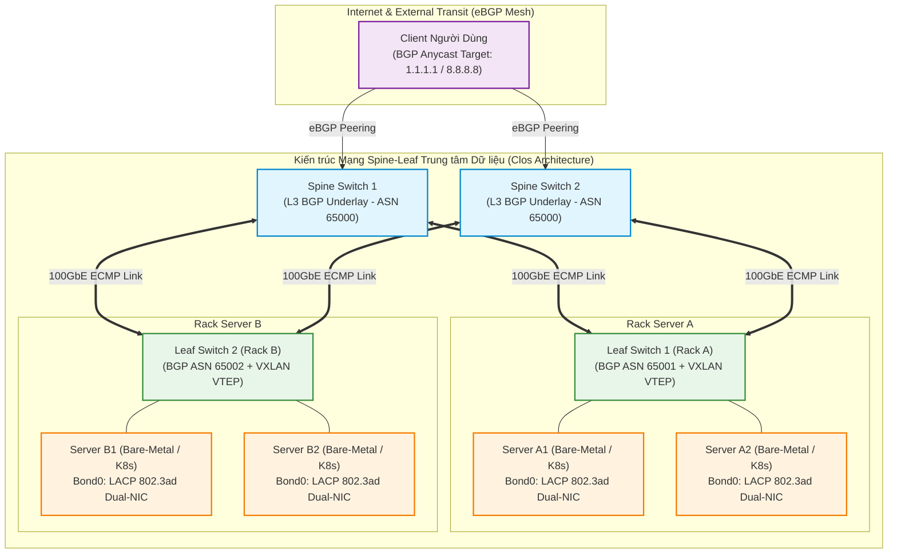
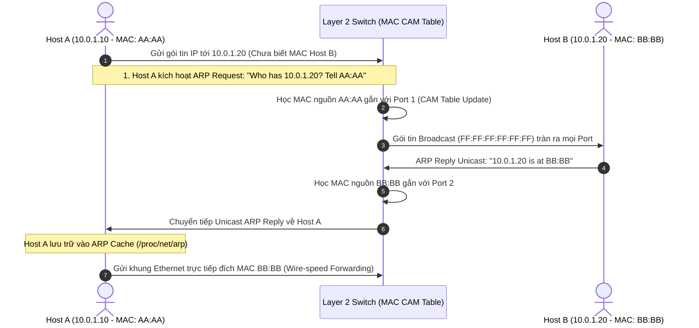

# 6.1. Network Addressing, Routing, and Switching (Địa chỉ Mạng, Định tuyến & Chuyển mạch Hạ tầng)

> [!IMPORTANT]
> **Nếu bạn chỉ được nhớ một điều duy nhất:** Mọi hệ thống mạng trung tâm dữ liệu hiện đại đều được xây dựng trên nguyên tắc **phân ly hoàn toàn giữa Lớp Dưới (Underlay Network - L3 Spine-Leaf Fabric định tuyến bằng BGP/OSPF và ECMP)** và **Lớp Trên (Overlay Network - L2-over-L3 đóng gói qua VXLAN EVPN)**; trong đó, **Layer 2 (Ethernet/VLAN/STP) bị cô lập chặt chẽ trong từng tủ Rack** để triệt tiêu hoàn toàn thảm họa lặp gói (Broadcast Storm), còn **Layer 3 (BGP Anycast)** biến toàn bộ mạng lưới phân tán toàn cầu thành một địa chỉ IP duy nhất có khả năng tự động cân bằng tải và hấp thụ các cuộc tấn công DDoS quy mô Terabit.

---

## 1. Kiến trúc Tổng quan & Mô hình Tư duy (Mental Model)

### 1.1. Ẩn dụ Đời sống: Mạng Lưới Giao Thông Đô Thị & Hệ Thống Tàu Điện Ngầm

Để hiểu sâu sắc về cách thức các gói tin di chuyển trong hạ tầng trung tâm dữ liệu, hãy đối chiếu với hai tầng giao thông thành phố:
- **Tầng Chuyển mạch Layer 2 (VLAN / MAC / STP) — Đường Nội Bộ Khu Phố**:
  - Tương tự như mạng lưới đường ngõ ngách trong một khu phố dân cư. Mọi người nhận diện nhau bằng biển số nhà (Địa chỉ MAC vật lý).
  - Khi một chiếc xe muốn tìm nhà ai đó, nếu không biết đường, người lái bấm còi inh ỏi (Broadcast ARP Request) cho cả khu phố nghe thấy.
  - Nếu khu phố có nhiều ngã rẽ vòng tròn (Switching Loop), những tiếng còi này sẽ dội lại liên tục tạo thành bão âm thanh làm tê liệt cả khu dân cư (Broadcast Storm). Để ngăn chặn, cảnh sát giao thông phải đặt các rào chắn một chiều (Spanning Tree Protocol - STP), chấp nhận biến một nửa số con đường thành đường cụt không được đi!
- **Tầng Định tuyến Layer 3 (IP / BGP / Clos Spine-Leaf) — Mạng Lưới Cao Tốc & Tàu Điện Ngầm Trục Chính**:
  - Để đi sang quận khác hoặc thành phố khác, xe không được chạy trong ngõ mà phải ra đường cao tốc liên tỉnh có mã số tuyến đường chuẩn hóa (Địa chỉ IP / CIDR Subnet).
  - Tại mỗi nút giao lập thể (Spine-Leaf Switch), các biển chỉ dẫn điện tử thông minh (Thuật toán định tuyến OSPF / BGP) liên tục cập nhật tình trạng kẹt xe và chỉ đường cho xe đi qua hàng chục cây cầu song song có cùng độ dài (ECMP - Equal-Cost Multi-Path). Không có con đường nào bị khóa vô ích như ở Layer 2; băng thông được nhân lên gấp $N$ lần.
- **BGP Anycast — Chuỗi Cửa Hàng Tiện Lợi 24/7 Cùng Một Thương Hiệu**:
  - Bạn chỉ cần nhớ một số điện thoại hotline duy nhất `8.8.8.8`. Khi bạn bấm gọi, tổng đài viễn thông (BGP Router) sẽ tự động nối máy tới chi nhánh cửa hàng ở gần bạn nhất về mặt khoảng cách mạng (AS-Path ngắn nhất). Nếu chi nhánh gần bạn bị cháy, cuộc gọi tự động chuyển sang chi nhánh kế tiếp chỉ trong vài giây.



---

## 2. Chi tiết từng Keyword (Under-the-Hood Deep Dive)

### 2.1. Network Addressing: IPv4, IPv6, Subnetting & CIDR
Mọi liên lạc trên mạng Internet và trung tâm dữ liệu đều bắt đầu từ việc định danh logic thông qua địa chỉ IP.

#### A. Kiến trúc Địa chỉ IPv4, Subnetting & CIDR (Classless Inter-Domain Routing)
- **IPv4 (32-bit Address)**: Chia thành 4 octets phân cách bằng dấu chấm (ví dụ: `192.168.1.1`).
- **CIDR & Subnet Mask**: Xóa bỏ kiến trúc chia lớp cứng nhắc (Class A, B, C cổ điển). Ký hiệu tiền tố `/N` (ví dụ: `/24` đại diện cho 24 bit mạng và 8 bit máy chủ):
  $$\text{Số lượng máy chủ khả dụng} = 2^{(32 - N)} - 2$$
  (Trừ 2 địa chỉ: Địa chỉ Mạng `Network ID` và Địa chỉ Quảng bá `Broadcast Address`).
- **VLSM (Variable Length Subnet Masking)**: Kỹ thuật phân mảnh không gian địa chỉ thành các khối con có kích thước linh hoạt tùy theo nhu cầu thực tế của từng phân khu mạng (VPC, DMZ, Database Tier, Management Out-of-Band).

#### B. IPv6: Cuộc Cách Mạng 128-bit & Sự Triệt Tiêu NAT
- **Không gian Địa chỉ 128-bit**: Cung cấp xấp xỉ $3.4 \times 10^{38}$ địa chỉ, đủ để cấp phát hàng tỷ IP cho từng hạt bụi trên Trái Đất.
- **Cấu trúc EUI-64 & SLAAC (Stateless Address Autoconfiguration)**: Cho phép máy chủ tự tạo địa chỉ IPv6 khả dụng toàn cầu (Global Unicast) bằng cách kết hợp tiền tố `/64` do Router quảng bá với địa chỉ MAC vật lý của Card mạng (chèn thêm giá trị `0xFFFE` vào giữa).
- **NDP (Neighbor Discovery Protocol)**: Thay thế hoàn toàn giao thức ARP phát tán quảng bá bằng các gói tin ICMPv6 Solicitation / Advertisement unicast và multicast, giảm thiểu triệt để hiện tượng nhiễu mạng trên quy mô cụm hàng chục ngàn máy chủ.

---

### 2.2. Layer 2 Switching: Ethernet, VLAN, STP & LACP
Chuyển mạch Layer 2 chịu trách nhiệm truyền tải các khung dữ liệu (Ethernet Frames) giữa các máy chủ trong cùng một miền quảng bá (Broadcast Domain).



#### A. Ethernet & Bảng CAM (Content Addressable Memory)
- Switch chuyển mạch ở tầng phần cứng ASIC thông qua bộ nhớ tra cứu siêu tốc CAM. Mỗi khi nhận được frame, Switch đọc MAC nguồn để nạp vào bảng MAC Table và đọc MAC đích để chuyển mạch thẳng ra port tương ứng.
- **Flooding**: Nếu MAC đích chưa có trong bảng, Switch sẽ nhân bản frame ra toàn bộ các port khác (trừ port nhận vào).

#### B. VLAN (802.1Q) & Trunking
- Chuẩn IEEE 802.1Q chèn một trường Header 4-byte (gồm 12-bit VLAN ID từ 1 đến 4094) vào giữa Source MAC và EtherType của Ethernet Frame.
- **Trunk Port**: Mang lưu lượng của nhiều VLAN đi qua một sợi cáp quang duy nhất giữa Switch và Hypervisor/Host.
- **Access Port**: Loại bỏ thẻ tag 802.1Q trước khi đưa gói tin vào Card mạng máy chủ không hỗ trợ gắn tag.

#### C. STP (Spanning Tree Protocol) vs RSTP (802.1w) & MSTP (802.1s)
- **Vấn đề Vòng lặp Mạng (Network Loop)**: Khi nối dây dự phòng giữa các switch L2 mà không có cơ chế kiểm soát, các gói Broadcast ARP sẽ nhân bản vô hạn, gây ra **Broadcast Storm**, khiến CPU của Switch đạt $100\%$ và làm sập toàn bộ hệ thống trong vài giây.
- **STP**: Bầu chọn một **Root Bridge** trung tâm dựa trên Bridge Priority và MAC. Sau đó đưa các cổng phụ vào trạng thái **Blocking** để duy trì một cấu trúc cây không có chu trình.
- **Hạn chế Cốt tử**: STP khóa cứng các đường dây dự phòng, gây lãng phí $50\%$ băng thông cáp quang đắt đỏ và thời gian hội tụ khi có sự cố rất chậm ($30 - 50$ giây với STP, $1 - 2$ giây với RSTP). Do đó, trung tâm dữ liệu hiện đại thay thế hoàn toàn STP bằng định tuyến L3 ECMP!

#### D. LACP (Link Aggregation Control Protocol - IEEE 802.3ad / Bond Mode 4)
- Gộp nhiều cổng mạng vật lý (ví dụ: $2 \times 25\text{GbE}$) thành một giao diện logic duy nhất (`bond0` / `team0` với băng thông $50\text{Gbps}$).
- **Thuật toán Băm Cân Bằng Tải**: LACP sử dụng hàm băm dòng lưu lượng (Flow Hash) dựa trên Layer 2 (MAC), Layer 3 (IP), hoặc Layer 4 (IP + Port TCP/UDP). Mọi gói tin của cùng một TCP Socket Connection luôn đi qua một cổng vật lý cố định để tránh hiện tượng gói tin bị đảo lộn trật tự (Packet Reordering).

---

### 2.3. Routing Protocols: Static, Dynamic, OSPF, IS-IS & BGP
Định tuyến Layer 3 quyết định đường đi tối ưu cho gói tin qua nhiều nút mạng trung gian (Hops) dựa trên bảng định tuyến FIB (Forwarding Information Base).

#### A. OSPF (Open Shortest Path First) & IS-IS
- Giao thức định tuyến nội miền (Interior Gateway Protocol - IGP) dựa trên thuật toán tìm đường ngắn nhất **Dijkstra SPF (Shortest Path First)**.
- **Link-State Advertisements (LSAs)**: Các router trao đổi trạng thái liên kết và xây dựng một bản đồ topo mạng hoàn chỉnh giống hệt nhau trong bộ nhớ (Link-State Database - LSDB).
- Phân chia cấu trúc phân cấp qua các **Areas**, trong đó **Area 0 (Backbone Area)** bắt buộc phải là trục trung tâm kết nối toàn bộ các Area phụ để triệt tiêu vòng lặp định tuyến.

#### B. BGP (Border Gateway Protocol - Chuẩn mực Mạng Toàn Cầu)
- Giao thức định tuyến ngoài (Exterior Gateway Protocol - EGP) duy nhất vận hành toàn bộ mạng Internet toàn cầu, đồng thời là giao thức xương sống bên trong Data Center hiện đại (BGP-in-the-Data-Center RFC 7938).
- **Path-Vector Protocol**: BGP chạy trên kết nối TCP port 179 tin cậy. Thay vì tính khoảng cách bằng số hop, BGP theo dõi danh sách toàn bộ các Số hiệu Vùng Tự trị (**AS - Autonomous System Numbers**) mà gói tin phải đi qua (`AS_PATH`). Nếu một router thấy ASN của chính mình nằm trong `AS_PATH`, nó lập tức loại bỏ route đó để chống Loop.
- **Hệ thống Thuộc tính Điều khiển Luồng (BGP Attributes)**:
  - `Weight` (Cục bộ trên router Cisco/Arista - giá trị càng cao càng ưu tiên).
  - `LOCAL_PREF` (Phạm vi toàn ASN nội bộ iBGP - quyết định cổng thoát ra ngoài Internet).
  - `AS_PATH` (Độ dài đường đi qua các ASN - chuỗi ngắn hơn được ưu tiên).
  - `MED (Multi-Exit Discriminator)` (Gợi ý cho AS láng giềng chọn cổng đi vào mạng của mình).

---

### 2.4. Cast Typology: Unicast, Broadcast, Multicast & Anycast
Phân loại các phương thức phát tán gói tin trong kiến trúc mạng hạ tầng:
1. **Unicast (Một-đến-Một)**: Luồng truyền điểm-điểm giữa một máy gửi và một máy nhận duy nhất (chiếm $95\%$ lưu lượng Internet thông thường: HTTP, SSH, Database Replication).
2. **Broadcast (Một-đến-Tất cả)**: Gói tin gửi tới địa chỉ `255.255.255.255` hoặc địa chỉ Broadcast của Subnet. Mọi host trong cùng Broadcast Domain đều bị đánh thức ngắt CPU để xử lý (bị cấm hoàn toàn trên IPv6).
3. **Multicast (Một-đến-Nhóm có chọn lọc)**: Gói tin gửi tới dải địa chỉ Class D (`224.0.0.0/4` trên IPv4 hoặc `ff00::/8` trên IPv6). Sử dụng giao thức **IGMP (Internet Group Management Protocol)** và **PIM-SM (Protocol Independent Multicast)** để truyền hình trực tiếp (IPTV), phân phối dữ liệu thị trường chứng khoán tốc độ cao (Financial Market Data Ticker).
4. **Anycast (Một-đến-Gần nhất về Tô-pô Mạng)**:
   - Nhiều máy chủ đặt ở khắp các châu lục (Singapore, Frankfurt, New York) cùng dùng chung một địa chỉ IP duy nhất (ví dụ: DNS Cloudflare `1.1.1.1` hoặc Google `8.8.8.8`).
   - Mỗi máy chủ cùng quảng bá địa chỉ IP này ra mạng Internet qua giao thức BGP.
   - Nhờ thuật toán tìm đường của BGP, gói tin của người dùng sẽ tự động rơi vào trung tâm dữ liệu có độ trễ mạng thấp nhất (ít AS hops nhất). Khi một Data Center bị sập, BGP rút lại tuyến đường (Route Withdraw) và lưu lượng tự động chuyển sang Data Center kế tiếp mà không cần thay đổi cấu hình DNS của client!

---

### 2.5. Datacenter Fabric: Clos Spine-Leaf & ECMP
Mạng doanh nghiệp truyền thống theo mô hình 3 tầng (Core - Aggregation - Access) đã bị thay thế hoàn toàn trong trung tâm dữ liệu hiện đại bằng **Kiến trúc Clos Spine-Leaf (2-tier Fabric)**:
- **Nguyên tắc Thiết kế**: Mọi Leaf Switch đều kết nối trực tiếp với tất cả các Spine Switch. Các Spine không bao giờ nối với nhau, các Leaf không bao giờ nối với nhau.
- **Độ trễ Đồng nhất (Predictable Latency)**: Mọi máy chủ trong Data Center liên lạc với nhau qua đúng **3 bước nhảy (Leaf $\to$ Spine $\to$ Leaf)**, đem lại độ trễ cực thấp và đồng đều cho các hệ thống tính toán phân tán.
- **ECMP (Equal-Cost Multi-Path)**: Router chia tải gói tin đều trên hàng chục đường liên kết Spine song song bằng hàm băm L4. Nếu cụm có 16 Spine Switch 100GbE, băng thông liên Rack đạt tới $1.6\text{Tbps}$ non-blocking.

---

## 3. Thực thi Mã nguồn & Mô phỏng Chuyên sâu (Dual-Engine Implementation)

### Engine 1: C++20 — Raw Socket IPv4 Header Packet Parser & CIDR Route Lookup Engine
Chương trình C++20 dưới đây mô phỏng động cơ phân tích khung gói tin mạng IPv4 thô (Raw Packet Parser) kết hợp cấu trúc dữ liệu cây tiền tố (Prefix Radix Tree) phục vụ tra cứu bảng định tuyến CIDR Longest Prefix Match (LPM) tốc độ cao ở tầng chuyển mạch phần cứng.

```cpp
#include <iostream>
#include <vector>
#include <string>
#include <sstream>
#include <cstdint>
#include <memory>
#include <iomanip>
#include <arpa/inet.h>

// Cấu trúc mô phỏng IPv4 Header chuẩn RFC 791 (20 Bytes)
struct IPv4Header {
    uint8_t  version_ihl;      // 4-bit Version, 4-bit Header Length
    uint8_t  type_of_service;  // DSCP / ECN
    uint16_t total_length;     // Tổng độ dài gói tin
    uint16_t identification;   // ID phân mảnh
    uint16_t flags_fragment;   // Cờ và Fragment Offset
    uint8_t  time_to_live;     // TTL (Chống loop L3)
    uint8_t  protocol;         // 6 = TCP, 17 = UDP, 1 = ICMP
    uint16_t header_checksum;  // Checksum tiêu đề
    uint32_t src_ip;           // Địa chỉ IP nguồn (Big-Endian)
    uint32_t dst_ip;           // Địa chỉ IP đích (Big-Endian)
};

// Nút trong Cây Nhị Phân Tiền Tố (Radix Trie Node cho LPM)
struct TrieNode {
    std::string next_hop_interface;
    bool is_terminal = false;
    std::unique_ptr<TrieNode> children[2];
};

class CIDRRouterEngine {
private:
    std::unique_ptr<TrieNode> root_;

    static uint32_t parse_ip_to_uint(const std::string& ip_str) {
        struct in_addr addr;
        inet_pton(AF_INET, ip_str.c_str(), &addr);
        return ntohl(addr.s_addr);
    }

    static std::string uint_to_ip_str(uint32_t ip_val) {
        struct in_addr addr;
        addr.s_addr = htonl(ip_val);
        char buf[INET_ADDRSTRLEN];
        inet_ntop(AF_INET, &addr, buf, INET_ADDRSTRLEN);
        return std::string(buf);
    }

public:
    CIDRRouterEngine() : root_(std::make_unique<TrieNode>()) {}

    // Nạp một tuyến đường vào bảng định tuyến FIB
    void add_route(const std::string& cidr, const std::string& iface) {
        size_t slash_pos = cidr.find('/');
        std::string ip_part = cidr.substr(0, slash_pos);
        int prefix_len = std::stoi(cidr.substr(slash_pos + 1));

        uint32_t ip = parse_ip_to_uint(ip_part);
        TrieNode* curr = root_.get();

        for (int i = 31; i >= 32 - prefix_len; --i) {
            int bit = (ip >> i) & 1;
            if (!curr->children[bit]) {
                curr->children[bit] = std::make_unique<TrieNode>();
            }
            curr = curr->children[bit].get();
        }
        curr->is_terminal = true;
        curr->next_hop_interface = iface;
        std::cout << "[FIB Route Insert] " << std::setw(18) << std::left << cidr 
                  << " -> Giao diện Cổng Thoát: " << iface << "\n";
    }

    // Tra cứu Longest Prefix Match (LPM) cho gói tin đến
    std::string lookup_longest_prefix_match(uint32_t dst_ip) const {
        TrieNode* curr = root_.get();
        std::string best_match = "DROP_NO_ROUTE (0.0.0.0/0 Discard)";

        for (int i = 31; i >= 0; --i) {
            if (curr->is_terminal) {
                best_match = curr->next_hop_interface;
            }
            int bit = (dst_ip >> i) & 1;
            if (!curr->children[bit]) {
                break;
            }
            curr = curr->children[bit].get();
        }
        if (curr && curr->is_terminal) {
            best_match = curr->next_hop_interface;
        }
        return best_match;
    }

    void process_raw_packet(const uint8_t* raw_bytes, size_t len) {
        if (len < sizeof(IPv4Header)) {
            std::cerr << "[L3 Parser] Lỗi: Gói tin nhỏ hơn kích thước chuẩn IPv4 Header!\n";
            return;
        }
        const IPv4Header* ip_hdr = reinterpret_cast<const IPv4Header*>(raw_bytes);
        uint8_t ihl = (ip_hdr->version_ihl & 0x0F) * 4;
        uint8_t ver = (ip_hdr->version_ihl >> 4);

        uint32_t src = ntohl(ip_hdr->src_ip);
        uint32_t dst = ntohl(ip_hdr->dst_ip);

        std::cout << "\n>>> TIẾP NHẬN GÓI TIN IP RAW (" << len << " Bytes) <<<\n";
        std::cout << "  Version : IPv" << static_cast<int>(ver) << " | IHL: " << static_cast<int>(ihl) << " Bytes\n";
        std::cout << "  TTL     : " << static_cast<int>(ip_hdr->time_to_live) 
                  << " | Protocol: " << (ip_hdr->protocol == 6 ? "TCP" : "UDP/Other") << "\n";
        std::cout << "  Nguồn   : " << uint_to_ip_str(src) << "\n";
        std::cout << "  Đích    : " << uint_to_ip_str(dst) << "\n";

        // Thực hiện LPM Lookup
        std::string out_iface = lookup_longest_prefix_match(dst);
        std::cout << "  [FIB Routing Decision] Chuyển tiếp ra cổng: >>> " << out_iface << " <<<\n";
    }
};

int main() {
    std::cout << "===================================================================\n";
    std::cout << "   C++20 HIGH-PERFORMANCE IPv4 ROUTER & FIB PREFIX LPM MATCH ENGINE \n";
    std::cout << "===================================================================\n";

    CIDRRouterEngine router;
    // Cấu hình bảng định tuyến với nhiều tiền tố đan xen
    router.add_route("0.0.0.0/0", "eth0 (Default Internet Gateway)");
    router.add_route("10.0.0.0/8", "eth1 (Internal Corporate Backbone)");
    router.add_route("10.128.0.0/16", "bond0.100 (Kubernetes Pod Overlay Network)");
    router.add_route("10.128.42.0/24", "veth-worker-node-42 (Local Rack vSwitch)");
    router.add_route("192.168.1.0/24", "wlan0 (Management Console)");

    // Giả lập gói tin IP thô 1: Đích gửi tới Pod K8s nội bộ (10.128.42.15)
    IPv4Header pkt1{};
    pkt1.version_ihl = (4 << 4) | 5; // IPv4, Header 20 bytes
    pkt1.total_length = htons(60);
    pkt1.time_to_live = 64;
    pkt1.protocol = 6; // TCP
    pkt1.src_ip = htonl(0x0A000001); // 10.0.0.1
    pkt1.dst_ip = htonl(0x0A802A0F); // 10.128.42.15

    router.process_raw_packet(reinterpret_cast<const uint8_t*>(&pkt1), sizeof(pkt1));

    // Giả lập gói tin IP thô 2: Đích gửi ra Internet công cộng (8.8.8.8)
    IPv4Header pkt2{};
    pkt2.version_ihl = (4 << 4) | 5;
    pkt2.total_length = htons(60);
    pkt2.time_to_live = 58;
    pkt2.protocol = 17; // UDP
    pkt2.src_ip = htonl(0xC0A80119); // 192.168.1.25
    pkt2.dst_ip = htonl(0x08080808); // 8.8.8.8

    router.process_raw_packet(reinterpret_cast<const uint8_t*>(&pkt2), sizeof(pkt2));

    return 0;
}
```

#### Terminal Output Mẫu Thực Tế (C++20 Engine)
```text
===================================================================
   C++20 HIGH-PERFORMANCE IPv4 ROUTER & FIB PREFIX LPM MATCH ENGINE 
===================================================================
[FIB Route Insert] 0.0.0.0/0          -> Giao diện Cổng Thoát: eth0 (Default Internet Gateway)
[FIB Route Insert] 10.0.0.0/8         -> Giao diện Cổng Thoát: eth1 (Internal Corporate Backbone)
[FIB Route Insert] 10.128.0.0/16      -> Giao diện Cổng Thoát: bond0.100 (Kubernetes Pod Overlay Network)
[FIB Route Insert] 10.128.42.0/24     -> Giao diện Cổng Thoát: veth-worker-node-42 (Local Rack vSwitch)
[FIB Route Insert] 192.168.1.0/24     -> Giao diện Cổng Thoát: wlan0 (Management Console)

>>> TIẾP NHẬN GÓI TIN IP RAW (20 Bytes) <<<
  Version : IPv4 | IHL: 20 Bytes
  TTL     : 64 | Protocol: TCP
  Nguồn   : 10.0.0.1
  Đích    : 10.128.42.15
  [FIB Routing Decision] Chuyển tiếp ra cổng: >>> veth-worker-node-42 (Local Rack vSwitch) <<<

>>> TIẾP NHẬN GÓI TIN IP RAW (20 Bytes) <<<
  Version : IPv4 | IHL: 20 Bytes
  TTL     : 58 | Protocol: UDP/Other
  Nguồn   : 192.168.1.25
  Đích    : 8.8.8.8
  [FIB Routing Decision] Chuyển tiếp ra cổng: >>> eth0 (Default Internet Gateway) <<<
```

---

### Engine 2: Python 3.11+ — BGP Path Vector Simulator & Anycast Failover Controller
Kịch bản Python 3.11+ dưới đây mô phỏng giải thuật chọn tuyến đường tốt nhất của giao thức BGP (`AS_PATH`, `LOCAL_PREF`, `MED`), đồng thời thực hiện rút tuyến đường tự động (BGP Route Withdraw) khi một điểm nút PoP Anycast gặp sự cố gián đoạn dịch vụ.

```python
#!/usr/bin/env python3
import time
from dataclasses import dataclass, field
from typing import List, Dict, Optional

@dataclass
class BGPRouteAdvertisement:
    prefix: str
    next_hop: str
    as_path: List[int]
    local_pref: int = 100
    med: int = 0
    origin: str = "IGP"

    def calculate_path_rank(self) -> tuple:
        # Thuật toán BGP Best Path Selection:
        # 1. LOCAL_PREF cao nhất thắng
        # 2. AS_PATH ngắn nhất thắng
        # 3. MED thấp nhất thắng
        return (-self.local_pref, len(self.as_path), self.med)

class BGPPeerRouter:
    def __init__(self, router_name: str, asn: int):
        self.router_name = router_name
        self.asn = asn
        self.routing_table: Dict[str, List[BGPRouteAdvertisement]] = {}

    def receive_update(self, route: BGPRouteAdvertisement):
        # Chống Loop: Nếu ASN của mình đã nằm trong AS_PATH thì hủy bỏ ngay
        if self.asn in route.as_path:
            print(f"[{self.router_name}] PHÁT HIỆN LOOP: ASN {self.asn} đã nằm trong AS-Path {route.as_path}! Drop route.")
            return

        if route.prefix not in self.routing_table:
            self.routing_table[route.prefix] = []
        self.routing_table[route.prefix].append(route)
        print(f"[{self.router_name}] Nhận Route {route.prefix} via AS-Path: {route.as_path} (Next-Hop: {route.next_hop})")

    def withdraw_route(self, prefix: str, next_hop: str):
        if prefix in self.routing_table:
            initial_count = len(self.routing_table[prefix])
            self.routing_table[prefix] = [
                r for r in self.routing_table[prefix] if r.next_hop != next_hop
            ]
            if len(self.routing_table[prefix]) < initial_count:
                print(f"[{self.router_name}] >>> BGP WITHDRAW: Rút bỏ route {prefix} từ Next-Hop {next_hop}! <<<")

    def get_best_route(self, prefix: str) -> Optional[BGPRouteAdvertisement]:
        candidates = self.routing_table.get(prefix, [])
        if not candidates:
            return None
        # Sắp xếp theo thứ tự ưu tiên BGP Best Path
        sorted_routes = sorted(candidates, key=lambda r: r.calculate_path_rank())
        return sorted_routes[0]

def simulate_anycast_global_routing():
    print("=" * 70)
    print("  PYTHON 3.11+: BGP ANYCAST & AS-PATH FAILOVER SIMULATOR")
    print("=" * 70)

    # Router người dùng tại Tokyo (ASN 13335)
    tokyo_edge_router = BGPPeerRouter("Tokyo-Internet-Exchange", asn=13335)
    anycast_vip = "198.51.100.1/32"

    print("\n--- GIAI ĐOẠN 1: 3 Data Center Anycast Toàn cầu cùng quảng bá IP VIP ---")
    # Node Singapore (Gần nhất về mạng)
    route_sg = BGPRouteAdvertisement(
        prefix=anycast_vip, next_hop="172.16.1.1", as_path=[4657, 13335_01], local_pref=100, med=10
    )
    # Node San Francisco (Xa hơn)
    route_us = BGPRouteAdvertisement(
        prefix=anycast_vip, next_hop="172.16.2.1", as_path=[2914, 3356, 13335_02], local_pref=100, med=20
    )
    # Node Frankfurt (Xa nhất)
    route_eu = BGPRouteAdvertisement(
        prefix=anycast_vip, next_hop="172.16.3.1", as_path=[6453, 1299, 1273, 13335_03], local_pref=100, med=30
    )

    tokyo_edge_router.receive_update(route_sg)
    tokyo_edge_router.receive_update(route_us)
    tokyo_edge_router.receive_update(route_eu)

    best = tokyo_edge_router.get_best_route(anycast_vip)
    print(f"\n[Quyết định Tuyến BGP Tối ưu] Khách hàng Tokyo được định tuyến đến:")
    print(f"  -> Next-Hop : {best.next_hop} | AS-Path: {best.as_path} (Singapore PoP)")

    print("\n--- GIAI ĐOẠN 2: Sự cố Đứt Cáp Biển tại Singapore PoP -> Kích hoạt BGP Withdraw ---")
    tokyo_edge_router.withdraw_route(anycast_vip, next_hop="172.16.1.1")

    best_after_fail = tokyo_edge_router.get_best_route(anycast_vip)
    print(f"\n[Hội tụ BGP Anycast Sau Sự Cố] Lưu lượng tự động chuyển sang:")
    print(f"  -> Next-Hop : {best_after_fail.next_hop} | AS-Path: {best_after_fail.as_path} (US West Coast PoP)")

if __name__ == "__main__":
    simulate_anycast_global_routing()
```

#### Terminal Output Mẫu Thực Tế (Python 3.11+ Engine)
```text
======================================================================
  PYTHON 3.11+: BGP ANYCAST & AS-PATH FAILOVER SIMULATOR
======================================================================

--- GIAI ĐOẠN 1: 3 Data Center Anycast Toàn cầu cùng quảng bá IP VIP ---
[Tokyo-Internet-Exchange] Nhận Route 198.51.100.1/32 via AS-Path: [4657, 1333501] (Next-Hop: 172.16.1.1)
[Tokyo-Internet-Exchange] Nhận Route 198.51.100.1/32 via AS-Path: [2914, 3356, 1333502] (Next-Hop: 172.16.2.1)
[Tokyo-Internet-Exchange] Nhận Route 198.51.100.1/32 via AS-Path: [6453, 1299, 1273, 1333503] (Next-Hop: 172.16.3.1)

[Quyết định Tuyến BGP Tối ưu] Khách hàng Tokyo được định tuyến đến:
  -> Next-Hop : 172.16.1.1 | AS-Path: [4657, 1333501] (Singapore PoP)

--- GIAI ĐOẠN 2: Sự cố Đứt Cáp Biển tại Singapore PoP -> Kích hoạt BGP Withdraw ---
[Tokyo-Internet-Exchange] >>> BGP WITHDRAW: Rút bỏ route 198.51.100.1/32 từ Next-Hop 172.16.1.1! <<<

[Hội tụ BGP Anycast Sau Sự Cố] Lưu lượng tự động chuyển sang:
  -> Next-Hop : 172.16.2.1 | AS-Path: [2914, 3356, 1333502] (US West Coast PoP)
```

---

## 4. Systems Engineering & Production Pitfalls

### 4.1. Sự cố Thực chiến Trong Hạ Tầng Mạng Doanh Nghiệp
1. **Sự cố BGP Route Flapping & Dampening Penalty**:
   - *Nguyên nhân*: Khi đường cáp quang quốc tế bị rung lắc vật lý (Intermittent Flapping), router liên tục gửi BGP Announcement rồi BGP Withdrawal trong vài giây. Các router Tier-1 trên Internet kích hoạt cơ chế **BGP Route Flap Dampening**, phạt điểm và khóa cứng tuyến đường của doanh nghiệp trong 30-60 phút. Doanh nghiệp biến mất hoàn toàn khỏi bản đồ Internet toàn cầu dù cáp mạng đã ổn định trở lại.
   - *Cách phòng ngừa*: Cấu hình bộ lọc giữ trễ (Hold-down timer) và BFD (Bidirectional Forwarding Detection) với ngưỡng nhạy hợp lý; không bật Dampening trên các tuyến đường trục trọng yếu.
2. **Lỗi MTU Mismatch & Black Hole Gói Tin (Path MTU Discovery Failure)**:
   - *Nguyên nhân*: Mạng Ethernet vật lý chuẩn có MTU là $1500\text{ bytes}$. Khi đóng gói mạng ảo hóa VXLAN (thêm 50 bytes header), kích thước gói tin tăng lên $1550\text{ bytes}$. Nếu switch vật lý chưa được cấu hình **Jumbo Frames (MTU 9000)**, gói tin sẽ bị âm thầm hủy bỏ (Drop). Nếu tường lửa chặn các gói tin ICMP `Fragmentation Needed (Type 3, Code 4)`, client sẽ bị treo vô tận khi tải các trang web lớn hoặc truyền file qua SSH (Black Hole Connection).
   - *Khắc phục*: Đồng bộ MTU vật lý $9000$ trên toàn bộ Spine-Leaf switches và bật tính năng TCP MSS Clamping trên Gateway.

### 4.2. Bộ Lệnh CLI Chẩn đoán & Giám sát Mạng Thực Chiến
- **Kiểm tra trạng thái IP, Link và Bảng MAC**:
  ```bash
  ip -d link show eth0
  ip address show
  ip route show table main
  bridge fdb show
  arp -an
  ```
- **Kiểm tra thống kê phần cứng Card mạng & Drop packets**:
  ```bash
  ethtool eth0
  ethtool -S eth0 | grep -E "drop|error|missed"
  ethtool -k eth0 # Xem trạng thái TSO, GSO, GRO hardware offload
  ```
- **Bắt và phân tích gói tin chuyên sâu**:
  ```bash
  tcpdump -nnvv -i any "tcp[tcpflags] & (tcp-syn|tcp-fin) != 0"
  tcpdump -nn -i eth0 icmp
  ss -tulpn
  ```

---

## 5. Bảng So sánh & Decision Matrix

### 5.1. Ma trận Đánh đổi giữa Các Giao thức Định tuyến

| Tiêu chí | OSPF (Open Shortest Path First) | BGP (Border Gateway Protocol) | Static Routing |
| :--- | :--- | :--- | :--- |
| **Phạm vi Sử dụng** | Mạng nội bộ doanh nghiệp (IGP), Campus | Kết nối Liên mạng (EGP), Data Center Fabric | Mạng cực nhỏ, Gateway mặc định |
| **Thuật toán** | Link-State (Dijkstra SPF) | Path-Vector (Hệ thuộc tính phong phú) | Cấu hình thủ công |
| **Quy mô Định tuyến** | Hàng chục ngàn routes (Giới hạn bộ nhớ) | Hàng triệu routes (Bảng định tuyến Internet) | Rất hạn chế (Khó quản lý khi mở rộng) |
| **Hội tụ khi Lỗi (Convergence)** | Cực nhanh (Dưới 1 giây khi kết hợp BFD) | Trung bình (Vài giây đến vài chục giây) | Không tự động (Cần can thiệp thủ công) |
| **Kiểm soát Chính sách (Policy)** | Rất thấp (Chỉ dựa trên Cost metric) | Cực cao (Filter theo AS-Path, Communities, LP) | Tuyệt đối nhưng tĩnh |

### 5.2. Khung Quyết định Thiết kế Hạ tầng Mạng (Architecture Guidelines)
1. **Thiết kế Mạng Data Center Pod**: Sử dụng kiến trúc **L3 BGP-only Clos Fabric** (RFC 7938). Triệt tiêu hoàn toàn VLAN và STP giữa các tủ Rack. Mỗi Rack gán một ASN riêng, giao tiếp Spine qua eBGP và phân tải ECMP 64 đường song song.
2. **Ứng dụng Yêu cầu Di chuyển Máy ảo Live Migration Không Đổi IP**: Triển khai giải pháp **VXLAN EVPN Overlay** chạy trên nền L3 Underlay Fabric. Không bao giờ kéo dây cáp VLAN L2 xuyên qua các hàng tủ Rack.
3. **Cung cấp Dịch vụ DNS / CDN Toàn Cầu**: Triển khai kiến trúc **BGP Anycast** với peering tại các trạm trung chuyển Internet (IXP) địa phương để tối ưu hóa độ trễ truy cập người dùng và triệt tiêu tấn công DDoS.
