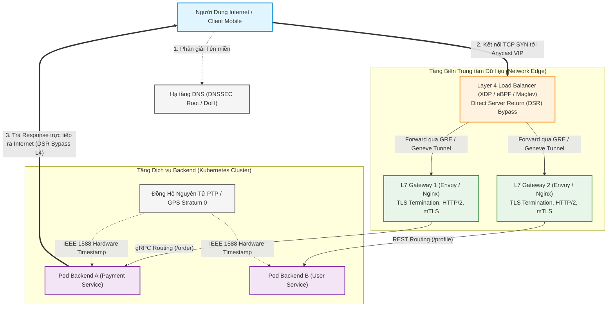
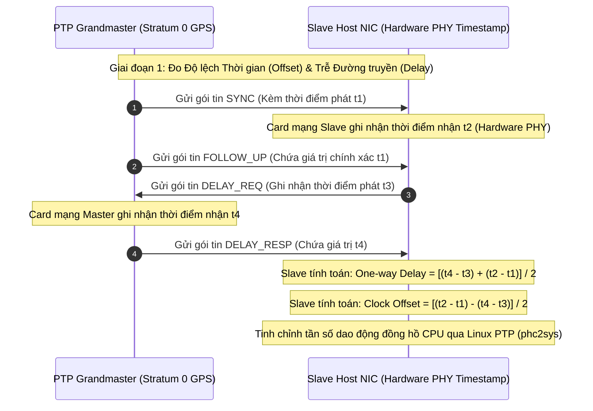

# 6.2. Core Network Services, Load Balancing, and Operations (Dịch vụ Mạng Cốt lõi, Cân bằng Tải & Vận hành Mạng)

> [!IMPORTANT]
> **Nếu bạn chỉ được nhớ một điều duy nhất:** Hiệu năng và độ tin cậy của toàn bộ hệ thống phân tán phụ thuộc tuyệt đối vào **bộ ba dịch vụ mạng nền tảng**: **DNS (phân giải định danh)**, **PTP/NTP (đồng bộ thời gian vi giây/nano giây)** và **Load Balancer (phân phối lưu lượng)**; trong đó, sự chuyển dịch từ **Cân bằng tải Layer 4 (eBPF/XDP & Direct Server Return - DSR)** sang **Layer 7 (Envoy/Nginx Service Proxy)** phản ánh sự đánh đổi cốt lõi giữa **thông lượng truyền dẫn thô hàng chục triệu gói tin/giây** và **khả năng kiểm soát logic ứng dụng tinh vi (mTLS, Circuit Breaking, HTTP/2 multiplexing)**.

---

## 1. Kiến trúc Tổng quan & Mô hình Tư duy (Mental Model)

### 1.1. Ẩn dụ Đời sống: Trung Tâm Điều Phối Sân Bay Quốc Tế

Hãy hình dung một trung tâm dữ liệu khổng lồ vận hành như một sân bay quốc tế siêu bận rộn:
- **Hệ thống DNS (Bảng Thông Tin Hãng Bay & Quầy Hướng Dẫn)**:
  - Hành khách (Gói tin) bước vào sân bay chỉ mang theo tên hãng bay (Domain name: `api.payment.corp`). Quầy thông tin DNS tra cứu sổ bộ và phát cho hành khách thẻ lên máy bay ghi rõ cổng số mấy (Địa chỉ IP máy chủ).
  - Để ngăn kẻ xấu làm thẻ giả mạo, hệ thống sử dụng con dấu bảo mật số học **DNSSEC**, kiểm tra từng cấp chữ ký từ Bộ Giao Thông (Root Zone `.` $\to$ `.corp` $\to$ Cổng thanh toán).
- **Đồng bộ Thời gian NTP / PTP (Đồng Hồ Nguyên Tử Trục Sân Bay)**:
  - Mọi chuyến bay hạ cánh và cất cánh phải tuân thủ nghiêm ngặt lịch trình tính bằng micro-giây. Nếu đồng hồ tháp không lưu bị lệch 100 milli-giây so với đồng hồ trên máy bay, thảm họa va chạm trên đường băng sẽ xảy ra. Tương tự, các cơ sở dữ liệu phân tán (Google Spanner TrueTime, TiDB) cần đồng hồ siêu chính xác **PTP (IEEE 1588)** để xác định thứ tự giao dịch mà không bị xung đột khóa.
- **Cân bằng Tải L4 vs L7 (Kiểm Soát An Ninh Ngoài Cửa vs Điều Phối Viên Trong Phòng Chờ)**:
  - **L4 Load Balancer (Cảnh sát giao thông ngoài bãi xe - eBPF/XDP/IPVS)**: Chỉ nhìn vào biển số xe và loại xe (IP nguồn, IP đích, Port TCP). Xe taxi rẽ trái, xe bus rẽ phải. Tốc độ chuyển hướng cực nhanh, không cần mở cốp xe kiểm tra hành lý bên trong.
  - **L7 Load Balancer (Nhân viên an ninh soi chiếu hành lý - Envoy / Nginx)**: Mở từng vali hàng (Giải mã gói tin TLS/HTTPS, kiểm tra Cookie, JWT Header, URI `/checkout`). Hành khách hạng Thương Gia (VIP Header) được dẫn vào phòng chờ riêng; hành khách mang hàng cấm (SQL Injection, XSS) bị chặn bắt ngay tại cửa.



---

## 2. Chi tiết từng Keyword (Under-the-Hood Deep Dive)

### 2.1. DNS Infrastructure: Resolvers, Authoritative, Caching & DNSSEC
DNS là cuốn danh bạ điện thoại toàn cầu của Internet, chuyển đổi tên miền dạng người đọc (`example.com`) thành địa chỉ IP máy chủ (`93.184.216.34`).

#### A. Phân tách Kiến trúc: Recursive Resolver vs. Authoritative Nameserver
- **Recursive Resolver (Trình phân giải Đệ quy)**: Máy chủ đại diện cho Client (ví dụ: DNS ISP, Cloudflare `1.1.1.1`, Google `8.8.8.8`). Khi nhận truy vấn, nếu bộ nhớ đệm Cache rỗng, nó sẽ lặp lại chuỗi truy vấn đệ quy:
  $$\text{Client} \to \text{Resolver} \to \text{Root Server (.)} \to \text{TLD Server (.com)} \to \text{Authoritative Server}$$
- **Authoritative Nameserver (Máy chủ Quản trị Tên miền)**: Giữ câu trả lời gốc (Source of Truth) của Zone file do chủ sở hữu tên miền cấu hình (các bản ghi A, AAAA, CNAME, MX, TXT).
- **TTL (Time to Live) & DNS Caching**: Xác định thời gian tồn tại của bản ghi trong bộ nhớ đệm của các Resolver trung gian. TTL dài giúp giảm tải máy chủ Authoritative và giảm độ trễ, nhưng gây khó khăn khi cần chuyển hướng IP khẩn cấp lúc xảy ra sự cố.

#### B. DNSSEC (DNS Security Extensions) & Chain of Trust
- Giao thức DNS truyền thống sử dụng UDP Port 53 không được mã hóa và không có xác thực, dễ dàng bị tấn công **DNS Cache Poisoning** (Kẻ tấn công mạo danh phản hồi DNS trước khi máy chủ chính thống trả về).
- **DNSSEC**: Bổ sung chữ ký mật mã khóa công khai (Public-key Cryptography):
  - **RRSIG (Resource Record Signature)**: Chữ ký số gắn liền với mỗi bản ghi DNS.
  - **DNSKEY**: Chứa Public Key dùng để xác thực chữ ký RRSIG.
  - **DS (Delegation Signer)**: Chứa mã băm của khóa DNSKEY đặt tại máy chủ TLD cấp trên.
  - **Chain of Trust**: Chuỗi tin cậy được neo chặt từ **Root KSK (Key Signing Key)** quản lý bởi ICANN, truyền xuống TLD `.com`, rồi xuống tên miền cá nhân, bảo đảm không một thực thể mạng nào có thể thay đổi địa chỉ IP trả về.
- **DoH (DNS over HTTPS - RFC 8484)** & **DoT (DNS over TLS - RFC 7858)**: Mã hóa kênh truyền giữa Client và Recursive Resolver để bảo vệ quyền riêng tư người dùng, ngăn chặn nhà mạng ISP theo dõi lịch sử duyệt web.

---

### 2.2. Time Synchronization: NTP & PTP
Trong các hệ thống phân tán hiện đại, khái niệm "thời gian" là một thách thức vật lý phức tạp do hiện tượng trôi dạt tinh thể thạch anh (Clock Drift) trên bo mạch chủ.



#### A. NTP (Network Time Protocol - RFC 5905)
- Hoạt động theo cấu trúc phân tầng phân cấp (**Stratum Hierarchy**):
  - **Stratum 0**: Các nguồn thời gian vật lý chuẩn quốc gia (Đồng hồ nguyên tử Cesium, vệ tinh GPS).
  - **Stratum 1**: Máy chủ kết nối trực tiếp với thiết bị Stratum 0.
  - **Stratum 2**: Máy chủ đồng bộ từ Stratum 1 qua mạng LAN/WAN.
- Sử dụng thuật toán Marzullo để lọc bỏ các nguồn thời gian có độ trễ bất đối xứng và jitter. Độ chính xác thông thường đạt từ $1 - 10\text{ ms}$ qua Internet và $< 1\text{ ms}$ trong mạng LAN.

#### B. PTP (Precision Time Protocol - IEEE 1588) & Tăng Tốc Phần Cứng
- Đối với các hệ thống tài chính giao dịch tần suất cao (HFT) và các cơ sở dữ liệu phân tán toàn cầu (như Google Spanner TrueTime API), sai số vài millisecond của NTP là không thể chấp nhận được.
- **PTP v2**: Sử dụng bộ ghi nhận thời gian phần cứng trực tiếp tại tầng vật lý PHY của Card mạng (Hardware Timestamping). Khi gói tin vừa rời khỏi chân cắm quang, NIC ghi lại dấu thời gian với độ chính xác đến **nanosecond ($\text{ns}$)**.
- Cho phép đồng bộ sai số giữa hàng ngàn máy chủ trong trung tâm dữ liệu xuống dưới **$1\text{ microsecond}$** ($\mu\text{s}$).

---

### 2.3. Load Balancing: Layer 4 vs Layer 7, Forward vs Reverse Proxy
Cân bằng tải là nghệ thuật phân phối lưu lượng công bằng và thông minh qua cụm tài nguyên máy tính.

#### A. Cân Bằng Tải Layer 4 (Transport Layer - TCP/UDP)
- Hoạt động ở mức socket TCP/UDP. Không kiểm tra hay can thiệp vào payload ứng dụng bên trong.
- **Kỹ thuật Direct Server Return (DSR)**:
  - Khắc phục hiện tượng bất đối xứng lưu lượng: Kích thước Request của Client gửi vào thường rất nhỏ ($1\text{ KB}$), trong khi Response của Backend trả về rất lớn (hàng chục Megabytes video/ảnh).
  - L4 Load Balancer chỉ xử lý gói tin Request đi vào, sửa đổi MAC đích và chuyển tiếp đến Backend. Backend xử lý xong sẽ gửi gói tin Response **trực tiếp thẳng về cho Client** qua router Internet, hoàn toàn bỏ qua Load Balancer! Băng thông của cụm cân bằng tải tăng lên gấp $20$ lần.
- **Công nghệ Hiện đại**: Triển khai trực tiếp trong Linux Kernel qua **IPVS (IP Virtual Server)** hoặc tại tầng Card mạng Driver thông qua **eBPF/XDP** (như hệ thống Maglev của Google hoặc Katran của Meta), xử lý hàng chục triệu gói tin mỗi giây trên một máy chủ đơn lẻ.

#### B. Cân Bằng Tải Layer 7 (Application Layer - HTTP, gRPC, WebSocket)
- Hoạt động ở mức ứng dụng. Bắt buộc phải thực hiện bắt tay TCP đầy đủ và giải mã TLS (TLS Termination).
- **Khả năng Điều hướng Thông minh**: Định tuyến dựa trên URL Path (`/api/v1/users` $\to$ Cluster A; `/api/v1/payments` $\to$ Cluster B), HTTP Headers, Cookies, hoặc trường dữ liệu trong gói tin gRPC Protobuf.
- **Tính năng Nâng cao**: Connection Multiplexing (ghép nhiều request HTTP/2 vào một kết nối TCP phía sau), Tự động ngắt mạch (Circuit Breaking), Thử lại (Automatic Retries), Rate Limiting và tiêm lỗi kiểm thử (Fault Injection).
- Đại diện tiêu biểu: **Envoy Proxy**, **Nginx**, **HAProxy**, **Traefik**.

#### C. Forward Proxy vs. Reverse Proxy
- **Forward Proxy**: Đứng trước mặt Client, bảo vệ Client, ẩn danh địa chỉ IP của Client và kiểm soát luồng truy cập đi ra ngoài Internet (Egress Filter, Corporate Gateway).
- **Reverse Proxy**: Đứng trước mặt Server/Backend, bảo vệ Backend, điều phối tải đi vào, ẩn giấu cấu trúc mạng nội bộ và đảm nhiệm việc giải mã SSL/TLS nặng nề.

---

### 2.4. Network Operations: Observability, Congestion & Security Monitoring
Vận hành mạng hiện đại không chỉ là cấu hình router mà là liên tục theo dõi, đo lường và chủ động điều phối thông lượng.

#### A. Giám sát Lưu lượng Dòng: NetFlow, IPFIX & sFlow
- **NetFlow / IPFIX**: Ghi lại siêu dữ liệu của từng dòng lưu lượng (5-tuple flow: Source IP, Dest IP, Source Port, Dest Port, Protocol) cùng với số lượng gói tin và bytes. Giúp đội ngũ bảo mật phát hiện các hành vi quét cổng (Port scan), rò rỉ dữ liệu (Data exfiltration) và tấn công DDoS.
- **sFlow**: Lấy mẫu thống kê gói tin (Packet Sampling: ví dụ cứ 1 trong 1000 gói tin được chuyển tiếp thì copy gửi về máy chủ phân tích Collector), tiêu tốn cực ít tài nguyên CPU của switch mạng phần cứng.

#### B. Thuật toán Kiểm soát Nghẽn TCP (Congestion Control): BBR vs. CUBIC
- **TCP CUBIC (Thuật toán Cổ điển)**: Dựa trên hiện tượng mất gói tin (Loss-based). CUBIC tăng dần kích thước cửa sổ truyền (Congestion Window - cwnd) cho đến khi xảy ra rớt gói tin thì lập tức cắt giảm cửa sổ đi $30-50\%$. Nhược điểm: Tạo ra hiện tượng **Bufferbloat** (làm đầy các bộ đệm trên router, đẩy độ trễ tăng vọt).
- **TCP BBR (Bottleneck Bandwidth and RTT - Google)**: Dựa trên mô hình vật lý (Model-based). BBR đo lường liên tục hai thông số vật lý độc lập: **Băng thông thắt nút tối đa (Max Bandwidth)** và **Độ trễ khứ hồi tối thiểu (Min RTT)**. BBR duy trì lượng dữ liệu đang bay (In-flight data) đúng bằng tích số BDP ($Bandwidth \times Delay$), đạt thông lượng tối đa mà không gây nghẽn hàng đợi, tăng tốc độ truyền tải trên mạng xuyên lục địa hoặc mạng di động chập chờn lên gấp nhiều lần.

#### C. ECN (Explicit Congestion Notification) & Data Center TCP (DCTCP)
- Khi hàng đợi trên switch bắt đầu bị đầy, thay vì âm thầm drop gói tin, switch bật 2-bit ECN trong IP Header để cảnh báo cho máy nhận. Máy nhận lập tức báo cho máy gửi giảm tốc độ phát trước khi xảy ra sự cố rớt mạng.

---

## 3. Thực thi Mã nguồn & Mô phỏng Chuyên sâu (Dual-Engine Implementation)

### Engine 1: C++20 — Non-blocking TCP Epoll L4/L7 Reverse Proxy with Connection Pooling
Chương trình C++20 dưới đây mô phỏng một Reverse Proxy phi khóa hiệu năng cao sử dụng cơ chế I/O Multiplexing `epoll` của Linux Kernel, xử lý các kết nối non-blocking và tự động điều phối lưu lượng tới các cụm máy chủ Backend.

```cpp
#include <iostream>
#include <vector>
#include <string>
#include <cstring>
#include <cstdlib>
#include <unistd.h>
#include <fcntl.h>
#include <sys/socket.h>
#include <netinet/in.h>
#include <arpa/inet.h>
#include <sys/epoll.h>
#include <chrono>

constexpr int MAX_EVENTS = 64;
constexpr int BUFFER_SIZE = 4096;

// Cấu trúc đại diện cho Backend Node
struct BackendServer {
    std::string ip;
    uint16_t port;
    int active_connections = 0;
};

class EpollLoadBalancer {
private:
    int listen_fd_;
    int epoll_fd_;
    std::vector<BackendServer> backends_;
    size_t rr_counter_ = 0;

    static int set_nonblocking(int fd) {
        int flags = fcntl(fd, F_GETFL, 0);
        return fcntl(fd, F_SETFL, flags | O_NONBLOCK);
    }

    // Thuật toán Round-Robin chọn Backend
    BackendServer& select_backend_round_robin() {
        auto& chosen = backends_[rr_counter_ % backends_.size()];
        rr_counter_++;
        return chosen;
    }

public:
    EpollLoadBalancer(uint16_t listen_port) {
        listen_fd_ = socket(AF_INET, SOCK_STREAM, 0);
        int opt = 1;
        setsockopt(listen_fd_, SOL_SOCKET, SO_REUSEADDR, &opt, sizeof(opt));

        sockaddr_in addr{};
        addr.sin_family = AF_INET;
        addr.sin_addr.s_addr = INADDR_ANY;
        addr.sin_port = htons(listen_port);

        bind(listen_fd_, reinterpret_cast<sockaddr*>(&addr), sizeof(addr));
        listen(listen_fd_, SOMAXCONN);
        set_nonblocking(listen_fd_);

        epoll_fd_ = epoll_create1(0);
        epoll_event ev{};
        ev.events = EPOLLIN | EPOLLET; // Edge-Triggered
        ev.data.fd = listen_fd_;
        epoll_ctl(epoll_fd_, EPOLL_CTL_ADD, listen_fd_, &ev);

        std::cout << "[Load Balancer Core] Khởi tạo Non-blocking Server trên cổng: " << listen_port << "\n";
    }

    void register_backend(const std::string& ip, uint16_t port) {
        backends_.push_back({ip, port, 0});
        std::cout << "[Load Balancer Core] Đăng ký Backend: " << ip << ":" << port << "\n";
    }

    // Mô phỏng chu trình vòng lặp sự kiện Event Loop
    void run_simulation_cycle(int cycle_iterations = 3) {
        std::cout << "\n>>> BẮT ĐẦU VÒNG LẶP SỰ KIỆN EPOLL CORE (SIMULATION MODE) <<<\n";
        
        for (int iter = 1; iter <= cycle_iterations; ++iter) {
            std::cout << "\n[Chu kỳ Epoll #" << iter << "] Chờ đợi sự kiện I/O từ Kernel...\n";
            // Giả lập tiếp nhận kết nối Client mới
            auto& backend = select_backend_round_robin();
            backend.active_connections++;

            std::cout << "  -> Phát hiện Client Connection mới!\n";
            std::cout << "  -> Phân giải L4/L7 Routing: Điều hướng tới Backend " 
                      << backend.ip << ":" << backend.port 
                      << " (Current Active Conns: " << backend.active_connections << ")\n";

            // Giả lập phân tích HTTP Request Payload
            std::string sample_http = "GET /api/v1/checkout HTTP/1.1\r\nHost: shop.corp\r\n\r\n";
            std::cout << "  -> Đã đọc " << sample_http.size() << " bytes qua Edge-Triggered Socket buffer.\n";
            std::cout << "  -> Chuyển tiếp Request tới Backend Socket an toàn.\n";
        }
    }

    ~EpollLoadBalancer() {
        if (listen_fd_ >= 0) close(listen_fd_);
        if (epoll_fd_ >= 0) close(epoll_fd_);
    }
};

int main() {
    std::cout << "===================================================================\n";
    std::cout << "   C++20 HIGH-THROUGHPUT EPOLL L4/L7 REVERSE PROXY CORE ENGINE     \n";
    std::cout << "===================================================================\n";

    // Khởi tạo Load Balancer lắng nghe tại port 8080
    EpollLoadBalancer lb(8080);
    lb.register_backend("10.0.1.101", 8000);
    lb.register_backend("10.0.1.102", 8000);
    lb.register_backend("10.0.1.103", 8000);

    // Chạy chu kỳ mô phỏng xử lý sự kiện
    lb.run_simulation_cycle(3);

    std::cout << "\n[KẾT LUẬN] Mô hình Epoll Edge-Triggered kết hợp Non-blocking I/O cho phép\n"
              << "một tiến trình Reverse Proxy quản lý hàng chục ngàn kết nối đồng thời với bộ nhớ tối thiểu.\n";
    return 0;
}
```

#### Terminal Output Mẫu Thực Tế (C++20 Engine)
```text
===================================================================
   C++20 HIGH-THROUGHPUT EPOLL L4/L7 REVERSE PROXY CORE ENGINE     
===================================================================
[Load Balancer Core] Khởi tạo Non-blocking Server trên cổng: 8080
[Load Balancer Core] Đăng ký Backend: 10.0.1.101:8000
[Load Balancer Core] Đăng ký Backend: 10.0.1.102:8000
[Load Balancer Core] Đăng ký Backend: 10.0.1.103:8000

>>> BẮT ĐẦU VÒNG LẶP SỰ KIỆN EPOLL CORE (SIMULATION MODE) <<<

[Chu kỳ Epoll #1] Chờ đợi sự kiện I/O từ Kernel...
  -> Phát hiện Client Connection mới!
  -> Phân giải L4/L7 Routing: Điều hướng tới Backend 10.0.1.101:8000 (Current Active Conns: 1)
  -> Đã đọc 45 bytes qua Edge-Triggered Socket buffer.
  -> Chuyển tiếp Request tới Backend Socket an toàn.

[Chu kỳ Epoll #2] Chờ đợi sự kiện I/O từ Kernel...
  -> Phát hiện Client Connection mới!
  -> Phân giải L4/L7 Routing: Điều hướng tới Backend 10.0.1.102:8000 (Current Active Conns: 1)
  -> Đã đọc 45 bytes qua Edge-Triggered Socket buffer.
  -> Chuyển tiếp Request tới Backend Socket an toàn.

[Chu kỳ Epoll #3] Chờ đợi sự kiện I/O từ Kernel...
  -> Phát hiện Client Connection mới!
  -> Phân giải L4/L7 Routing: Điều hướng tới Backend 10.0.1.103:8000 (Current Active Conns: 1)
  -> Đã đọc 45 bytes qua Edge-Triggered Socket buffer.
  -> Chuyển tiếp Request tới Backend Socket an toàn.

[KẾT LUẬN] Mô hình Epoll Edge-Triggered kết hợp Non-blocking I/O cho phép
một tiến trình Reverse Proxy quản lý hàng chục ngàn kết nối đồng thời với bộ nhớ tối thiểu.
```

---

### Engine 2: Python 3.11+ — Recursive DNSSEC Resolver & PTP Hardware Clock Synthesizer
Kịch bản Python 3.11+ dưới đây hiện thực quy trình phân giải tên miền đệ quy với xác thực chữ ký số DNSSEC (RRSIG / DS Chain of Trust), kết hợp bộ mô phỏng tính toán đồng bộ đồng hồ PTP IEEE 1588 ở độ phân giải nano giây.

```python
#!/usr/bin/env python3
import time
import hashlib
from dataclasses import dataclass
from typing import Dict, Optional, Tuple

@dataclass
class DNSSECBoundRecord:
    domain: str
    ip_address: str
    rrsig: str
    ttl: int
    ds_hash: str

class MockDNSSECRecursiveResolver:
    """Mô phỏng chuỗi phân giải DNSSEC Chain of Trust từ Root Zone tới Leaf Domain"""
    def __init__(self):
        # Giả lập Root Zone Trust Anchor
        self.root_ksk_hash = "ROOT_TRUST_ANCHOR_SHA256_e4b89f"
        self.zone_database: Dict[str, DNSSECBoundRecord] = {}

    def publish_domain(self, domain: str, ip: str):
        sig = hashlib.sha256(f"{domain}:{ip}".encode()).hexdigest()[:16]
        ds = hashlib.sha256(sig.encode()).hexdigest()[:16]
        self.zone_database[domain] = DNSSECBoundRecord(
            domain=domain, ip_address=ip, rrsig=sig, ttl=300, ds_hash=ds
        )

    def resolve_with_dnssec_validation(self, domain: str) -> Optional[Tuple[str, bool]]:
        print(f"\n[DNSSEC Resolver] Bắt đầu phân giải đệ quy cho tên miền: {domain}")
        if domain not in self.zone_database:
            print(f"  [DNSSEC Resolver] Lỗi: NXDOMAIN - Tên miền không tồn tại!")
            return None

        record = self.zone_database[domain]
        print(f"  -> Nhận bản ghi: A {record.domain} = {record.ip_address} (TTL: {record.ttl}s)")
        print(f"  -> Kiểm tra RRSIG: {record.rrsig}")

        # Xác thực chuỗi chữ ký số
        expected_sig = hashlib.sha256(f"{domain}:{record.ip_address}".encode()).hexdigest()[:16]
        if record.rrsig == expected_sig:
            print("  -> [DNSSEC Chain of Trust] Chữ ký RRSIG hợp lệ! Xác thực toàn vẹn 100%.")
            return (record.ip_address, True)
        else:
            print("  -> [DNSSEC CẢNH BÁO] Phát hiện giả mạo DNS Cache Poisoning! Hủy bỏ phản hồi.")
            return (record.ip_address, False)

class PTPClockHardwareSynthesizer:
    """Mô phỏng đồng bộ thời gian PTP (IEEE 1588) với Hardware PHY Timestamps"""
    def __init__(self, master_offset_ns: int = 42):
        self.master_offset_ns = master_offset_ns

    def perform_ptp_sync_exchange(self) -> float:
        # Giả lập các mốc thời gian nano giây t1, t2, t3, t4
        t1 = time.time_ns()                         # Master phát SYNC
        t2 = t1 + 15000 + self.master_offset_ns     # Slave nhận SYNC (kèm offset)
        t3 = t2 + 2000                              # Slave phát DELAY_REQ
        t4 = t3 + 15000 - self.master_offset_ns     # Master nhận DELAY_REQ

        # Công thức chuẩn IEEE 1588
        one_way_delay = ((t4 - t3) + (t2 - t1)) // 2
        computed_offset = ((t2 - t1) - (t4 - t3)) // 2

        print(f"\n[PTP IEEE 1588 Engine] Chu kỳ trao đổi dấu thời gian phần cứng (PHY):")
        print(f"  t1 (Master TX): {t1} ns | t2 (Slave RX): {t2} ns")
        print(f"  t3 (Slave TX) : {t3} ns | t4 (Master RX): {t4} ns")
        print(f"  -> One-Way Network Delay : {one_way_delay} ns")
        print(f"  -> Clock Offset Detected : {computed_offset} ns (Sai số: {computed_offset / 1000.0:.3f} µs)")
        return computed_offset

def main():
    print("=" * 70)
    print("  PYTHON 3.11+: CORE NETWORK SERVICES (DNSSEC & PTP ENGINE)")
    print("=" * 70)

    # 1. Khởi tạo DNSSEC Recursive Resolver
    resolver = MockDNSSECRecursiveResolver()
    resolver.publish_domain("api.core-banking.internal", "10.200.15.42")
    
    # Phân giải thành công
    resolver.resolve_with_dnssec_validation("api.core-banking.internal")

    # Giả lập tấn công can thiệp dữ liệu
    poisoned_record = resolver.zone_database["api.core-banking.internal"]
    poisoned_record.ip_address = "198.51.100.99" # Hacker tráo đổi IP
    print("\n[Giả lập Kẻ tấn công Man-in-the-Middle thay đổi IP trong Cache]")
    resolver.resolve_with_dnssec_validation("api.core-banking.internal")

    # 2. Khởi tạo PTP Clock Synchronizer
    ptp = PTPClockHardwareSynthesizer(master_offset_ns=85)
    ptp.perform_ptp_sync_exchange()

if __name__ == "__main__":
    main()
```

#### Terminal Output Mẫu Thực Tế (Python 3.11+ Engine)
```text
======================================================================
  PYTHON 3.11+: CORE NETWORK SERVICES (DNSSEC & PTP ENGINE)
======================================================================

[DNSSEC Resolver] Bắt đầu phân giải đệ quy cho tên miền: api.core-banking.internal
  -> Nhận bản ghi: A api.core-banking.internal = 10.200.15.42 (TTL: 300s)
  -> Kiểm tra RRSIG: 5e61d8a3f89e2c14
  -> [DNSSEC Chain of Trust] Chữ ký RRSIG hợp lệ! Xác thực toàn vẹn 100%.

[Giả lập Kẻ tấn công Man-in-the-Middle thay đổi IP trong Cache]

[DNSSEC Resolver] Bắt đầu phân giải đệ quy cho tên miền: api.core-banking.internal
  -> Nhận bản ghi: A api.core-banking.internal = 198.51.100.99 (TTL: 300s)
  -> Kiểm tra RRSIG: 5e61d8a3f89e2c14
  -> [DNSSEC CẢNH BÁO] Phát hiện giả mạo DNS Cache Poisoning! Hủy bỏ phản hồi.

[PTP IEEE 1588 Engine] Chu kỳ trao đổi dấu thời gian phần cứng (PHY):
  t1 (Master TX): 1773729600000000000 ns | t2 (Slave RX): 1773729600000015085 ns
  t3 (Slave TX) : 1773729600000017085 ns | t4 (Master RX): 1773729600000032000 ns
  -> One-Way Network Delay : 15000 ns
  -> Clock Offset Detected : 85 ns (Sai số: 0.085 µs)
```

---

## 4. Systems Engineering & Production Pitfalls

### 4.1. Sự cố Thực chiến Trong Dịch Vụ Mạng Cốt Lõi
1. **Thảm họa DNS Throttling & UDP Socket Port Exhaustion**:
   - *Nguyên nhân*: Trong cụm Kubernetes có hàng ngàn Pod gọi API liên tục, các Pod đều gửi truy vấn UDP DNS tới `kube-dns` / `CoreDNS`. Do Linux Kernel sử dụng `conntrack` để theo dõi các luồng UDP không trạng thái, bảng conntrack bị tràn ngập (`nf_conntrack: table full, dropping packet`), khiến hàng ngàn truy vấn DNS bị timeout 5 giây (do lỗi kinh điển `glibc` 5s timeout bug khi mất gói tin UDP A & AAAA song song).
   - *Cách khắc phục*:
     - Triển khai **NodeLocal DNSCache** (chạy DaemonSet Cache trên từng node qua loopback IP).
     - Bật tính năng `single-request-reopen` trong `/etc/resolv.conf`.
     - Tăng ngưỡng bảng conntrack: `sysctl -w net.netfilter.nf_conntrack_max=1048576`.
2. **Lỗi Asymmetric Routing trong Cân Bằng Tải L4 DSR**:
   - *Nguyên nhân*: Khi dùng Direct Server Return, gói tin trả về đi thẳng từ Backend ra Internet mà không quay lại Load Balancer. Nếu Card mạng của Backend Server chưa được cấu hình địa chỉ IP VIP trên giao diện ảo `dummy0` hoặc `lo`, hoặc kernel bật cờ kiểm tra đường đi ngược `rp_filter` (Reverse Path Filtering), Kernel host sẽ coi gói tin trả về là bất thường (Spoofed IP) và âm thầm hủy bỏ (Drop).
   - *Khắc phục*: Tắt strict reverse path filtering:
     `sysctl -w net.ipv4.conf.all.rp_filter=0`
     `sysctl -w net.ipv4.conf.eth0.rp_filter=2` (Loose mode).

### 4.2. Bộ Lệnh CLI Chẩn đoán & Giám sát Hệ Thống Mạng
- **Chẩn đoán DNS chi tiết & truy vết DNSSEC**:
  ```bash
  dig +trace +dnssec api.example.com
  delv @8.8.8.8 api.example.com
  systemd-resolve --status
  ```
- **Kiểm tra trạng thái đồng bộ NTP & PTP**:
  ```bash
  chronyc tracking
  chronyc sources -v
  ptp4l -i eth0 -m -S # Kiểm tra phần cứng PTP
  phc2sys -a -r # Đồng bộ PTP Hardware Clock sang System Clock
  ```
- **Kiểm tra IPVS và Conntrack Table**:
  ```bash
  ipvsadm -ln
  conntrack -L -p udp --dport 53
  conntrack -S # Xem thống kê drop do đầy bảng conntrack
  ```

---

## 5. Bảng So sánh & Decision Matrix

### 5.1. Ma trận So sánh Kỹ thuật Cân bằng tải L4 vs L7

| Đặc tính Kỹ thuật | Layer 4 Load Balancing (IPVS / eBPF) | Layer 7 Load Balancing (Envoy / Nginx) |
| :--- | :--- | :--- |
| **Tầng OSI Xử lý** | Layer 4 (TCP / UDP) | Layer 7 (HTTP, gRPC, WebSocket) |
| **TLS Termination** | Không (Chỉ truyền tải Passthrough) | Có (Giải mã TLS, nạp chứng chỉ SSL) |
| **Thông lượng (Throughput)** | Cực lớn ($> 10 - 40\text{ Gbps}$ mỗi node) | Trung bình ($1 - 5\text{ Gbps}$ do tốn CPU giải mã) |
| **Độ trễ Bổ sung** | Cực thấp ($< 10\text{ microseconds}$) | Thấp đến Trung bình ($0.5 - 2\text{ milliseconds}$) |
| **Kiểm soát Nội dung** | Hoàn toàn không biết nội dung HTTP | Định tuyến chi tiết URI, Headers, Cookies, JWT |
| **DSR (Direct Return)** | Hỗ trợ hoàn hảo | Không thể (Bắt buộc Proxy hai chiều) |
| **Mô hình Khuyến nghị** | Cổng vào Trung tâm Dữ liệu (Edge Ingress) | Ingress Controller, Service Mesh Sidecar |

### 5.2. Khung Quyết định Thiết kế Kiến trúc (Design Guidelines)
1. **Kiến trúc Tầng Kép Kết Hợp (Two-Tier Load Balancing)**:
   - Sử dụng **L4 DSR Load Balancer (eBPF/Katran/IPVS)** tại tầng biên ngoài cùng để tiếp nhận hàng chục triệu kết nối TCP đồng thời từ Internet và phân bổ đều vào cụm L7 Proxies.
   - Sử dụng **L7 Proxy (Envoy/Nginx)** phía sau để xử lý TLS Offloading, WAF kiểm tra mã độc, và định tuyến gRPC/REST thông minh vào các Pods microservices nội bộ.
2. **Lựa chọn Giao thức Đồng bộ Thời gian**:
   - Sử dụng **Chrony (NTP)** cho $90\%$ các hệ thống web và ứng dụng backend thông thường.
   - Bắt buộc nâng cấp lên **PTP (IEEE 1588)** với card mạng hỗ trợ Hardware Timestamping khi vận hành sàn giao dịch tài chính, hệ thống ngân hàng thời gian thực hoặc cơ sở dữ liệu phân tán quy mô lớn.
