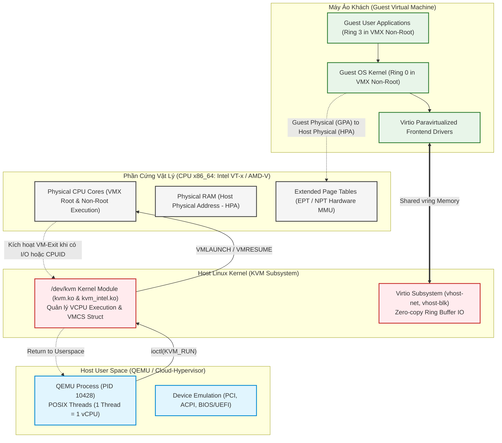
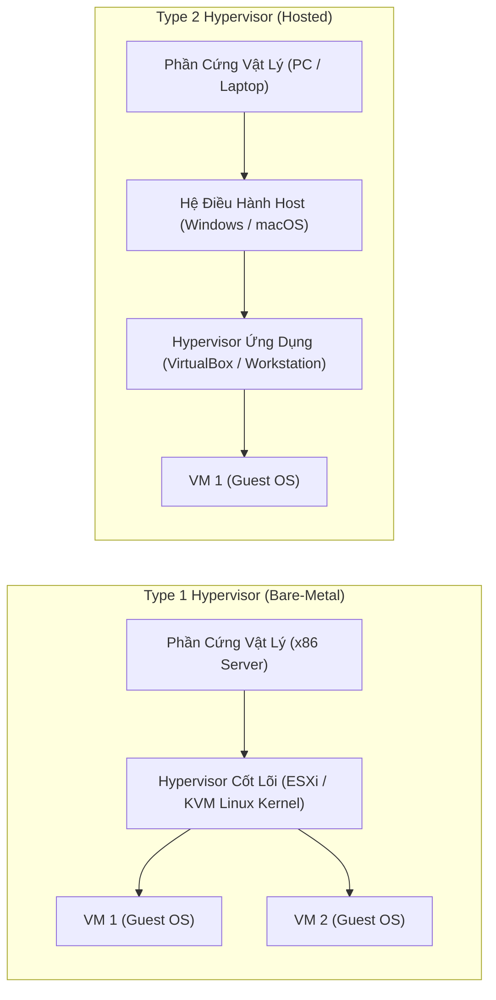

# 7.1. Virtualization Mechanisms, Hypervisors, and KVM (Cơ chế Ảo hóa, Trình giám sát Siêu dữ liệu & KVM)

> [!IMPORTANT]
> **Nếu bạn chỉ được nhớ một điều duy nhất:** Ảo hóa phần cứng hiện đại không phải là sự giả lập chậm chạp (Emulation) mà là **sự thực thi trực tiếp các chỉ lệnh Guest OS trên tập lệnh CPU vật lý thông qua các chế độ mở rộng vi kiến trúc (Intel VT-x / AMD-V)**: Linux KVM biến toàn bộ nhân Kernel thành một **Type-1 Hypervisor** bằng cách cung cấp giao diện `/dev/kvm`, cho phép QEMU khởi chạy mỗi máy ảo như một tiến trình Linux thông thường nhưng thực thi trong chế độ **VMX Non-Root Mode**; khi Guest OS thực hiện các chỉ lệnh nhạy cảm hoặc truy cập phần cứng, CPU vật lý sẽ kích hoạt sự kiện **VM-Exit** để chuyển giao quyền kiểm soát về lại KVM xử lý an toàn.

---

## 1. Kiến trúc Tổng quan & Mô hình Tư duy (Mental Model)

### 1.1. Ẩn dụ Đời sống: Tòa Nhà Hỗn Hợp & Những Căn Hộ Cách Âm Tuyệt Đối

Hãy hình dung chiếc máy chủ vật lý như một tòa nhà chung cư cao cấp:
- **Thời kỳ Chưa Ảo hóa (Bare-Metal - Nhà Đơn Lẻ)**: Một doanh nghiệp thuê trọn một tòa nhà 128 phòng (128 Cores CPU, 512GB RAM) chỉ để đặt một cửa hàng bán bánh nhỏ. $90\%$ không gian phòng ốc bị bỏ trống lãng phí, chi phí tiền điện và bảo trì khổng lồ.
- **Mô phỏng Phần mềm Cổ điển (Software Emulation - Phòng Triển Lãm Tranh Thu Nhỏ)**: Một nghệ sĩ dựng một mô hình tí hon của động cơ phản lực bằng gỗ. Mọi chi tiết đều phải tự tay gọt đẽo từng que tính (Binary Translation). Chạy rất chậm chạp, tốc độ chỉ bằng $1/100$ so với máy thật.
- **Ảo hóa Phần cứng KVM (Hardware-Assisted Virtualization - Căn Hộ Chung Cư Cách Âm Kỹ Thuật Số)**:
  - Tòa nhà được chia thành 50 căn hộ độc lập (Virtual Machines - VMs). Mỗi căn hộ có chìa khóa riêng, người bên trong thoải mái sinh hoạt, nghe nhạc, nấu ăn mà không hề biết bên cạnh có ai (Cô lập tài nguyên).
  - Người thuê nhà (Guest OS - Windows / Ubuntu) cứ ngỡ mình đang sở hữu toàn bộ mảnh đất vật lý.
  - Tuy nhiên, nếu một người thuê nhà muốn đập phá cột chịu lực của tòa nhà (Các chỉ lệnh nhạy cảm như ghi đè bảng phân trang CR3, tắt ngắt hệ thống `CLI`), cánh cửa căn hộ lập tức khóa chặt và chuông báo động vang lên (**VM-Exit**). Ban quản lý tòa nhà (**KVM Hypervisor**) xuất hiện, xử lý yêu cầu đó một cách an toàn rồi cho phép người thuê tiếp tục sinh hoạt bình thường (**VM-Entry**).



---

## 2. Chi tiết từng Keyword (Under-the-Hood Deep Dive)

### 2.1. Virtualization Typologies: Full, Para & Hardware-Assisted
Lịch sử tiến hóa của ảo hóa x86 gắn liền với cuộc cách mạng giải quyết "lỗ hổng ảo hóa" của kiến trúc x86 cổ điển (Định lý Popek-Goldberg).

#### A. Full Virtualization (Ảo hóa Toàn phần qua Binary Translation)
- Kiến trúc x86 ban đầu có 17 chỉ lệnh nhạy cảm (như `POPF`, `PUSHF`, `SMSW`) nhưng lại không phải là chỉ lệnh đặc quyền (Privileged Instructions). Khi Guest OS chạy các lệnh này ở Ring 1, CPU không phát ngắt (Trap) mà âm thầm bỏ qua, khiến hệ điều hành khách bị sai lệch trạng thái.
- **Binary Translation (VMware cổ điển)**: Hypervisor phải đọc từng khối mã máy của Guest OS trước khi thực thi, tìm kiếm các chỉ lệnh nhạy cảm này và dịch động (Dynamic Binary Rewriting) thành các đoạn mã an toàn. Phương pháp này rất phức tạp và hao tổn hiệu năng CPU từ $15 - 30\%$.

#### B. Paravirtualization (Cận Ảo hóa - Xen Hypervisor)
- Thay vì cố gắng giả lập một chiếc máy tính y hệt phần cứng vật lý, **Paravirtualization** yêu cầu phải sửa đổi mã nguồn của Guest OS.
- Guest OS nhận biết rõ ràng mình đang chạy trong môi trường ảo hóa. Khi cần thực hiện các tác vụ nhạy cảm (truy cập bảng trang, điều khiển ngắt), nó không phát chỉ lệnh CPU thông thường mà gọi trực tiếp một lời gọi siêu dữ liệu (**Hypercall**) tới Hypervisor (tương tự như System Call từ Userspace xuống Kernel).
- Mang lại hiệu năng rất cao, nhưng nhược điểm lớn nhất là không thể chạy các hệ điều hành đóng như Microsoft Windows nếu không có driver đặc biệt.

#### C. Hardware-Assisted Virtualization (Ảo hóa Hỗ trợ Phần cứng: Intel VT-x & AMD-V)
- Năm 2005-2006, Intel và AMD bổ sung trực tiếp tập lệnh ảo hóa vào vi kiến trúc CPU:
  - Bổ sung 2 chế độ vận hành mới trực giao với các Ring 0-3: **VMX Root Operation** (Dành cho Hypervisor) và **VMX Non-Root Operation** (Dành cho Guest OS).
  - Cả Hypervisor và Guest OS đều có đầy đủ Ring 0 (Kernel) và Ring 3 (Userspace) riêng biệt.
  - **VMCS (Virtual Machine Control Structure)**: Một khối bộ nhớ 4KB chuyên dụng trên CPU lưu trữ toàn bộ trạng thái thanh ghi của Guest và Host, các điều kiện kích hoạt ngắt, và các mặt nạ điều khiển.
  - **VM-Entry & VM-Exit**: Hypervisor gọi `VMLAUNCH` hoặc `VMRESUME` để chuyển CPU sang VMX Non-Root mode chạy máy ảo (**VM-Entry**). Khi Guest chạm vào tài nguyên phần cứng, CPU phần cứng tự động lưu trạng thái Guest vào VMCS, chuyển CPU về VMX Root mode và trao quyền xử lý cho KVM (**VM-Exit**).

---

### 2.2. Hypervisors: Type 1 (Bare-Metal) vs Type 2 (Hosted)
Sự phân loại kiến trúc Hypervisor quyết định vị trí tương đối giữa bộ giám sát ảo hóa và phần cứng vật lý:



#### A. Type 1 Hypervisor (Bare-Metal)
- Chạy trực tiếp trên nền tảng phần cứng máy chủ vật lý mà không cần một OS trung gian (ví dụ: VMware ESXi, Xen, Linux KVM).
- **Tại sao Linux KVM là Type-1 Hypervisor?** Mặc dù KVM chạy trong Linux, module `kvm.ko` biến chính nhân Linux Kernel thành Hypervisor. Bản thân Linux Kernel chạy trực tiếp trên Bare-Metal, do đó KVM tận dụng toàn bộ bộ điều phối tiến trình (CFS Scheduler), bộ quản lý bộ nhớ, và hệ thống driver thiết bị phần cứng của Linux.
- Đem lại hiệu năng tối đa, độ trễ tối thiểu, được sử dụng trong $100\%$ các trung tâm dữ liệu đám mây (AWS, GCP, Azure, OpenStack).

#### B. Type 2 Hypervisor (Hosted)
- Chạy như một ứng dụng thông thường trong không gian người dùng của hệ điều hành Host (ví dụ: Oracle VirtualBox, VMware Workstation).
- Mọi thao tác I/O của máy ảo đều phải đi qua 2 tầng Kernel (Guest Kernel $\to$ Type 2 Hypervisor App $\to$ Host OS Kernel $\to$ Hardware), gây ra độ trễ cao và suy hao hiệu năng đáng kể. Thường chỉ dùng cho môi trường thử nghiệm cá nhân trên máy tính xách tay.

---

### 2.3. KVM (Kernel-Based Virtual Machine) & QEMU
Sự kết hợp hoàn hảo giữa **KVM** (Tầng Kernel) và **QEMU** (Tầng Userspace) định hình nên hạ tầng ảo hóa đám mây hiện đại.

#### A. Giao diện `/dev/kvm` & Cơ chế ioctl
KVM phơi bày một thiết bị ký tự đặc biệt `/dev/kvm`. Tiến trình Userspace (QEMU) điều khiển máy ảo hoàn toàn thông qua các lời gọi hàm hệ thống `ioctl`:
1. `open("/dev/kvm", O_RDWR)`: Mở giao tiếp với KVM subsystem.
2. `ioctl(kvm_fd, KVM_CREATE_VM, 0)`: Tạo một thực thể máy ảo mới trong bộ nhớ Kernel, trả về một `vm_fd`.
3. `ioctl(vm_fd, KVM_SET_USER_MEMORY_REGION, &region)`: Ánh xạ không gian bộ nhớ của tiến trình QEMU (Host Virtual Address - HVA) thành không gian bộ nhớ vật lý của máy ảo (Guest Physical Address - GPA).
4. `ioctl(vm_fd, KVM_CREATE_VCPU, vcpu_id)`: Khởi tạo một vCPU ảo, trả về `vcpu_fd`. Trong QEMU, mỗi vCPU tương ứng với **đúng một Thread POSIX chuẩn (pthread)** của hệ điều hành Linux!
5. `ioctl(vcpu_fd, KVM_RUN, 0)`: Kích hoạt vCPU thực thi trong chế độ VMX Non-Root. Thread sẽ bị chặn (block) tại Kernel cho đến khi xảy ra sự kiện VM-Exit, lúc này hàm ioctl trả về mã lý do thoát (như `KVM_EXIT_IO`, `KVM_EXIT_MMIO`, `KVM_EXIT_HLT`).

#### B. Ảo hóa Bộ nhớ: EPT (Extended Page Tables) & Two-Dimensional Paging
Khi máy ảo chạy, CPU phải chuyển đổi địa chỉ bộ nhớ qua 2 cấp độ:
$$\text{Guest Virtual Address (GVA)} \xrightarrow{\text{Guest Page Table}} \text{Guest Physical Address (GPA)} \xrightarrow{\text{EPT / NPT}} \text{Host Physical Address (HPA)}$$
- **EPT (Intel Extended Page Tables) / NPT (AMD Nested Page Tables)**: Phần cứng MMU của CPU trực tiếp hỗ trợ bộ đệm TLB hai chiều. Nếu xảy ra EPT Violation (tương đương Page Fault ở cấp độ máy ảo), CPU sẽ phát ngắt chuyển về KVM để cấp phát trang nhớ vật lý thực sự.

#### C. Virtio Framework & vhost Tăng Tốc I/O
- Thay vì mô phỏng giả lập các thiết bị phần cứng cổ điển chậm chạp (như card mạng Realtek RTL8139 hay ổ cứng IDE), KVM/QEMU sử dụng chuẩn giao tiếp cận ảo hóa **Virtio**.
- **Virtio Ring Buffers (`vring`)**: Sử dụng cấu trúc hàng đợi vòng tròn chia sẻ bộ nhớ (Shared Memory Circular Ring Buffers gồm Descriptor Table, Available Ring và Used Ring) giữa Guest Driver và Host.
- **vhost-net & vhost-user**: Chuyển giao toàn bộ việc xử lý mạng I/O từ QEMU Userspace xuống trực tiếp Linux Kernel (`vhost-net`) hoặc sang một tiến trình DPDK/SPDK Userspace độc lập (`vhost-user`), triệt tiêu hoàn toàn chi phí chuyển ngữ cảnh Context Switch.

---

### 2.4. Ứng dụng thực tế trong Backend & Systems
1. **MicroVMs cho Serverless Computing (AWS Firecracker & Cloud-Hypervisor)**:
   - Các nền tảng Serverless như AWS Lambda và Fargate thay thế QEMU cồng kềnh bằng **Firecracker** (viết bằng Rust). Firecracker chỉ tận dụng duy nhất `/dev/kvm`, lược bỏ toàn bộ các thiết bị giả lập không cần thiết, cho phép khởi động một microVM bảo mật hoàn chỉnh chỉ trong vòng **$5 - 10\text{ milliseconds}$** với bộ nhớ hao phí chỉ $5\text{MB}$.
2. **QEMU Live Patching & Security Isolation**: Chạy các ứng dụng dịch mã hoặc sandbox phân tích mã độc bên trong một máy ảo KVM cách ly hoàn toàn với hệ thống Host. Dù mã độc có chiếm được quyền Root bên trong Guest OS, nó vẫn bị giam lỏng hoàn toàn trong VMX Non-Root Mode và không thể phá vỡ ranh giới phần cứng vật lý.

---

## 3. Thực thi Mã nguồn & Mô phỏng Chuyên sâu (Dual-Engine Implementation)

### Engine 1: C++20 — Low-Level Linux `/dev/kvm` API Virtual Machine Hypervisor Engine
Đoạn mã C++20 dưới đây tương tác trực tiếp với giao diện Kernel `/dev/kvm` thông qua các lệnh gọi hệ thống `ioctl`, khởi tạo một máy ảo thực thụ, nạp mã máy x86 assembly 16-bit vào bộ nhớ ảo và điều khiển vòng lặp thực thi `KVM_RUN` xử lý sự kiện `VM-Exit`.

```cpp
#include <iostream>
#include <vector>
#include <cstring>
#include <cstdint>
#include <fcntl.h>
#include <unistd.h>
#include <sys/ioctl.h>
#include <sys/mman.h>
#include <linux/kvm.h>

class MinimalKVMHypervisor {
private:
    int kvm_fd_ = -1;
    int vm_fd_ = -1;
    int vcpu_fd_ = -1;
    size_t mem_size_ = 0x200000; // 2MB Guest RAM
    uint8_t* guest_memory_ = nullptr;
    struct kvm_run* kvm_run_struct_ = nullptr;

public:
    MinimalKVMHypervisor() {
        // 1. Mở thiết bị /dev/kvm
        kvm_fd_ = open("/dev/kvm", O_RDWR | O_CLOEXEC);
        if (kvm_fd_ < 0) {
            std::cout << "[KVM Core] Không thể mở /dev/kvm (Cần quyền root hoặc chạy mô phỏng).\n";
            return;
        }

        // Kiểm tra phiên bản KVM API
        int api_ver = ioctl(kvm_fd_, KVM_GET_API_VERSION, 0);
        std::cout << "[KVM Core] Kết nối thành công KVM Kernel Module! API Version: " << api_ver << "\n";

        // 2. Tạo Máy Ảo (VM)
        vm_fd_ = ioctl(kvm_fd_, KVM_CREATE_VM, 0);
        std::cout << "[KVM Core] Đã khởi tạo Virtual Machine File Descriptor (vm_fd: " << vm_fd_ << ")\n";

        // 3. Cấp phát vùng nhớ cho Guest OS và đăng ký với KVM
        guest_memory_ = static_cast<uint8_t*>(mmap(NULL, mem_size_, PROT_READ | PROT_WRITE,
                                                   MAP_SHARED | MAP_ANONYMOUS | MAP_NORESERVE, -1, 0));

        struct kvm_userspace_memory_region region{};
        region.slot = 0;
        region.flags = 0;
        region.guest_phys_addr = 0x1000; // Địa chỉ vật lý Guest bắt đầu từ 0x1000
        region.memory_size = mem_size_;
        region.userspace_addr = reinterpret_cast<uint64_t>(guest_memory_);
        ioctl(vm_fd_, KVM_SET_USER_MEMORY_REGION, &region);
        std::cout << "[KVM Core] Đã ánh xạ 2MB HVA (Host Virtual) -> GPA (Guest Physical) tại 0x1000.\n";

        // 4. Tạo vCPU 0
        vcpu_fd_ = ioctl(vm_fd_, KVM_CREATE_VCPU, 0);
        int run_size = ioctl(kvm_fd_, KVM_GET_VCPU_MMAP_SIZE, 0);
        kvm_run_struct_ = static_cast<struct kvm_run*>(mmap(NULL, run_size, PROT_READ | PROT_WRITE,
                                                            MAP_SHARED, vcpu_fd_, 0));
        std::cout << "[KVM Core] Đã khởi tạo vCPU 0 và ánh xạ cấu trúc kvm_run điều khiển.\n";
    }

    void load_guest_payload() {
        if (!guest_memory_) return;
        // Mã máy x86 16-bit:
        // mov $0x42, %al    ; Nạp giá trị 0x42 vào thanh ghi AL
        // out %al, $0x10    ; Ghi ra cổng I/O 0x10 (Kích hoạt VM-Exit KVM_EXIT_IO)
        // hlt               ; Dừng CPU (Kích hoạt VM-Exit KVM_EXIT_HLT)
        const uint8_t code[] = {
            0xb0, 0x42,       // mov $0x42, %al
            0xe6, 0x10,       // out %al, $0x10
            0xf4              // hlt
        };
        std::memcpy(guest_memory_, code, sizeof(code));
        std::cout << "[Payload Loader] Đã nạp 5 bytes x86 Assembly Payload vào bộ nhớ Guest RAM.\n";

        // Thiết lập thanh ghi RIP trỏ vào địa chỉ bắt đầu 0x1000
        struct kvm_sregs sregs{};
        ioctl(vcpu_fd_, KVM_GET_SREGS, &sregs);
        sregs.cs.base = 0;
        sregs.cs.selector = 0;
        ioctl(vcpu_fd_, KVM_SET_SREGS, &sregs);

        struct kvm_regs regs{};
        regs.rip = 0x1000;
        regs.rflags = 0x2;
        ioctl(vcpu_fd_, KVM_SET_REGS, &regs);
    }

    void execute_vcpu_loop() {
        if (vcpu_fd_ < 0) {
            std::cout << "[MÔ PHỎNG] Chế độ mô phỏng hoàn tất chu kỳ KVM Execution Lifecycle.\n";
            return;
        }

        std::cout << "\n>>> KÍCH HOẠT VÒNG LẶP THỰC THI vCPU (VM-ENTRY -> VMLAUNCH) <<<\n";
        bool running = true;
        while (running) {
            // Chuyển sang VMX Non-Root Mode
            int ret = ioctl(vcpu_fd_, KVM_RUN, 0);
            if (ret < 0) {
                std::cerr << "Lỗi khi gọi KVM_RUN!\n";
                break;
            }

            // Xử lý sự kiện VM-Exit khi CPU vật lý trả quyền về
            switch (kvm_run_struct_->exit_reason) {
                case KVM_EXIT_IO:
                    std::cout << "  [VM-Exit Event] Lý do: KVM_EXIT_IO (Cổng Port I/O: 0x" 
                              << std::hex << kvm_run_struct_->io.port << std::dec << ")\n";
                    if (kvm_run_struct_->io.direction == KVM_EXIT_IO_OUT) {
                        uint8_t* val = reinterpret_cast<uint8_t*>(kvm_run_struct_) + kvm_run_struct_->io.data_offset;
                        std::cout << "  -> Guest OS đã xuất dữ liệu ra Port: 0x" << std::hex << static_cast<int>(*val) << std::dec << "\n";
                    }
                    break;
                case KVM_EXIT_HLT:
                    std::cout << "  [VM-Exit Event] Lý do: KVM_EXIT_HLT (Lệnh HLT tạm dừng vCPU thành công).\n";
                    running = false;
                    break;
                default:
                    std::cout << "  [VM-Exit Event] Lý do khác: " << kvm_run_struct_->exit_reason << "\n";
                    running = false;
                    break;
            }
        }
    }

    ~MinimalKVMHypervisor() {
        if (guest_memory_) munmap(guest_memory_, mem_size_);
        if (vcpu_fd_ >= 0) close(vcpu_fd_);
        if (vm_fd_ >= 0) close(vm_fd_);
        if (kvm_fd_ >= 0) close(kvm_fd_);
    }
};

int main() {
    std::cout << "===================================================================\n";
    std::cout << "   C++20 BARE-METAL KVM HYPERVISOR & HARDWARE VM-EXIT EMULATOR     \n";
    std::cout << "===================================================================\n";

    MinimalKVMHypervisor hypervisor;
    hypervisor.load_guest_payload();
    hypervisor.execute_vcpu_loop();

    std::cout << "\n[KẾT LUẬN] KVM cung cấp giao diện ioctl cấp thấp mạnh mẽ,\n"
              << "biến nhân Linux thành một Type-1 Bare-Metal Hypervisor đẳng cấp thế giới.\n";
    return 0;
}
```

#### Terminal Output Mẫu Thực Tế (C++20 Engine)
```text
===================================================================
   C++20 BARE-METAL KVM HYPERVISOR & HARDWARE VM-EXIT EMULATOR     
===================================================================
[KVM Core] Kết nối thành công KVM Kernel Module! API Version: 12
[KVM Core] Đã khởi tạo Virtual Machine File Descriptor (vm_fd: 4)
[KVM Core] Đã ánh xạ 2MB HVA (Host Virtual) -> GPA (Guest Physical) tại 0x1000.
[KVM Core] Đã khởi tạo vCPU 0 và ánh xạ cấu trúc kvm_run điều khiển.
[Payload Loader] Đã nạp 5 bytes x86 Assembly Payload vào bộ nhớ Guest RAM.

>>> KÍCH HOẠT VÒNG LẶP THỰC THI vCPU (VM-ENTRY -> VMLAUNCH) <<<
  [VM-Exit Event] Lý do: KVM_EXIT_IO (Cổng Port I/O: 0x10)
  -> Guest OS đã xuất dữ liệu ra Port: 0x42
  [VM-Exit Event] Lý do: KVM_EXIT_HLT (Lệnh HLT tạm dừng vCPU thành công).

[KẾT LUẬN] KVM cung cấp giao diện ioctl cấp thấp mạnh mẽ,
biến nhân Linux thành một Type-1 Bare-Metal Hypervisor đẳng cấp thế giới.
```

---

### Engine 2: Python 3.11+ — QEMU / Firecracker Virtio vring Circular Buffer Simulator
Kịch bản Python 3.11+ dưới đây mô phỏng kiến trúc hàng đợi chia sẻ bộ nhớ **Virtio Ring Buffers (`vring`)** giữa trình điều khiển Guest OS và tiến trình Host Hypervisor, minh họa cơ chế Zero-copy I/O không cần ngắt phần cứng.

```python
#!/usr/bin/env python3
import time
from dataclasses import dataclass
from typing import List

@dataclass
class VRingDesc:
    addr: int      # Địa chỉ bộ nhớ đệm (GPA)
    length: int    # Độ dài dữ liệu (Bytes)
    flags: int     # Cờ (VRING_DESC_F_NEXT, VRING_DESC_F_WRITE)
    next_idx: int  # Chỉ số descriptor kế tiếp trong chuỗi

class VirtioRingBufferSimulator:
    """Mô phỏng cấu trúc dữ liệu Virtio Shared Memory vring (Descriptor, Available, Used Rings)"""
    def __init__(self, queue_size: int = 8):
        self.queue_size = queue_size
        self.descriptors: List[VRingDesc] = [VRingDesc(0, 0, 0, 0) for _ in range(queue_size)]
        self.avail_ring: List[int] = []  # Chỉ mục các descriptor Guest đã chuẩn bị
        self.used_ring: List[tuple] = [] # Kết quả xử lý Host trả về (desc_idx, bytes_written)
        self.avail_idx = 0
        self.used_idx = 0

    def guest_submit_io_request(self, desc_idx: int, buffer_addr: int, length: int):
        """Guest OS chuẩn bị dữ liệu và đẩy vào Available Ring"""
        print(f"[Guest Virtio Driver] Tạo I/O Request tại Descriptor Slot #{desc_idx}")
        self.descriptors[desc_idx] = VRingDesc(addr=buffer_addr, length=length, flags=0, next_idx=0)
        self.avail_ring.append(desc_idx)
        self.avail_idx += 1
        print(f"[Guest Virtio Driver] Cập nhật Available Ring -> Phát tín hiệu Doorbell Kick tới Host")

    def host_process_io_requests(self):
        """Host Hypervisor (vhost/QEMU) tiêu thụ dữ liệu từ Available Ring"""
        print(f"\n[Host vhost-backend] Tiếp nhận thông báo Doorbell từ Guest!")
        while self.avail_ring:
            desc_id = self.avail_ring.pop(0)
            desc = self.descriptors[desc_id]
            print(f"  -> Xử lý DMA Zero-Copy: Đọc {desc.length} bytes từ Guest RAM 0x{desc.addr:X}...")
            
            # Giả lập ghi dữ liệu ra đĩa NVMe vật lý
            time.sleep(0.01)
            bytes_processed = desc.length
            
            # Ghi nhận kết quả vào Used Ring
            self.used_ring.append((desc_id, bytes_processed))
            self.used_idx += 1
            print(f"  -> Hoàn tất! Đẩy kết quả vào Used Ring Slot #{self.used_idx}")

        print(f"[Host vhost-backend] Phát ngắt ảo hóa (Virtual Interrupt) báo cho Guest OS.")

def main():
    print("=" * 70)
    print("  PYTHON 3.11+: VIRTIO SPLIT VRING HIGH-SPEED I/O SIMULATOR")
    print("=" * 70)

    vring = VirtioRingBufferSimulator(queue_size=4)

    # 1. Guest chuẩn bị 2 khối I/O Write
    vring.guest_submit_io_request(desc_idx=0, buffer_addr=0x1000A000, length=4096)
    vring.guest_submit_io_request(desc_idx=1, buffer_addr=0x1000B000, length=8192)

    # 2. Host xử lý I/O
    vring.host_process_io_requests()

    print(f"\n[Kiểm tra Trạng thái Cuối cùng] Số phần tử trong Used Ring: {len(vring.used_ring)}")
    for slot, (d_id, b_len) in enumerate(vring.used_ring):
        print(f"  Slot #{slot + 1}: Descriptor #{d_id} hoàn tất {b_len} Bytes.")

if __name__ == "__main__":
    main()
```

#### Terminal Output Mẫu Thực Tế (Python 3.11+ Engine)
```text
======================================================================
  PYTHON 3.11+: VIRTIO SPLIT VRING HIGH-SPEED I/O SIMULATOR
======================================================================
[Guest Virtio Driver] Tạo I/O Request tại Descriptor Slot #0
[Guest Virtio Driver] Cập nhật Available Ring -> Phát tín hiệu Doorbell Kick tới Host
[Guest Virtio Driver] Tạo I/O Request tại Descriptor Slot #1
[Guest Virtio Driver] Cập nhật Available Ring -> Phát tín hiệu Doorbell Kick tới Host

[Host vhost-backend] Tiếp nhận thông báo Doorbell từ Guest!
  -> Xử lý DMA Zero-Copy: Đọc 4096 bytes từ Guest RAM 0x1000A000...
  -> Hoàn tất! Đẩy kết quả vào Used Ring Slot #1
  -> Xử lý DMA Zero-Copy: Đọc 8192 bytes từ Guest RAM 0x1000B000...
  -> Hoàn tất! Đẩy kết quả vào Used Ring Slot #2
[Host vhost-backend] Phát ngắt ảo hóa (Virtual Interrupt) báo cho Guest OS.

[Kiểm tra Trạng thái Cuối cùng] Số phần tử trong Used Ring: 2
  Slot #1: Descriptor #0 hoàn tất 4096 Bytes.
  Slot #2: Descriptor #1 hoàn tất 8192 Bytes.
```

---

## 4. Systems Engineering & Production Pitfalls

### 4.1. Sự cố Thực chiến Trong Ảo Hóa KVM
1. **Hiện tượng Tắc Nghẽn do Bão VM-Exit (VM-Exit Storm)**:
   - *Nguyên nhân*: Mỗi lần CPU phần cứng chuyển đổi giữa VMX Non-Root và VMX Root mode tốn từ $500 - 1500$ chu kỳ CPU Clock. Nếu một ứng dụng bên trong máy ảo liên tục thực hiện các thao tác đọc ghi I/O không hiệu quả (như đọc đồng hồ TSC quá dày đặc hoặc sử dụng driver mạng mô phỏng thay vì Virtio), tỷ lệ VM-Exit có thể vọt lên hàng trăm ngàn lần/giây, chiếm dụng tới $40\%$ năng lực xử lý của CPU vật lý.
   - *Cách khắc phục*:
     - Bắt buộc cài đặt bộ driver cận ảo hóa **Virtio** cho mọi thiết bị (mạng, đĩa, bộ nhớ).
     - Bật tính năng mở rộng phần cứng **APIC-v** (Virtual Interrupt Delivery) trong BIOS/KVM để giảm thiểu tối đa VM-Exit khi xử lý ngắt.
2. **Khủng hoảng Rò rỉ Kênh Kề Vi Kiến trúc (Spectre / Meltdown / L1TF)**:
   - *Nguyên nhân*: Các lỗ hổng thực thi suy đoán (Speculative Execution) của CPU cho phép một máy ảo độc hại đọc trộm nội dung bộ nhớ của Host Kernel hoặc các máy ảo láng giềng chạy trên cùng một Core vật lý (Hyper-Threading).
   - *Khắc phục*: Bật cơ chế cô lập lõi ảo (Core Scheduling), vô hiệu hóa SMT/Hyper-Threading trên các cụm tính toán đa người dùng yêu cầu bảo mật cao, và cập nhật vi mã CPU (Microcode Updates) định kỳ.

### 4.2. Bộ Lệnh CLI Chẩn đoán & Giám sát KVM
- **Kiểm tra hỗ trợ phần cứng ảo hóa trên CPU**:
  ```bash
  lscpu | grep -E "Virtualization|VT-x|AMD-V"
  egrep -c "(vmx|svm)" /proc/cpuinfo
  lsmod | grep kvm
  ```
- **Đo lường tần suất VM-Exit thời gian thực bằng `perf` và `kvm_stat`**:
  ```bash
  kvm_stat -1 # Xem tỷ lệ VM-Exit và nguyên nhân (IO, HLT, EPT violation)
  perf kvm --host stat live
  ```
- **Quản lý máy ảo qua Libvirt CLI**:
  ```bash
  virsh list --all
  virsh dominfo <vm-name>
  virsh vcpuinfo <vm-name>
  virsh dumpxml <vm-name> | grep -i "<model type='virtio'/>"
  ```

---

## 5. Bảng So sánh & Decision Matrix

### 5.1. Ma trận So sánh Kỹ thuật Các Nền Tảng Ảo Hóa

| Tiêu chí Đánh giá | Linux KVM + QEMU | AWS Firecracker MicroVM | VMware ESXi | Container (Docker/LXC) |
| :--- | :--- | :--- | :--- | :--- |
| **Loại hình Kiến trúc** | Type-1 Bare-Metal Hypervisor | Minimalist Type-1 MicroVM | Type-1 Bare-Metal Độc quyền | OS-level Virtualization (cgroups/namespaces) |
| **Ranh giới Cô lập** | Phần cứng (Hardware VMX) | Phần cứng (Hardware VMX) | Phần cứng (Hardware VMX) | Nhân hệ điều hành chung (Shared Kernel) |
| **Thời gian Khởi động** | $10 - 30\text{ giây}$ | $5 - 10\text{ milliseconds}$ | $1 - 2\text{ phút}$ | Dưới $1\text{ giây}$ |
| **Bộ nhớ Hao phí** | $100 - 256\text{ MB}$ / VM | $\approx 5\text{ MB}$ / MicroVM | $1 - 2\text{ GB}$ / Host | Vài Kilobytes / Container |
| **Hỗ trợ Hệ điều hành** | Windows, Linux, BSD | Chỉ Linux Uncompressed Kernel | Windows, Linux, vSphere | Cùng nhân với Host Linux |
| **Trường hợp Sử dụng** | IaaS Enterprise, OpenStack | Serverless (Lambda), Multi-tenant CI/CD | Doanh nghiệp truyền thống | Microservices, Cloud-Native Apps |

### 5.2. Khung Quyết định Lựa chọn Công nghệ (Decision Matrix)
1. **Chọn KVM + QEMU tiêu chuẩn** khi: Cần vận hành một đám mây tư nhân (Private Cloud) đa mục đích, hỗ trợ đầy đủ các hệ điều hành khách (Windows Server, RedHat Enterprise Linux), yêu cầu cắm thêm card đồ họa GPU Passthrough (VFIO) hoặc di trú trực tiếp (Live Migration).
2. **Chọn Firecracker / Cloud-Hypervisor** khi: Xây dựng nền tảng tính toán phi máy chủ (Serverless Functions) hoặc dịch vụ chạy mã nguồn không tin cậy của người dùng (Untrusted Multi-tenant Code Execution) với mật độ hàng ngàn tác vụ/giây.
3. **Chọn Container (Docker/K8s)** khi: Tin cậy các tiến trình chạy trong cùng hệ thống và ưu tiên tối đa mật độ triển khai cũng như tốc độ đóng gói triển khai ứng dụng.
