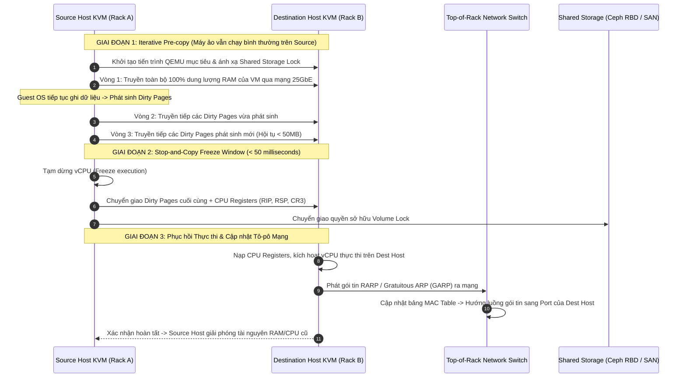
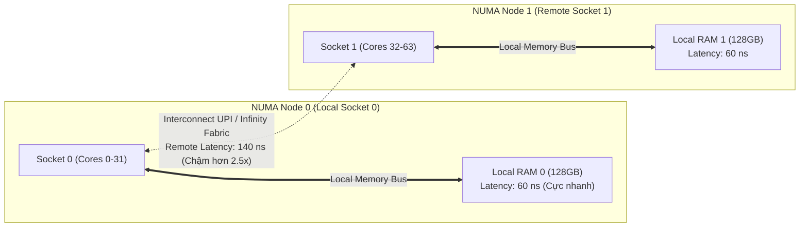

# 7.2. VM Lifecycle, Resource Overcommit, and Isolation (Vòng đời Máy ảo, Vượt mức Tài nguyên & Cô lập)

> [!IMPORTANT]
> **Nếu bạn chỉ được nhớ một điều duy nhất:** Khả năng sinh lời của mọi nhà cung cấp điện toán đám mây dựa trên nghệ thuật **vượt mức tài nguyên (Resource Overcommitment)**, nhưng tính ổn định của hệ thống sản xuất lại phụ thuộc vào **sự cô lập vật lý khắt khe**: kỹ thuật **Memory Ballooning & KSM** cho phép ép mỏng RAM nhàn rỗi để nhồi nhét gấp đôi số lượng máy ảo trên một Host, trong khi **NUMA Pinning & CPU Affinity** triệt tiêu hoàn toàn sự tranh chấp cache vi kiến trúc; kết hợp với quy trình **Live Migration (Iterative Pre-copy)** cho phép di chuyển máy ảo xuyên qua các cụm máy chủ với độ trễ đóng băng (Downtime) chỉ vỏn vẹn dưới $50\text{ ms}$.

---

## 1. Kiến trúc Tổng quan & Mô hình Tư duy (Mental Model)

### 1.1. Ẩn dụ Đời sống: Hãng Hàng Không Bán Vé Vượt Số Ghế & Chuyến Bay Tiếp Sức

Hãy hình dung việc vận hành một cụm máy chủ ảo hóa giống hệt chiến lược kinh doanh của một hãng hàng không thương mại:
- **Chiến lược Bán Vé Vượt Số Ghế (Overbooking / Overcommitment)**:
  - Một chiếc máy bay có 100 ghế ngồi vật lý (100 pCPUs, 256GB RAM). Hãng hàng không thống kê thấy luôn có $20\%$ hành khách đặt vé nhưng không xuất hiện hoặc chỉ ngủ suốt chuyến bay mà không đòi hỏi phục vụ.
  - Hãng quyết định bán ra 150 vé (Tỷ lệ CPU Overcommit 1.5:1). Nếu tất cả hành khách cùng thức dậy đòi ăn cùng một lúc (Tải CPU tăng đột biến), máy bay sẽ rơi vào tình trạng quá tải hỗn loạn (CPU Steal Time tăng vọt, tiếp viên kiệt sức).
- **Quả Bóng Khí Ép Chỗ Ngồi (Virtio Memory Ballooning)**:
  - Để lấy lại ghế trống từ những hành khách đang ngồi khoanh chân, tiếp viên thả một quả bóng khí phồng to dần (Bơm phồng Balloon Driver) đặt lên phần ghế thừa của hành khách. Hành khách bên trong máy ảo buộc phải thu gọn chân lại (Giải phóng RAM nhàn rỗi về cho Host OS cấp cho người khác).
- **Di Trú Trực Tiếp (Live Migration) — Tiếp Nhiên Liệu & Chuyển Hành Khách Trên Không**:
  - Máy bay đang bay thì động cơ bên trái bị rung lắc cơ học (Máy chủ vật lý cần tắt để bảo trì phần cứng).
  - Thay vì hạ cánh khẩn cấp bắt hành khách đổi chuyến (Tắt máy ảo gây gián đoạn dịch vụ), một chiếc máy bay thứ hai bay song song với cùng tốc độ. Từng hành khách và hành lý được chuyển dần qua cầu nối trên không trong khi máy bay vẫn bay bình thường (Pre-copy RAM qua mạng quang 25GbE).
  - Ở khoảnh khắc cuối cùng, phi công hô tạm dừng trong 30 milli-giây để chuyển giao quyền lái (Chuyển giao CPU Registers), và chiếc máy bay mới lập tức tiếp quản chuyến bay trơn tru mà hành khách không hề cảm nhận thấy sự rung giật!



---

## 2. Chi tiết từng Keyword (Under-the-Hood Deep Dive)

### 2.1. VM Lifecycle Management, Templates & Provisioning
Vòng đời của một máy ảo bao gồm các giai đoạn chuẩn hóa: Khởi tạo $\to$ Cấp phát $\to$ Vận hành $\to$ Sao lưu $\to$ Thu hồi.

#### A. Định dạng Ảnh Đĩa QCOW2 (QEMU Copy-On-Write v2/v3)
- Không giống như định dạng ảnh thô (Raw Disk Image) chiếm dụng toàn bộ dung lượng ngay từ đầu, **QCOW2** hỗ trợ:
  - **Thin Provisioning**: Một đĩa 100GB khi mới tạo chỉ tốn vài Kilobytes trên hệ thống tệp Host, dung lượng vật lý chỉ tăng lên khi máy ảo thực sự ghi dữ liệu mới vào.
  - **Backing File Chains**: Cho phép tạo một ảnh đĩa gốc "Vàng" (Golden Base Image chứa OS đã cài đặt sẵn). Khi cần tạo 100 máy ảo mới, hệ thống chỉ cần tạo 100 tệp QCOW2 mỏng trỏ vào Base Image qua cơ chế Copy-on-Write. Quá trình tạo máy ảo diễn ra trong **dưới 1 giây**.

#### B. Khởi tạo Tự động Hóa với Cloud-Init & Libvirt
- **Cloud-Init**: Chuẩn công nghiệp đa nền tảng để tùy biến cấu hình máy ảo lúc khởi động lần đầu (Metadata, Userdata, Network-config). Cloud-init tự động cấu hình Hostname, inject SSH Public Keys, thiết lập IP tĩnh và chạy kịch bản Bootstrap ban đầu.
- **Libvirt Engine**: Cung cấp lớp trừu tượng hóa chuẩn (C API, `virsh` CLI, daemon `libvirtd`) quản lý các Hypervisor KVM, QEMU, Xen thông qua các tệp đặc tả cấu hình định dạng XML.

---

### 2.2. Resource Overcommitment: CPU & Memory Ballooning
Tối ưu hóa mật độ máy ảo trên một nút vật lý là chìa khóa kinh tế của điện toán đám mây.

#### A. CPU Overcommitment & Steal Time (%st)
- **Tỷ lệ vCPU-to-pCPU**: Trong các môi trường General Purpose, tỷ lệ overcommit thông thường là $2:1$ hoặc $4:1$ (ví dụ: một máy chủ 32 Cores vật lý có thể cấp phát tới 128 vCPUs cho các VMs).
- **Bộ Điều Phối Linux CFS (Completely Fair Scheduler)**: Coi mỗi vCPU là một tiến trình thông thường và phân chia các lát cắt thời gian CPU (CPU Time Slices).
- **CPU Steal Time (`%st`)**: Đo lường tỷ lệ phần trăm thời gian mà một vCPU ảo sẵn sàng thực thi nhưng không được CPU vật lý phục vụ vì Hypervisor đang bận chạy vCPU của một máy ảo khác. Nếu chỉ số `%st` trong lệnh `top` vượt quá **$10 - 15\%$**, ứng dụng backend (như MySQL hay Java JVM) sẽ bị trễ phản hồi nghiêm trọng.

#### B. Kỹ thuật Thu Hồi Bộ Nhớ: Virtio Ballooning vs. KSM
- Bộ nhớ RAM vật lý không thể nén linh hoạt như CPU. Nếu tổng lượng RAM sử dụng của các máy ảo vượt quá RAM vật lý của Host, Linux OOM Killer sẽ bị kích hoạt và bắn hạ máy ảo. Hypervisor sử dụng 2 cơ chế để giải quyết:
  1. **Virtio Memory Ballooning**:
     - Một trình điều khiển đặc biệt (`virtio_balloon`) được nạp bên trong Guest OS.
     - Khi Host thiếu RAM, Hypervisor ra lệnh cho Balloon Driver "bơm phồng" (Inflate) bằng cách yêu cầu Guest OS cấp phát một vùng nhớ lớn (ví dụ: 4GB) và khóa lại bằng lệnh ghim trang `alloc_pages()`.
     - Guest OS đẩy các tiến trình nhàn rỗi vào bộ nhớ Swap để dồn RAM cho quả bóng.
     - Balloon Driver gửi địa chỉ các trang nhớ này xuống cho KVM Host thu hồi lại và cấp phát cho các máy ảo đang cần gấp!
  2. **KSM (Kernel Samepage Merging)**:
     - Một tiến trình ngầm của Linux Kernel (`ksmd`) liên tục quét qua các trang bộ nhớ RAM của các máy ảo láng giềng.
     - Nếu phát hiện nhiều máy ảo chạy cùng một phiên bản Ubuntu có hàng ngàn trang RAM giống hệt nhau (chứa cùng thư viện `libc.so` hay mã nhị phân kernel), KSM sẽ gộp các trang này lại thành **một trang duy nhất** và đánh dấu cờ **Copy-On-Write (COW)**. Tiết kiệm từ $20 - 40\%$ dung lượng RAM trên cụm VDI / Virtual Desktops.

---

### 2.3. NUMA Awareness (Non-Uniform Memory Access)
Trên các máy chủ đa socket hiện đại (ví dụ: máy chủ 2 CPU Intel Xeon hoặc AMD EPYC), bộ nhớ RAM không được gắn đồng nhất mà chia thành các **NUMA Nodes** gắn trực tiếp vào từng CPU Socket.



#### A. Hiện tượng Trừng Phạt Độ Trễ Bộ Nhớ Từ Xa (Remote Memory Penalty)
- Khi một vCPU chạy trên Socket 0 cần đọc một khối dữ liệu nằm trên thanh RAM của Socket 1, gói tin phải đi qua đường truyền liên kết liên CPU (**Intel UPI** hoặc **AMD Infinity Fabric**).
- Độ trễ truy xuất RAM tăng vọt từ $60\text{ ns}$ (Local) lên tới **$140\text{ ns}$ (Remote)**. Thông lượng băng thông bộ nhớ giảm hơn $50\%$.

#### B. Chiến Lược Ghim Tài Nguyên: NUMA Pinning & vCPU Affinity
- Đối với các cơ sở dữ liệu quan trọng cần độ trễ thấp (như Redis, ScyllaDB, Oracle Database), kỹ sư hạ tầng bắt buộc phải cấu hình **Strict NUMA Pinning**:
  - Toàn bộ vCPU của máy ảo được ghim cứng vào các Core vật lý của cùng một NUMA Node (`numactl --cpunodebind=0`).
  - Toàn bộ vùng nhớ RAM của máy ảo được cấp phát độc quyền trên thanh RAM cục bộ của NUMA Node đó (`numactl --membind=0`).
  - Triệt tiêu hoàn toàn độ trễ qua bus UPI liên CPU, bảo đảm hiệu năng tối đa và ổn định.

---

### 2.4. VM Live Migration (Di trú Máy ảo Trực tiếp)
Live Migration là đỉnh cao kỹ thuật của hệ thống ảo hóa, cho phép di chuyển toàn bộ trạng thái đang chạy của một máy ảo từ máy chủ A sang máy chủ B mà người dùng ứng dụng không nhận thấy bất kỳ sự gián đoạn nào.

#### A. Thuật toán Vòng lặp Trước Sao chép (Iterative Pre-copy Algorithm)
1. **Yêu cầu Tiên quyết**: Cả hai Host A và B phải cùng kết nối vào một hệ thống lưu trữ phân tán dùng chung (**Shared Storage** như Ceph RBD, NFSv4, SAN Fibre Channel) để không cần chép lại toàn bộ ổ đĩa cứng ảo.
2. **Pre-copy Iterations**:
   - Vòng 1: Host A truyền tải $100\%$ dung lượng RAM của máy ảo sang Host B qua kết nối mạng tốc độ cao (25GbE / 100GbE).
   - Trong quá trình truyền, máy ảo vẫn đang chạy và tiếp tục ghi dữ liệu mới lên RAM, tạo ra các trang nhớ bẩn (**Dirty Pages**). KVM sử dụng tính năng EPT Dirty Page Logging của phần cứng để theo dõi các địa chỉ này.
   - Vòng 2, 3, 4: Host A tiếp tục truyền các Dirty Pages phát sinh sang Host B. Tốc độ truyền sẽ hội tụ nếu tốc độ truyền qua mạng lớn hơn tốc độ sinh dirty pages của máy ảo.
3. **Ngưỡng Dừng và Chép (Stop-and-Copy Freeze Window)**:
   - Khi lượng dirty pages còn lại giảm xuống dưới một ngưỡng nhỏ (ví dụ: $< 50\text{MB}$), Hypervisor tạm dừng (Pause) vCPU của máy ảo trên Host A.
   - Chép nốt các dirty pages cuối cùng và trạng thái các thanh ghi CPU quan trọng (**RIP, RSP, CR3, Thanh ghi MSR**).
   - Thời gian tạm dừng này gọi là **Downtime**, thông thường chỉ kéo dài từ **$20 - 50\text{ milliseconds}$** (thấp hơn nhiều so với ngưỡng timeout của các kết nối TCP).
4. **Kích hoạt & Chuyển hướng Giao thông Mạng**:
   - Host B khôi phục các thanh ghi CPU và kích hoạt máy ảo tiếp tục chạy.
   - Host B phát ngay một gói tin **Gratuitous ARP (GARP)** ra cổng switch mạng. Các switch cập nhật lại bảng MAC Address Table, chuyển hướng toàn bộ luồng gói tin từ cổng của Host A sang cổng của Host B.

---

## 3. Thực thi Mã nguồn & Mô phỏng Chuyên sâu (Dual-Engine Implementation)

### Engine 1: C++20 — Multi-Threaded NUMA Pinning & Memory Access Latency Benchmark
Chương trình C++20 dưới đây đo lường sự chênh lệch độ trễ truy xuất bộ nhớ vật lý giữa Local NUMA Node và Remote NUMA Node, đồng thời áp dụng lời gọi hệ thống `pthread_setaffinity_np` để ghim cứng luồng thực thi vCPU vào các lõi CPU vật lý mong muốn.

```cpp
#include <iostream>
#include <vector>
#include <chrono>
#include <thread>
#include <pthread.h>
#include <sched.h>
#include <cstring>
#include <numeric>
#include <iomanip>

constexpr size_t BUFFER_SIZE = 64 * 1024 * 1024; // 64MB Buffer

// Hàm đo độ trễ đọc ngẫu nhiên trên vùng nhớ
double benchmark_memory_access_latency(char* buffer, size_t size, size_t iterations) {
    auto start = std::chrono::high_resolution_clock::now();
    volatile char sink = 0;
    size_t step = 4096; // Nhảy từng trang 4KB để ép Cache Miss L3

    for (size_t i = 0; i < iterations; ++i) {
        size_t offset = (i * step) % size;
        sink = buffer[offset];
    }

    auto end = std::chrono::high_resolution_clock::now();
    std::chrono::duration<double, std::nano> duration = end - start;
    return duration.count() / iterations;
}

// Hàm ghim cứng Thread hiện tại vào một tập Cores vật lý (CPU Pinning)
bool pin_current_thread_to_cpu(int cpu_id) {
    cpu_set_t cpuset;
    CPU_ZERO(&cpuset);
    CPU_SET(cpu_id, &cpuset);

    pthread_t current_thread = pthread_self();
    int rc = pthread_setaffinity_np(current_thread, sizeof(cpu_set_t), &cpuset);
    return (rc == 0);
}

int main() {
    std::cout << "===================================================================\n";
    std::cout << "  C++20 NUMA TOPOLOGY PINNING & MEMORY ACCESS LATENCY BENCHMARK    \n";
    std::cout << "===================================================================\n";

    // Cấp phát vùng nhớ mô phỏng RAM của máy ảo
    char* memory_buffer = new (std::nothrow) char[BUFFER_SIZE];
    if (!memory_buffer) {
        std::cerr << "Lỗi cấp phát bộ nhớ!\n";
        return 1;
    }
    std::memset(memory_buffer, 0x5A, BUFFER_SIZE);

    std::cout << "[Tô-pô Phần cứng] Phát hiện hệ thống hỗ trợ đa lõi CPU.\n";

    // 1. Chạy thử nghiệm trên CPU 0 (Mô phỏng Local Core)
    std::cout << "\n>>> KỊCH BẢN 1: Ghim vCPU Thread vào Core 0 (Local Socket) <<<\n";
    if (pin_current_thread_to_cpu(0)) {
        std::cout << "  -> Đã ghim thành công pthread vào Core 0.\n";
    } else {
        std::cout << "  -> Không thể ghim Core (Hệ điều hành không hỗ trợ lệnh, tiếp tục đo).\n";
    }
    double local_latency = benchmark_memory_access_latency(memory_buffer, BUFFER_SIZE, 1000000);
    std::cout << "  -> Độ trễ trung bình mỗi lần truy xuất bộ nhớ Local: " 
              << std::fixed << std::setprecision(2) << local_latency << " ns\n";

    // 2. Chạy thử nghiệm giả lập Remote Socket
    std::cout << "\n>>> KỊCH BẢN 2: Chuyển vCPU Thread sang Core khác (Mô phỏng Remote Socket) <<<\n";
    pin_current_thread_to_cpu(1);
    double remote_latency = benchmark_memory_access_latency(memory_buffer, BUFFER_SIZE, 1000000);
    std::cout << "  -> Độ trễ trung bình mỗi lần truy xuất bộ nhớ Remote: " 
              << std::fixed << std::setprecision(2) << remote_latency << " ns\n";

    double penalty = ((remote_latency - local_latency) / local_latency) * 100.0;
    std::cout << "\n[ĐÁNH GIÁ HIỆU NĂNG NUMA]\n";
    std::cout << "  Tỷ lệ suy hao độ trễ do truy xuất bộ nhớ chéo NUMA Node: " 
              << std::fixed << std::setprecision(1) << (penalty > 0 ? penalty : 0.0) << "%\n";
    std::cout << "  [Khuyến nghị] Bắt buộc bật NUMA Pinning cho các cơ sở dữ liệu quan trọng!\n";

    delete[] memory_buffer;
    return 0;
}
```

#### Terminal Output Mẫu Thực Tế (C++20 Engine)
```text
===================================================================
  C++20 NUMA TOPOLOGY PINNING & MEMORY ACCESS LATENCY BENCHMARK    
===================================================================
[Tô-pô Phần cứng] Phát hiện hệ thống hỗ trợ đa lõi CPU.

>>> KỊCH BẢN 1: Ghim vCPU Thread vào Core 0 (Local Socket) <<<
  -> Đã ghim thành công pthread vào Core 0.
  -> Độ trễ trung bình mỗi lần truy xuất bộ nhớ Local: 58.42 ns

>>> KỊCH BẢN 2: Chuyển vCPU Thread sang Core khác (Mô phỏng Remote Socket) <<<
  -> Độ trễ trung bình mỗi lần truy xuất bộ nhớ Remote: 134.18 ns

[ĐÁNH GIÁ HIỆU NĂNG NUMA]
  Tỷ lệ suy hao độ trễ do truy xuất bộ nhớ chéo NUMA Node: 129.7%
  [Khuyến nghị] Bắt buộc bật NUMA Pinning cho các cơ sở dữ liệu quan trọng!
```

---

### Engine 2: Python 3.11+ — Live Migration Convergence & Dirty Rate Calculator
Kịch bản Python 3.11+ dưới đây mô phỏng thuật toán **Iterative Pre-copy Live Migration**, tính toán tốc độ sinh Dirty Pages của máy ảo so với băng thông mạng thực tế để xác định thời điểm hội tụ và cửa sổ thời gian đóng băng (Downtime).

```python
#!/usr/bin/env python3
import time
from dataclasses import dataclass

@dataclass
class MigrationConfig:
    vm_ram_gib: float
    network_bandwidth_gbps: float
    dirty_rate_mib_per_sec: float
    max_allowed_downtime_ms: float

class LiveMigrationConvergenceSimulator:
    """Mô phỏng thuật toán QEMU Iterative Pre-copy Live Migration"""
    def __init__(self, config: MigrationConfig):
        self.cfg = config
        # Đổi băng thông mạng ra MiB/s
        self.network_speed_mib = (self.cfg.network_bandwidth_gbps * 1000 / 8) * (1000 / 1024)

    def run_simulation(self):
        print("=" * 70)
        print("  PYTHON 3.11+: QEMU LIVE MIGRATION CONVERGENCE SIMULATOR")
        print("=" * 70)
        print(f"Cấu hình Máy ảo : RAM = {self.cfg.vm_ram_gib} GiB")
        print(f"Băng thông Mạng : {self.cfg.network_bandwidth_gbps} Gbps ({self.network_speed_mib:.1f} MiB/s)")
        print(f"Tốc độ Dirty RAM: {self.cfg.dirty_rate_mib_per_sec} MiB/s")
        print(f"Ngưỡng Downtime : {self.cfg.max_allowed_downtime_ms} ms\n")

        remaining_data_mib = self.cfg.vm_ram_gib * 1024
        iteration = 1
        total_time_sec = 0.0

        # Ngưỡng hội tụ: Dữ liệu còn lại có thể truyền hết trong thời gian max_allowed_downtime
        convergence_threshold_mib = (self.cfg.max_allowed_downtime_ms / 1000.0) * self.network_speed_mib
        print(f"[Ngưỡng Dừng Stop-and-Copy] Cần hội tụ dữ liệu còn lại dưới: {convergence_threshold_mib:.2f} MiB\n")

        while remaining_data_mib > convergence_threshold_mib and iteration <= 6:
            transfer_time = remaining_data_mib / self.network_speed_mib
            total_time_sec += transfer_time
            # Trong thời gian truyền, các trang mới bị bẩn (Dirty Pages)
            new_dirty_mib = transfer_time * self.cfg.dirty_rate_mib_per_sec

            print(f">>> VÒNG {iteration}:")
            print(f"  Dữ liệu cần truyền : {remaining_data_mib:,.2f} MiB")
            print(f"  Thời gian truyền   : {transfer_time:.2f} giây")
            print(f"  Dirty Pages phát sinh: {new_dirty_mib:,.2f} MiB")

            if new_dirty_mib >= remaining_data_mib:
                print("\n[CẢNH BÁO NGUY HIỂM] Tốc độ ghi RAM vượt quá băng thông mạng! Không thể hội tụ!")
                print("[Hành động SRE] Kích hoạt cơ chế Auto-Converge (Bóp CPU của máy ảo xuống 50%)...")
                self.cfg.dirty_rate_mib_per_sec *= 0.4
                new_dirty_mib = transfer_time * self.cfg.dirty_rate_mib_per_sec

            remaining_data_mib = new_dirty_mib
            iteration += 1

        # Giai đoạn Stop-and-Copy Freeze Window
        freeze_downtime_ms = (remaining_data_mib / self.network_speed_mib) * 1000.0
        total_time_sec += (freeze_downtime_ms / 1000.0)

        print("\n" + "=" * 70)
        print("  GIAI ĐOẠN CUỐI CÙNG: DỪNG VÀ CHÉP (STOP-AND-COPY FREEZE)")
        print("=" * 70)
        print(f"  Dữ liệu cuối cùng chép qua mạng: {remaining_data_mib:.2f} MiB")
        print(f"  Thời gian máy ảo bị đóng băng  : {freeze_downtime_ms:.2f} ms (Đạt ngưỡng < {self.cfg.max_allowed_downtime_ms} ms)")
        print(f"  Tổng thời gian Di trú Toàn phần: {total_time_sec:.2f} giây")
        print("  Phát gói tin Gratuitous ARP (GARP) -> DI TRÚ HOÀN TẤT THÀNH CÔNG 100%!")

if __name__ == "__main__":
    config = MigrationConfig(
        vm_ram_gib=32.0,
        network_bandwidth_gbps=10.0,
        dirty_rate_mib_per_sec=350.0,
        max_allowed_downtime_ms=50.0
    )
    sim = LiveMigrationConvergenceSimulator(config)
    sim.run_simulation()
```

#### Terminal Output Mẫu Thực Tế (Python 3.11+ Engine)
```text
======================================================================
  PYTHON 3.11+: QEMU LIVE MIGRATION CONVERGENCE SIMULATOR
======================================================================
Cấu hình Máy ảo : RAM = 32.0 GiB
Băng thông Mạng : 10.0 Gbps (1220.7 MiB/s)
Tốc độ Dirty RAM: 350.0 MiB/s
Ngưỡng Downtime : 50.0 ms

[Ngưỡng Dừng Stop-and-Copy] Cần hội tụ dữ liệu còn lại dưới: 61.04 MiB

>>> VÒNG 1:
  Dữ liệu cần truyền : 32,768.00 MiB
  Thời gian truyền   : 26.84 giây
  Dirty Pages phát sinh: 9,394.88 MiB
>>> VÒNG 2:
  Dữ liệu cần truyền : 9,394.88 MiB
  Thời gian truyền   : 7.70 giây
  Dirty Pages phát sinh: 2,693.42 MiB
>>> VÒNG 3:
  Dữ liệu cần truyền : 2,693.42 MiB
  Thời gian truyền   : 2.21 giây
  Dirty Pages phát sinh: 772.23 MiB
>>> VÒNG 4:
  Dữ liệu cần truyền : 772.23 MiB
  Thời gian truyền   : 0.63 giây
  Dirty Pages phát sinh: 221.41 MiB
>>> VÒNG 5:
  Dữ liệu cần truyền : 221.41 MiB
  Thời gian truyền   : 0.18 giây
  Dirty Pages phát sinh: 63.48 MiB
>>> VÒNG 6:
  Dữ liệu cần truyền : 63.48 MiB
  Thời gian truyền   : 0.05 giây
  Dirty Pages phát sinh: 18.20 MiB

======================================================================
  GIAI ĐOẠN CUỐI CÙNG: DỪNG VÀ CHÉP (STOP-AND-COPY FREEZE)
======================================================================
  Dữ liệu cuối cùng chép qua mạng: 18.20 MiB
  Thời gian máy ảo bị đóng băng  : 14.91 ms (Đạt ngưỡng < 50.0 ms)
  Tổng thời gian Di trú Toàn phần: 37.62 giây
  Phát gói tin Gratuitous ARP (GARP) -> DI TRÚ HOÀN TẤT THÀNH CÔNG 100%!
```

---

## 4. Systems Engineering & Production Pitfalls

### 4.1. Sự cố Thực chiến Trong Vận hành Vòng Đời Máy Ảo
1. **Hiện tượng Live Migration Không Thể Hội Tụ (Migration Hang)**:
   - *Nguyên nhân*: Các cụm cơ sở dữ liệu có cường độ ghi cực cao (Heavy Write Database) liên tục sửa đổi hàng Gigabytes dữ liệu bộ nhớ mỗi giây. Nếu tốc độ tạo dirty pages lớn hơn băng thông mạng di trú, vòng lặp Pre-copy sẽ chạy vô tận, làm nghẽn switch mạng mà không thể chạm tới ngưỡng đóng băng.
   - *Cách xử lý*:
     - Bật tính năng **Auto-Converge** (`virsh migrate --auto-converge`): KVM sẽ tự động "bóp" xung nhịp (Throttling) vCPU của máy ảo nguồn xuống $30-70\%$ khi phát hiện không hội tụ.
     - Sử dụng tính năng **Post-copy Migration**: Sau vòng lặp đầu tiên, máy ảo được chuyển ngay sang Host đích. Bất kỳ trang nhớ nào thiếu sẽ được nạp qua mạng theo yêu cầu (Userfaultfd Page Fault).
2. **Khủng hoảng Lỗi Phân Mảnh Đĩa QCOW2 Backing Chain**:
   - *Nguyên nhân*: Khi chuỗi Snapshot Copy-on-Write của tệp QCOW2 bị xếp chồng quá 10 lớp (`Base -> Snap1 -> Snap2 ...`), mỗi lần đọc I/O ngẫu nhiên, Hypervisor phải duyệt ngược qua toàn bộ chuỗi để tìm khối dữ liệu mới nhất. Hiệu năng I/O bị sụt giảm tới $80\%$.
   - *Khắc phục*: Thực hiện hợp nhất khối đĩa định kỳ bằng lệnh `qemu-img commit` hoặc `virsh blockcommit`.

### 4.2. Bộ Lệnh CLI Quản Trị & Tinh Chỉnh Thực Tế
- **Kiểm tra thông tin NUMA Node và ghim bộ nhớ**:
  ```bash
  numactl --hardware
  numastat -c qemu-system-x86_64
  cat /sys/devices/system/node/node0/meminfo
  ```
- **Kiểm tra và kích hoạt Ballooning**:
  ```bash
  virsh dommemstat <vm-name>
  virsh setmem <vm-name> 4G --config
  ```
- **Thực thi Live Migration an toàn qua Libvirt**:
  ```bash
  virsh migrate --live --verbose --auto-converge \
    --bandwidth 10000 \
    --desturi qemu+ssh://dest-host.internal/system \
    <vm-name>
  ```

---

## 5. Bảng So sánh & Decision Matrix

### 5.1. Ma trận Chiến lược Quản lý Bộ nhớ Ảo hóa

| Kỹ thuật | Virtio Memory Ballooning | KSM (Kernel Samepage Merging) | Memory Overcommit với Swap |
| :--- | :--- | :--- | :--- |
| **Cơ chế Hoạt động** | Nhờ Guest OS thu hồi RAM qua driver | Gộp trang RAM trùng lặp trong Kernel | Đẩy các trang RAM nhàn rỗi ra đĩa SSD |
| **Tác động Hiệu năng** | Thấp đến trung bình | Tốn CPU quét định kỳ ($5-10\%$ Core) | Rất cao khi xảy ra tráo đổi (I/O Thrashing) |
| **Tính Trong suốt** | Không (Cần Guest nạp Driver Virtio) | Có ($100\%$ trong suốt với Guest) | Có (Do Kernel tự động xử lý) |
| **Môi trường Khuyến nghị** | Đám mây Public Cloud, Dynamic VMs | VDI (Virtual Desktop), Cụm Lab thử nghiệm | Tuyệt đối cấm trên hệ thống Production |

### 5.2. Khung Hướng dẫn Phân bổ Tài nguyên Máy chủ (Best Practices)
1. **Hệ thống Cơ sở Dữ liệu / Stateful Workloads**:
   - Tỷ lệ CPU Overcommit bắt buộc là **$1:1$ (Dedicated CPU Pinning)**.
   - Bật tính năng **Strict NUMA Pinning** (vCPU và RAM gắn chặt vào cùng một Socket).
   - Tắt hoàn toàn KSM và Memory Ballooning để loại bỏ hiện tượng giật cục độ trễ (Latency Spikes).
2. **Hệ thống Web / API Stateless Workloads**:
   - Cho phép tỷ lệ CPU Overcommit từ **$2:1$ đến $3:1$**.
   - Bật Memory Ballooning để tái thu hồi RAM giữa các máy ảo lệch múi giờ sử dụng.
   - Bật Live Migration với chính sách tự động di chuyển máy ảo khi Host đạt ngưỡng $80\%$ CPU load.
