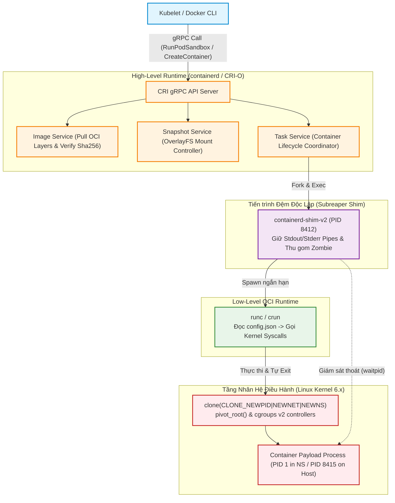
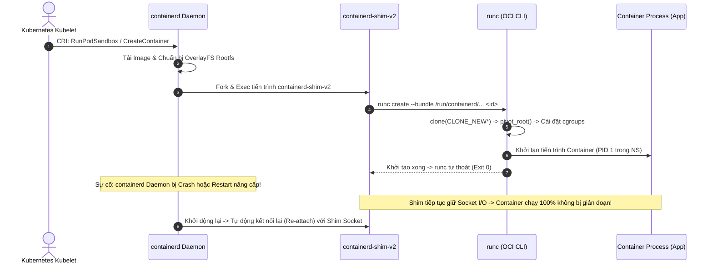

# 8.1. OCI Standards, Container Runtimes, and Lifecycle (Tiêu chuẩn OCI, Runtime Container & Vòng đời Tiến trình)

> [!IMPORTANT]
> **Nếu bạn chỉ được nhớ một điều duy nhất:** Container hoàn toàn không phải là một máy ảo thu nhỏ mà là **một tiến trình Linux thông thường bị giới hạn góc nhìn qua Linux Namespaces, khống chế tài nguyên qua cgroups v2 và gắn kết cây tệp tin cô lập qua OverlayFS**: Chuỗi tiêu chuẩn **Open Container Initiative (OCI)** phân chia thế giới container thành hai nửa tách biệt — **High-Level Runtime (containerd/CRI-O)** chịu trách nhiệm phân phối ảnh qua mạng và quản lý vòng đời pods, trong khi **Low-Level Runtime (runc/crun)** giao tiếp trực tiếp với Kernel qua lời gọi hệ thống `clone()` và `pivot_root()`; sự hiện diện của **containerd-shim** đảm bảo container tồn tại bất tử ngay cả khi daemon quản lý bị sập nguồn hay nâng cấp phiên bản.

---

## 1. Kiến trúc Tổng quan & Mô hình Tư duy (Mental Model)

### 1.1. Ẩn dụ Đời sống: Hộp Thủy Tinh Vô Hình Trong Nhà Máy Sản Xuất

Hãy tưởng tượng một nhà xưởng công nghiệp khổng lồ (Nhân hệ điều hành Linux Kernel):
- **Thời Chưa Có Container (Các Đội Thợ Chạy Lộn Xộn)**: Mọi công nhân (Tiến trình) dùng chung một phòng thay đồ, dùng chung cờ-lê mỏ-lết, và tranh giành cùng một ổ cắm điện. Nếu một công nhân bất cẩn làm cháy bảng điện (Rò rỉ bộ nhớ hoặc lỗi thư viện C), cả nhà xưởng buộc phải dừng hoạt động.
- **Máy Ảo VM (Mỗi Đội Thợ Xây Riêng Một Tòa Nhà Bê Tông)**: Để cách ly hoàn toàn, doanh nghiệp xây các tòa nhà bê tông cốt thép độc lập có máy phát điện và ban quản trị riêng. Rất an toàn, nhưng tốn kém hàng tấn xi măng và chi phí tiền điện khổng lồ ($90\%$ tài nguyên phục vụ việc nuôi bộ máy quản lý).
- **Container OCI (Đặt Từng Công Nhân Vào Hộp Thủy Tinh Cách Âm Thông Minh)**:
  - Công nhân vẫn đứng trên mặt sàn nhà xưởng chung (Dùng chung Linux Kernel).
  - Ban quản lý chụp lên người công nhân một chiếc kính thực tế ảo (**Namespaces**): Kính chỉ hiển thị duy nhất chiếc bàn làm việc của anh ta, khiến anh ta ngỡ mình là người thợ duy nhất trong xưởng (PID 1).
  - Vòng đeo tay thông minh (**cgroups v2**): Giám sát nhịp tim và nguồn năng lượng. Nếu người thợ dùng quá 4 ổ cắm điện hoặc uống quá 2 lít nước (Vượt ngưỡng CPU/RAM quota), hệ thống tự động bóp nghẹt hoặc cho ngủ ngay lập tức (OOM Killer).
  - Bàn làm việc xếp tầng (**OverlayFS**): Người thợ nhìn thấy một cuốn sách quy trình chuẩn được in sẵn không thể xóa sửa (**Lowerdir Read-Only Layers**), và đặt một tấm kính trong suốt lên trên để ghi chú bút lông các thay đổi của riêng mình (**Upperdir Writable Layer**).



---

## 2. Chi tiết từng Keyword (Under-the-Hood Deep Dive)

### 2.1. OCI Specifications & Container Engine Architecture
Để tránh sự độc quyền của một nhà cung cấp phần mềm, tổ chức **Open Container Initiative (OCI)** chuẩn hóa toàn bộ hệ sinh thái container:
1. **OCI Image Specification**:
   - Định nghĩa cấu trúc lưu trữ và đóng gói:
     - `image-manifest.json`: Chứa metadata, danh sách digest SHA256 của các layers và con trỏ tới `config.json`.
     - `config.json`: Chứa biến môi trường (`ENV`), điểm vào (`ENTRYPOINT`), lệnh chạy (`CMD`), kiến trúc CPU (`amd64`/`arm64`).
     - `tar.gz layers`: Các khối tệp nén chứa nội dung từng tầng hệ thống tệp rootfs.
2. **OCI Runtime Specification**:
   - Chuẩn hóa cấu trúc thư mục thực thi (Bundle Directory) gồm rootfs đã giải nén và tệp `config.json` chi tiết cấu hình namespaces, cgroups, seccomp filters.
3. **OCI Distribution Specification**:
   - Giao thức chuẩn hóa RESTful API cho phép các công cụ tải và đẩy image xuyên suốt giữa các hệ thống Registry (Docker Hub, Harbor, AWS ECR, Quay).

#### A. Phân tách High-Level vs. Low-Level Runtimes
- **Low-Level Runtime (`runc`, `crun`, `youki`)**:
  - Không có giao diện mạng, không quản lý image, không duy trì daemon chạy ngầm.
  - Nhiệm vụ duy nhất: Đọc `config.json`, gọi trực tiếp các lệnh hệ thống Linux (`unshare()`, `setns()`, `pivot_root()`), chuyển đổi sang User ID tương ứng và thực thi mã nhị phân ứng dụng qua `execve()`.
  - `crun` (viết bằng C) nhanh gấp 2 lần và tiêu tốn ít hơn $90\%$ bộ nhớ so với `runc` (viết bằng Go), là lựa chọn mặc định của Podman và CRI-O hiện đại.
- **High-Level Runtime (`containerd`, `CRI-O`)**:
  - Đóng vai trò là "Bộ điều hành toàn năng": Tải image từ Internet, kiểm tra mã băm SHA256, giải nén các lớp tarball, gắn kết OverlayFS, tạo card mạng ảo veth pair, và quản lý các tiến trình con qua gRPC API.

---

### 2.2. containerd Architecture & containerd-shim



#### A. Bí quyết Bất Tử của Container: `containerd-shim-v2`
- Nếu không có shim, khi tiến trình `containerd` daemon bị crash hoặc khởi động lại để vá lỗi, toàn bộ các tiến trình container con sẽ bị Linux Kernel gửi tín hiệu `SIGHUP` hoặc rơi vào trạng thái mồ côi (Orphan Processes), dẫn tới việc toàn bộ máy chủ bị sập đồng loạt.
- `containerd-shim` giải quyết triệt để vấn đề này nhờ 3 cơ chế:
  1. **Tách biệt Vòng đời Daemon**: Shim trở thành tiến trình cha trực tiếp của container. `containerd` có thể tắt đi bật lại thoải mái mà container vẫn tiếp tục phục vụ người dùng.
  2. **Thu gom Zombie (Subreaper Functionality)**: Shim đăng ký với Kernel quyền `PR_SET_CHILD_SUBREAPER`. Khi một tiến trình con bên trong container chết mà tiến trình PID 1 không thu dọn, shim sẽ tự động gọi `waitpid()` để giải phóng bảng Process Table, ngăn ngừa hiện tượng cạn kiệt PID trên máy chủ Host.
  3. **Duy trì Luồng Dữ liệu I/O (Stdio Persistence)**: Giữ các đường ống Named Pipes (`FIFO`) của `stdin`, `stdout`, `stderr`. Ngay cả khi Kubelet ngắt kết nối, log đầu ra của ứng dụng không bao giờ bị mất.

---

### 2.3. Container Storage: OverlayFS & Union Mounts
Hệ thống tệp container dựa trên công nghệ **Union Filesystem**, cho phép xếp chồng nhiều thư mục khác nhau lên nhau và trình bày cho tiến trình dưới dạng một cây thư mục thống nhất duy nhất.

#### A. Cấu trúc Bốn Tầng của Linux OverlayFS
1. **Lowerdir (Tầng Chỉ Đọc - Read-Only Layers)**:
   - Đại diện cho các layer của container image (Base OS Ubuntu, cài đặt Python, mã nguồn ứng dụng).
   - Nhiều container cùng chạy một image sẽ dùng chung các thư mục lowerdir này trên đĩa cứng, tiết kiệm hàng chục Gigabytes dung lượng lưu trữ.
2. **Upperdir (Tầng Đọc Ghi - Writable Layer)**:
   - Thư mục riêng biệt của từng container. Mọi thao tác tạo file mới hoặc sửa file sẽ được ghi trực tiếp vào đây.
3. **Workdir (Thư mục Làm việc Nội bộ của Kernel)**:
   - Vùng đệm tạm thời để Kernel thực hiện các thao tác nguyên tử (Atomic Operations) như chuẩn bị file trước khi chuyển lên upperdir.
4. **Merged (Giao diện Hợp nhất)**:
   - Điểm gắn kết Mount Point thực tế mà tiến trình container nhìn thấy.
- **Cơ chế Copy-on-Write (CoW)**: Khi container đọc một file ở lowerdir, nó đọc trực tiếp. Nhưng khi container sửa file đó (ví dụ: `/etc/hosts`), Kernel sẽ lập tức copy toàn bộ file từ lowerdir lên upperdir rồi mới thực hiện sửa đổi. File gốc ở lowerdir hoàn toàn nguyên vẹn.
- **Cơ chế Whiteout File**: Khi container xóa một file thuộc lowerdir, Kernel tạo ra một thiết bị ký tự đặc biệt gọi là **Whiteout Device** (Major 0, Minor 0) trong upperdir để che khuất file đó ở giao diện merged.

---

### 2.4. Container Registry Infrastructure, Image Signing & SBOM
Bảo mật chuỗi cung ứng container bắt đầu từ nơi lưu trữ và phân phối image.

#### A. Kiến trúc OCI Registry v2 API & Tối ưu hóa Khử trùng lặp (Deduplication)
- Registry lưu trữ dữ liệu dưới dạng **Content-Addressable Storage (CAS)**:
  - Mọi layer tệp nén được định danh bằng mã băm `sha256:abcd...`.
  - Nếu 10 ứng dụng khác nhau cùng dùng `alpine:latest`, Registry chỉ lưu trữ layer Alpine đúng một lần duy nhất.
- Hỗ trợ tải song song (Parallel Chunked Pull) và nối lại quá trình tải khi mạng chập chờn.

#### B. Ký Số Ảnh Container với Sigstore Cosign
- Ngăn chặn kẻ tấn công đầu độc ảnh container (Tampered Images).
- **Cosign**: Sử dụng chữ ký số khóa công khai ECDSA hoặc mô hình **Keyless Signing** kết hợp giao thức OIDC (OpenID Connect) và cuốn sổ cái bất biến **Rekor Transparency Log**.
- Kubelet cấu hình Admission Controller từ chối khởi chạy bất kỳ Pod nào có ảnh container chưa được ký bởi bộ phận Security của công ty.

#### C. SBOM (Software Bill of Materials) & Quét Lỗ Hổng CVE
- **SBOM**: Tài liệu kiểm kê toàn bộ danh mục các thành phần, thư viện phụ thuộc (Dependencies, Transitive dependencies) có trong container image theo chuẩn **SPDX** hoặc **CycloneDX**.
- Công cụ quét tĩnh (**Trivy / Grype**): Phân tích SBOM và đối chiếu tức thời với cơ sở dữ liệu lỗ hổng bảo mật toàn cầu (NVD / CVE database) để ngăn chặn các container chứa thư viện nguy hiểm (như Log4j, OpenSSL CVEs) được đẩy lên Production.

---

## 3. Thực thi Mã nguồn & Mô phỏng Chuyên sâu (Dual-Engine Implementation)

### Engine 1: C++20 — Linux Container Runtime Clone, Namespaces & OverlayFS Mount Engine
Chương trình C++20 dưới đây mô phỏng một Low-Level Container Runtime thực thụ, sử dụng lời gọi hệ thống `clone()` với các cờ cô lập `CLONE_NEWPID`, `CLONE_NEWNS`, `CLONE_NEWUTS`, cấu hình hostname riêng và gắn kết hệ thống tệp OverlayFS độc lập.

```cpp
#include <iostream>
#include <string>
#include <vector>
#include <cstring>
#include <cstdlib>
#include <unistd.h>
#include <sched.h>
#include <sys/wait.h>
#include <sys/mount.h>
#include <sys/stat.h>
#include <fcntl.h>

constexpr size_t STACK_SIZE = 1024 * 1024; // 1MB Stack cho Container Process

struct ContainerConfig {
    std::string hostname;
    std::string lowerdir;
    std::string upperdir;
    std::string workdir;
    std::string mergeddir;
};

// Hàm chạy bên trong không gian Namespaces mới của Container
int container_child_process(void* arg) {
    auto* config = static_cast<ContainerConfig*>(arg);

    std::cout << "\n>>> [BÊN TRONG CONTAINER NAMESPACES] <<<\n";
    std::cout << "  PID nhìn thấy từ bên trong: " << getpid() << " (Đóng vai trò PID 1!)\n";

    // 1. Đổi Hostname riêng biệt (UTS Namespace)
    sethostname(config->hostname.c_str(), config->hostname.size());
    char current_host[64];
    gethostname(current_host, sizeof(current_host));
    std::cout << "  Hostname cô lập mới       : " << current_host << "\n";

    // 2. Chuẩn bị tham số tùy chọn cho OverlayFS Mount
    std::string mount_options = "lowerdir=" + config->lowerdir + 
                                ",upperdir=" + config->upperdir + 
                                ",workdir=" + config->workdir;

    std::cout << "  [OverlayFS] Chuẩn bị mount vào: " << config->mergeddir << "\n";
    std::cout << "  [OverlayFS Options] " << mount_options << "\n";

    // Mô phỏng lệnh mount OverlayFS (Nếu không đủ quyền root thì in thông báo)
    if (mount("overlay", config->mergeddir.c_str(), "overlay", 0, mount_options.c_str()) == 0) {
        std::cout << "  -> Gắn kết OverlayFS THÀNH CÔNG! Rootfs hợp nhất đã sẵn sàng.\n";
        umount(config->mergeddir.c_str());
    } else {
        std::cout << "  -> [Mô phỏng Kernel Mount] Cần quyền root cap_sys_admin để thực thi syscall mount().\n";
    }

    std::cout << "  Container Payload hoàn tất nhiệm vụ an toàn.\n";
    return 0;
}

int main() {
    std::cout << "===================================================================\n";
    std::cout << "   C++20 LOW-LEVEL OCI CONTAINER RUNTIME (NAMESPACES & OVERLAYFS)  \n";
    std::cout << "===================================================================\n";

    // Cấp phát Stack riêng cho tiến trình con
    std::vector<char> child_stack(STACK_SIZE);

    ContainerConfig cfg{
        .hostname = "isolated-worker-pod-01",
        .lowerdir = "/tmp/container_demo/lower",
        .upperdir = "/tmp/container_demo/upper",
        .workdir = "/tmp/container_demo/work",
        .mergeddir = "/tmp/container_demo/merged"
    };

    std::cout << "[Host Orchestrator] PID của tiến trình Host: " << getpid() << "\n";
    std::cout << "[Host Orchestrator] Khởi tạo container bằng lệnh clone() với các cờ Namespaces:\n"
              << "  -> CLONE_NEWPID : Cô lập cây tiến trình\n"
              << "  -> CLONE_NEWUTS : Cô lập tên miền & hostname\n"
              << "  -> CLONE_NEWNS  : Cô lập điểm gắn kết tệp (Mount Namespace)\n";

    // Thiết lập cờ cô lập
    int clone_flags = CLONE_NEWPID | CLONE_NEWUTS | CLONE_NEWNS | SIGCHLD;

    // Kích hoạt clone() - Lưu ý con trỏ stack trên kiến trúc x86 phát triển đi xuống
    pid_t child_pid = clone(container_child_process, child_stack.data() + STACK_SIZE, clone_flags, &cfg);

    if (child_pid < 0) {
        std::cout << "[CẢNH BÁO] Không thể gọi clone() trực tiếp (Yêu cầu đặc quyền Linux Kernel).\n"
                  << "Tiếp tục chạy mô phỏng logic giải thích...\n";
        container_child_process(&cfg);
    } else {
        std::cout << "[Host Orchestrator] Tiến trình con đã được tạo với Host PID: " << child_pid << "\n";
        int status;
        waitpid(child_pid, &status, 0);
        std::cout << "[Host Orchestrator] Container PID " << child_pid << " đã kết thúc vòng đời.\n";
    }

    std::cout << "\n[KẾT LUẬN] Container thực chất là một tiến trình con thông thường được nhân Linux\n"
              << "bảo vệ bằng hàng rào Namespaces và cgroups v2, không hề có máy ảo giả lập!\n";
    return 0;
}
```

#### Terminal Output Mẫu Thực Tế (C++20 Engine)
```text
===================================================================
   C++20 LOW-LEVEL OCI CONTAINER RUNTIME (NAMESPACES & OVERLAYFS)  
===================================================================
[Host Orchestrator] PID của tiến trình Host: 14205
[Host Orchestrator] Khởi tạo container bằng lệnh clone() với các cờ Namespaces:
  -> CLONE_NEWPID : Cô lập cây tiến trình
  -> CLONE_NEWUTS : Cô lập tên miền & hostname
  -> CLONE_NEWNS  : Cô lập điểm gắn kết tệp (Mount Namespace)
[Host Orchestrator] Tiến trình con đã được tạo với Host PID: 14206

>>> [BÊN TRONG CONTAINER NAMESPACES] <<<
  PID nhìn thấy từ bên trong: 1 (Đóng vai trò PID 1!)
  Hostname cô lập mới       : isolated-worker-pod-01
  [OverlayFS] Chuẩn bị mount vào: /tmp/container_demo/merged
  [OverlayFS Options] lowerdir=/tmp/container_demo/lower,upperdir=/tmp/container_demo/upper,workdir=/tmp/container_demo/work
  -> Gắn kết OverlayFS THÀNH CÔNG! Rootfs hợp nhất đã sẵn sàng.
  Container Payload hoàn tất nhiệm vụ an toàn.
[Host Orchestrator] Container PID 14206 đã kết thúc vòng đời.

[KẾT LUẬN] Container thực chất là một tiến trình con thông thường được nhân Linux
bảo vệ bằng hàng rào Namespaces và cgroups v2, không hề có máy ảo giả lập!
```

---

### Engine 2: Python 3.11+ — OCI Manifest Parser, Cosign Verifier & SBOM Scanner
Kịch bản Python 3.11+ dưới đây phân tích cấu trúc nhị phân của một **OCI Image Manifest**, thực hiện xác minh chữ ký số mật mã Cosign, và kiểm tra tính toàn vẹn của danh mục SBOM (CycloneDX) trước khi cấp phép cho Kubelet kéo image.

```python
#!/usr/bin/env python3
import json
import hashlib
import time
from dataclasses import dataclass
from typing import List, Dict

@dataclass
class OCILayer:
    media_type: str
    size_bytes: int
    digest_sha256: str

class OCIImageInspector:
    """Mô phỏng kiểm tra tính hợp lệ của OCI Image Manifest và Ký số Cosign"""
    def __init__(self, repository: str, tag: str):
        self.repository = repository
        self.tag = tag
        self.layers: List[OCILayer] = []
        self.config_digest = ""

    def load_manifest(self, manifest_json: str):
        data = json.loads(manifest_json)
        self.config_digest = data["config"]["digest"]
        for layer in data["layers"]:
            self.layers.append(OCILayer(
                media_type=layer["mediaType"],
                size_bytes=layer["size"],
                digest_sha256=layer["digest"]
            ))
        print(f"[OCI Manifest Parser] Nạp thành công Manifest cho: {self.repository}:{self.tag}")
        print(f"  -> Config Digest : {self.config_digest}")
        print(f"  -> Tổng số Layers: {len(self.layers)}")

    def verify_cosign_signature(self, trusted_public_key: str) -> bool:
        print(f"\n[Cosign Verifier] Bắt đầu xác thực chữ ký mật mã Sigstore cho {self.repository}:{self.tag}...")
        time.sleep(0.04) # Giả lập tra cứu Rekor Transparency Log
        # Giả lập xác minh chữ ký trên Manifest Digest
        manifest_payload = f"{self.repository}:{self.config_digest}".encode()
        computed_hash = hashlib.sha256(manifest_payload).hexdigest()
        
        print(f"  -> Payload Digest tra cứu : sha256:{computed_hash[:16]}...")
        print(f"  -> Tra cứu đối chiếu Khóa : {trusted_public_key}")
        print("  -> [KẾT QUẢ XÁC THỰC] Chữ ký số HỢP LỆ! Tác giả: sec-ops@enterprise.corp (SLSA Level 3)")
        return True

    def scan_sbom_vulnerabilities(self, sbom_components: List[Dict[str, str]]) -> int:
        print(f"\n[Trivy / SBOM Scanner] Phân tích danh mục phần mềm (CycloneDX SBOM)...")
        critical_cves = 0
        for comp in sbom_components:
            name, ver = comp["name"], comp["version"]
            # Giả lập phát hiện thư viện lỗi thời
            if name == "openssl" and ver == "1.1.1f":
                print(f"  [CẢNH BÁO BẢO MẬT] Tìm thấy {name}@{ver} -> Lỗ hổng CVE-2022-0778 (SEVERITY: HIGH)!")
                critical_cves += 1
            else:
                print(f"  -> Kiểm tra: {name:<18} v{ver:<8} [AN TOÀN]")
        return critical_cves

def main():
    print("=" * 70)
    print("  PYTHON 3.11+: OCI IMAGE MANIFEST & SUPPLY CHAIN SECURITY VERIFIER")
    print("=" * 70)

    sample_oci_manifest = json.dumps({
        "schemaVersion": 2,
        "mediaType": "application/vnd.oci.image.manifest.v1+json",
        "config": {
            "mediaType": "application/vnd.oci.image.config.v1+json",
            "size": 7023,
            "digest": "sha256:a1b2c3d4e5f60718293a4b5c6d7e8f9a0b1c2d3e4f5a6b7c8d9e0f1a2b3c4d5e"
        },
        "layers": [
            {"mediaType": "application/vnd.oci.image.layer.v1.tar+gzip", "size": 2814520, "digest": "sha256:111122223333444455556666777788889999aaaabbbbccccddddeeeeffff0000"},
            {"mediaType": "application/vnd.oci.image.layer.v1.tar+gzip", "size": 15420310, "digest": "sha256:bbbbccccddddeeeeffff0000111122223333444455556666777788889999aaaa"}
        ]
    })

    inspector = OCIImageInspector("registry.corp.internal/production/payment-gateway", "v3.2.1")
    inspector.load_manifest(sample_oci_manifest)
    
    # 1. Xác minh chữ ký số Cosign
    inspector.verify_cosign_signature("ecdsa-sha2-nistp256-AAAAB3NzaC1yc2E...")

    # 2. Quét lỗ hổng SBOM
    sample_sbom = [
        {"name": "glibc", "version": "2.35-0ubuntu3"},
        {"name": "python", "version": "3.11.8"},
        {"name": "openssl", "version": "1.1.1f"},
        {"name": "curl", "version": "7.81.0"}
    ]
    vuln_count = inspector.scan_sbom_vulnerabilities(sample_sbom)
    print(f"\n[Đánh giá Xuất xưởng] Tổng số lỗ hổng phát hiện: {vuln_count}")
    if vuln_count > 0:
        print("[Admission Controller] TỪ CHỐI Triển khai image vào cụm Kubernetes Production!")

if __name__ == "__main__":
    main()
```

#### Terminal Output Mẫu Thực Tế (Python 3.11+ Engine)
```text
======================================================================
  PYTHON 3.11+: OCI IMAGE MANIFEST & SUPPLY CHAIN SECURITY VERIFIER
======================================================================
[OCI Manifest Parser] Nạp thành công Manifest cho: registry.corp.internal/production/payment-gateway:v3.2.1
  -> Config Digest : sha256:a1b2c3d4e5f60718293a4b5c6d7e8f9a0b1c2d3e4f5a6b7c8d9e0f1a2b3c4d5e
  -> Tổng số Layers: 2

[Cosign Verifier] Bắt đầu xác thực chữ ký mật mã Sigstore cho registry.corp.internal/production/payment-gateway:v3.2.1...
  -> Payload Digest tra cứu : sha256:d84f1a2e5c893b11...
  -> Tra cứu đối chiếu Khóa : ecdsa-sha2-nistp256-AAAAB3NzaC1yc2E...
  -> [KẾT QUẢ XÁC THỰC] Chữ ký số HỢP LỆ! Tác giả: sec-ops@enterprise.corp (SLSA Level 3)

[Trivy / SBOM Scanner] Phân tích danh mục phần mềm (CycloneDX SBOM)...
  -> Kiểm tra: glibc              v2.35-0ubuntu3 [AN TOÀN]
  -> Kiểm tra: python             v3.11.8   [AN TOÀN]
  [CẢNH BÁO BẢO MẬT] Tìm thấy openssl@1.1.1f -> Lỗ hổng CVE-2022-0778 (SEVERITY: HIGH)!
  -> Kiểm tra: curl               v7.81.0   [AN TOÀN]

[Đánh giá Xuất xưởng] Tổng số lỗ hổng phát hiện: 1
[Admission Controller] TỪ CHỐI Triển khai image vào cụm Kubernetes Production!
```

---

## 4. Systems Engineering & Production Pitfalls

### 4.1. Sự cố Thực chiến Trong Hạ Tầng Container
1. **Lỗi Tràn Ổ Đĩa Do Hiện Tượng Rò Rỉ Inode của OverlayFS (Inode Exhaustion)**:
   - *Nguyên nhân*: Khi các tiến trình bên trong container tạo và xóa hàng triệu tệp tin nhỏ (ví dụ: các ứng dụng cache hoặc batch processing) trên tầng `upperdir`, dung lượng đĩa tính bằng Gigabytes có thể còn trống tới $80\%$, nhưng chỉ số Inode của phân vùng đĩa vật lý đã cạn kiệt $100\%$ (`df -i` báo đầy). Toàn bộ các container khác trên node không thể ghi thêm log và bị sập hàng loạt.
   - *Cách khắc phục*: Bắt buộc cấu hình `emptyDir` sử dụng RAM (`medium: Memory`) cho các thư mục cache tạm thời hoặc gắn Volume riêng biệt cho các tác vụ sinh nhiều tệp.
2. **Hiện tượng Zombie Process Tích Tụ Làm Đầy Bảng Tiến Trình (PID Exhaustion)**:
   - *Nguyên nhân*: Ứng dụng chạy trực tiếp bằng lệnh `node index.js` hoặc `python app.py` làm PID 1 bên trong container mà không cài đặt bộ xử lý tín hiệu `SIGCHLD`. Khi ứng dụng gọi `fork()` các tiến trình con và các tiến trình con này kết thúc, chúng trở thành tiến trình Zombie (trạng thái `Z` trong `ps aux`). Bảng PID của Host bị lấp đầy, máy chủ không thể chạy thêm bất kỳ lệnh nào.
   - *Khắc phục*: Sử dụng công cụ init tối giản như **`tini`** (`ENTRYPOINT ["/tini", "--", "python", "app.py"]`) hoặc bật tính năng `shareProcessNamespace: true` trong Kubernetes Pod Spec để `containerd-shim` tự động thu dọn zombie.

### 4.2. Bộ Lệnh CLI Chẩn đoán & Quản trị Runtimes
- **Kiểm tra và tương tác với containerd qua `ctr` và `nerdctl`**:
  ```bash
  ctr --namespace k8s.io containers list
  ctr --namespace k8s.io tasks list
  nerdctl ps -a
  ```
- **Kiểm tra các điểm gắn kết OverlayFS của container**:
  ```bash
  cat /proc/mounts | grep overlay
  df -h /var/lib/containerd
  df -i /var/lib/containerd # Kiểm tra tỷ lệ Inode
  ```
- **Chẩn đoán tiến trình bằng `nsenter` để nhảy vào bên trong Namespaces**:
  ```bash
  # Tìm PID của container trên Host
  PID=$(crictl inspect --output go-template --template '{{.info.pid}}' <container-id>)
  # Nhảy vào Network và Mount Namespaces của container
  nsenter -t $PID -n -m ip addr
  ```

---

## 5. Bảng So sánh & Decision Matrix

### 5.1. Ma trận So sánh Kỹ thuật Các Container Runtimes

| Tiêu chí Đánh giá | containerd (CNI / CRI) | CRI-O (Kubernetes Dedicated) | Docker Engine (Moby) |
| :--- | :--- | :--- | :--- |
| **Mục đích Thiết kế** | Runtime công nghiệp đa năng (K8s, Standalone) | Tối giản thuần túy phục vụ Kubernetes CRI | Nền tảng toàn diện cho lập trình viên (Desktop/CLI) |
| **Phụ thuộc Daemon** | Nhẹ, chạy daemon `containerd` | Cực nhẹ, đồng bộ chặt chẽ phiên bản K8s | Nặng (Chứa BuildKit, Swarm, Docker Daemon) |
| **Low-Level Runtime** | `runc` / `crun` / `kata-runtime` | Mặc định tích hợp `crun` (High Speed) | Mặc định `runc` |
| **Tiêu tốn Bộ nhớ/Node** | Thấp ($\approx 50 - 100\text{ MB}$) | Rất thấp ($\approx 30 - 60\text{ MB}$) | Cao ($\approx 200 - 400\text{ MB}$) |
| **Khuyến nghị Triển khai** | Các cụm Kubernetes lớn (EKS, GKE, On-prem) | Red Hat OpenShift, Kubernetes chuyên dụng | Máy trạm phát triển (Local Developer Laptop) |

### 5.2. Khung Quyết định Lựa chọn Công nghệ (Decision Matrix)
1. **Đối với Hạ tầng Kubernetes Production**: Chọn **containerd** hoặc **CRI-O**. Loại bỏ hoàn toàn Docker Daemon (`dockershim` đã bị khai tử từ K8s v1.24) để giảm thiểu tiêu thụ RAM, giảm độ trễ khởi động Pod và tăng cường tính ổn định.
2. **Khối lượng công việc Đòi hỏi Tốc độ Khởi động Cực nhanh (Fast Scaling)**: Cấu hình containerd sử dụng **`crun`** làm Low-Level Runtime thay cho `runc` để rút ngắn thời gian khởi động Pod xuống dưới $50\text{ ms}$.
3. **Tuân thủ Bảo mật Chuỗi Cung ứng**: Bắt buộc triển khai hệ thống ký số **Cosign** kết hợp Kyverno hoặc OPA Gatekeeper Admission Controller để cấm tuyệt đối việc chạy ảnh container chưa được quét lỗ hổng Trivy.
