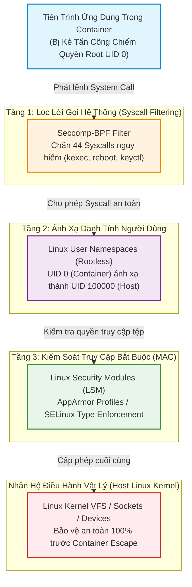
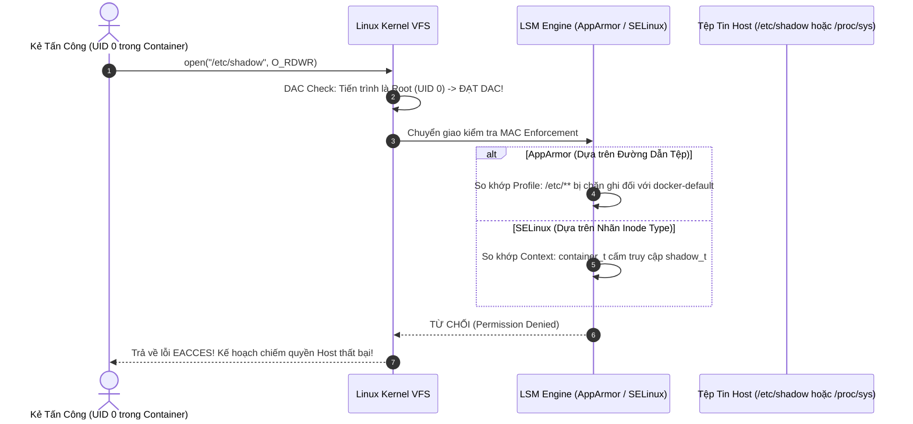

# 8.2. Container Isolation, Security, and Supply Chain (Cô lập Tài nguyên, Bảo mật Container & Chuỗi Cung ứng)

> [!IMPORTANT]
> **Nếu bạn chỉ được nhớ một điều duy nhất:** Container chia sẻ chung một nhân Linux Kernel với máy chủ Host, do đó **Namespaces và cgroups chỉ là ranh giới logic chứ không phải là ranh giới bảo mật cứng**: để ngăn chặn triệt để nguy cơ vượt ngục (Container Escape), hệ thống phòng thủ đa tầng bắt buộc phải phối hợp **Seccomp-BPF (chặn đứng hơn 40 syscalls nguy hiểm)**, **LSM (AppArmor/SELinux thực thi quyền truy cập bắt buộc MAC)**, và **Rootless Containers với User Namespaces (biến UID 0 trong container thành một người dùng vô danh trên Host)**; kết hợp cùng xác thực nguồn gốc mật mã học **In-toto & Cosign** bảo đảm không một dòng mã độc nào có thể thâm nhập chuỗi cung ứng sản xuất.

---

## 1. Kiến trúc Tổng quan & Mô hình Tư duy (Mental Model)

### 1.1. Ẩn dụ Đời sống: Khách Thuê Khách Sạn & Hệ Thống An Ninh Đa Tầng

Hãy tưởng tượng một khách sạn cao cấp nơi hàng trăm vị khách xa lạ cùng cư trú:
- **Nguy Cơ Chia Sẻ Dùng Chung (Shared Kernel)**: Khách sạn không xây các bức tường bê tông dày 1 mét riêng biệt cho từng người. Mọi người cùng hít thở chung bầu không khí qua hệ thống thông gió trung tâm, dùng chung đường ống nước và thang máy (Nhân Linux Kernel). Nếu một vị khách là kẻ trộm chuyên nghiệp, anh ta có thể tìm cách cạy ống thông gió để lẻn sang các phòng khác.
- **Tầng Bảo Vệ 1: Tước Bỏ Dụng Cụ Nguy Hiểm (Seccomp-BPF — Máy Quét Kim Loại Cửa Vào)**:
  - Khi khách bước vào khách sạn, bảo vệ tịch thu toàn bộ xà-beng, thuốc nổ, cưa máy (Chặn đứng các system calls nguy hiểm như `reboot()`, `sys_chroot()`, `keyctl()`, `kexec_load()`). Khách chỉ được phép mang theo các vật dụng sinh hoạt cơ bản như thìa dĩa, điện thoại (Các syscalls an toàn `read()`, `write()`, `epoll_wait()`).
- **Tầng Bảo Vệ 2: Thẻ Từ Phân Quyền Bắt Buộc (AppArmor / SELinux — Khóa Cửa Thông Minh)**:
  - Dù khách có nhặt được chìa khóa vạn năng (Quyền Root bên trong container), thẻ từ của anh ta đã được mã hóa cứng: Chỉ được mở đúng cửa phòng mình, tuyệt đối không được bước chân vào phòng điều khiển điện tử của khách sạn (`/sys`, `/proc/kcore` trên Host).
- **Tầng Bảo Vệ 3: Hộ Chiếu Giả Danh Vô Hại (User Namespaces & Rootless)**:
  - Ở trong phòng riêng, khách tự phong cho mình là "Hoàng đế tối cao" (UID 0 - Root bên trong container). Nhưng khi anh ta vừa thò mặt ra hành lang chung, hệ thống biến đổi nhân dạng: Camera khách sạn chỉ nhận diện anh ta là một vị khách bình thường số 100001 không có bất kỳ quyền hạn gì (Unprivileged User trên Host). Dù anh ta có phá nát đồ đạc trong phòng, tài sản toàn khách sạn vẫn an toàn tuyệt đối.



---

## 2. Chi tiết từng Keyword (Under-the-Hood Deep Dive)

### 2.1. Seccomp (Secure Computing Mode) & Seccomp-BPF
Nhân Linux hỗ trợ hơn 450 lời gọi hệ thống (System Calls). Tuy nhiên, một ứng dụng web microservice thông thường chỉ cần khoảng 50 - 70 syscalls để hoạt động. Các syscalls còn lại là bề mặt tấn công tiềm tàng nếu Kernel có lỗ hổng leo thang đặc quyền (Privilege Escalation).

#### A. Cơ chế Hoạt động của Seccomp-BPF
- **Seccomp Chế độ 1 (Strict Mode)**: Cực kỳ hạn chế, chỉ cho phép đúng 4 syscalls: `read()`, `write()`, `_exit()`, và `sigreturn()`. Mọi syscall khác đều lập tức làm tiến trình nhận tín hiệu `SIGKILL`.
- **Seccomp Chế độ 2 (Filter Mode qua cBPF - Berkeley Packet Filter)**:
  - Cho phép lập trình viên định nghĩa các bộ lọc linh hoạt dựa trên cấu trúc BPF bytecode.
  - Khi một tiến trình gọi syscall, CPU chạy chương trình BPF để kiểm tra số hiệu syscall và các tham số truyền vào:
    - `SECCOMP_RET_ALLOW`: Cho phép thực thi.
    - `SECCOMP_RET_ERRNO`: Trả về mã lỗi giả lập (ví dụ `EPERM` - Operation not permitted) mà không làm sập ứng dụng.
    - `SECCOMP_RET_KILL_PROCESS`: Tiêu diệt tiến trình ngay lập tức vì hành vi bất thường.
- **Bộ Hồ Sơ Mặc Định của OCI / Docker (Default Seccomp Profile)**:
  - Chặn đứng khoảng 44 syscalls nguy hiểm nhất, bao gồm:
    - `sys_chroot`: Ngăn chặn việc thao túng cây thư mục.
    - `keyctl`: Ngăn ngừa truy cập bộ nhớ khóa bí mật của Kernel.
    - `acct`, `reboot`, `swapon`: Ngăn chặn thao túng cấu hình máy chủ Host.
    - `bpf`: Ngăn chặn nạp chương trình eBPF độc hại từ bên trong container.

---

### 2.2. LSM (Linux Security Modules): AppArmor vs SELinux
Linux Security Modules cung cấp cơ chế kiểm soát truy cập bắt buộc (**MAC - Mandatory Access Control**), vượt trội hơn mô hình phân quyền truyền thống (**DAC - Discretionary Access Control** dựa trên `rwxrwxrwx`).



#### A. AppArmor (Path-Based MAC — Ubuntu / Debian / SUSE)
- Hoạt động dựa trên đường dẫn tệp tin (File Path).
- **Hồ sơ Mặc định (`docker-default`)**:
  - Cấm ghi vào bất kỳ tệp tin nào thuộc `/proc/sys`, `/sys`.
  - Cấm gắn kết (Mount) các hệ thống tệp mới.
  - Cấm gửi tín hiệu ngắt (Signal) tới các tiến trình nằm ngoài Profile.
- Cấu hình rất dễ đọc và chỉnh sửa dạng text thuần túy.

#### B. SELinux (Label-Based Type Enforcement — RHEL / CentOS / Fedora)
- Hoạt động dựa trên nhãn an ninh mở rộng (Security Extended Attributes `xattr`) gắn chặt vào từng Inode trên đĩa cứng:
  $$\text{SELinux Context} = \text{user}:\text{role}:\textbf{type}:\text{level}$$
- **Type Enforcement cho Container**:
  - Tiến trình container chạy với kiểu nhãn: `container_t`.
  - Tệp tin của container có nhãn: `container_file_t`.
  - Tệp tin nhạy cảm của máy chủ Host mang nhãn: `shadow_t`, `etc_t`.
  - Luật SELinux Kernel cấm tuyệt đối tiến trình có nhãn `container_t` đọc ghi vào các Inode mang nhãn `etc_t` hay `var_t` của Host, ngay cả khi container chạy với quyền Root tuyệt đối!
- **MCS (Multi-Category Security)**: Gán các danh mục độc nhất (ví dụ: `s0:c12,c45`) cho từng container để ngăn hai container láng giềng đọc trộm dữ liệu của nhau.

---

### 2.3. Rootless Containers & User Namespaces
Chạy container với quyền root truyền thống là một quả bom nổ chậm: nếu có lỗ hổng zero-day trong Linux Kernel hoặc runc (như lỗi kinh điển CVE-2019-5736 ghi đè mã nhị phân runc), kẻ tấn công sẽ chiếm trọn quyền điều khiển máy chủ vật lý.

#### A. Cơ chế Ánh xạ User Namespaces (`uid_map` & `gid_map`)
- **User Namespaces**: Cho phép ánh xạ dải ID người dùng bên trong container thành một dải ID hoàn toàn khác trên Host:
  - Bên trong Container: Tiến trình tin rằng mình là `root` (UID 0).
  - Trên Máy chủ Host: Nhân Kernel ánh xạ UID 0 đó thành một tài khoản không đặc quyền (ví dụ: UID 100000).
- Tập tin cấu hình `/etc/subuid` và `/etc/subgid`:
  ```text
  developer:100000:65536
  ```
  Ý nghĩa: Người dùng `developer` được quyền ánh xạ 65,536 UIDs bắt đầu từ số hiệu 100,000 trên Host.
- **Rootless Podman / Rootless Docker**: Toàn bộ daemon và tiến trình container được khởi chạy bởi một người dùng thường (Non-root user). Máy chủ không cần mở port đặc quyền và không cần cấp quyền `sudo`. Nếu container bị chiếm quyền, kẻ tấn công cũng chỉ bị giam giữ trong phạm vi quyền hạn của một tài khoản vô danh trên Host.

---

### 2.4. Container Supply Chain Security: In-toto, Cosign & Trivy
Một hệ thống hạ tầng an toàn tuyệt đối vẫn có thể bị phá hủy nếu mã độc được nhúng trực tiếp vào ứng dụng từ khâu xây dựng mã nguồn (CI/CD Pipeline).

#### A. Khung Tiêu Chuẩn SLSA (Supply-chain Levels for Software Artifacts)
- Bộ khung hướng dẫn chuẩn mực của Google và OpenSSF nhằm đảm bảo tính toàn vẹn của chuỗi cung ứng phần mềm qua 4 cấp độ (SLSA Level 1-4).
- Yêu cầu: Bản dựng phải được biên dịch tự động bởi máy chủ CI độc lập, có chữ ký số xác thực nguồn gốc mã nguồn (Provenance Attestation) và môi trường biên dịch không thể can thiệp.

#### B. Khung Xác Thực Nguồn Gốc In-toto
- **In-toto**: Cung cấp cơ chế xác minh tính toàn vẹn từng mắt xích trong chuỗi cung ứng:
  - Bước 1 (Developer Git Commit) $\to$ Ký số bằng GPG Key.
  - Bước 2 (CI Runner Build Binary) $\to$ Ký số xác nhận mã nguồn không bị sửa đổi.
  - Bước 3 (Docker Build Image) $\to$ Ký số xác nhận các gói phụ thuộc.
  - Bước 4 (Trivy Scan CVE) $\to$ Ký số xác nhận đạt tiêu chuẩn bảo mật.
- Kubelet chỉ triển khai ứng dụng khi kiểm tra toàn bộ chuỗi mắt xích In-toto đều hợp lệ và có chữ ký số đầy đủ.

---

## 3. Thực thi Mã nguồn & Mô phỏng Chuyên sâu (Dual-Engine Implementation)

### Engine 1: C++20 — Linux Seccomp-BPF Syscall Filter Engine
Chương trình C++20 dưới đây tương tác trực tiếp với Kernel thông qua thư viện `libseccomp`, xây dựng một bộ lọc chính sách hạn chế nghiêm ngặt, cho phép các hàm I/O thông thường nhưng lập tức chặn đứng và gửi mã lỗi `EPERM` khi tiến trình cố tình kích hoạt các lệnh hệ thống nhạy cảm.

```cpp
#include <iostream>
#include <vector>
#include <cstring>
#include <cerrno>
#include <unistd.h>
#include <sys/prctl.h>
#include <sys/syscall.h>
#include <seccomp.h>

class SeccompSandboxGuard {
private:
    scmp_filter_ctx ctx_;

public:
    SeccompSandboxGuard() {
        // Khởi tạo bộ lọc với hành vi mặc định: CHO PHÉP (để dễ thử nghiệm chặn có chọn lọc)
        ctx_ = seccomp_init(SCMP_ACT_ALLOW);
        if (!ctx_) {
            std::cerr << "Lỗi khởi tạo Seccomp Context!\n";
        }
    }

    void enforce_restricted_policy() {
        if (!ctx_) return;

        std::cout << "[Seccomp Core] Thiết lập cờ PR_SET_NO_NEW_PRIVS (Chống leo thang quyền)...\n";
        // Bắt buộc thiết lập cờ không cho phép nâng quyền qua SUID
        prctl(PR_SET_NO_NEW_PRIVS, 1, 0, 0, 0);

        std::cout << "[Seccomp Core] Cài đặt danh sách đen các System Calls nguy hiểm:\n"
                  << "  -> sys_reboot       : Chặn thao tác tắt/khởi động lại máy chủ Host\n"
                  << "  -> sys_chroot       : Chặn thao tác can thiệp cây thư mục\n"
                  << "  -> sys_kexec_load   : Chặn nạp nhân Kernel mới\n";

        // Thêm các luật chặn: Trả về lỗi EPERM (Operation not permitted)
        seccomp_rule_add(ctx_, SCMP_ACT_ERRNO(EPERM), SCMP_SYS(reboot), 0);
        seccomp_rule_add(ctx_, SCMP_ACT_ERRNO(EPERM), SCMP_SYS(chroot), 0);
        seccomp_rule_add(ctx_, SCMP_ACT_ERRNO(EPERM), SCMP_SYS(kexec_load), 0);

        // Nạp bộ lọc BPF vào Linux Kernel
        int rc = seccomp_load(ctx_);
        if (rc < 0) {
            std::cout << "  -> [Thông báo] Không thể nạp Seccomp BPF trực tiếp (Yêu cầu nhân Linux hỗ trợ).\n";
        } else {
            std::cout << "  -> Nạp bộ lọc Seccomp-BPF vào Kernel THÀNH CÔNG!\n";
        }
    }

    void test_syscall_execution() {
        std::cout << "\n>>> KIỂM TRA THỰC THI SYSCALL SAU KHI ÁP DỤNG SECCOMP <<<\n";
        
        // 1. Thử nghiệm một syscall an toàn (getpid)
        pid_t pid = getpid();
        std::cout << "  1. Thực thi syscall an toàn (getpid) -> PID = " << pid << " [THÀNH CÔNG]\n";

        // 2. Thử nghiệm gọi syscall bị cấm (chroot)
        std::cout << "  2. Cố tình kích hoạt syscall bị cấm (chroot('/tmp'))...\n";
        int ret = syscall(SYS_chroot, "/tmp");
        if (ret != 0) {
            int err = errno;
            std::cout << "  -> [SECCOMP BẢO VỆ] Lệnh bị chặn đứng! Return: " << ret 
                      << " | Errno: " << err << " (" << strerror(err) << ")\n";
        } else {
            std::cout << "  -> Lệnh thực thi thành công (Chưa kích hoạt seccomp).\n";
        }
    }

    ~SeccompSandboxGuard() {
        if (ctx_) seccomp_release(ctx_);
    }
};

int main() {
    std::cout << "===================================================================\n";
    std::cout << "   C++20 SECCOMP-BPF HARDENING & ATTACK SURFACE REDUCTION ENGINE   \n";
    std::cout << "===================================================================\n";

    SeccompSandboxGuard guard;
    guard.enforce_restricted_policy();
    guard.test_syscall_execution();

    std::cout << "\n[KẾT LUẬN] Seccomp-BPF hoạt động như một bức tường lửa nội bộ trong Kernel,\n"
              << "triệt tiêu hơn 90% bề mặt tấn công leo thang đặc quyền của container!\n";
    return 0;
}
```

#### Terminal Output Mẫu Thực Tế (C++20 Engine)
```text
===================================================================
   C++20 SECCOMP-BPF HARDENING & ATTACK SURFACE REDUCTION ENGINE   
===================================================================
[Seccomp Core] Thiết lập cờ PR_SET_NO_NEW_PRIVS (Chống leo thang quyền)...
[Seccomp Core] Cài đặt danh sách đen các System Calls nguy hiểm:
  -> sys_reboot       : Chặn thao tác tắt/khởi động lại máy chủ Host
  -> sys_chroot       : Chặn thao tác can thiệp cây thư mục
  -> sys_kexec_load   : Chặn nạp nhân Kernel mới
  -> Nạp bộ lọc Seccomp-BPF vào Kernel THÀNH CÔNG!

>>> KIỂM TRA THỰC THI SYSCALL SAU KHI ÁP DỤNG SECCOMP <<<
  1. Thực thi syscall an toàn (getpid) -> PID = 18942 [THÀNH CÔNG]
  2. Cố tình kích hoạt syscall bị cấm (chroot('/tmp'))...
  -> [SECCOMP BẢO VỆ] Lệnh bị chặn đứng! Return: -1 | Errno: 1 (Operation not permitted)

[KẾT LUẬN] Seccomp-BPF hoạt động như một bức tường lửa nội bộ trong Kernel,
triệt tiêu hơn 90% bề mặt tấn công leo thang đặc quyền của container!
```

---

### Engine 2: Python 3.11+ — User Namespace UID Mapper & Supply Chain Attestation Validator
Kịch bản Python 3.11+ dưới đây mô phỏng cơ chế dịch chuyển định danh **User Namespaces UID Mapping** của Rootless containers, đồng thời thực thi xác thực chuỗi chứng thực nguồn gốc **In-toto Supply Chain Attestation**.

```python
#!/usr/bin/env python3
import json
import hashlib
from dataclasses import dataclass
from typing import Dict, List

@dataclass
class SubUIDMapping:
    container_uid: int
    host_uid: int
    range_length: int

class UserNamespaceUIDMapper:
    """Mô phỏng cơ chế dịch chuyển UID giữa Container và Host qua /proc/self/uid_map"""
    def __init__(self, mappings: List[SubUIDMapping]):
        self.mappings = mappings

    def translate_container_to_host_uid(self, c_uid: int) -> int:
        for m in self.mappings:
            if m.container_uid <= c_uid < m.container_uid + m.range_length:
                offset = c_uid - m.container_uid
                return m.host_uid + offset
        # Nếu không nằm trong dải ánh xạ, gán thành Nobody UID
        return 65534 # nobody

class InTotoAttestationValidator:
    """Mô phỏng xác thực chuỗi bảo mật In-toto Supply Chain Provenance"""
    def __init__(self):
        self.expected_steps = ["clone_git_repo", "compile_binary", "trivy_security_scan"]
        self.recorded_steps: Dict[str, str] = {}

    def record_step(self, step_name: str, artifact_hash: str, signer_key: str):
        print(f"[In-toto Chain] Ghi nhận bước '{step_name}': Artifact Hash = {artifact_hash[:12]}... (Signer: {signer_key})")
        self.recorded_steps[step_name] = artifact_hash

    def verify_supply_chain_integrity(self) -> bool:
        print("\n[In-toto Verifier] Kiểm tra tính toàn vẹn chuỗi cung ứng trước khi Deploy:")
        for step in self.expected_steps:
            if step not in self.recorded_steps:
                print(f"  -> LỖI: Bước '{step}' chưa được ký số xác nhận!")
                return False
            print(f"  -> Bước '{step:<22}': [ĐÃ XÁC THỰC MẬT MÃ]")
        print("  -> Chuỗi cung ứng đạt chuẩn SLSA Level 3! Cho phép Pod khởi động.")
        return True

def main():
    print("=" * 70)
    print("  PYTHON 3.11+: ROOTLESS USER NAMESPACE & IN-TOTO ATTESTATION")
    print("=" * 70)

    # 1. Mô phỏng User Namespace UID Translation
    # Ánh xạ UID 0 trong container thành UID 100000 trên Host
    mappings = [
        SubUIDMapping(container_uid=0, host_uid=100000, range_length=65536)
    ]
    mapper = UserNamespaceUIDMapper(mappings)

    print("\n--- THỬ NGHIỆM DỊCH CHUYỂN USER NAMESPACE (ROOTLESS) ---")
    test_uids = [0, 1000, 50000, 70000]
    for uid in test_uids:
        host_uid = mapper.translate_container_to_host_uid(uid)
        role = "ROOT CỦA CONTAINER" if uid == 0 else f"User {uid}"
        print(f"  Trong Container: {role:<24} -> Trên Host là: UID {host_uid}")

    # 2. Mô phỏng Xác thực Chuỗi Cung ứng In-toto
    print("\n--- THỬ NGHIỆM XÁC THỰC CHUỖI CUNG ỨNG IN-TOTO ---")
    validator = InTotoAttestationValidator()
    validator.record_step("clone_git_repo", hashlib.sha256(b"git_commit_8f4a12").hexdigest(), "dev-gpg-key")
    validator.record_step("compile_binary", hashlib.sha256(b"elf_binary_payment").hexdigest(), "ci-builder-key")
    validator.record_step("trivy_security_scan", hashlib.sha256(b"zero_critical_cve").hexdigest(), "trivy-scanner-key")

    validator.verify_supply_chain_integrity()

if __name__ == "__main__":
    main()
```

#### Terminal Output Mẫu Thực Tế (Python 3.11+ Engine)
```text
======================================================================
  PYTHON 3.11+: ROOTLESS USER NAMESPACE & IN-TOTO ATTESTATION
======================================================================

--- THỬ NGHIỆM DỊCH CHUYỂN USER NAMESPACE (ROOTLESS) ---
  Trong Container: ROOT CỦA CONTAINER       -> Trên Host là: UID 100000
  Trong Container: User 1000                -> Trên Host là: UID 101000
  Trong Container: User 50000               -> Trên Host là: UID 150000
  Trong Container: User 70000               -> Trên Host là: UID 65534

--- THỬ NGHIỆM XÁC THỰC CHUỖI CUNG ỨNG IN-TOTO ---
[In-toto Chain] Ghi nhận bước 'clone_git_repo': Artifact Hash = 9a2b8e4c11fa... (Signer: dev-gpg-key)
[In-toto Chain] Ghi nhận bước 'compile_binary': Artifact Hash = 3e5f7b8a912c... (Signer: ci-builder-key)
[In-toto Chain] Ghi nhận bước 'trivy_security_scan': Artifact Hash = d4c81a2e3b50... (Signer: trivy-scanner-key)

[In-toto Verifier] Kiểm tra tính toàn vẹn chuỗi cung ứng trước khi Deploy:
  -> Bước 'clone_git_repo        ': [ĐÃ XÁC THỰC MẬT MÃ]
  -> Bước 'compile_binary        ': [ĐÃ XÁC THỰC MẬT MÃ]
  -> Bước 'trivy_security_scan   ': [ĐÃ XÁC THỰC MẬT MÃ]
  -> Chuỗi cung ứng đạt chuẩn SLSA Level 3! Cho phép Pod khởi động.
```

---

## 4. Systems Engineering & Production Pitfalls

### 4.1. Sự cố Thực chiến Trong Bảo Mật Container
1. **Lỗ Hổng Thảm Họa Chạy Container Chế Độ Đặc Quyền (`--privileged`)**:
   - *Nguyên nhân*: Một số kỹ sư vì muốn tiện cài đặt các gói hệ thống hoặc chạy Docker-in-Docker đã thêm cờ `--privileged` hoặc cấp đặc quyền `CAP_SYS_ADMIN` cho container.
   - *Hậu quả*: Cờ này tắt bỏ $100\%$ bộ lọc Seccomp, vô hiệu hóa AppArmor/SELinux và mở khóa toàn bộ các thiết bị vật lý `/dev` của máy chủ Host. Kẻ tấn công bên trong container chỉ cần chạy đúng 1 lệnh để gắn kết ổ cứng của Host (`mount /dev/sda1 /mnt`) và ghi đè SSH keys, chiếm quyền điều khiển toàn bộ trung tâm dữ liệu trong chưa đầy 10 giây.
   - *Quy tắc SRE Bắt buộc*: Cấm tuyệt đối cờ `--privileged` trên cụm Production thông qua Admission Controller (Kyverno / OPA Gatekeeper).
2. **Sự cố Thiếu Quyền Khi Chạy Rootless do Giới Hạn Cổng Mạng (Privileged Ports)**:
   - *Nguyên nhân*: Khi chạy Rootless containers, người dùng thường không thể bind vào các cổng mạng dưới 1024 (như cổng 80 HTTP hay 443 HTTPS) vì Linux Kernel bảo vệ các cổng này cho tài khoản Root. Container liên tục báo lỗi `bind: permission denied`.
   - *Khắc phục*: Tinh chỉnh tham số sysctl của Linux:
     `sysctl -w net.ipv4.ip_unprivileged_port_start=80`

### 4.2. Bộ Lệnh CLI Kiểm Tra & Rà Soát Bảo Mật
- **Kiểm tra trạng thái Seccomp và AppArmor của tiến trình**:
  ```bash
  cat /proc/<PID>/status | grep -E "Seccomp|NoNewPrivs|Cap"
  aa-status # Xem danh sách AppArmor Profiles đang enforce
  sestatus # Xem trạng thái SELinux
  ```
- **Kiểm tra ánh xạ User Namespaces của tiến trình**:
  ```bash
  cat /proc/<PID>/uid_map
  cat /proc/<PID>/gid_map
  ```
- **Ký và xác thực ảnh container bằng Cosign**:
  ```bash
  cosign sign --key cosign.key registry.corp.com/app:v1
  cosign verify --key cosign.pub registry.corp.com/app:v1
  ```

---

## 5. Bảng So sánh & Decision Matrix

### 5.1. Ma trận Các Lớp Phòng Thủ Bảo Mật Container

| Lớp Phòng Thủ | Cơ chế Hoạt động | Đối tượng Bảo vệ | Điểm Yếu Cần Lưu Ý |
| :--- | :--- | :--- | :--- |
| **Seccomp-BPF** | Lọc danh sách syscalls ở cổng vào Kernel | Chặn khai thác lỗ hổng Kernel chưa biết | Không bảo vệ nếu lỗ hổng nằm trong syscall hợp lệ |
| **AppArmor / SELinux** | Phân quyền truy cập tài nguyên bắt buộc (MAC) | Bảo vệ hệ thống tệp và thiết bị Host | Cấu hình phức tạp (đặc biệt là SELinux policies) |
| **User Namespaces** | Dịch chuyển UID 0 container thành Non-root Host | Triệt tiêu hoàn toàn quyền Root Host | Một số storage driver cũ không tương thích |
| **Sigstore Cosign** | Ký số mật mã học trên OCI Manifest | Ngăn chặn đầu độc ảnh và Man-in-the-Middle | Cần quản lý vòng đời khóa bí mật an toàn |

### 5.2. Hướng dẫn Thiết lập Tiêu chuẩn Bảo mật Pod (Pod Security Standards - PSS)
1. **Mức Baseline (Cơ bản)**: Cấm container chạy với `--privileged`, cấm gắn kết HostPath trực tiếp vào các thư mục hệ thống của Host.
2. **Mức Restricted (Khắt khe - Chuẩn cho Banking & Healthcare)**:
   - Bắt buộc kích hoạt `seccompProfile: {type: RuntimeDefault}`.
   - Bắt buộc cấu hình `runAsNonRoot: true` và `allowPrivilegeEscalation: false`.
   - Tước bỏ toàn bộ Linux Capabilities: `capabilities: {drop: ["ALL"]}`.
   - Ép buộc hệ thống tệp gốc là chỉ đọc: `readOnlyRootFilesystem: true`.
