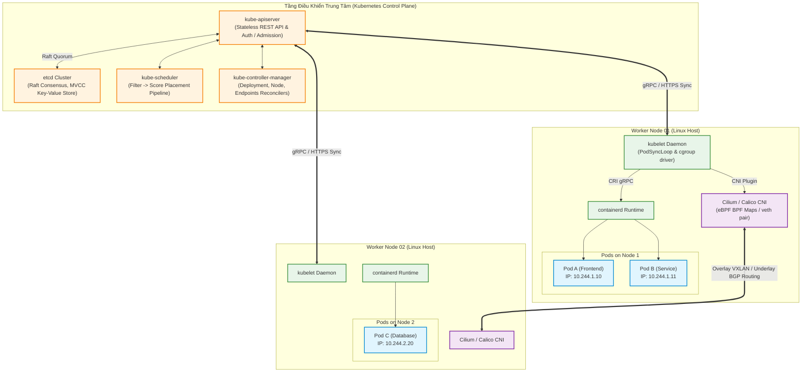
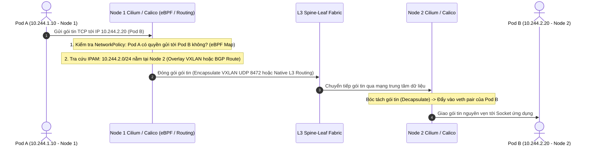

# 9.1. Control Plane, Node Architecture, and Networking (Kiến trúc Control Plane, Node & Mạng Kubernetes)

> [!IMPORTANT]
> **Nếu bạn chỉ được nhớ một điều duy nhất:** Kubernetes là một **hệ thống điều khiển vòng lặp trạng thái khai báo (Declarative Reconciliation Loop) phân tán khổng lồ**: **etcd** là "nguồn sự thật duy nhất" (Single Source of Truth) lưu trữ trạng thái bất biến qua thuật toán Raft, **kube-apiserver** là cổng giao tiếp không trạng thái duy nhất được phép chạm vào etcd, trong khi mô hình mạng **IP-per-Pod** phẳng được hiện thực hóa qua giao diện **CNI (Container Network Interface)** — nơi sự tiến hóa từ **iptables/IPVS (kube-proxy)** sang **eBPF/XDP (Cilium)** loại bỏ hoàn toàn hiện tượng suy hao độ trễ $O(N)$ khi số lượng Service vượt quá hàng chục ngàn.

---

## 1. Kiến trúc Tổng quan & Mô hình Tư duy (Mental Model)

### 1.1. Ẩn dụ Đời sống: Bộ Chỉ Huy Tác Chiến Quân Sự & Mạng Lưới Đồn Trú

Hãy tưởng tượng cụm Kubernetes như một bộ chỉ huy quân đoàn hiện đại:
- **Bộ Tổng Tham Mưu (Control Plane)**:
  - **Cuốn Sổ Cái Mật Lệnh (etcd)**: Cuốn sổ cái bọc thép ghi lại vị trí từng tiểu đoàn, số lượng xe tăng hiện có. Chỉ có duy nhất một sĩ quan phụ tá được phép mở sổ (**kube-apiserver**).
  - **Sĩ Quan Tác Chiến Phân Bổ (kube-scheduler)**: Khi có lệnh điều động 100 quân lính (Pods), scheduler xem xét bản đồ doanh trại: Đồn nào còn giường trống, đồn nào có bãi đáp trực thăng (GPU/SSD), đồn nào gần nguồn nước (NodeAffinity).
  - **Ban Thanh Tra Quân Đội (kube-controller-manager)**: Liên tục so sánh: *Mệnh lệnh yêu cầu luôn có 5 lính gác ở cổng thành (Desired State: 5 Replicas), nhưng hiện tại chỉ thấy 4 người (Actual State: 4)* $\to$ Lập tức ký lệnh điều động thêm 1 lính mới (**Reconciliation Loop**).
- **Các Đồn Trú Thực Địa (Worker Nodes)**:
  - **Đồn Trưởng Cơ Sở (kubelet)**: Đứng tại đồn, liên tục báo cáo quân số về Bộ chỉ huy. Khi nhận lệnh từ apiserver, kubelet ra lệnh cho nhà thầu xây dựng (**containerd / CRI**) dựng lều bạt cho lính ở.
  - **Hệ Thống Điện Thoại Nội Bộ (kube-proxy & CNI Driver)**:
  - Mỗi người lính (Pod) sinh ra đều được cấp một số điện thoại riêng biệt (**IP-per-Pod**), có thể gọi trực tiếp cho bất kỳ người lính nào ở đồn khác mà không cần qua tổng đài chuyển tiếp (No NAT).
  - **CNI (Cilium / Calico)** đóng vai trò như hệ thống cáp quang ngầm dưới lòng đất kết nối tất cả các đồn thành một mạng lưới thông suốt.



---

## 2. Chi tiết từng Keyword (Under-the-Hood Deep Dive)

### 2.1. Control Plane Components: kube-apiserver, etcd, Scheduler & Controllers
Trái tim của Kubernetes là một kiến trúc hướng sự kiện (Event-driven) dựa trên mô hình trạng thái:

#### A. etcd: "Nguồn Sự Thật Duy Nhất" (Single Source of Truth)
- Cơ sở dữ liệu phân tán dạng Key-Value được viết bằng Go, sử dụng thuật toán đồng thuận **Raft**.
- **MVCC (Multi-Version Concurrency Control)**: Mỗi lần ghi dữ liệu thành công, etcd tăng số hiệu phiên bản toàn cục (`revision`). Cho phép truy vấn lại lịch sử trạng thái tại bất kỳ mốc thời gian nào và phục vụ cơ chế **Optimistic Concurrency Control**.
- **Watch API (gRPC HTTP/2 Streams)**: Thay vì các thành phần phải liên tục gửi lệnh kiểm tra (Polling), etcd cho phép mở các luồng Watch dài hạn. Bất cứ khi nào một key thay đổi, etcd lập tức đẩy sự kiện (Event Push) tới client theo thời gian thực.
- Quy tắc sống còn: etcd bắt buộc triển khai theo số lẻ ($3$ hoặc $5$ nodes) và yêu cầu ổ đĩa NVMe SSD có độ trễ ghi `fdatasync` dưới **$10\text{ ms}$**.

#### B. kube-apiserver: Cổng Vào Duy Nhất của Hệ Thống
- Là thành phần hoàn toàn không trạng thái (**Stateless**), có thể mở rộng quy mô (Scale Out) ngang hàng phía sau một Load Balancer.
- Mọi thành phần trong cụm (kể cả Kubelet, Scheduler, Controller) bắt buộc phải giao tiếp qua apiserver, **không một ai được phép chạm trực tiếp vào etcd**.
- **Quy trình Xử lý Request**:
  1. *Authentication (Xác thực)*: X.509 Client Certificates, Bearer Tokens, OIDC.
  2. *Authorization (Phân quyền)*: RBAC (Role-Based Access Control) kiểm tra `Subject - Verb - Resource`.
  3. *Mutating Admission Webhooks*: Sửa đổi đối tượng (ví dụ: tự động inject Sidecar Envoy proxy).
  4. *Schema Validation*: Kiểm tra tính hợp lệ cú pháp OpenAPI Spec.
  5. *Validating Admission Webhooks*: Kiểm tra chính sách lần cuối trước khi commit vào etcd.

#### C. kube-scheduler: Đường Ống Lọc và Chấm Điểm (Filter & Score)
- Lắng nghe các Pods mới tạo ở trạng thái `Pending` (`spec.nodeName` đang rỗng) và gán Pod vào Node tối ưu:
  1. **Filtering Phase (Vòng Lọc Tiên Quyết)**: Loại bỏ các node không đủ điều kiện (không đủ CPU/RAM, bị Taints mà Pod không có Toleration, không khớp NodeSelector).
  2. **Scoring Phase (Vòng Chấm Điểm)**: Chấm điểm từ 0-100 cho các node còn lại dựa trên các thuật toán: `ImageLocality` (Node nào đã tải sẵn image container), `NodeResourcesLeastAllocated` hoặc `MostAllocated`, `PodTopologySpread`.
  3. **Binding Phase**: Ghi đè tên node vào `spec.nodeName` và gửi lệnh lên apiserver.

#### D. kube-controller-manager: Người Gác Đền Vòng Lặp Điều Hòa (Reconciler)
- Chứa hàng chục bộ điều khiển chạy song song trong một tiến trình duy nhất: Node Controller, Deployment Controller, ReplicaSet Controller, EndpointSlice Controller.
- Mỗi Controller chạy một vòng lặp vĩnh cửu:
  $$\text{Reconcile}() : \textbf{Diff}(\text{Desired State in Spec}, \text{Actual State in Cluster}) \to \textbf{Execute Actions to Converge}$$

---

### 2.2. Node Architecture: kubelet, CRI & kube-proxy
Mỗi Worker Node đại diện cho một cỗ máy tính toán thực thi:

#### A. kubelet: Đội Trưởng Thực Địa của Node
- Chạy dưới dạng một `systemd service` gốc trên máy chủ Linux (không chạy trong container).
- **PodSyncLoop**: Lắng nghe cấu hình Pod từ apiserver, tệp tin cục bộ tĩnh (Static Pods như etcd, kube-apiserver), hoặc HTTP endpoint.
- **Tích hợp cgroup driver**: Bắt buộc đồng bộ cấu hình `cgroupDriver: systemd` với container runtime để tránh xung đột quản lý tài nguyên hai tầng giữa Linux systemd và Kubelet.
- Thực hiện kiểm tra sức khỏe ứng dụng qua **Liveness**, **Readiness**, và **Startup Probes**.

#### B. kube-proxy: Sự Tiến Hóa từ iptables sang IPVS và eBPF
- Đảm bảo tính trừu tượng hóa của **Kubernetes Service**: Cung cấp một địa chỉ ảo duy nhất (ClusterIP VIP) đại diện cho một tập hợp nhiều Pods phía sau.
- **Chế độ iptables (Mặc định Cổ điển)**: Tạo ra hàng chục ngàn chuỗi luật `KUBE-SERVICES` trong Linux Netfilter. Khi cụm có trên $5,000$ Services, mỗi gói tin phải duyệt tuần tự qua danh sách luật $O(N)$, làm tăng vọt độ trễ mạng và tiêu tốn CPU.
- **Chế độ IPVS (IP Virtual Server)**: Sử dụng bảng băm Netfilter L4 trong Linux Kernel, độ phức tạp tra cứu giảm xuống $O(1)$, hỗ trợ các giải thuật cân bằng tải thông minh (Round-Robin, Least Connection, Weighted).
- **Chế độ eBPF (Cilium Bypass)**: Loại bỏ hoàn toàn kube-proxy và iptables. Gói tin được chuyển tiếp trực tiếp tại tầng socket bằng chương trình eBPF nạp vào Card mạng, đem lại hiệu năng chạm ngưỡng phần cứng dây dẫn (Wire-speed).

---

### 2.3. Cluster Networking: CNI Plugins & Network Policies
Kubernetes đặt ra một quy chuẩn mạng nền tảng rất đơn giản nhưng khắt khe: **Mọi Pod đều có một IP riêng biệt và có thể giao tiếp với mọi Pod khác trên toàn cụm mà không cần cấu hình NAT (Network Address Translation)**.



#### A. Phân Loại Các Động Cơ Mạng CNI (Container Network Interface)
1. **Flannel (Mô hình Overlay Đơn giản)**: Sử dụng kỹ thuật đóng gói gói tin **VXLAN** (đóng gói khung Ethernet vào gói tin UDP port 8472). Rất dễ cài đặt, nhưng tốn hao phí CPU đóng gói và không hỗ trợ Network Policies.
2. **Calico (Mô hình Underlay BGP & iptables)**: Biến mỗi Worker Node thành một BGP Router sử dụng daemon **BIRD**. Các Node tự quảng bá dải IP Pod cục bộ cho nhau qua mạng L3 vật lý. Không tốn hao phí đóng gói gói tin (No Encapsulation Overhead). Hỗ trợ chính sách bảo mật NetworkPolicy mạnh mẽ.
3. **Cilium (Kỷ Nguyên eBPF)**: Đỉnh cao công nghệ mạng Cloud-Native. Thay thế toàn bộ iptables và định tuyến Linux cổ điển bằng các chương trình **eBPF** gắn vào các móc mạng (tc / XDP). Cung cấp khả năng quan sát mạng tầng ứng dụng (L7 Observability qua Hubble), mã hóa trong suốt WireGuard/IPsec và tăng tốc Service Routing gấp 3 lần.

#### B. Kubernetes NetworkPolicy: Mô Hình Mặc Định Cho Phép (Default Allow)
- Mặc định, mọi Pod trong K8s đều có thể nói chuyện tự do với nhau.
- **Best Practice Bảo Mật Zero-Trust**: Bắt buộc thiết lập luật **Default Deny All Ingress & Egress** cho toàn bộ Namespace. Sau đó mở chọn lọc từng luồng kết nối cần thiết:
  ```yaml
  apiVersion: networking.k8s.io/v1
  kind: NetworkPolicy
  metadata:
    name: default-deny-all
  spec:
    podSelector: {}
    policyTypes:
    - Ingress
    - Egress
  ```

---

### 2.4. Cluster Ingress & Gateway API Infrastructure
Làm thế nào để người dùng Internet bên ngoài truy cập vào các Services bên trong cụm Kubernetes?

#### A. Sự Hạn Chế của Ingress Controller Cổ Điển
- Chuẩn `Ingress` truyền thống (Nginx Ingress, Traefik) là một tài nguyên nguyên khối (Monolithic Resource). Nó gộp chung cấu hình định tuyến ứng dụng, cấu hình chứng chỉ SSL/TLS, và cấu hình hạ tầng mạng vào cùng một file YAML.
- Dẫn tới việc lập trình viên ứng dụng có thể vô tình ghi đè cấu hình bảo mật hoặc làm sập cổng vào của toàn công ty.

#### B. Cuộc Cách Mạng Gateway API (Chuẩn Mực Mới của CNCF)
- **Gateway API** phân tách quyền hạn rõ ràng theo vai trò tổ chức (Role-Oriented Architecture):
  1. **GatewayClass** (Dành cho Nhà cung cấp Hạ tầng / Cloud Provider): Định nghĩa loại bộ điều khiển (ví dụ: `cilium`, `envoy-gateway`, `istio`).
  2. **Gateway** (Dành cho Kỹ sư Cụm SRE / Cluster Operator): Cấp phát địa chỉ IP VIP công cộng, quản lý mở port 80/443 và đính kèm chứng chỉ bảo mật TLS Secret.
  3. **HTTPRoute / GRPCRoute** (Dành cho Lập trình viên Ứng dụng / Developer): Tự do định tuyến theo đường dẫn URL (`/api`), phân tách lưu lượng Canary ($90\%$ v1, $10\%$ v2), và viết lại Header mà không cần xin phép quyền quản trị cụm.

---

## 3. Thực thi Mã nguồn & Mô phỏng Chuyên sâu (Dual-Engine Implementation)

### Engine 1: C++20 — Kubernetes Scheduler Filter & Score Placement Simulator
Chương trình C++20 dưới đây mô phỏng chính xác thuật toán 2 pha **Filter & Score** của `kube-scheduler`, tính toán điểm số tối ưu dựa trên tài nguyên CPU/RAM khả dụng và ràng buộc Node Affinity trước khi phát lệnh Binding.

```cpp
#include <iostream>
#include <vector>
#include <string>
#include <algorithm>
#include <iomanip>
#include <cmath>

struct ResourceSpec {
    int cpu_cores;
    int memory_mb;
};

struct K8sNode {
    std::string name;
    ResourceSpec capacity;
    ResourceSpec allocated;
    std::vector<std::string> labels;
    bool is_ready;

    bool has_label(const std::string& label) const {
        return std::find(labels.begin(), labels.end(), label) != labels.end();
    }
};

struct K8sPod {
    std::string name;
    ResourceSpec request;
    std::string required_node_label; // NodeSelector constraint
};

class KubeSchedulerSimulator {
public:
    static std::string schedule_pod(const K8sPod& pod, const std::vector<K8sNode>& nodes) {
        std::cout << "\n===================================================================\n";
        std::cout << "  SCHEDULING POD: " << pod.name 
                  << " (CPU Req: " << pod.request.cpu_cores << "m, RAM Req: " 
                  << pod.request.memory_mb << "Mi)\n";
        std::cout << "===================================================================\n";

        // GIAI ĐOẠN 1: FILTERING (Loại bỏ các node không đủ điều kiện)
        std::cout << ">>> GIAI ĐOẠN 1: FILTERING (Vòng Lọc Tiên Quyết) <<<\n";
        std::vector<const K8sNode*> feasible_nodes;

        for (const auto& node : nodes) {
            if (!node.is_ready) {
                std::cout << "  Node " << std::setw(16) << std::left << node.name << " -> LOẠI: NodeNotReady\n";
                continue;
            }
            if (!pod.required_node_label.empty() && !node.has_label(pod.required_node_label)) {
                std::cout << "  Node " << std::setw(16) << std::left << node.name 
                          << " -> LOẠI: NodeSelectorMismatch (Thiếu " << pod.required_node_label << ")\n";
                continue;
            }
            int free_cpu = node.capacity.cpu_cores - node.allocated.cpu_cores;
            int free_mem = node.capacity.memory_mb - node.allocated.memory_mb;

            if (free_cpu < pod.request.cpu_cores || free_mem < pod.request.memory_mb) {
                std::cout << "  Node " << std::setw(16) << std::left << node.name 
                          << " -> LOẠI: InsufficientResources (Free CPU: " << free_cpu << ", Free RAM: " << free_mem << ")\n";
                continue;
            }

            std::cout << "  Node " << std::setw(16) << std::left << node.name << " -> HỢP LỆ (Đạt điều kiện tiên quyết)\n";
            feasible_nodes.push_back(&node);
        }

        if (feasible_nodes.empty()) {
            std::cout << "\n[LỖI ĐIỀU PHỐI] Không tìm thấy Node khả dụng! Pod rơi vào trạng thái PENDING.\n";
            return "FAILED_TO_SCHEDULE";
        }

        // GIAI ĐOẠN 2: SCORING (Chấm điểm các node còn lại)
        std::cout << "\n>>> GIAI ĐOẠN 2: SCORING (Thuật toán NodeResourcesLeastAllocated) <<<\n";
        const K8sNode* best_node = nullptr;
        double highest_score = -1.0;

        for (const auto* node : feasible_nodes) {
            int rem_cpu = node->capacity.cpu_cores - (node->allocated.cpu_cores + pod.request.cpu_cores);
            int rem_mem = node->capacity.memory_mb - (node->allocated.memory_mb + pod.request.memory_mb);

            // Công thức LeastAllocated: Càng nhiều tài nguyên còn trống điểm càng cao (0-100)
            double cpu_score = (static_cast<double>(rem_cpu) / node->capacity.cpu_cores) * 50.0;
            double mem_score = (static_cast<double>(rem_mem) / node->capacity.memory_mb) * 50.0;
            double total_score = cpu_score + mem_score;

            std::cout << "  Node " << std::setw(16) << std::left << node->name 
                      << " -> Điểm CPU: " << std::fixed << std::setprecision(1) << cpu_score 
                      << " | Điểm RAM: " << mem_score << " => TỔNG ĐIỂM: " << total_score << "/100\n";

            if (total_score > highest_score) {
                highest_score = total_score;
                best_node = node;
            }
        }

        std::cout << "\n>>> GIAI ĐOẠN 3: BINDING <<<\n";
        std::cout << "  [QUYẾT ĐỊNH ĐIỀU PHỐI] Gán Pod " << pod.name << " -> Node " << best_node->name 
                  << " (Chiến thắng với điểm số: " << highest_score << ")\n";
        return best_node->name;
    }
};

int main() {
    std::cout << "===================================================================\n";
    std::cout << "   C++20 KUBERNETES CONTROL PLANE SCHEDULER ALGORITHM SIMULATOR   \n";
    std::cout << "===================================================================\n";

    // Khởi tạo 3 Worker Nodes
    std::vector<K8sNode> cluster_nodes = {
        {"node-zone-a-01", {8000, 16384}, {6000, 12000}, {"topology.kubernetes.io/zone=zone-a", "disk=nvme"}, true},
        {"node-zone-b-01", {8000, 16384}, {2000, 4000},  {"topology.kubernetes.io/zone=zone-b", "disk=nvme"}, true},
        {"node-zone-c-01", {4000, 8192},  {3500, 7000},  {"topology.kubernetes.io/zone=zone-c", "disk=hdd"},  true},
        {"node-zone-d-01", {8000, 16384}, {1000, 2000},  {"topology.kubernetes.io/zone=zone-d"}, false} // NotReady
    };

    K8sPod payment_pod{
        .name = "production-payment-api-pod-v1",
        .request = {2000, 4096}, // Cần 2 Cores và 4GB RAM
        .required_node_label = "disk=nvme" // Bắt buộc ổ NVMe
    };

    KubeSchedulerSimulator::schedule_pod(payment_pod, cluster_nodes);

    return 0;
}
```

#### Terminal Output Mẫu Thực Tế (C++20 Engine)
```text
===================================================================
   C++20 KUBERNETES CONTROL PLANE SCHEDULER ALGORITHM SIMULATOR   
===================================================================

===================================================================
  SCHEDULING POD: production-payment-api-pod-v1 (CPU Req: 2000m, RAM Req: 4096Mi)
===================================================================
>>> GIAI ĐOẠN 1: FILTERING (Vòng Lọc Tiên Quyết) <<<
  Node node-zone-a-01   -> LOẠI: InsufficientResources (Free CPU: 2000, Free RAM: 4384)
  Node node-zone-b-01   -> HỢP LỆ (Đạt điều kiện tiên quyết)
  Node node-zone-c-01   -> LOẠI: NodeSelectorMismatch (Thiếu disk=nvme)
  Node node-zone-d-01   -> LOẠI: NodeNotReady

>>> GIAI ĐOẠN 2: SCORING (Thuật toán NodeResourcesLeastAllocated) <<<
  Node node-zone-b-01   -> Điểm CPU: 25.0 | Điểm RAM: 25.3 => TỔNG ĐIỂM: 50.3/100

>>> GIAI ĐOẠN 3: BINDING <<<
  [QUYẾT ĐỊNH ĐIỀU PHỐI] Gán Pod production-payment-api-pod-v1 -> Node node-zone-b-01 (Chiến thắng với điểm số: 50.3)
```

---

### Engine 2: Python 3.11+ — K8s Declarative Reconciliation Loop & eBPF CNI Router
Kịch bản Python 3.11+ dưới đây mô phỏng vòng lặp điều hòa **Declarative Reconcile Loop** của một Deployment Controller kết hợp mô phỏng định tuyến mạng chuyển mạch eBPF/XDP của CNI Plugin.

```python
#!/usr/bin/env python3
import time
from dataclasses import dataclass, field
from typing import List, Dict

@dataclass
class PodInstance:
    pod_name: str
    ip_address: str
    node_name: str
    status: str = "Running"

class DeploymentReconciler:
    """Mô phỏng vòng lặp điều hòa chuẩn của Kubernetes Controller Manager"""
    def __init__(self, deployment_name: str, desired_replicas: int):
        self.deployment_name = deployment_name
        self.desired_replicas = desired_replicas
        self.active_pods: Dict[str, PodInstance] = {}
        self.pod_counter = 0

    def reconcile_step(self):
        current_replicas = len(self.active_pods)
        print(f"\n[Controller Loop] Reconcile Deployment '{self.deployment_name}':")
        print(f"  Desired State: {self.desired_replicas} Replicas | Actual State: {current_replicas} Replicas")

        diff = self.desired_replicas - current_replicas
        if diff > 0:
            print(f"  -> Trôi lệch âm! Cần tạo thêm {diff} Pods mới...")
            for _ in range(diff):
                self.pod_counter += 1
                p_name = f"{self.deployment_name}-{self.pod_counter:04d}"
                p_ip = f"10.244.1.{10 + self.pod_counter}"
                self.active_pods[p_name] = PodInstance(p_name, p_ip, "k8s-worker-node-01")
                print(f"     [+] Đã khởi tạo {p_name} gắn IP: {p_ip}")
        elif diff < 0:
            print(f"  -> Trôi lệch dương! Cần thu hồi {abs(diff)} Pods...")
            for _ in range(abs(diff)):
                remove_key = next(iter(self.active_pods))
                removed = self.active_pods.pop(remove_key)
                print(f"     [-] Đã giải phóng {removed.pod_name}")
        else:
            print("  -> Hệ thống ở trạng thái Cân bằng Hoàn hảo (In-Sync). Không cần thao tác!")

class CiliumEBPFNetworkRouter:
    """Mô phỏng tra cứu bảng eBPF BPF Maps để định tuyến gói tin không cần iptables"""
    def __init__(self):
        # Mô phỏng eBPF Map: BPF_MAP_TYPE_HASH
        self.cilium_bpf_lxc_map: Dict[str, str] = {}

    def register_pod_interface(self, pod_ip: str, veth_interface: str):
        self.cilium_bpf_lxc_map[pod_ip] = veth_interface
        print(f"[Cilium eBPF CNI] Nạp luật BPF Map: {pod_ip} => {veth_interface} (Zero-copy XDP Hook)")

    def route_packet(self, dst_ip: str):
        print(f"[eBPF XDP Hook] Tiếp nhận gói tin gửi tới đích: {dst_ip}")
        if dst_ip in self.cilium_bpf_lxc_map:
            iface = self.cilium_bpf_lxc_map[dst_ip]
            print(f"  -> [eBPF Fast Path] Chuyển tiếp tức thì ra {iface} trong O(1) [Bypass Linux Network Stack]!")
        else:
            print("  -> [eBPF Drop] Không tìm thấy Endpoint trong BPF Map! Drop packet.")

def main():
    print("=" * 70)
    print("  PYTHON 3.11+: KUBERNETES RECONCILIATION LOOP & CILIUM eBPF ROUTER")
    print("=" * 70)

    # 1. Khởi tạo Controller điều hòa Pods
    reconciler = DeploymentReconciler("auth-service", desired_replicas=3)
    reconciler.reconcile_step()

    # Giả lập sự cố: Một Pod bị chết đột ngột
    print("\n[Mô phỏng Sự Cố] Pod 'auth-service-0002' bị lỗi OOMKilled!")
    del reconciler.active_pods["auth-service-0002"]

    # Controller phát hiện trôi lệch và tự động hồi phục (Self-Healing)
    reconciler.reconcile_step()

    # 2. Khởi tạo Cilium eBPF Router
    print("\n" + "-" * 70)
    router = CiliumEBPFNetworkRouter()
    for pod in reconciler.active_pods.values():
        router.register_pod_interface(pod.ip_address, f"lxc_{pod.pod_name[:12]}")

    router.route_packet("10.244.1.11")
    router.route_packet("10.244.1.99")

if __name__ == "__main__":
    main()
```

#### Terminal Output Mẫu Thực Tế (Python 3.11+ Engine)
```text
======================================================================
  PYTHON 3.11+: KUBERNETES RECONCILIATION LOOP & CILIUM eBPF ROUTER
======================================================================

[Controller Loop] Reconcile Deployment 'auth-service':
  Desired State: 3 Replicas | Actual State: 0 Replicas
  -> Trôi lệch âm! Cần tạo thêm 3 Pods mới...
     [+] Đã khởi tạo auth-service-0001 gắn IP: 10.244.1.11
     [+] Đã khởi tạo auth-service-0002 gắn IP: 10.244.1.12
     [+] Đã khởi tạo auth-service-0003 gắn IP: 10.244.1.13

[Mô phỏng Sự Cố] Pod 'auth-service-0002' bị lỗi OOMKilled!

[Controller Loop] Reconcile Deployment 'auth-service':
  Desired State: 3 Replicas | Actual State: 2 Replicas
  -> Trôi lệch âm! Cần tạo thêm 1 Pods mới...
     [+] Đã khởi tạo auth-service-0004 gắn IP: 10.244.1.14

----------------------------------------------------------------------
[Cilium eBPF CNI] Nạp luật BPF Map: 10.244.1.11 => lxc_auth-servic (Zero-copy XDP Hook)
[Cilium eBPF CNI] Nạp luật BPF Map: 10.244.1.13 => lxc_auth-servic (Zero-copy XDP Hook)
[Cilium eBPF CNI] Nạp luật BPF Map: 10.244.1.14 => lxc_auth-servic (Zero-copy XDP Hook)
[eBPF XDP Hook] Tiếp nhận gói tin gửi tới đích: 10.244.1.11
  -> [eBPF Fast Path] Chuyển tiếp tức thì ra lxc_auth-servic trong O(1) [Bypass Linux Network Stack]!
[eBPF XDP Hook] Tiếp nhận gói tin gửi tới đích: 10.244.1.99
  -> [eBPF Drop] Không tìm thấy Endpoint trong BPF Map! Drop packet.
```

---

## 4. Systems Engineering & Production Pitfalls

### 4.1. Sự cố Thực chiến Trong Hạ Tầng Kubernetes
1. **Khủng Hoảng etcd Disk Fsync Latency & Split-Brain Lead Loss**:
   - *Nguyên nhân*: etcd sử dụng thuật toán Raft yêu cầu ghi nhật ký WAL (Write-Ahead Log) đồng bộ bằng lệnh `fdatasync` xuống đĩa cứng trước khi xác nhận cam kết giao dịch. Nếu etcd đặt chung ổ đĩa với các ứng dụng ghi nhiều log hoặc đĩa mạng chậm, thời gian `fdatasync` tăng vọt $> 30\text{ ms}$. etcd Leader bị timeout nhịp tim (Heartbeat timeout), kích hoạt bầu cử Leader liên tục (Leader Flapping), khiến toàn bộ cụm Kubernetes bị tê liệt không thể tạo hay xóa bất kỳ Pod nào.
   - *Cách khắc phục*: Dành riêng phân vùng ổ đĩa NVMe SSD vật lý độc lập cho thư mục dữ liệu etcd (`/var/lib/etcd`), tối ưu hóa I/O priority qua `ionice -c2 -n0`.
2. **Hiện tượng Cạn Kiệt Dải Mạng IPAM của Pod (Subnet Exhaustion)**:
   - *Nguyên nhân*: Cấu hình dải mạng Pod quá hẹp (ví dụ `/16` cấp phát cho 100 nodes, mỗi node chỉ nhận được dải `/24` với 254 IPs). Khi các Pod liên tục sinh ra và chết đi trong các quy trình CI/CD tự động, CNI plugin chưa kịp thu hồi IP rác, khiến Kubelet báo lỗi `FailedCreatePodSandBox: failed to allocate for range: no IP addresses available in range`.
   - *Khắc phục*: Quy hoạch không gian địa chỉ IPv4 rộng rãi ngay từ đầu (tối thiểu `/14` hoặc chuyển đổi sang Dual-Stack IPv6).

### 4.2. Bộ Lệnh CLI Chẩn đoán & Giám sát Kubernetes
- **Kiểm tra trạng thái sức khỏe etcd**:
  ```bash
  etcdctl endpoint health --write-out=table
  etcdctl endpoint status --write-out=table
  etcdctl check perf # Đo lường hiệu năng ghi đĩa và mạng của etcd
  ```
- **Chẩn đoán Pod và mạng bằng crictl**:
  ```bash
  crictl pods
  crictl ps
  crictl logs <container-id>
  ```
- **Kiểm tra và gỡ lỗi Cilium eBPF**:
  ```bash
  cilium status
  cilium bpf endpoint list
  cilium monitor --type drop
  ```

---

## 5. Bảng So sánh & Decision Matrix

### 5.1. Ma trận So sánh Kỹ thuật Các Động cơ Mạng CNI

| Tiêu chí | Flannel | Project Calico | Cilium |
| :--- | :--- | :--- | :--- |
| **Cơ chế Định tuyến** | Đóng gói VXLAN (Overlay) | Định tuyến BGP trực tiếp (Underlay) | eBPF XDP / TC (Kernel Bypass) |
| **Hỗ trợ NetworkPolicy** | Không hỗ trợ | Rất mạnh mẽ (iptables / eBPF) | Toàn diện (Layer 3/4 + Layer 7 HTTP) |
| **Hiệu năng & Băng thông** | Thấp nhất (Hao phí đóng gói UDP) | Rất cao (Độ trễ bare-metal native) | Cao nhất thế giới (Direct Socket Routing) |
| **Độ Phức Tạp Vận Hành** | Rất thấp (Cài đặt 1 file YAML) | Trung bình (Cần hiểu biết BGP peering) | Trung bình đến Cao (Yêu cầu Linux Kernel $> 5.4$) |
| **Khuyến nghị Triển khai** | Cụm Lab, Thử nghiệm, Edge nhỏ | Mạng On-premise kết nối Switch vật lý | Chuẩn mực vàng cho Kubernetes Enterprise |

### 5.2. Khung Hướng dẫn Quy hoạch Hạ tầng Control Plane
1. **Quy mô Cụm Dưới 50 Nodes**: 3 Nodes Master kết hợp Control Plane và etcd (Stacked Control Plane). Đĩa SSD SATA/NVMe tiêu chuẩn.
2. **Quy mô Cụm Trên 200 Nodes**:
   - Bắt buộc tách cụm **etcd** sang 3 hoặc 5 máy chủ Bare-Metal vật lý chuyên dụng độc lập với Master Nodes.
   - Cấu hình tối thiểu 3 máy chủ chạy `kube-apiserver` phía sau Layer 4 Load Balancer (HAProxy / Keepalived).
   - Sử dụng **Cilium CNI** kết hợp chế độ `kube-proxy-replacement: strict` để đạt hiệu năng tối đa.
