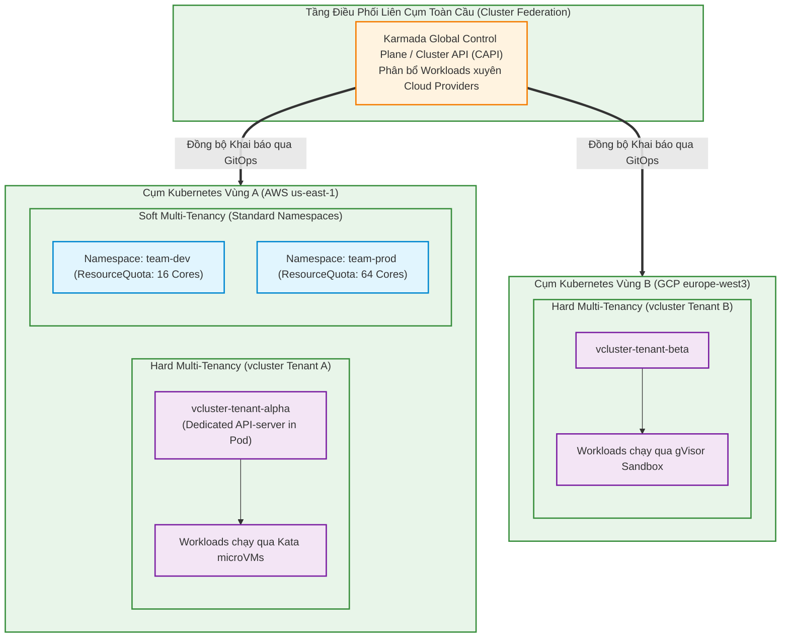
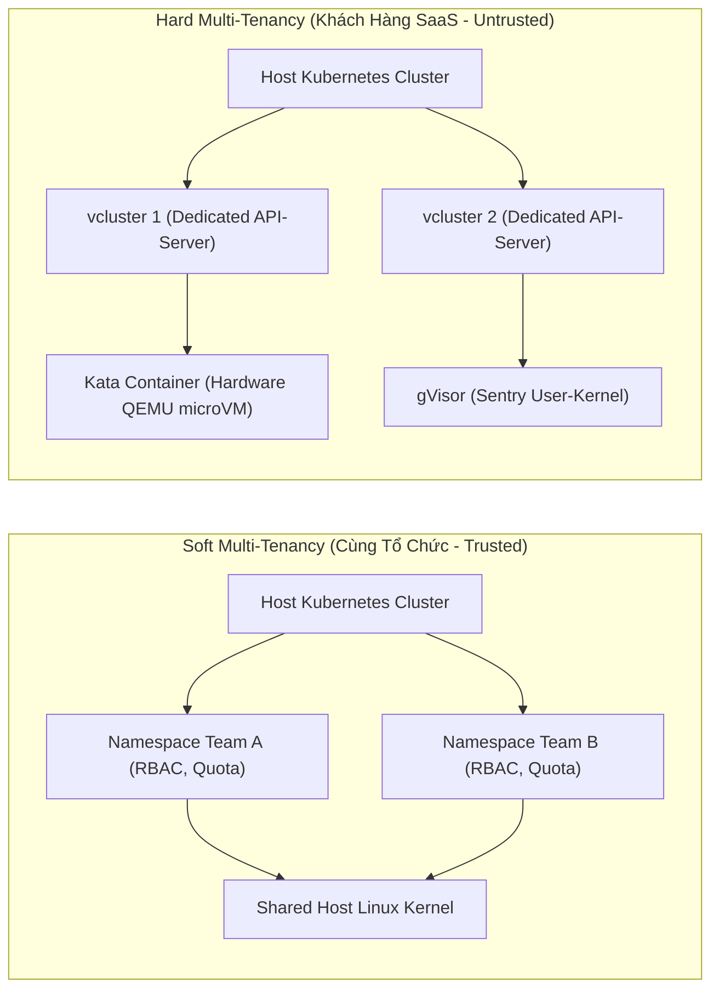

# 9.2. Workload Scheduling, Multi-Tenancy, and Federation (Điều phối Tải, Đa Người dùng & Liên cụm Kubernetes)

> [!IMPORTANT]
> **Nếu bạn chỉ được nhớ một điều duy nhất:** Trong môi trường Kubernetes doanh nghiệp quy mô lớn, **sự cô lập logic (Soft Multi-Tenancy qua Namespaces/RBAC) là hoàn toàn không đủ để ngăn chặn các cuộc tấn công qua nhân Kernel hoặc tranh chấp tài nguyên mạng**: giải pháp bắt buộc là kết hợp **Hard Multi-Tenancy (Kata Containers / vcluster)** với các quy tắc điều phối topo tinh vi (**Taints/Tolerations & TopologySpreadConstraints**), bảo đảm các khối lượng công việc nhạy cảm không bao giờ bị xếp chung máy chủ vật lý; đồng thời kiến trúc **Liên Cụm Đa Vùng (Cluster Federation qua Karmada)** mở rộng biên giới điều phối xuyên qua các Cloud Providers khác nhau mà không tạo ra điểm nghẽn tập trung.

---

## 1. Kiến trúc Tổng quan & Mô hình Tư duy (Mental Model)

### 1.1. Ẩn dụ Đời sống: Khu Đô Thị Đa Dân Cư & Liên Minh Các Thành Phố

Hãy tưởng tượng hạ tầng tính toán doanh nghiệp như một mô hình quản lý đô thị hiện đại:
- **Điều Phối Tải Thông Minh (Tài Xế Taxi & Bản Đồ Quy Hoạch)**:
  - Khi một gia đình chuyển đến thành phố (Triển khai Pod), họ có những yêu cầu khắt khe: Không thích ở gần nhà máy hóa chất (**PodAntiAffinity**), muốn ở gần trường học (**NodeAffinity**), và muốn các anh em trong gia đình sống rải rác ở cả 3 quận khác nhau để lỡ một quận mất điện thì các quận khác vẫn còn người đi làm (**TopologySpreadConstraints**).
  - Ngược lại, khu đất vàng trung tâm thành phố có biển báo cấm người lạ (**Taints: `dedicated=gpu:NoSchedule`**). Chỉ những chiếc xe đặc chủng có thẻ ưu tiên (**Tolerations**) mới được phép đi vào bãi đỗ này.
- **Đa Người Dùng (Soft vs. Hard Multi-Tenancy)**:
  - **Soft Multi-Tenancy (Các Căn Hộ Chung Vách Thạch Cao — Namespaces/RBAC)**: Các phòng ban trong cùng một công ty chia sẻ chung một tòa nhà. Vách ngăn bằng thạch cao chỉ để giữ sự riêng tư lịch sự. Nếu một phòng mở nhạc loa thùng quá to (Noisy Neighbor ngốn $100\%$ CPU), cả tòa nhà đều bị ảnh hưởng.
  - **Hard Multi-Tenancy (Khu Biệt Thự Có Tường Rào Bê Tông — vcluster & Kata Containers)**: Dành cho các khách hàng cạnh tranh hoặc không tin cậy (Multi-tenant SaaS). Mỗi khách hàng được cấp một máy ảo microVM riêng hoặc một cụm Kubernetes ảo độc lập (**vcluster**). Họ có quyền phong làm Admin tối cao bên trong vcluster của mình mà không hề có cơ hội phá hoại cụm máy chủ vật lý bên dưới.
- **Liên Cụm (Multi-Cluster Federation — Liên Minh Các Thành Phố)**:
  - Thay vì xây dựng một thành phố khổng lồ 10 triệu dân (1 Cụm K8s $10,000$ nodes dễ bị sập toàn diện khi có sự cố), doanh nghiệp xây dựng 5 thành phố vệ tinh quy mô vừa ($2,000$ nodes/cụm) đặt ở Tokyo, Singapore, Frankfurt.
  - Một trung tâm điều hành liên minh (**Karmada / KubeFed**) đứng trên cao, tự động điều phối: Nếu thành phố Tokyo gặp động đất (Sập Data Center AWS), luồng dân cư tự động được tái định cư sang thành phố Singapore chỉ trong vài giây.



---

## 2. Chi tiết từng Keyword (Under-the-Hood Deep Dive)

### 2.1. Workload Scheduling: Affinity, Anti-Affinity, Taints, Tolerations & Topology
Các cơ chế điều phối nâng cao giúp kỹ sư hạ tầng làm chủ hoàn toàn vị trí thực thi của ứng dụng:

#### A. NodeAffinity vs. PodAntiAffinity
- **NodeAffinity**: Kéo Pod về các Node có đặc tính phần cứng mong muốn:
  - `requiredDuringSchedulingIgnoredDuringExecution` (Ràng buộc cứng): Nếu node không có nhãn chỉ định, Pod nhất quyết không chạy và ở trạng thái Pending.
  - `preferredDuringSchedulingIgnoredDuringExecution` (Ràng buộc mềm): Ưu tiên node có nhãn, nhưng nếu không có thì vẫn chấp nhận chạy ở node khác với điểm số thấp hơn.
- **PodAntiAffinity**: Đẩy các Pod ra xa nhau để ngăn chặn sự cố chết chùm:
  - Ví dụ: 3 Pods của dịch vụ Cơ sở Dữ liệu bắt buộc không được chạy trên cùng một máy chủ vật lý (`topologyKey: kubernetes.io/hostname`) hoặc không được chạy trên cùng một tủ Rack (`topologyKey: topology.kubernetes.io/zone`).

#### B. Taints & Tolerations: Cơ Chế Đẩy Và Dung Thứ
- **Taints (Gắn lên Node)**: Đánh dấu sự "độc hại" hoặc chuyên biệt của node. Cấu trúc gồm `Key=Value:Effect`:
  - `NoSchedule`: Kube-scheduler không bao giờ gán Pod mới vào node này nếu Pod không có Toleration tương ứng.
  - `PreferNoSchedule`: Tránh gán Pod vào nếu có thể.
  - `NoExecute`: Nếu node bị gắn Taint này, toàn bộ các Pods đang chạy trên node mà không có Toleration sẽ lập tức bị đuổi (Evict) ra khỏi node!
- **Tolerations (Khai báo trong Pod Spec)**: "Tấm vé thông hành" cho phép Pod được chấp nhận chạy trên node có Taint. Thường dùng cho các Worker Nodes gắn card đồ họa đắt đỏ (GPU Nodes) hoặc các Node dành riêng cho tác vụ Machine Learning Training.

#### C. TopologySpreadConstraints (Phân Bổ Cân Bằng Đa Miền)
- Giải quyết bài toán phân bố đều Pods trên các Availability Zones (AZs):
  ```yaml
  topologySpreadConstraints:
  - maxSkew: 1
    topologyKey: topology.kubernetes.io/zone
    whenUnsatisfiable: DoNotSchedule
    labelSelector:
      matchLabels:
        app: core-banking-api
  ```
  `maxSkew: 1` bảo đảm số lượng Pod chênh lệch giữa Zone A, Zone B và Zone C không bao giờ được vượt quá 1 Pod, triệt tiêu nguy cơ một Zone bị quá tải khi các Zone khác nhàn rỗi.

---

### 2.2. Multi-Tenancy Architecture: Soft vs Hard Multi-Tenancy
Khi nhiều đội nhóm hoặc khách hàng cùng chia sẻ một nền tảng hạ tầng, vấn đề cô lập trở thành sinh tử:



#### A. Soft Multi-Tenancy (Cô lập Logic trong Cùng Công Ty)
- **Namespaces**: Không gian tên logic để phân chia tài nguyên và phạm vi tên gọi.
- **RBAC (Role-Based Access Control)**: Gán quyền hạn cụ thể (`Role`, `ClusterRole`, `RoleBinding`) để giới hạn các kỹ sư chỉ được xem hoặc chỉnh sửa trong Namespace của đội mình.
- **ResourceQuota & LimitRange**:
  - `ResourceQuota`: Giới hạn tổng số lượng CPU, RAM và số lượng Pods tối đa mà một Namespace được phép tiêu thụ.
  - `LimitRange`: Ép buộc mọi container tạo ra phải có giá trị `requests` và `limits` tối thiểu và tối đa, ngăn chặn việc lập trình viên quên khai báo khiến Pod chiếm dụng toàn bộ tài nguyên của Node.

#### B. Hard Multi-Tenancy (Cô lập Vật Lý / Hạt Nhân cho Khách Hàng SaaS)
- Đối với môi trường chạy mã nguồn không tin cậy của bên thứ ba, các cơ chế cgroups và namespaces thông thường không đủ an toàn. Cần áp dụng giải pháp Hard Isolation:
  1. **Virtual Clusters (vcluster)**:
     - Tạo ra một cụm Kubernetes độc lập chạy bên trong một Namespace của cụm cha (Host Cluster).
     - Mỗi vcluster có riêng một `kube-apiserver` và `syncer` riêng biệt. Người thuê nhà (Tenant) có toàn quyền `cluster-admin` bên trong vcluster, có thể tự tạo CRDs, cài đặt Helm charts tùy thích mà hoàn toàn không thể chạm tới cụm Host bên dưới.
  2. **Sandboxed Container Runtimes (Kata Containers / gVisor)**:
     - **Kata Containers**: Mỗi Pod được đóng gói bên trong một máy ảo microVM siêu nhẹ (dùng QEMU hoặc Cloud-Hypervisor) với một nhân Linux Kernel riêng biệt, bảo đảm cách ly cấp độ phần cứng.
     - **gVisor (Google)**: Chạy một nhân Kernel giả lập trong không gian người dùng (**Sentry**) viết bằng Go, chặn đứng $100\%$ các lệnh gọi hệ thống nguy hiểm chạm vào nhân Host Kernel.

---

### 2.3. Multi-Cluster Federation & Fleet Management
Khi quy mô doanh nghiệp vượt quá giới hạn khuyến nghị của một cụm Kubernetes đơn lẻ (5,000 nodes, 150,000 pods) hoặc khi có yêu cầu tuân thủ dữ liệu theo khu vực địa lý (GDPR, Data Residency), việc chuyển sang mô hình **Đa Cụm (Multi-Cluster)** là bắt buộc.

#### A. Thách Thức Khi Quản Lý Fleet Hàng Trăm Cụm
- Trôi lệch cấu hình (Configuration Drift) giữa các cụm.
- Khó khăn trong việc quan sát và định tuyến lưu lượng xuyên cụm (Cross-cluster Service Discovery).
- Quản lý vòng đời cập nhật phiên bản Kubernetes đồng loạt mà không gây downtime.

#### B. Nền Tảng Điều Phối Liên Cụm Hiện Đại: Karmada & Cluster API (CAPI)
- **Cluster API (CAPI)**: Đưa triết lý khai báo của Kubernetes vào việc quản lý chính các cụm Kubernetes. Sử dụng Custom Resources (`Cluster`, `MachineDeployment`) để tự động cấp phát và nâng cấp các cụm K8s trên AWS, GCP, Azure, VMware vSphere thông qua mã nguồn.
- **Karmada (Kubernetes Multi-Cluster Orchestration - CNCF)**:
  - Cung cấp giao diện tương thích $100\%$ chuẩn Kubernetes API bản địa.
  - **PropagationPolicy**: Định nghĩa chính sách phân bổ thông minh:
    - *Replication*: Sao chép đồng nhất Deployment tới tất cả các cụm vệ tinh.
    - *Multi-Cloud Spreading*: Tự động chia tải $60\%$ sang cụm AWS và $40\%$ sang cụm On-premise.
    - *Failover Automation*: Tự động di dời toàn bộ Workload sang cụm khác khi một cụm mất liên lạc quá 3 phút.

---

## 3. Thực thi Mã nguồn & Mô phỏng Chuyên sâu (Dual-Engine Implementation)

### Engine 1: C++20 — Multi-Dimension Topology Spread Constraint Evaluator
Chương trình C++20 dưới đây mô phỏng thuật toán tính toán độ lệch phân bổ **`TopologySpreadConstraints`** của Kubernetes, kiểm tra độ lệch `maxSkew` trên các Availability Zones để bảo đảm tính sẵn sàng cao trước thảm họa mất trung tâm dữ liệu.

```cpp
#include <iostream>
#include <vector>
#include <string>
#include <unordered_map>
#include <algorithm>
#include <iomanip>

struct TopologyDomain {
    std::string zone_id;
    int current_pod_count = 0;
};

class TopologySpreadEngine {
private:
    std::unordered_map<std::string, TopologyDomain> topology_map_;
    int max_skew_;

public:
    TopologySpreadEngine(const std::vector<std::string>& zones, int max_skew) : max_skew_(max_skew) {
        for (const auto& z : zones) {
            topology_map_[z] = {z, 0};
        }
    }

    void set_zone_pod_count(const std::string& zone, int count) {
        if (topology_map_.find(zone) != topology_map_.end()) {
            topology_map_[zone].current_pod_count = count;
        }
    }

    // Đánh giá xem có được phép đưa thêm 1 Pod vào zone mục tiêu không
    bool evaluate_placement(const std::string& target_zone) {
        if (topology_map_.find(target_zone) == topology_map_.end()) {
            return false;
        }

        // Tạo bản sao tạm thời để tính toán skew giả lập
        auto temp_map = topology_map_;
        temp_map[target_zone].current_pod_count++;

        int min_count = 1e9;
        int max_count = -1;

        for (const auto& [_, domain] : temp_map) {
            min_count = std::min(min_count, domain.current_pod_count);
            max_count = std::max(max_count, domain.current_pod_count);
        }

        int calculated_skew = max_count - min_count;

        std::cout << "  -> Đánh giá đưa Pod vào Zone [" << target_zone << "]: "
                  << "MinCount=" << min_count << ", MaxCount=" << max_count 
                  << " => Skew sau khi xếp: " << calculated_skew << " (Ngưỡng maxSkew: " << max_skew_ << ")\n";

        if (calculated_skew <= max_skew_) {
            std::cout << "     [ĐẠT] Thỏa mãn TopologySpreadConstraint! Cho phép lập lịch.\n";
            return true;
        } else {
            std::cout << "     [TỪ CHỐI] Vi phạm maxSkew! Kube-scheduler sẽ tìm kiếm Zone khác.\n";
            return false;
        }
    }
};

int main() {
    std::cout << "===================================================================\n";
    std::cout << "  C++20 KUBERNETES TOPOLOGY SPREAD CONSTRAINT SKEW EVALUATOR       \n";
    std::cout << "===================================================================\n";

    // Khởi tạo 3 Vùng Khả dụng (Availability Zones) với ràng buộc maxSkew = 1
    TopologySpreadEngine engine({"us-east-1a", "us-east-1b", "us-east-1c"}, 1);

    // Giả lập trạng thái hiện tại của cụm:
    // Zone A đang có 3 pods
    // Zone B đang có 2 pods
    // Zone C đang có 2 pods
    engine.set_zone_pod_count("us-east-1a", 3);
    engine.set_zone_pod_count("us-east-1b", 2);
    engine.set_zone_pod_count("us-east-1c", 2);

    std::cout << "[Hiện trạng Phân Bổ]: us-east-1a: 3 Pods | us-east-1b: 2 Pods | us-east-1c: 2 Pods\n\n";

    // Kịch bản 1: Cố tình đưa thêm Pod vào Zone A (Vốn dĩ đang nhiều nhất)
    std::cout << ">>> KỊCH BẢN 1: Thử nghiệm xếp Pod vào us-east-1a <<<\n";
    engine.evaluate_placement("us-east-1a");

    // Kịch bản 2: Đưa Pod vào Zone B
    std::cout << "\n>>> KỊCH BẢN 2: Thử nghiệm xếp Pod vào us-east-1b <<<\n";
    engine.evaluate_placement("us-east-1b");

    return 0;
}
```

#### Terminal Output Mẫu Thực Tế (C++20 Engine)
```text
===================================================================
  C++20 KUBERNETES TOPOLOGY SPREAD CONSTRAINT SKEW EVALUATOR       
===================================================================
[Hiện trạng Phân Bổ]: us-east-1a: 3 Pods | us-east-1b: 2 Pods | us-east-1c: 2 Pods

>>> KỊCH BẢN 1: Thử nghiệm xếp Pod vào us-east-1a <<<
  -> Đánh giá đưa Pod vào Zone [us-east-1a]: MinCount=2, MaxCount=4 => Skew sau khi xếp: 2 (Ngưỡng maxSkew: 1)
     [TỪ CHỐI] Vi phạm maxSkew! Kube-scheduler sẽ tìm kiếm Zone khác.

>>> KỊCH BẢN 2: Thử nghiệm xếp Pod vào us-east-1b <<<
  -> Đánh giá đưa Pod vào Zone [us-east-1b]: MinCount=2, MaxCount=3 => Skew sau khi xếp: 1 (Ngưỡng maxSkew: 1)
     [ĐẠT] Thỏa mãn TopologySpreadConstraint! Cho phép lập lịch.
```

---

### Engine 2: Python 3.11+ — Multi-Cluster Federation Workload Dispatcher & Failover
Kịch bản Python 3.11+ dưới đây mô phỏng bộ điều phối **Multi-Cluster Federation (Karmada Architecture)**, tự động chia sẻ tải làm việc xuyên qua 3 cụm Kubernetes độc lập và kích hoạt di chuyển tự động (Auto-failover) khi phát hiện một cụm bị mất liên lạc.

```python
#!/usr/bin/env python3
import time
from dataclasses import dataclass
from typing import List, Dict

@dataclass
class MemberCluster:
    name: str
    region: str
    available_cpu_cores: int
    is_healthy: bool = True
    assigned_replicas: int = 0

class FederationOrchestrator:
    """Mô phỏng bộ điều phối Karmada Multi-Cluster Propagation Policy"""
    def __init__(self):
        self.member_clusters: Dict[str, MemberCluster] = {}

    def register_cluster(self, name: str, region: str, cpu_cores: int):
        self.member_clusters[name] = MemberCluster(name, region, cpu_cores)
        print(f"[Federation Core] Đã kết nối Thành viên Cụm: {name:<18} (Vùng: {region:<12} | CPU: {cpu_cores} Cores)")

    def dispatch_workload(self, deployment_name: str, total_replicas: int):
        print(f"\n[Federation Policy] Phân bổ Workload '{deployment_name}' (Tổng số bản sao: {total_replicas}):")
        healthy_clusters = [c for c in self.member_clusters.values() if c.is_healthy]
        if not healthy_clusters:
            print("  [LỖI] Không có cụm nào khả dụng!")
            return

        # Phân bổ đều theo tỷ lệ
        base_replicas = total_replicas // len(healthy_clusters)
        remainder = total_replicas % len(healthy_clusters)

        for idx, cluster in enumerate(healthy_clusters):
            alloc = base_replicas + (1 if idx < remainder else 0)
            cluster.assigned_replicas = alloc
            print(f"  -> Cụm {cluster.name:<18} [{cluster.region}]: Nhận {alloc} Replicas")

    def simulate_cluster_outage(self, failed_cluster_name: str, deployment_name: str, total_replicas: int):
        print(f"\n" + "!" * 70)
        print(f"  PHÁT HIỆN SỰ CỐ THẢM HỌA: Cụm '{failed_cluster_name}' MẤT KẾT NỐI (Heartbeat Timeout)!")
        print("!" * 70)
        if failed_cluster_name in self.member_clusters:
            self.member_clusters[failed_cluster_name].is_healthy = False
            self.member_clusters[failed_cluster_name].assigned_replicas = 0

        print(f"[Failover Controller] Kích hoạt chính sách tái phân bổ khẩn cấp cho '{deployment_name}'...")
        self.dispatch_workload(deployment_name, total_replicas)

def main():
    print("=" * 70)
    print("  PYTHON 3.11+: MULTI-CLUSTER FEDERATION & DISASTER RECOVERY ENGINE")
    print("=" * 70)

    fed = FederationOrchestrator()
    fed.register_cluster("k8s-aws-us-east", "us-east-1", 128)
    fed.register_cluster("k8s-gcp-europe", "europe-west3", 128)
    fed.register_cluster("k8s-onprem-dc1", "singapore", 256)

    # 1. Phân bổ ban đầu 12 bản sao
    fed.dispatch_workload("global-trading-engine", total_replicas=12)

    # 2. Giả lập trung tâm dữ liệu AWS bị mất điện hoàn toàn
    fed.simulate_cluster_outage("k8s-aws-us-east", "global-trading-engine", total_replicas=12)

if __name__ == "__main__":
    main()
```

#### Terminal Output Mẫu Thực Tế (Python 3.11+ Engine)
```text
======================================================================
  PYTHON 3.11+: MULTI-CLUSTER FEDERATION & DISASTER RECOVERY ENGINE
======================================================================
[Federation Core] Đã kết nối Thành viên Cụm: k8s-aws-us-east    (Vùng: us-east-1    | CPU: 128 Cores)
[Federation Core] Đã kết nối Thành viên Cụm: k8s-gcp-europe     (Vùng: europe-west3 | CPU: 128 Cores)
[Federation Core] Đã kết nối Thành viên Cụm: k8s-onprem-dc1     (Vùng: singapore    | CPU: 256 Cores)

[Federation Policy] Phân bổ Workload 'global-trading-engine' (Tổng số bản sao: 12):
  -> Cụm k8s-aws-us-east    [us-east-1]: Nhận 4 Replicas
  -> Cụm k8s-gcp-europe     [europe-west3]: Nhận 4 Replicas
  -> Cụm k8s-onprem-dc1     [singapore]: Nhận 4 Replicas

!!!!!!!!!!!!!!!!!!!!!!!!!!!!!!!!!!!!!!!!!!!!!!!!!!!!!!!!!!!!!!!!!!!!!!
  PHÁT HIỆN SỰ CỐ THẢM HỌA: Cụm 'k8s-aws-us-east' MẤT KẾT NỐI (Heartbeat Timeout)!
!!!!!!!!!!!!!!!!!!!!!!!!!!!!!!!!!!!!!!!!!!!!!!!!!!!!!!!!!!!!!!!!!!!!!!
[Failover Controller] Kích hoạt chính sách tái phân bổ khẩn cấp cho 'global-trading-engine'...

[Federation Policy] Phân bổ Workload 'global-trading-engine' (Tổng số bản sao: 12):
  -> Cụm k8s-gcp-europe     [europe-west3]: Nhận 6 Replicas
  -> Cụm k8s-onprem-dc1     [singapore]: Nhận 6 Replicas
```

---

## 4. Systems Engineering & Production Pitfalls

### 4.1. Sự cố Thực chiến Trong Điều Phối & Đa Người Dùng
1. **Khủng hoảng Pod Starvation Do Không Cấu Hình PriorityClass**:
   - *Nguyên nhân*: Khi cụm máy chủ bị quá tải tài nguyên, các Pods tác vụ xử lý hàng đợi (Batch Job) cấp phát hàng loạt chiếm hết CPU/RAM. Các Pods quan trọng của hệ thống (như CoreDNS, Calico CNI, Ingress Gateway) bị kubelet trục xuất (Eviction) hoặc không thể khởi động lại, làm tê liệt toàn bộ hạ tầng.
   - *Cách khắc phục*: Bắt buộc định nghĩa các mức **`PriorityClass`**:
     - `system-cluster-critical`: Mức ưu tiên cao nhất ($2,000,000,000$) dành cho CNI, Ingress.
     - `production-high`: Mức ưu tiên cao dành cho Core APIs.
     - `batch-low`: Mức ưu tiên thấp (sẵn sàng bị Preemption giải phóng tài nguyên).
2. **Hiện tượng Tranh Chấp Tài Nguyên Đĩa Mạng (Storage IOPS Noisy Neighbor)**:
   - *Nguyên nhân*: Kubernetes ResourceQuotas chỉ giới hạn được CPU và Memory, hoàn toàn không giới hạn được Disk IOPS và Băng thông Mạng. Một ứng dụng ghi log không kiểm soát có thể nuốt trọn toàn bộ IOPS của ổ cứng NVMe trên Node, khiến các container láng giềng bị treo I/O (`D-state processes`).
   - *Khắc phục*: Triển khai cgroups v2 I/O throttling (`io.weight`, `io.max`) hoặc chuyển sang sử dụng các giải pháp CSI hỗ trợ QoS IOPS như Ceph hoặc Portworx.

### 4.2. Bộ Lệnh CLI Quản Trị & Rà Soát Điều Phối
- **Kiểm tra Taints và Labels trên Nodes**:
  ```bash
  kubectl get nodes --show-labels
  kubectl describe node <node-name> | grep -i taints
  kubectl taint nodes <node-name> dedicated=gpu:NoSchedule
  ```
- **Kiểm tra ResourceQuota và mức tiêu thụ của Namespace**:
  ```bash
  kubectl get resourcequotas -n <namespace>
  kubectl describe resourcequota -n <namespace>
  ```
- **Xem lý do Pod bị kẹt không thể lập lịch**:
  ```bash
  kubectl get events -n <namespace> --sort-by='.metadata.creationTimestamp'
  kubectl describe pod <pending-pod-name>
  ```

---

## 5. Bảng So sánh & Decision Matrix

### 5.1. Ma trận Lựa chọn Mô hình Đa Người Dùng (Multi-Tenancy)

| Tiêu chí | Namespaces + RBAC (Soft) | Virtual Clusters (vcluster) | Separate Dedicated Clusters |
| :--- | :--- | :--- | :--- |
| **Mức độ Cô lập** | Thấp (Chung Kernel & API Server) | Cao (Riêng API Server, Chung Kernel) | Tuyệt đối (Phần cứng độc lập $100\%$) |
| **Chi phí Vận hành** | Thấp nhất (Tối ưu hóa tài nguyên) | Rất thấp (Chỉ tốn thêm 1 Pod vcluster) | Rất cao (Lãng phí tài nguyên Node tối thiểu) |
| **Quyền Admin Khách hàng** | Không (Chỉ cấp quyền Namespace) | Có (Toàn quyền `cluster-admin` ảo) | Có (Toàn quyền trên cụm riêng) |
| **Bảo vệ Vượt ngục (Escape)** | Kém (Nếu có lỗ hổng Kernel) | Trung bình (Bảo vệ tầng API) | Tuyệt đối (Không thể ảnh hưởng lẫn nhau) |
| **Mô hình Phù hợp** | Các đội nội bộ trong cùng công ty | Multi-tenant SaaS, Môi trường CI/CD | Môi trường Tuân thủ Ngân hàng, PCI-DSS |

### 5.2. Khung Hướng dẫn Chiến lược Lập lịch Ứng dụng
1. **Ứng dụng Web / Microservice Phân tán**:
   - Sử dụng `topologySpreadConstraints` với `topologyKey: topology.kubernetes.io/zone` để rải đều Pods trên tối thiểu 3 Availability Zones.
   - Kết hợp `PodAntiAffinity` mềm (`preferredDuringScheduling`) theo `hostname` để tránh gom 2 bản sao vào cùng một máy chủ.
2. **Khối lượng công việc Tính toán Hiệu năng Cao (AI / Machine Learning Training)**:
   - Sử dụng `Taints/Tolerations` chuyên dụng cho GPU nodes.
   - Cấu hình `NodeAffinity` cứng gắn chặt với nhãn `accelerator=nvidia-h100`.
