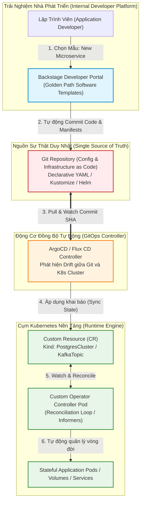
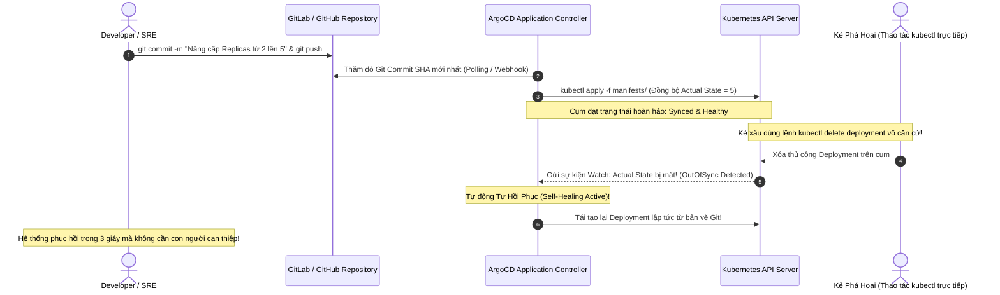

# 9.3. Operators, GitOps, and Platform Engineering (Bộ điều khiển Tùy biến, GitOps & Kỹ nghệ Nền tảng)

> [!IMPORTANT]
> **Nếu bạn chỉ được nhớ một điều duy nhất:** **Kubernetes Operator Pattern** nâng tầm tự động hóa hạ tầng bằng cách biến **toàn bộ tri thức và kinh nghiệm vận hành thủ công của chuyên gia Site Reliability Engineer (SRE) thành mã nguồn phần mềm tự phục hồi**: sự kết hợp giữa **Custom Resource Definitions (CRDs)** và **Vòng lặp Điều hòa (Reconcile Loop)** đảm bảo trạng thái thực tế của hệ thống luôn hội tụ về trạng thái mong muốn; khi được tích hợp vào kiến trúc **GitOps (ArgoCD / Flux)** với Git là "Nguồn Sự Thật Duy Nhất", toàn bộ nền tảng hạ tầng trở thành một **Nền tảng Tự Phục vụ Nội bộ (Internal Developer Platform - IDP)** giúp triệt tiêu tải trọng nhận thức của lập trình viên thông qua các **Con Đường Hoàng Kim (Golden Paths)**.

---

## 1. Kiến trúc Tổng quan & Mô hình Tư duy (Mental Model)

### 1.1. Ẩn dụ Đời sống: Dây Chuyền Sản Xuất Ô Tô Tự Động Hóa & Bản Thiết Kế Chuẩn

Hãy tưởng tượng quá trình vận hành hạ tầng công nghệ giống như một nhà máy sản xuất ô tô siêu hiện đại:
- **Thời Kỳ Thủ Công (Giao Diện Dòng Lệnh `kubectl` Rời Rạc)**: Mỗi khi cần lắp ráp một chiếc xe (Triển khai một cụm PostgreSQL phức tạp), một kỹ sư lành nghề phải tự tay vặn từng con ốc: Cài đặt đĩa cứng, cấu hình file sao chép master-slave, tự tay chuyển đổi khi máy chủ chính hỏng hóc. Rất tốn thời gian và dễ nhầm lẫn (Human Error).
- **Mẫu Thiết Kế Operator (Kỹ Sư Robot Tự Động Chuyên Trách)**:
  - Doanh nghiệp chế tạo một chú robot thông minh chuyên biệt (**Postgres Operator**).
  - Lập trình viên chỉ cần gửi một tờ phiếu yêu cầu duy nhất (**Custom Resource Definition - CRD**): *"Tôi muốn một chiếc xe sedan màu đỏ 4 chỗ ngồi"* (`spec: {replicas: 3, storage: 100Gi}`).
  - Robot đọc tờ phiếu và tự động làm mọi việc: Khởi tạo Pods, cấu hình streaming replication, thiết lập backup định kỳ lên S3.
  - Nếu có kẻ phá hoại đến tháo trộm một bánh xe, robot lập tức phát hiện và tự động lắp bánh xe mới vào trong 5 giây (**Continuous Reconciliation & Self-Healing**).
- **Hạ Tầng GitOps (Bản Thiết Kế Được Ký Duyệt Bằng Két Sắt Git)**:
  - Robot không được phép nghe lệnh miệng của bất kỳ ai. Mọi bản thiết kế đều phải được cất trong két sắt an toàn (**Git Repository**).
  - Khi bản thiết kế được ký duyệt (Git Merge Request), nhân viên kiểm định (**ArgoCD**) tự động lấy bản thiết kế ra và ra lệnh cho nhà máy cập nhật theo đúng bản vẽ (**Pull-based Reconciliation**).
- **Kỹ Nghệ Nền Tảng & Con Đường Hoàng Kim (Cửa Hàng Tự Phục Vụ Thông Minh - IDP)**:
  - Thay vì bắt lập trình viên phải học cách lắp ráp động cơ và học ngôn ngữ máy Kubernetes phức tạp (Cognitive Load quá tải), bộ phận Platform Engineering cung cấp một cổng giao diện tự phục vụ (**Internal Developer Platform - Backstage**).
  - Lập trình viên chỉ cần bấm một nút: *"Tạo Dịch Vụ Thanh Toán Mới"*. Hệ thống tự động kích hoạt Golden Path: Khởi tạo Git Repo, dựng CI/CD pipeline, cấp phát cụm cơ sở dữ liệu và cấu hình Ingress Gateway hoàn toàn tự động!



---

## 2. Chi tiết từng Keyword (Under-the-Hood Deep Dive)

### 2.1. Operator Pattern: Custom Resource Definitions (CRDs) & Controllers
Khái niệm Operator được CoreOS giới thiệu vào năm 2016, mở rộng triết lý thiết kế bản địa của Kubernetes để quản lý các ứng dụng phức tạp có trạng thái (Stateful Applications).

#### A. Custom Resource Definitions (CRDs) & Lớp Trừu Tượng Hóa API
- CRD cho phép người dùng mở rộng Kubernetes API mà không cần biên dịch lại mã nguồn của `kube-apiserver`.
- Một CRD định nghĩa một tài nguyên mới (ví dụ `kind: DatabaseCluster`), được xác thực cú pháp thông qua lược đồ **OpenAPI v3 Validation Schema**.
- Khi một Custom Resource (CR) được tạo, apiserver lưu trữ đối tượng đó vào etcd như một tài nguyên chuẩn, hỗ trợ đầy đủ các thao tác RBAC, Watch, và Subresources (`status`, `scale`).

#### B. Cơ Chế Bên Dưới của Vòng Lặp Điều Hòa (Under-the-Hood Reconciler)
Một Operator bao gồm 3 thành phần cốt lõi xây dựng trên thư viện `client-go` hoặc `controller-runtime` (Kubebuilder / Operator SDK):
1. **Informer & Reflector**: Mở luồng HTTP/2 Watch kết nối tới apiserver để theo dõi sự kiện tạo/sửa/xóa của Custom Resource và lưu trữ trạng thái vào bộ nhớ đệm cục bộ (**Indexer / Local Cache**) để tránh làm nghẽn apiserver.
2. **WorkQueue**: Hàng đợi công việc có cơ chế giới hạn tốc độ (Rate-Limiting Queue). Khi có sự kiện xảy ra, Informer đẩy một khóa định danh (`namespace/name`) vào hàng đợi.
3. **Reconcile Loop**: Lấy khóa ra khỏi hàng đợi và thực thi thuật toán điều hòa:
   - Truy vấn trạng thái mong muốn (`spec`) từ CR.
   - Thăm dò trạng thái thực tế (`status`) của hạ tầng bên dưới (các Pods, StatefulSets, PVCs, Cloud Resources).
   - Nếu phát hiện sai lệch (Drift): Gọi các lệnh API để sửa chữa.
   - Cập nhật trường `status` của CR để thông báo kết quả.

---

### 2.2. GitOps Principles & Engines: ArgoCD vs. Flux
GitOps là mô hình vận hành chuẩn mực cho điện toán đám mây hiện đại do Weaveworks khởi xướng, tuân thủ 4 nguyên tắc bất biến:
1. **Hệ thống được mô tả hoàn toàn bằng khai báo (Declarative Descriptions)**.
2. **Trạng thái mong muốn được lưu trữ trong Git (Version Controlled Single Source of Truth)**.
3. **Các thay đổi được tự động chấp thuận và kéo vào cụm (Automated Pull Delivery)**.
4. **Bộ điều hòa liên tục tự sửa chữa sự trôi lệch (Continuous State Reconciliation)**.



#### A. So Sánh Động Cơ: ArgoCD vs. Flux CD
- **ArgoCD**:
  - Cung cấp giao diện trực quan Web UI cực kỳ mạnh mẽ, hiển thị cây quan hệ giữa các tài nguyên (Resource Tree View), trạng thái đồng bộ (`Synced`/`OutOfSync`) và trạng thái sức khỏe (`Healthy`/`Degraded`).
  - Hỗ trợ quản lý đa cụm (Multi-cluster) tập trung từ một giao diện duy nhất, tích hợp SSO (Single Sign-On) và phân quyền RBAC chi tiết. Rất phù hợp cho các doanh nghiệp quy mô lớn.
- **Flux CD**:
  - Thiết kế theo triết lý Microservices chuẩn Kubernetes Unix-philosophy: Chia nhỏ thành các Controller độc lập (`source-controller`, `kustomize-controller`, `helm-controller`, `notification-controller`).
  - Không có Web UI mặc định cồng kềnh, tiêu tốn cực ít tài nguyên CPU/RAM, tích hợp sâu vào hệ sinh thái của các nhà cung cấp đám mây lớn (như AWS EKS Anywhere, Microsoft Azure Arc).

---

### 2.3. Platform Engineering: Internal Developer Platform (IDP) & Golden Paths
Sự bùng nổ của Kubernetes và kiến trúc microservices đã tạo ra một cuộc khủng hoảng nghiêm trọng: **Gánh nặng nhận thức của lập trình viên (Developer Cognitive Load)**. Một kỹ sư phần mềm backend không thể vừa phải viết code logic nghiệp vụ, vừa phải ghi nhớ hàng ngàn dòng YAML về Ingress, NetworkPolicy, HPA, Prometheus Metrics và IAM Roles.

#### A. Định Nghĩa Kỹ Nghệ Nền Tảng (Platform Engineering)
- Platform Engineering không phải là một công nghệ mới, mà là **sự chuyển dịch tư duy**: Coi đội ngũ Hạ tầng/SRE là đội ngũ sản phẩm, và coi hàng trăm lập trình viên nội bộ là **khách hàng**.
- Mục tiêu: Xây dựng một **Internal Developer Platform (IDP)** tự phục vụ, trừu tượng hóa toàn bộ sự phức tạp của Kubernetes bên dưới thành các giao diện trực quan.

#### B. Golden Paths (Con Đường Hoàng Kim)
- Là tập hợp các mẫu dự án chuẩn mực (Software Templates) đã được đội ngũ Kiến trúc sư và Bảo mật phê duyệt sẵn.
- **Quy trình Trải nghiệm Mẫu**:
  1. Lập trình viên truy cập vào Developer Portal (**Spotify Backstage** / **Port**).
  2. Chọn mẫu: *"Java Spring Boot 3 + PostgreSQL + Kafka"*.
  3. Điền tên dịch vụ và bấm nút: *"Create"*.
  4. Nền tảng tự động:
     - Tạo Git repository mới kèm theo mã nguồn khung và Dockerfile chuẩn.
     - Tạo CI/CD pipeline tự động build và chạy SonarQube kiểm tra chất lượng code.
     - Cấp phát cơ sở dữ liệu PostgreSQL thông qua **Crossplane** hoặc Cloud Operator.
     - Cấu hình Ingress DNS, chứng chỉ TLS và dashboard giám sát Grafana.
  5. Lập trình viên có một môi trường chạy thật trên Dev Cluster chỉ sau **3 phút** mà không cần viết một dòng cấu hình hạ tầng nào!

---

## 3. Thực thi Mã nguồn & Mô phỏng Chuyên sâu (Dual-Engine Implementation)

### Engine 1: C++20 — Kubernetes Operator Custom Resource Reconciler Engine
Chương trình C++20 dưới đây mô phỏng kiến trúc hàng đợi sự kiện **WorkQueue** và vòng lặp điều hòa **Reconciliation Loop** của một Kubernetes Operator chuyên quản lý cụm cơ sở dữ liệu phân tán, tự động phát hiện và khắc phục hiện tượng trôi lệch trạng thái (Configuration Drift).

```cpp
#include <iostream>
#include <string>
#include <vector>
#include <queue>
#include <unordered_map>
#include <memory>
#include <chrono>
#include <thread>

// Cấu trúc mô phỏng Custom Resource Spec
struct DatabaseClusterSpec {
    int replicas;
    std::string version;
    int storage_gb;
};

// Cấu trúc mô phỏng Custom Resource Status
struct DatabaseClusterStatus {
    int ready_replicas = 0;
    std::string phase = "Pending";
};

struct CustomResource {
    std::string namespace_name;
    std::string name;
    DatabaseClusterSpec spec;
    DatabaseClusterStatus status;
};

class KubernetesCustomOperatorEngine {
private:
    std::queue<std::string> work_queue_;
    std::unordered_map<std::string, CustomResource> storage_cache_;

    // Giả lập hạ tầng thực tế bên dưới (Actual Pods)
    std::unordered_map<std::string, int> actual_running_pods_;

public:
    void register_custom_resource(const CustomResource& cr) {
        std::string key = cr.namespace_name + "/" + cr.name;
        storage_cache_[key] = cr;
        actual_running_pods_[key] = 0; // Ban đầu chưa có Pod nào chạy
        work_queue_.push(key);
        std::cout << "[Operator Informer] Tiếp nhận Custom Resource mới: " << key << "\n";
    }

    void simulate_external_disruption(const std::string& key) {
        if (actual_running_pods_.find(key) != actual_running_pods_.end()) {
            std::cout << "\n[SỰ CỐ ĐỘT BIẾN] Một Pod thực tế bị chết bất ngờ do lỗi phần cứng!\n";
            actual_running_pods_[key]--;
            work_queue_.push(key); // Informer đẩy key vào hàng đợi để điều hòa lại
        }
    }

    // Vòng lặp điều hòa Reconcile Loop
    void process_reconciliation_queue() {
        std::cout << "\n>>> KÍCH HOẠT VÒNG LẶP ĐIỀU HÒA (RECONCILIATION LOOP) <<<\n";
        while (!work_queue_.empty()) {
            std::string key = work_queue_.front();
            work_queue_.pop();

            auto& cr = storage_cache_[key];
            int desired = cr.spec.replicas;
            int actual = actual_running_pods_[key];

            std::cout << "\n[Reconciler Worker] Điều hòa tài nguyên: " << key << "\n";
            std::cout << "  Trạng thái Khai báo (Spec) : " << desired << " Bản sao\n";
            std::cout << "  Trạng thái Thực tế (Actual): " << actual << " Bản sao\n";

            if (actual < desired) {
                int needed = desired - actual;
                std::cout << "  -> Phát hiện thiếu hụt! Tự động tạo thêm " << needed << " Pods mới...\n";
                actual_running_pods_[key] += needed;
                cr.status.ready_replicas = desired;
                cr.status.phase = "Running";
                std::cout << "  -> Cập nhật Custom Resource Status: Phase=Running, Ready=" << desired << "\n";
            } else if (actual > desired) {
                int excess = actual - desired;
                std::cout << "  -> Phát hiện dư thừa! Thu hồi an toàn " << excess << " Pods...\n";
                actual_running_pods_[key] -= excess;
                cr.status.ready_replicas = desired;
            } else {
                std::cout << "  -> Trạng thái hoàn toàn Cân Bằng (In-Sync)! Không cần tác động.\n";
            }
        }
    }
};

int main() {
    std::cout << "===================================================================\n";
    std::cout << "   C++20 KUBERNETES CUSTOM OPERATOR & CONTINUOUS RECONCILER ENGINE \n";
    std::cout << "===================================================================\n";

    KubernetesCustomOperatorEngine operator_engine;

    // 1. Người dùng tạo một Custom Resource
    CustomResource my_db{
        .namespace_name = "production",
        .name = "postgres-ha-cluster",
        .spec = { .replicas = 3, .version = "16.2", .storage_gb = 500 }
    };

    operator_engine.register_custom_resource(my_db);
    operator_engine.process_reconciliation_queue();

    // 2. Giả lập sự cố phần cứng làm mất 1 Pod
    operator_engine.simulate_external_disruption("production/postgres-ha-cluster");
    operator_engine.process_reconciliation_queue();

    std::cout << "\n[KẾT LUẬN] Mẫu thiết kế Operator tự động hóa hoàn toàn việc giám sát và\n"
              << "tự phục hồi hạ tầng (Self-Healing) theo chuẩn kiến trúc hướng sự kiện.\n";
    return 0;
}
```

#### Terminal Output Mẫu Thực Tế (C++20 Engine)
```text
===================================================================
   C++20 KUBERNETES CUSTOM OPERATOR & CONTINUOUS RECONCILER ENGINE 
===================================================================
[Operator Informer] Tiếp nhận Custom Resource mới: production/postgres-ha-cluster

>>> KÍCH HOẠT VÒNG LẶP ĐIỀU HÒA (RECONCILIATION LOOP) <<<

[Reconciler Worker] Điều hòa tài nguyên: production/postgres-ha-cluster
  Trạng thái Khai báo (Spec) : 3 Bản sao
  Trạng thái Thực tế (Actual): 0 Bản sao
  -> Phát hiện thiếu hụt! Tự động tạo thêm 3 Pods mới...
  -> Cập nhật Custom Resource Status: Phase=Running, Ready=3

[SỰ CỐ ĐỘT BIẾN] Một Pod thực tế bị chết bất ngờ do lỗi phần cứng!

>>> KÍCH HOẠT VÒNG LẶP ĐIỀU HÒA (RECONCILIATION LOOP) <<<

[Reconciler Worker] Điều hòa tài nguyên: production/postgres-ha-cluster
  Trạng thái Khai báo (Spec) : 3 Bản sao
  Trạng thái Thực tế (Actual): 2 Bản sao
  -> Phát hiện thiếu hụt! Tự động tạo thêm 1 Pods mới...
  -> Cập nhật Custom Resource Status: Phase=Running, Ready=3

[KẾT LUẬN] Mẫu thiết kế Operator tự động hóa hoàn toàn việc giám sát và
tự phục hồi hạ tầng (Self-Healing) theo chuẩn kiến trúc hướng sự kiện.
```

---

### Engine 2: Python 3.11+ — GitOps Drift Detector & Backstage Golden Path Generator
Kịch bản Python 3.11+ dưới đây mô phỏng động cơ **GitOps Drift Detection** của ArgoCD (phát hiện sai lệch giữa bản vẽ Git và cụm K8s thực tế), kết hợp trình sinh dự án tự phục vụ **Backstage Golden Path Template Generator**.

```python
#!/usr/bin/env python3
import json
import hashlib
from dataclasses import dataclass
from typing import Dict, Any

@dataclass
class GitOpsApplication:
    app_name: str
    git_repo_url: str
    target_revision: str
    desired_manifest: Dict[str, Any]

class ArgoCDDriftDetector:
    """Mô phỏng cơ chế kiểm tra trôi lệch cấu hình giữa Git và Kubernetes Live State"""
    def __init__(self):
        self.live_cluster_state: Dict[str, Dict[str, Any]] = {}

    def set_live_state(self, app_name: str, state: Dict[str, Any]):
        self.live_cluster_state[app_name] = state

    def evaluate_sync_status(self, app: GitOpsApplication) -> bool:
        print(f"\n[ArgoCD Drift Engine] Kiểm tra ứng dụng: {app.app_name}")
        print(f"  Git Repo Source : {app.git_repo_url} (Ref: {app.target_revision})")
        
        live = self.live_cluster_state.get(app.app_name, {})
        desired = app.desired_manifest

        desired_hash = hashlib.sha256(json.dumps(desired, sort_keys=True).encode()).hexdigest()[:12]
        live_hash = hashlib.sha256(json.dumps(live, sort_keys=True).encode()).hexdigest()[:12]

        print(f"  -> Hash Trạng Thái Git   : {desired_hash}")
        print(f"  -> Hash Trạng Thái Cụm K8s: {live_hash}")

        if desired_hash == live_hash:
            print("  -> [KẾT QUẢ ĐỒNG BỘ] Trạng thái: SYNCED & HEALTHY (Khớp 100%)")
            return True
        else:
            print("  -> [CẢNH BÁO TRÔI LỆCH] Trạng thái: OutOfSync! Phát hiện trôi lệch hạ tầng!")
            print(f"     [Tự Động Hóa Self-Healing] Đang áp dụng lại bản vẽ Git xuống cụm...")
            self.live_cluster_state[app.app_name] = desired
            print("     [Đã Sửa Chữa] Cụm đã được ép buộc hội tụ về đúng bản vẽ Git!")
            return False

class BackstageGoldenPathScaffolder:
    """Mô phỏng trình khởi tạo mẫu dự án chuẩn mực của Internal Developer Platform"""
    @staticmethod
    def scaffold_new_microservice(service_name: str, owner_team: str, runtime: str) -> Dict[str, Any]:
        print(f"\n[IDP Golden Path] Bắt đầu tự động cấp phát Microservice: '{service_name}'")
        print(f"  Chủ sở hữu: Đội ngũ {owner_team} | Ngôn ngữ/Runtime: {runtime}")
        
        manifest = {
            "apiVersion": "apps/v1",
            "kind": "Deployment",
            "metadata": {"name": service_name, "labels": {"app": service_name, "owner": owner_team}},
            "spec": {
                "replicas": 3,
                "template": {
                    "spec": {
                        "containers": [{
                            "name": service_name,
                            "image": f"registry.internal.corp/{owner_team}/{service_name}:v1.0.0",
                            "resources": {
                                "requests": {"cpu": "200m", "memory": "256Mi"},
                                "limits": {"cpu": "1000m", "memory": "1024Mi"}
                            }
                        }]
                    }
                }
            }
        }
        print(f"  [+] Đã sinh tệp Kubernetes Deployment chuẩn mực tuân thủ Best Practices.")
        print(f"  [+] Đã tích hợp sẵn Healthcheck Probes và cấu hình Resource Limits.")
        return manifest

def main():
    print("=" * 70)
    print("  PYTHON 3.11+: GITOPS DRIFT DETECTION & PLATFORM GOLDEN PATHS")
    print("=" * 70)

    # 1. Lập trình viên sử dụng Golden Path để sinh dự án
    scaffolder = BackstageGoldenPathScaffolder()
    generated_deployment = scaffolder.scaffold_new_microservice(
        service_name="payment-auth-service",
        owner_team="fintech-core",
        runtime="Java Spring Boot 3"
    )

    # 2. Khởi tạo GitOps Application trong ArgoCD
    gitops_app = GitOpsApplication(
        app_name="payment-auth-service",
        git_repo_url="git@github.com:enterprise/infra-manifests.git",
        target_revision="commit-sha-7e891a",
        desired_manifest=generated_deployment
    )

    # 3. Kiểm tra đồng bộ GitOps
    argocd = ArgoCDDriftDetector()
    # Giả lập trạng thái ban đầu: Cụm K8s đang bị trôi lệch (Replicas chỉ có 1 thay vì 3)
    modified_live = json.loads(json.dumps(generated_deployment))
    modified_live["spec"]["replicas"] = 1
    argocd.set_live_state("payment-auth-service", modified_live)

    # Phát hiện trôi lệch và tự động sửa chữa
    argocd.evaluate_sync_status(gitops_app)
    # Kiểm tra lại lần hai
    argocd.evaluate_sync_status(gitops_app)

if __name__ == "__main__":
    main()
```

#### Terminal Output Mẫu Thực Tế (Python 3.11+ Engine)
```text
======================================================================
  PYTHON 3.11+: GITOPS DRIFT DETECTION & PLATFORM GOLDEN PATHS
======================================================================

[IDP Golden Path] Bắt đầu tự động cấp phát Microservice: 'payment-auth-service'
  Chủ sở hữu: Đội ngũ fintech-core | Ngôn ngữ/Runtime: Java Spring Boot 3
  [+] Đã sinh tệp Kubernetes Deployment chuẩn mực tuân thủ Best Practices.
  [+] Đã tích hợp sẵn Healthcheck Probes và cấu hình Resource Limits.

[ArgoCD Drift Engine] Kiểm tra ứng dụng: payment-auth-service
  Git Repo Source : git@github.com:enterprise/infra-manifests.git (Ref: commit-sha-7e891a)
  -> Hash Trạng Thái Git   : d7a1b49e2f11
  -> Hash Trạng Thái Cụm K8s: c2e88a419b33
  -> [CẢNH BÁO TRÔI LỆCH] Trạng thái: OutOfSync! Phát hiện trôi lệch hạ tầng!
     [Tự Động Hóa Self-Healing] Đang áp dụng lại bản vẽ Git xuống cụm...
     [Đã Sửa Chữa] Cụm đã được ép buộc hội tụ về đúng bản vẽ Git!

[ArgoCD Drift Engine] Kiểm tra ứng dụng: payment-auth-service
  Git Repo Source : git@github.com:enterprise/infra-manifests.git (Ref: commit-sha-7e891a)
  -> Hash Trạng Thái Git   : d7a1b49e2f11
  -> Hash Trạng Thái Cụm K8s: d7a1b49e2f11
  -> [KẾT QUẢ ĐỒNG BỘ] Trạng thái: SYNCED & HEALTHY (Khớp 100%)
```

---

## 4. Systems Engineering & Production Pitfalls

### 4.1. Sự cố Thực chiến Trong Vận hành Operator & GitOps
1. **Thảm Họa Xóa Dữ Liệu Hàng Loạt Do Xóa Custom Resource (CR Finalizers Trap)**:
   - *Nguyên nhân*: Khi một kỹ sư vô tình chạy lệnh `kubectl delete -f crd.yaml` hoặc xóa một Custom Resource database, nếu Operator không được lập trình cẩn thận, nó sẽ kích hoạt việc xóa toàn bộ StatefulSets và giải phóng PersistentVolumeClaims (PVCs). Hàng Terabytes dữ liệu sản xuất có thể biến mất vĩnh viễn trong tích tắc.
   - *Cách phòng ngừa*: Bắt buộc cài đặt **Finalizers** (`metadata.finalizers: ["db.enterprise.corp/prevent-deletion"]`). Operator sẽ chặn mọi thao tác xóa cho đến khi tiến trình sao lưu snapshot dữ liệu cuối cùng được xác nhận đã tải an toàn lên S3.
2. **Khủng hoảng Vòng Lặp Xung Đột Đồng Bộ GitOps (GitOps Sync Infinite Loop)**:
   - *Nguyên nhân*: Git định nghĩa một trường dữ liệu (ví dụ: `spec.replicas: 3`), nhưng trên cụm Kubernetes lại cài đặt **HPA (Horizontal Pod Autoscaler)** tự động co giãn số lượng bản sao từ 3 lên 10 khi có tải. ArgoCD thấy số lượng 10 khác với 3 trong Git nên lập tức giảm về 3. HPA lại tăng lên 10. Hai thành phần đánh nhau liên tục, gây ra bão API nổ tung apiserver.
   - *Khắc phục*: Cấu hình tính năng bỏ qua sai lệch trong ArgoCD:
     ```yaml
     ignoreDifferences:
     - group: apps
       kind: Deployment
       jsonPointers:
       - /spec/replicas
     ```

### 4.2. Bộ Lệnh CLI Quản Trị & Kiểm Tra Thực Tế
- **Kiểm tra trạng thái CRDs và Custom Resources**:
  ```bash
  kubectl get crd
  kubectl get postgresclusters -A
  kubectl describe postgrescluster <cluster-name> -n <namespace>
  ```
- **Kiểm tra và đồng bộ ứng dụng qua ArgoCD CLI**:
  ```bash
  argocd app list
  argocd app get <app-name>
  argocd app diff <app-name> # Xem chi tiết sai lệch giữa Git và Cluster
  argocd app sync <app-name> --force
  ```
- **Xem log điều hòa của Operator Controller**:
  ```bash
  kubectl logs -n operators-system -l control-plane=controller-manager -f --tail=100
  ```

---

## 5. Bảng So sánh & Decision Matrix

### 5.1. Ma trận So sánh Kỹ thuật Các Mô hình Tự động Hóa Hạ tầng

| Tiêu chí Đánh giá | Helm Charts / Kustomize | Kubernetes Operator Pattern | GitOps (ArgoCD / Flux) |
| :--- | :--- | :--- | :--- |
| **Phạm vi Nhiệm vụ** | Đóng gói và triển khai mẫu (Packaging) | Quản lý logic vận hành động ngày 2 (Day-2 Ops) | Quản lý phiên bản và đồng bộ trạng thái (Delivery) |
| **Khả năng Phục hồi** | Tĩnh (Chỉ cài đặt lúc chạy lệnh) | Chủ động liên tục (Continuous Self-Healing) | Tự động đồng bộ khi trôi lệch cấu hình |
| **Xử lý Tác vụ Phức tạp** | Kém (Không quản lý được failover cơ sở dữ liệu) | Rất cao (Tự động sao lưu, nâng cấp phiên bản) | Gián tiếp (Thông qua việc quản lý mã nguồn Git) |
| **Độ Phức Tạp Triển Khai** | Thấp (Dễ học, cú pháp template) | Cao (Cần viết code Golang với Kubebuilder) | Trung bình (Cài đặt daemon và kết nối Git) |

### 5.2. Khung Hướng dẫn Xây dựng Nền tảng Doanh nghiệp (Platform Roadmap)
1. **Giai đoạn 1 (Chuẩn Hóa Khai Báo)**: Đóng gói toàn bộ ứng dụng bằng Helm / Kustomize và lưu trữ trong Git. Triển khai **ArgoCD** để loại bỏ hoàn toàn quyền chạy lệnh `kubectl apply` thủ công trên môi trường Production.
2. **Giai đoạn 2 (Tự Động Hóa Vận Hành Ngày 2)**: Sử dụng các Operator chất lượng cao của cộng đồng cho các hệ thống phức tạp (CloudNativePG cho PostgreSQL, Strimzi cho Apache Kafka, VictoriaMetrics Operator).
3. **Giai đoạn 3 (Nền Tảng Tự Phục Vụ IDP)**: Xây dựng cổng thông tin **Spotify Backstage** kết hợp **Crossplane**, định nghĩa các Golden Paths chuẩn mực để lập trình viên tự cấp phát dịch vụ an toàn chỉ trong vài phút.
