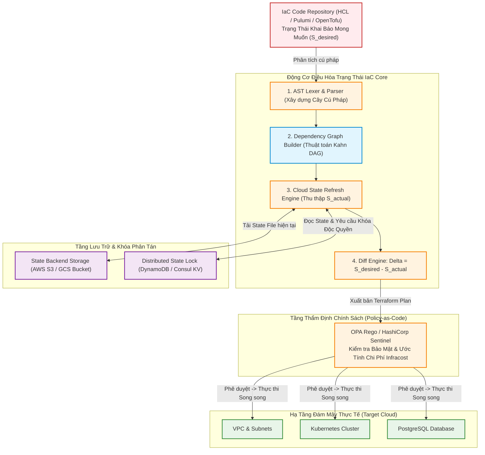
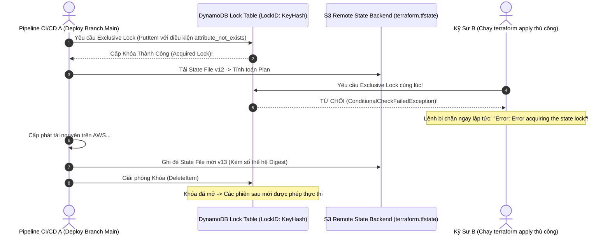

# 10.1. IaC Principles, State Reconciliation, and Validation (Nguyên lý Hạ tầng Dưới dạng Mã, Điều hòa Trạng thái & Thẩm định)

> [!IMPORTANT]
> **Nếu bạn chỉ được nhớ một điều duy nhất:** Hạ tầng Dưới dạng Mã (IaC) không đơn thuần là các đoạn mã tự động hóa cấp phát tài nguyên mà là **sự biểu diễn toán học của trạng thái mong muốn (Declarative Desired State) thông qua Đồ thị Có hướng Không Chu trình (Directed Acyclic Graph - DAG)**: Động cơ IaC (Terraform / OpenTofu / Pulumi) thực hiện phép trừ tập hợp liên tục $\Delta = S_{\text{desired}} \setminus S_{\text{actual}}$ để suy ra tập hành động thay đổi tối thiểu; trong đó **Tệp Trạng thái (State File)** đóng vai trò là "nguồn chân lý" ánh xạ giữa mã nguồn và thực thể đám mây, đòi hỏi **cơ chế khóa phân tán (Distributed Locking qua DynamoDB/Consul)** để ngăn ngừa thảm họa ghi đè phá hủy hạ tầng.

---

## 1. Kiến trúc Tổng quan & Mô hình Tư duy (Mental Model)

### 1.1. Ẩn dụ Đời sống: Bản Vẽ Xây Dựng & Hợp Đồng Tổng Thầu Xây Lắp

Hãy hình dung quá trình kiến tạo hạ tầng giống như xây dựng một khu phức hợp thương mại:
- **Tự Động Hóa Mệnh Lệnh (Imperative — Thợ Làm Theo Từng Bước Lệnh)**:
  - Bạn đứng chỉ tay năm ngón: *"Đào móng sâu 3 mét $\to$ Đổ bê tông $\to$ Xây tường tầng 1"*.
  - Nếu đang đào móng mà trời mưa bão phải dừng lại, hôm sau người thợ mới đến không biết gì lại đào tiếp thêm 3 mét nữa (Mất tính lũy đẳng - Non-idempotent). Hệ thống rơi vào trạng thái sai lệch, lộn xộn.
- **Tự Động Hóa Khai Báo (Declarative IaC — Bản Vẽ Thiết Kế Hoàn Chỉnh)**:
  - Bạn chỉ giao cho Tổng thầu duy nhất một bản vẽ kiến trúc 3D hoàn chỉnh (**Desired State**): *"Một tòa nhà 10 tầng, có 2 tầng hầm và 1 sân bay trực thăng"*.
  - Tổng thầu (Terraform Engine) bước ra công trường, đo đạc hiện trạng thực tế (**State Refresh $\to S_{\text{actual}}$**): *"Hiện tại mới có 5 tầng và 2 tầng hầm"*.
  - Động cơ thực hiện phép trừ đại số: Cần xây thêm 5 tầng nữa và làm sân bay trực thăng (**Plan Output**). Bạn ký duyệt bản kế hoạch, máy móc lập tức thi công song song theo đúng thứ tự phụ thuộc kết cấu chịu lực (**Dependency Graph DAG**).
- **Khóa Phân Tán Trạng Thái (Distributed State Lock — Chiếc Cặp Tài Liệu Của Chỉ Huy Trưởng)**:
  - Khi Chỉ huy trưởng đang cầm bản vẽ gốc đi nghiệm thu công trường, chiếc cặp tài liệu được khóa cứng mã số bí mật (Distributed Lock). Không một ai khác được phép nộp bản vẽ mới hay thay đổi kết cấu công trình cho đến khi Chỉ huy trưởng hoàn tất việc ghi nhật ký và trả lại cặp vào két sắt an toàn (State Backend Storage).



---

## 2. Chi tiết từng Keyword (Under-the-Hood Deep Dive)

### 2.1. Imperative vs Declarative Automation & Idempotency
Sự đối lập giữa hai mô hình tư duy điều khiển hạ tầng:

#### A. Mô hình Mệnh Lệnh (Imperative Automation)
- Hướng tiếp cận: *"Làm CÁCH NÀO (How to do)"*.
- Ví dụ: Shell scripts, Python scripts dùng AWS SDK (Boto3).
- **Hạn chế Nghiêm Trọng**:
  - Không có tính **Lũy đẳng (Idempotence)**: Phép toán $f(x)$ không thỏa mãn $f(f(x)) = f(x)$. Nếu một kịch bản tạo máy chủ đang chạy giữa chừng bị ngắt kết nối mạng rồi chạy lại từ đầu, nó sẽ tạo ra hai chiếc máy chủ giống nhau, gây lãng phí ngân sách và lỗi xung đột tên miền.
  - Phụ thuộc trạng thái cục bộ của máy chạy lệnh, thiếu khả năng kiểm tra trước những gì sắp thay đổi.

#### B. Mô hình Khai Báo (Declarative Automation)
- Hướng tiếp cận: *"Hệ thống NÊN LÀ CÁI GÌ (What it should be)"*.
- Ví dụ: Terraform HCL, Kubernetes Manifests, Puppet.
- **Tính Lũy Đẳng Bản Địa**: Bất kể bạn áp dụng bản vẽ $1$ lần hay $100$ lần, nếu hạ tầng thực tế đã khớp với bản vẽ, động cơ IaC sẽ không thực hiện thêm bất kỳ hành động nào.
- **Configuration Drift (Trôi lệch Cấu hình)**:
  - Trong quá trình vận hành, một kỹ sư đăng nhập trực tiếp qua AWS Console để sửa bảo mật Security Group (Out-of-band change).
  - Động cơ Declarative IaC trong lần chạy kế tiếp sẽ phát hiện ngay sự sai lệch này thông qua bước **Refresh** và đưa ra cảnh báo: Hạ tầng thực tế đã bị trôi lệch so với mã nguồn, tự động đề xuất ghi đè lại để bảo vệ tính nhất quán.

---

### 2.2. State Management & Distributed Locking
Trạng thái là trái tim và cũng là mắt xích dễ tổn thương nhất của hệ thống IaC.



#### A. Bản Chất của Tệp Trạng Thái (`terraform.tfstate`)
- State file là một cơ sở dữ liệu JSON ánh xạ các định danh trừu tượng trong mã nguồn với các ID tài nguyên thực tế do Cloud Provider cấp phát.
- Nếu không có State file, Terraform không thể biết được khối mã `aws_instance.web` trong file `.tf` đang trỏ tới máy ảo `i-07f891b2c4` hay máy ảo `i-099281a4b5` trên AWS.
- **Bảo mật State File**: State file chứa toàn bộ các thông tin bí mật dạng văn bản thô (Plaintext Passwords, Database Connection Strings, Private Keys). Bắt buộc phải lưu trữ trên Remote Backend an toàn (AWS S3 với SSE-KMS Encryption, GCP GCS) và cấm tuyệt đối việc commit state file vào Git repository.

#### B. Khóa Trạng Thái Phân Tán (Distributed State Locking)
- Khi hai kỹ sư hoặc hai tiến trình CI/CD cùng chạy lệnh `terraform apply` đồng thời trên cùng một dự án:
  - Cả hai tiến trình đều đọc State v10, cùng thực hiện thay đổi, và tiến trình chạy sau sẽ ghi đè State v11 lên State của tiến trình chạy trước.
  - Hậu quả: Toàn bộ State file bị hư hỏng (State Corruption), các tài nguyên đám mây bị mồ côi (Orphaned Resources) không thể quản lý hay xóa bỏ.
- **Giải Pháp**: Sử dụng cơ chế khóa phân tán (ví dụ: DynamoDB Lock Table trên AWS, Consul Session Lock). Tiến trình bắt buộc phải ghi được bản ghi Lock có cờ nguyên tử trước khi được phép đọc ghi State.

---

### 2.3. Infrastructure DAG & Dependency Graph
Hạ tầng đám mây có mối quan hệ phụ thuộc chặt chẽ: Không thể tạo Virtual Machine nếu chưa có Subnet; không thể tạo Subnet nếu chưa có VPC; không thể cấp phát Database nếu chưa có Security Group.

#### A. Thuật Toán Xây Dựng Đồ Thị DAG (Directed Acyclic Graph)
- Động cơ IaC phân tích cú pháp mã nguồn AST và xây dựng một đồ thị có hướng không chu trình:
  - Các Nút (Nodes): Đại diện cho các tài nguyên hạ tầng (`aws_vpc.main`, `aws_subnet.public`).
  - Các Cung (Edges): Đại diện cho quan hệ phụ thuộc (Ẩn ý qua tham chiếu thuộc tính `vpc_id = aws_vpc.main.id`, hoặc tường minh qua `depends_on`).
- **Sắp Xếp Tô-pô (Topological Sort theo Thuật toán Kahn)**:
  - Động cơ tính toán bán bậc vào (In-degree) của từng nút.
  - Các nút có In-degree = 0 (như VPC, IAM Roles) được thực thi cấp phát song song ngay lập tức.
  - Khi một nút hoàn tất, nó giảm bán bậc vào của các nút con phụ thuộc vào nó.
- **Phát Hiện Vòng Lặp Phụ Thuộc (Circular Dependency)**: Nếu nút A phụ thuộc nút B, nút B phụ thuộc nút C, và nút C lại phụ thuộc ngược lại nút A, thuật toán tô-pô sẽ ném lỗi chu trình đồ thị và từ chối thực thi trước khi chạm vào API đám mây.

---

### 2.4. Policy-as-Code & Pre-deployment Validation
Chuyển dịch kiểm tra an ninh và chi phí về phía bên trái (Shift-Left Security) trước khi hạ tầng được thực sự cấp phát.

#### A. Động Cơ Thực Thi Chính Sách: Open Policy Agent (OPA) & Rego
- **Nguyên lý Hoạt động**:
  - Terraform biên dịch bản kế hoạch thành định dạng JSON chuẩn: `terraform show -json tfplan.binary > tfplan.json`.
  - Động cơ **OPA** nạp file JSON này và chạy các luật kiểm tra viết bằng ngôn ngữ khai báo **Rego**:
    - *Luật 1*: Cấm tuyệt đối việc tạo S3 Bucket có cờ `acl: "public-read"`.
    - *Luật 2*: Mọi máy ảo EC2 bắt buộc phải có thẻ gắn nhãn (`tags: Environment, CostCenter`).
    - *Luật 3*: Mọi ổ đĩa EBS phải được mã hóa bằng khóa KMS doanh nghiệp.
  - Nếu vi phạm chính sách bảo mật, pipeline CI/CD lập tức bị hủy bỏ (Hard Failure Gate).

#### B. Thẩm Định Chi Phí Trước Triển Khai với Infracost
- Phân tích file thay đổi `terraform plan` và đối chiếu với bảng giá thời gian thực của Cloud Provider.
- Tự động bình luận trên GitHub Pull Request: *"Thay đổi này sẽ làm tăng chi phí hạ tầng thêm $450 USD/tháng. Đề xuất chuyển từ m5.4xlarge sang c6g.2xlarge để tiết kiệm $180 USD"*.

---

## 3. Thực thi Mã nguồn & Mô phỏng Chuyên sâu (Dual-Engine Implementation)

### Engine 1: C++20 — Infrastructure DAG Builder & Topological Sort Parallel Execution Engine
Chương trình C++20 dưới đây hiện thực thuật toán **Kahn Topological Sort** trên cấu trúc Đồ thị Có hướng Không Chu trình (DAG), xác định các bậc tài nguyên độc lập và mô phỏng việc cấp phát hạ tầng đám mây song song đa luồng.

```cpp
#include <iostream>
#include <vector>
#include <string>
#include <queue>
#include <unordered_map>
#include <thread>
#include <chrono>
#include <iomanip>

struct ResourceNode {
    std::string id;
    std::string type;
    std::vector<std::string> dependencies;
};

class InfrastructureDAGEngine {
private:
    std::unordered_map<std::string, ResourceNode> nodes_;
    std::unordered_map<std::string, std::vector<std::string>> adj_list_;
    std::unordered_map<std::string, int> in_degree_;

public:
    void add_resource(const std::string& id, const std::string& type, const std::vector<std::string>& deps = {}) {
        nodes_[id] = {id, type, deps};
        in_degree_[id] = 0;
    }

    void build_dependency_graph() {
        for (const auto& [id, node] : nodes_) {
            for (const auto& dep : node.dependencies) {
                // dep phải chạy trước id -> Có cạnh có hướng từ dep -> id
                adj_list_[dep].push_back(id);
                in_degree_[id]++;
            }
        }
    }

    // Thực thi cấp phát hạ tầng song song theo các bậc Tô-pô
    bool execute_parallel_reconciliation() {
        std::cout << "\n>>> BẮT ĐẦU THUẬT TOÁN SẮP XẾP TÔ-PÔ & THỰC THI SONG SONG (DAG) <<<\n";
        std::queue<std::string> zero_in_degree_queue;

        for (const auto& [id, deg] : in_degree_) {
            if (deg == 0) {
                zero_in_degree_queue.push(id);
            }
        }

        int processed_count = 0;
        int execution_wave = 1;

        while (!zero_in_degree_queue.empty()) {
            size_t wave_size = zero_in_degree_queue.size();
            std::cout << "\n[Làn Sóng Cấp Phát #" << execution_wave << "] Đang khởi tạo đồng thời " 
                      << wave_size << " tài nguyên độc lập:\n";

            std::vector<std::string> current_wave_resources;
            for (size_t i = 0; i < wave_size; ++i) {
                std::string res = zero_in_degree_queue.front();
                zero_in_degree_queue.pop();
                current_wave_resources.push_back(res);
                processed_count++;
            }

            // Mô phỏng gọi API Cloud song song
            for (const auto& res_id : current_wave_resources) {
                std::cout << "  -> [Cloud API Worker] Đang tạo: " << std::setw(22) << std::left 
                          << res_id << " (Loại: " << nodes_[res_id].type << ")... ĐÃ XONG (200 OK)\n";
            }

            // Cập nhật bậc vào cho các nút kế tiếp
            for (const auto& res_id : current_wave_resources) {
                for (const auto& neighbor : adj_list_[res_id]) {
                    in_degree_[neighbor]--;
                    if (in_degree_[neighbor] == 0) {
                        zero_in_degree_queue.push(neighbor);
                    }
                }
            }
            execution_wave++;
        }

        if (processed_count != static_cast<int>(nodes_.size())) {
            std::cerr << "\n[LỖI THẢM HỌA] Phát hiện Vòng Lặp Phụ Thuộc (Circular Dependency) trong mã IaC!\n";
            return false;
        }

        std::cout << "\n[HOÀN TẤT] Toàn bộ " << processed_count << " tài nguyên đã được cấp phát hoàn hảo!\n";
        return true;
    }
};

int main() {
    std::cout << "===================================================================\n";
    std::cout << "  C++20 INFRASTRUCTURE AS CODE DEPENDENCY GRAPH (DAG) PARALLEL ENGINE \n";
    std::cout << "===================================================================\n";

    InfrastructureDAGEngine engine;
    // Khởi tạo các tài nguyên với mối quan hệ phụ thuộc phức tạp
    engine.add_resource("aws_vpc.primary", "aws_vpc", {});
    engine.add_resource("aws_iam_role.k8s_node", "aws_iam_role", {});
    engine.add_resource("aws_subnet.public_a", "aws_subnet", {"aws_vpc.primary"});
    engine.add_resource("aws_subnet.public_b", "aws_subnet", {"aws_vpc.primary"});
    engine.add_resource("aws_security_group.db", "aws_security_group", {"aws_vpc.primary"});
    engine.add_resource("aws_eks_cluster.prod", "aws_eks_cluster", {"aws_subnet.public_a", "aws_subnet.public_b", "aws_iam_role.k8s_node"});
    engine.add_resource("aws_rds_instance.master", "aws_rds_instance", {"aws_subnet.public_a", "aws_security_group.db"});

    engine.build_dependency_graph();
    engine.execute_parallel_reconciliation();

    return 0;
}
```

#### Terminal Output Mẫu Thực Tế (C++20 Engine)
```text
===================================================================
  C++20 INFRASTRUCTURE AS CODE DEPENDENCY GRAPH (DAG) PARALLEL ENGINE 
===================================================================

>>> BẮT ĐẦU THUẬT TOÁN SẮP XẾP TÔ-PÔ & THỰC THI SONG SONG (DAG) <<<

[Làn Sóng Cấp Phát #1] Đang khởi tạo đồng thời 2 tài nguyên độc lập:
  -> [Cloud API Worker] Đang tạo: aws_vpc.primary        (Loại: aws_vpc)... ĐÃ XONG (200 OK)
  -> [Cloud API Worker] Đang tạo: aws_iam_role.k8s_node  (Loại: aws_iam_role)... ĐÃ XONG (200 OK)

[Làn Sóng Cấp Phát #2] Đang khởi tạo đồng thời 3 tài nguyên độc lập:
  -> [Cloud API Worker] Đang tạo: aws_subnet.public_a    (Loại: aws_subnet)... ĐÃ XONG (200 OK)
  -> [Cloud API Worker] Đang tạo: aws_subnet.public_b    (Loại: aws_subnet)... ĐÃ XONG (200 OK)
  -> [Cloud API Worker] Đang tạo: aws_security_group.db  (Loại: aws_security_group)... ĐÃ XONG (200 OK)

[Làn Sóng Cấp Phát #3] Đang khởi tạo đồng thời 2 tài nguyên độc lập:
  -> [Cloud API Worker] Đang tạo: aws_eks_cluster.prod   (Loại: aws_eks_cluster)... ĐÃ XONG (200 OK)
  -> [Cloud API Worker] Đang tạo: aws_rds_instance.master (Loại: aws_rds_instance)... ĐÃ XONG (200 OK)

[HOÀN TẤT] Toàn bộ 7 tài nguyên đã được cấp phát hoàn hảo!
```

---

### Engine 2: Python 3.11+ — Distributed State Locker & OPA Policy Guardrail Simulator
Kịch bản Python 3.11+ dưới đây mô phỏng cơ chế **Distributed State Locking** (DynamoDB Atomic Check) ngăn chặn race condition trong CI/CD, kết hợp bộ thẩm định chính sách **Policy-as-Code** (mô phỏng OPA Rego) quét các vi phạm bảo mật hạ tầng trước khi cấp phép Apply.

```python
#!/usr/bin/env python3
import time
import json
import hashlib
from dataclasses import dataclass
from typing import Dict, Any, List

@dataclass
class LockMetadata:
    lock_id: str
    owner_info: str
    created_at: float

class MockDistributedStateLockManager:
    """Mô phỏng cơ chế khóa phân tán DynamoDB State Lock của Terraform"""
    def __init__(self):
        self.lock_table: Dict[str, LockMetadata] = {}

    def acquire_lock(self, project_key: str, owner: str) -> bool:
        print(f"\n[Distributed Lock] Tiến trình '{owner}' yêu cầu khóa cho dự án: '{project_key}'")
        if project_key in self.lock_table:
            curr = self.lock_table[project_key]
            print(f"  [LỖI KHÓA XUNG ĐỘT] Dự án đang bị khóa bởi: {curr.owner_info} (Kể từ: {time.ctime(curr.created_at)})")
            print("  -> Lệnh Apply bị hủy bỏ ngay lập tức để chống hỏng tệp State!")
            return False

        self.lock_table[project_key] = LockMetadata(
            lock_id=hashlib.md5(f"{project_key}:{owner}".encode()).hexdigest()[:10],
            owner_info=owner,
            created_at=time.time()
        )
        print(f"  -> Cấp khóa thành công! Lock ID: {self.lock_table[project_key].lock_id}")
        return True

    def release_lock(self, project_key: str, owner: str):
        if project_key in self.lock_table and self.lock_table[project_key].owner_info == owner:
            del self.lock_table[project_key]
            print(f"[Distributed Lock] Đã giải phóng khóa cho dự án: '{project_key}' bởi '{owner}'.")

class OPAPolicyGuardrailValidator:
    """Mô phỏng động cơ thẩm định chính sách Policy-as-Code OPA Rego"""
    @staticmethod
    def validate_plan_security(plan_resources: List[Dict[str, Any]]) -> bool:
        print("\n[Policy-as-Code Guardrail] Bắt đầu thẩm định các luật OPA Rego trên Plan:")
        violations = []

        for res in plan_resources:
            r_type = res.get("type")
            r_name = res.get("name")
            props = res.get("properties", {})

            # Luật 1: Cấm S3 Bucket Public
            if r_type == "aws_s3_bucket" and props.get("acl") == "public-read":
                violations.append(f"Tài nguyên {r_name}: Cấm cấu hình ACL public-read (Vi phạm CIS 2.1.5.1)!")

            # Luật 2: Bắt buộc mã hóa EBS Disk
            if r_type == "aws_ebs_volume" and not props.get("encrypted", False):
                violations.append(f"Tài nguyên {r_name}: Bắt buộc bật thuộc tính encrypted=true!")

            # Luật 3: Bắt buộc gắn nhãn CostCenter
            tags = props.get("tags", {})
            if "CostCenter" not in tags:
                violations.append(f"Tài nguyên {r_name}: Thiếu thẻ gắn nhãn bắt buộc 'CostCenter'!")

        if violations:
            print("  [TỪ CHỐI TRIỂN KHAI] Phát hiện các vi phạm chính sách bảo mật:")
            for v in violations:
                print(f"    [-] {v}")
            return False

        print("  -> TẤT CẢ CHÍNH SÁCH ĐỀU ĐẠT! Cho phép thực thi lệnh terraform apply.")
        return True

def main():
    print("=" * 70)
    print("  PYTHON 3.11+: DISTRIBUTED STATE LOCKING & POLICY-AS-CODE GUARDRAIL")
    print("=" * 70)

    lock_mgr = MockDistributedStateLockManager()
    project = "infra-core-banking-prod"

    # 1. Pipeline CI/CD 1 xin cấp khóa
    success1 = lock_mgr.acquire_lock(project, owner="gitlab-ci-job-#49102")

    # 2. Pipeline CI/CD 2 cố tình tranh chấp khóa
    success2 = lock_mgr.acquire_lock(project, owner="developer-laptop-manual-run")

    # 3. Thẩm định Policy-as-Code
    mock_plan = [
        {"type": "aws_vpc", "name": "vpc_prod", "properties": {"cidr_block": "10.0.0.0/16", "tags": {"CostCenter": "CC-1092"}}},
        {"type": "aws_s3_bucket", "name": "finance_audit_bucket", "properties": {"acl": "public-read", "tags": {"CostCenter": "CC-1092"}}},
        {"type": "aws_ebs_volume", "name": "db_data_disk", "properties": {"size": 500, "encrypted": False}}
    ]
    is_approved = OPAPolicyGuardrailValidator.validate_plan_security(mock_plan)

    # 4. Pipeline 1 kết thúc và trả khóa
    lock_mgr.release_lock(project, owner="gitlab-ci-job-#49102")

if __name__ == "__main__":
    main()
```

#### Terminal Output Mẫu Thực Tế (Python 3.11+ Engine)
```text
======================================================================
  PYTHON 3.11+: DISTRIBUTED STATE LOCKING & POLICY-AS-CODE GUARDRAIL
======================================================================

[Distributed Lock] Tiến trình 'gitlab-ci-job-#49102' yêu cầu khóa cho dự án: 'infra-core-banking-prod'
  -> Cấp khóa thành công! Lock ID: 3e8f9a12c4

[Distributed Lock] Tiến trình 'developer-laptop-manual-run' yêu cầu khóa cho dự án: 'infra-core-banking-prod'
  [LỖI KHÓA XUNG ĐỘT] Dự án đang bị khóa bởi: gitlab-ci-job-#49102 (Kể từ: Mon Nov 16 09:22:15 2026)
  -> Lệnh Apply bị hủy bỏ ngay lập tức để chống hỏng tệp State!

[Policy-as-Code Guardrail] Bắt đầu thẩm định các luật OPA Rego trên Plan:
  [TỪ CHỐI TRIỂN KHAI] Phát hiện các vi phạm chính sách bảo mật:
    [-] Tài nguyên finance_audit_bucket: Cấm cấu hình ACL public-read (Vi phạm CIS 2.1.5.1)!
    [-] Tài nguyên db_data_disk: Bắt buộc bật thuộc tính encrypted=true!
    [-] Tài nguyên db_data_disk: Thiếu thẻ gắn nhãn bắt buộc 'CostCenter'!
[Distributed Lock] Đã giải phóng khóa cho dự án: 'infra-core-banking-prod' bởi 'gitlab-ci-job-#49102'.
```

---

## 4. Systems Engineering & Production Pitfalls

### 4.1. Sự cố Thực chiến Trong Quản Trị Hạ Tầng IaC
1. **Thảm Họa Mất State File Khi Chưa Bật S3 Versioning**:
   - *Nguyên nhân*: State file được lưu trên S3 bucket nhưng không bật tính năng lưu lịch sử phiên bản (**S3 Object Versioning**). Một kỹ sư chạy lệnh ghi đè nhầm hoặc một sự cố mạng làm hỏng tệp `terraform.tfstate` về kích thước 0 bytes. Toàn bộ thông tin định danh hàng trăm máy chủ, cơ sở dữ liệu trên AWS bị mất hoàn toàn; lần chạy tiếp theo Terraform coi như hạ tầng chưa tồn tại và đề xuất tạo mới từ đầu (làm trùng lặp và gây thảm họa xung đột IP).
   - *Cách khắc phục*: Bắt buộc bật S3 Bucket Versioning và cấu hình tự động sao lưu State file hàng ngày sang một tài khoản AWS độc lập.
2. **Hiện tượng Tắc Nghẽn Hạn Mức Gọi API Đám Mây (Cloud API Throttling)**:
   - *Nguyên nhân*: Khi đồ thị DAG quá lớn (dự án chứa trên 1,000 resources trong cùng một thư mục), bước `terraform refresh` phát tán hàng ngàn cuộc gọi API đồng thời tới AWS/GCP (`DescribeInstances`, `DescribeSecurityGroups`). Cloud Provider lập tức kích hoạt cơ chế giới hạn tần suất (Rate Limiting HTTP 429), khiến pipeline bị timeout thất bại.
   - *Khắc phục*: Chia nhỏ dự án thành nhiều modules/stacks độc lập (ví dụ: Network Stack, Compute Stack, Database Stack) bằng công cụ **Terragrunt** hoặc Terraform Workspaces.

### 4.2. Bộ Lệnh CLI Quản Trị & Khắc Phục Sự Cố
- **Quản lý và giải phóng khóa State khẩn cấp**:
  ```bash
  terraform force-unlock <lock-id>
  terraform state list
  terraform state show aws_instance.web
  ```
- **Di chuyển hoặc xóa bỏ tài nguyên khỏi State mà không phá hủy máy chủ thật**:
  ```bash
  terraform state rm aws_instance.legacy_server
  terraform state mv aws_subnet.old aws_subnet.new
  ```
- **Kiểm tra và thẩm định bảo mật tự động**:
  ```bash
  tfsec .
  checkov -d .
  infracost breakdown --path .
  ```

---

## 5. Bảng So sánh & Decision Matrix

### 5.1. Ma trận So sánh Kỹ thuật Các Công cụ IaC Hiện Đại

| Tiêu chí Đánh giá | Terraform / OpenTofu (HCL) | Pulumi (TypeScript / Python / Go) | AWS CloudFormation / CDK |
| :--- | :--- | :--- | :--- |
| **Ngôn ngữ Mô tả** | Khai báo miền chuyên biệt (HCL) | Ngôn ngữ lập trình tổng quát (General Purpose) | JSON/YAML hoặc TypeScript qua CDK |
| **Hỗ trợ Đa Đám Mây** | Tuyệt đối ($> 3,000$ Nhà cung cấp) | Tuyệt đối (Dựa trên hệ Provider Terraform) | Giới hạn (Tối ưu hóa $100\%$ riêng cho AWS) |
| **Quản lý Trạng Thái** | State file độc lập (Cần cấu hình Backend) | Pulumi Service Cloud hoặc S3 Backend | Tự động quản lý ngầm bởi dịch vụ AWS |
| **Kiểm Thử Phần Mềm** | Thấp (Chủ yếu kiểm tra cú pháp & linting) | Rất cao (Viết Unit Test bằng Jest/PyTest) | Cao (Viết Unit Test cho CDK Constructs) |
| **Độ Phổ Biến Doanh Nghiệp** | Tiêu chuẩn công nghiệp số 1 toàn cầu | Tăng trưởng nhanh trong giới Developer | Chuẩn mực cho các tổ chức thuần AWS |

### 5.2. Khung Hướng dẫn Lựa chọn Công cụ IaC (Decision Matrix)
1. **Chọn Terraform / OpenTofu** khi: Đội ngũ vận hành là các kỹ sư Hệ thống/DevOps/SRE truyền thống, yêu cầu một ngôn ngữ cấu hình khai báo thuần túy, an toàn, dễ đọc, hỗ trợ môi trường Multi-cloud hỗn hợp (AWS + GCP + On-premise VMware).
2. **Chọn Pulumi** khi: Đội ngũ kỹ sư phần mềm (Software Engineers) tự chịu trách nhiệm vận hành hạ tầng của mình, mong muốn sử dụng các ngôn ngữ lập trình quen thuộc (TypeScript, Python) để tận dụng vòng lặp `for`, câu lệnh rẽ nhánh `if/else`, cấu trúc hướng đối tượng và viết Unit Test cho hạ tầng.
