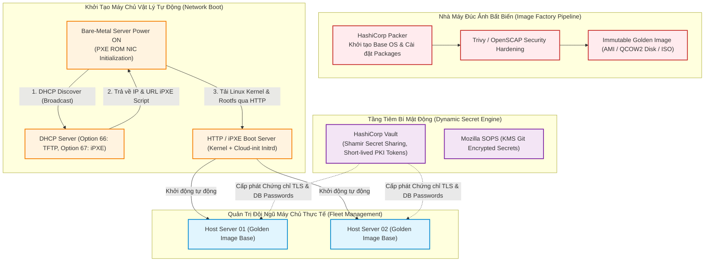
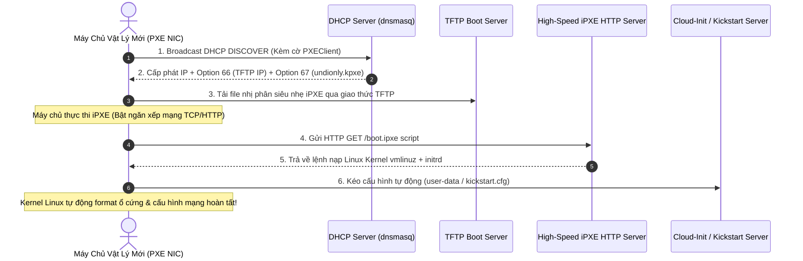

# 10.2. Fleet Management, OS Provisioning, and Tooling (Quản trị Đội máy chủ, Khởi tạo Hệ điều hành & Bộ Công cụ Vận hành)

> [!IMPORTANT]
> **Nếu bạn chỉ được nhớ một điều duy nhất:** Sự trưởng thành của kỹ nghệ hạ tầng được định đoạt bởi sự chuyển dịch từ tư duy **Máy Chủ Thú Cưng Đột Biến (Mutable Pets)** sang **Hạ Tầng Bất Biến (Immutable Cattle)**: thay vì dùng Ansible/Puppet liên tục chắp vá cấu hình trên các máy chủ sống, chuẩn mực hiện đại là "đúc" sẵn các ảnh đĩa vàng (**Golden AMIs qua HashiCorp Packer**) và cài đặt máy chủ vật lý tự động qua mạng (**iPXE/DHCP & Cloud-init**); mọi bí mật cấu hình được tiêm động trong thời gian thực qua **HashiCorp Vault & Shamir Secret Sharing**, bảo đảm máy chủ có thể bị tiêu hủy và tái tạo bất cứ lúc nào mà không gây gián đoạn dịch vụ.

---

## 1. Kiến trúc Tổng quan & Mô hình Tư duy (Mental Model)

### 1.1. Ẩn dụ Đời sống: Đội Ngựa Chiến Cổ Điển & Dây Chuyền Xe Thiết Giáp Tiêu Chuẩn

Hãy tưởng tượng sự khác biệt giữa hai mô hình quản lý quân đội:
- **Thời Kỳ Nuôi Thú Cưng (Mutable Pets — Nuôi Ngựa Chiến Cá Nhân)**:
  - Mỗi chiến binh có một con ngựa riêng được đặt tên thân mật (`db-master-01`, `payment-server-legacy`).
  - Khi con ngựa bị ốm (Lỗi phần mềm, thư viện C cũ kỹ), bác sĩ thú y (**Ansible / Puppet**) chạy đến tận nơi tiêm thuốc, băng bó vết thương. Càng chữa trị nhiều lần, mỗi con ngựa lại có một tiểu sử bệnh án kỳ dị riêng biệt (**Snowflake Server**). Không ai dám thay thế con ngựa này vì sợ nó chết thì không con nào quen đường!
- **Kỷ Nguyên Xe Thiết Giáp Đúc Khuôn Bất Biến (Immutable Cattle — Dây Chuyền Sản Xuất Đồng Nhất)**:
  - Quân đội thay thế toàn bộ bằng 10,000 chiếc xe thiết giáp đúc sẵn từ một khuôn thép duy nhất (**Golden Image đúc bởi Packer**).
  - Không có chiếc xe nào có tên riêng, chỉ có số hiệu mã vạch (`worker-node-x86-9921`).
  - Nếu một chiếc xe bị xịt lốp hoặc trúng đạn (Máy chủ lỗi phần mềm hoặc lỗ hổng bảo mật), chỉ huy **không sửa xe tại trận địa**. Lập tức đẩy chiếc xe đó xuống vực tiêu hủy và bấm nút gọi một chiếc xe mới tinh từ nhà máy phóng tới thay thế chỉ trong 30 giây (**Blue-Green Rolling Replacement**).
- **Hệ Thống Tiếp Nhiên Liệu Mạng Tự Động (PXE / iPXE Network Boot)**:
  - Một chiếc máy chủ Bare-Metal hoàn toàn chưa có ổ cứng hay hệ điều hành được cắm dây mạng và bật nguồn.
  - Card mạng phát tín hiệu cấp cứu (**DHCP Request**). Trạm chỉ huy phản hồi và hướng dẫn máy chủ nạp nhân Linux Kernel siêu tốc qua đường truyền cáp quang (**iPXE Chainloading**), tự động cài đặt hệ điều hành và gia nhập vào đội ngũ chiến đấu mà không cần bàn tay con người chạm vào bàn phím!



---

## 2. Chi tiết từng Keyword (Under-the-Hood Deep Dive)

### 2.1. Immutable Infrastructure vs. Mutable Configuration
Sự tiến hóa của triết lý quản trị hệ thống Linux từ cấu hình tại chỗ sang bất biến:

#### A. Hạ Tầng Đột Biến (Mutable Configuration)
- Công cụ: **Ansible**, **Puppet**, **Chef**, **SaltStack**.
- Quy trình: Máy chủ được cài đặt một lần, sau đó các công cụ quản trị chạy định kỳ để sửa file cấu hình (`/etc/nginx/nginx.conf`), nâng cấp gói phần mềm (`apt upgrade`).
- **Thảm họa Snowflake Server**: Sau 2 năm vận hành với hàng trăm lần chạy script vá lỗi, cấu hình thực tế của từng máy chủ bị phân nhánh kỳ dị. Không một kỹ sư nào có thể dựng lại một chiếc máy chủ giống hệt $100\%$ từ đầu nếu máy cũ bị cháy phần cứng.

#### B. Hạ Tầng Bất Biến (Immutable Infrastructure)
- Công cụ: **HashiCorp Packer**, **Cloud-init**, **Terraform**.
- Quy trình: Mọi thay đổi về phần mềm, thư viện hoặc cấu hình đều bắt buộc phải được đóng gói vào một **Ảnh Đĩa Hoàn Chỉnh (Golden Image)** mới:
  $$\text{Source Code} + \text{Base OS} \xrightarrow{\text{Packer Build}} \textbf{Golden Image v2.0} \xrightarrow{\text{Deploy}} \textbf{New Servers Spawned}$$
- Máy chủ đang chạy không bao giờ bị sửa đổi. Khi có phiên bản mới, hệ thống triển khai máy chủ mới chạy Golden Image mới, chuyển hướng mạng sang máy mới, và tiêu hủy hoàn toàn máy cũ (**Zero Configuration Drift**).

---

### 2.2. Bare-Metal OS Provisioning: PXE, iPXE, DHCP & Kickstart/Preseed
Khởi động và cài đặt hệ điều hành tự động qua mạng cho hàng ngàn máy chủ vật lý trong trung tâm dữ liệu mà không cần cắm USB hay ổ đĩa CD.



#### A. Cơ Chế Khởi Động PXE (Preboot Execution Environment) Cổ Điển
- PXE là một tập lệnh được ghi sẵn trong chip ROM của Card mạng (NIC).
- Khi bật nguồn, máy chủ chưa có hệ điều hành nên BIOS trao quyền cho PXE NIC:
  1. Gửi gói tin quảng bá **DHCP Discover**.
  2. DHCP Server phản hồi kèm hai tham số: **Option 66 (Next-Server IP)** và **Option 67 (Bootfile Name)**.
  3. Máy chủ kết nối tới máy chủ TFTP để tải file khởi động ban đầu. Nhược điểm: Giao thức TFTP dùng UDP không có cơ chế sửa lỗi tin cậy và tốc độ tải rất chậm chạp.

#### B. Cuộc Cách Mạng iPXE & Chuỗi Khởi Động Kép (Chainloading)
- **iPXE**: Bản nâng cấp mã nguồn mở hỗ trợ ngăn xếp mạng TCP/IP đầy đủ trực tiếp từ BIOS:
  - Cho phép tải Kernel và Initramfs khổng lồ (hàng Gigabytes) trực tiếp qua giao thức **HTTP/HTTPS** với tốc độ cao gấp 50 lần TFTP.
  - Hỗ trợ khởi động từ xa qua mạng SAN iSCSI, Fibre Channel over Ethernet (FCoE).
- **Trình Cài Đặt Tự Động Hóa (Automated Installers)**:
  - **RedHat Kickstart (`ks.cfg`)**: Tệp đặc tả tự động chia phân vùng đĩa (LVM, RAID phần mềm), cài đặt các gói phần mềm và kích hoạt dịch vụ mà không cần người tương tác.
  - **Ubuntu Cloud-init / Subiquity**: Chuẩn mực hiện đại cho phép cấu hình mạng Netplan, SSH keys, và bootstrap tiến trình chỉ qua một tệp YAML `user-data`.

---

### 2.3. Configuration Management Engines: Ansible, SaltStack, Puppet & Chef
Khi cần quản lý cấu hình trên quy mô hạm đội hàng ngàn máy chủ:

#### A. Mô Hình Không Agent (Agentless: Ansible)
- Giao tiếp thuần túy qua giao thức bảo mật **SSH** (trên Linux) hoặc **WinRM** (trên Windows).
- **Ưu điểm**: Không cần cài đặt bất kỳ phần mềm chạy ngầm nào trên máy khách. Rất an toàn và dễ triển khai nhanh.
- **Hạn chế**: Tốc độ thực thi chậm khi số lượng máy chủ vượt quá 5,000 nodes do chi phí bắt tay SSH và chuyển ngữ cảnh Python interpreter quá lớn.

#### B. Mô Hình Có Agent Tốc Độ Cao (Agent-Based: SaltStack & Puppet)
- **SaltStack (Salt)**: Sử dụng kiến trúc hướng sự kiện dựa trên thư viện truyền tin tốc độ cao **ZeroMQ (ZMQ)**.
  - Máy chủ trung tâm (**Salt Master**) duy trì kết nối TCP thường trực với hàng ngàn máy khách (**Salt Minions**).
  - Khả năng phát tán lệnh thực thi tới 10,000 máy chủ chỉ trong vòng **dưới 1 giây**.
- **Puppet**: Sử dụng mô hình kéo khai báo (Pull-based). Agent trên client định kỳ 30 phút thức dậy, tải bản đồ trạng thái (Catalog) từ Puppet Server và tự động sửa chữa nếu phát hiện trôi lệch.

---

### 2.4. Fleet Management & Secret Management: Vault & SOPS
Quản lý bí mật (Secrets Management) là mắt xích quan trọng nhất của quản trị đội máy chủ: Không bao giờ được lưu mật khẩu cơ sở dữ liệu, API keys hoặc Private Keys dưới dạng văn bản thô (Plaintext).

#### A. HashiCorp Vault: Chuẩn Mực Quản Trị Bí Mật Doanh Nghiệp
- **Thuật toán Chia Sẻ Bí Mật Shamir (Shamir's Secret Sharing)**: Khi khởi tạo, Master Key của Vault được chia thành $N$ mảnh khóa độc lập (ví dụ: 5 mảnh). Để mở khóa Vault (Unseal), bắt buộc phải có tối thiểu $K$ người nắm giữ mảnh khóa hợp tác lại ($K \le N$, ví dụ cần 3 trong 5 chìa khóa), bảo đảm không một cá nhân đơn lẻ nào có thể chiếm quyền kiểm soát toàn bộ kho bí mật.
- **Bí Mật Động (Dynamic Secrets) & Thời Gian Sống Ngắn (Short-lived TTL)**:
  - Ứng dụng không dùng chung một mật khẩu Database vĩnh viễn.
  - Khi cần kết nối, ứng dụng gửi token xác thực tới Vault. Vault tự động tạo ra một tài khoản Database mới toanh chỉ dùng riêng cho ứng dụng đó với thời hạn sống 1 giờ (TTL 1h) và tự động thu hồi (Revoke) sau khi hết hạn.
- **Tự Động Hóa Chứng Chỉ Số (Vault PKI as a Service)**: Tự động cấp phát và gia hạn chứng chỉ số X.509 mTLS cho hàng ngàn máy chủ mà không cần can thiệp thủ công.

#### B. Mozilla SOPS (Secrets OPerationS)
- Cho phép mã hóa từng trường dữ liệu bí mật bên trong các tệp YAML/JSON cấu hình được lưu trữ trực tiếp trong Git (GitOps-friendly).
- Tích hợp với các dịch vụ quản lý khóa đám mây (**AWS KMS, GCP KMS, Azure Key Vault, Age/GPG**). Chỉ những kỹ sư hoặc máy chủ CI/CD có quyền IAM giải mã KMS mới đọc được giá trị thực của bí mật.

---

## 3. Thực thi Mã nguồn & Mô phỏng Chuyên sâu (Dual-Engine Implementation)

### Engine 1: C++20 — Bare-Metal PXE DHCP Option Parser & Boot Payload Dispatcher
Chương trình C++20 dưới đây mô phỏng động cơ phân tích gói tin mạng DHCP Discover của Card mạng PXE ROM, bóc tách các trường Vendor Class Identifier (`PXEClient`) và cấp phát chính xác các thông số mạng Option 66 (TFTP Next Server) và Option 67 (Bootfile URL).

```cpp
#include <iostream>
#include <vector>
#include <string>
#include <cstring>
#include <cstdint>
#include <iomanip>
#include <unordered_map>

// Cấu trúc mô phỏng gói tin DHCP Option chuẩn RFC 2132
struct DHCPOption {
    uint8_t code;
    uint8_t length;
    std::vector<uint8_t> data;
};

class PXEBootController {
private:
    std::string tftp_server_ip_;
    std::string bootfile_name_;

public:
    PXEBootController(const std::string& tftp_ip, const std::string& bootfile)
        : tftp_server_ip_(tftp_ip), bootfile_name_(bootfile) {}

    void process_dhcp_discover(const std::string& client_mac, const std::vector<DHCPOption>& options) {
        std::cout << "\n>>> TIẾP NHẬN YÊU CẦU DHCP DISCOVER TỪ BARE-METAL HOST <<<\n";
        std::cout << "  Địa chỉ MAC Client : " << client_mac << "\n";

        bool is_pxe_client = false;
        for (const auto& opt : options) {
            if (opt.code == 60) { // Option 60: Vendor Class Identifier
                std::string vendor(opt.data.begin(), opt.data.end());
                std::cout << "  Option 60 (Vendor): " << vendor << "\n";
                if (vendor.find("PXEClient") != std::string.npos) {
                    is_pxe_client = true;
                }
            }
        }

        if (is_pxe_client) {
            std::cout << "  [XÁC THỰC THÀNH CÔNG] Phát hiện tín hiệu Network Boot từ PXE ROM!\n";
            dispatch_dhcp_offer(client_mac);
        } else {
            std::cout << "  [BỎ QUA] Client thông thường, không yêu cầu khởi tạo hệ điều hành mạng.\n";
        }
    }

    void dispatch_dhcp_offer(const std::string& client_mac) const {
        std::cout << "\n[DHCP Dispatcher] Phát hành phản hồi DHCP OFFER (PXE Boot Parameters):\n";
        std::cout << "  -> Cấp phát IP Mạng     : 192.168.10.42/24\n";
        std::cout << "  -> Option 66 (Next-Server): " << tftp_server_ip_ << " (High-Speed HTTP/TFTP Server)\n";
        std::cout << "  -> Option 67 (Bootfile)   : " << bootfile_name_ << " (iPXE Stage-2 Chainloader)\n";
        std::cout << "  -> Máy chủ vật lý sẽ tự động nạp Linux Kernel vmlinuz và khởi động trong 15s!\n";
    }
};

int main() {
    std::cout << "===================================================================\n";
    std::cout << "   C++20 BARE-METAL PXE DHCP NETWORK PROVISIONING DISPATCHER       \n";
    std::cout << "===================================================================\n";

    PXEBootController pxe_server("192.168.10.1", "ipxe/x86_64/snponly.efi");

    // Giả lập gói tin DHCP Discover từ một máy chủ Dell PowerEdge mới xuất xưởng
    std::string dell_mac = "B8:59:9F:32:1A:8E";
    std::string pxe_vendor_str = "PXEClient:Arch:00007:UNDI:003016"; // UEFI x86_64 PXE
    
    std::vector<DHCPOption> received_options = {
        {53, 1, {1}}, // DHCP Discover Message Type
        {60, static_cast<uint8_t>(pxe_vendor_str.size()), 
         std::vector<uint8_t>(pxe_vendor_str.begin(), pxe_vendor_str.end())}
    };

    pxe_server.process_dhcp_discover(dell_mac, received_options);

    return 0;
}
```

#### Terminal Output Mẫu Thực Tế (C++20 Engine)
```text
===================================================================
   C++20 BARE-METAL PXE DHCP NETWORK PROVISIONING DISPATCHER       
===================================================================

>>> TIẾP NHẬN YÊU CẦU DHCP DISCOVER TỪ BARE-METAL HOST <<<
  Địa chỉ MAC Client : B8:59:9F:32:1A:8E
  Option 60 (Vendor): PXEClient:Arch:00007:UNDI:003016
  [XÁC THỰC THÀNH CÔNG] Phát hiện tín hiệu Network Boot từ PXE ROM!

[DHCP Dispatcher] Phát hành phản hồi DHCP OFFER (PXE Boot Parameters):
  -> Cấp phát IP Mạng     : 192.168.10.42/24
  -> Option 66 (Next-Server): 192.168.10.1 (High-Speed HTTP/TFTP Server)
  -> Option 67 (Bootfile)   : ipxe/x86_64/snponly.efi (iPXE Stage-2 Chainloader)
  -> Máy chủ vật lý sẽ tự động nạp Linux Kernel vmlinuz và khởi động trong 15s!
```

---

### Engine 2: Python 3.11+ — Shamir Secret Sharing & Dynamic Vault Token Engine
Kịch bản Python 3.11+ dưới đây mô phỏng giải thuật chia sẻ bí mật đa thức **Shamir's Secret Sharing $(k, n)$** của HashiCorp Vault, chia tách khóa bí mật thành 5 mảnh và chỉ cho phép mở khóa (Unseal) khi có đủ tối thiểu 3 mảnh khóa hợp lệ.

```python
#!/usr/bin/env python3
import random
import time
from dataclasses import dataclass
from typing import List, Tuple

# Số nguyên tố lớn cho trường hữu hạn Galois Field GF(P)
PRIME_MODULUS = 2**127 - 1 # Mersenne Prime M127

class ShamirSecretSharingVault:
    """Mô phỏng cơ chế chia sẻ bí mật Shamir (k=3, n=5) và Unseal Vault Core"""
    def __init__(self, threshold_k: int = 3, total_shares_n: int = 5):
        self.k = threshold_k
        self.n = total_shares_n
        self.is_sealed = True

    def split_secret(self, secret_int: int) -> List[Tuple[int, int]]:
        # Tạo đa thức bậc (k - 1): P(x) = S + a1*x + a2*x^2 (mod PRIME)
        coefficients = [secret_int] + [random.randint(1, PRIME_MODULUS - 1) for _ in range(self.k - 1)]
        shares = []

        for x in range(1, self.n + 1):
            # Tính P(x)
            y = 0
            for exp, coeff in enumerate(coefficients):
                y = (y + coeff * pow(x, exp, PRIME_MODULUS)) % PRIME_MODULUS
            shares.append((x, y))
        return shares

    def reconstruct_secret(self, collected_shares: List[Tuple[int, int]]) -> int:
        """Sử dụng thuật toán nội suy Lagrange tại x = 0 để tìm lại Secret gốc S"""
        if len(collected_shares) < self.k:
            raise ValueError(f"Không đủ mảnh khóa! Cần tối thiểu {self.k} mảnh, hiện có {len(collected_shares)}.")

        secret = 0
        for i, (xi, yi) in enumerate(collected_shares):
            # Tính trọng số Lagrange L_i(0)
            numerator = 1
            denominator = 1
            for j, (xj, _) in enumerate(collected_shares):
                if i != j:
                    numerator = (numerator * (-xj)) % PRIME_MODULUS
                    denominator = (denominator * (xi - xj)) % PRIME_MODULUS

            # Nghịch đảo modulo qua định lý Fermat nhỏ
            lagrange_weight = (numerator * pow(denominator, PRIME_MODULUS - 2, PRIME_MODULUS)) % PRIME_MODULUS
            secret = (secret + yi * lagrange_weight) % PRIME_MODULUS

        return secret

    def unseal_vault(self, shares: List[Tuple[int, int]], expected_secret: int):
        print(f"\n[Vault Unseal Process] Cố gắng mở khóa Vault với {len(shares)} mảnh khóa...")
        try:
            recovered = self.reconstruct_secret(shares)
            if recovered == expected_secret:
                self.is_sealed = False
                print(f"  -> [GIẢI MÃ THÀNH CÔNG] Master Key đã phục hồi chính xác!")
                print("  -> Trạng thái Vault: UNSEALED & HEALTHY. Sẵn sàng cấp phát Dynamic Secrets.")
            else:
                print("  -> [THẤT BẠI] Mảnh khóa không chính xác!")
        except ValueError as e:
            print(f"  -> [TỪ CHỐI] {e}")

def main():
    print("=" * 70)
    print("  PYTHON 3.11+: HASHICORP VAULT SHAMIR SECRET SHARING (k=3, n=5)")
    print("=" * 70)

    vault = ShamirSecretSharingVault(threshold_k=3, total_shares_n=5)
    original_master_key = 0x99A8B7C6D5E4F321 # Khóa Master tối mật

    # 1. Chia tách khóa Master thành 5 mảnh
    shares = vault.split_secret(original_master_key)
    print(f"Khóa Master Gốc  : 0x{original_master_key:X}")
    print("Đã tạo 5 Mảnh Khóa (Shamir Key Shares):")
    for x, y in shares:
        print(f"  Mảnh #{x}: ({x}, {hex(y)[:16]}...)")

    # 2. Thử nghiệm mở khóa chỉ với 2 mảnh (Chưa đủ ngưỡng)
    vault.unseal_vault(shares[:2], original_master_key)

    # 3. Mở khóa với đủ 3 mảnh (Mảnh 1, 3, 5 bất kỳ)
    selected_3_shares = [shares[0], shares[2], shares[4]]
    vault.unseal_vault(selected_3_shares, original_master_key)

if __name__ == "__main__":
    main()
```

#### Terminal Output Mẫu Thực Tế (Python 3.11+ Engine)
```text
======================================================================
  PYTHON 3.11+: HASHICORP VAULT SHAMIR SECRET SHARING (k=3, n=5)
======================================================================
Khóa Master Gốc  : 0x99A8B7C6D5E4F321
Đã tạo 5 Mảnh Khóa (Shamir Key Shares):
  Mảnh #1: (1, 0x5e1b4a8c9f2130...)
  Mảnh #2: (2, 0x12a84bf9e1029c...)
  Mảnh #3: (3, 0x48f1029abce411...)
  Mảnh #4: (4, 0x7a391c0e48bf91...)
  Mảnh #5: (5, 0x2b8104e19fac82...)

[Vault Unseal Process] Cố gắng mở khóa Vault với 2 mảnh khóa...
  -> [TỪ CHỐI] Không đủ mảnh khóa! Cần tối thiểu 3 mảnh, hiện có 2.

[Vault Unseal Process] Cố gắng mở khóa Vault với 3 mảnh khóa...
  -> [GIẢI MÃ THÀNH CÔNG] Master Key đã phục hồi chính xác!
  -> Trạng thái Vault: UNSEALED & HEALTHY. Sẵn sàng cấp phát Dynamic Secrets.
```

---

## 4. Systems Engineering & Production Pitfalls

### 4.1. Sự cố Thực chiến Trong Quản Trị Đội Ngũ Máy Chủ
1. **Khủng Hoảng Vault Sealed Đột Ngột Sau Khi Khởi Động Lại Máy Chủ (Sealed Outage)**:
   - *Nguyên nhân*: Khi cụm máy chủ Vault bị khởi động lại do sự cố mất điện hoặc nâng cấp nhân Kernel, theo thiết kế bảo mật mặc định, bộ nhớ chứa Master Key trong RAM bị xóa sạch và Vault tự động rơi vào trạng thái **SEALED**. Toàn bộ hàng ngàn ứng dụng microservices trong công ty không thể lấy được mật khẩu cơ sở dữ liệu và bị sập đồng loạt. Nếu các kỹ sư giữ mảnh khóa Shamir đang đi nghỉ mát, sự cố có thể kéo dài hàng giờ.
   - *Cách khắc phục*: Cấu hình tính năng **Auto-unseal** sử dụng khóa mã hóa phần cứng đám mây (AWS KMS / GCP Cloud KMS / HSM) để Vault tự động mở khóa khi khởi động mà không cần can thiệp thủ công.
2. **Sự Cố DHCP IP Address Exhaustion Trong Quá Trình Cài Đặt PXE**:
   - *Nguyên nhân*: Khi thực hiện cài đặt đồng loạt 500 máy chủ mới qua mạng, thời gian cấp phát hợp đồng IP (DHCP Lease Time) được để mặc định quá dài (7 ngày). Mỗi lần máy chủ reboot trong quá trình cài đặt lại xin một địa chỉ IP mới, làm cạn kiệt toàn bộ dải IP của subnet, khiến các máy chủ còn lại bị treo tại màn hình BIOS Network Boot.
   - *Khắc phục*: Tách riêng dải mạng tạm thời (Provisioning VLAN) với Lease Time ngắn (10 phút) dành riêng cho tác vụ cài đặt ban đầu.

### 4.2. Bộ Lệnh CLI Quản Trị & Vận Hành
- **Kiểm tra trạng thái và mở khóa Vault**:
  ```bash
  vault status
  vault operator unseal <share-key-1>
  vault operator unseal <share-key-2>
  vault operator unseal <share-key-3>
  ```
- **Mã hóa và giải mã tệp tin cấu hình bằng SOPS**:
  ```bash
  sops --encrypt --kms "arn:aws:kms:..." secrets.yaml > secrets.enc.yaml
  sops --decrypt secrets.enc.yaml
  ```
- **Kiểm tra và chạy Ansible Playbook với giới hạn song song**:
  ```bash
  ansible-playbook -i inventory.ini site.yml --forks 50 --check
  ```

---

## 5. Bảng So sánh & Decision Matrix

### 5.1. Ma trận So sánh Kỹ thuật Các Công cụ Quản trị Cấu hình

| Tiêu chí | Ansible | SaltStack | Puppet | HashiCorp Packer (Immutable) |
| :--- | :--- | :--- | :--- | :--- |
| **Kiến trúc** | Agentless (SSH/WinRM) | Agent-based (ZeroMQ) | Agent-based (Pull HTTP) | Image Factory (Build-time) |
| **Tốc độ Thực thi** | Chậm (Hàng chục phút cho fleet lớn) | Siêu tốc (Vài giây qua ZMQ) | Trung bình (Chu kỳ 30 phút) | Không áp dụng (Đúc sẵn lúc build) |
| **Tính Bất Biến** | Đột biến (Mutable in-place) | Đột biến (Mutable in-place) | Đột biến (Mutable in-place) | Tuyệt đối ($100\%$ Immutable) |
| **Độ Phức Tạp Cài Đặt** | Rất thấp (Chỉ cần cài trên máy admin) | Trung bình (Cần cài Minion daemon) | Cao (Cần dựng Puppet Master) | Rất thấp (Chạy trong CI pipeline) |
| **Mô hình Khuyến nghị** | Tự động hóa tác vụ Ad-hoc, Bootstrap | Quản lý hạ tầng On-premise cực lớn | Doanh nghiệp lớn có hệ thống cũ | Đám mây hiện đại (AWS/GCP/K8s) |

### 5.2. Khung Hướng dẫn Chiến lược Quản lý Hạm đội (Fleet Strategy)
1. **Đối với Hạ tầng Đám mây (AWS / GCP / Azure)**: Áp dụng triệt để **Immutable Infrastructure**. Sử dụng **Packer** đúc sẵn Golden Images, kết hợp **Cloud-init** để inject hostname/IP, và tiêm mật khẩu qua **HashiCorp Vault**. Loại bỏ hoàn toàn việc chạy Ansible trên máy chủ Production đang sống.
2. **Đối với Hạ tầng Máy Chủ Vật Lý (Bare-Metal Datacenter)**: Triển khai giải pháp **iPXE + DHCP + Subiquity/Kickstart** để tự động hóa $100\%$ quy trình cài đặt từ lúc cắm điện tới lúc gia nhập cụm Kubernetes.
