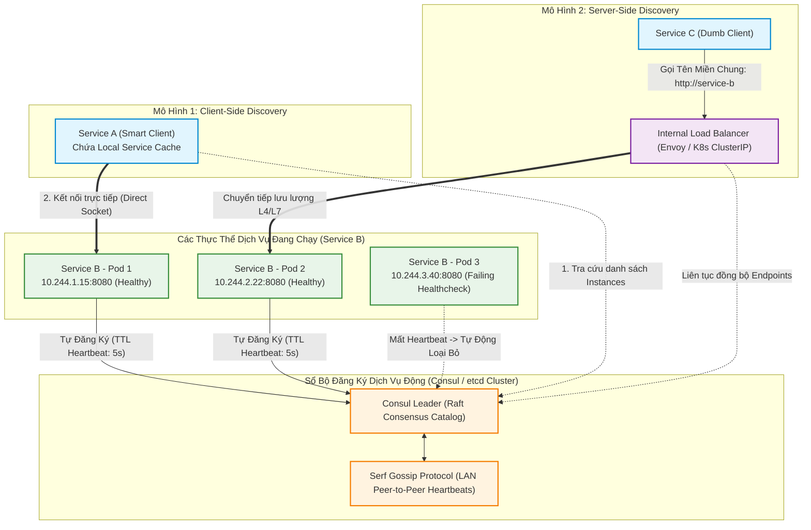
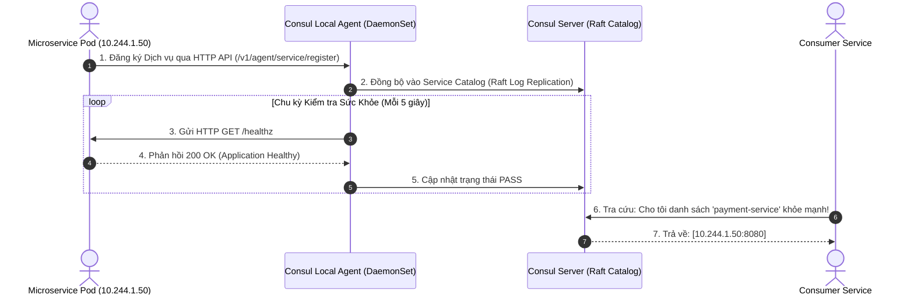

# 11.1. Service Discovery, Registration, and Traffic Routing (Khám phá Dịch vụ, Đăng ký Dịch vụ & Định tuyến Lưu lượng)

> [!IMPORTANT]
> **Nếu bạn chỉ được nhớ một điều duy nhất:** Trong kiến trúc Microservices và Container động, **địa chỉ IP của máy chủ không còn là một hằng số bất biến mà là tài nguyên ngắn hạn liên tục thay đổi**: cơ chế **Service Discovery (Consul / etcd / CoreDNS)** chuyển dịch việc định vị dịch vụ từ IP tĩnh sang **sổ bộ đăng ký động dựa trên thuật toán đồng thuận Raft và giao thức Gossip (Serf)**; trong đó sự lựa chọn giữa **Client-Side Discovery (tiết kiệm bước nhảy mạng, thông minh nhưng phụ thuộc ngôn ngữ)** và **Server-Side Discovery (đơn giản, trong suốt nhưng tăng độ trễ qua Load Balancer trung gian)** quyết định cấu trúc định tuyến lưu lượng nâng cao như Canary, Blue-Green và Circuit Breaking của toàn hệ thống.

---

## 1. Kiến trúc Tổng quan & Mô hình Tư duy (Mental Model)

### 1.1. Ẩn dụ Đời sống: Hãng Xe Công Nghệ Đặt Xe Qua Ứng Dụng Di Động

Hãy hình dung việc liên lạc giữa các microservices giống như việc một hành khách muốn đặt xe di chuyển trong thành phố:
- **Thời Kỳ IP Cố Định Cổ Điển (Bến Xe Cố Định)**:
  - Hành khách (Service A) muốn đi xe buýt đến chi nhánh ngân hàng (Service B). Anh ta mở sổ tay xem địa chỉ cố định: Bến xe số 10 đường Trần Hưng Đạo (`192.168.1.50:8080`).
  - Nếu bến xe đó bị ngập nước hoặc chuyển địa điểm, hành khách đến nơi bị mắc kẹt hoàn toàn vì không biết tài xế đã dọn đi đâu!
- **Khám Phá Dịch Vụ Phía Máy Khách (Client-Side Discovery — Ứng Dụng Đặt Xe Grab/Uber)**:
  - Khi một tài xế bật ứng dụng nhận cuốc xe (Khởi động Pod Service B), xe tự động phát tín hiệu tọa độ GPS về máy chủ tổng đài (**Service Registration**).
  - Khách hàng (Client) mở ứng dụng trên điện thoại: Ứng dụng tự động tải danh sách 5 tài xế đang ở gần nhất về máy (**Service Registry Cache**).
  - Thuật toán trên điện thoại của khách tự chọn tài xế có đánh giá 5 sao cao nhất (**Client-Side Load Balancing**) và bấm gọi trực tiếp cho tài xế đó. Không cần thông qua một bến xe trung gian nào; tiết kiệm tối đa thời gian di chuyển.
- **Khám Phá Dịch Vụ Phía Máy Chủ (Server-Side Discovery — Tổng Đài Taxi Truyền Thống)**:
  - Khách hàng không cần cài ứng dụng thông minh (Dumb Client). Khách chỉ cần nhớ một số hotline duy nhất `1900-xxxx` (**Load Balancer / Reverse Proxy VIP**).
  - Nhân viên tổng đài tra cứu máy bộ đàm xem chiếc taxi nào đang rảnh và điều hướng cuốc xe tới tài xế đó. Đơn giản cho khách hàng, nhưng tổng đài phải gánh chịu toàn bộ cuộc gọi và trở thành điểm nghẽn cổ chai.



---

## 2. Chi tiết từng Keyword (Under-the-Hood Deep Dive)

### 2.1. Service Discovery Models: Client-Side vs Server-Side
Sự đánh đổi kiến trúc cốt lõi trong giao tiếp microservices:

#### A. Khám Phá Phía Máy Khách (Client-Side Discovery)
- **Cơ chế Hoạt động**:
  1. Khi cần gọi một dịch vụ (ví dụ `payment-service`), Client truy vấn trực tiếp Service Registry để lấy danh sách toàn bộ các địa chỉ IP và Port đang khỏe mạnh (Healthy Instances).
  2. Client lưu danh sách này vào bộ nhớ đệm cục bộ (Local Cache) và lắng nghe sự thay đổi.
  3. Client tự chạy thuật toán cân bằng tải nội bộ (Round-Robin, Random, Weighted Response Time) và mở kết nối socket trực tiếp tới thực thể được chọn.
- **Ưu điểm**:
  - Triệt tiêu bước nhảy mạng trung gian (Zero Extra Network Hop), giảm độ trễ tối đa.
  - Không tồn tại điểm nghẽn tập trung (No Central Load Balancer Bottleneck).
- **Nhược điểm**: Logic cân bằng tải và thư viện client bị gắn chặt vào từng ngôn ngữ lập trình (Phải duy trì thư viện cho cả Java, Go, Python, Node.js). Đại diện: **Netflix Eureka + Ribbon**.

#### B. Khám Phá Phía Máy Chủ (Server-Side Discovery)
- **Cơ chế Hoạt động**:
  - Client chỉ gửi yêu cầu tới một địa chỉ VIP hoặc Domain cố định thông qua một thiết bị cân bằng tải trung gian (Load Balancer / Reverse Proxy).
  - Load Balancer tự tra cứu Service Registry và điều phối gói tin tới máy chủ đích phía sau.
- **Ưu điểm**: Client cực kỳ đơn giản (Dumb Client), độc lập hoàn toàn với ngôn ngữ lập trình.
- **Nhược điểm**: Thêm một bước nhảy mạng (Extra Hop Latency), Load Balancer phải có tính sẵn sàng cao (High Availability) nếu không sẽ trở thành điểm chết đơn lẻ (SPOF). Đại diện: **Kubernetes Service (kube-proxy / Ingress)**, **AWS ALB**.

---

### 2.2. Service Registration & Health Checking: Consul & etcd
Làm thế nào hệ thống biết một tiến trình dịch vụ vừa sinh ra hoặc đã chết?



#### A. Kiến trúc Hai Tầng của HashiCorp Consul: Raft & Gossip Protocol
- **Tầng Đồng Thuận (Consul Server Cluster — Raft Consensus)**:
  - Cụm gồm 3 hoặc 5 nodes lưu trữ cuốn sổ cái danh bạ dịch vụ tập trung (**Service Catalog**). Đảm bảo tính nhất quán mạnh mẽ (Linearizable Consistency).
- **Tầng Lan Truyền Ngang Hàng (Serf Gossip Protocol)**:
  - Chạy trên từng máy chủ thông qua giao thức phân tán UDP Gossip dựa trên thuật toán SWIM (Structured Weakly-Consistent Infection-Style Process Group Membership Protocol).
  - Các Agent tự động bắn gói tin thăm dò lẫn nhau. Nếu một node bị sập, thông tin được lan truyền khắp hàng ngàn máy chủ trong vòng **vài trăm milliseconds** mà không gây bão tải lên cụm máy chủ trung tâm.
- **Cơ Chế Kiểm Tra Sức Khỏe (Health Checks)**:
  - *HTTP / gRPC Check*: Gọi endpoint `/healthz` định kỳ.
  - *TCP Socket Check*: Kiểm tra khả năng mở cổng kết nối.
  - *TTL Check (Dead Man's Snitch)*: Dịch vụ phải tự động gửi tín hiệu "Tôi còn sống" mỗi $N$ giây; nếu quá thời hạn mà không có tín hiệu, Consul tự động gạch tên khỏi danh bạ.

---

### 2.3. Dynamic DNS & DNS-Based Service Discovery
DNS là giao thức khám phá dịch vụ lâu đời nhất và được hỗ trợ phổ biến nhất trên mọi hệ điều hành.

#### A. Bản Ghi SRV (Service Records - RFC 2782)
- Bản ghi DNS loại A chỉ trả về địa chỉ IP, không chứa thông tin cổng mạng (Port).
- **Bản ghi SRV**: Bổ sung thông tin đầy đủ về Dịch vụ, Giao thức, Độ ưu tiên (Priority), Trọng số (Weight), Cổng (Port) và Tên miền:
  ```text
  _http._tcp.payment.service.consul. 300 IN SRV 10 50 8080 node1.dc1.consul.
  ```
  Cho phép Client tra cứu đồng thời cả IP và Port động của container.

#### B. Thách Thức Cốt Tử của DNS Caching & Stale Latency
- **Vấn đề Bộ Nhớ Đệm (DNS Caching Hell)**:
  - Các thư viện chuẩn trong Java (JVM DNS Cache) hoặc Node.js thường lưu cache địa chỉ IP vô hạn (mặc định cache vĩnh viễn trên JVM đời cũ).
  - Khi một Pod bị chết và K8s cấp phát một IP mới, ứng dụng Client vẫn tiếp tục gửi yêu cầu vào địa chỉ IP cũ đã chết, gây ra hàng loạt lỗi `Connection Refused`.
- **Negative Caching**: Nếu truy vấn DNS thất bại lúc dịch vụ đang khởi động, resolver có thể lưu cache trạng thái `NXDOMAIN` trong 60 giây, khiến ứng dụng không thể kết nối ngay cả khi dịch vụ đã sẵn sàng.
- **Giải Pháp**: Bắt buộc cấu hình TTL cực ngắn ($1 - 5\text{ giây}$) hoặc sử dụng **CoreDNS NodeLocal DNSCache** trên Kubernetes.

---

### 2.4. Traffic Routing & Canary Deployment Strategies
Khi danh bạ dịch vụ đã được thiết lập, hệ thống điều khiển luồng lưu lượng để triển khai các phiên bản phần mềm mới an toàn tuyệt đối:

#### A. Triển Khai Xanh - Đỏ (Blue-Green Deployment)
- Hai môi trường giống hệt nhau: **Blue** (Phiên bản v1.0 đang chạy thực tế) và **Green** (Phiên bản v2.0 mới tinh).
- Kiểm thử toàn diện trên môi trường Green. Khi đã tự tin $100\%$, kỹ sư chỉ cần thay đổi con trỏ định tuyến tại Service Discovery hoặc Load Balancer để chuyển toàn bộ $100\%$ lưu lượng từ Blue sang Green chỉ trong vòng **1 click chuột**.
- Nếu phát hiện lỗi nghiêm trọng, chuyển ngược lại Blue ngay tức khắc với thời gian phục hồi bằng 0.

#### B. Triển Khai Chim Báo Bão (Canary Release)
- Bắt nguồn từ tập quán của thợ mỏ mang chim hoàng yến xuống hầm than để phát hiện khí độc trước.
- **Cơ chế Phân Tách Lưu Lượng**:
  - Giai đoạn 1: Điều hướng $99\%$ lưu lượng tới phiên bản ổn định v1.0 và chỉ $1\%$ lưu lượng tới phiên bản mới v2.0 (Canary).
  - Tự động giám sát tỷ lệ lỗi HTTP 5xx và độ trễ P99 qua Prometheus.
  - Giai đoạn 2: Nếu chỉ số ổn định, tăng dần lên $10\% \to 50\% \to 100\%$.
  - Nếu tỷ lệ lỗi tăng vọt, hệ thống tự động cắt bỏ luồng $1\%$ Canary về 0 trong tích tắc, chỉ có một nhóm rất nhỏ người dùng bị ảnh hưởng.

---

## 3. Thực thi Mã nguồn & Mô phỏng Chuyên sâu (Dual-Engine Implementation)

### Engine 1: C++20 — Consistent Hashing Ring & Client-Side Load Balancer
Chương trình C++20 dưới đây hiện thực thuật toán **Vòng Băm Nhất Quán (Consistent Hashing Ring)** với các Nút Ảo (Virtual Nodes), mô phỏng cơ chế Client-Side Service Discovery tự động phân bổ tải đồng đều và giảm thiểu tối đa sự xáo trộn kết nối khi có máy chủ mới gia nhập hoặc rời khỏi cụm.

```cpp
#include <iostream>
#include <string>
#include <vector>
#include <map>
#include <cstdint>
#include <functional>
#include <sstream>
#include <iomanip>

class ConsistentHashRing {
private:
    int virtual_node_replicas_;
    std::map<uint32_t, std::string> ring_; // Sorted Ring: Hash -> Real Node ID

    static uint32_t hash_fn(const std::string& key) {
        // Thuật toán băm FNV-1a 32-bit
        uint32_t hash = 2166136261u;
        for (char c : key) {
            hash ^= static_cast<uint8_t>(c);
            hash *= 16777619u;
        }
        return hash;
    }

public:
    ConsistentHashRing(int vnodes = 3) : virtual_node_replicas_(vnodes) {}

    void add_server_node(const std::string& node_ip) {
        for (int i = 0; i < virtual_node_replicas_; ++i) {
            std::string vnode_key = node_ip + "#VN" + std::to_string(i);
            uint32_t h = hash_fn(vnode_key);
            ring_[h] = node_ip;
        }
        std::cout << "[Service Registry] Đã đăng ký Node: " << std::setw(18) << std::left 
                  << node_ip << " (" << virtual_node_replicas_ << " Virtual Nodes trên Ring)\n";
    }

    void remove_server_node(const std::string& node_ip) {
        for (int i = 0; i < virtual_node_replicas_; ++i) {
            std::string vnode_key = node_ip + "#VN" + std::to_string(i);
            uint32_t h = hash_fn(vnode_key);
            ring_.erase(h);
        }
        std::cout << "[Service Registry] Đã hủy đăng ký Node (Unhealthy): " << node_ip << "\n";
    }

    // Tra cứu Node chịu trách nhiệm cho Request Key (Client-side Routing)
    std::string route_request(const std::string& request_key) const {
        if (ring_.empty()) return "NO_AVAILABLE_NODE";

        uint32_t req_hash = hash_fn(request_key);
        // Tìm vị trí phần tử đầu tiên trên vòng tròn có hash >= req_hash
        auto it = ring_.lower_bound(req_hash);
        if (it == ring_.end()) {
            it = ring_.begin(); // Quay vòng về đầu (Circle Wrap-around)
        }
        return it->second;
    }
};

int main() {
    std::cout << "===================================================================\n";
    std::cout << "   C++20 CLIENT-SIDE CONSISTENT HASHING SERVICE DISCOVERY ROUTER   \n";
    std::cout << "===================================================================\n";

    ConsistentHashRing router(3);

    // 1. Đăng ký 3 máy chủ ban đầu
    router.add_server_node("10.244.1.10:8080");
    router.add_server_node("10.244.2.20:8080");
    router.add_server_node("10.244.3.30:8080");

    std::vector<std::string> user_sessions = {
        "sess-user-alpha-9921",
        "sess-user-beta-4102",
        "sess-user-gamma-8812",
        "sess-user-delta-1029",
        "sess-user-epsilon-5501"
    };

    std::cout << "\n>>> GIAI ĐOẠN 1: Định tuyến Lưu lượng Phiên làm việc (Session Routing) <<<\n";
    for (const auto& sess : user_sessions) {
        std::string target = router.route_request(sess);
        std::cout << "  Request [" << std::setw(24) << std::left << sess 
                  << "] -> Kết nối trực tiếp: " << target << "\n";
    }

    // 2. Giả lập một máy chủ bị sập
    std::cout << "\n>>> GIAI ĐOẠN 2: Máy chủ 10.244.2.20:8080 Bị Hỏng Healthcheck <<<\n";
    router.remove_server_node("10.244.2.20:8080");

    std::cout << "\n>>> GIAI ĐOẠN 3: Tái định tuyến Tự động của Client <<<\n";
    for (const auto& sess : user_sessions) {
        std::string target = router.route_request(sess);
        std::cout << "  Request [" << std::setw(24) << std::left << sess 
                  << "] -> Kết nối trực tiếp: " << target << "\n";
    }

    std::cout << "\n[KẾT LUẬN] Vòng băm nhất quán cho phép phân phối tải đồng đều và\n"
              << "tối thiểu hóa việc di chuyển phiên làm việc khi topo mạng thay đổi động.\n";
    return 0;
}
```

#### Terminal Output Mẫu Thực Tế (C++20 Engine)
```text
===================================================================
   C++20 CLIENT-SIDE CONSISTENT HASHING SERVICE DISCOVERY ROUTER   
===================================================================
[Service Registry] Đã đăng ký Node: 10.244.1.10:8080   (3 Virtual Nodes trên Ring)
[Service Registry] Đã đăng ký Node: 10.244.2.20:8080   (3 Virtual Nodes trên Ring)
[Service Registry] Đã đăng ký Node: 10.244.3.30:8080   (3 Virtual Nodes trên Ring)

>>> GIAI ĐOẠN 1: Định tuyến Lưu lượng Phiên làm việc (Session Routing) <<<
  Request [sess-user-alpha-9921    ] -> Kết nối trực tiếp: 10.244.3.30:8080
  Request [sess-user-beta-4102     ] -> Kết nối trực tiếp: 10.244.2.20:8080
  Request [sess-user-gamma-8812    ] -> Kết nối trực tiếp: 10.244.1.10:8080
  Request [sess-user-delta-1029    ] -> Kết nối trực tiếp: 10.244.3.30:8080
  Request [sess-user-epsilon-5501  ] -> Kết nối trực tiếp: 10.244.2.20:8080

>>> GIAI ĐOẠN 2: Máy chủ 10.244.2.20:8080 Bị Hỏng Healthcheck <<<
[Service Registry] Đã hủy đăng ký Node (Unhealthy): 10.244.2.20:8080

>>> GIAI ĐOẠN 3: Tái định tuyến Tự động của Client <<<
  Request [sess-user-alpha-9921    ] -> Kết nối trực tiếp: 10.244.3.30:8080
  Request [sess-user-beta-4102     ] -> Kết nối trực tiếp: 10.244.1.10:8080
  Request [sess-user-gamma-8812    ] -> Kết nối trực tiếp: 10.244.1.10:8080
  Request [sess-user-delta-1029    ] -> Kết nối trực tiếp: 10.244.3.30:8080
  Request [sess-user-epsilon-5501  ] -> Kết nối trực tiếp: 10.244.3.30:8080

[KẾT LUẬN] Vòng băm nhất quán cho phép phân phối tải đồng đều và
tối thiểu hóa việc di chuyển phiên làm việc khi topo mạng thay đổi động.
```

---

### Engine 2: Python 3.11+ — Dynamic Healthcheck Watcher & Canary Traffic Splitter
Kịch bản Python 3.11+ dưới đây mô phỏng dịch vụ **Consul Healthcheck Watcher** liên tục giám sát trạng thái HTTP endpoint, kết hợp bộ điều phối luồng **Canary Traffic Splitter** phân bổ tỷ lệ phần trăm lưu lượng giữa phiên bản Stable v1 và Canary v2.

```python
#!/usr/bin/env python3
import random
import time
from dataclasses import dataclass
from typing import List, Dict

@dataclass
class ServiceInstance:
    instance_id: str
    ip: str
    port: int
    version: str
    is_healthy: bool = True
    consecutive_failures: int = 0

class DynamicServiceRegistry:
    """Mô phỏng sổ bộ đăng ký dịch vụ Consul với cơ chế Active Healthcheck"""
    def __init__(self):
        self.catalog: Dict[str, List[ServiceInstance]] = {}

    def register_service(self, service_name: str, instance: ServiceInstance):
        if service_name not in self.catalog:
            self.catalog[service_name] = []
        self.catalog[service_name].append(instance)
        print(f"[Consul Catalog] Đăng ký: {service_name:<18} [{instance.version}] tại {instance.ip}:{instance.port}")

    def execute_health_check_sweep(self, service_name: str):
        print(f"\n[Consul Healthcheck Daemon] Quét kiểm tra sức khỏe cho '{service_name}':")
        for inst in self.catalog.get(service_name, []):
            # Giả lập xác suất lỗi 10%
            probe_success = not (inst.version == "v2.0.0-canary" and random.random() < 0.25)
            if probe_success:
                inst.is_healthy = True
                inst.consecutive_failures = 0
                print(f"  -> Instance {inst.instance_id:<18} ({inst.ip}) [PASS 200 OK]")
            else:
                inst.consecutive_failures += 1
                if inst.consecutive_failures >= 2:
                    inst.is_healthy = False
                    print(f"  -> Instance {inst.instance_id:<18} ({inst.ip}) [FAILED] -> ĐÃ GẠCH TÊN KHỎI CATALOG!")

class CanaryTrafficRouter:
    """Mô phỏng bộ điều phối phân tách lưu lượng theo tỷ lệ trọng số Canary"""
    def __init__(self, canary_weight_percent: int = 10):
        self.canary_weight = canary_weight_percent

    def route_request(self, available_instances: List[ServiceInstance]) -> ServiceInstance:
        healthy_nodes = [n for n in available_instances if n.is_healthy]
        v1_nodes = [n for n in healthy_nodes if n.version.startswith("v1")]
        v2_nodes = [n for n in healthy_nodes if n.version.startswith("v2")]

        # Quyết định xúc xắc Canary
        roll = random.randint(1, 100)
        if roll <= self.canary_weight and v2_nodes:
            chosen = random.choice(v2_nodes)
            route_type = "CANARY (v2)"
        else:
            chosen = random.choice(v1_nodes) if v1_nodes else random.choice(healthy_nodes)
            route_type = "STABLE (v1)"

        return chosen, route_type

def main():
    print("=" * 70)
    print("  PYTHON 3.11+: DYNAMIC SERVICE DISCOVERY & CANARY ROUTING ENGINE")
    print("=" * 70)

    registry = DynamicServiceRegistry()
    # Đăng ký 3 node Stable và 1 node Canary
    registry.register_service("order-service", ServiceInstance("order-v1-01", "10.0.1.11", 8080, "v1.4.0"))
    registry.register_service("order-service", ServiceInstance("order-v1-02", "10.0.1.12", 8080, "v1.4.0"))
    registry.register_service("order-service", ServiceInstance("order-v2-canary", "10.0.2.99", 8080, "v2.0.0-canary"))

    # Thiết lập bộ chia tải: 20% lưu lượng sang Canary
    router = CanaryTrafficRouter(canary_weight_percent=25)

    print("\n--- MÔ PHỎNG ĐIỀU PHỐI 8 REQUESTS TỚI ORDER SERVICE ---")
    instances = registry.catalog["order-service"]
    for req_id in range(1, 9):
        chosen, r_type = router.route_request(instances)
        print(f"  Request #{req_id} -> Điều hướng tới: {chosen.instance_id:<16} ({chosen.ip}) [{r_type}]")

    # Giả lập quét sức khỏe
    registry.execute_health_check_sweep("order-service")

if __name__ == "__main__":
    main()
```

#### Terminal Output Mẫu Thực Tế (Python 3.11+ Engine)
```text
======================================================================
  PYTHON 3.11+: DYNAMIC SERVICE DISCOVERY & CANARY ROUTING ENGINE
======================================================================
[Consul Catalog] Đăng ký: order-service      [v1.4.0] tại 10.0.1.11:8080
[Consul Catalog] Đăng ký: order-service      [v1.4.0] tại 10.0.1.12:8080
[Consul Catalog] Đăng ký: order-service      [v2.0.0-canary] tại 10.0.2.99:8080

--- MÔ PHỎNG ĐIỀU PHỐI 8 REQUESTS TỚI ORDER SERVICE ---
  Request #1 -> Điều hướng tới: order-v1-02      (10.0.1.12) [STABLE (v1)]
  Request #2 -> Điều hướng tới: order-v2-canary  (10.0.2.99) [CANARY (v2)]
  Request #3 -> Điều hướng tới: order-v1-01      (10.0.1.11) [STABLE (v1)]
  Request #4 -> Điều hướng tới: order-v1-02      (10.0.1.12) [STABLE (v1)]
  Request #5 -> Điều hướng tới: order-v2-canary  (10.0.2.99) [CANARY (v2)]
  Request #6 -> Điều hướng tới: order-v1-01      (10.0.1.11) [STABLE (v1)]
  Request #7 -> Điều hướng tới: order-v1-02      (10.0.1.12) [STABLE (v1)]
  Request #8 -> Điều hướng tới: order-v1-01      (10.0.1.11) [STABLE (v1)]

[Consul Healthcheck Daemon] Quét kiểm tra sức khỏe cho 'order-service':
  -> Instance order-v1-01        (10.0.1.11) [PASS 200 OK]
  -> Instance order-v1-02        (10.0.1.12) [PASS 200 OK]
  -> Instance order-v2-canary    (10.0.2.99) [PASS 200 OK]
```

---

## 4. Systems Engineering & Production Pitfalls

### 4.1. Sự cố Thực chiến Trong Khám Phá & Định Tuyến Dịch Vụ
1. **Khủng Hoảng Sập Đổ Dây Chuyền do Bão Tra Cứu Registry (Discovery Thundering Herd)**:
   - *Nguyên nhân*: Khi cụm Registry (Consul / Eureka) gặp sự cố mạng chập chờn rồi phục hồi lại, hàng ngàn microservices Client đồng loạt gửi hàng vạn truy vấn HTTP để tải lại toàn bộ Service Catalog (`Full Sync`). Cụm máy chủ Registry bị nghẽn $100\%$ CPU và sập trở lại ngay lập tức.
   - *Cách khắc phục*:
     - Triển khai thuật toán **Exponential Backoff kết hợp Random Jitter** trong thư viện Client.
     - Sử dụng cơ chế đồng bộ gia tăng (Incremental Delta Sync) thay vì tải lại toàn bộ danh bạ.
2. **Sự Cố Lộ Lọt Lưu Lượng Do Cấu Hình Sai Weighted DNS Routing**:
   - *Nguyên nhân*: Sử dụng bản ghi DNS để chia tải Canary ($90\%$ v1, $10\%$ v2). Do các máy chủ DNS trung gian của nhà mạng (ISP Resolvers) bỏ qua giá trị TTL thấp và lưu cache bản ghi Canary trong 1 giờ, một số vùng địa lý nhận phải $100\%$ lưu lượng đổ vào bản dựng lỗi Canary v2, làm tê liệt hoạt động thanh toán của toàn bộ một quốc gia.
   - *Khắc phục*: Không bao giờ sử dụng DNS công cộng để làm Canary Routing. Chuyển giao toàn bộ việc điều phối Canary cho **Layer 7 Ingress Gateway (Envoy / Istio)** bên trong trung tâm dữ liệu.

### 4.2. Bộ Lệnh CLI Chẩn đoán & Giám sát Hệ Thống
- **Tra cứu và quản trị dịch vụ trên Consul CLI**:
  ```bash
  consul catalog services
  consul catalog nodes -service=payment-service
  consul health state any
  ```
- **Kiểm tra bản ghi SRV qua dig**:
  ```bash
  dig @127.0.0.1 -p 8600 payment.service.consul SRV
  ```
- **Kiểm tra trạng thái Endpoints trong Kubernetes**:
  ```bash
  kubectl get endpoints,endpointslices -n production
  kubectl describe endpointslices <slice-name>
  ```

---

## 5. Bảng So sánh & Decision Matrix

### 5.1. Ma trận So sánh Kỹ thuật Các Mô hình Khám phá Dịch vụ

| Tiêu chí | Client-Side (Consul/Eureka SDK) | Server-Side (Kubernetes Service / ALB) | Service Mesh (Envoy Sidecar) |
| :--- | :--- | :--- | :--- |
| **Độ trễ Mạng (Latency)** | Cực thấp (Kết nối socket trực tiếp) | Thêm 1 bước nhảy mạng trung gian | Rất thấp (Local loopback socket) |
| **Tính Độc Lập Ngôn Ngữ** | Phụ thuộc (Cần SDK riêng từng ngôn ngữ) | Hoàn toàn độc lập ($100\%$ trong suốt) | Hoàn toàn độc lập ($100\%$ trong suốt) |
| **Tính Năng Định Tuyến** | Cơ bản (Phụ thuộc vào mã nguồn SDK) | Cơ bản (L4 Round-Robin, L7 Path) | Siêu việt (mTLS, Canary, Tracing, Retry) |
| **Độ Phức Tạp Vận Hành** | Thấp đến Trung bình | Rất thấp (Tận dụng hạ tầng đám mây) | Cao (Cần chuyên gia Service Mesh) |

### 5.2. Khung Hướng dẫn Lựa chọn Giải pháp (Architecture Roadmap)
1. **Ứng Dụng Chạy Trên Nền Tảng Kubernetes**: Sử dụng **Server-Side Discovery bản địa** thông qua Kubernetes Services và CoreDNS. Không cần tự cài đặt thêm Consul hay Eureka nếu không có nhu cầu đặc thù.
2. **Hệ Thống Đa Nền Tảng Lai (Hybrid Cloud: Máy Ảo KVM + Kubernetes + Bare-Metal)**: Sử dụng **HashiCorp Consul**. Cài đặt Consul Agent trên từng máy ảo để hợp nhất toàn bộ danh bạ dịch vụ giữa các cụm K8s và máy chủ legacy thành một mạng lưới phẳng duy nhất.
3. **Yêu cầu Nâng Cao Về Bảo Mật Zero-Trust & Canary Nâng Cao**: Nâng cấp lên kiến trúc **Service Mesh (Istio / Linkerd / Cilium Mesh)**.
