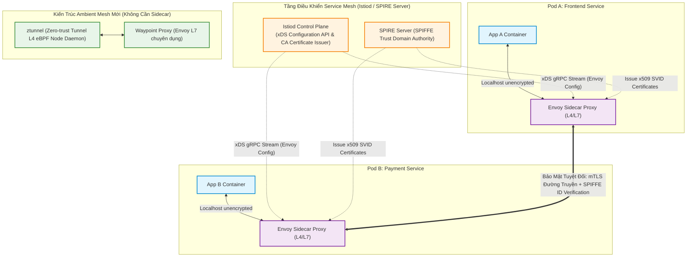
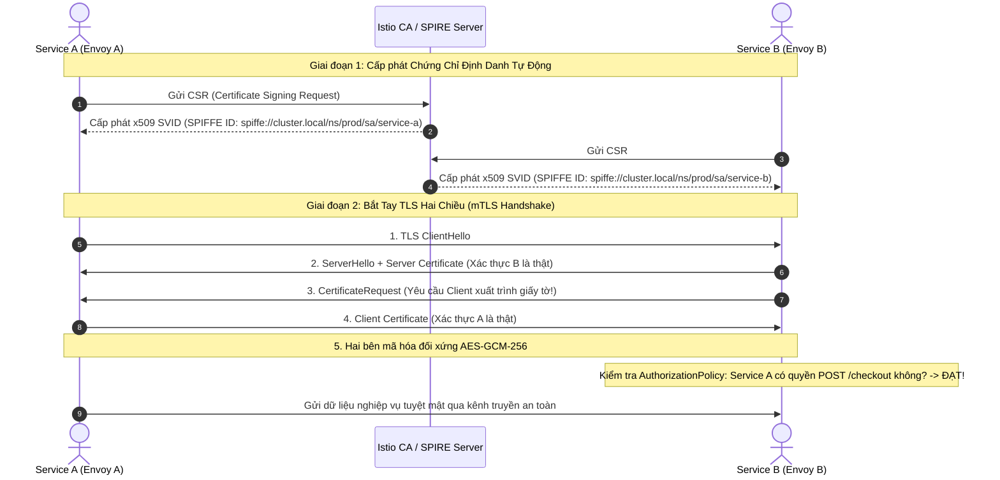

# 11.2. Service Mesh Architectures, Security, and Ecosystem (Kiến trúc Lưới Dịch vụ, An ninh & Hệ sinh thái)

> [!IMPORTANT]
> **Nếu bạn chỉ được nhớ một điều duy nhất:** Service Mesh giải phóng mã nguồn ứng dụng khỏi toàn bộ logic mạng phức tạp bằng cách **chuyển giao việc quản lý lưu lượng, quan sát và mã hóa mTLS sang một tầng hạ tầng chuyên biệt độc lập**: sự tiến hóa kiến trúc từ **Sidecar Proxy cổ điển (Envoy tiêm vào từng Pod)** sang **Ambient Mesh / eBPF (ztunnel L4 tại Node + Waypoint L7 tùy chọn)** triệt tiêu hoàn toàn sự lãng phí tài nguyên CPU/RAM và giảm thiểu độ trễ mạng, trong khi chuẩn định danh **SPIFFE/SPIRE** biến mỗi tiến trình thành một thực thể mật mã học có thể tự chứng thực danh tính xuyên biên giới đám mây.

---

## 1. Kiến trúc Tổng quan & Mô hình Tư duy (Mental Model)

### 1.1. Ẩn dụ Đời sống: Đoàn Xe Ngoại Giao Có Xe Cảnh Sát Hộ Tống

Hãy hình dung mạng lưới microservices giống như việc di chuyển của các đoàn đại biểu ngoại giao cấp cao:
- **Thời Kỳ Chưa Có Service Mesh (Các Nhà Ngoại Giao Tự Lái Xe)**:
  - Mỗi vị đại biểu (Tiến trình ứng dụng) phải tự học cách lái xe, tự học võ thuật tự vệ (Tự viết mã TLS, mã retry, mã circuit breaker trong code).
  - Nhà ngoại giao Java học theo một kiểu, nhà ngoại giao Python học theo một kiểu khác. Rất dễ xảy ra tai nạn giao thông và lộ lọt bí mật nếu ai đó quên khóa cửa xe (Thiếu kiểm tra chứng chỉ SSL).
- **Mô Hình Service Mesh Sidecar (Mỗi Xe Đại Biểu Có Một Xe Cảnh Sát Đi Kèm — Envoy Proxy)**:
  - Khi xe của đại biểu chuẩn bị lăn bánh, một chiếc xe cảnh sát hộ tống (**Envoy Sidecar**) áp sát ngay bên cạnh.
  - Đại biểu chỉ cần ngồi trong xe nói chuyện bình thường qua cửa sổ (Giao tiếp HTTP không mã hóa qua Localhost).
  - Mọi việc nguy hiểm do xe cảnh sát đảm nhận: Bật còi ưu tiên, mã hóa kênh truyền bọc thép (**Mutual TLS - mTLS**), kiểm tra căn cước thẻ căn cước của xe đối diện (**SPIFFE ID**), và tự động đổi đường đi khác nếu đường phía trước bị kẹt xe (**Traffic Management & Circuit Breaking**).
  - Nhược điểm: Thành phố có 1,000 đại biểu thì phải nuôi thêm 1,000 xe cảnh sát chạy song song, tiêu tốn gấp đôi nhiên liệu và không gian bãi đỗ xe (CPU & Memory Overhead).
- **Kỷ Nguyên Ambient Mesh & eBPF (Cảnh Sát Giao Thông Ngầm Dưới Lòng Đất)**:
  - Thay vì cấp xe cảnh sát riêng cho từng người, thành phố đặt các bốt an ninh tàng hình tại chân từng tòa nhà chung (**Node-level ztunnel qua eBPF**).
  - Tự động mã hóa mTLS cấp độ L4 cho mọi xe chạy qua mà không cần tốn một chiếc xe hộ tống nào. Chỉ những đại biểu nào cần kiểm tra hộ chiếu ngoại giao phức tạp (L7 WAF / Path Routing) mới được dẫn qua cổng hải quan chuyên dụng (**Waypoint Proxy**).



---

## 2. Chi tiết từng Keyword (Under-the-Hood Deep Dive)

### 2.1. Service Mesh Topologies: Sidecar vs Proxyless vs Ambient / eBPF
Cuộc tiến hóa về mặt kiến trúc nhằm cân bằng giữa tính năng, độ trễ và chi phí tài nguyên:

#### A. Mô hình Sidecar Truyền Thống (Istio Classic / Linkerd)
- Kubelet tự động tiêm (Inject) một container phụ `envoy` chạy song song trong cùng Pod với container ứng dụng.
- **Cơ chế Bắt Gói Tin qua iptables**:
  - Container khởi tạo (`istio-init`) chạy trước với quyền `CAP_NET_ADMIN`, cấu hình các luật Linux iptables PREROUTING và OUTPUT để bí mật chuyển hướng toàn bộ lưu lượng mạng TCP đi vào và đi ra của Pod vào cổng localhost `15001/15006` của Envoy.
- **Hạn chế Cốt tử**:
  - Tiêu tốn bộ nhớ khổng lồ: Nếu mỗi Envoy ngốn 50MB RAM, một cụm có 2,000 Pods sẽ lãng phí tới $100\text{ GB}$ RAM chỉ để chạy các proxy rỗng!
  - Thêm độ trễ từ $1.5 - 3\text{ ms}$ cho mỗi lượt request do phải đi qua 3 lần ngăn xếp TCP/IP của Linux Kernel.

#### B. Mô hình Không Proxy (Proxyless gRPC)
- Loại bỏ hoàn toàn container Envoy.
- Mã nguồn ứng dụng sử dụng trực tiếp thư viện gRPC tích hợp sẵn giao thức **xDS API** để kết nối trực tiếp với Istiod Control Plane.
- **Ưu điểm**: Độ trễ bằng 0, không tốn thêm RAM proxy.
- **Nhược điểm**: Chỉ hỗ trợ các dịch vụ viết bằng gRPC, không hỗ trợ các ứng dụng REST/HTTP hoặc cơ sở dữ liệu.

#### C. Kỷ Nguyên Ambient Mesh & eBPF Kernel Bypass
- **Istio Ambient Mesh**: Tách biệt hoàn toàn xử lý mạng thành 2 tầng độc lập:
  1. **Tầng L4 An Ninh Cơ Bản (ztunnel)**: Một daemonset duy nhất chạy trên từng Node (thay vì từng Pod). Xử lý định tuyến L4 và mã hóa mTLS tốc độ cao qua giao thức đóng gói **HBONE (HTTP-Based Overlay Network)**.
  2. **Tầng L7 Nghiệp Vụ Tùy Chọn (Waypoint Proxy)**: Chỉ khởi tạo khi dịch vụ thực sự cần các tính năng L7 (như JWT Authentication, Path-based routing, Circuit breaking). Tiết kiệm tới $80\%$ chi phí tài nguyên máy chủ.
- **Cilium Service Mesh**: Sử dụng chương trình **eBPF** gắn thẳng vào socket layer trong Linux Kernel (`sockops`), chuyển tiếp dữ liệu trực tiếp giữa hai socket mà không cần đi qua ngăn xếp mạng TCP/IP và không cần iptables.

---

### 2.2. Zero-Trust Security: Mutual TLS (mTLS) & SPIFFE/SPIRE
Trong mạng lưới nội bộ của trung tâm dữ liệu hiện đại, nguyên tắc vàng là: **Không tin tưởng bất kỳ ai, luôn luôn xác thực mọi kết nối (Never Trust, Always Verify)**.



#### A. Chuẩn Định Danh Khối Lượng Công Việc SPIFFE / SPIRE
- **SPIFFE (Secure Production Identity Framework for Everyone)**: Chuẩn mở định nghĩa định danh mật mã học bất biến cho phần mềm:
  $$\text{SPIFFE ID} = \text{spiffe://}\underbrace{\text{cluster.local}}_{\text{Trust Domain}}/\underbrace{\text{ns/prod/sa/payment-service}}_{\text{Workload Path}}$$
- **SVID (SPIFFE Verifiable Identity Document)**: Chứng chỉ số X.509 chứa SPIFFE ID trong trường SAN (Subject Alternative Name).
- **SPIRE (SPIFFE Runtime Engine)**: Nền tảng tự động cấp phát, ký số và tự động xoay vòng (Rotate) chứng chỉ số sau mỗi 1-12 giờ mà không cần khởi động lại ứng dụng.

#### B. Cơ Chế Xác Thực Hai Chiều (Mutual TLS - mTLS)
- Khác với HTTPS thông thường chỉ có Client xác thực Server, **mTLS bắt buộc cả hai bên phải xuất trình chứng chỉ số hợp lệ**.
- Toàn bộ lưu lượng truyền tải giữa các Pods trên đường dây cáp quang vật lý đều được mã hóa đối xứng phần cứng (AES-NI / ChaCha20-Poly1305), bảo vệ tuyệt đối trước nguy cơ nghe lén (Sniffing) ngay cả khi kẻ tấn công đã thâm nhập vào cùng mạng LAN.

---

### 2.3. Traffic Management & Reliability Engineering
Service Mesh cung cấp các công cụ bảo vệ hệ thống trước sự cố sụp đổ dây chuyền (Cascading Failure):

#### A. Tự Động Thử Lại (Retries) & Giới Hạn Thời Gian (Timeouts)
- Thay vì để kết nối bị treo vô tận khi backend bị đơ, Envoy áp đặt giới hạn Timeout nghiêm ngặt (ví dụ: $500\text{ ms}$).
- Tự động thử lại các lỗi tạm thời (HTTP 503 Service Unavailable) với thuật toán Exponential Backoff và Jitter để tránh làm quá tải thêm backend.

#### B. Bộ Ngắt Mạch (Circuit Breaking) & Phát Hiện Phần Tử Bất Thường (Outlier Detection)
- Dựa trên nguyên lý rơ-le ngắt điện khi dòng điện quá tải:
  - **Trạng thái CLOSED (Bình thường)**: Lưu lượng đi qua bình thường.
  - **Trạng thái OPEN (Ngắt mạch)**: Nếu tỷ lệ lỗi HTTP 5xx vượt quá $50\%$ trong 10 giây, Circuit Breaker lập tức bung ra. Mọi request tiếp theo bị từ chối ngay lập tức tại Client Proxy mà không gửi đi qua mạng, cho phép dịch vụ Backend có thời gian thở và hồi phục.
  - **Trạng thái HALF-OPEN**: Thử cho một vài request đi qua thăm dò. Nếu thành công, đóng mạch trở lại.
- **Outlier Detection (Trục Xuất Thực Thể Lỗi)**: Tự động phát hiện và tạm thời gạch tên một Pod bị lỗi (Ejection) ra khỏi danh sách cân bằng tải trong 30 giây mà không cần chờ Kubelet can thiệp.

---

## 3. Thực thi Mã nguồn & Mô phỏng Chuyên sâu (Dual-Engine Implementation)

### Engine 1: C++20 — Circuit Breaker State Machine & Envoy Outlier Detection Simulator
Chương trình C++20 dưới đây hiện thực máy trạng thái hữu hạn **Finite State Machine (FSM)** của mẫu thiết kế **Circuit Breaker** (Closed $\to$ Open $\to$ Half-Open), mô phỏng cơ chế tự động bảo vệ của Envoy Proxy khi dịch vụ phụ thuộc phía sau bị lỗi quá ngưỡng.

```cpp
#include <iostream>
#include <string>
#include <chrono>
#include <thread>
#include <iomanip>

enum class CircuitState { CLOSED, OPEN, HALF_OPEN };

class EnvoyCircuitBreaker {
private:
    CircuitState state_ = CircuitState::CLOSED;
    int failure_count_ = 0;
    int success_count_ = 0;
    const int failure_threshold_ = 3;      // 3 lỗi liên tiếp -> Bật ngắt mạch
    const int half_open_success_threshold_ = 2; // 2 thành công -> Đóng mạch trở lại
    std::chrono::steady_clock::time_point last_state_change_;
    const std::chrono::milliseconds open_timeout_{100}; // Thời gian mở mạch 100ms

public:
    EnvoyCircuitBreaker() : last_state_change_(std::chrono::steady_clock::now()) {}

    bool allow_request() {
        auto now = std::chrono::steady_clock::now();

        if (state_ == CircuitState::OPEN) {
            // Kiểm tra xem đã hết thời gian làm nguội chưa
            if (now - last_state_change_ >= open_timeout_) {
                state_ = CircuitState::HALF_OPEN;
                success_count_ = 0;
                last_state_change_ = now;
                std::cout << "\n[Circuit Breaker FSM] Hết thời gian Cool-down -> Chuyển sang: HALF-OPEN (Cho phép thử nghiệm)\n";
                return true;
            }
            std::cout << "  [CIRCUIT BREAKER: OPEN] Request bị từ chối ngay lập tức tại Local Proxy (Bảo vệ Backend)!\n";
            return false;
        }
        return true;
    }

    void record_result(bool success) {
        auto now = std::chrono::steady_clock::now();

        if (state_ == CircuitState::CLOSED) {
            if (!success) {
                failure_count_++;
                std::cout << "  -> Ghi nhận lỗi #" << failure_count_ << " (Ngưỡng: " << failure_threshold_ << ")\n";
                if (failure_count_ >= failure_threshold_) {
                    state_ = CircuitState::OPEN;
                    last_state_change_ = now;
                    std::cout << "\n[BÁO ĐỘNG FSM] Vượt ngưỡng lỗi! Circuit Breaker bung ra: >>> TRẠNG THÁI OPEN <<<\n";
                }
            } else {
                failure_count_ = 0;
            }
        } else if (state_ == CircuitState::HALF_OPEN) {
            if (success) {
                success_count_++;
                std::cout << "  -> Thử nghiệm thành công " << success_count_ << "/" << half_open_success_threshold_ << "\n";
                if (success_count_ >= half_open_success_threshold_) {
                    state_ = CircuitState::CLOSED;
                    failure_count_ = 0;
                    last_state_change_ = now;
                    std::cout << "\n[HỒI PHỤC FSM] Backend đã ổn định trở lại! Circuit Breaker: >>> TRẠNG THÁI CLOSED <<<\n";
                }
            } else {
                state_ = CircuitState::OPEN;
                last_state_change_ = now;
                std::cout << "\n[THỬ NGHIỆM THẤT BẠI] Backend vẫn lỗi -> Bung mạch trở lại: >>> TRẠNG THÁI OPEN <<<\n";
            }
        }
    }
};

int main() {
    std::cout << "===================================================================\n";
    std::cout << "   C++20 ENVOY PROXY CIRCUIT BREAKER & OUTLIER DETECTION ENGINE    \n";
    std::cout << "===================================================================\n";

    EnvoyCircuitBreaker cb;

    std::cout << ">>> GIAI ĐOẠN 1: Backend gặp sự cố liên tiếp 3 lần <<<\n";
    for (int i = 1; i <= 3; ++i) {
        if (cb.allow_request()) {
            std::cout << "Gửi Request #" << i << " tới Backend (Giả lập lỗi HTTP 503)...\n";
            cb.record_result(false);
        }
    }

    std::cout << "\n>>> GIAI ĐOẠN 2: Các request tiếp theo khi mạch đang OPEN <<<\n";
    for (int i = 4; i <= 5; ++i) {
        std::cout << "Thử gửi Request #" << i << ":\n";
        cb.allow_request();
    }

    std::cout << "\n>>> GIAI ĐOẠN 3: Chờ 110ms cho hết thời gian Cool-down <<<\n";
    std::this_thread::sleep_for(std::chrono::milliseconds(110));

    std::cout << "\n>>> GIAI ĐOẠN 4: Thử nghiệm phục hồi Backend <<<\n";
    if (cb.allow_request()) {
        std::cout << "Gửi Request thăm dò 1 (Thành công 200 OK)...\n";
        cb.record_result(true);
    }
    if (cb.allow_request()) {
        std::cout << "Gửi Request thăm dò 2 (Thành công 200 OK)...\n";
        cb.record_result(true);
    }

    std::cout << "\n[KẾT LUẬN] Circuit Breaker bảo vệ hệ thống trước sự cố sụp đổ dây chuyền,\n"
              << "tự động cô lập dịch vụ lỗi và phục hồi trơn tru khi backend khỏe mạnh trở lại.\n";
    return 0;
}
```

#### Terminal Output Mẫu Thực Tế (C++20 Engine)
```text
===================================================================
   C++20 ENVOY PROXY CIRCUIT BREAKER & OUTLIER DETECTION ENGINE    
===================================================================
>>> GIAI ĐOẠN 1: Backend gặp sự cố liên tiếp 3 lần <<<
Gửi Request #1 tới Backend (Giả lập lỗi HTTP 503)...
  -> Ghi nhận lỗi #1 (Ngưỡng: 3)
Gửi Request #2 tới Backend (Giả lập lỗi HTTP 503)...
  -> Ghi nhận lỗi #2 (Ngưỡng: 3)
Gửi Request #3 tới Backend (Giả lập lỗi HTTP 503)...
  -> Ghi nhận lỗi #3 (Ngưỡng: 3)

[BÁO ĐỘNG FSM] Vượt ngưỡng lỗi! Circuit Breaker bung ra: >>> TRẠNG THÁI OPEN <<<

>>> GIAI ĐOẠN 2: Các request tiếp theo khi mạch đang OPEN <<<
Thử gửi Request #4:
  [CIRCUIT BREAKER: OPEN] Request bị từ chối ngay lập tức tại Local Proxy (Bảo vệ Backend)!
Thử gửi Request #5:
  [CIRCUIT BREAKER: OPEN] Request bị từ chối ngay lập tức tại Local Proxy (Bảo vệ Backend)!

>>> GIAI ĐOẠN 3: Chờ 110ms cho hết thời gian Cool-down <<<

[Circuit Breaker FSM] Hết thời gian Cool-down -> Chuyển sang: HALF-OPEN (Cho phép thử nghiệm)

>>> GIAI ĐOẠN 4: Thử nghiệm phục hồi Backend <<<
Gửi Request thăm dò 1 (Thành công 200 OK)...
  -> Thử nghiệm thành công 1/2
Gửi Request thăm dò 2 (Thành công 200 OK)...
  -> Thử nghiệm thành công 2/2

[HỒI PHỤC FSM] Backend đã ổn định trở lại! Circuit Breaker: >>> TRẠNG THÁI CLOSED <<<

[KẾT LUẬN] Circuit Breaker bảo vệ hệ thống trước sự cố sụp đổ dây chuyền,
tự động cô lập dịch vụ lỗi và phục hồi trơn tru khi backend khỏe mạnh trở lại.
```

---

### Engine 2: Python 3.11+ — SPIFFE ID Validator & Zero-Trust mTLS Policy Simulator
Kịch bản Python 3.11+ dưới đây mô phỏng quy trình xác thực chứng chỉ số **x509 SVID** theo chuẩn **SPIFFE ID**, kiểm tra chính sách ủy quyền **Istio AuthorizationPolicy** cấp độ phương thức HTTP trước khi cho phép dữ liệu đi qua.

```python
#!/usr/bin/env python3
import time
from dataclasses import dataclass
from typing import List, Dict

@dataclass
class X509SVIDCertificate:
    spiffe_id: str
    valid_until: float
    issuer: str

class SPIFFEAuthorizationEngine:
    """Mô phỏng bộ kiểm tra chính sách Zero-Trust Istio AuthorizationPolicy"""
    def __init__(self, trust_domain: str = "cluster.local"):
        self.trust_domain = trust_domain
        # Chính sách: Chỉ cho phép Service 'payment-frontend' gọi POST vào '/v1/charge'
        self.allowed_rules: List[Dict[str, str]] = [
            {"from_spiffe": f"spiffe://{trust_domain}/ns/production/sa/frontend-sa",
             "path": "/v1/charge",
             "method": "POST"}
        ]

    def validate_svid_validity(self, cert: X509SVIDCertificate) -> bool:
        if not cert.spiffe_id.startswith(f"spiffe://{self.trust_domain}/"):
            print(f"  [XÁC THỰC LỖI] Trust Domain không khớp! Mong muốn '{self.trust_domain}'")
            return False
        if time.time() > cert.valid_until:
            print("  [XÁC THỰC LỖI] Chứng chỉ SVID đã hết hạn!")
            return False
        return True

    def check_access_authorization(self, client_cert: X509SVIDCertificate, method: str, path: str) -> bool:
        print(f"\n[Zero-Trust Policy Gate] Kiểm tra quyền truy cập:")
        print(f"  Client SPIFFE ID : {client_cert.spiffe_id}")
        print(f"  Yêu cầu thao tác : {method} {path}")

        if not self.validate_svid_validity(client_cert):
            return False

        for rule in self.allowed_rules:
            if (rule["from_spiffe"] == client_cert.spiffe_id and 
                rule["path"] == path and 
                rule["method"] == method):
                print("  -> [KẾT QUẢ] CẤP QUYỀN (ALLOW 200 OK)! Khớp chính sách AuthorizationPolicy.")
                return True

        print("  -> [KẾT QUẢ] TỪ CHỐI (DENY 403 FORBIDDEN)! Không có luật phù hợp trong chính sách.")
        return False

def main():
    print("=" * 70)
    print("  PYTHON 3.11+: SPIFFE ID & ZERO-TRUST AUTHORIZATION POLICY ENGINE")
    print("=" * 70)

    auth_engine = SPIFFEAuthorizationEngine(trust_domain="enterprise.corp")

    # 1. Chứng chỉ hợp lệ của Frontend Service
    valid_frontend_cert = X509SVIDCertificate(
        spiffe_id="spiffe://enterprise.corp/ns/production/sa/frontend-sa",
        valid_until=time.time() + 3600,
        issuer="spire-ca.enterprise.corp"
    )

    # 2. Chứng chỉ hợp lệ của Analytics Service
    analytics_cert = X509SVIDCertificate(
        spiffe_id="spiffe://enterprise.corp/ns/analytics/sa/report-worker",
        valid_until=time.time() + 3600,
        issuer="spire-ca.enterprise.corp"
    )

    # Thử nghiệm 1: Frontend gọi POST /v1/charge (Hợp lệ)
    auth_engine.check_access_authorization(valid_frontend_cert, method="POST", path="/v1/charge")

    # Thử nghiệm 2: Frontend gọi DELETE /v1/charge (Vi phạm phương thức)
    auth_engine.check_access_authorization(valid_frontend_cert, method="DELETE", path="/v1/charge")

    # Thử nghiệm 3: Analytics Service cố tình gọi API thanh toán (Vi phạm danh tính)
    auth_engine.check_access_authorization(analytics_cert, method="POST", path="/v1/charge")

if __name__ == "__main__":
    main()
```

#### Terminal Output Mẫu Thực Tế (Python 3.11+ Engine)
```text
======================================================================
  PYTHON 3.11+: SPIFFE ID & ZERO-TRUST AUTHORIZATION POLICY ENGINE
======================================================================

[Zero-Trust Policy Gate] Kiểm tra quyền truy cập:
  Client SPIFFE ID : spiffe://enterprise.corp/ns/production/sa/frontend-sa
  Yêu cầu thao tác : POST /v1/charge
  -> [KẾT QUẢ] CẤP QUYỀN (ALLOW 200 OK)! Khớp chính sách AuthorizationPolicy.

[Zero-Trust Policy Gate] Kiểm tra quyền truy cập:
  Client SPIFFE ID : spiffe://enterprise.corp/ns/production/sa/frontend-sa
  Yêu cầu thao tác : DELETE /v1/charge
  -> [KẾT QUẢ] TỪ CHỐI (DENY 403 FORBIDDEN)! Không có luật phù hợp trong chính sách.

[Zero-Trust Policy Gate] Kiểm tra quyền truy cập:
  Client SPIFFE ID : spiffe://enterprise.corp/ns/analytics/sa/report-worker
  Yêu cầu thao tác : POST /v1/charge
  -> [KẾT QUẢ] TỪ CHỐI (DENY 403 FORBIDDEN)! Không có luật phù hợp trong chính sách.
```

---

## 4. Systems Engineering & Production Pitfalls

### 4.1. Sự cố Thực chiến Trong Vận hành Service Mesh
1. **Hiện tượng Tắc Nghẽn Bão Cấu Hình xDS (xDS Storming)**:
   - *Nguyên nhân*: Trong một cụm lớn có 1,000 microservices, mỗi khi một Pod sinh ra hoặc chết đi, `istiod` tính toán lại toàn bộ cấu hình Endpoint và phát tán (Push) bản cập nhật tới tất cả 1,000 Envoy proxies trên toàn cụm. Cụm điều khiển bị nghẽn $100\%$ CPU và mạng nội bộ bị nghẽn bởi hàng trăm Megabytes dữ liệu JSON/Protobuf xDS liên tục.
   - *Cách khắc phục*:
     - Bắt buộc khai báo tài nguyên **`Sidecar`** của Istio để giới hạn phạm vi: Pod A chỉ được phép nhận cấu hình của các Service mà nó thực sự có kết nối tới (`egress: [hosts: ["./*", "istio-system/*"]]`).
2. **Lỗi Rớt Gói Tin Do Hết Hạn Chứng Chỉ Gốc (Root CA Expiration Panic)**:
   - *Nguyên nhân*: Chứng chỉ Root CA của Istio hoặc SPIRE có thời hạn 1 năm. Nếu không có hệ thống cảnh báo tự động và kỹ sư quên gia hạn, đúng ngày hết hạn, toàn bộ hàng triệu luồng mTLS trong công ty lập tức bị hủy bỏ (Certificate Expired Error), toàn bộ hạ tầng tê liệt hoàn toàn.
   - *Khắc phục*: Tích hợp hệ thống quản trị chứng chỉ tự động với Cert-Manager và Vault, đặt cảnh báo Prometheus khi thời hạn Root CA còn dưới 30 ngày.

### 4.2. Bộ Lệnh CLI Chẩn đoán & Gỡ Lỗi
- **Kiểm tra trạng thái đồng bộ xDS của Envoy Proxy qua istioctl**:
  ```bash
  istioctl proxy-status
  istioctl proxy-config endpoints <pod-name>
  istioctl proxy-config clusters <pod-name>
  ```
- **Phân tích các luật mTLS đang thực thi**:
  ```bash
  istioctl authn tls-check <pod-name>
  ```
- **Xem trực tiếp thông số kết nối của Envoy admin socket**:
  ```bash
  kubectl exec <pod-name> -c istio-proxy -- curl -s 127.0.0.1:15000/stats | grep ssl
  ```

---

## 5. Bảng So sánh & Decision Matrix

### 5.1. Ma trận So sánh Kỹ thuật Các Nền Tảng Service Mesh

| Tiêu chí Đánh giá | Istio (Envoy Sidecar) | Istio Ambient Mesh | Linkerd (Rust Proxy) | Cilium Service Mesh (eBPF) |
| :--- | :--- | :--- | :--- | :--- |
| **Kiến trúc Proxy** | Sidecar Proxy (Envoy) | Node-level (ztunnel) + Waypoint | Micro-proxy siêu nhẹ (Rust) | Kernel eBPF + Envoy nhúng |
| **Tiêu tốn Tài nguyên** | Rất cao ($\approx 50\text{MB}$ / Pod) | Thấp ($\approx 80\%$ tiết kiệm) | Rất thấp ($\approx 15\text{MB}$ / Pod) | Thấp nhất thế giới (Kernel Native) |
| **Độ Phức Tạp Vận Hành** | Rất cao (Nhiều CRDs phức tạp) | Trung bình (Không cần tiêm sidecar) | Thấp (Đơn giản, dễ tiếp cận) | Trung bình (Yêu cầu Kernel mới) |
| **Hệ Sinh Thái & Cộng Đồng** | Lớn nhất thế giới (CNCF Graduated) | Tương lai của Istio | Nhỏ gọn, tập trung độ tin cậy | Tăng trưởng bùng nổ |

### 5.2. Khung Hướng dẫn Lựa chọn Công nghệ Service Mesh
1. **Tổ Chức Doanh Nghiệp Lớn Cần Bộ Tính Năng L7 Toàn Diện**: Chọn **Istio** (và có lộ trình chuyển dịch dần sang **Ambient Mesh**) để tận dụng toàn bộ hệ sinh thái giám sát, chính sách bảo mật phong phú và hỗ trợ đa cụm mạnh mẽ.
2. **Đội Ngũ Tinh Gọn Ưu Tiên Tốc Độ & Độ Trễ Tối Thiểu**: Chọn **Linkerd**. Được viết bằng Rust an toàn bộ nhớ, Linkerd cung cấp mTLS tự động chỉ trong 5 phút cài đặt mà không đòi hỏi cấu hình phức tạp.
3. **Môi Trường Đã Triển Khai Cilium CNI**: Kích hoạt trực tiếp **Cilium Service Mesh** để tận dụng lợi thế tăng tốc eBPF mà không cần cài đặt thêm một hệ thống thứ hai.
