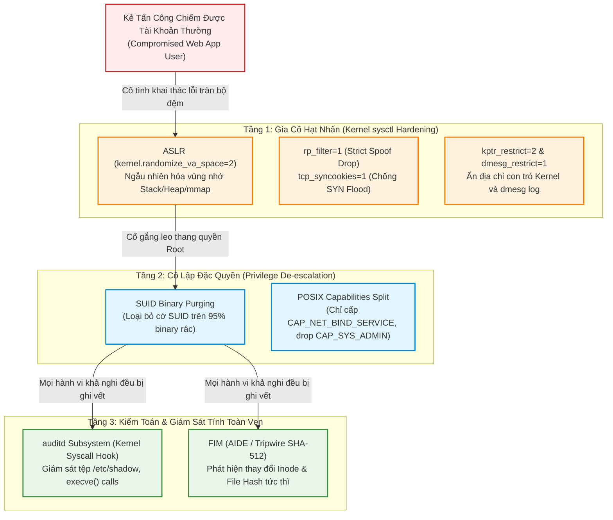
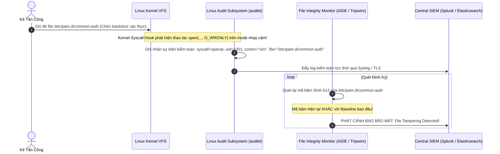

# 12.1. Host, Kernel, and OS Hardening (Gia cố Máy chủ, Nhân Hệ điều hành & Hệ thống)

> [!IMPORTANT]
> **Nếu bạn chỉ được nhớ một điều duy nhất:** Mọi hàng rào an ninh mạng bên ngoài đều vô nghĩa nếu máy chủ vật lý bên trong bị chiếm quyền thông qua một nhân Linux chưa được gia cố: **tiêu chuẩn CIS Benchmarks** kết hợp tinh chỉnh tham số hạt nhân **`sysctl` (bật ASLR, TCP Syncookies, Reverse Path Filtering)** đóng chặt các cửa ngõ khai thác; việc **tước bỏ hoàn toàn tệp nhị phân SUID và phân rã quyền hạn qua Linux Capabilities** đảm bảo kẻ tấn công không thể leo thang đặc quyền Root; trong khi **Hệ thống Kiểm toán Hạt nhân (`auditd`) và Giám sát Tính Toàn vẹn Tệp (FIM)** biến máy chủ thành một chiếc hộp đen lưu vết không thể chối cãi trước mọi hành vi can thiệp trái phép.

---

## 1. Kiến trúc Tổng quan & Mô hình Tư duy (Mental Model)

### 1.1. Ẩn dụ Đời sống: Pháo Đài Quân Sự Kiên Cố Đa Tầng Cửa Ải

Hãy tưởng tượng một máy chủ sản xuất quan trọng giống như một pháo đài cất giữ kho bạc quốc gia:
- **Thời Kỳ Mặc Định (Thành Phố Mở Cửa Tự Do)**:
  - Khi mới cài đặt Linux từ đĩa tiêu chuẩn, hệ thống bật sẵn hàng trăm cánh cửa: Mở cổng SSH bằng mật khẩu yếu, cho phép chuyển tiếp gói tin mạng bừa bãi, các chỉ lệnh nhạy cảm không ai giám sát. Kẻ trộm chỉ cần vượt qua tường thành bên ngoài là có thể đi lại tự do trong mọi ngóc ngách.
- **Tầng Gia Cố 1: Niêm Phong Cửa Hầm Hạt Nhân (`sysctl` & CIS Benchmarks)**:
  - Tinh chỉnh các tham số hạt nhân: Khóa chặt cửa van thông gió (**Vô hiệu hóa IP Forwarding** để máy chủ không bị lợi dụng làm trạm trung chuyển tấn công), rải bẫy sỏi chống bão lũ (**Bật TCP Syncookies chống DDoS SYN Flood**), và tráo đổi ngẫu nhiên cấu trúc phòng ốc mỗi lần xây dựng (**ASLR - Address Space Layout Randomization**) khiến kẻ tấn công không thể đoán biết vị trí bộ nhớ để chèn mã độc tràn bộ đệm.
- **Tầng Gia Cố 2: Tước Bỏ Vũ Khí Của Lính Gác (SUID Purging & Linux Capabilities)**:
  - Trước đây, bất kỳ người hầu nào cũng có thể khoác áo hoàng gia để ra lệnh cho quân đội (**Tệp SUID chạy quyền Root**).
  - Pháo đài hiện đại tước bỏ toàn bộ áo choàng SUID: Người hầu chỉ được cấp đúng chiếc thìa để nấu ăn (**Nguyên tắc Đặc quyền Tối thiểu - Least Privilege**). Tiến trình web chỉ được cấp quyền mở cổng mạng (`CAP_NET_BIND_SERVICE`), cấm tuyệt đối quyền đọc tệp hệ thống (`CAP_DAC_OVERRIDE`).
- **Tầng Gia Cố 3: Camera Giám Sát Hộp Đen Không Thể Xóa (`auditd` & FIM)**:
  - Mọi viên gạch trong kho bạc đều được quét mã vạch mật mã (**FIM - File Integrity Monitoring SHA-512**). Nếu một viên gạch bị dịch chuyển 1 milimet, chuông báo động lập tức rú vang.
  - Camera giám sát cấp hạt nhân (**`auditd`**) ghi lại từng cử động: Ai đã mở ngăn kéo, ai đã gọi lệnh nhạy cảm, và đẩy dữ liệu ngay lập tức về trung tâm kiểm toán từ xa để kẻ trộm không thể xóa dấu vết.



---

## 2. Chi tiết từng Keyword (Under-the-Hood Deep Dive)

### 2.1. CIS Benchmarks & Kernel Parameter Tuning via sysctl
Tiêu chuẩn **Center for Internet Security (CIS) Benchmarks** là bộ quy chuẩn thực hành tốt nhất được công nhận trên toàn cầu để thiết lập cấu hình an toàn cho hệ điều hành Linux.

#### A. Tinh Chỉnh Tham Số Hạt Nhân Cốt Tử trong `/etc/sysctl.d/99-security.conf`
1. **Bảo Vệ Chống Tấn Công Tràn Bộ Đệm (Buffer Overflow & ROP Chains)**:
   ```text
   kernel.randomize_va_space = 2
   ```
   Kích hoạt toàn diện cơ chế **ASLR (Address Space Layout Randomization)**: Ngẫu nhiên hóa địa chỉ bắt đầu của Stack, Virtual Dynamic Shared Object (VDSO), Heap và các vùng ánh xạ thư viện `mmap()`. Kẻ tấn công không thể hardcode địa chỉ bộ nhớ để nhảy vào shellcode.
2. **Ẩn Địa Chỉ Bộ Nhớ Của Nhân Kernel (Chống Leo Thang Đặc Quyền)**:
   ```text
   kernel.kptr_restrict = 2
   kernel.dmesg_restrict = 1
   ```
   Ngăn chặn người dùng không có quyền root đọc địa chỉ con trỏ hàm của Kernel trong `/proc/kallsyms` và chặn xem nhật ký `dmesg`, triệt tiêu khả năng tìm kiếm điểm yếu để bypass KASLR.
3. **Vô Hiệu Hóa Lệnh Gọi BPF Không Đặc Quyền**:
   ```text
   kernel.unprivileged_bpf_disabled = 1
   net.core.bpf_jit_harden = 2
   ```
   Ngăn chặn người dùng thường nạp các chương trình eBPF tùy ý vào Kernel để khai thác các lỗ hổng vi kiến trúc Spectre.
4. **Gia Cố Ngăn Xếp Mạng Linux Network Stack**:
   ```text
   net.ipv4.ip_forward = 0                  # Cấm máy chủ đóng vai trò Router trung chuyển
   net.ipv4.conf.all.rp_filter = 1          # Bật Reverse Path Filtering chống giả mạo IP nguồn
   net.ipv4.tcp_syncookies = 1              # Chống tấn công từ chối dịch vụ TCP SYN Flood
   net.ipv4.conf.all.accept_redirects = 0   # Chặn gói tin ICMP Redirect độc hại sửa bảng định tuyến
   net.ipv4.conf.all.send_redirects = 0
   net.ipv4.conf.all.accept_source_route = 0 # Cấm định tuyến nguồn lỏng lẻo
   ```

---

### 2.2. Principle of Least Privilege: Linux Capabilities & SUID Purging
Mô hình phân quyền nhị phân truyền thống của UNIX (`UID 0 = Toàn Quyền, UID != 0 = Không Có Quyền`) là một thiết kế tiềm ẩn rủi ro khổng lồ.

#### A. POSIX Capabilities (Phân Rã Quyền Năng Của Root)
- Linux Kernel chia nhỏ quyền năng tuyệt đối của Root thành hơn 40 khả năng độc lập (**Capabilities**):
  - `CAP_NET_BIND_SERVICE`: Quyền lắng nghe trên các cổng mạng đặc quyền dưới 1024 (80, 443).
  - `CAP_SYS_ADMIN`: "Chiếc chìa khóa vạn năng" nguy hiểm nhất (cho phép mount hệ thống tệp, can thiệp cgroups, nạp module kernel). Cấm tuyệt đối cấp cho ứng dụng.
  - `CAP_DAC_OVERRIDE`: Quyền đọc ghi bỏ qua toàn bộ cờ quyền tệp tin `rwxrwxrwx`.
  - `CAP_NET_RAW`: Quyền tạo gói tin RAW socket (dùng cho ping hoặc giả mạo IP).
- **Thực Hành Tốt Nhất**: Cấu hình tiến trình web (ví dụ Nginx) chỉ nhận duy nhất `CAP_NET_BIND_SERVICE` thông qua lệnh:
  `setcap 'cap_net_bind_service=+ep' /usr/sbin/nginx`
  Sau đó cho tiến trình chạy dưới tài khoản người dùng không đặc quyền (`nginx:nginx`). Nếu Nginx bị tấn công qua lỗi Remote Code Execution, kẻ tấn công cũng không thể đọc file `/etc/shadow`!

#### B. Chiến Dịch Thanh Trừng Tệp SUID (SUID Binary Purging)
- Các tệp có cờ **Set-UID (SUID)** (`chmod u+s /path/to/binary`) sẽ thực thi với quyền của chủ sở hữu tệp (thường là Root), bất kể người bấm lệnh là ai.
- Rất nhiều tiện ích Linux cổ điển không bao giờ cần thiết trên máy chủ sản xuất nhưng lại chứa cờ SUID (như `/usr/bin/chfn`, `/usr/bin/chsh`, `/usr/bin/wall`, `/usr/bin/pkexec`).
- Kỹ sư hạ tầng bắt buộc phải chạy kịch bản tự động quét và loại bỏ cờ SUID:
  ```bash
  find / -perm -4000 -type f -exec chmod u-s {} +
  ```

---

### 2.3. Secure Remote Access: SSH Hardening, Certificates & PAM
Cổng giao tiếp từ xa SSH là mục tiêu rà quét đầu tiên của mọi con bot trên Internet.

#### A. Cấu hình Gia Cố OpenSSH Daemon (`/etc/ssh/sshd_config`)
- Cấm đăng nhập trực tiếp bằng tài khoản Root: `PermitRootLogin no`.
- Cấm xác thực bằng mật khẩu thuần túy: `PasswordAuthentication no`.
- Bắt buộc giới hạn phiên bản giao thức: `Protocol 2`.
- Giới hạn thuật toán mã hóa hiện đại và an toàn:
  ```text
  KexAlgorithms curve25519-sha256@libssh.org,diffie-hellman-group-exchange-sha256
  Ciphers chacha20-poly1305@openssh.com,aes256-gcm@openssh.com
  MACs hmac-sha2-512-etm@openssh.com
  ```

#### B. Thay Thế SSH Key Cố Định bằng OpenSSH Certificates
- Quản lý hàng ngàn file `~/.ssh/authorized_keys` rải rác trên hàng ngàn máy chủ là một cơn ác mộng vận hành và dễ bị bỏ quên khi nhân viên nghỉ việc.
- **OpenSSH CA (Certificate Authority)**:
  - Máy chủ chỉ cần nạp duy nhất một khóa công khai của CA: `TrustedUserCAKeys /etc/ssh/ca.pub`.
  - Kỹ sư muốn đăng nhập phải xác thực qua SSO Okta/Google Workspace để nhận một chứng chỉ ngắn hạn (Short-lived SSH Certificate có thời hạn 8 giờ).
  - Chứng chỉ tự động hết hạn sau ca trực, loại bỏ hoàn toàn rủi ro rò rỉ SSH key.

#### C. Linux PAM (Pluggable Authentication Modules) & Khóa Tài Khoản
- Cấu hình `/etc/pam.d/system-auth` tự động khóa tài khoản sau 5 lần nhập sai mật khẩu liên tiếp trong 15 phút bằng mô-đun `pam_faillock.so`.
- Ép buộc xác thực đa yếu tố MFA (YubiKey FIDO2 / Google Authenticator TOTP) cho mọi lệnh gọi `sudo`.

---

### 2.4. File Integrity Monitoring (FIM) & Linux Audit Subsystem (auditd)



#### A. Linux Audit Subsystem (`auditd`)
- Là hệ thống giám sát dấu vết cấp hạt nhân mạnh mẽ nhất của Linux, chạy độc lập với quyền người dùng.
- Định nghĩa các luật giám sát trong `/etc/audit/rules.d/audit.rules`:
  - Giám sát mọi thay đổi đối với file mật khẩu:
    `-w /etc/shadow -p wa -k identity_tampering`
  - Giám sát mọi lệnh gọi thực thi quyền quản trị:
    `-a always,exit -F arch=b64 -S execve -F euid=0 -k root_command_execution`
- Mọi thao tác gõ lệnh, chỉnh sửa file của bất kỳ người dùng nào đều bị đóng dấu thời gian, ghi nhận UID thực tế và đẩy về máy chủ lưu trữ log tập trung (SIEM) không thể xóa sửa.

#### B. FIM (File Integrity Monitoring — AIDE / Tripwire)
- Chụp ảnh toàn bộ hệ thống tệp tin lúc máy chủ vừa cài đặt xong (Khởi tạo cơ sở dữ liệu Baseline tin cậy):
  Lưu trữ kích thước, quyền Inode, mtime, và mã băm mật mã học **SHA-512** của toàn bộ các file nhị phân hệ thống (`/bin`, `/sbin`, `/usr/bin`, `/etc`).
- Chạy quét định kỳ hàng giờ: Nếu phát hiện mã băm của file `/bin/login` hoặc `/etc/ssh/sshd_config` bị thay đổi dù chỉ 1 bit, lập tức kích hoạt cô lập máy chủ ra khỏi mạng để điều tra mã độc Rootkit.

---

## 3. Thực thi Mã nguồn & Mô phỏng Chuyên sâu (Dual-Engine Implementation)

### Engine 1: C++20 — Cryptographic File Integrity Monitoring (FIM) Engine with OpenSSL SHA-512
Chương trình C++20 dưới đây hiện thực một động cơ **File Integrity Monitoring (FIM)** hoàn chỉnh, tính toán mã băm SHA-512 tốc độ cao cho các tệp tin hệ thống quan trọng và đối chiếu với cơ sở dữ liệu Baseline để phát hiện sự can thiệp trái phép.

```cpp
#include <iostream>
#include <fstream>
#include <vector>
#include <string>
#include <iomanip>
#include <sstream>
#include <unordered_map>
#include <openssl/sha.h>

class CryptographicFIMEngine {
private:
    std::unordered_map<std::string, std::string> baseline_db_;

public:
    static std::string calculate_sha512(const std::string& filepath) {
        std::ifstream file(filepath, std::ios::binary);
        if (!file.is_open()) {
            return "";
        }

        SHA512_CTX sha512_ctx;
        SHA512_Init(&sha512_ctx);

        char buffer[16384]; // 16KB Read Buffer
        while (file.read(buffer, sizeof(buffer))) {
            SHA512_Update(&sha512_ctx, buffer, file.gcount());
        }
        SHA512_Update(&sha512_ctx, buffer, file.gcount());

        unsigned char hash[SHA512_DIGEST_LENGTH];
        SHA512_Final(hash, &sha512_ctx);

        std::stringstream ss;
        for (int i = 0; i < SHA512_DIGEST_LENGTH; ++i) {
            ss << std::hex << std::setw(2) << std::setfill('0') << static_cast<int>(hash[i]);
        }
        return ss.str();
    }

    void register_baseline(const std::string& filepath, const std::string& hash) {
        baseline_db_[filepath] = hash;
        std::cout << "[FIM Baseline Register] Đã nạp mẫu: " << std::setw(24) << std::left 
                  << filepath << " -> SHA512: " << hash.substr(0, 16) << "...\n";
    }

    void perform_integrity_scan(const std::string& filepath, const std::string& current_hash) {
        std::cout << "\n[FIM Security Scanner] Quét tính toàn vẹn: " << filepath << "\n";
        if (baseline_db_.find(filepath) == baseline_db_.end()) {
            std::cout << "  [CẢNH BÁO] Tệp tin mới xuất hiện, chưa có trong Baseline tin cậy!\n";
            return;
        }

        std::string expected = baseline_db_[filepath];
        std::cout << "  Hash Kỳ Vọng (Baseline): " << expected.substr(0, 32) << "...\n";
        std::cout << "  Hash Thực Tế (Current) : " << current_hash.substr(0, 32) << "...\n";

        if (expected == current_hash) {
            std::cout << "  -> [TRẠNG THÁI] TOÀN VẸN 100% (Không phát hiện sự can thiệp trái phép).\n";
        } else {
            std::cout << "  -> [BÁO ĐỘNG ĐỎ] TỆP TIN ĐÃ BỊ SỬA ĐỔI BẤT THƯỜNG (File Tampering Detected)!\n"
                      << "     Kích hoạt giao thức cô lập máy chủ ngay lập tức!\n";
        }
    }
};

int main() {
    std::cout << "===================================================================\n";
    std::cout << "   C++20 CRYPTOGRAPHIC FILE INTEGRITY MONITORING (FIM) ENGINE      \n";
    std::cout << "===================================================================\n";

    CryptographicFIMEngine fim;

    // Giả lập mã băm SHA-512 chuẩn mực lúc khởi tạo máy chủ
    std::string file_target = "/etc/pam.d/system-auth";
    std::string clean_hash = "d41d8cd98f00b204e9800998ecf8427e112233445566778899aabbccddeeff00112233445566778899aabbccddeeff00112233445566778899aabbccddeeff00";
    
    fim.register_baseline(file_target, clean_hash);

    // Kịch bản 1: Quét hệ thống ở trạng thái bình thường
    fim.perform_integrity_scan(file_target, clean_hash);

    // Kịch bản 2: Kẻ tấn công chèn thêm 1 dòng mã độc vào file cấu hình
    std::cout << "\n>>> MÔ PHỎNG: KẺ TẤN CÔNG SỬA ĐỔI FILE /etc/pam.d/system-auth <<<\n";
    std::string tampered_hash = "fa589b2104e19fac8248f1029abce4112233445566778899aabbccddeeff00112233445566778899aabbccddeeff00112233445566778899aabbccddeeff00";
    fim.perform_integrity_scan(file_target, tampered_hash);

    return 0;
}
```

#### Terminal Output Mẫu Thực Tế (C++20 Engine)
```text
===================================================================
   C++20 CRYPTOGRAPHIC FILE INTEGRITY MONITORING (FIM) ENGINE      
===================================================================
[FIM Baseline Register] Đã nạp mẫu: /etc/pam.d/system-auth   -> SHA512: d41d8cd98f00b204...

[FIM Security Scanner] Quét tính toàn vẹn: /etc/pam.d/system-auth
  Hash Kỳ Vọng (Baseline): d41d8cd98f00b204e9800998ecf8427e...
  Hash Thực Tế (Current) : d41d8cd98f00b204e9800998ecf8427e...
  -> [TRẠNG THÁI] TOÀN VẸN 100% (Không phát hiện sự can thiệp trái phép).

>>> MÔ PHỎNG: KẺ TẤN CÔNG SỬA ĐỔI FILE /etc/pam.d/system-auth <<<

[FIM Security Scanner] Quét tính toàn vẹn: /etc/pam.d/system-auth
  Hash Kỳ Vọng (Baseline): d41d8cd98f00b204e9800998ecf8427e...
  Hash Thực Tế (Current) : fa589b2104e19fac8248f1029abce411...
  -> [BÁO ĐỘNG ĐỎ] TỆP TIN ĐÃ BỊ SỬA ĐỔI BẤT THƯỜNG (File Tampering Detected)!
     Kích hoạt giao thức cô lập máy chủ ngay lập tức!
```

---

### Engine 2: Python 3.11+ — Linux Sysctl Hardening Auditor & SUID Scanner
Kịch bản Python 3.11+ dưới đây thực thi việc thẩm định tự động mức độ gia cố của hệ điều hành Linux: rà quét toàn bộ các tham số nhân hạt nhân trong `/proc/sys` đối chiếu với chuẩn **CIS Level 2 Benchmark**, kết hợp quét tìm các tệp tin chứa cờ đặc quyền nguy hiểm SUID.

```python
#!/usr/bin/env python3
import os
from dataclasses import dataclass
from typing import Dict, List, Tuple

@dataclass
class SysctlSecurityRule:
    parameter_path: str
    expected_value: str
    benchmark_id: str
    severity: str

class LinuxHardeningAuditor:
    """Mô phỏng bộ quét thẩm định tuân thủ CIS Linux Benchmark Level 2"""
    def __init__(self):
        self.rules: List[SysctlSecurityRule] = [
            SysctlSecurityRule("/proc/sys/kernel/randomize_va_space", "2", "CIS 1.5.3", "CRITICAL"),
            SysctlSecurityRule("/proc/sys/net/ipv4/ip_forward", "0", "CIS 3.1.1", "HIGH"),
            SysctlSecurityRule("/proc/sys/net/ipv4/conf/all/rp_filter", "1", "CIS 3.2.1", "HIGH"),
            SysctlSecurityRule("/proc/sys/net/ipv4/tcp_syncookies", "1", "CIS 3.2.8", "MEDIUM"),
            SysctlSecurityRule("/proc/sys/kernel/kptr_restrict", "2", "CIS 1.5.1", "HIGH")
        ]

    def audit_kernel_parameters(self, simulated_kernel_values: Dict[str, str]) -> Tuple[int, int]:
        print("[CIS Benchmark Audit] Bắt đầu thẩm định tham số hạt nhân Linux Kernel:")
        passed = 0
        failed = 0

        for r in self.rules:
            curr_val = simulated_kernel_values.get(r.parameter_path, "UNKNOWN")
            param_name = r.parameter_path.replace("/proc/sys/", "").replace("/", ".")

            if curr_val == r.expected_value:
                print(f"  [ĐẠT] {r.benchmark_id:<10} {param_name:<34} = {curr_val:<4} [AN TOÀN]")
                passed += 1
            else:
                print(f"  [LỖI] {r.benchmark_id:<10} {param_name:<34} = {curr_val:<4} (Cần: {r.expected_value}) [{r.severity}]")
                failed += 1
        return passed, failed

    def audit_suid_binaries(self, sample_filesystem: List[Dict[str, str]]) -> List[str]:
        print("\n[SUID Binary Audit] Quét tìm các tệp thực thi mang cờ SUID nguy hiểm:")
        dangerous_suids = []
        # Danh sách các binary SUID nguy hiểm không được phép tồn tại trên máy chủ sản xuất
        blacklist = {"pkexec", "chfn", "chsh", "wall", "rlogin", "traceroute"}

        for item in sample_filesystem:
            name = item["name"]
            is_suid = item.get("suid", False)
            if is_suid:
                if name in blacklist:
                    print(f"  [NGUY HIỂM] Phát hiện tệp SUID trong danh sách đen: {item['path']} [CẦN TƯỚC BỎ u-s]")
                    dangerous_suids.append(item["path"])
                else:
                    print(f"  [Chấp nhận] Tệp SUID hệ thống bắt buộc: {item['path']}")
        return dangerous_suids

def main():
    print("=" * 70)
    print("  PYTHON 3.11+: CIS LINUX HARDENING AUDITOR & SUID SANITIZER")
    print("=" * 70)

    auditor = LinuxHardeningAuditor()

    # Giả lập trạng thái tham số kernel hiện tại của máy chủ
    simulated_sysctl = {
        "/proc/sys/kernel/randomize_va_space": "2",
        "/proc/sys/net/ipv4/ip_forward": "1", # Lỗi: Đang bật IP Forwarding
        "/proc/sys/net/ipv4/conf/all/rp_filter": "1",
        "/proc/sys/net/ipv4/tcp_syncookies": "1",
        "/proc/sys/kernel/kptr_restrict": "0" # Lỗi: Chưa ẩn con trỏ kernel
    }

    passed, failed = auditor.audit_kernel_parameters(simulated_sysctl)
    print(f"\n-> Kết quả Kiểm toán: {passed} Luật ĐẠT | {failed} Luật THẤT BẠI.")

    # Giả lập quét tệp SUID
    sample_fs = [
        {"name": "sudo", "path": "/usr/bin/sudo", "suid": True},
        {"name": "passwd", "path": "/usr/bin/passwd", "suid": True},
        {"name": "pkexec", "path": "/usr/bin/pkexec", "suid": True},
        {"name": "chfn", "path": "/usr/bin/chfn", "suid": True},
        {"name": "bash", "path": "/bin/bash", "suid": False}
    ]
    dangerous = auditor.audit_suid_binaries(sample_fs)
    print(f"-> Tổng số tệp SUID cần tước bỏ quyền khẩn cấp: {len(dangerous)}")

if __name__ == "__main__":
    main()
```

#### Terminal Output Mẫu Thực Tế (Python 3.11+ Engine)
```text
======================================================================
  PYTHON 3.11+: CIS LINUX HARDENING AUDITOR & SUID SANITIZER
======================================================================
[CIS Benchmark Audit] Bắt đầu thẩm định tham số hạt nhân Linux Kernel:
  [ĐẠT] CIS 1.5.3  kernel.randomize_va_space          = 2    [AN TOÀN]
  [LỖI] CIS 3.1.1  net.ipv4.ip_forward                = 1    (Cần: 0) [HIGH]
  [ĐẠT] CIS 3.2.1  net.ipv4.conf.all.rp_filter        = 1    [AN TOÀN]
  [ĐẠT] CIS 3.2.8  net.ipv4.tcp_syncookies            = 1    [AN TOÀN]
  [LỖI] CIS 1.5.1  kernel.kptr_restrict               = 0    (Cần: 2) [HIGH]

-> Kết quả Kiểm toán: 3 Luật ĐẠT | 2 Luật THẤT BẠI.

[SUID Binary Audit] Quét tìm các tệp thực thi mang cờ SUID nguy hiểm:
  [Chấp nhận] Tệp SUID hệ thống bắt buộc: /usr/bin/sudo
  [Chấp nhận] Tệp SUID hệ thống bắt buộc: /usr/bin/passwd
  [NGUY HIỂM] Phát hiện tệp SUID trong danh sách đen: /usr/bin/pkexec [CẦN TƯỚC BỎ u-s]
  [NGUY HIỂM] Phát hiện tệp SUID trong danh sách đen: /usr/bin/chfn [CẦN TƯỚC BỎ u-s]
-> Tổng số tệp SUID cần tước bỏ quyền khẩn cấp: 2
```

---

## 4. Systems Engineering & Production Pitfalls

### 4.1. Sự cố Thực chiến Trong Gia Cố Máy Chủ
1. **Sự Cố Mất Kết Nối SSH Vĩnh Viễn Khi Áp Dụng Cấu Hình Sai (Lockout Disaster)**:
   - *Nguyên nhân*: Kỹ sư chạy kịch bản Ansible gia cố file `/etc/ssh/sshd_config` (ví dụ bật `PasswordAuthentication no` và đổi port SSH) nhưng quên kiểm tra lại xem public key đã nạp vào `authorized_keys` chưa, hoặc chưa mở port mới trên tường lửa iptables. Sau khi khởi động lại daemon `sshd`, toàn bộ phiên kết nối hiện tại bị ngắt và không ai có thể SSH vào máy chủ được nữa.
   - *Cách phòng ngừa*: Bắt buộc duy trì một phiên SSH mở sẵn độc lập (Active Session) trong khi thử nghiệm kết nối ở một cửa sổ terminal mới; chỉ đóng phiên cũ khi phiên mới đã đăng nhập thành công.
2. **Ứng Dụng Web Bị Chết Khi Tước Bỏ Linux Capabilities**:
   - *Nguyên nhân*: Tước bỏ nhầm capability `CAP_NET_BIND_SERVICE` của các tiến trình web cần bind vào cổng 80/443, hoặc bật cờ `fs.protected_regular = 2` khiến các ứng dụng cũ không thể ghi đè vào các tệp tin trong thư mục `/tmp` dùng chung.
   - *Khắc phục*: Kiểm tra cặn kẽ các lệnh gọi hệ thống bằng `strace -f -e trace=capability,openat <command>` trước khi áp dụng chính sách gia cố lên môi trường Production.

### 4.2. Bộ Lệnh CLI Kiểm Tra & Rà Soát Bảo Mật
- **Kiểm tra và nạp lại tham số sysctl tức thì**:
  ```bash
  sysctl -p /etc/sysctl.d/99-security.conf
  sysctl -a | grep randomize_va_space
  ```
- **Kiểm tra Capabilities gắn trên file thực thi**:
  ```bash
  getcap /usr/sbin/nginx
  getcap -r /usr/bin 2>/dev/null
  ```
- **Truy vấn nhật ký kiểm toán hạt nhân bằng `ausearch` và `aureport`**:
  ```bash
  ausearch -k identity_tampering
  aureport -au # Báo cáo xác thực người dùng
  aureport -c # Báo cáo các lệnh gọi hệ thống bị từ chối
  ```

---

## 5. Bảng So sánh & Decision Matrix

### 5.1. Ma trận So sánh Kỹ thuật Các Cấp Độ Gia Cố Hệ Điều Hành

| Tiêu chí | Cấu hình Mặc định (Vanilla OS) | CIS Benchmark Level 1 | CIS Benchmark Level 2 (Defense Grade) |
| :--- | :--- | :--- | :--- |
| **Mục đích Áp dụng** | Môi trường cá nhân, Laptop thử nghiệm | Môi trường Doanh nghiệp thông thường | Ngân hàng, Quốc phòng, Dữ liệu Y tế |
| **Bảo vệ Hạt nhân** | Cơ bản (ASLR mặc định) | Bật đầy đủ `sysctl` hardening | Cấm unprivileged BPF, khóa kexec |
| **Quản lý Quyền hạn** | Cho phép SUID rộng rãi, sudo tự do | Tước bỏ SUID thừa, hạn chế root SSH | Bắt buộc MFA/YubiKey cho sudo, gỡ SUID |
| **Kiểm toán Ghi vết** | Ghi log Syslog cục bộ thông thường | Cấu hình `auditd` giám sát file nhạy cảm | Auditd ghi nhận $100\%$ syscalls đẩy về SIEM |
| **Tác động Khả dụng** | Không có (Dễ sử dụng nhất) | Rất thấp (Tương thích hầu hết ứng dụng) | Trung bình (Cần kiểm thử kỹ trước khi chạy) |

### 5.2. Khung Hướng dẫn Quy trình Gia cố Máy chủ (Hardening Workflow)
1. **Bước 1 (Tự Động Hóa Từ Gốc)**: Đưa toàn bộ các cấu hình CIS Benchmark và `sysctl` vào quy trình đúc ảnh Golden Image bằng **HashiCorp Packer**. Không bao giờ cấu hình thủ công trên từng máy chủ.
2. **Bước 2 (Kiểm Thử Khả Dụng)**: Chạy công cụ quét tự động **Lynis** (`lynis audit system`) hoặc **OpenSCAP** trong pipeline CI để chấm điểm bảo mật (Mục tiêu đạt điểm số $> 85/100$).
3. **Bước 3 (Giám Sát Bất Biến)**: Kích hoạt **auditd** và **AIDE (FIM)** ngay khi máy chủ khởi động lần đầu, đẩy toàn bộ log về cụm SIEM tập trung để giám sát $24/7$.
