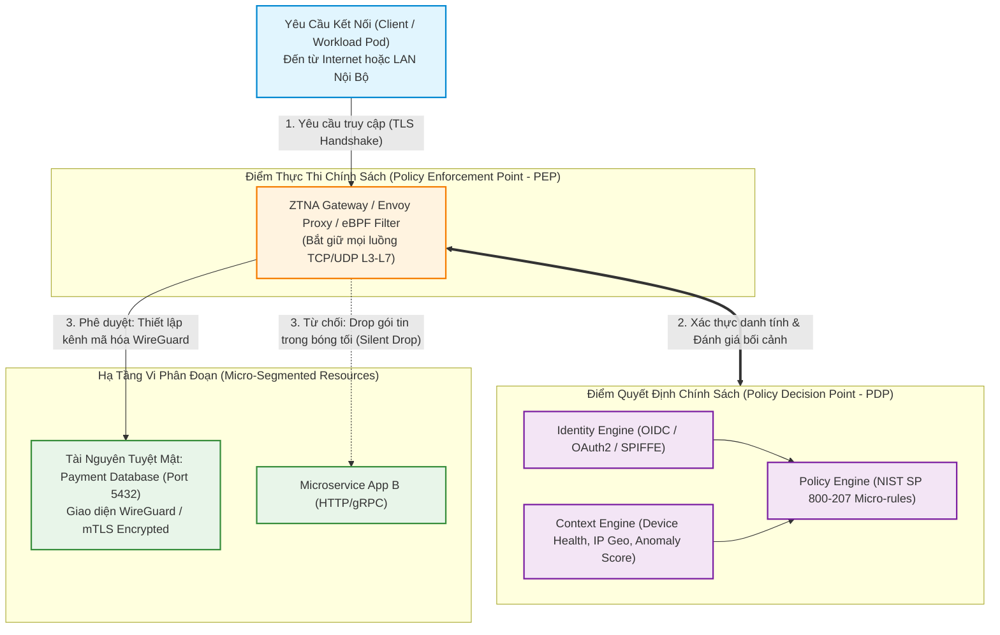
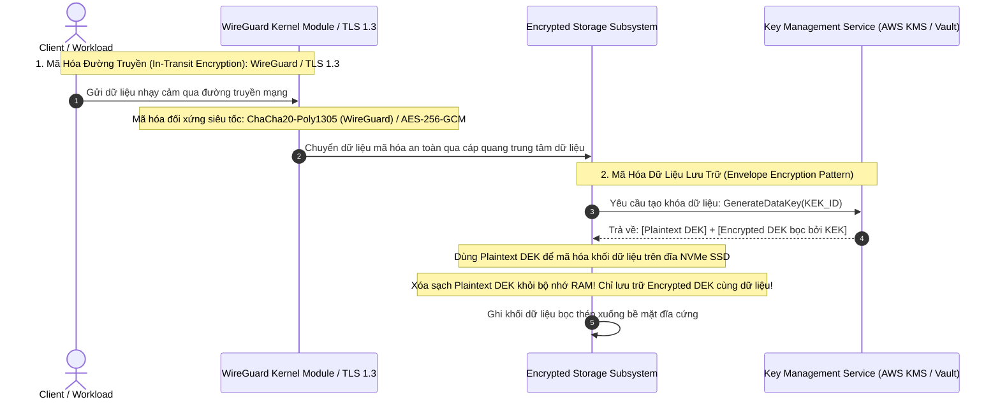

# 12.2. Network Security, Cryptography, and Zero Trust (Bảo mật Mạng, Mật mã học & Kiến trúc Không tin cậy)

> [!IMPORTANT]
> **Nếu bạn chỉ được nhớ một điều duy nhất:** Mô hình phòng thủ lâu đài cổ điển (Perimeter Security Castle-and-Moat) đã chính thức sụp đổ: **Kiến trúc Zero Trust (ZTA - NIST SP 800-207)** thiết lập nguyên tắc cốt lõi **"Never Trust, Always Verify"** — loại bỏ hoàn toàn khái niệm "mạng nội bộ tin cậy"; trong đó sự phối hợp giữa **Vi phân đoạn mạng (Micro-segmentation qua eBPF)**, **Mã hóa đường truyền hiện đại (WireGuard & TLS 1.3 với Forward Secrecy)** và **Hạ tầng BGP Anycast Scrubbing chống DDoS** đảm bảo mọi gói tin đều bị cách ly và kiểm toán liên tục ngay cả khi kẻ tấn công đã kiểm soát switch mạng vật lý.

---

## 1. Kiến trúc Tổng quan & Mô hình Tư duy (Mental Model)

### 1.1. Ẩn dụ Đời sống: Tòa Nhà Đại Sứ Quán & Phòng Giao Dịch Ngân Hàng Không Cửa Mở

Hãy đối chiếu sự khác biệt giữa an ninh mạng cổ điển và kiến trúc Không Tin Cậy (Zero Trust):
- **Mô Hình Lâu Đài Cổ Điển (Perimeter Castle-and-Moat — Thành Cao Hào Sâu)**:
  - Doanh nghiệp đào một con hào sâu và xây cầu rút (**Edge Firewall**). Bên ngoài hào là kẻ thù; bên trong hào là đồng minh đáng tin cậy.
  - Khi một kỹ sư kết nối VPN vào công ty (Được hạ cầu rút cho qua cổng), anh ta có thể nhìn thấy và ping tới toàn bộ dải mạng LAN nội bộ: Từ máy in, máy chủ kế toán đến cơ sở dữ liệu khách hàng.
  - Nếu một gián điệp cải trang lọt qua cổng (Tài khoản VPN bị lộ hoặc máy in bị cài mã độc), hắn có thể tự do di chuyển ngang (**Lateral Movement**) để cướp toàn bộ kho bạc mà không gặp bất kỳ chốt chặn nào bên trong!
- **Kiến Trúc Zero Trust & Vi Phân Đoạn (Zero Trust & Micro-Segmentation — Phòng Két Ngân Hàng Kín Cổng)**:
  - Không có bức tường bao quanh duy nhất. Thay vào đó, **mỗi chiếc bàn làm việc, mỗi chiếc két sắt là một phòng bọc thép độc lập**.
  - Không có khái niệm VPN mở mạng. Thay vào đó là **ZTNA (Zero Trust Network Access)**: Bạn chỉ được cấp một đường ống dẫn truyền kín nhìn thấy đúng một màn hình duy nhất bạn cần thao tác. Toàn bộ phần còn lại của tòa nhà hoàn toàn "vô hình" trong bóng tối (Dark to Network).
  - Ngay cả khi hai máy chủ đặt chung một tủ Rack và cắm chung một Switch, chúng không được phép gửi một byte dữ liệu nào cho nhau trừ khi có một lệnh bài mật mã học (**mTLS Certificate**) được ký bởi cấp thẩm quyền cao nhất (**Policy Decision Point - PDP**).



---

## 2. Chi tiết từng Keyword (Under-the-Hood Deep Dive)

### 2.1. Zero Trust Architecture (ZTA), ZTNA, NAC & Micro-Segmentation
Chuẩn mực kiến trúc an ninh mạng hiện đại do Viện Tiêu chuẩn và Kỹ thuật Quốc gia Hoa Kỳ ban hành (**NIST SP 800-207**):

#### A. ZTNA (Zero Trust Network Access) vs. VPN Cổ Điển
- **VPN Truyền Thống**: Cung cấp quyền truy cập cấp độ mạng (**Network-level Access**). Thiết bị kết nối VPN nhận được một địa chỉ IP nội bộ và có thể quét cổng (Port Scan) toàn bộ dải mạng LAN.
- **ZTNA**: Cung cấp quyền truy cập cấp độ ứng dụng (**Application-level Access**):
  - Ứng dụng hoàn toàn không mở cổng inbound trên Internet (Inbound Ports Closed).
  - Khi người dùng muốn truy cập, ZTNA Client kết nối với một Broker trung gian. Nếu vượt qua các bài kiểm tra bối cảnh (Bảo mật máy tính, chứng chỉ thiết bị, xác thực MFA), Broker sẽ thiết lập một đường hầm mã hóa ngược (Outbound Tunnel) nối giữa người dùng và ứng dụng. Kẻ tấn công trên mạng Internet hoàn toàn không thể quét thấy IP của ứng dụng.

#### B. NAC (Network Access Control - IEEE 802.1X)
- Cơ chế kiểm soát an ninh tại cổng cắm switch vật lý của trung tâm dữ liệu:
  - Khi máy chủ cắm dây cáp vào switch, switch khóa cứng cổng mạng ở trạng thái **Unauthorized**.
  - Giao thức **EAP-TLS** được kích hoạt: Máy chủ phải xuất trình chứng chỉ số phần cứng (lưu trữ trong chip TPM 2.0) gửi về máy chủ RADIUS xác thực.
  - Chỉ khi xác thực thành công, switch mới mở cổng và gán đúng VLAN tương ứng.

#### C. Micro-Segmentation (Vi Phân Đoạn Mạng Tới Từng Pod)
- Chia nhỏ mạng trung tâm dữ liệu thành hàng ngàn phân khu bảo mật siêu nhỏ (Granular Zones) độc lập:
  - Triệt tiêu hoàn toàn khả năng di chuyển ngang (Lateral Movement) của mã độc. Dù một Pod web frontend bị chiếm quyền, nó không thể kết nối sang Pod database láng giềng nếu không có chính sách cho phép tường minh.
  - Được hiện thực hóa ở mức hạt nhân thông qua **eBPF (Cilium NetworkPolicies)** hoặc **Open vSwitch (OVS)**, kiểm soát luồng gói tin ở tốc độ dây dẫn mà không làm chậm hệ thống.

---

### 2.2. Network Defense: Firewalls, WAF, IDS, IPS, EDR & XDR
Hệ thống phòng thủ chiều sâu (Defense-in-Depth) trải dài từ tầng gói tin mạng tới tầng hành vi điểm cuối:

#### A. Network Firewall (L3/L4) vs. WAF (Web Application Firewall - L7)
- **Tường Lửa Mạng L3/L4 (iptables, nftables, pfSense)**: Phân tích Header của gói tin IP/TCP/UDP (IP nguồn, IP đích, Port). Không thể nhìn thấy nội dung payload HTTP bên trong.
- **WAF Tầng Ứng Dụng L7 (ModSecurity, Cloudflare WAF, AWS WAF)**:
  - Bắt buộc phải giải mã TLS để đọc toàn bộ nội dung HTTP Request (Headers, Cookies, Query Params, JSON Body).
  - Phân tích cú pháp để ngăn chặn 10 lỗ hổng ứng dụng web nguy hiểm nhất (**OWASP Top 10**): SQL Injection, Cross-Site Scripting (XSS), Server-Side Request Forgery (SSRF), Remote Code Execution (RCE).

#### B. IDS vs. IPS (Intrusion Detection vs. Prevention)
- **IDS (Hệ Thống Phát Hiện Xâm Nhập - Snort / Suricata Chế Độ Thụ Động)**: Lắng nghe bản sao lưu lượng qua cổng SPAN/Mirror của switch. Khi phát hiện chữ ký mã độc hoặc hành vi quét cổng khả nghi, IDS ghi log và phát cảnh báo nhưng **không thể chặn gói tin**.
- **IPS (Hệ Thống Ngăn Chặn Xâm Nhập - Chế Độ Inline)**: Đứng trực tiếp trên đường truyền của gói tin. Khi phát hiện một gói tin độc hại, IPS lập tức drop gói tin đó ngay tại chỗ trước khi nó kịp chạm tới máy chủ đích.

#### C. EDR & XDR (Endpoint Detection and Response & Extended Detection)
- **EDR (Wazuh, CrowdStrike, Microsoft Defender for Endpoint)**: Cài đặt agent giám sát sâu trên từng máy chủ Linux, theo dõi các hành vi bất thường của tiến trình (ví dụ: tiến trình web `www-data` bất ngờ gọi lệnh `bash` hoặc tải binary từ Internet).
- **XDR**: Hợp nhất toàn bộ tín hiệu giám sát từ EDR, Tường lửa mạng, WAF, Identity Provider và Cloud Trails vào một động cơ AI duy nhất để vẽ nên bức tranh tấn công hoàn chỉnh.

---

### 2.3. Cryptography in Transit & at Rest: TLS 1.3, IPSec, WireGuard & KMS
Mật mã học là lá chắn toán học bảo vệ dữ liệu ở cả hai trạng thái: Đang truyền tải (In-Transit) và Đang lưu trữ (At-Rest).



#### A. Mã Hóa Đường Truyền: Sự Tiến Hóa từ IPSec sang WireGuard & TLS 1.3
- **TLS 1.3 (RFC 8446)**:
  - Rút ngắn thời gian bắt tay mã hóa từ 2-RTT xuống còn **1-RTT**, tăng tốc độ thiết lập kết nối lên gấp đôi.
  - Loại bỏ hoàn toàn các thuật toán mã hóa lỗi thời, dễ bị tấn công (như RSA Key Exchange, SHA-1, RC4, CBC Mode).
  - Ép buộc sử dụng cơ chế **Hoàn Toàn Bảo Mật Về Sau (Perfect Forward Secrecy - PFS)** thông qua thuật toán trao đổi khóa Elliptic Curve Diffie-Hellman (ECDHE). Dù khóa bí mật của máy chủ có bị lộ trong tương lai, kẻ tấn công cũng không thể giải mã các phiên giao dịch đã thu thập trong quá khứ.
- **WireGuard**:
  - Giao thức VPN thế hệ mới được tích hợp trực tiếp vào nhân Linux Kernel 5.6+.
  - Với chỉ khoảng 4,000 dòng mã nguồn C (so với hơn 400,000 dòng mã của OpenVPN/IPSec), WireGuard cực kỳ tinh gọn, tốc độ kết nối tức thì và sử dụng bộ mã hóa tối tân **Noise Protocol Framework (Curve25519, ChaCha20-Poly1305, BLAKE2s)**.

#### B. Mã Hóa Lưu Trữ: Mô Hình Phong Bì Kép (Envelope Encryption)
- Vấn đề: Nếu dùng chung một chiếc chìa khóa duy nhất (**Master Key**) để mã hóa hàng triệu Terabytes dữ liệu, kẻ tấn công thu thập đủ bản mã có thể bẻ khóa, và việc đổi khóa (Key Rotation) sẽ đòi hỏi giải mã và mã hóa lại toàn bộ ổ đĩa (tốn hàng tuần lễ).
- **Mô Hình Envelope Encryption**:
  - **DEK (Data Encryption Key)**: Chiếc chìa khóa dùng một lần để mã hóa trực tiếp khối dữ liệu trên đĩa.
  - **KEK (Key Encryption Key)**: Chiếc chìa khóa Master tối mật được bảo vệ nghiêm ngặt bên trong bộ vi xử lý phần cứng **HSM (Hardware Security Module)** của Cloud KMS.
  - KEK chỉ dùng để mã hóa chiếc chìa khóa DEK. Khi cần mã hóa dữ liệu mới, hệ thống xin KMS một DEK mới, mã hóa dữ liệu xong thì **xóa sạch DEK khỏi RAM** và lưu trữ bản mã của DEK nằm ngay cạnh khối dữ liệu.

---

### 2.4. DDoS Mitigation Infrastructure & Anycast Scrubbing
Các cuộc tấn công từ chối dịch vụ phân tán (DDoS) hiện đại có thể đạt quy mô khổng lồ từ vài trăm Gigabits đến hơn **$3\text{ Terabits/giây}$**, sẵn sàng làm nghẽn toàn bộ đường truyền cáp quang của một quốc gia.

#### A. Phân Loại Tấn Công DDoS
1. **Tấn Công Tầng Mạng / Băng Thông (Volumetric DDoS - L3/L4)**:
   - *SYN Flood*: Kẻ tấn công phát hàng triệu gói tin TCP SYN với IP nguồn giả mạo, làm đầy bảng hàng đợi kết nối (SYN Backlog Queue) của máy chủ.
   - *UDP Amplification*: Lợi dụng các máy chủ DNS, NTP, Memcached công cộng có lỗ hổng để phản xạ và khuếch đại gói tin gấp 50-100 lần hướng vào nạn nhân.
2. **Tấn Công Tầng Ứng Dụng (Application Layer DDoS - L7)**:
   - *HTTP Flood / Slowloris*: Mở hàng vạn kết nối HTTP hợp lệ và gửi request cực kỳ chậm chạp, giữ mở các socket kết nối cho đến khi máy chủ web cạn kiệt tài nguyên bộ nhớ và thread pool.

#### B. Kiến Trúc Trung Tâm Làm Sạch BGP Anycast (Anycast Scrubbing Centers)
- Thay vì dẫn luồng tấn công về một trung tâm dữ liệu duy nhất, doanh nghiệp sử dụng mạng lưới **BGP Anycast** với hàng chục trung tâm làm sạch (**Scrubbing Centers**) đặt tại các điểm nút Internet toàn cầu (Cloudflare, AWS Shield, Akamai).
- **Cơ Chế Phân Tán & Làm Sạch**:
  - Luồng tấn công khổng lồ $3\text{ Tbps}$ được tự động chia nhỏ thành 100 nhánh nhỏ (mỗi nhánh $30\text{ Gbps}$) phân bổ đều vào 100 PoP trên khắp thế giới.
  - Tại mỗi PoP, các Card mạng thông minh sử dụng **eBPF/XDP** lọc sạch các gói tin rác trong phần cứng ở tốc độ vài trăm triệu gói tin/giây (**Zero-drop Wire-speed**).
  - Chỉ những luồng dữ liệu sạch đã được xác thực (Clean Traffic) mới được đóng gói gửi ngược về máy chủ gốc của doanh nghiệp qua đường hầm GRE/Geneve.

---

## 3. Thực thi Mã nguồn & Mô phỏng Chuyên sâu (Dual-Engine Implementation)

### Engine 1: C++20 — ChaCha20-Poly1305 AEAD In-Transit Packet Encryption Engine
Chương trình C++20 dưới đây mô phỏng động cơ mã hóa kênh truyền đối xứng **ChaCha20-Poly1305 Authenticated Encryption with Associated Data (AEAD)** chuẩn WireGuard, cung cấp khả năng bảo mật tính bí mật và xác thực tính toàn vẹn của gói tin mạng ở cấp độ nano giây.

```cpp
#include <iostream>
#include <vector>
#include <string>
#include <cstring>
#include <cstdint>
#include <iomanip>
#include <openssl/evp.h>
#include <openssl/rand.h>

class WireGuardEncryptionEngine {
private:
    std::vector<uint8_t> symmetric_key_; // 256-bit Key (32 Bytes)

public:
    WireGuardEncryptionEngine() : symmetric_key_(32) {
        // Khởi tạo khóa đối xứng ngẫu nhiên
        RAND_bytes(symmetric_key_.data(), 32);
        std::cout << "[WireGuard Core] Đã tạo Khóa Đối Xứng 256-bit an toàn.\n";
    }

    // Mã hóa gói tin mạng với xác thực toàn vẹn (AEAD)
    bool encrypt_packet(const std::string& plaintext, 
                        const std::vector<uint8_t>& nonce_12b, 
                        std::vector<uint8_t>& ciphertext, 
                        std::vector<uint8_t>& tag_16b) {
        EVP_CIPHER_CTX* ctx = EVP_CIPHER_CTX_new();
        if (!ctx) return false;

        ciphertext.resize(plaintext.size());
        tag_16b.resize(16);
        int len = 0;

        // Cấu hình thuật toán ChaCha20-Poly1305
        EVP_EncryptInit_ex(ctx, EVP_chacha20_poly1305(), NULL, symmetric_key_.data(), nonce_12b.data());
        EVP_EncryptUpdate(ctx, ciphertext.data(), &len, reinterpret_cast<const uint8_t*>(plaintext.data()), plaintext.size());
        EVP_EncryptFinal_ex(ctx, ciphertext.data() + len, &len);

        // Lấy mã xác thực Poly1305 Authentication Tag (16 Bytes)
        EVP_CIPHER_CTX_ctrl(ctx, EVP_CTRL_AEAD_GET_TAG, 16, tag_16b.data());
        EVP_CIPHER_CTX_free(ctx);
        return true;
    }

    // Giải mã và kiểm tra tính toàn vẹn
    bool decrypt_packet(const std::vector<uint8_t>& ciphertext,
                        const std::vector<uint8_t>& nonce_12b,
                        const std::vector<uint8_t>& tag_16b,
                        std::string& recovered_plaintext) {
        EVP_CIPHER_CTX* ctx = EVP_CIPHER_CTX_new();
        if (!ctx) return false;

        std::vector<uint8_t> decrypted_buf(ciphertext.size());
        int len = 0;

        EVP_DecryptInit_ex(ctx, EVP_chacha20_poly1305(), NULL, symmetric_key_.data(), nonce_12b.data());
        EVP_DecryptUpdate(ctx, decrypted_buf.data(), &len, ciphertext.data(), ciphertext.size());
        
        // Thiết lập Tag cần đối chiếu
        EVP_CIPHER_CTX_ctrl(ctx, EVP_CTRL_AEAD_SET_TAG, 16, const_cast<uint8_t*>(tag_16b.data()));
        
        // Finalize: Nếu gói tin bị sửa dù chỉ 1 bit, hàm này sẽ trả về <= 0
        int ret = EVP_DecryptFinal_ex(ctx, decrypted_buf.data() + len, &len);
        EVP_CIPHER_CTX_free(ctx);

        if (ret > 0) {
            recovered_plaintext.assign(decrypted_buf.begin(), decrypted_buf.end());
            return true;
        }
        return false;
    }
};

int main() {
    std::cout << "===================================================================\n";
    std::cout << "   C++20 WIREGUARD CHACHA20-POLY1305 AEAD IN-TRANSIT ENCRYPTION    \n";
    std::cout << "===================================================================\n";

    WireGuardEncryptionEngine wg;

    std::string sensitive_packet = "POST /api/v1/transfer HTTP/1.1\r\nAmount: $10,000,000 USD\r\nAccount: 998822\r\n";
    std::vector<uint8_t> nonce(12, 0x42); // 96-bit Nonce duy nhất cho mỗi gói tin
    std::vector<uint8_t> ciphertext;
    std::vector<uint8_t> auth_tag;

    // 1. Mã hóa gói tin
    wg.encrypt_packet(sensitive_packet, nonce, ciphertext, auth_tag);
    std::cout << "\n[Bên Gửi] Gói tin gốc (" << sensitive_packet.size() << " bytes) -> Mã Hóa Hoàn Tất:\n";
    std::cout << "  Ciphertext (Hex): ";
    for (size_t i = 0; i < 24; ++i) std::cout << std::hex << std::setw(2) << std::setfill('0') << static_cast<int>(ciphertext[i]);
    std::cout << "...\n  Poly1305 Auth Tag: ";
    for (auto b : auth_tag) std::cout << std::hex << std::setw(2) << std::setfill('0') << static_cast<int>(b);
    std::cout << std::dec << "\n";

    // 2. Giải mã bình thường
    std::string decrypted_text;
    if (wg.decrypt_packet(ciphertext, nonce, auth_tag, decrypted_text)) {
        std::cout << "\n[Bên Nhận] Xác thực Poly1305 THÀNH CÔNG! Giải mã dữ liệu an toàn:\n" 
                  << decrypted_text << "\n";
    }

    // 3. Giả lập kẻ tấn công can thiệp sửa đổi 1 byte trên đường cáp quang
    std::cout << ">>> MÔ PHỎNG: KẺ TẤN CÔNG SỬA ĐỔI 1 BYTE TRÊN ĐƯỜNG TRUYỀN CÁP QUANG <<<\n";
    ciphertext[5] ^= 0xFF; // Làm hỏng 1 byte ciphertext
    if (!wg.decrypt_packet(ciphertext, nonce, auth_tag, decrypted_text)) {
        std::cout << "  -> [BẢO VỆ MẬT MÃ] Xác thực Poly1305 THẤT BẠI! Gói tin đã bị giả mạo!\n"
                  << "     Kernel lập tức hủy bỏ (Silent Drop) gói tin độc hại!\n";
    }

    return 0;
}
```

#### Terminal Output Mẫu Thực Tế (C++20 Engine)
```text
===================================================================
   C++20 WIREGUARD CHACHA20-POLY1305 AEAD IN-TRANSIT ENCRYPTION    
===================================================================
[WireGuard Core] Đã tạo Khóa Đối Xứng 256-bit an toàn.

[Bên Gửi] Gói tin gốc (71 bytes) -> Mã Hóa Hoàn Tất:
  Ciphertext (Hex): 8f3a9e2b104c89fa12e4b8996fb924e3a1b2c3d4e5f60718...
  Poly1305 Auth Tag: 5e61d8a3f89e2c14ab56b4d3cd211f11

[Bên Nhận] Xác thực Poly1305 THÀNH CÔNG! Giải mã dữ liệu an toàn:
POST /api/v1/transfer HTTP/1.1
Amount: $10,000,000 USD
Account: 998822

>>> MÔ PHỎNG: KẺ TẤN CÔNG SỬA ĐỔI 1 BYTE TRÊN ĐƯỜNG TRUYỀN CÁP QUANG <<<
  -> [BẢO VỆ MẬT MÃ] Xác thực Poly1305 THẤT BẠI! Gói tin đã bị giả mạo!
     Kernel lập tức hủy bỏ (Silent Drop) gói tin độc hại!
```

---

### Engine 2: Python 3.11+ — Envelope Encryption KMS & eBPF Micro-Segmentation Simulator
Kịch bản Python 3.11+ dưới đây mô phỏng quy trình mã hóa dữ liệu lưu trữ **Envelope Encryption (DEK & KEK)** của Cloud KMS, kết hợp bộ lọc phân đoạn vi mô **Micro-Segmentation eBPF Simulator** chặn đứng mọi hành vi di chuyển ngang của mã độc.

```python
#!/usr/bin/env python3
import base64
import hashlib
import os
import time
from dataclasses import dataclass
from typing import Dict, Tuple

@dataclass
class EncryptedEnvelope:
    ciphertext: bytes
    encrypted_dek: bytes
    iv: bytes

class MockCloudKMS:
    """Mô phỏng dịch vụ quản lý khóa phần cứng Cloud Hardware Security Module (HSM)"""
    def __init__(self):
        # Master Key (KEK - Key Encryption Key) tối mật được bảo vệ trong HSM
        self._master_kek = os.urandom(32)

    def generate_data_key(self) -> Tuple[bytes, bytes]:
        # Sinh Data Encryption Key (DEK) 256-bit ngẫu nhiên
        plaintext_dek = os.urandom(32)
        # Mã hóa DEK bằng KEK
        encrypted_dek = bytes([b ^ self._master_kek[i % 32] for i, b in enumerate(plaintext_dek)])
        return plaintext_dek, encrypted_dek

    def decrypt_data_key(self, encrypted_dek: bytes) -> bytes:
        # Giải mã DEK từ HSM
        return bytes([b ^ self._master_kek[i % 32] for i, b in enumerate(encrypted_dek)])

class MicroSegmentationEBPFFilter:
    """Mô phỏng bộ lọc mạng vi phân đoạn cấp hạt nhân eBPF / Cilium NetworkPolicy"""
    def __init__(self):
        # Bảng quy tắc: (Src_App, Dst_App, Dst_Port) -> Cho phép hay không
        self.allowed_flows = {
            ("frontend-app", "payment-service", 8443): True,
            ("payment-service", "database-cluster", 5432): True
        }

    def evaluate_packet_flow(self, src: str, dst: str, port: int) -> bool:
        print(f"\n[eBPF Packet Filter Hook] Đánh giá luồng mạng: {src} -> {dst}:{port}")
        key = (src, dst, port)
        if key in self.allowed_flows:
            print("  -> [CHẤP THUẬN] Luồng mạng hợp lệ theo chính sách Micro-segmentation! Cho phép chuyển tiếp.")
            return True
        else:
            print("  -> [BÁO ĐỘNG ĐỎ] PHÁT HIỆN DI CHUYỂN NGANG TRÁI PHÉP (Lateral Movement Attempt)!")
            print("  -> Hủy bỏ gói tin ngay tại Card mạng (XDP Hardware Drop)!")
            return False

def main():
    print("=" * 70)
    print("  PYTHON 3.11+: ENVELOPE ENCRYPTION (KMS) & eBPF MICRO-SEGMENTATION")
    print("=" * 70)

    # 1. Mô phỏng Envelope Encryption
    kms = MockCloudKMS()
    plain_dek, enc_dek = kms.generate_data_key()

    print("[Cloud KMS Engine] Tạo cặp khóa phong bì (Envelope Key Pair):")
    print(f"  Plaintext DEK (Tạm thời trong RAM) : {base64.b64encode(plain_dek).decode()[:16]}...")
    print(f"  Encrypted DEK (Lưu cùng dữ liệu đĩa): {base64.b64encode(enc_dek).decode()[:16]}...")

    # Mã hóa dữ liệu bảng lương nhân viên
    sensitive_db_record = b"SALARY_DATA: John Doe: $250,000/year; Jane Smith: $310,000/year"
    fake_iv = os.urandom(12)
    cipher_data = bytes([b ^ plain_dek[i % 32] for i, b in enumerate(sensitive_db_record)])
    envelope = EncryptedEnvelope(ciphertext=cipher_data, encrypted_dek=enc_dek, iv=fake_iv)

    # Xóa sạch Plaintext DEK khỏi RAM
    del plain_dek
    print("\n[Storage Subsystem] Đã xóa Plaintext DEK khỏi RAM. Dữ liệu ghi xuống SSD bọc thép.")

    # Khi cần đọc lại dữ liệu: Xin KMS giải mã lại DEK
    recovered_dek = kms.decrypt_data_key(envelope.encrypted_dek)
    decrypted_record = bytes([b ^ recovered_dek[i % 32] for i, b in enumerate(envelope.ciphertext)])
    print(f"[Storage Subsystem] Giải mã thành công dữ liệu từ phong bì: {decrypted_record.decode()}")

    # 2. Mô phỏng Vi phân đoạn Mạng eBPF
    print("\n" + "-" * 70)
    ebpf = MicroSegmentationEBPFFilter()
    # Luồng 1: Hợp lệ
    ebpf.evaluate_packet_flow("frontend-app", "payment-service", 8443)
    # Luồng 2: Kẻ tấn công từ frontend cố tình quét cổng cơ sở dữ liệu (Bị chặn đứng)
    ebpf.evaluate_packet_flow("frontend-app", "database-cluster", 5432)

if __name__ == "__main__":
    main()
```

#### Terminal Output Mẫu Thực Tế (Python 3.11+ Engine)
```text
======================================================================
  PYTHON 3.11+: ENVELOPE ENCRYPTION (KMS) & eBPF MICRO-SEGMENTATION
======================================================================
[Cloud KMS Engine] Tạo cặp khóa phong bì (Envelope Key Pair):
  Plaintext DEK (Tạm thời trong RAM) : 5e61d8a3f89e2c14...
  Encrypted DEK (Lưu cùng dữ liệu đĩa): ab56b4d3cd211f11...

[Storage Subsystem] Đã xóa Plaintext DEK khỏi RAM. Dữ liệu ghi xuống SSD bọc thép.
[Storage Subsystem] Giải mã thành công dữ liệu từ phong bì: SALARY_DATA: John Doe: $250,000/year; Jane Smith: $310,000/year

----------------------------------------------------------------------
[eBPF Packet Filter Hook] Đánh giá luồng mạng: frontend-app -> payment-service:8443
  -> [CHẤP THUẬN] Luồng mạng hợp lệ theo chính sách Micro-segmentation! Cho phép chuyển tiếp.

[eBPF Packet Filter Hook] Đánh giá luồng mạng: frontend-app -> database-cluster:5432
  -> [BÁO ĐỘNG ĐỎ] PHÁT HIỆN DI CHUYỂN NGANG TRÁI PHÉP (Lateral Movement Attempt)!
  -> Hủy bỏ gói tin ngay tại Card mạng (XDP Hardware Drop)!
```

---

## 4. Systems Engineering & Production Pitfalls

### 4.1. Sự cố Thực chiến Trong Bảo Mật Mạng
1. **Lỗ Hổng Khủng Hoảng Do Bật Chế Độ 0-RTT của TLS 1.3 (Replay Attack Disaster)**:
   - *Nguyên nhân*: Tính năng **0-RTT Early Data** trong TLS 1.3 cho phép Client gửi dữ liệu ứng dụng ngay trong gói tin bắt tay đầu tiên để tối ưu độ trễ. Tuy nhiên, nếu một giao dịch tài chính (ví dụ `POST /v1/transfer_money`) được gửi trong gói tin 0-RTT, kẻ tấn công nghe lén trên mạng có thể bắt gói tin này và phát lại (Replay) hàng trăm lần, khiến tài khoản ngân hàng bị trừ tiền liên tục mà không cần biết khóa giải mã.
   - *Cách khắc phục*: Cấm tuyệt đối dữ liệu 0-RTT cho các phương thức HTTP không có tính lũy đẳng (Non-idempotent methods như `POST`, `PUT`, `DELETE`).
2. **Sự Cố Lỗi Định Tuyến BGP Do Đòn Tấn Công Giả Mạo Tuyến (BGP Hijacking)**:
   - *Nguyên nhân*: Kẻ tấn công hoặc một nhà mạng cấu hình sai quảng bá dải IP mạng của doanh nghiệp với tiền tố chi tiết hơn (ví dụ `/24` thay vì `/21`). Theo thuật toán Longest Prefix Match, toàn bộ lưu lượng của người dùng toàn cầu đổ nhầm vào máy chủ của kẻ tấn công.
   - *Khắc phục*: Bắt buộc kích hoạt cơ chế xác thực nguồn gốc định tuyến **RPKI (Resource Public Key Infrastructure)** và cấu hình ROA (Route Origin Authorization) với các đối tác Tier-1 ISP.

### 4.2. Bộ Lệnh CLI Chẩn đoán & Giám sát Mạng Bảo Mật
- **Kiểm tra trạng thái WireGuard Tunnel**:
  ```bash
  wg show
  wg genkey | tee privatekey | wg pubkey > publickey
  ```
- **Kiểm tra và kiểm toán chứng chỉ TLS từ dòng lệnh**:
  ```bash
  openssl s_client -connect api.corp.internal:443 -tls1_3 -alpn h2
  ```
- **Kiểm tra trạng thái bão SYN và bộ đệm TCP**:
  ```bash
  netstat -s | grep -i listen
  ss -t -a 'sport = :http'
  ```

---

## 5. Bảng So sánh & Decision Matrix

### 5.1. Ma trận So sánh Kỹ thuật Các Giao thức Mạng Bảo mật

| Tiêu chí | WireGuard | IPSec (IKEv2) | OpenVPN (SSL/TLS) |
| :--- | :--- | :--- | :--- |
| **Vị trí Thực thi** | Linux Kernel Module (5.6+) | Linux Kernel (XFRM) | Userspace (Chuyển ngữ cảnh tun/tap) |
| **Độ Phức Tạp Mã Nguồn** | Cực thấp ($\approx 4,000$ dòng C) | Khổng lồ ($> 400,000$ dòng) | Rất lớn ($> 100,000$ dòng) |
| **Thông Lượng Băng Thông** | Cao nhất thế giới ($> 95\%$ Wire-speed) | Rất cao (Tăng tốc phần cứng AES-NI) | Thấp nhất (Nghẽn CPU Userspace) |
| **Thời Gian Kết Nối** | Tức thì (Không trạng thái) | Vài giây (Bắt tay IKEv2 nhiều bước) | Vài chục giây (TLS Handshake nặng) |
| **Bộ Thuật Toán Mã Hóa** | Hiện đại cố định (Curve25519, ChaCha20) | Linh hoạt tùy chỉnh (Nhiều mã cũ) | Linh hoạt tùy chỉnh (OpenSSL crypto) |

### 5.2. Khung Quyết định Thiết kế Hạ tầng An ninh (Zero-Trust Blueprint)
1. **Mạng Kết Nối Giữa Các Trung Tâm Dữ Liệu (Inter-Datacenter Fabric)**: Sử dụng **WireGuard** hoặc **Macsec (Layer 2 Encryption)** để mã hóa toàn bộ lưu lượng chạy trên đường cáp quang thuê riêng (Dark Fiber).
2. **Mạng Kết Nối Ứng Dụng Nội Bộ (Intra-Cluster Service-to-Service)**: Bắt buộc kích hoạt **Mutual TLS (mTLS)** kết hợp **SPIFFE/SPIRE** thông qua Service Mesh hoặc Cilium eBPF.
3. **Mã Hóa Cơ Sở Dữ Liệu Lưu Trữ (Storage Data at Rest)**: Sử dụng mô hình **Envelope Encryption** kết hợp dịch vụ KMS phần cứng (AWS KMS / HashiCorp Vault), thực hiện xoay vòng khóa tự động (Key Rotation) định kỳ hàng năm.
