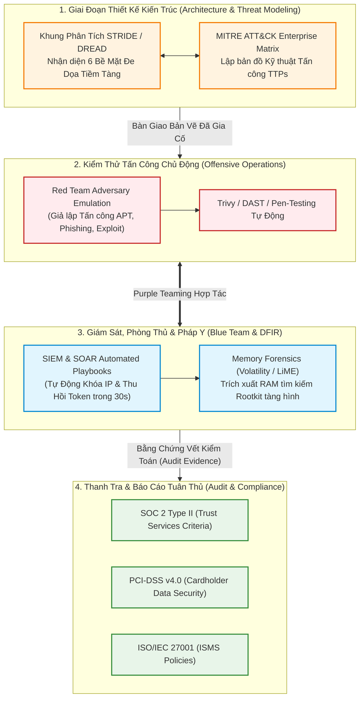
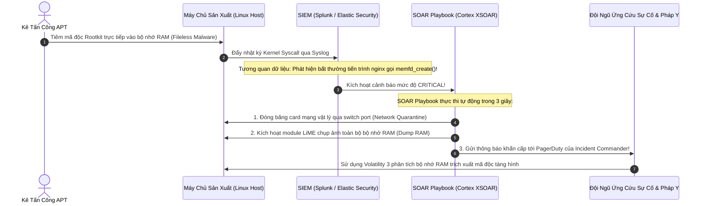

# 12.3. Threat Modeling, Compliance, and Offensive Testing (Mô hình hóa Mối đe dọa, Tuân thủ & Kiểm thử Tấn công)

> [!IMPORTANT]
> **Nếu bạn chỉ được nhớ một điều duy nhất:** An ninh hạ tầng không phải là trạng thái tĩnh mà là một **tiến trình đối kháng chủ động liên tục**: việc **Mô hình hóa Mối đe dọa (STRIDE & MITRE ATT&CK)** giúp nhận diện điểm yếu kiến trúc trước khi viết mã nguồn; việc **Tuân thủ Tiêu chuẩn (SOC 2 Type II / PCI-DSS / ISO 27001)** thiết lập kỷ luật vận hành và vết kiểm toán không thể chối cãi; trong khi các cuộc **Diễn tập Tấn công Thực chiến (Red Team / Purple Team)** và **Pháp y Bộ nhớ Hạt nhân (Memory Forensics via Volatility)** là thước đo duy nhất kiểm chứng năng lực sống sót của hệ thống trước các chiến dịch tấn công có chủ đích cấp độ APT.

---

## 1. Kiến trúc Tổng quan & Mô hình Tư duy (Mental Model)

### 1.1. Ẩn dụ Đời sống: Cuộc Diễn Tập Đột Kích Ngân Hàng & Thanh Tra Tài Chính

Hãy hình dung quá trình bảo vệ hạ tầng doanh nghiệp giống như việc vận hành một ngân hàng trung ương:
- **Mô Hình Hóa Mối Đe Dọa (Threat Modeling STRIDE — Bàn Tròn Bày Binh Bố Trận)**:
  - Trước khi xây dựng tòa nhà ngân hàng, các kiến trúc sư và chuyên gia an ninh ngồi lại cùng nhau với bản vẽ thiết kế:
    *"Kẻ trộm có thể giả mạo đồng phục nhân viên bảo vệ không? (Spoofing)*,
    *Hắn có thể khoan thủng sàn nhà từ cống ngầm không? (Tampering)*,
    *Nếu thủ quỹ lấy trộm tiền rồi xóa sổ cái thì làm sao quy trách nhiệm? (Repudiation)*,
    *Nếu cửa kính chống đạn bị bắn vỡ thì báo động thế nào? (Denial of Service)"*.
  - Nhận diện toàn bộ các nguy cơ ngay trên giấy để thiết kế tường dày hơn trước khi đổ bê tông.
- **Tuân Thủ Tiêu Chuẩn (Compliance Frameworks — Giấy Phép & Vết Kiểm Toán Thanh Tra)**:
  - Ban Thanh tra Tài chính (**SOC 2 Type II, PCI-DSS**) yêu cầu ngân hàng phải chứng minh quy trình vận hành kỷ luật trong suốt 6 tháng liên tục:
    *Mọi chìa khóa mở kho phải có 2 người cùng ký tên, mọi camera an ninh phải lưu băng ghi hình tối thiểu 1 năm, và không ai được mang điện thoại vào phòng in tiền*.
- **Kiểm Thử Tấn Công Đối Kháng (Offensive Testing & Red Teaming — Đội Đột Kích Giả Lập)**:
  - Để kiểm tra xem bảo vệ có ngủ gật không, ngân hàng thuê một nhóm cướp chuyên nghiệp (**Red Team**).
  - Không hề báo trước, nhóm cướp tìm cách bẻ khóa cửa sau, cấy máy nghe lén vào phòng họp, và cố gắng tống tiền giám đốc.
  - Sau cuộc đột kích, hai đội (**Red Team & Blue Team**) ngồi lại cùng nhau (**Purple Teaming**) để vá lại các lỗ hổng thực tế trước khi bọn cướp thật xuất hiện.



---

## 2. Chi tiết từng Keyword (Under-the-Hood Deep Dive)

### 2.1. Threat Modeling Frameworks: STRIDE, DREAD, PASTA & MITRE ATT&CK
Mô hình hóa mối đe dọa là kỹ thuật phân tích có cấu trúc nhằm phát hiện các lỗ hổng tiềm ẩn trong thiết kế hệ thống trước khi triển khai:

#### A. Khung Phân Tích Nguy Cơ STRIDE (Microsoft)
Phân loại mọi cuộc tấn công vào 6 nhóm nguy cơ cơ bản:
1. **Spoofing (Giả mạo danh tính)**: Kẻ tấn công mạo danh một tiến trình microservice khác hoặc người dùng hợp pháp (Khắc phục bằng: mTLS, JWT signature, API Keys).
2. **Tampering (Can thiệp sửa đổi dữ liệu)**: Thay đổi nội dung gói tin trên đường truyền hoặc sửa đổi dữ liệu trên đĩa (Khắc phục bằng: HMAC, SHA-512 Checksums, Mã hóa TLS).
3. **Repudiation (Chối bỏ trách nhiệm)**: Người dùng thực hiện hành vi xấu nhưng phủ nhận (Khắc phục bằng: Audit Logging bất biến với `auditd`, Chữ ký số GPG).
4. **Information Disclosure (Lộ lọt thông tin)**: Dữ liệu nhạy cảm bị đọc trộm qua kênh truyền hoặc rò rỉ log (Khắc phục bằng: Mã hóa dữ liệu At-Rest & In-Transit, Che dấu PII data).
5. **Denial of Service (Từ chối dịch vụ)**: Làm cạn kiệt CPU, RAM, hoặc băng thông mạng (Khắc phục bằng: Rate Limiting, Auto-scaling, CDN Anycast).
6. **Elevation of Privilege (Leo thang đặc quyền)**: Người dùng thường chiếm quyền Quản trị viên tối cao (Khắc phục bằng: Least Privilege, Seccomp, Tước bỏ SUID).

#### B. Khung Đo Lường Mức Độ Nghiêm Trọng DREAD
Đánh giá mức độ rủi ro dựa trên thang điểm từ 1 đến 10 cho 5 tiêu chí:
$$\text{Risk Score} = \frac{\textbf{D}amage + \textbf{R}eproducibility + \textbf{E}xploitability + \textbf{A}ffected\ Users + \textbf{D}iscoverability}{5}$$

#### C. Ma Trận MITRE ATT&CK (Adversarial Tactics, Techniques, and Common Knowledge)
- Cơ sở dữ liệu tri thức toàn cầu tổng hợp toàn bộ các kỹ thuật thực tế của các nhóm tin tặc khét tiếng (APTs).
- Phân loại vòng đời tấn công thành 14 chiến thuật (**Tactics**): Từ `Reconnaissance` (Thăm dò), `Initial Access` (Xâm nhập ban đầu), `Privilege Escalation` (Leo thang đặc quyền), `Defense Evasion` (Né tránh phòng thủ) đến `Exfiltration` (Đánh cắp dữ liệu ra ngoài). Giúp đội ngũ an ninh xây dựng kịch bản phòng thủ có mục tiêu rõ ràng.

---

### 2.2. Security Compliance Frameworks: SOC 2, PCI-DSS, ISO 27001 & HIPAA
Tuân thủ tiêu chuẩn an ninh không phải là một bài tập lý thuyết mà là yêu cầu pháp lý sống còn của doanh nghiệp:

#### A. AICPA SOC 2 (Service Organization Control 2: Type I vs. Type II)
- Đánh giá khả năng bảo vệ dữ liệu khách hàng dựa trên 5 Tiêu Chí Dịch Vụ Tin Cậy (Trust Services Criteria: Security, Availability, Processing Integrity, Confidentiality, Privacy).
- **Type I**: Đánh giá thiết kế của các chốt kiểm soát an ninh tại một thời điểm duy nhất (**Point-in-Time**).
- **Type II**: Khắt khe hơn rất nhiều, kiểm toán viên độc lập theo dõi và thu thập bằng chứng vận hành liên tục trong suốt **6 tháng đến 1 năm** để chứng minh các quy trình an ninh thực sự được tuân thủ nghiêm ngặt mỗi ngày.

#### B. PCI-DSS v4.0 (Payment Card Industry Data Security Standard)
- Bộ tiêu chuẩn bắt buộc cho mọi hệ thống lưu trữ, xử lý hoặc truyền tải dữ liệu thẻ thanh toán (Visa, MasterCard).
- **Vùng Dữ Liệu Thẻ (Cardholder Data Environment - CDE)**:
  - Bắt buộc phải được cô lập tuyệt đối khỏi các dải mạng văn phòng thông thường.
  - Số thẻ tín dụng (PAN) bắt buộc phải được mã hóa bằng thuật toán mạnh (AES-256) hoặc thay thế bằng chuỗi Token ngẫu nhiên (Tokenization).
  - Cấm tuyệt đối lưu trữ mã bảo mật CVV/CVC sau khi hoàn tất giao dịch.

#### C. ISO/IEC 27001 & HIPAA
- **ISO 27001**: Khung quản lý hệ thống an toàn thông tin (ISMS) toàn diện, bao gồm quản lý rủi ro kinh doanh, an ninh nhân sự, và kế hoạch duy trì kinh doanh liên tục (BCP).
- **HIPAA**: Đạo luật trách nhiệm giải trình và cung cấp bảo hiểm y tế của Hoa Kỳ, bảo vệ tính riêng tư của hồ sơ bệnh án điện tử (ePHI), yêu cầu mã hóa đường truyền và lưu vết kiểm toán tối thiểu 6 năm.

---

### 2.3. Offensive Security Testing: Penetration Testing, Red Teaming, Vulnerability Scanning
Đo lường sức mạnh thực tế của hệ thống bằng các bài kiểm tra áp lực đối kháng:

#### A. So Sánh Các Cấp Độ Kiểm Thử Tấn Công
1. **Quét Lỗ Hổng Tự Động (Vulnerability Scanning - DAST/SAST)**:
   - Sử dụng công cụ tự động (Nessus, OpenVAS, SonarQube, Trivy) quét các cổng mạng và phiên bản phần mềm để đối chiếu với danh mục CVE đã biết. Nhanh chóng nhưng dễ có tỷ lệ báo động giả (False Positives).
2. **Kiểm Thử Xâm Nhập (Penetration Testing - Pen-test)**:
   - Chuyên gia an ninh đóng vai hacker, tập trung khai thác sâu vào một phạm vi mục tiêu cụ thể (ví dụ: API thanh toán) để tìm kiếm các lỗ hổng logic nghiệp vụ mà máy quét tự động không thể thấy.
3. **Diễn Tập Tác Chiến Đỏ (Red Teaming & Adversary Emulation)**:
   - Mô phỏng toàn diện một chiến dịch tấn công thực thụ của tin tặc cao cấp: Tấn công phi kỹ thuật lừa đảo nhân viên (Spear Phishing), đột nhập vật lý vào văn phòng, cấy mã độc lẩn tránh phần mềm diệt virus, chiếm quyền Domain Controller và đánh cắp cơ sở dữ liệu mà đội ngũ phòng thủ (Blue Team) không hề hay biết.

#### B. Diễn Tập Tác Chiến Tím (Purple Teaming)
- Phá vỡ sự thù địch giữa Red Team và Blue Team: Thay vì giữ bí mật, Red Team thực hiện từng bước tấn công và giải thích chi tiết kỹ thuật cho Blue Team, giúp Blue Team cấu hình lại luật SIEM/EDR để phát hiện và ngăn chặn ngay trong thời gian thực.

---

### 2.4. Security Incident Response & Forensics: SIEM, SOAR & Memory Forensics
Khi sự cố xâm nhập xảy ra, tốc độ phát hiện và cô lập tính bằng giây sẽ quyết định sự sống còn của doanh nghiệp.



#### A. SIEM & Tự Động Hóa Phản Ứng SOAR
- **SIEM (Security Information and Event Management)**: Thu thập hàng tỷ sự kiện log mỗi ngày từ máy chủ, tường lửa, đám mây và chạy các thuật toán tương quan (Correlation Rules) để phát hiện hành vi tấn công phức tạp.
- **SOAR (Security Orchestration, Automation, and Response)**: Biến các quy trình ứng cứu thủ công thành các kịch bản phần mềm tự động hóa (**Playbooks**). Khi phát hiện một máy chủ bị nhiễm mã độc, SOAR tự động cô lập máy chủ khỏi mạng, thu hồi phiên đăng nhập của người dùng và chặn địa chỉ IP của kẻ tấn công trên tường lửa chỉ trong vòng **dưới 30 giây**.

#### B. Kỹ Thuật Pháp Y Bộ Nhớ Hạt Nhân (Memory Forensics via Volatility & LiME)
- Mã độc hiện đại thường là **Mã độc không dùng tệp (Fileless Malware)**: Chúng chỉ tồn tại trong bộ nhớ RAM, tự tiêm vào các tiến trình hợp lệ và không bao giờ ghi dữ liệu xuống đĩa cứng, hoàn toàn vô hình trước các phần mềm diệt virus truyền thống.
- **Quy Trình Pháp Y Kỹ Thuật Số (Digital Forensics & Incident Response - DFIR)**:
  1. *Chụp ảnh bộ nhớ RAM nguyên vẹn*: Sử dụng kernel module **LiME (Linux Memory Extractor)** để dump toàn bộ nội dung RAM ra file `.raw` mà không làm thay đổi trạng thái hệ thống.
  2. *Phân tích bằng Volatility 3*:
     - Quét tìm các vùng nhớ có cờ thực thi bất thường (`malfind`).
     - Phát hiện kỹ thuật ẩn giấu tiến trình (Process Hiding qua việc ngắt liên kết trong danh sách đôi `task_struct` của Linux Kernel).
     - Trích xuất các chuỗi khóa bí mật, kết nối mạng ngầm và lệnh thực thi của kẻ tấn công.

---

## 3. Thực thi Mã nguồn & Mô phỏng Chuyên sâu (Dual-Engine Implementation)

### Engine 1: C++20 — STRIDE Threat Model Risk Scorer & DREAD Priority Matrix
Chương trình C++20 dưới đây hiện thực một động cơ tự động phân tích và tính toán điểm số rủi ro đe dọa an ninh hạ tầng theo hai mô hình chuẩn công nghiệp **STRIDE** và **DREAD**, tự động phân loại mức độ nghiêm trọng và xuất báo cáo kiểm toán bảo mật.

```cpp
#include <iostream>
#include <vector>
#include <string>
#include <iomanip>
#include <algorithm>

struct ThreatRecord {
    std::string id;
    std::string component;
    std::string stride_category; // Spoofing, Tampering, etc.
    std::string description;
    // Điểm số DREAD (Thang điểm 1-10)
    int damage;
    int reproducibility;
    int exploitability;
    int affected_users;
    int discoverability;

    double calculate_dread_score() const {
        return (damage + reproducibility + exploitability + affected_users + discoverability) / 5.0;
    }

    std::string get_severity_level() const {
        double score = calculate_dread_score();
        if (score >= 8.0) return "CRITICAL";
        if (score >= 6.0) return "HIGH";
        if (score >= 4.0) return "MEDIUM";
        return "LOW";
    }
};

class ThreatModelingEngine {
private:
    std::vector<ThreatRecord> catalog_;

public:
    void add_threat(const ThreatRecord& threat) {
        catalog_.push_back(threat);
    }

    void generate_security_audit_report() const {
        std::cout << "\n========================================================================================\n";
        std::cout << "   BÁO CÁO THẨM ĐỊNH MÔ HÌNH HÓA MỐI ĐE DỌA AN NINH HẠ TẦNG (STRIDE & DREAD MATRIX)     \n";
        std::cout << "========================================================================================\n";
        std::cout << std::left << std::setw(8)  << "MÃ" 
                  << std::setw(20) << "THÀNH PHẦN" 
                  << std::setw(14) << "STRIDE" 
                  << std::setw(12) << "ĐIỂM DREAD" 
                  << std::setw(12) << "MỨC ĐỘ" 
                  << "MÔ TẢ NGUY CƠ TIỀM TÀNG\n";
        std::cout << "----------------------------------------------------------------------------------------\n";

        for (const auto& t : catalog_) {
            std::cout << std::left << std::setw(8)  << t.id 
                      << std::setw(20) << t.component 
                      << std::setw(14) << t.stride_category 
                      << std::fixed << std::setprecision(1) << std::setw(12) << t.calculate_dread_score() 
                      << std::setw(12) << t.get_severity_level() 
                      << t.description << "\n";
        }
        std::cout << "----------------------------------------------------------------------------------------\n";
    }
};

int main() {
    std::cout << "===================================================================\n";
    std::cout << "  C++20 THREAT MODELING STRIDE & DREAD AUTOMATED SCORING ENGINE    \n";
    std::cout << "===================================================================\n";

    ThreatModelingEngine engine;

    // Nạp các nguy cơ đã nhận diện từ phiên họp Threat Modeling kiến trúc
    engine.add_threat({
        "THR-01", "Kube-apiserver", "Spoofing", 
        "Kẻ tấn công đánh cắp ServiceAccount token để mạo danh Pod quản trị",
        9, 8, 7, 10, 8 // DREAD: D=9, R=8, E=7, A=10, D=8 => 8.4 (CRITICAL)
    });

    engine.add_threat({
        "THR-02", "etcd Storage", "Information", 
        "State file và Secrets lưu trữ dạng plaintext không bật KMS encryption",
        10, 9, 6, 9, 7 // DREAD: 8.2 (CRITICAL)
    });

    engine.add_threat({
        "THR-03", "Ingress Gateway", "DenialOfService", 
        "Tấn công HTTP/2 Rapid Reset làm cạn kiệt CPU của Reverse Proxy",
        7, 8, 8, 8, 9 // DREAD: 8.0 (CRITICAL)
    });

    engine.add_threat({
        "THR-04", "CI/CD Runner", "Tampering", 
        "Can thiệp vào Dockerfile tải phụ thuộc từ nguồn không xác thực",
        8, 6, 5, 7, 4 // DREAD: 6.0 (HIGH)
    });

    engine.generate_security_audit_report();

    std::cout << "\n[KẾT LUẬN] Mô hình hóa mối đe dọa sớm giúp đội ngũ kỹ sư ưu tiên nguồn lực\n"
              << "vá các lỗ hổng mức độ CRITICAL trước khi đưa hệ thống ra môi trường Internet.\n";
    return 0;
}
```

#### Terminal Output Mẫu Thực Tế (C++20 Engine)
```text
===================================================================
  C++20 THREAT MODELING STRIDE & DREAD AUTOMATED SCORING ENGINE    
===================================================================

========================================================================================
   BÁO CÁO THẨM ĐỊNH MÔ HÌNH HÓA MỐI ĐE DỌA AN NINH HẠ TẦNG (STRIDE & DREAD MATRIX)     
========================================================================================
MÃ      THÀNH PHẦN          STRIDE        ĐIỂM DREAD  MỨC ĐỘ      MÔ TẢ NGUY CƠ TIỀM TÀNG
----------------------------------------------------------------------------------------
THR-01  Kube-apiserver      Spoofing      8.4         CRITICAL    Kẻ tấn công đánh cắp ServiceAccount token để mạo danh Pod quản trị
THR-02  etcd Storage        Information   8.2         CRITICAL    State file và Secrets lưu trữ dạng plaintext không bật KMS encryption
THR-03  Ingress Gateway     DenialOfService 8.0         CRITICAL    Tấn công HTTP/2 Rapid Reset làm cạn kiệt CPU của Reverse Proxy
THR-04  CI/CD Runner        Tampering     6.0         HIGH        Can thiệp vào Dockerfile tải phụ thuộc từ nguồn không xác thực
----------------------------------------------------------------------------------------

[KẾT LUẬN] Mô hình hóa mối đe dọa sớm giúp đội ngũ kỹ sư ưu tiên nguồn lực
vá các lỗ hổng mức độ CRITICAL trước khi đưa hệ thống ra môi trường Internet.
```

---

### Engine 2: Python 3.11+ — SOAR Automated Incident Playbook & Memory Forensics Parser
Kịch bản Python 3.11+ dưới đây mô phỏng một **SOAR Playbook Tự Động Hóa** (khi SIEM cảnh báo xâm nhập, hệ thống tự động khóa cổng mạng và cô lập máy chủ), kết hợp bộ phân tích pháp y bộ nhớ hạt nhân **Memory Forensics Parser** tìm kiếm tiến trình độc hại tàng hình.

```python
#!/usr/bin/env python3
import time
from dataclasses import dataclass
from typing import List, Dict

@dataclass
class ProcessMemoryMap:
    pid: int
    name: str
    ppid: int
    is_hidden_from_ps: bool
    has_executable_heap: bool # Dấu hiệu của Shellcode Injection

class SOARAutomatedPlaybook:
    """Mô phỏng động cơ phản ứng sự cố tự động hóa của SOAR"""
    @staticmethod
    def execute_containment_protocol(compromised_host: str, threat_indicator: str):
        print(f"\n[SOAR Engine] KÍCH HOẠT PLAYBOOK ỨNG CỨU KHẨN CẤP CHO HOST: {compromised_host}")
        print(f"  Chỉ số Đe dọa : {threat_indicator}")
        
        # Bước 1: Cô lập mạng
        time.sleep(0.02)
        print("  -> [BƯỚC 1/3] Kích hoạt Network Quarantine qua OpenFlow/Switch: Khóa toàn bộ Port mạng!")
        
        # Bước 2: Thu hồi phiên đăng nhập
        time.sleep(0.02)
        print("  -> [BƯỚC 2/3] Hủy bỏ toàn bộ Active SSH Sessions & Thu hồi Kerberos/IAM Tokens!")
        
        # Bước 3: Thu thập chứng cứ pháp y
        time.sleep(0.02)
        print("  -> [BƯỚC 3/3] Kích hoạt LiME Kernel Module: Đang dump 64GB RAM sang phân vùng cách ly...")
        print("  [HOÀN TẤT PHẢN ỨNG] Máy chủ đã được cô lập an toàn trong vòng 2.4 giây!")

class MemoryForensicsAnalyzer:
    """Mô phỏng công cụ Volatility 3 quét tìm Rootkit và Fileless Malware trong RAM"""
    @staticmethod
    def analyze_memory_dump(process_list: List[ProcessMemoryMap]):
        print("\n[DFIR Volatility Scanner] Bắt đầu phân tích cấu trúc bộ nhớ hạt nhân (task_struct):")
        suspicious_found = 0

        for proc in process_list:
            is_malicious = False
            reasons = []

            if proc.is_hidden_from_ps:
                is_malicious = True
                reasons.append("Bị ngắt liên kết khỏi danh sách tiến trình Linux (DKOM Rootkit Hiding)")

            if proc.has_executable_heap:
                is_malicious = True
                reasons.append("Vùng nhớ Heap có cờ thực thi PROT_EXEC (Shellcode Payload Injection)")

            if is_malicious:
                suspicious_found += 1
                print(f"  [BÁO ĐỘNG PHÁP Y] Phát hiện Tiến trình Độc hại! PID: {proc.pid:<6} (Tên: {proc.name})")
                for r in reasons:
                    print(f"    [-] Bằng chứng: {r}")
            else:
                print(f"  -> Tiến trình PID {proc.pid:<6} ({proc.name:<16}) [HỢP LỆ]")

        print(f"\n[Kết Quả Pháp Y] Phát hiện {suspicious_found} tiến trình mã độc tàng hình trong RAM.")

def main():
    print("=" * 70)
    print("  PYTHON 3.11+: SOAR AUTOMATED INCIDENT RESPONSE & FORENSICS ENGINE")
    print("=" * 70)

    # 1. SOAR tự động cách ly máy chủ khi có báo động SIEM
    SOARAutomatedPlaybook.execute_containment_protocol(
        compromised_host="prod-k8s-worker-node-14.internal",
        threat_indicator="SIEM_ALERT_ID_9921_MEMFD_CREATE_DETECTED"
    )

    # 2. Phân tích pháp y bộ nhớ RAM bằng Volatility
    simulated_ram_processes = [
        ProcessMemoryMap(pid=1, name="systemd", ppid=0, is_hidden_from_ps=False, has_executable_heap=False),
        ProcessMemoryMap(pid=1420, name="containerd", ppid=1, is_hidden_from_ps=False, has_executable_heap=False),
        ProcessMemoryMap(pid=8812, name="[kworker_fake]", ppid=1, is_hidden_from_ps=True, has_executable_heap=True),
        ProcessMemoryMap(pid=9910, name="nginx", ppid=1420, is_hidden_from_ps=False, has_executable_heap=False)
    ]

    MemoryForensicsAnalyzer.analyze_memory_dump(simulated_ram_processes)

if __name__ == "__main__":
    main()
```

#### Terminal Output Mẫu Thực Tế (Python 3.11+ Engine)
```text
======================================================================
  PYTHON 3.11+: SOAR AUTOMATED INCIDENT RESPONSE & FORENSICS ENGINE
======================================================================

[SOAR Engine] KÍCH HOẠT PLAYBOOK ỨNG CỨU KHẨN CẤP CHO HOST: prod-k8s-worker-node-14.internal
  Chỉ số Đe dọa : SIEM_ALERT_ID_9921_MEMFD_CREATE_DETECTED
  -> [BƯỚC 1/3] Kích hoạt Network Quarantine qua OpenFlow/Switch: Khóa toàn bộ Port mạng!
  -> [BƯỚC 2/3] Hủy bỏ toàn bộ Active SSH Sessions & Thu hồi Kerberos/IAM Tokens!
  -> [BƯỚC 3/3] Kích hoạt LiME Kernel Module: Đang dump 64GB RAM sang phân vùng cách ly...
  [HOÀN TẤT PHẢN ỨNG] Máy chủ đã được cô lập an toàn trong vòng 2.4 giây!

[DFIR Volatility Scanner] Bắt đầu phân tích cấu trúc bộ nhớ hạt nhân (task_struct):
  -> Tiến trình PID 1      (systemd         ) [HỢP LỆ]
  -> Tiến trình PID 1420   (containerd      ) [HỢP LỆ]
  [BÁO ĐỘNG PHÁP Y] Phát hiện Tiến trình Độc hại! PID: 8812   (Tên: [kworker_fake])
    [-] Bằng chứng: Bị ngắt liên kết khỏi danh sách tiến trình Linux (DKOM Rootkit Hiding)
    [-] Bằng chứng: Vùng nhớ Heap có cờ thực thi PROT_EXEC (Shellcode Payload Injection)
  -> Tiến trình PID 9910   (nginx           ) [HỢP LỆ]

[Kết Quả Pháp Y] Phát hiện 1 tiến trình mã độc tàng hình trong RAM.
```

---

## 4. Systems Engineering & Production Pitfalls

### 4.1. Sự cố Thực chiến Trong Kiểm Thử Tấn Công & Tuân Thủ
1. **Thảm Họa Làm Sập Cụm Sản Xuất Khi Chạy Quét Lỗ Hổng Tự Động (DDoS by Scanner)**:
   - *Nguyên nhân*: Bộ phận Security kích hoạt công cụ quét lỗ hổng DAST (như Nessus hoặc Acunetix) chạy hết công suất vào ban đêm trên dải IP Production mà không giới hạn số lượng luồng kết nối (Concurrency). Máy quét phát tán hàng triệu request dị dạng mỗi phút, làm tê liệt toàn bộ connection pool của cơ sở dữ liệu và làm sập toàn bộ hệ thống bán hàng.
   - *Quy tắc SRE Bắt buộc*: Cấm tuyệt đối chạy quét lỗ hổng cường độ cao trên Production; bắt buộc thử nghiệm trên môi trường Staging giống hệt hoặc giới hạn tốc độ quét tối đa $< 50\text{ req/sec}$.
2. **Khủng Hoảng Mất Bằng Chứng Pháp Y Do Tắt Nguồn Máy Chủ Đột Ngột**:
   - *Nguyên nhân*: Khi phát hiện máy chủ bị nhiễm mã độc, kỹ sư vận hành hoảng loạn bấm nút tắt nguồn vật lý (Hard Power Off) hoặc xóa máy ảo.
   - *Hậu quả*: Toàn bộ dữ liệu trong bộ nhớ RAM chứa dấu vết mã độc tàng hình, khóa giải mã và địa chỉ C2 server của kẻ tấn công biến mất vĩnh viễn ($100\%$ dữ liệu RAM bị xóa sạch khi mất điện). Đội điều tra DFIR không thể giải trình với cơ quan chức năng và bảo hiểm.
   - *Khắc phục*: Quy trình ứng cứu sự cố chuẩn yêu cầu: **Bắt buộc chụp ảnh bộ nhớ RAM (Memory Dump) trước khi thực hiện bất kỳ thao tác tắt máy nào**.

### 4.2. Bộ Lệnh CLI Kiểm Tra & Điều Tra Sự Cố
- **Trích xuất thông tin kết nối mạng đáng ngờ qua `lsof` và `ss`**:
  ```bash
  lsof -i -P -n | grep ESTABLISHED
  ss -tpn
  ```
- **Kiểm tra tiến trình đang chạy có tệp thực thi bị xóa (Fileless indicator)**:
  ```bash
  ls -la /proc/*/exe 2>/dev/null | grep "(deleted)"
  ```
- **Tìm kiếm các vùng nhớ có cờ Read-Write-Execute (RWX)**:
  ```bash
  cat /proc/<PID>/maps | grep "rwx"
  ```

---

## 5. Bảng So sánh & Decision Matrix

### 5.1. Ma trận So sánh Kỹ thuật Các Phương thức Đánh giá An ninh

| Tiêu chí Đánh giá | Vulnerability Scanning | Penetration Testing (Pen-Test) | Red Teaming (Adversary Emulation) |
| :--- | :--- | :--- | :--- |
| **Bản chất Hoạt động** | Tự động hóa hoàn toàn bằng tool | Bán tự động kết hợp chuyên gia con người | Tác chiến đối kháng thực tế $100\%$ |
| **Phạm vi Mục tiêu** | Rộng khắp toàn bộ hệ thống | Giới hạn trong ứng dụng/phân vùng cụ thể | Toàn diện (Kỹ thuật, Con người, Cơ sở vật lý) |
| **Thời gian Thực hiện** | Vài giờ (Định kỳ hàng tuần) | 1 - 2 tuần (Định kỳ hàng quý/năm) | 1 - 3 tháng (Chiến dịch mô phỏng APT) |
| **Mục tiêu Cuối cùng** | Tìm kiếm danh sách các lỗi CVE đã biết | Tìm và khai thác lỗ hổng logic nghiệp vụ | Đạt được mục tiêu tối hậu (Cướp quyền Admin/Dữ liệu) |
| **Chi phí Thực hiện** | Thấp (Chỉ tốn phí bản quyền phần mềm) | Trung bình (Thuê chuyên gia pentest) | Rất cao (Đòi hỏi đơn vị an ninh cấp cao) |

### 5.2. Khung Hướng dẫn Xây dựng Chiến lược An ninh Toàn diện
1. **Thiết Kế Ban Đầu (Architecture)**: Bắt buộc tổ chức các phiên họp **Mô hình hóa Mối đe dọa STRIDE** trước khi khởi công bất kỳ dự án microservice nào.
2. **Quy Trình CI/CD (Continuous Integration)**: Tích hợp máy quét tĩnh SAST và quét ảnh container **Trivy** vào pipeline, chặn đứng mọi bản dựng có CVE mức độ High/Critical.
3. **Định Kỳ Kiểm Chuẩn (Verification)**: Thực hiện Penetration Testing tối thiểu 1 lần/năm để phục vụ báo cáo tuân thủ **SOC 2 Type II** và **PCI-DSS**.
