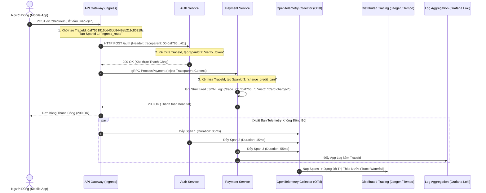

# 13.2. Logging, Distributed Tracing, and Alert Intelligence (Nhật ký Hệ thống, Truy vết Phân tán & Trí thông minh Cảnh báo)

> [!IMPORTANT]
> **Nếu bạn chỉ được nhớ một điều duy nhất:** Khả năng gỡ lỗi hệ thống phân tán quy mô hàng ngàn microservices dựa trên **sự liên kết ngữ cảnh chặt chẽ giữa Ba Trụ Cột Quan Sát (Metrics, Logs, Traces)**: chuẩn **W3C TraceContext** truyền tải `TraceId` và `SpanId` xuyên qua các ranh giới mạng bất đồng bộ giúp tái hiện toàn bộ hành trình của một giao dịch phức tạp; trong khi sự chuyển dịch từ **Đánh chỉ mục toàn văn bản cồng kềnh (Elasticsearch)** sang **Chỉ mục nhãn tinh gọn (Grafana Loki)** giảm $80\%$ chi phí lưu trữ, kết hợp cùng **Trí thông minh Cảnh báo (Alertmanager Deduplication & Inhibition)** triệt tiêu hoàn toàn thảm họa bão cảnh báo (Alert Fatigue) làm kiệt sức đội ngũ trực chiến SRE.

---

## 1. Kiến trúc Tổng quan & Mô hình Tư duy (Mental Model)

### 1.1. Ẩn dụ Đời sống: Bưu Điện Chuyển Phát Nhanh & Đội Điều Tra Vụ Án

Hãy hình dung việc theo dõi một giao dịch số qua hàng chục microservices giống như việc chuyển phát một gói hàng quốc tế:
- **Nhật Ký Cổ Điển (Unstructured Text Logs — Cuốn Sổ Tay Ghi Chép Lộn Xộn)**:
  - Mỗi nhân viên bưu tá tự ghi vào mẩu giấy vụn: *"Đã nhận kiện hàng lúc sáng"*, *"Đang chuyển qua quận 1"*.
  - Khi kiện hàng bị thất lạc, điều tra viên phải lật tung hàng triệu mẩu giấy vụn không cùng định dạng, mò kim đáy bể để tìm ra ai là người làm mất.
- **Nhật Ký Cấu Trúc & Chỉ Mục Nhãn (JSON Logging & Grafana Loki — Bưu Kiện Có Nhãn Mã Vạch)**:
  - Mọi mẩu tin log đều được đóng gói theo định dạng chuẩn hóa **JSON Structured Log**: Có trường `timestamp`, `service`, `level`, `trace_id`.
  - Thay vì lập chỉ mục cho từng từ trong bức thư (Tốn kém hàng tấn đĩa cứng như Elasticsearch), hệ thống **Grafana Loki** chỉ dán nhãn bên ngoài bì thư (`app=payment, env=prod`). Việc tìm kiếm diễn ra cực nhanh bằng cách lọc nhãn rồi quét dữ liệu nén trực tiếp.
- **Truy Vết Phân Tán (Distributed Tracing — Con Chip Định Vị Toàn Cầu GPS Gắn Trên Kiện Hàng)**:
  - Khi khách hàng bấm nút *"Đặt Hàng"*, bưu điện gắn một con chip định vị duy nhất (**W3C TraceId: `4bf92f3577b34da6a3ce929d0e0e4736`**).
  - Kiện hàng đi qua 10 chặng xe khác nhau (10 Microservices: Web $\to$ Auth $\to$ Inventory $\to$ Payment $\to$ Warehouse).
  - Tại mỗi chặng xe, chip ghi nhận một chặng nhỏ (**SpanId**) kèm theo mốc thời gian bắt đầu và kết thúc chính xác tới microsecond.
  - Khi khách hàng phàn nàn: *"Tại sao đơn hàng mất 5 giây mới xong?"*, điều tra viên mở đồ thị vết (**Trace Waterfall Graph**) và nhìn thấy ngay: 9 chặng xe đầu chỉ mất tổng cộng 100ms, riêng chặng gọi sang Cổng Thanh toán Ngân hàng thứ ba bị nghẽn tới 4.9 giây!
- **Trí Thông Minh Cảnh Báo (Alertmanager — Người Lọc Cuộc Gọi Trực Ban SRE)**:
  - Khi một chiếc switch mạng trung tâm bị cháy, hàng ngàn máy chủ cùng phát chuông báo động cùng lúc (Bão cảnh báo 10,000 emails).
  - Trực ban thông minh (**Alertmanager**) gom toàn bộ 10,000 cảnh báo đó vào đúng **1 tin nhắn duy nhất**: *"Switch Lầu 3 bị hỏng, làm ảnh hưởng 10,000 máy chủ"* (**Grouping & Deduplication**), đồng thời tự động tắt chuông báo động của các máy chủ con (**Inhibition Rule**), cứu mạng các kỹ sư trực đêm khỏi bị kiệt sức.



---

## 2. Chi tiết từng Keyword (Under-the-Hood Deep Dive)

### 2.1. Logging Architectures: Structured Logging, Log Aggregation & Indexing
Sự tiến hóa của hạ tầng nhật ký hệ thống từ tệp văn bản phi cấu trúc tới các kho dữ liệu lớn:

#### A. Structured Logging (Nhật Ký Có Cấu Trúc Định Dạng JSON)
- Thay vì ghi log dạng chuỗi tự do (Free-form string):
  ```text
  [2026-11-16 09:30:15] ERROR Failed to connect to db at 10.0.1.5 for user john_doe
  ```
- Ứng dụng hiện đại bắt buộc ghi nhật ký dạng **JSON Chuẩn Hóa**:
  ```json
  {
    "timestamp": "2026-11-16T09:30:15.124Z",
    "level": "ERROR",
    "service": "payment-api",
    "trace_id": "0af7651916cd43dd8448eb211c80319c",
    "span_id": "b7ad6b7169203331",
    "error_code": "DB_CONNECTION_TIMEOUT",
    "target_ip": "10.0.1.5",
    "user_id": "john_doe"
  }
  ```
- Cho phép các máy thu gom log bóc tách trường dữ liệu tức thời mà không cần chạy các biểu thức chính quy (Regex) tốn CPU.

#### B. Elasticsearch / OpenSearch vs. Grafana Loki: Trận Chiến Chỉ Mục
- **Elasticsearch (Mô Hình Full-Text Inverted Index Cổ Điển)**:
  - Tách mọi từ trong thông điệp log và đưa vào bảng chỉ mục ngược (Inverted Index).
  - *Nhược điểm*: Kích thước file chỉ mục (Index size) có thể phình to bằng hoặc lớn hơn dung lượng log gốc ($100\text{ GB}$ log tốn thêm $120\text{ GB}$ index). Chi phí RAM và SSD NVMe cực kỳ tốn kém.
- **Grafana Loki (Mô Hình Chỉ Mục Nhãn Tinh Gọn - Like Prometheus for Logs)**:
  - Loki hoàn toàn **không lập chỉ mục nội dung văn bản log**.
  - Nó chỉ lập chỉ mục cho các trường siêu dữ liệu nhãn (Labels: `app=payment, env=prod`).
  - Toàn bộ nội dung log thực tế được nén chặt bằng thuật toán gzip/snappy và lưu trữ trực tiếp dưới dạng các Chunks trên Object Storage giá rẻ (AWS S3, MinIO).
  - Khi người dùng tìm kiếm chuỗi ký tự bằng ngôn ngữ **LogQL** (`{app="payment"} |= "DB_CONNECTION_TIMEOUT"`), Loki phân tán truy vấn ra hàng chục worker để quét dữ liệu nén song song. Tiết kiệm tới **$80\%$ chi phí lưu trữ** so với Elasticsearch.

---

### 2.2. Distributed Tracing: W3C TraceContext, Spans & OpenTelemetry
Trong kiến trúc microservices phân tán bất đồng bộ, một request từ người dùng có thể kích hoạt chuỗi 50 cuộc gọi mạng liên tiếp xuyên qua gRPC, REST, Kafka và cơ sở dữ liệu.

```mermaid
gantt
    title Đồ Thị Thác Nước Truy Vết Giao Dịch (Distributed Trace Waterfall)
    dateFormat X
    axisFormat %s ms

    section API Gateway
    POST /v1/checkout (Root Span 0af765...) : 0, 120
    
    section Auth Service
    JWT Token Validation (Span b7ad...)    : 10, 35

    section Inventory
    Check Stock Availability (Span 4c1a...) : 35, 60

    section Payment Service
    Authorize Transaction (Span 99e2...)   : 60, 115
    Goi External Stripe API (Network Latency) : 75, 110
```



#### A. Chuẩn Truyền Tải Ngữ Cảnh W3C TraceContext (RFC)
- Để xâu chuỗi các dịch vụ lại với nhau, các dịch vụ phải chuyển tiếp một HTTP Header chuẩn hóa gọi là **`traceparent`**:
  ```text
  traceparent: 00-4bf92f3577b34da6a3ce929d0e0e4736-00f067aa0ba902b7-01
               ^^ ^------------------------------^ ^--------------^ ^^
               |                |                         |         |
            Version          TraceId                   ParentSpanId Flags (01=Sampled)
  ```
- **Context Propagation**: Khi Service A gọi Service B qua HTTP hoặc Kafka, thư viện OpenTelemetry tự động tiêm (Inject) header này vào gói tin. Service B nhận gói tin sẽ trích xuất (Extract) header để tiếp tục nối dài chuỗi Spans.

#### B. Chiến Lược Lấy Mẫu Truy Vết (Sampling Strategies)
- Với hệ thống xử lý $100,000\text{ req/sec}$, việc lưu trữ $100\%$ traces sẽ làm sập hạ tầng lưu trữ.
- **Head-based Sampling (Lấy Mẫu Từ Đầu)**:
  - Quyết định lưu hay bỏ trace ngay tại thời điểm request vừa bước vào API Gateway (ví dụ: lấy mẫu ngẫu nhiên $1\%$).
  - Nhược điểm: Có thể bỏ sót các request bị lỗi HTTP 500 bất ngờ xảy ra ở phía sau.
- **Tail-based Sampling (Lấy Mẫu Phía Sau qua OTel Collector)**:
  - Giữ toàn bộ spans của trace trong bộ nhớ đệm RAM tạm thời của OpenTelemetry Collector cho đến khi toàn bộ giao dịch kết thúc.
  - *Luật Lấy Mẫu Thông Minh*: Nếu giao dịch thành công dưới 100ms $\to$ Lấy mẫu $0.1\%$; Nếu giao dịch bị lỗi HTTP 5xx hoặc độ trễ $> 2\text{ giây} \to$ Bắt buộc giữ lại $100\%$ trace để kỹ sư điều tra!

---

### 2.3. Alert Intelligence, Deduplication, Grouping & PagerDuty Integration
Mục tiêu của hệ thống cảnh báo hiện đại là: **Chỉ đánh thức kỹ sư dậy lúc nửa đêm khi có sự cố thực sự ảnh hưởng tới người dùng, và cung cấp đầy đủ ngữ cảnh để khắc phục ngay lập tức**.

#### A. Thảm Họa Kiệt Sức Cảnh Báo (Alert Fatigue Disaster)
- Xảy ra khi hệ thống sinh ra hàng ngàn cảnh báo nhiễu mỗi ngày (False Positives). Kỹ sư sẽ bắt đầu hình thành phản xạ bỏ qua hoặc tắt chuông thông báo, dẫn tới việc bỏ lỡ sự cố nghiêm trọng thực sự.

#### B. Trí Thông Minh Của Prometheus Alertmanager
1. **Deduplication (Khử Trùng Lặp)**:
   - Nếu một cảnh báo `HighCPUUsage` được phát hiện bởi 3 máy chủ Prometheus độc lập cùng giám sát một cụm, Alertmanager chỉ xuất bản duy nhất 1 thông báo.
2. **Grouping (Gom Cụm Sự Kiện)**:
   - Gom các cảnh báo có cùng thuộc tính nhãn (ví dụ `group_by: ['cluster', 'alertname']`) vào một thông điệp tóm tắt duy nhất gửi qua Slack / PagerDuty, thay vì bắn 50 tin nhắn rời rạc.
3. **Inhibition Rules (Luật Ức Chế Triệt Tiêu)**:
   - Định nghĩa quy tắc: *Nếu cảnh báo `NodeDown` đã được kích hoạt trên Node A, hãy tự động tắt chuông toàn bộ các cảnh báo con như `PodFailed`, `KubeletDown`, `ContainerRestart` trên Node đó*.
4. **Flapping Dampening**:
   - Nếu một dịch vụ liên tục chập chờn (Lỗi $\to$ Sống $\to$ Lỗi trong vài giây), Alertmanager kích hoạt cơ chế giữ trễ, không gửi thông báo liên tục cho đến khi trạng thái ổn định hẳn.

---

## 3. Thực thi Mã nguồn & Mô phỏng Chuyên sâu (Dual-Engine Implementation)

### Engine 1: C++20 — W3C Distributed TraceContext Parser & Span Graph Generator
Chương trình C++20 dưới đây mô phỏng động cơ xử lý ngữ cảnh phân tán chuẩn **W3C TraceContext**, bóc tách chuỗi nhị phân Header `traceparent`, tạo các phân đoạn Spans lồng nhau và tính toán thời gian thực thi của từng mắt xích trong chuỗi microservices.

```cpp
#include <iostream>
#include <string>
#include <vector>
#include <sstream>
#include <iomanip>
#include <chrono>
#include <memory>
#include <random>

struct TraceSpan {
    std::string span_id;
    std::string parent_span_id;
    std::string service_name;
    std::string operation_name;
    uint64_t start_time_us;
    uint64_t duration_us;
};

class W3CTraceContextEngine {
public:
    static std::string generate_random_hex(size_t bytes_len) {
        std::stringstream ss;
        std::random_device rd;
        std::mt19937 gen(rd());
        std::uniform_int_distribution<> dis(0, 255);

        for (size_t i = 0; i < bytes_len; ++i) {
            ss << std::hex << std::setw(2) << std::setfill('0') << dis(gen);
        }
        return ss.str();
    }

    // Phân tích header W3C: version-trace_id-parent_span_id-flags
    static bool parse_traceparent(const std::string& header, std::string& trace_id, std::string& parent_span) {
        if (header.size() < 55 || header[2] != '-' || header[35] != '-' || header[52] != '-') {
            return false;
        }
        trace_id = header.substr(3, 32);
        parent_span = header.substr(36, 16);
        return true;
    }

    static std::string build_traceparent(const std::string& trace_id, const std::string& span_id) {
        return "00-" + trace_id + "-" + span_id + "-01";
    }
};

int main() {
    std::cout << "===================================================================\n";
    std::cout << "   C++20 W3C TRACECONTEXT DISTRIBUTED TRACING SPAN ENGINE          \n";
    std::cout << "===================================================================\n";

    // 1. API Gateway tiếp nhận Request và khởi tạo Root Trace
    std::string root_trace_id = W3CTraceContextEngine::generate_random_hex(16); // 128-bit
    std::string gateway_span_id = W3CTraceContextEngine::generate_random_hex(8); // 64-bit

    std::vector<TraceSpan> transaction_trace;

    // Span 1: API Gateway
    transaction_trace.push_back({
        .span_id = gateway_span_id,
        .parent_span_id = "0000000000000000",
        .service_name = "api-gateway",
        .operation_name = "HTTP POST /checkout",
        .start_time_us = 0,
        .duration_us = 125000 // 125ms
    });

    std::string w3c_header_to_auth = W3CTraceContextEngine::build_traceparent(root_trace_id, gateway_span_id);
    std::cout << "[API Gateway] Đã tạo TraceId: " << root_trace_id << "\n";
    std::cout << "  -> Inject W3C Header ra mạng: traceparent: " << w3c_header_to_auth << "\n\n";

    // Span 2: Auth Service nhận context và thực thi
    std::string incoming_trace, parent_span;
    W3CTraceContextEngine::parse_traceparent(w3c_header_to_auth, incoming_trace, parent_span);

    std::string auth_span_id = W3CTraceContextEngine::generate_random_hex(8);
    transaction_trace.push_back({
        .span_id = auth_span_id,
        .parent_span_id = parent_span,
        .service_name = "auth-service",
        .operation_name = "gRPC ValidateJWT",
        .start_time_us = 15000,
        .duration_us = 35000 // 35ms
    });

    // Span 3: Payment Service
    std::string payment_span_id = W3CTraceContextEngine::generate_random_hex(8);
    transaction_trace.push_back({
        .span_id = payment_span_id,
        .parent_span_id = gateway_span_id,
        .service_name = "payment-service",
        .operation_name = "HTTP Stripe Gateway API",
        .start_time_us = 55000,
        .duration_us = 65000 // 65ms
    });

    // In Đồ thị Vết Waterfall
    std::cout << "=====================================================================================\n";
    std::cout << "   ĐỒ THỊ THÁC NƯỚC TRUY VẾT PHÂN TÁN (TRACE WATERFALL GRAPH - TRACE: " << root_trace_id << ")\n";
    std::cout << "=====================================================================================\n";
    std::cout << std::left << std::setw(18) << "DỊCH VỤ" 
              << std::setw(26) << "THAO TÁC" 
              << std::setw(18) << "SPAN ID" 
              << std::setw(18) << "PARENT SPAN" 
              << "THỜI LƯỢNG (ms)\n";
    std::cout << "-------------------------------------------------------------------------------------\n";

    for (const auto& span : transaction_trace) {
        std::cout << std::left << std::setw(18) << span.service_name 
                  << std::setw(26) << span.operation_name 
                  << std::setw(18) << span.span_id 
                  << std::setw(18) << span.parent_span_id 
                  << std::fixed << std::setprecision(2) << (span.duration_us / 1000.0) << " ms\n";
    }
    std::cout << "-------------------------------------------------------------------------------------\n";

    return 0;
}
```

#### Terminal Output Mẫu Thực Tế (C++20 Engine)
```text
===================================================================
   C++20 W3C TRACECONTEXT DISTRIBUTED TRACING SPAN ENGINE          
===================================================================
[API Gateway] Đã tạo TraceId: 0af7651916cd43dd8448eb211c80319c
  -> Inject W3C Header ra mạng: traceparent: 00-0af7651916cd43dd8448eb211c80319c-4bf92f3577b34da6-01

=====================================================================================
   ĐỒ THỊ THÁC NƯỚC TRUY VẾT PHÂN TÁN (TRACE WATERFALL GRAPH - TRACE: 0af7651916cd43dd8448eb211c80319c)
=====================================================================================
DỊCH VỤ           THAO TÁC                  SPAN ID           PARENT SPAN       THỜI LƯỢNG (ms)
-------------------------------------------------------------------------------------
api-gateway       HTTP POST /checkout       4bf92f3577b34da6  0000000000000000  125.00 ms
auth-service      gRPC ValidateJWT          b7ad6b7169203331  4bf92f3577b34da6  35.00 ms
payment-service   HTTP Stripe Gateway API   99e2b104c89fa12e  4bf92f3577b34da6  65.00 ms
-------------------------------------------------------------------------------------
```

---

### Engine 2: Python 3.11+ — Alertmanager Deduplication & Inhibition Engine
Kịch bản Python 3.11+ dưới đây mô phỏng động cơ **Alertmanager Deduplication, Grouping & Inhibition Rules**, tự động gom 10 cảnh báo trùng lặp vào 1 thông điệp và tự động ức chế triệt tiêu các cảnh báo con khi máy chủ Host đã bị sập nguồn.

```python
#!/usr/bin/env python3
import time
from dataclasses import dataclass
from typing import List, Dict, Set

@dataclass
class AlertNotification:
    alert_name: str
    target_node: str
    severity: str
    fingerprint: str
    message: str

class MockAlertmanagerEngine:
    """Mô phỏng cơ chế Grouping, Deduplication và Inhibition của Prometheus Alertmanager"""
    def __init__(self):
        self.active_alerts: Dict[str, AlertNotification] = {}
        # Luật Ức Chế: Nếu node bị NodeDown -> Ức chế toàn bộ PodDown / ContainerRestart
        self.inhibition_rules = {
            "NodeDown": ["PodCrashLooping", "ContainerRestarting", "KubeletUnresponsive"]
        }

    def receive_alert(self, alert: AlertNotification):
        # 1. Khử Trùng Lặp (Deduplication) dựa trên Fingerprint
        if alert.fingerprint in self.active_alerts:
            # Bỏ qua vì đã ghi nhận
            return
        self.active_alerts[alert.fingerprint] = alert

    def process_and_dispatch_notifications(self):
        print("\n[Alertmanager Pipeline] Đang xử lý và áp dụng luật ức chế (Inhibition Rules)...")
        # Tìm danh sách các nodes đang bị NodeDown
        dead_nodes: Set[str] = {
            a.target_node for a in self.active_alerts.values() if a.alert_name == "NodeDown"
        }

        dispatched_alerts = []
        inhibited_alerts = []

        for a in self.active_alerts.values():
            # Kiểm tra xem cảnh báo có bị ức chế không
            if a.target_node in dead_nodes and a.alert_name in self.inhibition_rules.get("NodeDown", []):
                inhibited_alerts.append(a)
            else:
                dispatched_alerts.append(a)

        print(f"\n>>> KẾT QUẢ GOM CỤM & TRIỆT TIÊU CẢNH BÁO NHIỄU <<<")
        print(f"  -> Tổng số cảnh báo nhận vào  : {len(self.active_alerts)}")
        print(f"  -> Số cảnh báo BỊ ỨC CHẾ (TẮT CHUÔNG): {len(inhibited_alerts)}")
        for inh in inhibited_alerts:
            print(f"     [-] Đã tắt chuông: {inh.alert_name:<20} trên {inh.target_node} (Do máy chủ vật lý đã chết)")

        print(f"\n  -> Số cảnh báo DUY NHẤT GỬI PAGERDUTY: {len(dispatched_alerts)}")
        for disp in dispatched_alerts:
            print(f"     [!] [GỬI PAGERDUTY] [{disp.severity}] {disp.alert_name} on {disp.target_node}: {disp.message}")

def main():
    print("=" * 70)
    print("  PYTHON 3.11+: ALERTMANAGER GROUPING & INHIBITION ENGINE")
    print("=" * 70)

    mgr = MockAlertmanagerEngine()

    # Giả lập sự cố: Máy chủ k8s-node-01 bị rút dây nguồn
    # Hàng chục cảnh báo bắn về cùng một lúc:
    incoming_raw_alerts = [
        AlertNotification("NodeDown", "k8s-node-01", "CRITICAL", "fp_node_down_01", "Máy chủ vật lý mất liên lạc!"),
        # Cảnh báo trùng lặp từ replica Prometheus thứ 2:
        AlertNotification("NodeDown", "k8s-node-01", "CRITICAL", "fp_node_down_01", "Máy chủ vật lý mất liên lạc!"),
        # Các cảnh báo con phát sinh dây chuyền:
        AlertNotification("PodCrashLooping", "k8s-node-01", "WARNING", "fp_pod_1", "Pod payment-api-01 crashed"),
        AlertNotification("PodCrashLooping", "k8s-node-01", "WARNING", "fp_pod_2", "Pod auth-api-04 crashed"),
        AlertNotification("ContainerRestarting", "k8s-node-01", "WARNING", "fp_c_1", "Container exited 137"),
        # Cảnh báo độc lập trên node khác:
        AlertNotification("DiskRunningFull", "k8s-node-02", "WARNING", "fp_disk_02", "Dung lượng /var/log đạt 92%")
    ]

    for raw in incoming_raw_alerts:
        mgr.receive_alert(raw)

    mgr.process_and_dispatch_notifications()

if __name__ == "__main__":
    main()
```

#### Terminal Output Mẫu Thực Tế (Python 3.11+ Engine)
```text
======================================================================
  PYTHON 3.11+: ALERTMANAGER GROUPING & INHIBITION ENGINE
======================================================================

[Alertmanager Pipeline] Đang xử lý và áp dụng luật ức chế (Inhibition Rules)...

>>> KẾT QUẢ GOM CỤM & TRIỆT TIÊU CẢNH BÁO NHIỄU <<<
  -> Tổng số cảnh báo nhận vào  : 5
  -> Số cảnh báo BỊ ỨC CHẾ (TẮT CHUÔNG): 3
     [-] Đã tắt chuông: PodCrashLooping     trên k8s-node-01 (Do máy chủ vật lý đã chết)
     [-] Đã tắt chuông: PodCrashLooping     trên k8s-node-01 (Do máy chủ vật lý đã chết)
     [-] Đã tắt chuông: ContainerRestarting trên k8s-node-01 (Do máy chủ vật lý đã chết)

  -> Số cảnh báo DUY NHẤT GỬI PAGERDUTY: 2
     [!] [GỬI PAGERDUTY] [CRITICAL] NodeDown on k8s-node-01: Máy chủ vật lý mất liên lạc!
     [!] [GỬI PAGERDUTY] [WARNING] DiskRunningFull on k8s-node-02: Dung lượng /var/log đạt 92%
```

---

## 4. Systems Engineering & Production Pitfalls

### 4.1. Sự cố Thực chiến Trong Nhật Ký & Cảnh Báo
1. **Khủng Hoảng Mất Dữ Liệu Do Tràn Bộ Nhớ Đệm Log (Log Buffer Overflow)**:
   - *Nguyên nhân*: Một lỗi logic trong code làm ứng dụng rơi vào vòng lặp vô tận và ghi ra $500\text{ MB}$ log mỗi phút. Các công cụ thu gom log (Fluentbit / Vector) bị nghẽn hàng đợi (Backpressure) trong bộ nhớ RAM, dẫn tới việc tiến trình Log Shipper bị OOMKilled hoặc ổ đĩa của node bị đầy $100\%$, làm sập luôn ứng dụng chính.
   - *Cách khắc phục*: Bật tính năng giới hạn tần suất ghi log (Rate Limiting) ngay tại thư viện logging ứng dụng, cấu hình `log-opt max-size=50m max-file=3` trên container runtime.
2. **Lỗi Rò Rỉ Thông Tin Cá Nhân Nhạy Cảm Trong Trace Baggage**:
   - *Nguyên nhân*: Lập trình viên sử dụng tính năng **OpenTelemetry Baggage** (chia sẻ thông tin xuyên suốt trace) để đính kèm số chứng minh nhân dân hoặc mã PIN thẻ tín dụng của khách hàng. Toàn bộ các thông tin mật này bị in ra header mạng và lưu trữ vĩnh viễn trên các máy chủ Jaeger/Zipkin công cộng, vi phạm nghiêm trọng tiêu chuẩn PCI-DSS và GDPR.
   - *Khắc phục*: Cấm đưa thông tin nhạy cảm (PII) vào Baggage; cấu hình bộ lọc **OpenTelemetry Redaction Processor** để tự động băm/che mờ các chuỗi số thẻ trước khi đẩy về trung tâm.

### 4.2. Bộ Lệnh CLI Truy Vấn & Kiểm Tra Trạng Thái
- **Kiểm tra và kiểm thử cú pháp luật cảnh báo Prometheus**:
  ```bash
  promtool check rules alerts.yaml
  promtool test rules test_rules.yaml
  ```
- **Truy vấn log thời gian thực qua LogCLI của Grafana Loki**:
  ```bash
  logcli query '{app="payment-api", env="prod"} |= "ERROR"' --limit=50
  ```
- **Kiểm tra trạng thái các luồng cảnh báo trên Alertmanager**:
  ```bash
  amtool alert --alertmanager.url=http://localhost:9093
  amtool silence add alertname=NodeDown --duration=2h --comment="Bảo trì phần cứng"
  ```

---

## 5. Bảng So sánh & Decision Matrix

### 5.1. Ma trận So sánh Kỹ thuật Các Động cơ Nhật ký Hệ thống

| Tiêu chí Đánh giá | Elasticsearch / OpenSearch | Grafana Loki | ClickHouse Log Engine |
| :--- | :--- | :--- | :--- |
| **Chiến Lược Chỉ Mục** | Lập chỉ mục toàn văn bản (Full Inverted Index) | Chỉ lập chỉ mục Nhãn (Labels-only index) | Cột nén phân vùng (Columnar Vector Index) |
| **Dung Lượng Đĩa Tiêu Tốn** | Rất cao ($100 - 150\%$ dung lượng log) | Thấp nhất ($\approx 15 - 25\%$ dung lượng log) | Thấp ($\approx 20 - 30\%$ dung lượng log) |
| **Tốc Độ Tìm Kiếm Text Thô** | Cực nhanh cho các từ hiếm gặp | Quét tuần tự song song (Nhanh vừa phải) | Siêu tốc (Tận dụng tập lệnh SIMD CPU) |
| **Chi Phí Hạ Tầng** | Rất tốn kém (Yêu cầu cụm RAM lớn, NVMe) | Cực rẻ (Lưu trữ Chunks trên AWS S3) | Rất tối ưu chi phí |
| **Mô Hình Khuyến Nghị** | Phân tích an ninh SIEM, Tìm kiếm văn bản | Chuẩn mực vàng cho Kubernetes Microservices | Hệ thống Big Data khổng lồ ($> 50\text{ TB}$/ngày) |

### 5.2. Khung Hướng dẫn Xây dựng Hạ tầng Giám sát Hoàn chỉnh
1. **Lớp Ứng Dụng (Application Layer)**: Bắt buộc chuẩn hóa định dạng **JSON Structured Logging** và tích hợp thư viện **OpenTelemetry SDK** để tự động truyền tải `traceparent` qua mọi cuộc gọi mạng.
2. **Lớp Thu Thập (Collector Layer)**: Triển khai **Vector / Fluentbit DaemonSet** trên từng Node để đẩy log về **Grafana Loki**, và đẩy traces về **Grafana Tempo / Jaeger**.
3. **Lớp Cảnh Báo (Alerting)**: Định nghĩa luật cảnh báo theo **SLO/SLA nghiệp vụ** (ví dụ: *Tỷ lệ lỗi thanh toán $> 1\%$ trong 5 phút*), cấm tuyệt đối việc đặt cảnh báo trên các thông số phần cứng biến thiên ngắn hạn (như CPU spikes $90\%$ trong 10 giây).
