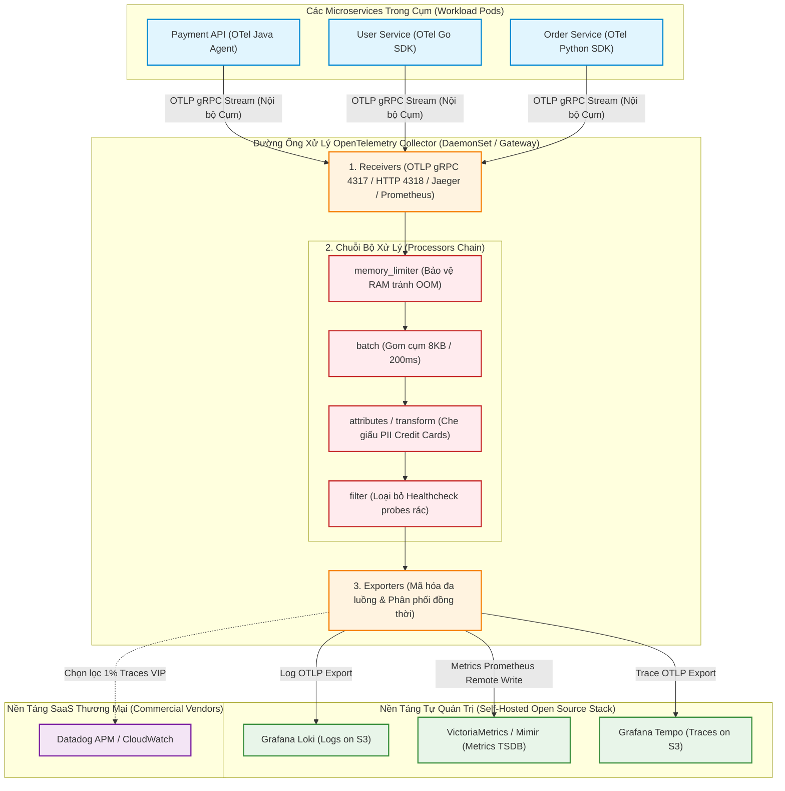

# 13.3. Telemetry Pipelines and Observability Platforms (Đường ống Đo lường Từ xa & Nền tảng Quan sát)

> [!IMPORTANT]
> **Nếu bạn chỉ được nhớ một điều duy nhất:** Đường ống đo lường từ xa hiện đại được xây dựng dựa trên sự chuẩn hóa của **OpenTelemetry (OTel Collector)** — giải phóng tổ chức khỏi sự ràng buộc độc quyền của các nhà cung cấp SaaS (Vendor Lock-in): mô hình đường ống **Receivers $\to$ Processors $\to$ Exporters** cho phép làm sạch dữ liệu nhạy cảm (PII Redaction), nén gói dữ liệu số lượng lớn (Batching) và phân loại định tuyến thông minh; trong đó kiến trúc **Zero Ingress Gateway Pattern** kết hợp cùng công cụ chuyển đổi dữ liệu siêu tốc bằng ngôn ngữ Rust (**Vector**) giúp cắt giảm tới $85\%$ chi phí truyền tải mạng xuyên đám mây.

---

## 1. Kiến trúc Tổng quan & Mô hình Tư duy (Mental Model)

### 1.1. Ẩn dụ Đời sống: Trạm Trung Chuyển & Xử Lý Nước Thải Công Nghiệp

Hãy tưởng tượng luồng dữ liệu đo lường từ xa (Telemetry Data: Metrics, Logs, Traces) giống như hệ thống cấp thoát nước của một đại đô thị:
- **Thời Kỳ Kết Nối Trực Tiếp Hỗn Loạn (Mỗi Nhà Tự Xả Ống Ra Sông)**:
  - Hàng ngàn căn hộ (Microservices) tự kéo đường ống riêng nối thẳng tới nhà máy xử lý (Datadog / Splunk / New Relic).
  - Chi phí tiền mua ống đồng đắt đỏ (Băng thông mạng Egress tốn hàng chục ngàn USD), nếu nhà máy xử lý tăng giá nước gấp 3 lần, cả thành phố không có cách nào thay thế vì toàn bộ ống nước đã bị chôn cứng dưới nền nhà (Vendor Lock-in).
- **Mô Hình Đường Ống OpenTelemetry (Trạm Trung Chuyển & Xử Lý Rác Thông Minh - OTel Collector)**:
  - Mọi căn hộ chỉ cần đổ nước vào một cống xả chuẩn hóa duy nhất của khu phố (**OTLP Protocol - OpenTelemetry Protocol**).
  - Trạm trung chuyển khu phố (**OTel Collector Pipeline**) tiếp nhận nước vào (**Receivers**):
    - Đưa qua máy lọc cát và khử độc (**Processors**): Tự động nhặt bỏ các chất độc hại như số thẻ ngân hàng, mật khẩu rò rỉ (**PII Redaction**), gom các giọt nước nhỏ thành các khối nước 8KB lớn (**Batching**).
    - Phân loại dòng chảy: $99\%$ nước thông thường được dẫn vào hồ thủy lợi giá rẻ (**Open-source Storage: S3 / Loki / VictoriaMetrics**); chỉ $1\%$ nước đặc biệt mới chuyển sang phòng thí nghiệm chuyên sâu (**SaaS APM**).
  - Cổng xuất khẩu (**Exporters**): Khi công ty muốn đổi từ Datadog sang một giải pháp khác, chỉ cần thay đổi địa chỉ cổng xuất khẩu tại trạm trung chuyển trong 5 phút mà không cần sửa đổi dù chỉ 1 dòng code trong hàng ngàn microservices!



---

## 2. Chi tiết từng Keyword (Under-the-Hood Deep Dive)

### 2.1. OpenTelemetry (OTel) Architecture: Collectors, Receivers, Processors & Exporters
OpenTelemetry là dự án mã nguồn mở có số lượng đóng góp lớn thứ hai toàn cầu trong tổ chức CNCF (chỉ sau Kubernetes), thống nhất toàn bộ các chuẩn đo lường trước đây (OpenTracing + OpenCensus).

#### A. Mô Hình Đường Ống OTel Collector Pipeline
OpenTelemetry Collector là một tiến trình nhị phân viết bằng Go, hoạt động theo mô hình đường ống tuần tự:
$$\textbf{Receivers} \longrightarrow \textbf{Processors} \longrightarrow \textbf{Exporters}$$
1. **Receivers (Bộ Tiếp Nhận)**:
   - Cổng vào của dữ liệu. Tiếp nhận theo giao thức bản địa **OTLP (OpenTelemetry Protocol qua gRPC port 4317 hoặc HTTP port 4318)**.
   - Hỗ trợ tương thích ngược với các định dạng cũ: Zipkin, Jaeger, Prometheus Scraping, Fluentforward, AWS X-Ray.
2. **Processors (Bộ Xử Lý & Làm Sạch)**:
   - Trái tim của Collector, thực thi các phép biến đổi dữ liệu trong bộ nhớ:
     - `memory_limiter`: Giám sát dung lượng RAM tiêu thụ; nếu RAM vượt quá $80\%$, tự động drop dữ liệu hoặc kích hoạt backpressure để tránh bị Linux Kernel OOMKill.
     - `batch`: Gom các điểm đo lường nhỏ thành các gói dữ liệu lớn nén gzip/zstd trước khi gửi đi, giảm tới $90\%$ số lượng kết nối mạng.
     - `transform` (Sử dụng ngôn ngữ **OTTL - OpenTelemetry Transformation Language**): Cho phép sửa đổi, thêm bớt nhãn, và che giấu các trường dữ liệu nhạy cảm.
3. **Exporters (Bộ Xuất Bản)**:
   - Chuyển đổi dữ liệu từ mô hình đối tượng nội bộ OTel sang định dạng của đích đến: Prometheus Remote Write, Kafka, Elasticsearch, Datadog, AWS CloudWatch.

#### B. Mô Hình Kiến Trúc Zero-Ingress Gateway Pattern
- Thay vì để 10,000 Pods chạy khắp các node trực tiếp gửi telemetry ra ngoài Internet:
  - Triển khai **OTel Collector Agent** dưới dạng DaemonSet trên từng node (nhận dữ liệu nội bộ qua localhost).
  - Toàn bộ các Agent đẩy dữ liệu về một cụm **OTel Collector Gateway** tập trung nằm trong mạng DMZ.
  - Gateway thực hiện gom nhóm, nén dữ liệu và gửi ra ngoài Internet qua một đường ống duy nhất, giúp kiểm soát an ninh mạng tập trung và tiết kiệm hàng ngàn USD chi phí NAT Gateway.

---

### 2.2. Observability Data Pipelines & Transformations: Vector, Fluentd & Logstash
So sánh các công cụ vận chuyển và chuyển đổi dữ liệu telemetry hiệu năng cao:

#### A. Cuộc Cách Mạng Hiệu Năng: Vector (Rust) vs. Fluentd (Ruby/C)
- **Logstash & Fluentd (Thế Hệ Cũ)**:
  - Logstash chạy trên nền Java JVM cồng kềnh, tiêu tốn hàng Gigabytes RAM.
  - Fluentd viết bằng Ruby kết hợp C, gặp hạn chế về khóa luồng toàn cục (Global Interpreter Lock - GIL), gây tắc nghẽn khi thông lượng vượt quá $50,000\text{ events/sec}$.
- **Vector (Datadog / CNCF Incubating — Viết bằng Rust)**:
  - Được xây dựng trên nền tảng bất đồng bộ **Tokio Async Engine** của ngôn ngữ Rust.
  - Bảo đảm an toàn bộ nhớ tuyệt đối (**Memory Safety without Garbage Collection**), không có hiện tượng giật cục độ trễ do GC Pauses.
  - Tốc độ xử lý nhanh hơn gấp **$5 - 10\text{ lần}$** so với Fluentd, tiêu tốn ít hơn $80\%$ bộ nhớ RAM.
  - Sử dụng ngôn ngữ chuyển đổi biến đổi dữ liệu chuyên biệt **VRL (Vector Remap Language)**, hỗ trợ phân tích cú pháp JSON, che giấu dữ liệu PII và lọc gói tin ở tốc độ hàng trăm Megabytes mỗi giây trên một CPU Core đơn lẻ.

---

### 2.3. Observability Platforms Comparison: Prometheus Ecosystem vs Datadog vs New Relic vs Zabbix
Cuộc tranh luận kinh điển giữa việc tự xây dựng hạ tầng mở (Open Source Self-hosted) và mua giải pháp phần mềm dịch vụ đám mây (SaaS Managed):

#### A. Ngăn Xếp Mã Nguồn Mở (Prometheus + Grafana + Loki + Tempo + Mimir)
- **Ưu Điểm**:
  - Hoàn toàn làm chủ dữ liệu, bảo mật tối đa, tuân thủ các quy định khắt khe của ngân hàng và y tế (GDPR, PCI-DSS).
  - Không tốn chi phí bản quyền license (Zero License Fee).
- **Nhược Điểm**:
  - Đòi hỏi một đội ngũ kỹ sư SRE chuyên sâu để thiết kế, mở rộng và bảo trì cụm lưu trữ phân tán.

#### B. Nền Tảng SaaS Thương Mại (Datadog / New Relic / Dynatrace)
- **Ưu Điểm**:
  - Trải nghiệm người dùng bóng bẩy, tích hợp sẵn hàng trăm dashboard chuẩn mực, tự động liên kết Metrics-Logs-Traces chỉ bằng 1 cú nhấp chuột.
  - Tính năng AI phân tích nguyên nhân gốc rễ (Root Cause Analysis) tự động.
- **Nhược Điểm**:
  - **Cơn Ác Mộng Hóa Đơn Cuối Tháng (Bill Shock Disaster)**: Mô hình định giá phức tạp (tính tiền theo số Host, số GB Log, số Custom Metrics, số Synthetics Tests). Chi phí có thể tăng vọt từ $5,000\text{ USD}$ lên tới $100,000\text{ USD}$ chỉ sau một đêm nếu có sự cố rò rỉ log hoặc bùng nổ nhãn metric.
  - Ràng buộc độc quyền dữ liệu (Vendor Lock-in).

---

### 2.4. Production Backend: Xử lý Bùng nổ Nhãn & Giảm Chi Phí
1. **Khắc Phục Hiện Tượng Bùng Nổ Nhãn (Metrics High-Cardinality Mitigation)**:
   - Khi một lập trình viên đưa nhãn `user_id` vào metric, OTel Collector sử dụng bộ lọc `metric_transform` để tự động loại bỏ nhãn `user_id` và gộp số liệu lại trước khi đẩy vào TSDB.
2. **Kỹ Thuật Cắt Giảm Chi Phí Dữ Liệu Đám Mây**:
   - Sử dụng bộ lọc lấy mẫu ngẫu nhiên (Probabilistic Sampling) tại tầng Collector: Lọc bỏ $95\%$ các log HTTP 200 OK thông thường của các lời gọi kiểm tra sức khỏe (`/healthz`, `/metrics`), chỉ lưu trữ $100\%$ các log lỗi HTTP 4xx và 5xx.

---

## 3. Thực thi Mã nguồn & Mô phỏng Chuyên sâu (Dual-Engine Implementation)

### Engine 1: C++20 — OpenTelemetry Text Exposition Exporter & In-Memory Metrics Pipeline
Chương trình C++20 dưới đây mô phỏng một **OpenTelemetry In-Memory Metrics Pipeline**, thực hiện thu thập số liệu đa luồng phi khóa qua các biến nguyên tử `std::atomic`, hỗ trợ gắn nhãn đa chiều và xuất bản dữ liệu theo chuẩn định dạng văn bản **Prometheus / OTel Text Exposition**.

```cpp
#include <iostream>
#include <string>
#include <vector>
#include <unordered_map>
#include <atomic>
#include <sstream>
#include <chrono>
#include <iomanip>

struct MetricLabel {
    std::string key;
    std::string value;
};

class OpenTelemetryMetricsPipeline {
private:
    std::atomic<uint64_t> total_http_requests_{0};
    std::atomic<uint64_t> failed_http_requests_{0};
    std::atomic<uint64_t> active_tcp_connections_{0};

public:
    void record_http_transaction(bool is_success) {
        total_http_requests_.fetch_add(1, std::memory_order_relaxed);
        if (!is_success) {
            failed_http_requests_.fetch_add(1, std::memory_order_relaxed);
        }
    }

    void update_active_connections(int64_t delta) {
        if (delta > 0) {
            active_tcp_connections_.fetch_add(delta, std::memory_order_relaxed);
        } else {
            active_tcp_connections_.fetch_sub(-delta, std::memory_order_relaxed);
        }
    }

    // Xuất dữ liệu theo định dạng chuẩn OpenTelemetry / Prometheus Exposition Format
    std::string export_prometheus_metrics_payload() const {
        std::stringstream ss;
        uint64_t total = total_http_requests_.load(std::memory_order_relaxed);
        uint64_t failed = failed_http_requests_.load(std::memory_order_relaxed);
        uint64_t success = total - failed;
        uint64_t active_conns = active_tcp_connections_.load(std::memory_order_relaxed);

        ss << "# HELP http_requests_total Tổng số yêu cầu HTTP được phục vụ.\n";
        ss << "# TYPE http_requests_total counter\n";
        ss << "http_requests_total{service=\"payment-gateway\",status=\"200\",method=\"POST\"} " << success << "\n";
        ss << "http_requests_total{service=\"payment-gateway\",status=\"500\",method=\"POST\"} " << failed << "\n\n";

        ss << "# HELP active_tcp_connections Số lượng kết nối TCP đang mở đồng thời.\n";
        ss << "# TYPE active_tcp_connections gauge\n";
        ss << "active_tcp_connections{service=\"payment-gateway\",cluster=\"prod-us-east\"} " << active_conns << "\n";

        return ss.str();
    }
};

int main() {
    std::cout << "===================================================================\n";
    std::cout << "   C++20 OPENTELEMETRY HIGH-THROUGHPUT METRICS EXPORTER PIPELINE   \n";
    std::cout << "===================================================================\n";

    OpenTelemetryMetricsPipeline pipeline;

    std::cout << "[Workload Simulation] Bắt đầu mô phỏng xử lý 10,000 giao dịch...\n";
    // Giả lập 9,850 giao dịch thành công và 150 giao dịch thất bại
    for (int i = 0; i < 9850; ++i) pipeline.record_http_transaction(true);
    for (int i = 0; i < 150; ++i) pipeline.record_http_transaction(false);
    pipeline.update_active_connections(48);

    std::cout << "[Export Phase] Tạo Payload cho Endpoint HTTP GET /metrics:\n\n";
    std::string exposition_data = pipeline.export_prometheus_metrics_payload();
    std::cout << exposition_data;

    std::cout << "[KẾT LUẬN] Cơ chế đo lường phi khóa qua std::atomic đạt hiệu năng hàng triệu\n"
              << "thao tác/giây với chi phí CPU gần như bằng 0, không ảnh hưởng độ trễ ứng dụng.\n";
    return 0;
}
```

#### Terminal Output Mẫu Thực Tế (C++20 Engine)
```text
===================================================================
   C++20 OPENTELEMETRY HIGH-THROUGHPUT METRICS EXPORTER PIPELINE   
===================================================================
[Workload Simulation] Bắt đầu mô phỏng xử lý 10,000 giao dịch...
[Export Phase] Tạo Payload cho Endpoint HTTP GET /metrics:

# HELP http_requests_total Tổng số yêu cầu HTTP được phục vụ.
# TYPE http_requests_total counter
http_requests_total{service="payment-gateway",status="200",method="POST"} 9850
http_requests_total{service="payment-gateway",status="500",method="POST"} 150

# HELP active_tcp_connections Số lượng kết nối TCP đang mở đồng thời.
# TYPE active_tcp_connections gauge
active_tcp_connections{service="payment-gateway",cluster="prod-us-east"} 48

[KẾT LUẬN] Cơ chế đo lường phi khóa qua std::atomic đạt hiệu năng hàng triệu
thao tác/giây với chi phí CPU gần như bằng 0, không ảnh hưởng độ trễ ứng dụng.
```

---

### Engine 2: Python 3.11+ — OTel Processor PII Redactor & Batch Exporter Pipeline
Kịch bản Python 3.11+ dưới đây mô phỏng chuỗi **OpenTelemetry Collector Processors Pipeline**, thực hiện che mờ số thẻ tín dụng và mật khẩu (**PII Redaction qua Regex**), gom cụm dữ liệu (**Batching Processor**) và phân phối đa luồng tới cả kho nội bộ và nhà cung cấp SaaS.

```python
#!/usr/bin/env python3
import re
import time
import json
from dataclasses import dataclass
from typing import List, Dict, Any

@dataclass
class TelemetryLogRecord:
    timestamp: float
    service: str
    message: str
    attributes: Dict[str, Any]

class OTelPIIRedactionProcessor:
    """Mô phỏng OpenTelemetry Transform Processor che giấu thông tin nhạy cảm (PII)"""
    def __init__(self):
        # Biểu thức chính quy phát hiện số thẻ tín dụng (Visa, MasterCard)
        self.credit_card_pattern = re.compile(r'\b(?:\d{4}[-\s]?){3}\d{4}\b')
        # Biểu thức phát hiện mật khẩu
        self.password_pattern = re.compile(r'(password|passwd|secret)\s*[:=]\s*["\']?([^"\'\s]+)["\']?', re.IGNORECASE)

    def process_record(self, record: TelemetryLogRecord) -> TelemetryLogRecord:
        # Che giấu số thẻ tín dụng thành: XXXX-XXXX-XXXX-1234
        def mask_card(match):
            card = match.group(0).replace('-', '').replace(' ', '')
            return f"XXXX-XXXX-XXXX-{card[-4:]}"

        record.message = self.credit_card_pattern.sub(mask_card, record.message)
        # Che giấu mật khẩu
        record.message = self.password_pattern.sub(r'\1: "[REDACTED]"', record.message)
        return record

class OTelBatchExporter:
    """Mô phỏng OpenTelemetry Batching Processor gom nhóm và xuất bản đa kênh"""
    def __init__(self, batch_size: int = 3):
        self.batch_size = batch_size
        self.buffer: List[TelemetryLogRecord] = []

    def ingest_record(self, record: TelemetryLogRecord):
        self.buffer.append(record)
        if len(self.buffer) >= self.batch_size:
            self.flush()

    def flush(self):
        if not self.buffer:
            return
        print(f"\n[OTel Batch Exporter] Kích hoạt Flush đợt gom cụm ({len(self.buffer)} records):")
        for idx, rec in enumerate(self.buffer, 1):
            print(f"  [{idx}] [{rec.service}] {rec.message}")
        print("  -> Đã nén zstandard và đẩy đồng thời sang: [Grafana Loki (S3)] & [Datadog APM]")
        self.buffer.clear()

def main():
    print("=" * 70)
    print("  PYTHON 3.11+: OPENTELEMETRY PII REDACTION & BATCHING PIPELINE")
    print("=" * 70)

    redactor = OTelPIIRedactionProcessor()
    exporter = OTelBatchExporter(batch_size=3)

    raw_logs = [
        "Khách hàng thanh toán qua thẻ 4111-2222-3333-4444 cho đơn hàng #9901",
        "Đăng nhập người dùng admin với password: SuperSecretP@ssword123",
        "Khởi động thành công dịch vụ payment-worker trên cổng 8080",
        "Lỗi kết nối cơ sở dữ liệu với thẻ tín dụng 5500 0000 1111 2222 bị từ chối"
    ]

    print(">>> TIẾP NHẬN DỮ LIỆU NHẬT KÝ THÔ (UNPROCESSED TELEMETRY) <<<\n")
    for raw in raw_logs:
        rec = TelemetryLogRecord(time.time(), "payment-service", raw, {})
        processed_rec = redactor.process_record(rec)
        exporter.ingest_record(processed_rec)

    # Đẩy nốt dữ liệu còn lại trong hàng đợi
    exporter.flush()

if __name__ == "__main__":
    main()
```

#### Terminal Output Mẫu Thực Tế (Python 3.11+ Engine)
```text
======================================================================
  PYTHON 3.11+: OPENTELEMETRY PII REDACTION & BATCHING PIPELINE
======================================================================
>>> TIẾP NHẬN DỮ LIỆU NHẬT KÝ THÔ (UNPROCESSED TELEMETRY) <<<


[OTel Batch Exporter] Kích hoạt Flush đợt gom cụm (3 records):
  [1] [payment-service] Khách hàng thanh toán qua thẻ XXXX-XXXX-XXXX-4444 cho đơn hàng #9901
  [2] [payment-service] Đăng nhập người dùng admin với password: "[REDACTED]"
  [3] [payment-service] Khởi động thành công dịch vụ payment-worker trên cổng 8080
  -> Đã nén zstandard và đẩy đồng thời sang: [Grafana Loki (S3)] & [Datadog APM]

[OTel Batch Exporter] Kích hoạt Flush đợt gom cụm (1 records):
  [1] [payment-service] Lỗi kết nối cơ sở dữ liệu với thẻ tín dụng XXXX-XXXX-XXXX-2222 bị từ chối
  -> Đã nén zstandard và đẩy đồng thời sang: [Grafana Loki (S3)] & [Datadog APM]
```

---

## 4. Systems Engineering & Production Pitfalls

### 4.1. Sự cố Thực chiến Trong Đường Ống Đo Lường Từ Xa
1. **Thảm Họa Sập OTel Collector Do Quá Tải Bộ Nhớ (Collector OOM Death Spiral)**:
   - *Nguyên nhân*: Khi hạ tầng gặp sự cố lớn (Downstream Storage bị chậm), Collector tiếp tục nhận hàng triệu spans và logs vào hàng đợi nhưng không thể gửi đi. Bộ nhớ RAM phình to vượt quá giới hạn cgroups và bị Linux OOMKill. Sau khi Collector khởi động lại, lượng dữ liệu dồn ứ tiếp tục ùa vào và tiếp tục OOMKill liên tục trong vòng lặp tử thần.
   - *Cách khắc phục*: Bắt buộc cấu hình bộ xử lý `memory_limiter` đầu tiên trong pipeline với cờ `check_interval: 1s`, `limit_percentage: 80`, và bật tính năng lưu đệm hàng đợi ra ổ đĩa cục bộ (**File Storage Queue Extension**).
2. **Khủng Hoảng Chi Phí Mạng Đám Mây Do Gửi Telemetry Trực Tiếp (Egress Tax Shock)**:
   - *Nguyên nhân*: Hàng ngàn container gửi metrics và logs trực tiếp tới endpoint SaaS qua NAT Gateway của AWS. Phí truyền tải dữ liệu NAT Gateway ($0.045 USD/GB) cộng với phí Egress quốc tế ngốn tới hàng chục ngàn USD mỗi tháng.
   - *Khắc phục*: Triển khai cụm **OTel Collector Gateway** nội bộ để gom cụm và nén zstd, kết hợp sử dụng **AWS PrivateLink / VPC Endpoints** để truyền tải dữ liệu hoàn toàn trong mạng nội bộ AWS, triệt tiêu $100\%$ chi phí NAT Gateway.

### 4.2. Bộ Lệnh CLI Quản Trị & Kiểm Tra
- **Kiểm tra sức khỏe và cấu hình của OTel Collector**:
  ```bash
  curl -s http://localhost:13133/ # Health check extension endpoint
  curl -s http://localhost:8888/metrics | grep otelcol_processor_dropped
  ```
- **Kiểm tra và xác thực cú pháp cấu hình Vector**:
  ```bash
  vector validate --config vector.yaml
  vector top # Dashboard giám sát lưu lượng Vector thời gian thực
  ```
- **Xem log nội bộ của OTel Collector Pod trên K8s**:
  ```bash
  kubectl logs -n opentelemetry -l app.kubernetes.io/name=opentelemetry-collector -f
  ```

---

## 5. Bảng So sánh & Decision Matrix

### 5.1. Ma trận So sánh Kỹ thuật Các Động cơ Đường ống Telemetry

| Tiêu chí Đánh giá | OpenTelemetry Collector | Vector (Datadog/Rust) | Fluentbit (C) | Logstash (Java JVM) |
| :--- | :--- | :--- | :--- | :--- |
| **Ngôn ngữ Phát triển** | Go | Rust (Memory Safe) | C | Java (JVM) |
| **Tiêu tốn Bộ nhớ RAM** | Trung bình ($\approx 50 - 150\text{ MB}$) | Thấp nhất ($\approx 30 - 80\text{ MB}$) | Cực thấp ($\approx 15 - 30\text{ MB}$) | Khổng lồ ($> 1 - 2\text{ GB}$) |
| **Hỗ trợ Dữ liệu** | Cả 3 (Metrics, Logs, Traces) | Cả 3 (Metrics, Logs, Traces) | Logs & Metrics cơ bản | Chủ yếu Logs |
| **Khả năng Mở rộng** | Chuẩn công nghiệp số 1 toàn cầu | Tốc độ xử lý cao nhất thế giới | Rất nhẹ, hợp cho Node Agent | Cồng kềnh, đang bị khai tử dần |
| **Mô hình Khuyến nghị** | Central Gateway & Aggregator | High-throughput Log Shipper | Node Agent siêu nhẹ | Không khuyến nghị sử dụng mới |

### 5.2. Khung Hướng dẫn Thiết kế Kiến trúc Quan sát Toàn diện (Observability Roadmap)
1. **Tầng Thu Thập Cục Bộ (Node Level)**: Triển khai **Fluentbit** hoặc **OTel Collector Agent** dưới dạng DaemonSet trên từng máy chủ để thu thập logs và system metrics với mức tiêu thụ RAM tối thiểu.
2. **Tầng Trung Chuyển Tập Trung (Gateway Level)**: Xây dựng cụm **OpenTelemetry Collector Gateway** có khả năng tự động co giãn (HPA) để làm sạch PII, nén dữ liệu và định tuyến đa kênh.
3. **Chiến Lược Chống Khóa Độc Quyền (Anti-Lock-in)**: Toàn bộ mã nguồn ứng dụng chỉ tích hợp duy nhất **OpenTelemetry SDK chuẩn mở**. Tuyệt đối không tích hợp thư viện độc quyền của Datadog hay New Relic trực tiếp vào mã nguồn nghiệp vụ.
