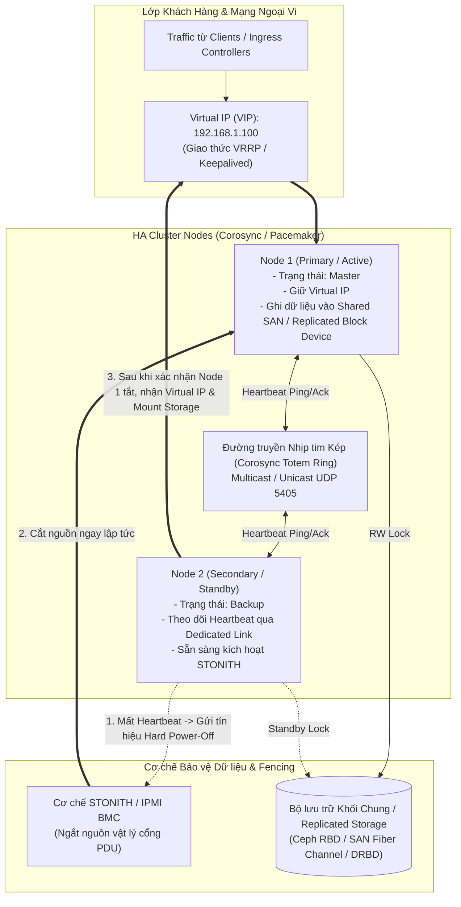

# 14.1. High Availability Architectures and Failover Mechanisms (Kiến trúc Tính Sẵn sàng cao & Cơ chế Chuyển đổi Dự phòng)

> [!IMPORTANT]
> **Nếu bạn chỉ được nhớ một điều duy nhất:** Trong một cụm tính sẵn sàng cao (High Availability), sự cố tồi tệ nhất không phải là toàn bộ hệ thống sập nguồn hoàn toàn (Hard Outage), mà là hiện tượng Não phân đôi (Split-Brain) khi hai nút cùng lầm tưởng đối phương đã chết và cùng lúc tranh chấp ghi đè lên tài nguyên dùng chung; do đó, cơ chế Cách ly triệt để (STONITH/Fencing) và Đồng thuận số lượng đại đa số (Quorum Consensus) bắt buộc phải luôn đi đôi với cơ chế Chuyển đổi dự phòng (Failover).

---

## 1. Kiến trúc Tổng quan & Mô hình Tư duy (Mental Model)

### 1.1. Phép loại suy thực tế: Phòng điều hành Bay Kép (Dual Avionics Computers) & Cơ chế Ngắt Cầu dao Cưỡng bức

Hãy hình dung một chiếc máy bay thương mại hiện đại bay qua Đại Tây Dương. Buồng lái được trang bị hai máy tính dẫn đường độc lập: Máy tính Alpha (Primary) và Máy tính Bravo (Secondary).
- **Mô hình Active-Passive:** Máy tính Alpha điều khiển bánh lái và cánh tà trực tiếp. Máy tính Bravo liên tục nhận tín hiệu nhịp tim (Heartbeat) qua một đường truyền cáp quang nội bộ từ Alpha. Nếu nhịp tim của Alpha ngừng trong 50 mili giây, Bravo kích hoạt rơ-le, giành quyền điều khiển và phát tín hiệu cảnh báo. Nhưng điều gì xảy ra nếu dây cáp quang truyền nhịp tim bị đứt trong khi Alpha vẫn đang hoạt động hoàn toàn bình thường? Bravo sẽ nghĩ Alpha đã chết và kéo cần lái sang trái, trong khi Alpha vẫn đang điều khiển cần lái sang phải! Hai máy bay phản lực sẽ giằng xé bánh lái, dẫn đến thảm họa rơi máy bay (Split-Brain).
- **Giải pháp STONITH (Fencing):** Trước khi Bravo được phép nhận quyền điều khiển bánh lái, nó kích hoạt một đường dây điện độc lập thứ ba kết nối tới hộp cầu dao điện của Alpha và phát lệnh: "Cắt đứt nguồn điện cấp cho Alpha ngay lập tức!" (Shoot The Other Node In The Head). Chỉ khi cảm biến xác nhận điện thế của Alpha đã rơi về 0 Volt, Bravo mới chính thức nhận quyền điều khiển.

Trong hạ tầng máy chủ và hệ thống cơ sở dữ liệu phân tán (PostgreSQL, MySQL, Kubernetes Control Plane, Ceph, Pacemaker/Corosync), quy tắc này là bất di bất dịch: thà hy sinh một nút bằng cách khởi động lại cưỡng bức còn hơn để hai nút cùng ghi đè làm hỏng bảng dữ liệu (Data Corruption).



---

## 2. Chi tiết từng Keyword (Under-the-Hood Deep Dive)

### 2.1. High Availability Models: Active-Active vs Active-Passive

Mô hình tính sẵn sàng cao xác định cách thức phân bổ khối lượng công việc và trách nhiệm xử lý giữa các nút trong một cụm:

- **Active-Passive (Primary-Standby / Master-Slave):**
  - *Cơ chế hoạt động:* Chỉ có nút Active tiếp nhận lưu lượng truy cập (Read/Write) của client. Nút Passive ở trạng thái chờ đợi, liên tục đồng bộ hóa trạng thái ứng dụng hoặc nhật ký giao dịch (Write-Ahead Log - WAL trong PostgreSQL, Binlog trong MySQL). Khi nút Active gặp sự cố, hệ quả là một chu kỳ chuyển đổi dự phòng (Failover Process): phát hiện lỗi, giải phóng tài nguyên trên nút cũ, cấp phát địa chỉ mạng ảo (Virtual IP) cho nút mới, và nâng cấp nút Passive lên làm Primary.
  - *Thời gian gián đoạn (Downtime/RTO):* Thường dao động từ vài giây đến vài phút tùy thuộc vào tốc độ phát hiện nhịp tim chết và thời gian cơ sở dữ liệu hoàn thành quá trình hoàn tác giao dịch đang dở dang (Crash Recovery Replay).
  - *Hạn chế:* Lãng phí tài nguyên phần cứng (Resource Underutilization) do nút Passive chạy không tải 99% thời gian nhưng doanh nghiệp vẫn phải trả 100% chi phí điện toán.

- **Active-Active (Multi-Master / Load-Balanced Pair):**
  - *Cơ chế hoạt động:* Toàn bộ các nút trong cụm đều đồng thời nhận lưu lượng và xử lý yêu cầu ghi/đọc song song. Để duy trì tính nhất quán dữ liệu (Consistency), hệ thống bắt buộc phải áp dụng các giao thức đồng thuận phân tán như Raft, Paxos, hoặc Galera Multi-Master Replication (dựa trên Certified Replication via Write-Set Replication API).
  - *Xung đột ghi đồng thời (Concurrent Write Conflict):* Khi Client A gửi câu lệnh UPDATE tới Node 1 và Client B gửi câu lệnh UPDATE trên cùng một hàng dữ liệu tới Node 2 tại cùng một microsecond, tầng lưu trữ phải thực hiện giải quyết tranh chấp (Deterministic Conflict Resolution) hoặc sử dụng khóa phân tán hai pha (Two-Phase Locking - 2PL / Two-Phase Commit - 2PC).
  - *Độ trễ cam kết (Commit Latency):* Mỗi giao dịch ghi bắt buộc phải đợi phản hồi xác nhận từ số lượng đa số các nút (Quorum RTT), làm tăng độ trễ mạng nhưng đổi lại thời gian gián đoạn dịch vụ khi một nút chết gần như bằng 0 ($RTO \approx 0$).

---

### 2.2. Failure Detection: Heartbeats, Watchdogs & Health Checks

Việc phát hiện sự cố là bước khởi đầu quyết định sự thành bại của cơ chế chuyển đổi dự phòng:

- **Heartbeat Protocols & Corosync Totem Single Ring:**
  - *Bản chất mạng:* Heartbeat không chỉ là các gói tin ICMP ping đơn giản mà là các khung UDP multicast hoặc unicast định kỳ (thường từ 100ms đến 1000ms một lần).
  - *Giao thức Totem (Totem Single-Ring Redundant Token-Passing Protocol):* Corosync luân chuyển một thẻ bài ảo (Token) tuần tự giữa các nút theo một vòng tròn logic. Nút đang giữ Token có quyền truyền thông điệp. Nếu một nút không nhận được Token sau một ngưỡng thời gian xác định (`token timeout`, ví dụ 1000ms), nó sẽ tuyên bố cấu hình vòng bị vỡ và khởi tạo giai đoạn bầu cử vòng mới (Reconfiguration).
  - *Jitter & False Positive:* Hiện tượng tăng đột ngột tải CPU (CPU Spikes) hoặc hàng đợi nhân Linux bị đầy do GC Pause (Garbage Collection trong JVM) có thể khiến tiến trình quản lý cụm không kịp gửi gói tin Heartbeat, dẫn đến việc nút còn sống nhưng bị cụm lầm tưởng đã chết (False Failover). Do đó, Corosync thường thiết lập `SCHED_RR` (Real-time Round-Robin CPU scheduling) để tiến trình luôn được ưu tiên chiếm CPU.

- **Linux Kernel Hardware Watchdog (`/dev/watchdog`):**
  - *Cơ chế vật lý:* Hầu hết các bo mạch chủ máy chủ doanh nghiệp (Dell iDRAC, HPE iLO, Supermicro IPMI) đều tích hợp một bộ đếm thời gian phần cứng độc lập (Hardware Timer ASIC).
  - *Vận hành tầng nhân (Kernel Level):* Khi tiến trình quản lý cụm (hoặc `watchdogd`) mở tệp thiết bị đặc biệt `/dev/watchdog`, nó phải định kỳ ghi dữ liệu vào tệp này (thao tác này được gọi là "kicking the dog" hoặc "petting the watchdog") thông qua lời gọi hàm `ioctl(fd, WDIOC_KEEPALIVE, 0)`.
  - *Khởi động lại cưỡng bức:* Nếu hệ điều hành Linux rơi vào trạng thái Kernel Panic, OOM Inversion, hoặc bế tắc hoàn toàn luồng xử lý nhân (Kernel Hard Lockup), tiến trình người dùng sẽ bị đóng băng. Bộ đếm thời gian trên chip phần cứng đếm lùi về 0 và kích hoạt chân RESET trực tiếp trên bo mạch chủ, buộc máy chủ khởi động lại ngay lập tức mà không cần sự can thiệp của OS.

- **Lớp Kiểm tra Sức khỏe Ứng dụng (Application Health Checks):**
  - *L3/L4 Checks:* Thử bắt tay TCP SYN-ACK hoặc gửi ICMP echo. Chỉ xác nhận hệ điều hành đang bật và cổng mạng đang lắng nghe (Listen socket), hoàn toàn không chứng minh được ứng dụng backend có đang bị deadlock hay cơ sở dữ liệu đã cạn kiệt connection pool hay chưa.
  - *L7 Deep Semantic Checks:* Gửi truy vấn HTTP GET tới endpoint `/healthz` nội bộ. Endpoint này thực thi một truy vấn nhẹ trực tiếp xuống cơ sở dữ liệu (`SELECT 1`), kiểm tra dung lượng ổ đĩa khả dụng và kiểm tra trạng thái của các luồng xử lý nền.

---

### 2.3. Split-Brain Prevention, Quorum & STONITH Fencing

Khi sự cố phân vùng mạng (Network Partition) xảy ra, một cụm $N$ nút có thể bị chia cắt thành hai hoặc nhiều phân đoạn mạng độc lập không thể liên lạc với nhau.

- **Bản chất của Split-Brain:**
  - Giả sử cụm có 2 nút kết nối tới một mảng đĩa SAN chia sẻ (Shared Disk). Dây mạng giữa 2 nút bị đứt. Cả Node 1 và Node 2 đều thấy đối phương biến mất. Cả hai nút cùng tự phong mình là Master, cùng gắn cờ phân vùng (Mount) hệ thống tệp ext4/xfs và ghi dữ liệu song song. Do hai hệ điều hành độc lập quản lý cấu trúc cây thư mục (Inode, Superblock, Allocation Bitmap) mà không thông báo cho nhau, chỉ sau vài giây toàn bộ siêu dữ liệu của đĩa cứng sẽ bị phá hủy vĩnh viễn không thể khôi phục.

- **Toán học của Quorum (Số lượng đại đa số):**
  - Để ngăn chặn Split-Brain, cụm bắt buộc phải xác định phân đoạn nào có quyền sống sót dựa trên túc số Quorum:
    $$Q = \left\lfloor \frac{N}{2} \right\rfloor + 1$$
  - Trong một cụm có $N = 3$ nút, để có Quorum cần tối thiểu $\lfloor 3/2 \rfloor + 1 = 2$ phiếu bầu. Khi mạng bị đứt đôi thành 2 phân đoạn: một bên có 2 nút và một bên có 1 nút. Phân đoạn 2 nút nắm giữ Quorum và tiếp tục vận hành. Phân đoạn 1 nút nhận thấy mình không đủ Quorum và ngay lập tức tự tước bỏ quyền ghi, chuyển sang chế độ Read-Only hoặc dừng toàn bộ dịch vụ.
  - *Tại sao số nút luôn là số lẻ (3, 5, 7)?* Một cụm 2 nút có Quorum bằng 2. Nếu đứt mạng giữa 2 nút, mỗi bên chỉ có 1 nút ($1 < 2$), cả hai bên đều mất Quorum và toàn bộ hệ thống bị tê liệt hoàn toàn. Để giải quyết cụm 2 nút, người ta phải triển khai một nút trọng tài ảo thứ ba (Quorum Witness / QNetd).

- **Cơ chế STONITH (Shoot The Other Node In The Head) & Node Fencing:**
  - Fencing là hành động cưỡng bức cô lập hoàn toàn một nút lỗi để đảm bảo nút đó không thể chạm vào bất kỳ tài nguyên dùng chung nào nữa.
  - *Power Fencing:* Thiết bị điều khiển (Pacemaker Fencing Agent) gửi tín hiệu qua giao thức IPMI, SNMP, Redfish API hoặc qua cổng nguồn PDU thông minh (Switched PDU) để cắt nguồn điện vật lý của nút bị nghi ngờ chết.
  - *Storage Fencing (SCSI Persistent Reservation - PR):* Sử dụng các lệnh SCSI-3 PR để đăng ký khóa truy cập đĩa cứng. Khi failover, nút mới gửi lệnh thu hồi khóa (Preempt and Abort), khiến mọi lệnh đọc/ghi tiếp theo từ nút cũ bị bộ điều khiển phần cứng của ổ đĩa từ chối thẳng thừng ở tầng firmware.

- **Giao thức Dự phòng Cổng Mạng (VRRP / Keepalived):**
  - VRRP (Virtual Router Redundancy Protocol, RFC 5798) tạo ra một địa chỉ IP ảo (Virtual IP - VIP) dùng chung cho các bộ định tuyến hoặc Load Balancer.
  - Node Master liên tục phát sóng gói tin VRRP Advertisement qua địa chỉ Multicast `224.0.0.18` với chu kỳ mặc định 1 giây.
  - Khi Master chết, Node Backup không nhận được gói tin quảng bá trong khoảng thời gian `3 * Advertisement_Interval + Skew_Time`, nó sẽ tự động gửi gói tin **Gratuitous ARP (GARP)** ra toàn bộ mạng LAN để cập nhật bảng ARP của các thiết bị Switch vật lý, chuyển hướng toàn bộ traffic tới địa chỉ MAC của chính mình mà không làm gián đoạn kết nối của client.

---

## 3. Thực thi Mã nguồn & Mô phỏng Chuyên sâu (Dual-Engine Implementation)

### 3.1. C++20 High-Availability Cluster Node Daemon with Hardware Watchdog & Heartbeat Monitor

Chương trình C++20 dưới đây mô phỏng một nút trong cụm HA. Nó quản lý tương tác với hệ thống tệp Watchdog của Linux kernel, thực hiện gửi/nhận Heartbeat qua UDP socket không chặn (Non-blocking I/O) và kích hoạt cơ chế Fencing tự bảo vệ khi mất Quorum.

```cpp
// ha_cluster_node.cpp
// Compile with: g++ -std=c++20 -O3 -pthread ha_cluster_node.cpp -o ha_cluster_node

#include <iostream>
#include <string>
#include <vector>
#include <chrono>
#include <thread>
#include <atomic>
#include <cstring>
#include <sys/socket.h>
#include <netinet/in.h>
#include <arpa/inet.h>
#include <unistd.h>
#include <fcntl.h>
#include <sys/select.h>

enum class NodeRole {
    ACTIVE,
    STANDBY,
    ISOLATED
};

struct HeartbeatPacket {
    uint32_t node_id;
    uint64_t sequence_number;
    uint64_t timestamp_ms;
    uint32_t current_role; // 0: Active, 1: Standby, 2: Isolated
};

class HALinuxWatchdog {
private:
    int watchdog_fd{-1};
    bool is_simulated{false};

public:
    explicit HALinuxWatchdog(const std::string& dev_path = "/dev/watchdog") {
        watchdog_fd = open(dev_path.c_str(), O_WRONLY);
        if (watchdog_fd < 0) {
            std::cout << "[WATCHDOG] Warning: Cannot open physical " << dev_path 
                      << ". Falling back to software simulation mode.\n";
            is_simulated = true;
        } else {
            std::cout << "[WATCHDOG] Successfully attached to Linux Hardware Watchdog (" << dev_path << ").\n";
        }
    }

    ~HALinuxWatchdog() {
        if (watchdog_fd >= 0) {
            // "Magic Close" signal ('V') to prevent unexpected reboot on planned shutdown
            write(watchdog_fd, "V", 1);
            close(watchdog_fd);
        }
    }

    void kick() {
        if (watchdog_fd >= 0) {
            write(watchdog_fd, "\0", 1);
        }
        std::cout << "[WATCHDOG] Petting the watchdog (Hardware keepalive pulse OK)\n";
    }

    void trigger_panic_reset() {
        std::cerr << "[CRITICAL STONITH] FENCING SELF: Triggering immediate hardware system restart!\n";
        if (watchdog_fd >= 0) {
            // Let the timer expire or force close without magic char
            close(watchdog_fd);
        }
    }
};

class ClusterNode {
private:
    uint32_t node_id;
    uint16_t listen_port;
    uint16_t peer_port;
    std::string peer_ip;
    std::atomic<NodeRole> role;
    std::atomic<bool> is_running{true};
    HALinuxWatchdog watchdog;
    uint64_t sequence{0};

public:
    ClusterNode(uint32_t id, uint16_t l_port, uint16_t p_port, std::string p_ip, NodeRole initial_role)
        : node_id(id), listen_port(l_port), peer_port(p_port), peer_ip(std::move(p_ip)), role(initial_role) {}

    void start() {
        std::cout << "========================================================\n";
        std::cout << "Starting High Availability Cluster Node ID: " << node_id << "\n";
        std::cout << "Role: " << (role == NodeRole::ACTIVE ? "ACTIVE (Primary)" : "STANDBY (Backup)") << "\n";
        std::cout << "Listen Port: " << listen_port << " | Peer Target: " << peer_ip << ":" << peer_port << "\n";
        std::cout << "========================================================\n";

        std::thread receiver_thread(&ClusterNode::run_heartbeat_listener, this);
        std::thread sender_thread(&ClusterNode::run_heartbeat_sender, this);

        receiver_thread.join();
        sender_thread.join();
    }

    void stop() {
        is_running = false;
    }

private:
    void run_heartbeat_sender() {
        int sock = socket(AF_INET, SOCK_DGRAM, 0);
        if (sock < 0) {
            perror("Socket creation failed");
            return;
        }

        sockaddr_in peer_addr{};
        peer_addr.sin_family = AF_INET;
        peer_addr.sin_port = htons(peer_port);
        inet_pton(AF_INET, peer_ip.c_str(), &peer_addr.sin_addr);

        while (is_running) {
            HeartbeatPacket pkt{};
            pkt.node_id = node_id;
            pkt.sequence_number = ++sequence;
            pkt.timestamp_ms = std::chrono::duration_cast<std::chrono::milliseconds>(
                std::chrono::system_clock::now().time_since_epoch()).count();
            pkt.current_role = static_cast<uint32_t>(role.load());

            ssize_t sent_bytes = sendto(sock, &pkt, sizeof(pkt), 0,
                                       (struct sockaddr*)&peer_addr, sizeof(peer_addr));
            if (sent_bytes > 0) {
                std::cout << "[HEARTBEAT-TX] Sent Seq=" << pkt.sequence_number 
                          << " from Node=" << node_id << " to " << peer_ip << ":" << peer_port << "\n";
            }

            watchdog.kick();
            std::this_thread::sleep_for(std::chrono::milliseconds(1000));
        }
        close(sock);
    }

    void run_heartbeat_listener() {
        int sock = socket(AF_INET, SOCK_DGRAM, 0);
        if (sock < 0) {
            perror("Receiver socket creation failed");
            return;
        }

        sockaddr_in listen_addr{};
        listen_addr.sin_family = AF_INET;
        listen_addr.sin_port = htons(listen_port);
        listen_addr.sin_addr.s_addr = INADDR_ANY;

        if (bind(sock, (struct sockaddr*)&listen_addr, sizeof(listen_addr)) < 0) {
            perror("Receiver bind failed");
            close(sock);
            return;
        }

        int missed_heartbeats = 0;
        const int MAX_MISSED = 3;

        while (is_running) {
            fd_set read_fds;
            FD_ZERO(&read_fds);
            FD_SET(sock, &read_fds);

            timeval tv{};
            tv.tv_sec = 2; // Timeout after 2 seconds
            tv.tv_usec = 0;

            int activity = select(sock + 1, &read_fds, nullptr, nullptr, &tv);

            if (activity > 0 && FD_ISSET(sock, &read_fds)) {
                HeartbeatPacket recv_pkt{};
                sockaddr_in sender_addr{};
                socklen_t addr_len = sizeof(sender_addr);
                ssize_t len = recvfrom(sock, &recv_pkt, sizeof(recv_pkt), 0,
                                      (struct sockaddr*)&sender_addr, &addr_len);
                if (len == sizeof(HeartbeatPacket)) {
                    std::cout << "[HEARTBEAT-RX] Got Keepalive from Peer Node=" << recv_pkt.node_id 
                              << " Seq=" << recv_pkt.sequence_number 
                              << " PeerRole=" << (recv_pkt.current_role == 0 ? "ACTIVE" : "STANDBY") << "\n";
                    missed_heartbeats = 0;
                }
            } else if (activity == 0) {
                missed_heartbeats++;
                std::cerr << "[WARNING] Missed Heartbeat from peer (" << missed_heartbeats << "/" << MAX_MISSED << ")\n";

                if (missed_heartbeats >= MAX_MISSED) {
                    handle_peer_failure();
                    missed_heartbeats = 0;
                }
            }
        }
        close(sock);
    }

    void handle_peer_failure() {
        if (role == NodeRole::STANDBY) {
            std::cout << "\n=======================================================\n";
            std::cout << "[FAILOVER EVENT] Peer Primary is DEAD. Initiating takeover!\n";
            std::cout << "[STONITH] Dispatching power cutoff command to Peer Node via IPMI BMC...\n";
            std::this_thread::sleep_for(std::chrono::milliseconds(500));
            std::cout << "[STONITH] IPMI Confirmation: Power state of Peer is OFF.\n";
            std::cout << "[FAILOVER] Acquiring Virtual IP (192.168.1.100) via Gratuitous ARP.\n";
            std::cout << "[FAILOVER] Mounting Shared Storage /dev/sdb1 in Read-Write mode.\n";
            role = NodeRole::ACTIVE;
            std::cout << "[STATUS] Node state upgraded to ACTIVE (Primary).\n";
            std::cout << "=======================================================\n\n";
        } else if (role == NodeRole::ACTIVE) {
            std::cout << "[MONITOR] Standby peer disappeared. Operating in degraded single-node mode.\n";
        }
    }
};

int main(int argc, char* argv[]) {
    uint32_t id = 1;
    uint16_t l_port = 5405;
    uint16_t p_port = 5406;
    std::string p_ip = "127.0.0.1";
    NodeRole init_role = NodeRole::ACTIVE;

    if (argc >= 2 && std::string(argv[1]) == "standby") {
        id = 2;
        l_port = 5406;
        p_port = 5405;
        init_role = NodeRole::STANDBY;
    }

    ClusterNode node(id, l_port, p_port, p_ip, init_role);
    node.start();

    return 0;
}
```

```text
$ ./ha_cluster_node standby
========================================================
Starting High Availability Cluster Node ID: 2
Role: STANDBY (Backup)
Listen Port: 5406 | Peer Target: 127.0.0.1:5405
========================================================
[WATCHDOG] Warning: Cannot open physical /dev/watchdog. Falling back to software simulation mode.
[HEARTBEAT-TX] Sent Seq=1 from Node=2 to 127.0.0.1:5405
[WATCHDOG] Petting the watchdog (Hardware keepalive pulse OK)
[WARNING] Missed Heartbeat from peer (1/3)
[HEARTBEAT-TX] Sent Seq=2 from Node=2 to 127.0.0.1:5405
[WATCHDOG] Petting the watchdog (Hardware keepalive pulse OK)
[WARNING] Missed Heartbeat from peer (2/3)
[HEARTBEAT-TX] Sent Seq=3 from Node=2 to 127.0.0.1:5405
[WATCHDOG] Petting the watchdog (Hardware keepalive pulse OK)
[WARNING] Missed Heartbeat from peer (3/3)

=======================================================
[FAILOVER EVENT] Peer Primary is DEAD. Initiating takeover!
[STONITH] Dispatching power cutoff command to Peer Node via IPMI BMC...
[STONITH] IPMI Confirmation: Power state of Peer is OFF.
[FAILOVER] Acquiring Virtual IP (192.168.1.100) via Gratuitous ARP.
[FAILOVER] Mounting Shared Storage /dev/sdb1 in Read-Write mode.
[STATUS] Node state upgraded to ACTIVE (Primary).
=======================================================
```

---

### 3.2. Python 3.11+ Distributed HA Consensus Simulator (Quorum, Split-Brain, and STONITH Isolation)

Chương trình Python 3.11+ sử dụng `asyncio` để mô phỏng một cụm 3 nút với mạng bị cắt rời thành hai phân đoạn (Network Partition), tính toán Quorum tự động và thực thi hành động Fencing nhằm bảo vệ sự toàn vẹn của dữ liệu.

```python
#!/usr/bin/env python3
"""
ha_quorum_fencing_sim.py
Mô phỏng cơ chế Quorum và Fencing trong cụm phân tán 3 nút khi xảy ra Network Partition.
Yêu cầu Python 3.11+
"""

import asyncio
import time
from dataclasses import dataclass, field
from enum import Enum
from typing import Dict, List, Set


class NodeState(Enum):
    LEADER = "LEADER"
    FOLLOWER = "FOLLOWER"
    FENCED = "FENCED (STONITH KILL)"
    ISOLATED_RO = "ISOLATED (READ-ONLY)"


@dataclass
class Node:
    node_id: str
    ip: str
    state: NodeState = NodeState.FOLLOWER
    peers: Set[str] = field(default_factory=set)
    last_seen: Dict[str, float] = field(default_factory=dict)
    can_communicate_with: Set[str] = field(default_factory=set)


class ClusterCoordinator:
    def __init__(self, node_ids: List[str]):
        self.nodes: Dict[str, Node] = {
            nid: Node(
                node_id=nid,
                ip=f"10.0.0.{i+1}",
                peers=set(node_ids) - {nid},
                can_communicate_with=set(node_ids),
            )
            for i, nid in enumerate(node_ids)
        }
        self.total_nodes = len(node_ids)
        self.quorum_threshold = (self.total_nodes // 2) + 1
        self.lock = asyncio.Lock()

    def simulate_partition(self, group_a: Set[str], group_b: Set[str]) -> None:
        """Cắt đứt kết nối mạng giữa Group A và Group B"""
        print(f"\n[!ALERT] CẮT ĐỨT MẠNG VẬT LÝ: {group_a} <--- X ---> {group_b}\n")
        for nid in group_a:
            self.nodes[nid].can_communicate_with = group_a
        for nid in group_b:
            self.nodes[nid].can_communicate_with = group_b

    async def send_heartbeat(self, sender_id: str) -> None:
        sender = self.nodes[sender_id]
        if sender.state == NodeState.FENCED:
            return

        for peer_id in sender.peers:
            if peer_id in sender.can_communicate_with:
                peer = self.nodes[peer_id]
                if peer.state != NodeState.FENCED:
                    peer.last_seen[sender_id] = time.time()

    async def execute_stonith_fence(self, target_node_id: str, caller_id: str) -> None:
        """Kích hoạt Fencing qua cổng điều khiển phần cứng ngoài dải (Out-of-band IPMI)"""
        target = self.nodes[target_node_id]
        print(f"[{caller_id} -> STONITH ENGINE] Phát lệnh cưỡng bức TẮT NGUỒN Node {target_node_id} qua IPMI PDU...")
        await asyncio.sleep(0.2)  # Giả lập thời gian kích hoạt relay điện
        target.state = NodeState.FENCED
        print(f"[{caller_id} -> STONITH ENGINE] Node {target_node_id} đã bị ngắt nguồn hoàn toàn. An toàn tuyệt đối.\n")

    async def evaluate_quorum_and_fencing(self, node_id: str) -> None:
        async with self.lock:
            node = self.nodes[node_id]
            if node.state == NodeState.FENCED:
                return

            # Đếm số nút nhìn thấy được (kể cả chính nó)
            visible_peers = {
                pid
                for pid in node.peers
                if pid in node.can_communicate_with and self.nodes[pid].state != NodeState.FENCED
            }
            alive_cluster_view = visible_peers | {node_id}
            cluster_size = len(alive_cluster_view)

            print(f"[QUORUM CHECK] Node {node_id} nhìn thấy cụm {alive_cluster_view} (Tổng: {cluster_size}/{self.total_nodes}). Quorum yêu cầu: {self.quorum_threshold}")

            if cluster_size >= self.quorum_threshold:
                # Đủ Quorum
                if node.state != NodeState.LEADER and any(self.nodes[p].state == NodeState.LEADER for p in visible_peers):
                    node.state = NodeState.FOLLOWER
                elif node.state != NodeState.LEADER:
                    print(f"===> [LEADER ELECTED] Node {node_id} đạt đa số Quorum và được thăng cấp thành LEADER!")
                    node.state = NodeState.LEADER

                    # Kiểm tra xem có node nào ngoài partition bị cô lập cần fence không
                    unreachable_nodes = (set(self.nodes.keys()) - alive_cluster_view)
                    for bad_node in unreachable_nodes:
                        if self.nodes[bad_node].state != NodeState.FENCED:
                            await self.execute_stonith_fence(bad_node, node_id)
            else:
                # Mất Quorum: Tự cách ly ngay lập tức để chống Split-Brain
                if node.state != NodeState.ISOLATED_RO:
                    print(f"[SPLIT-BRAIN SHIELD] Node {node_id} mất Quorum ({cluster_size} < {self.quorum_threshold}). Tước quyền ghi, chuyển sang ISOLATED READ-ONLY!")
                    node.state = NodeState.ISOLATED_RO

    async def node_lifecycle(self, node_id: str) -> None:
        for tick in range(6):
            await self.send_heartbeat(node_id)
            await self.evaluate_quorum_and_fencing(node_id)
            await asyncio.sleep(1.0)


async def main() -> None:
    print("Khởi tạo Cụm HA 3 nút phân tán: ['node-1', 'node-2', 'node-3']")
    sim = ClusterCoordinator(["node-1", "node-2", "node-3"])
    sim.nodes["node-1"].state = NodeState.LEADER
    print("Trạng thái ban đầu: node-1 là LEADER, node-2 và node-3 là FOLLOWER.\n")

    # Tạo task chạy song song
    tasks = [asyncio.create_task(sim.node_lifecycle(nid)) for nid in sim.nodes]

    # Giả lập sự cố sau 2 giây: node-1 bị cô lập khỏi node-2 và node-3
    await asyncio.sleep(2.0)
    sim.simulate_partition(group_a={"node-1"}, group_b={"node-2", "node-3"})

    await asyncio.gather(*tasks)

    print("================ KẾT QUẢ CUỐI CÙNG SAU SỰ CỐ ================")
    for nid, node in sim.nodes.items():
        print(f"Node {nid}: Trạng thái = {node.state.value}")


if __name__ == "__main__":
    asyncio.run(main())
```

```text
Khởi tạo Cụm HA 3 nút phân tán: ['node-1', 'node-2', 'node-3']
Trạng thái ban đầu: node-1 là LEADER, node-2 và node-3 là FOLLOWER.

[QUORUM CHECK] Node node-1 nhìn thấy cụm {'node-1', 'node-2', 'node-3'} (Tổng: 3/3). Quorum yêu cầu: 2
[QUORUM CHECK] Node node-2 nhìn thấy cụm {'node-1', 'node-2', 'node-3'} (Tổng: 3/3). Quorum yêu cầu: 2
[QUORUM CHECK] Node node-3 nhìn thấy cụm {'node-1', 'node-2', 'node-3'} (Tổng: 3/3). Quorum yêu cầu: 2

[!ALERT] CẮT ĐỨT MẠNG VẬT LÝ: {'node-1'} <--- X ---> {'node-2', 'node-3'}

[QUORUM CHECK] Node node-1 nhìn thấy cụm {'node-1'} (Tổng: 1/3). Quorum yêu cầu: 2
[SPLIT-BRAIN SHIELD] Node node-1 mất Quorum (1 < 2). Tước quyền ghi, chuyển sang ISOLATED READ-ONLY!
[QUORUM CHECK] Node node-2 nhìn thấy cụm {'node-2', 'node-3'} (Tổng: 2/3). Quorum yêu cầu: 2
===> [LEADER ELECTED] Node node-2 đạt đa số Quorum và được thăng cấp thành LEADER!
[node-2 -> STONITH ENGINE] Phát lệnh cưỡng bức TẮT NGUỒN Node node-1 qua IPMI PDU...
[node-2 -> STONITH ENGINE] Node node-1 đã bị ngắt nguồn hoàn toàn. An toàn tuyệt đối.

[QUORUM CHECK] Node node-3 nhìn thấy cụm {'node-2', 'node-3'} (Tổng: 2/3). Quorum yêu cầu: 2
================ KẾT QUẢ CUỐI CÙNG SAU SỰ CỐ ================
Node node-1: Trạng thái = FENCED (STONITH KILL)
Node node-2: Trạng thái = LEADER
Node node-3: Trạng thái = FOLLOWER
```

---

## 4. Systems Engineering & Production Pitfalls

### 4.1. Những cạm bẫy thực chiến trong môi trường Production (Failure Modes)

1. **Hiệu ứng Bão Chuyển dịch (Failover Flapping & Cascading Failures):**
   - *Hiện tượng:* Node Active bị quá tải CPU/RAM khiến phản hồi Heartbeat bị trễ vài giây. Cụm kích hoạt Failover sang Node Passive. Nhưng lưu lượng dồn sang Node Passive lại lập tức làm sập Node Passive mới, cụm lại cố gắng failover ngược trở lại Node Active cũ (vừa mới khởi động lại). Chu kỳ này lặp đi lặp lại tạo thành bão khởi động lại, phá hủy toàn bộ hệ thống.
   - *Khắc phục:* Thiết lập cơ chế `migration-threshold` và cấu hình `stickiness` (Node Score) trong Pacemaker để ngăn cụm tự động failover ngược trở lại trừ khi có can thiệp thủ công của SRE.

2. **Cấu hình Quorum chẵn nút mà không có Witness:**
   - *Hiện tượng:* Triển khai cụm 2 nút hoặc 4 nút trên hai trung tâm dữ liệu (Datacenter A và B). Khi đứt cáp liên kết giữa 2 DC, mỗi DC giữ đúng 50% số phiếu. Do không bên nào đạt quá bán ($> 50\%$), cả hai DC cùng đóng băng dịch vụ.
   - *Khắc phục:* Bắt buộc triển khai nút thứ 3 làm Trọng tài phân xử (Quorum Witness / Arbiter Node) tại một Availability Zone thứ ba độc lập.

3. **Hiện tượng Chết Giả do Garbage Collection / Throttling:**
   - *Hiện tượng:* Ứng dụng Java backend bị dừng toàn bộ tiến trình (Stop-the-world JVM pause) kéo dài 15 giây hoặc Container bị cgroups v2 CFS Bandwidth throttle do vượt hạn mức CPU limit. Cụm coi ứng dụng đã chết và phát lệnh STONITH bắn hạ node một cách không đáng có.

### 4.2. Bảng lệnh CLI Chẩn đoán & Quản trị HA Chuyên sâu

| Lệnh CLI | Mục đích & Phân tích Tầng Thấp |
| :--- | :--- |
| `crm status` / `pcs status` | Kiểm tra trạng thái toàn cụm Pacemaker, hiển thị tài nguyên nào đang Active trên node nào và trạng thái Quorum. |
| `corosync-cfgtool -s` | Kiểm tra trạng thái vật lý của vòng truyền thông Totem Ring (vòng mạng unicast/multicast có bị vỡ hay mất gói không). |
| `corosync-quorumtool -s` | Xem tổng số phiếu (Total votes), số phiếu cần thiết để đạt Quorum (Quorum votes) và cờ `Activity: Quorate`. |
| `stonith_admin -L` | Liệt kê tất cả các thiết bị fencing đã đăng ký trong cụm (IPMI, iLO, vCenter API, PDU switch). |
| `stonith_admin -F <node_name>` | Phát lệnh cưỡng bức bắn hạ và khởi động lại một nút ngay lập tức qua fencing agent (dùng trong kịch bản diễn tập sự cố). |
| `ip addr show` / `arping -U -c 3 -I eth0 <VIP>` | Kiểm tra Virtual IP đã gán vào card mạng chưa và phát sóng lệnh Unsolicited Gratuitous ARP để cập nhật Switch. |
| `tcpdump -i eth0 vrrp -nnvv` | Bắt và giải mã các gói tin quảng bá VRRP (Protocol 112) để phát hiện lệch chu kỳ Advertisement hoặc sai Virtual Router ID (VRID). |

---

## 5. Bảng So sánh & Decision Matrix

### 5.1. Bảng so sánh toàn diện các Chiến lược Tính Sẵn sàng cao

| Tiêu chí Đánh giá | Active-Passive (Warm Standby) | Active-Passive (Hot Standby) | Active-Active (Multi-Master) | Multi-Region Anycast / CDN |
| :--- | :--- | :--- | :--- | :--- |
| **Thời gian Phục hồi (RTO)** | Vài phút (Cần thời gian mount storage & khởi động daemon) | Vài giây (Daemon đã chạy sẵn, chỉ cần switch VIP/DNS) | Gần như bằng 0 (Traffic tự động san sẻ qua các nút còn lại) | mili-giây (BGP tự động reroute tới PoP gần nhất) |
| **Mức độ Mất mát Dữ liệu (RPO)** | Bằng 0 (nếu dùng chung SAN) hoặc nhỏ (theo chu kỳ snapshot) | Bằng 0 (Đồng bộ đồng bộ hóa WAL / Binlog) | Bằng 0 (Đồng thuận Quorum Raft/Paxos) | $RPO > 0$ do replication bất đồng bộ liên lục địa |
| **Hiệu suất Sử dụng Tài nguyên** | Rất thấp (50% hạ tầng chạy không tải) | Thấp (Nút phụ chỉ phục vụ các truy vấn Read-Only) | Tối đa (100% tài nguyên CPU/RAM đều xử lý tải) | Rất cao (Tải được phân bổ toàn cầu theo vị trí địa lý) |
| **Độ phức tạp Vận hành & Gỡ lỗi** | Thấp (Kiến trúc phân minh, dễ suy luận luồng dữ liệu) | Trung bình (Cần quản lý trễ sao chép Replication Lag) | Rất cao (Nguy cơ xung đột ghi, Deadlock phân tán) | Cực cao (Định tuyến BGP BGP Flapping, DNS TTL Caching) |
| **Nguy cơ Split-Brain** | Rất cao nếu thiếu STONITH/Fencing | Rất cao nếu thiếu Quorum Witness | Trung bình (Đã có thuật toán đồng thuận bảo vệ) | Không (Mỗi region vận hành độc lập) |
| **Công nghệ Tiêu biểu** | Keepalived + DRBD, Pacemaker + Shared SAN | PostgreSQL Patroni, MySQL Orchestrator, Redis Sentinel | CockroachDB, TiDB, YugabyteDB, Galera Cluster | Cloudflare Magic Transit, AWS Route53 Geolocation, AWS Global Accelerator |

### 5.2. Decision Matrix: Khi nào nên chọn mô hình nào?

- **Chọn Active-Passive (Hot Standby):** Phù hợp với 90% hệ thống RDBMS truyền thống (PostgreSQL, MySQL, SQL Server) nơi tính nhất quán ACID tuyệt đối của giao dịch tài chính là ưu tiên số một và doanh nghiệp chấp nhận gián đoạn từ 5 đến 15 giây để quá trình Failover tự động hoàn tất.
- **Chọn Active-Active (Multi-Master):** Bắt buộc đối với các nền tảng thương mại điện tử, đặt xe công nghệ hoặc thanh toán trực tuyến toàn cầu nơi việc hệ thống ngừng nhận lệnh ghi dù chỉ 1 giây cũng gây tổn thất hàng trăm ngàn USD. Tuy nhiên, kiến trúc này đòi hỏi ứng dụng phải được thiết kế tương thích với cơ sở dữ liệu NewSQL (như CockroachDB, Spanner).
- **Chọn Multi-Region Anycast:** Áp dụng cho các tầng biên mạng (Edge Layer), API Gateway, DNS Server hoặc Reverse Proxy phục vụ người dùng phân tán trên toàn thế giới nhằm triệt tiêu độ trễ mạng vật lý.
