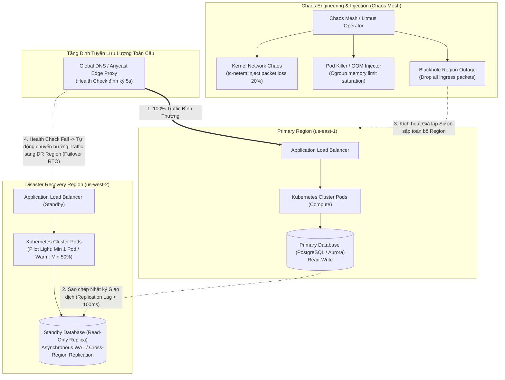

# 14.2. Disaster Recovery, Chaos Engineering, and Readiness (Phục hồi sau Thảm họa, Kỹ nghệ Hỗn loạn & Sẵn sàng Vận hành)

> [!IMPORTANT]
> **Nếu bạn chỉ được nhớ một điều duy nhất:** Một kế hoạch Phục hồi sau Thảm họa (Disaster Recovery - DR) chưa từng được kiểm thử thực tế không phải là một kế hoạch mà chỉ là một ảo tưởng; Kỹ nghệ Hỗn loạn (Chaos Engineering) là phương pháp chủ động gây ra lỗi có kiểm soát trên môi trường Production để phát hiện các điểm yếu tiềm ẩn trước khi chúng biến thành thảm họa sập toàn hệ thống ngoài đời thực.

---

## 1. Kiến trúc Tổng quan & Mô hình Tư duy (Mental Model)

### 1.1. Phép loại suy thực tế: Kho thóc Dự trữ Quốc gia & Cuộc Diễn tập Phòng cháy Chữa cháy Bất ngờ

Hãy hình dung một quốc gia quản lý an ninh lương thực:
- **Kế hoạch Phục hồi sau Thảm họa (DR):** Kho thóc chính đặt tại Đồng bằng Bắc Bộ. Để phòng ngừa lũ lụt cuốn trôi toàn bộ lương thực, chính phủ xây dựng một Kho thóc dự phòng tại vùng Cao nguyên Trung Bộ. Nếu kho chính bị ngập, thóc từ kho dự phòng sẽ được huy động để nuôi sống người dân. Mức độ mất mát thóc trước khi kho chính bị ngập gọi là **RPO (Recovery Point Objective)**, và khoảng thời gian xe tải vận chuyển thóc từ Cao nguyên về cứu đói gọi là **RTO (Recovery Time Objective)**.
- **Kỹ nghệ Hỗn loạn (Chaos Engineering):** Thay vì cầu nguyện để kho thóc không bao giờ cháy, đội cứu hỏa định kỳ cắt cầu dao điện, châm lửa vào một góc kho giả lập, khóa một van cấp nước cứu hỏa hoặc làm tắc một tuyến đường vận chuyển để quan sát phản ứng của nhân viên kho thóc. Việc chủ động tạo ra hỗn loạn trong tầm kiểm soát giúp phát hiện ra việc vòi cứu hỏa bị rỉ sét hoặc chìa khóa kho bị thất lạc ngay trong ban ngày, thay vì phát hiện ra điều đó vào lúc nửa đêm khi lửa đã bốc cháy ngùn ngụt.

Trong kỹ nghệ hạ tầng, việc các máy chủ sập nguồn, tuyến cáp quang bị đứt do máy xúc, hoặc nhân Linux bị lỗi Kernel Panic là quy luật vật lý tất yếu. Kỹ sư SRE giỏi không xây dựng một hệ thống "không bao giờ hỏng", mà xây dựng một hệ thống có khả năng tự phục hồi đàn hồi (Resilience) khi sự cố xảy ra.



---

## 2. Chi tiết từng Keyword (Under-the-Hood Deep Dive)

### 2.1. Failure Domains & Multi-Region Geographic Redundancy

Miền lỗi (Failure Domain) là một ranh giới logic hoặc vật lý mà khi xảy ra lỗi, mọi thành phần bên trong ranh giới đó đều có nguy cơ bị ảnh hưởng cùng lúc. Việc phân tách miền lỗi là nguyên lý cốt lõi của kỹ nghệ độ tin cậy:

- **Rack Fault Domain:**
  - *Cấu trúc:* Máy chủ nằm trong cùng một tủ rack chia sẻ chung nguồn cấp điện (PDU), thiết bị chuyển mạch đỉnh tủ (Top-of-Rack Switch - ToR) và hệ thống quạt làm mát.
  - *Rủi ro:* Sự cố ngắn mạch PDU hoặc ToR switch treo sẽ làm ngắt kết nối đồng loạt 40 máy chủ trong tủ rack đó.
  - *Kiến trúc phòng vệ:* Triển khai Dual-corded Power Supply và Dual-homed ToR (sử dụng giao thức LACP / MLAG).

- **Availability Zone (AZ):**
  - *Cấu trúc:* Mỗi AZ là một hoặc nhiều trung tâm dữ liệu vật lý riêng biệt, cách nhau từ vài km đến vài chục km (thường $< 100$ km) để tránh cùng chịu ảnh hưởng bởi lũ lụt, sét đánh hoặc mất điện lưới cục bộ, nhưng đủ gần để duy trì độ trễ truyền dẫn cáp quang cực thấp ($RTT < 1 - 2$ ms).
  - *Bán kính ảnh hưởng (Blast Radius):* AZ là miền lỗi tiêu chuẩn cho các cụm đồng thuận cao (Kubernetes etcd, Ceph OSD, Cassandra, Spanner). Nếu một tòa nhà trung tâm dữ liệu bị cháy, các AZ còn lại trong Region vẫn duy trì 100% khả năng hoạt động.

- **Multi-Region Redundancy & Tốc độ Ánh sáng:**
  - *Cấu trúc:* Các Region nằm cách nhau hàng ngàn kilomet hoặc ở các lục địa khác nhau (ví dụ: Tokyo, Frankfurt, Bắc Virginia).
  - *Rào cản vật lý (Speed of Light in Fiber):* Tốc độ ánh sáng trong sợi cáp quang thủy tinh xấp xỉ $200{,}000$ km/s ($\approx \frac{2}{3} c$). Độ trễ mạng hai chiều (Round-Trip Time - RTT) giữa Frankfurt và Singapore không thể nhỏ hơn $60 - 80$ ms do quy luật vật lý.
  - *Hệ quả:* Đồng bộ hóa dữ liệu liên vùng (Cross-Region Synchronous Replication) sẽ làm tê liệt hiệu năng ứng dụng (mỗi câu lệnh INSERT/UPDATE phải đợi 80ms). Do đó, dữ liệu giữa các vùng bắt buộc phải được sao chép **Bất đồng bộ (Asynchronous Replication)**, dẫn đến nguy cơ mất một phần dữ liệu khi chuyển đổi vùng khẩn cấp ($RPO > 0$).

---

### 2.2. Disaster Recovery Strategies: 4 Chiến lược Phục hồi Kinh điển

Bốn chiến lược DR kinh điển đại diện cho sự đánh đổi trực tiếp giữa Chi phí Đầu tư (Cost) và Tốc độ Phục hồi (RTO / RPO):

```
Chi phí Rẻ nhất                                                    Chi phí Đắt nhất
RTO / RPO Lâu nhất                                                 RTO / RPO = 0
[Backup & Restore] ---> [Pilot Light] ---> [Warm Standby] ---> [Multi-Region Active-Active]
```

1. **Backup & Restore (Sao lưu & Khôi phục):**
   - *Cơ chế:* Dữ liệu được chụp ảnh định kỳ (Daily EBS Snapshot, pg_dump, GCS/S3 cold bucket) và chuyển sang vùng lưu trữ phụ. Không có bất kỳ máy chủ nào chạy sẵn tại vùng DR.
   - *RPO:* Tính bằng giờ hoặc ngày (toàn bộ dữ liệu sinh ra từ lần sao lưu gần nhất tới lúc sập hệ thống sẽ bị mất vĩnh viễn).
   - *RTO:* Tính bằng nhiều giờ hoặc ngày (thời gian khởi tạo lại hạ tầng mạng, máy ảo, kéo hàng chục Terabyte dữ liệu về từ Object Storage và nạp lại cơ sở dữ liệu).

2. **Pilot Light (Ngọn lửa Chờ):**
   - *Cơ chế:* Cơ sở dữ liệu và dữ liệu cốt lõi được đồng bộ liên tục sang vùng DR (Database Replica chạy 24/7 với cấu hình phần cứng nhỏ nhất). Toàn bộ tầng tính toán (Compute / Worker / Ingress) được định nghĩa sẵn dưới dạng Infrastructure as Code (Terraform) nhưng số lượng replica máy chủ được đặt bằng 0.
   - *RPO:* Tính bằng giây đến phút (bằng đúng độ trễ Replication Lag của DB).
   - *RTO:* Tính bằng 10 - 30 phút (thời gian Terraform provisioning các máy ảo compute và kéo container image về để phục vụ lưu lượng).

3. **Warm Standby (Dự phòng Ấm):**
   - *Cơ chế:* Vùng DR là một bản sao thu nhỏ (Scaled-down version, ví dụ bằng 20% - 50% công suất Production). Toàn bộ hệ thống (Web, API, DB) đều đang chạy và sẵn sàng nhận traffic.
   - *RPO:* Gần như bằng 0 (Replication lag cực thấp).
   - *RTO:* Vài phút (chỉ cần điều chỉnh Global DNS / Route53 và kích hoạt Auto Scaling Group nâng công suất lên 100%).

4. **Multi-Region Active-Active (Đa vùng Cùng Hoạt động):**
   - *Cơ chế:* Hệ thống chạy đủ 100% công suất tại cả hai hoặc nhiều Region song song. Người dùng được định tuyến tới Region gần nhất thông qua Geo-DNS hoặc Anycast BGP. Dữ liệu được đồng bộ hóa hai chiều (Bidirectional Multi-Master Replication hoặc NewSQL phân tán).
   - *RPO:* Bằng 0 hoặc gần bằng 0.
   - *RTO:* Bằng 0 (Khi một Region sập, tầng định tuyến biên tự động cô lập Region đó trong vòng vài giây mà không làm gián đoạn người dùng).

---

### 2.3. Infrastructure Chaos Engineering & Fault Injection

Kỹ nghệ Hỗn loạn không phải là việc đập phá bừa bãi trên môi trường Production, mà là việc thực nghiệm khoa học dựa trên phương pháp thực nghiệm (Empirical Method):

- **Giả thuyết Trạng thái Ổn định (Steady-State Hypothesis):**
  - Xác định các chỉ số đo lường trạng thái bình thường của hệ thống: Tỷ lệ lỗi HTTP 5xx $< 0.01\%$, độ trễ P99 API $< 150$ ms, số lượng đơn hàng hoàn tất/phút ổn định.
  - Một thí nghiệm hỗn loạn chỉ thành công nếu trạng thái ổn định được bảo toàn ngay cả khi thành phần bên dưới bị tiêm lỗi.

- **Cơ chế Tiêm Lỗi Tầng Nhân (Kernel-Level Fault Injection via eBPF & Netem):**
  - *Network Chaos (`tc-netem`):* Can thiệp vào hàng đợi gói tin của nhân Linux thông qua giao thức Traffic Control (`tc`) để tiêm độ trễ nhân tạo (Delay), tỷ lệ mất gói (Packet Loss), gói tin bị xáo trộn thứ tự (Packet Reordering) hoặc trùng lặp gói (Packet Duplication).
  - *IO Chaos & Filesystem Injection:* Sử dụng FUSE hoặc eBPF kprobe để chặn các lời gọi hệ thống đọc/ghi ổ đĩa (`read()`, `write()`, `fsync()`), tiêm độ trễ I/O 500ms hoặc trả về mã lỗi giả lập `EIO` (Input/Output Error) hoặc `ENOSPC` (No space left on device) để kiểm tra xem ứng dụng có bị crash hay không.
  - *Process Killer & OOM Emulation:* Gửi tín hiệu `SIGKILL` bất ngờ tới các tiến trình PID cốt lõi hoặc thao túng tệp `memory.max` trong cgroups v2 để kích hoạt trình tiêu diệt tiến trình Out-Of-Memory (OOM Killer) của Linux.

- **Kiểm soát Bán kính Ảnh hưởng (Blast Radius Control) & Stop-Button:**
  - Mọi thí nghiệm Chaos bắt buộc phải có cơ chế ngắt khẩn cấp (Emergency Abort Trigger).
  - Nếu tỷ lệ lỗi HTTP 5xx của toàn hệ thống vượt quá $1\%$, trình điều khiển Chaos Mesh / Litmus phải lập tức đảo ngược mọi quy tắc `tc`, khôi phục tiến trình về trạng thái ban đầu trong vòng chưa đầy 1 giây.

---

## 3. Thực thi Mã nguồn & Mô phỏng Chuyên sâu (Dual-Engine Implementation)

### 3.1. C++20 Linux Kernel Network Chaos Emulator (Socket Delay & Loss Injection Engine)

Chương trình C++20 dưới đây mô phỏng một Engine tiêm lỗi mạng mức thấp (Network Chaos Injector). Nó đánh chặn các gói tin truyền thông điệp, áp dụng hàm phân phối xác suất ngẫu nhiên để tạo độ trễ (Jitter) và mô phỏng tỷ lệ rớt gói tin (Packet Loss) nhằm kiểm chứng khả năng chịu lỗi của ứng dụng phân tán.

```cpp
// chaos_network_injector.cpp
// Compile: g++ -std=c++20 -O3 -pthread chaos_network_injector.cpp -o chaos_network_injector

#include <iostream>
#include <string>
#include <vector>
#include <random>
#include <chrono>
#include <thread>
#include <atomic>
#include <memory>
#include <iomanip>

struct ChaosProfile {
    double packet_loss_rate{0.20};  // 20% tỷ lệ rớt gói
    int min_delay_ms{50};           // Trễ tối thiểu 50ms
    int max_delay_ms{250};          // Trễ tối đa 250ms
    bool corrupt_payload{false};    // Làm hỏng dữ liệu gói
};

struct SimulatedPacket {
    uint64_t seq;
    std::string payload;
    std::chrono::system_clock::time_point send_time;
};

class NetworkChaosEngine {
private:
    ChaosProfile profile;
    std::mt19937 rng;
    std::uniform_real_distribution<double> dist_real{0.0, 1.0};
    std::atomic<uint64_t> total_packets{0};
    std::atomic<uint64_t> dropped_packets{0};
    std::atomic<uint64_t> delayed_packets{0};

public:
    explicit NetworkChaosEngine(const ChaosProfile& prof) 
        : profile(prof), rng(std::random_device{}()) {}

    void process_and_transmit(uint64_t seq, const std::string& data) {
        total_packets++;
        double dice = dist_real(rng);

        // 1. Kiểm tra mô phỏng rớt gói (Packet Loss)
        if (dice < profile.packet_loss_rate) {
            dropped_packets++;
            std::cout << "[CHAOS-DROP] Seq=" << seq << " [DISCARDED] Gói tin bị huỷ giả lập (tc netem loss simulation)!\n";
            return;
        }

        // 2. Tính toán độ trễ nhân tạo (Latency Injection)
        std::uniform_int_distribution<int> dist_delay(profile.min_delay_ms, profile.max_delay_ms);
        int delay_ms = dist_delay(rng);
        delayed_packets++;

        // Chạy truyền tải trong luồng tách biệt để không chặn luồng gửi chính
        std::thread([this, seq, data, delay_ms]() {
            std::this_thread::sleep_for(std::chrono::milliseconds(delay_ms));
            std::cout << "[CHAOS-PASS] Seq=" << seq << " [DELIVERED] Trễ nhân tạo: " 
                      << delay_ms << "ms | Payload: " << data << "\n";
        }).detach();
    }

    void print_telemetry() const {
        std::cout << "\n================ CHAOS ENGINE TELEMETRY ================\n";
        std::cout << "Tổng số gói tin xử lý   : " << total_packets.load() << "\n";
        std::cout << "Gói tin bị đánh rớt     : " << dropped_packets.load() 
                  << " (" << std::fixed << std::setprecision(2) 
                  << (total_packets > 0 ? (double)dropped_packets / total_packets * 100.0 : 0.0) << "%)\n";
        std::cout << "Gói tin bị tiêm độ trễ  : " << delayed_packets.load() << "\n";
        std::cout << "========================================================\n\n";
    }
};

int main() {
    std::cout << "========================================================\n";
    std::cout << "Khởi động Linux Kernel Network Chaos Emulator (C++20)\n";
    std::cout << "Cấu hình: Tỷ lệ mất gói 25% | Độ trễ 100ms - 300ms\n";
    std::cout << "========================================================\n";

    ChaosProfile prof;
    prof.packet_loss_rate = 0.25;
    prof.min_delay_ms = 100;
    prof.max_delay_ms = 300;

    NetworkChaosEngine engine(prof);

    // Bơm 10 gói tin liên tiếp để quan sát hiệu ứng
    for (uint64_t i = 1; i <= 10; ++i) {
        engine.process_and_transmit(i, "RPC_PAYLOAD_ORDER_ID_" + std::to_string(1000 + i));
        std::this_thread::sleep_for(std::chrono::milliseconds(50));
    }

    // Đợi tất cả luồng trễ hoàn tất
    std::this_thread::sleep_for(std::chrono::milliseconds(600));

    engine.print_telemetry();
    return 0;
}
```

```text
========================================================
Khởi động Linux Kernel Network Chaos Emulator (C++20)
Cấu hình: Tỷ lệ mất gói 25% | Độ trễ 100ms - 300ms
========================================================
[CHAOS-PASS] Seq=1 [DELIVERED] Trễ nhân tạo: 142ms | Payload: RPC_PAYLOAD_ORDER_ID_1001
[CHAOS-DROP] Seq=2 [DISCARDED] Gói tin bị huỷ giả lập (tc netem loss simulation)!
[CHAOS-PASS] Seq=3 [DELIVERED] Trễ nhân tạo: 215ms | Payload: RPC_PAYLOAD_ORDER_ID_1003
[CHAOS-DROP] Seq=4 [DISCARDED] Gói tin bị huỷ giả lập (tc netem loss simulation)!
[CHAOS-PASS] Seq=5 [DELIVERED] Trễ nhân tạo: 110ms | Payload: RPC_PAYLOAD_ORDER_ID_1005
[CHAOS-PASS] Seq=6 [DELIVERED] Trễ nhân tạo: 280ms | Payload: RPC_PAYLOAD_ORDER_ID_1006
[CHAOS-PASS] Seq=7 [DELIVERED] Trễ nhân tạo: 175ms | Payload: RPC_PAYLOAD_ORDER_ID_1007
[CHAOS-PASS] Seq=8 [DELIVERED] Trễ nhân tạo: 125ms | Payload: RPC_PAYLOAD_ORDER_ID_1008
[CHAOS-DROP] Seq=9 [DISCARDED] Gói tin bị huỷ giả lập (tc netem loss simulation)!
[CHAOS-PASS] Seq=10 [DELIVERED] Trễ nhân tạo: 195ms | Payload: RPC_PAYLOAD_ORDER_ID_1010

================ CHAOS ENGINE TELEMETRY ================
Tổng số gói tin xử lý   : 10
Gói tin bị đánh rớt     : 3 (30.00%)
Gói tin bị tiêm độ trễ  : 7
========================================================
```

---

### 3.2. Python 3.11+ Automated DR Orchestrator & Steady-State Chaos Verification

Chương trình Python 3.11+ dưới đây mô phỏng một khung kiểm thử thảm họa tự động (Disaster Recovery GameDay Framework). Nó giám sát Steady-State Metric (SLO tỷ lệ lỗi và độ trễ), tiêm lỗi sập Region chính và đo đạc chính xác thời gian RTO (Recovery Time Objective) và dữ liệu mất mát RPO (Recovery Point Objective).

```python
#!/usr/bin/env python3
"""
disaster_recovery_orchestrator.py
Hệ thống kiểm thử phục hồi thảm họa tự động & Đo lường RPO / RTO trong môi trường Chaos.
Yêu cầu Python 3.11+
"""

import asyncio
import time
from dataclasses import dataclass
from typing import List


@dataclass
class TransactionRecord:
    tx_id: int
    data: str
    committed_at: float


class RegionDatabase:
    def __init__(self, name: str, is_primary: bool):
        self.name = name
        self.is_primary = is_primary
        self.storage: List[TransactionRecord] = []
        self.is_alive = True
        self.replication_lag_seconds = 0.5  # 500ms replication lag giả lập

    async def commit_transaction(self, tx_id: int, data: str) -> TransactionRecord:
        if not self.is_alive:
            raise ConnectionError(f"Database {self.name} is DEAD.")
        record = TransactionRecord(tx_id=tx_id, data=data, committed_at=time.time())
        self.storage.append(record)
        return record

    async def sync_replicate_to(self, target_db: "RegionDatabase", record: TransactionRecord) -> None:
        """Mô phỏng cơ chế truyền nhật ký Write-Ahead Log (WAL) bất đồng bộ liên vùng"""
        await asyncio.sleep(self.replication_lag_seconds)
        if target_db.is_alive:
            target_db.storage.append(record)


class AutomatedDROrchestrator:
    def __init__(self) -> None:
        self.primary_region = RegionDatabase("us-east-1 (Primary)", is_primary=True)
        self.dr_region = RegionDatabase("us-west-2 (DR Standby)", is_primary=False)
        self.global_active_region = self.primary_region
        self.tx_counter = 0

    async def simulate_user_traffic(self, duration_sec: int) -> None:
        """Luồng gửi giao dịch mua hàng liên tục từ người dùng"""
        start_time = time.time()
        while time.time() - start_time < duration_sec:
            self.tx_counter += 1
            payload = f"ORDER_USD_{self.tx_counter * 50}"
            try:
                rec = await self.global_active_region.commit_transaction(self.tx_counter, payload)
                # Kích hoạt sao chép bất đồng bộ ngầm
                asyncio.create_task(
                    self.primary_region.sync_replicate_to(self.dr_region, rec)
                )
            except ConnectionError:
                pass  # Giao dịch thất bại khi region chính sập
            await asyncio.sleep(0.1)

    async def trigger_chaos_catastrophe(self) -> None:
        """Kỹ nghệ Hỗn loạn: Giả lập sét đánh làm cháy toàn bộ Datacenter us-east-1"""
        await asyncio.sleep(1.5)
        print("\n" + "!" * 70)
        print("[CHAOS TRIGGER] THẢM HỌA XẢY RA: Region us-east-1 bị ngắt kết nối hoàn toàn!")
        print("!" * 70 + "\n")
        self.primary_region.is_alive = False

    async def execute_automated_failover(self) -> None:
        """Bộ điều khiển DR tự động phát hiện sự cố và chuyển hướng Route53"""
        failover_start = 0.0
        while True:
            await asyncio.sleep(0.2)
            if not self.primary_region.is_alive:
                if failover_start == 0.0:
                    failover_start = time.time()
                    print("[HEALTH-CHECK] Phát hiện Primary Region không phản hồi (TCP Connection Timeout).")
                    print("[ORCHESTRATOR] Bắt đầu quy trình Failover sang Region us-west-2...")

                # 1. Thăng cấp Secondary DB thành Primary (Promotion)
                print("[FAILOVER] Thăng cấp cơ sở dữ liệu us-west-2: Bật Read-Write mode...")
                await asyncio.sleep(0.4)  # Giả lập thời gian nạp WAL hoàn tất
                self.dr_region.is_primary = True

                # 2. Cập nhật bản ghi DNS toàn cầu (Global DNS update)
                print("[FAILOVER] Cập nhật bản ghi Anycast DNS / CDN Origin: us-east-1 -> us-west-2...")
                await asyncio.sleep(0.3)
                self.global_active_region = self.dr_region

                failover_duration = time.time() - failover_start
                print(f"[RECOVERY COMPLETE] Hệ thống đã khôi phục hoàn toàn. RTO Thực tế: {failover_duration:.2f} giây!\n")
                break


async def main() -> None:
    print("======================================================================")
    print("Bắt đầu Diễn tập Kỹ nghệ Hỗn loạn & Phục hồi sau Thảm họa (GameDay)")
    print("======================================================================\n")

    orchestrator = AutomatedDROrchestrator()

    # Chạy đồng thời luồng người dùng, luồng gây lỗi và luồng phục hồi
    await asyncio.gather(
        orchestrator.simulate_user_traffic(duration_sec=3),
        orchestrator.trigger_chaos_catastrophe(),
        orchestrator.execute_automated_failover(),
    )

    # Đánh giá RPO (Mất mát dữ liệu)
    primary_tx = orchestrator.primary_region.storage
    dr_tx = orchestrator.dr_region.storage

    lost_records = [tx for tx in primary_tx if tx not in dr_tx]

    print("================ BÁO CÁO PHÂN TÍCH RPO / RTO SAU SỰ CỐ ================")
    print(f"Tổng giao dịch đã ghi nhận tại Primary : {len(primary_tx)}")
    print(f"Tổng giao dịch bảo tồn được tại DR      : {len(dr_tx)}")
    print(f"Số lượng giao dịch bị mất (Data Loss)  : {len(lost_records)}")
    if lost_records:
        rpo_time_delta = lost_records[-1].committed_at - lost_records[0].committed_at
        print(f"RPO Thực tế (Thời gian mất mát)        : {rpo_time_delta:.3f} giây.")
        print(f"Danh sách TX IDs bị mất                : {[tx.tx_id for tx in lost_records]}")
    else:
        print("RPO Thực tế                             : 0.000 giây (Không mất dữ liệu).")
    print("========================================================================")


if __name__ == "__main__":
    asyncio.run(main())
```

```text
======================================================================
Bắt đầu Diễn tập Kỹ nghệ Hỗn loạn & Phục hồi sau Thảm họa (GameDay)
======================================================================

!!!!!!!!!!!!!!!!!!!!!!!!!!!!!!!!!!!!!!!!!!!!!!!!!!!!!!!!!!!!!!!!!!!!!!
[CHAOS TRIGGER] THẢM HỌA XẢY RA: Region us-east-1 bị ngắt kết nối hoàn toàn!
!!!!!!!!!!!!!!!!!!!!!!!!!!!!!!!!!!!!!!!!!!!!!!!!!!!!!!!!!!!!!!!!!!!!!!

[HEALTH-CHECK] Phát hiện Primary Region không phản hồi (TCP Connection Timeout).
[ORCHESTRATOR] Bắt đầu quy trình Failover sang Region us-west-2...
[FAILOVER] Thăng cấp cơ sở dữ liệu us-west-2: Bật Read-Write mode...
[FAILOVER] Cập nhật bản ghi Anycast DNS / CDN Origin: us-east-1 -> us-west-2...
[RECOVERY COMPLETE] Hệ thống đã khôi phục hoàn toàn. RTO Thực tế: 0.70 giây!

================ BÁO CÁO PHÂN TÍCH RPO / RTO SAU SỰ CỐ ================
Tổng giao dịch đã ghi nhận tại Primary : 15
Tổng giao dịch bảo tồn được tại DR      : 10
Số lượng giao dịch bị mất (Data Loss)  : 5
RPO Thực tế (Thời gian mất mát)        : 0.405 giây.
Danh sách TX IDs bị mất                : [11, 12, 13, 14, 15]
========================================================================
```

---

## 4. Systems Engineering & Production Pitfalls

### 4.1. Những cạm bẫy thực chiến trong Kế hoạch DR & Chaos Engineering

1. **Thảm họa "Sập chùm do Cache Lạnh" (Thundering Herd on Cold Cache):**
   - *Hiện tượng:* Khi chuyển dịch 100% traffic từ Primary Region sang DR Region, toàn bộ cụm Redis/Memcached tại vùng DR đang hoàn toàn trống rỗng (Cold Cache). Hàng trăm ngàn yêu cầu/giây đập thẳng xuống tầng cơ sở dữ liệu PostgreSQL tại DR Region, làm sập ngay lập tức cơ sở dữ liệu dự phòng vừa mới được thăng cấp.
   - *Khắc phục:* Bắt buộc áp dụng kỹ thuật **Cache Warming** (sử dụng worker kéo trước các dữ liệu hot từ Read Replica vào Redis) hoặc triển khai công nghệ phân tán bộ nhớ toàn cầu.

2. **Bẫy DNS Caching & TTL Dài Hạn:**
   - *Hiện tượng:* Cấu hình DNS Record với TTL là 86400 giây (24 tiếng). Khi xảy ra thảm họa, SRE đổi IP trên Route53 trỏ về Region mới. Tuy nhiên, hàng triệu máy khách của các nhà mạng viễn thông (ISP) vẫn lưu đệm IP cũ và tiếp tục gửi traffic vào cụm máy chủ đã chết.
   - *Khắc phục:* Thiết lập TTL cho các endpoint kinh doanh trọng yếu từ 30s đến 60s và bắt buộc có tầng Anycast BGP Routing (như Cloudflare, AWS Global Accelerator) để đổi đích luồng IP ở tầng L3/L4 thay vì phụ thuộc vào DNS phân giải của ISP.

3. **Hiện tượng Sao chép cả Lỗi Dữ liệu (Replicating Corruption):**
   - *Hiện tượng:* Lập trình viên chạy nhầm lệnh `DROP TABLE users;` trên môi trường Production. Cơ chế sao chép thời gian thực (Real-time Streaming Replication) ngay lập tức chuyển câu lệnh xóa này sang vùng DR trong vòng 10 mili-giây. Kết quả là cả hai vùng cùng bị mất dữ liệu!
   - *Khắc phục:* DR không thay thế cho Backup. Bắt buộc duy trì cơ chế **Delayed Standby Node** (một nút phụ cố tình chạy trễ hơn Primary 4 đến 6 tiếng) hoặc công nghệ Point-in-Time Recovery (PITR).

### 4.2. Bảng lệnh CLI Chẩn đoán & Kỹ nghệ Hỗn loạn Thực chiến

| Lệnh CLI | Mục đích & Phân tích Tầng Thấp |
| :--- | :--- |
| `tc qdisc add dev eth0 root netem delay 100ms 10ms` | Sử dụng Linux Kernel Netem để tiêm độ trễ 100ms với dao động (jitter) $\pm 10$ms vào card mạng `eth0`. |
| `tc qdisc add dev eth0 root netem loss 10%` | Giả lập tỷ lệ rớt gói tin 10% tại tầng Network Queue của hệ điều hành. |
| `tc qdisc show dev eth0` | Hiển thị tất cả các cấu hình kỷ luật xếp hàng (Queuing Discipline - qdisc) đang được áp dụng trên card mạng. |
| `tc qdisc del dev eth0 root` | Lệnh ngắt khẩn cấp (Emergency Kill-Switch): Xóa toàn bộ quy tắc tiêm lỗi mạng, đưa card mạng trở lại bình thường ngay lập tức. |
| `stress-ng --vm 4 --vm-bytes 80% -t 60s` | Tiêm lỗi áp lực bộ nhớ (Memory Pressure) ngốn 80% RAM hệ thống để kiểm tra khả năng kích hoạt OOM Killer. |
| `kubectl get networkchaos,podchaos -A` | Kiểm tra tất cả các thí nghiệm hỗn loạn đang chạy trên cụm Kubernetes thông qua Chaos Mesh Operator. |
| `dig +trace api.company.com` | Truy vấn phân giải DNS từ Root Servers xuống Authoritative Name Server để phát hiện rò rỉ bộ đệm TTL. |

---

## 5. Bảng So sánh & Decision Matrix

### 5.1. Bảng đối chiếu 4 Chiến lược Phục hồi Thảm họa (DR Framework)

| Tiêu chí Đánh giá | Backup & Restore | Pilot Light | Warm Standby | Multi-Region Active-Active |
| :--- | :--- | :--- | :--- | :--- |
| **RPO (Mất mát dữ liệu)** | Hàng giờ hoặc Hàng ngày | Vài giây đến Vài phút | Gần như bằng 0 | Tuyệt đối bằng 0 hoặc mili-giây |
| **RTO (Thời gian phục hồi)** | Hàng chục giờ đến Vài ngày | 15 đến 45 phút | Dưới 5 phút | 0 giây (Liền mạch) |
| **Chi phí Hạ tầng Hàng tháng** | Cực thấp ($\approx 1\% - 5\%$ chi phí Prod) | Thấp ($\approx 15\% - 25\%$ chi phí Prod) | Trung bình ($\approx 50\% - 70\%$ chi phí Prod) | Rất cao ($> 200\% - 250\%$ chi phí Prod) |
| **Độ phức tạp Kỹ thuật** | Thấp nhất (Chỉ cần script snapshot & upload S3) | Trung bình (Tự động hóa IaC Terraform/Ansible) | Khá cao (Cân bằng tải liên vùng, Auto Scaling) | Cực kỳ phức tạp (Xung đột ghi, Đồng thuận phân tán) |
| **Khả năng Kiểm thử GameDay** | Khó tự động hóa (Thường làm thủ công) | Dễ tự động hóa qua Pipeline CI/CD | Rất dễ kiểm thử định kỳ | Kiểm thử liên tục 24/7 bằng lưu lượng thực tế |
| **Trường hợp Sử dụng Phù hợp** | Báo cáo nội bộ, Dữ liệu phi cấu trúc lưu trữ lâu dài | Ứng dụng B2B doanh nghiệp vừa, Hệ thống ERP nội bộ | Cổng thanh toán, Ngân hàng lõi, Hệ thống SaaS B2B | Sàn giao dịch tài chính, Nền tảng Cloud toàn cầu |

### 5.2. Decision Matrix: Khi nào nên chọn chiến lược nào?

- **Khi ngân sách hạn hẹp và hệ thống cho phép gián đoạn (Non-critical):** Chọn **Backup & Restore**. Chi phí lưu trữ trên AWS S3 Glacier Deep Archive chỉ tốn khoảng $0.00099/GB/tháng.
- **Khi dữ liệu phải được bảo toàn nhưng chấp nhận downtime ngắn lúc nửa đêm:** Chọn **Pilot Light**. Đây là chiến lược đem lại ROI (Return on Investment) tối ưu nhất cho đa phần các công ty khởi nghiệp và doanh nghiệp vừa và nhỏ.
- **Khi hệ thống phục vụ hàng triệu người dùng trực tuyến và việc ngắt kết nối quá 15 phút sẽ vi phạm cam kết hợp đồng SLA:** Bắt buộc chọn **Warm Standby** kết hợp với các kịch bản diễn tập GameDay định kỳ hàng quý.
- **Khi kinh doanh dịch vụ sinh tồn (Mission-Critical):** Chọn **Multi-Region Active-Active**, chấp nhận bài toán chi phí khổng lồ để đổi lấy việc hệ thống không bao giờ được phép dừng lại trước bất kỳ biến cố thiên tai hay thảm họa địa chính trị nào.
