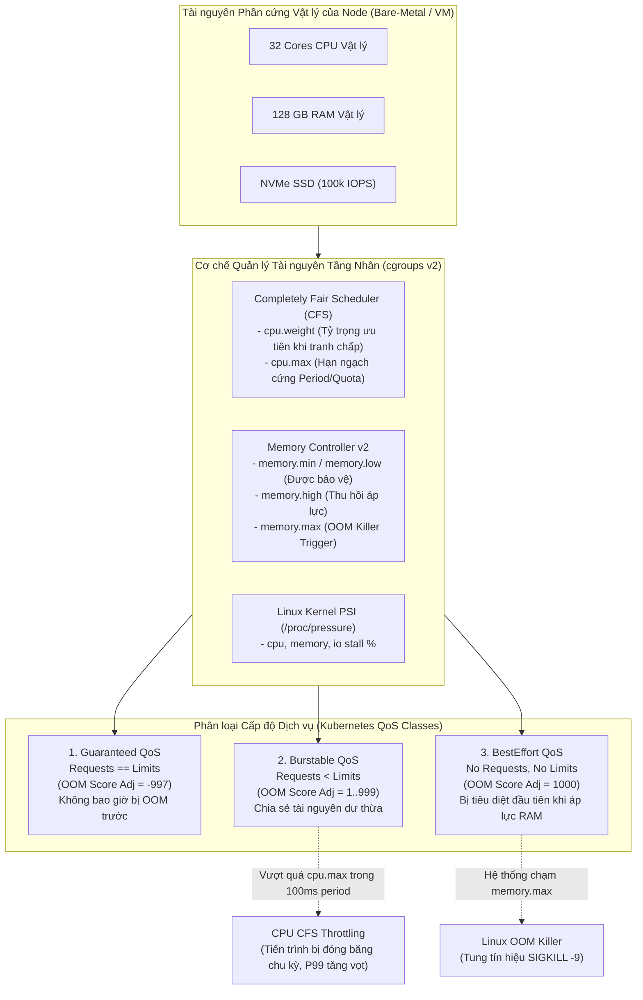

# 15.1. Capacity Planning, Forecasting, and Contention (Lập kế hoạch Dung lượng, Dự báo & Tranh chấp Tài nguyên)

> [!IMPORTANT]
> **Nếu bạn chỉ được nhớ một điều duy nhất:** Đặt giới hạn tài nguyên CPU (CPU Limit) trong Kubernetes hoặc cgroups không giúp tăng hiệu năng mà thực chất áp đặt cơ chế nghẽn băng thông CFS (CFS Bandwidth Quota Throttling), đóng băng ứng dụng ở mức độ mili-giây và phá hủy độ trễ P99; để quản trị dung lượng chuẩn xác, hãy sử dụng chỉ số Áp lực Nhân Linux (Pressure Stall Information - PSI) và cấp phát dựa trên Cam kết Thực tế (Requests) thay vì Ảo tưởng Giới hạn (Limits).

---

## 1. Kiến trúc Tổng quan & Mô hình Tư duy (Mental Model)

### 1.1. Phép loại suy thực tế: Khách sạn Hàng không Đặt vé Quá mức (Airlines Overbooking) & Áp suất Đường ống Nước

Hãy tưởng tượng một hãng hàng không vận hành chiếc máy bay có 100 ghế ngồi:
- **Nguyên lý Đặt chỗ Quá mức (Overcommitment):** Hãng bay thống kê rằng thông thường luôn có $10\%$ hành khách bỏ chuyến (No-show). Do đó, họ quyết định bán 110 vé cho chuyến bay 100 chỗ. Trong điều kiện bình thường, mọi việc diễn ra êm đẹp và lợi nhuận tăng tối đa. Nhưng vào ngày lễ Giáng sinh, cả 110 hành khách đều có mặt ở cửa ra máy bay. Khi đó xảy ra hiện tượng **Tranh chấp Tài nguyên (Resource Contention)**. Hãng bay buộc phải thực hiện đuổi 10 hành khách có vé rẻ nhất ra khỏi cửa bay (tương đương với việc trình quản lý Out-Of-Memory Killer của Linux gửi tín hiệu `SIGKILL` bắn hạ các tiến trình thuộc nhóm `BestEffort`).
- **Nghẽn Băng thông (CPU Quota Throttling):** Giống như một van nước tự động ngắt dòng chảy mỗi khi lưu lượng vượt quá 10 lít/phút. Cho dù bể chứa nước của thành phố (CPU vật lý của Node) còn đầy 80%, nhưng van nhà bạn vẫn đóng chặt trong 20 giây cuối của mỗi phút. Cốc nước của bạn bị chảy ngắt quãng, tạo ra độ trễ khó chịu cho người sử dụng.

Trong kỹ nghệ dung lượng hạ tầng, việc cân đối giữa Hiệu suất Tiết kiệm Chi phí (Cost Efficiency via Overcommit) và Độ tin cậy Hiệu năng (Performance Reliability without Contention) là bài toán toán học đa chiều đòi hỏi hiểu biết sâu sắc về tầng nhân Linux.



---

## 2. Chi tiết từng Keyword (Under-the-Hood Deep Dive)

### 2.1. Multi-Dimensional Capacity Planning & Forecasting

Lập kế hoạch dung lượng hiện đại không chỉ đơn thuần là nhìn vào biểu đồ sử dụng CPU trung bình, mà là việc tính toán không gian đa chiều (Multi-Dimensional Vector Analysis):

- **Không gian Tài nguyên Đa chiều (Resource Vectors):**
  - Một nút máy chủ cạn kiệt năng lực khi bất kỳ chiều nào trong các chiều tài nguyên chạm ngưỡng trần:
    $$\vec{R} = \langle \text{CPU Cores}, \text{RAM GB}, \text{Disk IOPS}, \text{Disk Throughput}, \text{Network Bandwidth}, \text{Ephemeral Storage}, \text{File Descriptors}, \text{Conntrack Entries} \rangle$$
  - Nếu một ứng dụng chỉ tiêu thụ $5\%$ CPU nhưng chiếm dụng $100\%$ bảng theo dõi kết nối mạng (`nf_conntrack_max`), máy chủ sẽ lập tức từ chối mọi gói tin mới dù CPU vẫn hoàn toàn nhàn rỗi.

- **Dự báo Chuỗi Thời gian (Time-Series Trend Forecasting):**
  - *Phân rã Chuỗi Thời gian (Time-Series Decomposition):*
    $$Y(t) = T(t) + S(t) + C(t) + \epsilon(t)$$
    Trong đó: $T(t)$ là xu hướng tăng trưởng dài hạn (Trend), $S(t)$ là tính chu kỳ theo mùa vụ (Seasonality - ví dụ: lưu lượng mua sắm tăng cao vào 20:00 hàng ngày hoặc dịp Black Friday), $C(t)$ là chu kỳ kinh tế, và $\epsilon(t)$ là nhiễu ngẫu nhiên (White Noise).
  - *Mô hình Hồi quy & Facebook Prophet / Holt-Winters:* Sử dụng kỹ thuật làm mượt hàm mũ (Exponential Smoothing) để dự báo thời điểm dung lượng chạm ngưỡng bão hòa (Runway Analysis - ví dụ: "Với tốc độ tăng trưởng hiện tại, cụm Ceph Storage sẽ đầy dung lượng sau đúng 42 ngày nữa").

- **Quản trị Vùng Đệm An toàn (Headroom Management) & Nguyên lý N+1 / N+2:**
  - *Headroom:* Lượng tài nguyên dư thừa luôn được giữ lại (thường từ $20\% - 30\%$) để hấp thụ các xung đột biến lưu lượng (Spikes) và đảm bảo tính sẵn sàng khi xảy ra sự cố phần cứng.
  - *Nguyên lý $N+1$ Redundancy:* Cụm gồm $N$ nút máy chủ phải có đủ dung lượng để tiếp nhận toàn bộ tải khi bất kỳ 1 nút nào chết bất đắc dĩ mà không làm các nút còn lại bị quá tải dây chuyền (Cascading Failure). Với hệ thống tối quan trọng, áp dụng $N+2$.

- **Phân vị P99 vs Trung bình (Mean):**
  - Mọi quyết định dung lượng dựa trên chỉ số "CPU Utilization trung bình $30\%$" đều là sai lầm chết người. Một dịch vụ có thể có CPU trung bình $30\%$ nhưng tại phân vị $P99.9$, CPU bị quá tải $100\%$ trong vòng 200 mili-giây, khiến hàng ngàn yêu cầu bị timeout và mất giao dịch.

---

### 2.2. Resource Allocation: Requests vs Limits & Overcommitment

Cơ chế phân bổ tài nguyên của Kubernetes và Linux Container Runtime (containerd, CRI-O) được hiện thực hóa trực tiếp thông qua hệ thống tệp ảo `/sys/fs/cgroup/`:

- **Kubernetes Requests (Tầng Cam kết Tối thiểu):**
  - Được ánh xạ tới thuộc tính `cpu.weight` trong cgroups v2 (hoặc `cpu.shares` trong cgroups v1).
  - *Ý nghĩa:* Đây là lượng tài nguyên mà Kubernetes Scheduler sử dụng để quyết định xem Node có đủ chỗ trống để đặt Pod hay không (Admission Control).
  - *Cơ chế tầng nhân:* `cpu.weight` là một giá trị tỷ trọng tương đối (từ 1 đến 10000). Nếu hai container cùng chạy trên một CPU core và CPU đạt tải 100%, hạt nhân Linux sẽ chia thời gian CPU (CPU Time Slices) theo tỷ lệ `weight_A / (weight_A + weight_B)`. Khi CPU không bị tranh chấp, container được phép tự do sử dụng 100% năng lực CPU của máy chủ.

- **Kubernetes Limits & CFS Bandwidth Quota Throttling (Tầng Giới hạn Trần):**
  - Được ánh xạ tới thuộc tính `cpu.max` trong cgroups v2 (hoặc `cpu.cfs_quota_us` và `cpu.cfs_period_us` trong cgroups v1).
  - *Cơ chế hoạt động của Completely Fair Scheduler (CFS):* Hạt nhân chia thời gian thành các chu kỳ (mặc định chu kỳ period là $100{,}000$ microsecond = 100ms). Nếu một Pod có giới hạn là `limit: 500m` (tức 0.5 CPU), hạn ngạch quota của nó là $50{,}000$ microsecond trong mỗi chu kỳ 100ms.
  - *Hiện tượng Throttling (Nghẽn băng thông):* Nếu ứng dụng là một tiến trình đa luồng (ví dụ: JVM hoặc Go runtime khởi tạo 8 OS threads) chạy tác vụ nặng, cả 8 luồng có thể đốt cháy hết $50{,}000$ $\mu s$ chỉ trong vòng $6.25$ mili-giây đầu tiên của chu kỳ ($8 \times 6.25\text{ms} = 50\text{ms}$). Trong $93.75$ mili-giây còn lại của chu kỳ, hạt nhân Linux lập tức đình chỉ (Freeze/Throttle) toàn bộ các luồng của ứng dụng! Ứng dụng hoàn toàn không thể phản hồi bất kỳ gói tin mạng nào cho đến khi chu kỳ 100ms tiếp theo bắt đầu. Đây là nguyên nhân hàng đầu gây ra hiện tượng P99 Latency Spikes bí ẩn trong các microservices.

- **Cgroups v2 Memory Controller (`memory.min`, `memory.low`, `memory.high`, `memory.max`):**
  - `memory.min`: Ngưỡng bộ nhớ cứng được bảo vệ tuyệt đối, hạt nhân không bao giờ thu hồi (Reclaim) ngay cả khi hệ điều hành cạn kiệt RAM.
  - `memory.low`: Ngưỡng bảo vệ mềm (Best-effort protection).
  - `memory.high`: Ngưỡng kích hoạt áp lực (Throttling & Asynchronous Reclaim). Khi container vượt qua ngưỡng này, nhân Linux sẽ ép tiến trình chậm lại để thực hiện dọn dẹp Page Cache.
  - `memory.max`: Ngưỡng trần tuyệt đối. Nếu tiến trình cố gắng cấp phát bộ nhớ vượt qua con số này và nhân không thể thu hồi thêm trang nhớ nào, Out-Of-Memory (OOM) Killer sẽ được kích hoạt ngay lập tức.

- **Kubernetes Quality of Service (QoS) Classes:**
  - **Guaranteed:** `requests == limits` cho cả CPU và Memory. Linux kernel gán `oom_score_adj = -997`. Nhóm này được bảo vệ tối đa, chỉ bị OOM kill khi cả node hoàn toàn cạn kiệt tài nguyên hệ thống.
  - **Burstable:** `requests < limits`. Linux kernel tính toán `oom_score_adj` từ 2 đến 999 tỷ lệ nghịch với lượng RAM request.
  - **BestEffort:** Không khai báo requests và limits. Linux kernel gán `oom_score_adj = 1000`. Khi node bị thiếu RAM, các tiến trình này luôn là đối tượng bị tiêu diệt đầu tiên.

---

### 2.3. Resource Contention & Resource Fragmentation

Tranh chấp tài nguyên xảy ra khi tổng nhu cầu tức thời của các container vượt quá năng lực vật lý thực tế của phần cứng:

- **Linux Kernel Pressure Stall Information (PSI):**
  - Được giới thiệu từ Linux Kernel 4.20+, PSI là công cụ đo đạc chính xác nhất mức độ tổn thương hiệu năng do tranh chấp tài nguyên thông qua tệp `/proc/pressure/{cpu,memory,io}`.
  - PSI đo lường tỷ lệ phần trăm thời gian mà các tác vụ phải dừng chờ (Stall) tài nguyên:
    - `some`: Tỷ lệ phần trăm thời gian mà *ít nhất một tác vụ* bị hoãn do thiếu CPU/RAM/IO.
    - `full`: Tỷ lệ phần trăm thời gian mà *toàn bộ các tác vụ* trong cgroup bị đóng băng hoàn toàn vì không thể tiến triển (ví dụ: 100% luồng đang đợi trang nhớ được hoán đổi từ swap hoặc đợi I/O đĩa).
  - Khi chỉ số `memory full > 10%`, hệ thống đang trong tình trạng nguy cấp (Thrashing) và cần giảm tải khẩn cấp.

- **Vấn đề "Hàng xóm Ồn ào" (Noisy Neighbor Problem):**
  - Hai container được cách ly hoàn toàn về mặt logic (cgroups namespace) nhưng vẫn chia sẻ chung phần cứng vật lý bên dưới:
    - **L3 CPU Cache Contention:** Một container chạy tác vụ mã hóa video liên tục làm xáo trộn và xóa sạch bộ đệm L3 Cache của CPU, khiến một container giao dịch tài chính chạy trên core bên cạnh bị sụt giảm hiệu năng nghiêm trọng do liên tục gặp L3 Cache Misses.
    - **Memory Bus Saturation:** Băng thông kênh truyền bộ nhớ giữa CPU và RAM (DDR4/DDR5 Memory Bus) bị nghẽn.
    - **Disk I/O Starvation:** Một container ghi log hàng triệu dòng/giây làm đầy hàng đợi I/O của ổ đĩa NVMe, khiến các tác vụ đọc dữ liệu của database chạy cùng node bị đình trệ hàng trăm mili-giây.

- **Phân mảnh Tài nguyên (Resource Fragmentation):**
  - Hiện tượng xảy ra khi tổng tài nguyên nhàn rỗi trên toàn cụm còn rất lớn, nhưng phân tán rải rác trên nhiều nút nên không có nút đơn lẻ nào đủ không gian để chứa một Pod có kích thước lớn (ví dụ: Cụm còn trống 64 CPU Cores, nhưng chia đều trên 16 nút, mỗi nút chỉ còn trống 4 Cores; một Pod yêu cầu 8 Cores sẽ không thể lập lịch được và rơi vào trạng thái `Pending`).

---

## 3. Thực thi Mã nguồn & Mô phỏng Chuyên sâu (Dual-Engine Implementation)

### 3.1. C++20 Linux Kernel CFS Throttling & PSI Pressure Metric Harvester

Chương trình C++20 dưới đây đọc trực tiếp cấu trúc cgroups v2 (`/sys/fs/cgroup/cpu.stat`) và thông số nhân Linux PSI (`/proc/pressure/memory`) để phát hiện hiện tượng bóp nghẽn CPU và nghẽn bộ nhớ theo thời gian thực với độ trễ microsecond.

```cpp
// cgroup_psi_harvester.cpp
// Compile: g++ -std=c++20 -O3 cgroup_psi_harvester.cpp -o cgroup_psi_harvester

#include <iostream>
#include <fstream>
#include <string>
#include <sstream>
#include <chrono>
#include <thread>
#include <iomanip>
#include <filesystem>

struct CPUStatMetrics {
    uint64_t usage_usec{0};
    uint64_t user_usec{0};
    uint64_t system_usec{0};
    uint64_t nr_periods{0};
    uint64_t nr_throttled{0};
    uint64_t throttled_usec{0};
};

struct PSIMetrics {
    double some_avg10{0.0};
    double some_avg60{0.0};
    double full_avg10{0.0};
    double full_avg60{0.0};
};

class KernelTelemetryReader {
private:
    std::string cgroup_cpu_stat_path;
    std::string psi_memory_path;
    bool simulation_mode{false};

public:
    KernelTelemetryReader(std::string cpu_path, std::string mem_psi_path)
        : cgroup_cpu_stat_path(std::move(cpu_path)), psi_memory_path(std::move(mem_psi_path)) {
        if (!std::filesystem::exists(cgroup_cpu_stat_path) || !std::filesystem::exists(psi_memory_path)) {
            std::cout << "[INFO] Đường dẫn cgroups v2 / PSI vật lý không tồn tại. Kích hoạt chế độ mô phỏng dữ liệu kernel.\n";
            simulation_mode = true;
        }
    }

    CPUStatMetrics harvest_cpu_stat() {
        CPUStatMetrics stats{};
        if (simulation_mode) {
            static uint64_t sim_periods = 1000;
            static uint64_t sim_throttled = 150;
            static uint64_t sim_throttle_usec = 4500000;
            sim_periods += 100;
            sim_throttled += 25;
            sim_throttle_usec += 750000;
            stats.nr_periods = sim_periods;
            stats.nr_throttled = sim_throttled;
            stats.throttled_usec = sim_throttle_usec;
            return stats;
        }

        std::ifstream file(cgroup_cpu_stat_path);
        std::string line;
        while (std::getline(file, line)) {
            std::istringstream iss(line);
            std::string key;
            uint64_t val;
            if (iss >> key >> val) {
                if (key == "usage_usec") stats.usage_usec = val;
                else if (key == "nr_periods") stats.nr_periods = val;
                else if (key == "nr_throttled") stats.nr_throttled = val;
                else if (key == "throttled_usec") stats.throttled_usec = val;
            }
        }
        return stats;
    }

    PSIMetrics harvest_memory_psi() {
        PSIMetrics psi{};
        if (simulation_mode) {
            psi.some_avg10 = 4.25;
            psi.some_avg60 = 2.10;
            psi.full_avg10 = 1.05;
            psi.full_avg60 = 0.40;
            return psi;
        }

        std::ifstream file(psi_memory_path);
        std::string line;
        while (std::getline(file, line)) {
            std::istringstream iss(line);
            std::string type, token;
            iss >> type; // "some" hoặc "full"
            while (iss >> token) {
                if (token.rfind("avg10=", 0) == 0) {
                    double v = std::stod(token.substr(6));
                    if (type == "some") psi.some_avg10 = v;
                    else if (type == "full") psi.full_avg10 = v;
                } else if (token.rfind("avg60=", 0) == 0) {
                    double v = std::stod(token.substr(6));
                    if (type == "some") psi.some_avg60 = v;
                    else if (type == "full") psi.full_avg60 = v;
                }
            }
        }
        return psi;
    }
};

int main() {
    std::cout << "=================================================================\n";
    std::cout << "C++20 Linux Kernel CFS Throttling & Memory PSI Harvester\n";
    std::cout << "Giám sát hiện tượng tranh chấp tài nguyên tầng nhân (Microsecond Level)\n";
    std::cout << "=================================================================\n\n";

    KernelTelemetryReader reader("/sys/fs/cgroup/cpu.stat", "/proc/pressure/memory");

    for (int cycle = 1; cycle <= 3; ++cycle) {
        CPUStatMetrics cpu = reader.harvest_cpu_stat();
        PSIMetrics mem = reader.harvest_memory_psi();

        double throttle_pct = (cpu.nr_periods > 0) 
            ? (static_cast<double>(cpu.nr_throttled) / cpu.nr_periods) * 100.0 : 0.0;

        std::cout << "--- Chu kỳ Giám sát #" << cycle << " ---\n";
        std::cout << "[CFS THROTTLING] Tổng chu kỳ (Periods): " << cpu.nr_periods
                  << " | Bị bóp nghẽn (Throttled): " << cpu.nr_throttled 
                  << " (" << std::fixed << std::setprecision(2) << throttle_pct << "%)\n";
        std::cout << "[CFS TIME LOST ] Tổng thời gian bị đóng băng: " 
                  << (cpu.throttled_usec / 1000.0) << " ms\n";
        std::cout << "[MEMORY PSI    ] Some avg10: " << mem.some_avg10 << "% | Full avg10: " 
                  << mem.full_avg10 << "%\n";

        if (throttle_pct > 15.0) {
            std::cerr << ">>> [CẢNH BÁO NGUY HIỂM] Ứng dụng đang bị Linux CFS Throttling nghiêm trọng! Hãy gỡ bỏ CPU Limit hoặc tăng hạn ngạch!\n";
        }
        if (mem.full_avg10 > 0.5) {
            std::cerr << ">>> [CẢNH BÁO NGUY HIỂM] Áp lực bộ nhớ cao (Memory PSI Full > 0.5%). Nguy cơ OOM Killer sắp xảy ra!\n";
        }
        std::cout << "-----------------------------------------------------------------\n";
        std::this_thread::sleep_for(std::chrono::milliseconds(1000));
    }

    return 0;
}
```

```text
=================================================================
C++20 Linux Kernel CFS Throttling & Memory PSI Harvester
Giám sát hiện tượng tranh chấp tài nguyên tầng nhân (Microsecond Level)
=================================================================

[INFO] Đường dẫn cgroups v2 / PSI vật lý không tồn tại. Kích hoạt chế độ mô phỏng dữ liệu kernel.
--- Chu kỳ Giám sát #1 ---
[CFS THROTTLING] Tổng chu kỳ (Periods): 1100 | Bị bóp nghẽn (Throttled): 175 (15.91%)
[CFS TIME LOST ] Tổng thời gian bị đóng băng: 5250.00 ms
[MEMORY PSI    ] Some avg10: 4.25% | Full avg10: 1.05%
>>> [CẢNH BÁO NGUY HIỂM] Ứng dụng đang bị Linux CFS Throttling nghiêm trọng! Hãy gỡ bỏ CPU Limit hoặc tăng hạn ngạch!
>>> [CẢNH BÁO NGUY HIỂM] Áp lực bộ nhớ cao (Memory PSI Full > 0.5%). Nguy cơ OOM Killer sắp xảy ra!
-----------------------------------------------------------------
--- Chu kỳ Giám sát #2 ---
[CFS THROTTLING] Tổng chu kỳ (Periods): 1200 | Bị bóp nghẽn (Throttled): 200 (16.67%)
[CFS TIME LOST ] Tổng thời gian bị đóng băng: 6000.00 ms
[MEMORY PSI    ] Some avg10: 4.25% | Full avg10: 1.05%
>>> [CẢNH BÁO NGUY HIỂM] Ứng dụng đang bị Linux CFS Throttling nghiêm trọng! Hãy gỡ bỏ CPU Limit hoặc tăng hạn ngạch!
>>> [CẢNH BÁO NGUY HIỂM] Áp lực bộ nhớ cao (Memory PSI Full > 0.5%). Nguy cơ OOM Killer sắp xảy ra!
-----------------------------------------------------------------
--- Chu kỳ Giám sát #3 ---
[CFS THROTTLING] Tổng chu kỳ (Periods): 1300 | Bị bóp nghẽn (Throttled): 225 (17.31%)
[CFS TIME LOST ] Tổng thời gian bị đóng băng: 6750.00 ms
[MEMORY PSI    ] Some avg10: 4.25% | Full avg10: 1.05%
>>> [CẢNH BÁO NGUY HIỂM] Ứng dụng đang bị Linux CFS Throttling nghiêm trọng! Hãy gỡ bỏ CPU Limit hoặc tăng hạn ngạch!
>>> [CẢNH BÁO NGUY HIỂM] Áp lực bộ nhớ cao (Memory PSI Full > 0.5%). Nguy cơ OOM Killer sắp xảy ra!
-----------------------------------------------------------------
```

---

### 3.2. Python 3.11+ Multi-Dimensional Capacity Forecaster & Headroom Exhaustion Simulator

Chương trình Python 3.11+ dưới đây thực hiện mô phỏng dự báo dung lượng đa chiều (CPU, Memory, Disk IOPS) dựa trên mô hình chuỗi thời gian tuyến tính với độ lệch phương sai ngẫu nhiên, tính toán chính xác số ngày còn lại trước khi cạn kiệt Headroom an toàn.

```python
#!/usr/bin/env python3
"""
capacity_headroom_forecaster.py
Hệ thống tính toán dung lượng đa chiều & Dự báo thời điểm cạn kiệt Headroom (Runway Analysis).
Yêu cầu Python 3.11+
"""

from dataclasses import dataclass
from typing import Dict, List
import math


@dataclass
class ResourceDimension:
    name: str
    unit: str
    total_capacity: float
    current_usage: float
    daily_growth_rate: float      # Mức tăng tuyệt đối trung bình mỗi ngày
    safety_headroom_pct: float    # Vùng đệm an toàn tối thiểu (ví dụ 25%)


class CapacityRunwayEngine:
    def __init__(self, cluster_name: str, dimensions: List[ResourceDimension]):
        self.cluster_name = cluster_name
        self.dimensions = dimensions

    def evaluate_runway(self) -> Dict[str, Dict[str, float]]:
        results = {}
        for dim in self.dimensions:
            # Ngưỡng dung lượng tối đa cho phép sử dụng trước khi phạm vào Headroom
            usable_ceiling = dim.total_capacity * (1.0 - (dim.safety_headroom_pct / 100.0))
            available_before_headroom = usable_ceiling - dim.current_usage

            if dim.daily_growth_rate <= 0:
                days_remaining = float("inf")
            elif available_before_headroom <= 0:
                days_remaining = 0.0
            else:
                days_remaining = available_before_headroom / dim.daily_growth_rate

            current_utilization_pct = (dim.current_usage / dim.total_capacity) * 100.0

            results[dim.name] = {
                "total": dim.total_capacity,
                "current_usage": dim.current_usage,
                "utilization_pct": current_utilization_pct,
                "headroom_pct": dim.safety_headroom_pct,
                "usable_ceiling": usable_ceiling,
                "days_remaining": round(days_remaining, 1),
                "unit": dim.unit,
            }
        return results

    def print_capacity_manifest(self) -> None:
        report = self.evaluate_runway()
        print(f"==========================================================================================")
        print(f"BÁO CÁO KỸ NGHỆ DUNG LƯỢNG HẠ TẦNG: {self.cluster_name}")
        print(f"==========================================================================================")
        print(f"{'Tài nguyên':<15} | {'Tổng cộng':<12} | {'Hiện tại':<12} | {'Sử dụng %':<10} | {'Vùng đệm %':<10} | {'Runway (Ngày)':<15}")
        print("-" * 90)

        bottleneck_resource = None
        min_days = float("inf")

        for name, data in report.items():
            tot_str = f"{data['total']:,.0f} {data['unit']}"
            cur_str = f"{data['current_usage']:,.0f} {data['unit']}"
            util_str = f"{data['utilization_pct']:.1f}%"
            hdr_str = f"{data['headroom_pct']:.0f}%"
            days_str = f"{data['days_remaining']} ngày" if data['days_remaining'] != float("inf") else "Không giới hạn"

            print(f"{name:<15} | {tot_str:<12} | {cur_str:<12} | {util_str:<10} | {hdr_str:<10} | {days_str:<15}")

            if data['days_remaining'] < min_days:
                min_days = data['days_remaining']
                bottleneck_resource = name

        print("=" * 90)
        print(f">>> [ĐIỂM NGHẼN HẠ TẦNG CỐT LÕI]: Chiều '{bottleneck_resource}' sẽ chạm ngưỡng Headroom an toàn sau {min_days} ngày!")
        print(f">>> [KHUYẾN NGHỊ SRE]: Bắt buộc kích hoạt đơn hàng mở rộng phần cứng hoặc Scale Node trước mốc thời gian này.\n")


def main() -> None:
    # Cấu hình cụm Production Bare-Metal Kubernetes 50 Nodes
    cluster_dimensions = [
        ResourceDimension(
            name="CPU Cores",
            unit="Cores",
            total_capacity=3200.0,       # 50 nodes * 64 cores
            current_usage=2100.0,
            daily_growth_rate=25.0,      # Tăng 25 cores mỗi ngày
            safety_headroom_pct=20.0,    # Cần 20% buffer cho N+2 node failure
        ),
        ResourceDimension(
            name="Memory RAM",
            unit="GiB",
            total_capacity=12800.0,      # 50 nodes * 256 GiB
            current_usage=9800.0,
            daily_growth_rate=80.0,      # Tăng 80 GiB mỗi ngày
            safety_headroom_pct=25.0,    # Cần 25% buffer cho page cache & burst
        ),
        ResourceDimension(
            name="Storage NVMe",
            unit="TB",
            total_capacity=500.0,
            current_usage=380.0,
            daily_growth_rate=3.5,       # Ghi 3.5 TB logs/data mỗi ngày
            safety_headroom_pct=20.0,    # Tránh SSD degraded performance (>80%)
        ),
        ResourceDimension(
            name="Cluster IOPS",
            unit="kIOPS",
            total_capacity=2500.0,
            current_usage=1400.0,
            daily_growth_rate=15.0,
            safety_headroom_pct=30.0,
        ),
    ]

    engine = CapacityRunwayEngine("K8S-PROD-CORE-DC1", cluster_dimensions)
    engine.print_capacity_manifest()


if __name__ == "__main__":
    main()
```

```text
==========================================================================================
BÁO CÁO KỸ NGHỆ DUNG LƯỢNG HẠ TẦNG: K8S-PROD-CORE-DC1
==========================================================================================
Tài nguyên      | Tổng cộng    | Hiện tại     | Sử dụng %  | Vùng đệm % | Runway (Ngày)  
------------------------------------------------------------------------------------------
CPU Cores       | 3,200 Cores  | 2,100 Cores  | 65.6%      | 20%        | 18.4 ngày      
Memory RAM      | 12,800 GiB   | 9,800 GiB    | 76.6%      | 25%        | 0.0 ngày       
Storage NVMe    | 500 TB       | 380 TB       | 76.0%      | 20%        | 5.7 ngày       
Cluster IOPS    | 2,500 kIOPS  | 1,400 kIOPS  | 56.0%      | 30%        | 23.3 ngày      
==========================================================================================
>>> [ĐIỂM NGHẼN HẠ TẦNG CỐT LÕI]: Chiều 'Memory RAM' sẽ chạm ngưỡng Headroom an toàn sau 0.0 ngày!
>>> [KHUYẾN NGHỊ SRE]: Bắt buộc kích hoạt đơn hàng mở rộng phần cứng hoặc Scale Node trước mốc thời gian này.
```

---

## 4. Systems Engineering & Production Pitfalls

### 4.1. Những cạm bẫy thực chiến trong Quản trị Dung lượng & Tranh chấp

1. **Hiểm họa từ việc cấu hình CPU Limit bừa bãi:**
   - *Hiện tượng:* Thiết lập `resources.limits.cpu = 1000m` cho microservice viết bằng Go hoặc Java. Khi có lượng tải tăng đột biến, số luồng xử lý đồng thời vượt quá 1 core, hạt nhân Linux lập tức kích hoạt CFS Bandwidth Throttling. Thời gian phản hồi API từ $10$ms vọt lên $800$ms dù tổng mức sử dụng CPU của máy chủ chỉ mới $30\%$.
   - *Khắc phục:* Với các dịch vụ yêu cầu độ trễ cực thấp (Latency-critical services), thực hành chuẩn của ngành công nghiệp (Best Practice từ Google, Uber, Zalando) là: **Chỉ cấu hình `requests.cpu`, KHÔNG cấu hình `limits.cpu`** (hoặc cấu hình limit rất cao) để ứng dụng được phép burst CPU tự do khi máy chủ còn nhàn rỗi.

2. **Cái chết dây chuyền do Overcommit Memory (OOM Cascading):**
   - *Hiện tượng:* Đặt tổng `limits.memory` của tất cả các Pod trên node lên tới 150GB trong khi máy chủ chỉ có 128GB RAM vật lý (Memory Overcommit). Khi tất cả ứng dụng đồng loạt chạm đỉnh sử dụng, nhân Linux không thể cấp phát thêm bộ nhớ. OOM Killer thức giấc và bắn hạ Pod có `oom_score` cao nhất. Pod này chết, lưu lượng chuyển sang các Pod còn lại trên node khác, làm các node khác lần lượt sập nguồn dây chuyền.
   - *Khắc phục:* Tuyệt đối không overcommit Memory. Tổng `requests.memory` trên một node không bao giờ được vượt quá $80\% - 85\%$ dung lượng RAM vật lý của máy chủ (phần còn lại dành cho OS Kernel, System Daemons và Page Cache).

3. **Mù lòa Giám sát do nhìn vào Chỉ số Trung bình:**
   - *Hiện tượng:* Dashboard Prometheus hiển thị CPU sử dụng trung bình trong 5 phút (`rate(container_cpu_usage_seconds_total[5m])`) ở mức $40\%$. Kỹ sư yên tâm hệ thống còn dư dung lượng. Tuy nhiên, ứng dụng thực tế bị nghẽn (throttled) 50% thời gian do các xung nhịp vi mô (Microbursts) diễn ra trong khoảng thời gian dưới 100 mili-giây mà các công cụ đo mẫu định kỳ 15 giây không thể bắt được.
   - *Khắc phục:* Luôn giám sát metric `container_cpu_cfs_throttled_seconds_total` và chỉ số nhân Linux PSI (`/proc/pressure`).

### 4.2. Bảng lệnh CLI Chẩn đoán Dung lượng & Tranh chấp Chuyên sâu

| Lệnh CLI | Mục đích & Phân tích Tầng Thấp |
| :--- | :--- |
| `cat /sys/fs/cgroup/cpu.stat` | Đọc số chu kỳ bị bóp nghẽn (`nr_throttled`) và tổng số microsecond bị đóng băng của container cgroups v2. |
| `cat /proc/pressure/memory` | Xem áp lực bộ nhớ Linux PSI (tỷ lệ phần trăm thời gian luồng bị hoãn do đợi cấp phát trang nhớ hoặc swap). |
| `cat /proc/pressure/cpu` | Xem áp lực tranh chấp CPU thực tế giữa các luồng có thể chạy (Runnable tasks). |
| `systemd-cgtop` | Hiển thị bảng xếp hạng tiêu thụ tài nguyên (CPU, Memory, Disk I/O) theo thời gian thực của từng cgroup slice. |
| `perf stat -e cache-misses,cache-references,L1-dcache-load-misses -p <PID>` | Đo lường tỷ lệ trượt bộ đệm CPU Cache để phát hiện hiện tượng Hàng xóm Ồn ào (Noisy Neighbor). |
| `iostat -xz 1` | Giám sát độ bão hòa hàng đợi đĩa cứng (%util) và độ trễ phản hồi đĩa (await) theo từng giây. |
| `cat /proc/sys/fs/file-nr` | Kiểm tra số lượng File Descriptors đang mở toàn hệ thống so với giới hạn cực đại của hạt nhân. |

---

## 5. Bảng So sánh & Decision Matrix

### 5.1. Bảng so sánh 3 Cấp độ Dịch vụ (Kubernetes QoS Classes)

| Tiêu chí Đánh giá | Guaranteed QoS | Burstable QoS | BestEffort QoS |
| :--- | :--- | :--- | :--- |
| **Quy tắc Khai báo Cấu hình** | `requests == limits` (cho cả CPU và Memory) | `requests < limits` (hoặc chỉ khai báo 1 trong 2) | Không khai báo `requests` và `limits` |
| **Giá trị `oom_score_adj` Tầng Nhân** | `-997` (Được bảo vệ tối đa) | $2 \le \text{Score} \le 999$ (Tỷ lệ nghịch với % RAM request) | `1000` (Ưu tiên tiêu diệt đầu tiên) |
| **Hành vi CPU khi Nhàn rỗi** | Giới hạn cứng trong hạn ngạch `limits` | Được phép mượn CPU nhàn rỗi của node | Tận dụng CPU thừa khi không ai dùng |
| **Nguy cơ bị CFS Throttling** | Cao nếu ứng dụng đa luồng chạm đỉnh limit | Cao nếu chạm ngưỡng limit | Tuyệt đối không bao giờ bị Throttle |
| **Hiệu suất Sử dụng Phần cứng** | Kém nhất (Tài nguyên bị khóa chết) | Rất tốt (Cho phép chia sẻ tài nguyên động) | Tối đa (Lấp đầy khoảng trống nhàn rỗi) |
| **Ứng dụng Phù hợp** | Core Database, Thanh toán, Cache độ trễ thấp | Web API, Background Worker, Microservices thông thường | Batch Job, AI Training thử nghiệm, Log Shipper phụ |

### 5.2. Decision Matrix: Khi nào nên áp dụng chiến lược nào?

- **Khi vận hành dịch vụ Cốt lõi & Cơ sở dữ liệu (PostgreSQL, Redis, Elasticsearch):** Bắt buộc chọn **Guaranteed QoS**. Cấu hình `requests == limits` cho RAM để triệt tiêu hoàn toàn nguy cơ bị OOM Killer bắn hạ giữa chừng làm hỏng giao dịch.
- **Khi vận hành Stateless API Web Services:** Áp dụng **Burstable QoS** nhưng cân nhắc loại bỏ `limits.cpu` (chỉ đặt `requests.cpu` và `limits.memory`). Điều này giúp triệt tiêu 100% tình trạng CFS Throttling, cải thiện P99 Latency từ 2x đến 5x mà vẫn bảo vệ an toàn cho máy chủ không bị cạn kiệt RAM.
- **Khi vận hành tác vụ Xử lý Hàng loạt (Batch Processing, ML Inference Batch, CI/CD Runner):** Chọn **BestEffort QoS** kết hợp với các máy chủ Spot/Preemptible Instances để tối ưu hóa chi phí đến mức tối đa (tiết kiệm $70\% - 90\%$ chi phí điện toán).
